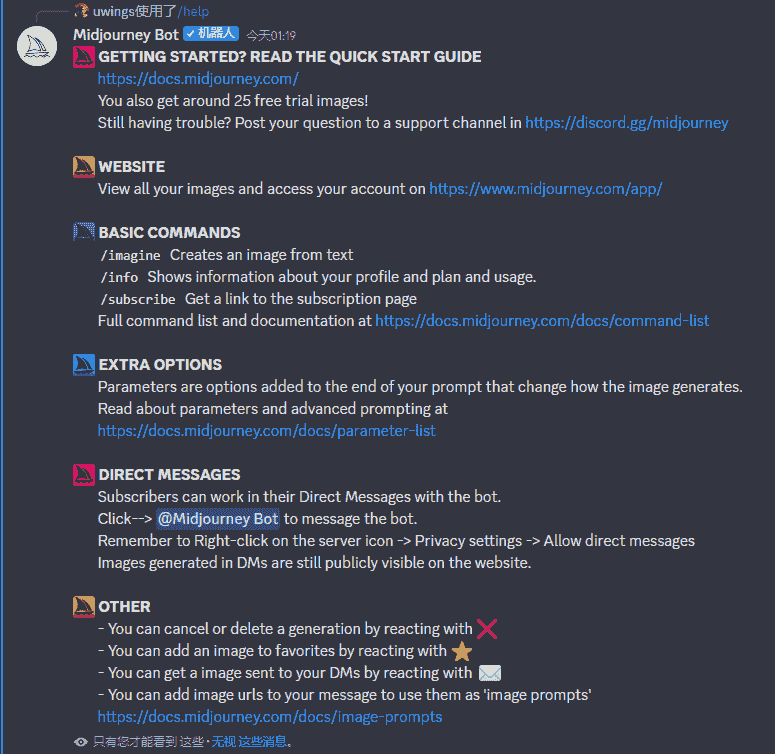
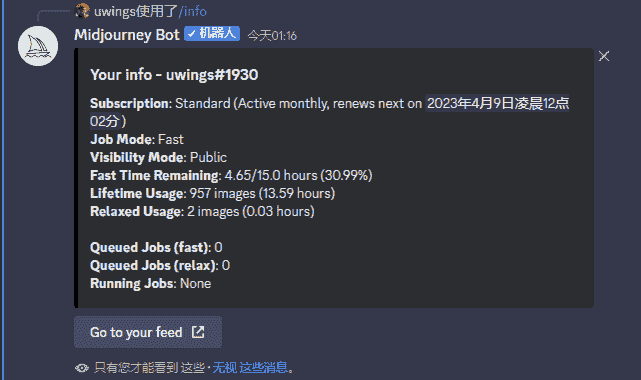
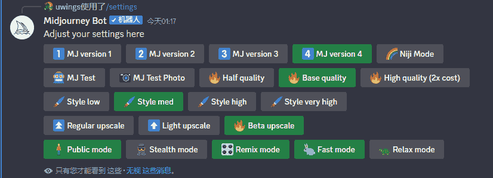

# 🎁【快速上手】必看！Midjouney指令大全

> 来源：[https://chengchaungai.feishu.cn/docx/Tu2Udo2AioTLePxqISjcDlGgnIg](https://chengchaungai.feishu.cn/docx/Tu2Udo2AioTLePxqISjcDlGgnIg)

————**选择人工智能，链接无限未来**————

本文编辑:**JUGO** **  ****  **                                                         👸号：橙创AI

**进入👉 **[🍊橙创AI知识库（首页）](https://ix9q8jjj4ug.feishu.cn/wiki/DOsXwmRDaibJVUkDSHKcYbhmn0f)**获取更多A****IGC内****容👈**

> **查阅、整理和输出教程属实**[**不易**](https://ki6j1b0d92h.feishu.cn/wiki/wikcnOTLuqHXX6ZJ1oWEBGbd9zf?from=from_copylink)，觉得这篇教程对你有所帮助的话，不妨分享给更多需要的人呗😊

您可以在Discord上通过输入命令与 Midjourney 机器人进行交互。命令用于创建图像、更改默认设置、监视用户信息和执行其他任务。

Midjourney 命令可以在任何 Bot 频道中使用，在已允许Midjourney Bot 操作的私人Discord 服务器上，或在与Midjourney Bot 的直接消息中使用。

## 命令列表

### /ask

得到一个问题的答案。

---

### /blend

混合

轻松混合两张图片。

---

### /daily_theme

每日主题

切换 #daily-theme 频道更新的通知提示

---

### /fast

切换到快速模式。

---

### /help

帮助

展示 Midjourney Bot 的基本信息和提示。

// 帮助

shows help for the bot

为机器人提供帮助。

**GETTING STARTED? READ T**HE QUICK START GUIDE

#### 开始？阅读快速入门指南。

https://docs.midjourney.com/

You also get around 25 free trial images!

您还可以获得约25张免费试用图像！

Still having trouble? Post your question to a support channel in https://discord.gg/midjourney

仍然有困难吗？请在https://discord.gg/midjourney的支持频道中发布您的问题。

**WEBSITE**

#### 网站

View all your images and access your account on https://www.midjourney.com/app/

查看您的所有图片并访问您的账户，请访问https://www.midjourney.com/app/。

**BASIC COMMANDS**

#### 基本指令

/imagine**  **Creates an image from text

创建一个由文本生成的图像。

/info  Shows information about your profile and plan and usage.

显示有关您的个人资料、计划和使用情况的信息。

/subscribe  Get a link to the subscription page

获取订阅页面链接

Full command list a[nd documentation at https](https://docs.midjourney.com/docs/command-list)://docs.midjourney.com/docs/command-list

完整的命令列表和文档请查阅 [https://docs.midjourney.c](https://docs.midjourney.com/docs/command-list)om/docs/command-list

EXTRA OPTIONS

#### 额外选项

Parameters are options added to the end of your prompt that change how the image generates.

参数是添加到您的提示符末尾的选项，可更改图像生成方式。

Read about parameters and advanced prompting at

[了解有关参数和高级提示的内容，请阅读：https://](https://docs.midjourney.com/docs/parameter-list)docs.midjourney.com/docs/parameter-list 参数列表

**DIRECT MESSAGES**

#### 私信

Subscribers can work in their Direct Messages with the bot.

订阅者可以通过直接消息与机器人进行工作。

Click--> @Midjourney Bot to message the bot.

点击--> @Midjourney 机器人发送消息。

Remember to Right-click on the server icon -> Privacy settings -> Allow direct messages

请记住右键单击服务器图标->隐私设置->允许直接消息。

Images generated in DMs are still publicly visible on the website.

私信中生成的图像仍可在网站上公开查看。

**OTHER**

#### 其他

+   You can cancel or delete a generation by reacting with :x:

您可以通过点 ❌ 来取消或删除一个生成任务。

+   You can add an image to favorites by reacting with :star:

+   你可以用 ⭐️ 将图片添加到收藏夹中。

+   You can get a image sent to your DMs by reacting with  :envelope:

你可以通过使用 📧 表情符号回应来获得一张图像发送到你的DM中。

+   You can add image urls to your message to use them as 'image prompts'

您可以添加图像URL到您的信息中，以将它们用作'图像提示'. [https://docs.midjourney.co](https://docs.midjourney.com/docs/image-prompts)m/docs/image-prompts

---

### /imagine

想象

使用 prompts 生成图像

---

### /info

信息

查看您的账户信息和任何已排队或正在运行的任务。

**查看您的个人资料信息。**

Your info - uwings#1930

您的信息 - uwings＃1930

Subscription: Standard (Active monthly, renews next on 2023年4月9日凌晨12点02分)

订阅：标准（月订阅活跃，下次续费于2023年4月9日凌晨12点02分）

Job Mode: Fast

工作模式：快速

Visibility Mode: Public

可见模式：公开

Fast Time Remaining: 0.30/15.0 hours (1.99%)

剩余时间： 0.30/15.0 小时 (1.99%)

Lifetime Usage: 1299 images (18.76 hours)

终身使用次数：1299张图片（18.76小时）。

Relaxed Usage: 2 images (0.03 hours)

轻松模式使用：2张图片（0.03小时）

Queued Jobs (fast): 0

排队作业（快速）：0

Queued Jobs (relax): 0

排队工作 (轻松): 0

Running Jobs: None

无运行作业

go to your feed

在 Midjourney 打开你的 feed

---

### /stealth

隐身

Pro计划订阅者：切换到隐形模式

---

### /public

公开模式

对于 Pro Plan 订户：切换到公开模式。

---

### /subscribe

订阅

为用户账户页面生成个人链接，付费订阅。

订阅 Midjourney(1)。

Open the page below to pick your plan and subscribe!

打开下面的页面选择您的计划并订阅！

This is your personal link, do not share it with anyone!

这是你的个人链接，请不要与任何人分享！

open subscription page

打开订阅页面

1.  订阅 stand。。。。。

---

### /settings

设置

查看并调整 Midjourney Bot 的设置

Adjust your settings here

在此处调整您的设置。

MJ version1 | 2 | 3 | 4 | Niji Mode

Midjourney 版本 1 | 2 | 3 | 4 | Niji 漫画模式

MJ Test | MJ test photo | half quality | base quality | High quality (2x cost)

MJ 测试模式 | MJ照片测试模式 | 一半质量(1) | 基础质量 | 高质量 （2倍成本）

Style low | Style med | style high | Style very high

风格低(2) | 中 | 高 | 非常高

Regular upscalse | Light upscale | Beta upscale

常规放大 | 轻微放大 | Beta 版放大(3)

Public mode | Stealth mode | Remix mode | Fast mode | Relax mode

公开模式 | 隐身模式(4) | 混合模式(5) | 快速模式 | 轻松模式(6)

1.  aaa

1.  bbb

1.  ccc

---

### /prefer option

首选项

创建或管理自定义选项。

---

### /prefer option list

首选项列表

查看您当前的定制选项。

---

### /prefer suffix

首选 后缀

请指定每个 Prompt 结尾要添加的后缀。

---

### /show

展示

使用图片作业ID（可在 Midjourney 记录中查看或复制）重新生成 Discord 中的作业。

---

### /relax

放松模式

切换到放松模式。

---

### /remix

重混

切换重混模式。

---

### 不推荐使用

/private (replaced with '/stealth')

/pixels

/idea

---

### 分类名称（我是模板）

#### /optionName 简单解释

+   示例： /optionName params

+   结果描述 / 示例： relax mode off

+   预置

+   是否预置：是

+   默认项：开

您可以在Discord上通过输入命令与 Midjourney 机器人进行交互。命令用于创建图像、更改默认设置、监视用户信息和执行其他任务。

Midjourney 命令可以在任何 Bot 频道中使用，在已允许Midjourney Bot 操作的私人Discord 服务器上，或在与Midjourney Bot 的直接消息中使用。

您可以在Discord上通过输入命令与 Midjourney 机器人进行交互。命令用于创建图像、更改默认设置、监视用户信息和执行其他任务。

Midjourney 命令可以在任何 Bot 频道中使用，在已允许Midjourney Bot 操作的私人Discord 服务器上，或在与Midjourney Bot 的直接消息中使用。

您可以在Discord上通过输入命令与 Midjourney 机器人进行交互。命令用于创建图像、更改默认设置、监视用户信息和执行其他任务。

Midjourney 命令可以在任何 Bot 频道中使用，在已允许Midjourney Bot 操作的私人Discord 服务器上，或在与Midjourney Bot 的直接消息中使用。

> 关注**👸号**，加入**AI****实战交流群**，掌握全面专业的**行业资讯**、**工具分享**、**变现指南**和**实战教程**，开启你的AI智慧之旅👇👇

联系🛰️**JUGO737Y****（备注来意）**

👸号：**橙创****AI**

**群聊二维码**：

