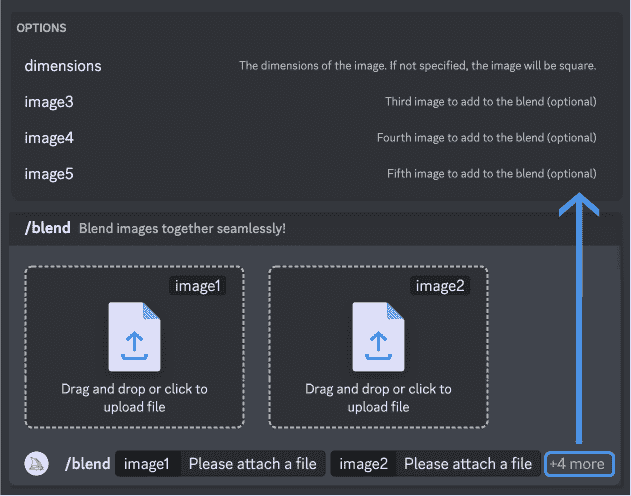
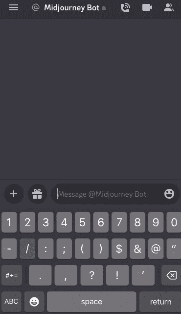

# ✨混合命令 /blend

> 来源：[https://chengchaungai.feishu.cn/docx/YaledNSlHotOERxTUx7cSM3HnUe](https://chengchaungai.feishu.cn/docx/YaledNSlHotOERxTUx7cSM3HnUe)

————**选择人工智能，链接无限未来**————

本文编辑:**JUGO** **  ****  **                                                         公众号：橙创AI

**进入👉 **[🍊橙创AI知识库（首页）](https://ix9q8jjj4ug.feishu.cn/wiki/DOsXwmRDaibJVUkDSHKcYbhmn0f)**获取更多A****IGC内****容👈**

> **查阅、整理和输出教程属实**[**不易**](https://ki6j1b0d92h.feishu.cn/wiki/wikcnOTLuqHXX6ZJ1oWEBGbd9zf?from=from_copylink)，觉得这篇教程对你有所帮助的话，不妨分享给更多需要的人呗😊

> /blend命令可以快速上传2至5张图片，并分析每张图片的理念和美学，将它们融合成一张新的图像。

> 

> /blend 与/imagine 使用多个图像提示相同，但界面经过优化，使其在移动设备更易用。

> /blend 最多可以使用5张图片。如果要在提示中使用超过5张图片，请使用 /imagine 命令和 image prompts。

> /blend 与纯文本 prompts 不兼容。 如果需要同时使用图像提示和文本提示，请使用 /imagine 命令和 image prompts。

**/blend**** 选项**

1.输入 /blend 命令后，将提示您上传两张照片。

2.当使用移动设备时，可拖放图像或从照片库添加图像。

3.要添加更多图像，请选择可选/选项字段并选择image3、image4或image5。

/blend命令可能比其他命令启动时间更长，因为在 Midjourney 机器人处理您的请求之前，必须先上传您的图片。

混合图像默认使用1:1长宽比，但您可以使用可选的 dimensions 字段在正方形长宽比（1:1）、竖向长宽比（2:3）或横向长宽比（3:2）之间进行选择。

自定义后缀被添加到/blend prompts 的末尾，就像其他  /imagine prompts  一样。作为/blend 命令的一部分指定的长宽比会覆盖自定义后缀中的长宽比。

## ** 混合技**巧

###  为了获得最佳效果，请上传与您期望结果相同比例的图像。

## ** 如何使用**** /blen**d

> 关注**公众号**，加入**AI****实战交流群**，掌握全面专业的**行业资讯**、**工具分享**、**变现指南**和**实战教程**，开启你的AI智慧之旅👇👇

联系微信**JUGO737Y****（备注来意）**

公众号：**橙创****AI**

**群聊二维码**：

