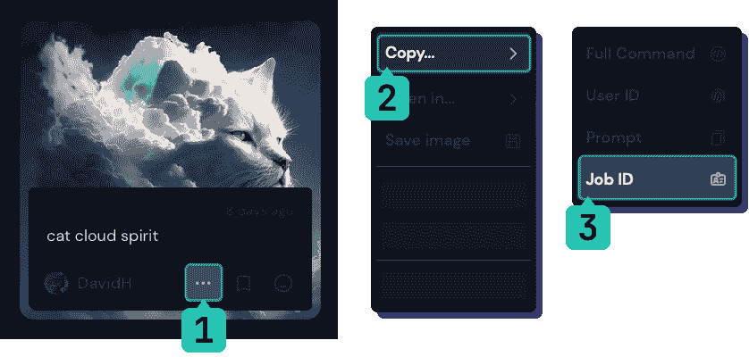
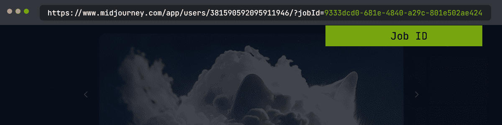
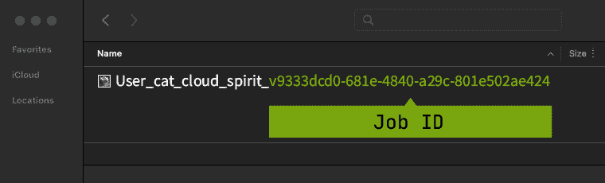
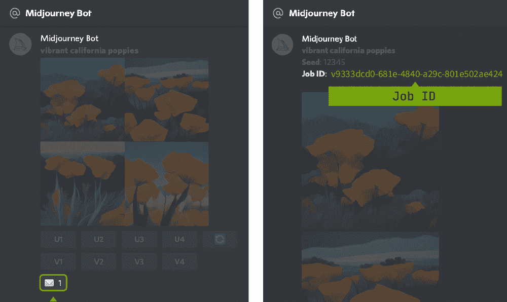
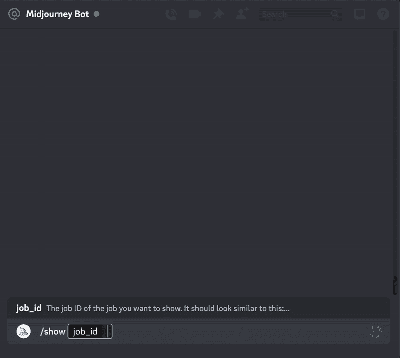
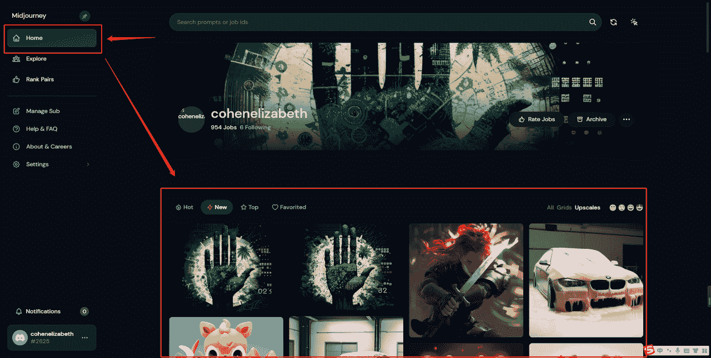
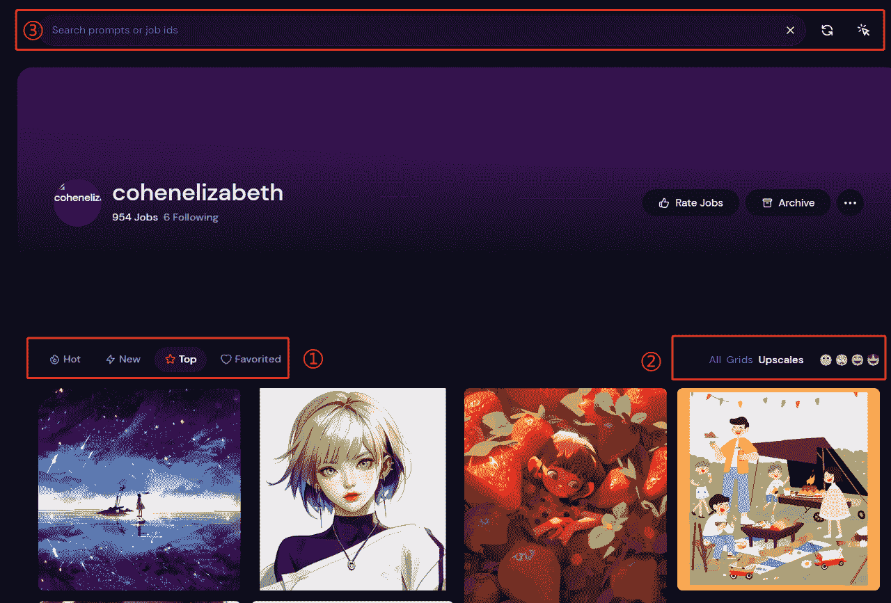

# ✨显示作业 /Show Job

> 来源：[https://chengchaungai.feishu.cn/docx/QSCMd9V5sodKZFxAmyUcrD03nxd](https://chengchaungai.feishu.cn/docx/QSCMd9V5sodKZFxAmyUcrD03nxd)

————**选择人工智能，链接无限未来**————

本文编辑:**JUGO** **  ****  **                                                         公众号：橙创AI

**进入👉 **[🍊橙创AI知识库（首页）](https://ix9q8jjj4ug.feishu.cn/wiki/DOsXwmRDaibJVUkDSHKcYbhmn0f)**获取更多A****IGC内****容👈**

> **查阅、整理和输出教程属实**[**不易**](https://ki6j1b0d92h.feishu.cn/wiki/wikcnOTLuqHXX6ZJ1oWEBGbd9zf?from=from_copylink)，觉得这篇教程对你有所帮助的话，不妨分享给更多需要的人呗😊

## 介绍

你可以使用图片唯一的Job ID 与 /show 命令，将一个图片移动到其他服务器或频道中，复活失踪的图片，或刷新旧图片以产生新的变化(V)，放大(U)，或使用新的参数和功能。

/show 命令只能作用于你自己的 Job（图片）

## 查找Job ID

Job ID 是Midjourney为每个生成的图像使用的独一无二的标识符。

作业 IDs 看起来像 this: 9333dcd0-681e-4840-a29c-801e502ae424, 可以在所有图像文件名的第一个部分,网站URL中和图像文件名中找到。

### 在webiste上找到

您可以在会员画廊中选择任何图像  ... > 复制... > Job ID来查找其Job ID。

找到图像的Job ID后,您可以使用 /show 命令来将图像移动到其他服务器或频道，复活失踪的图片，或刷新旧图像以产生新的变化（V），放大（U）或使用较新的参数和功能。 Job ID是访问和管理图像的唯一方式。

### 从URL里找到

在您的midjourney画廊中查看图像时，Job ID 在URL的最后部分

### 从文件名里找

从画廊下载图片到电脑，Job ID是文件名的最后一部分

### 使用Discord 表情回复获取

在生成的图片上使用信封emoji ✉️ 回应， Bot会私信消息将包括图像的种子号和作业 ID。 只有您自己的作业才能进行 ✉️ 回复。

（译者注：V4和niji 可以获取单张图的 seed，job，v 5只能获取 4宫格的 seed 和 job）

## 如何使用 Show

在任意MJ bot 频道内，输入 /show 在自动弹出的菜单里选择 Job ID，然后粘贴 job ID， 发送即可

## 查看作品更便捷的方法

### 善用官网

登录midjourney的官网（https://www.midjourney.com/app/），在左上角的【Home】界面内，会显示往期所渲染的作品，可用于内容回溯。

### 小技巧

1.  善用分栏

在作品顶部有可切换分栏，更好地检索往期的作品，其中【Hot】【New】【Top】【Favorited】可用于快速搜索相应的产出类型。

1.  显示的内容少

可切换右侧【ALL】【Grids】【Upscales】按钮，默认Upscales，因此一些未放大图片未被显示。

1.  搜索栏

顶部搜索栏可根据提示词快速检索往期生成的内容，需要注意的是，在【home】页是检索自己的作品库，在【explorer】界面是检索midjourney服务器内的作品，不同界面下检索的范围不同注意区分。（碎碎念：我觉得这个交互逻辑有问题）

> 关注**公众号**，加入**AI****实战交流群**，掌握全面专业的**行业资讯**、**工具分享**、**变现指南**和**实战教程**，开启你的AI智慧之旅👇👇

联系微信**JUGO737Y****（备注来意）**

公众号：**橙创****AI**

**群聊二维码**：

