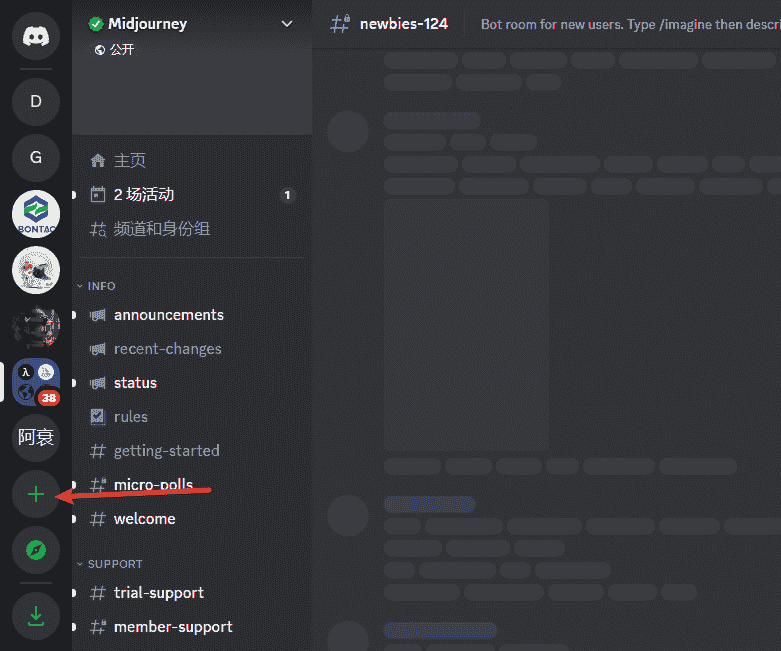
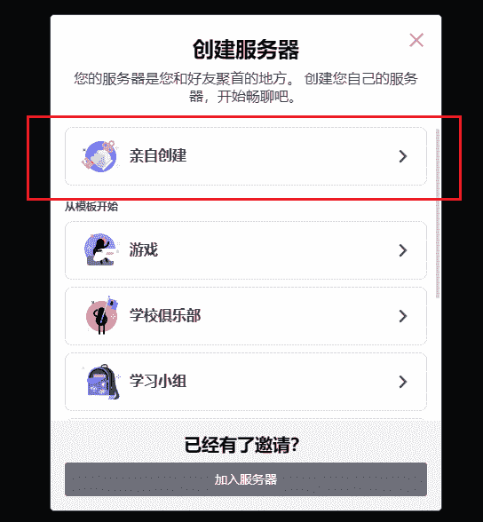
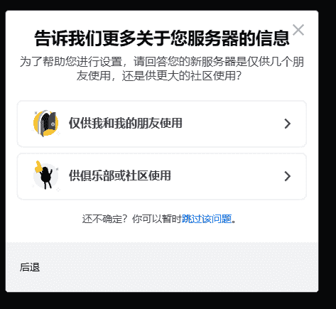
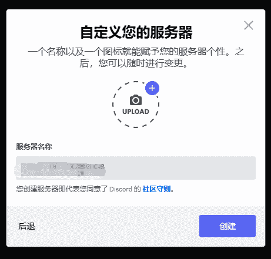
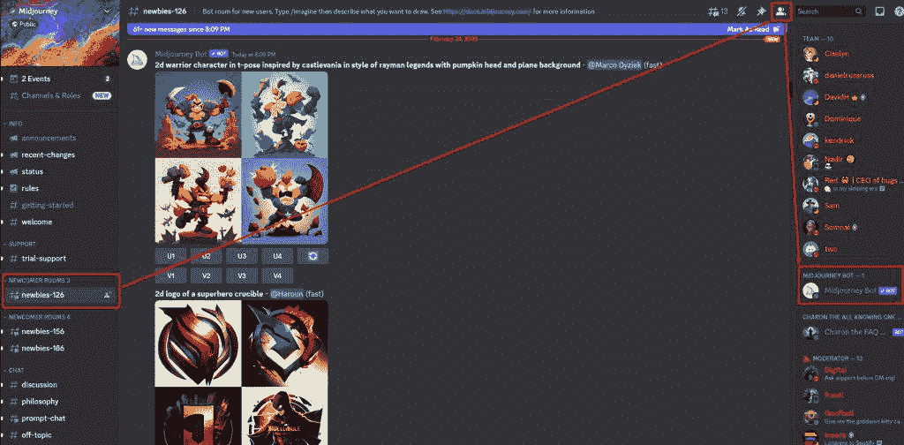
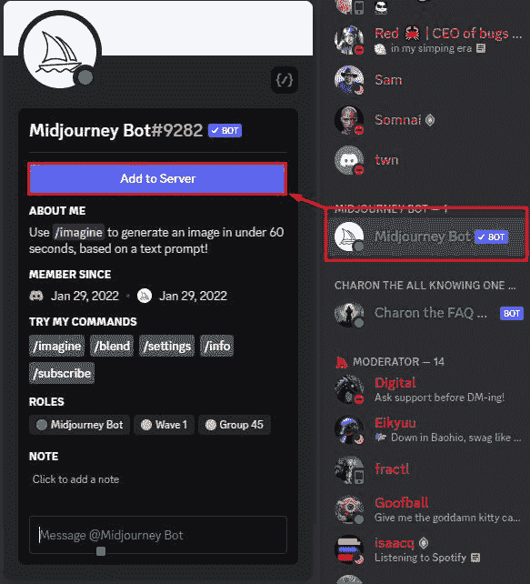
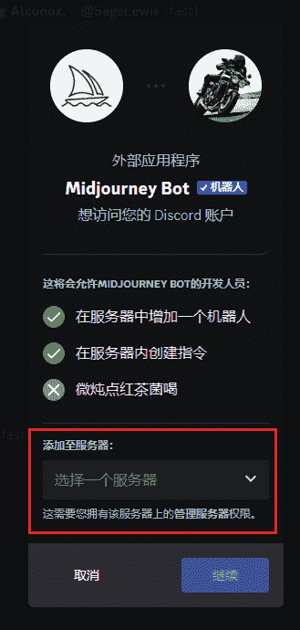
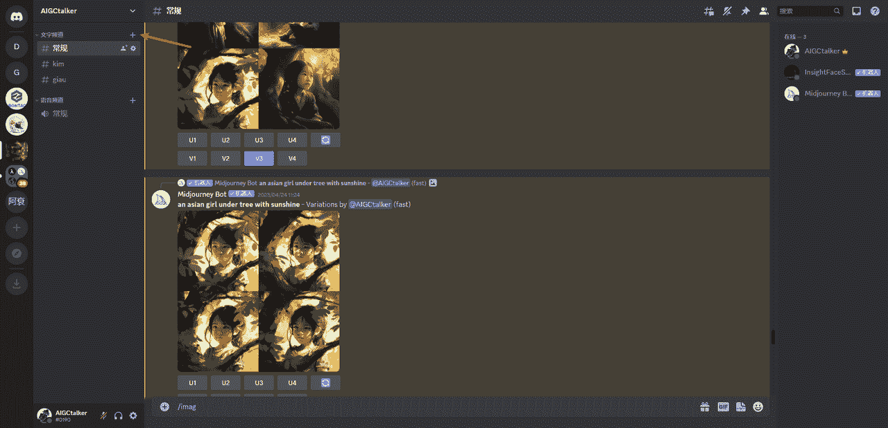
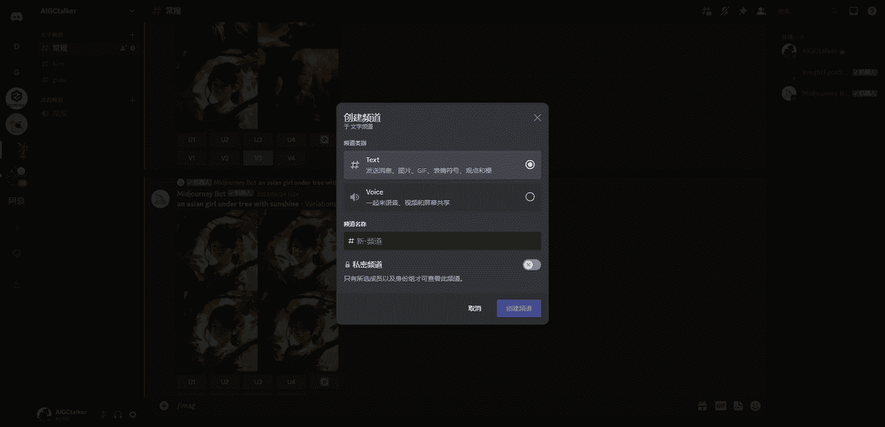

# 🎁【快速上手】搭建你自己的MJ服务器

> 来源：[https://chengchaungai.feishu.cn/docx/NzgXdCnzOon08Bxmn53cVOzDnLd](https://chengchaungai.feishu.cn/docx/NzgXdCnzOon08Bxmn53cVOzDnLd)

Midjourney官方群组的消息太多了，一不小心消息就冲得找不到了，那么如何避免和全球的人在一个服务器里面呢，那就是在discord上面自己创建一个服务器；再则共享账号往往是多人一起使用，为避免混乱，各自建立各自的服务器或频道才能避免打扰到别人的创作和学习，下面就介绍如何创建自定义服务器和自定义频道，现在开始：

> 在私人服务器上生成的 Midjourney 图像仍受 Midjourney 的社区准则约束。

> 在私人服务器上生成的图像仍然对http://midjourney.com上的其他用户可见。（即你真人的照片社区所有看得见，注意隐私暴露）

> 要在任何服务器中使用 Midjourney Bot，用户必须具有有效的 Midjourney 试用版或订阅版。

> /imagine首次使用 将自动开始为新用户提供试用会员资格。

# 创建自定义服务器

1.  登录进discord后，在左侧菜单找到加号按钮

1.  点击加号按钮，选择亲自创建

1.  选择仅供我和我的朋友使用

1.  自己想个名字A，点击确定，创建成功

## 1、加入官方服务器

如果想将 Midjourney 机器人添加到您的 Discord 服务器，第一步是加入Midjourney Discord 服务器。

## 2、找到 Midjourney Bot 机器人

1.  进入官方服务器后，切换到 #newbies（号码）频道

1.  点击个人资料图标。 会显示一个成员列表，包括 Midjourney Bot。

## 3、将机器人添加到自己服务器

1.  点击Midjourney Bot，选择“添加到服务器”并选择要将机器人添加到的服务器。

1.  选择刚创建的服务器A，选择“继续”和“授权”。

> 需要注意的是，该 bot 只能在成员少于 1000 人的服务器上使用，授权它就可以读取和发送消息。

## 4、5使用方法

1.  授权成功后，机器人就悄悄的进去了，你需要做的就是使用/imagine + 提示词 开整

[🎁【快速上手】必看！AI绘画【提示词/参数】基础入门](https://chengchaungai.feishu.cn/wiki/XaHCwCCfyi1RehksEyNcivYdnch?wiki_all_space_view_source=space_sidebar)

> 如果您不希望机器人在特定频道中可用，则需要更改频道权限。 为此，请转至频道 > 编辑频道 > 权限 > @everyone > 取消选中 “Use Application Commands”。 这将确保该机器人只能在您允许其使用的频道中使用。

# 创建自定义频道

创建自定义频道非常简单，只有两步：

要在有一个有管理权限的服务器中（即刚刚创建的自定义服务器），点击如图所示的加号

然后在弹窗中选择text，输入一个频道名称就创建成功了，如果是共享账号，那么私密频道开不开都没用哈

通常情况下自定义频道默认就继承了服务器参数，即不用再添加机器人进来了，可以直接输入命令开整

> 关注**👸号**，加入**AI****实战交流群**，掌握全面专业的**行业资讯**、**工具分享**、**变现指南**和**实战教程**，开启你的AI智慧之旅👇👇

联系🛰️**JUGO737Y****（备注来意）**

👸号：**橙创****AI**

**群聊二维码**：

