# 🥈【技法拆解】怎么用Midjourney反推灵感参考图，输出相似的作品

> 来源：[https://chengchaungai.feishu.cn/docx/EY3mdd7nGovTCSx6V3XcuzounCh](https://chengchaungai.feishu.cn/docx/EY3mdd7nGovTCSx6V3XcuzounCh)

————**选择人工智能，链接无限未来**————

本文编辑:**JUGO** **  ****  **                                                         👸号：橙创AI

**进入👉 **[🍊橙创AI知识库（首页）](https://ix9q8jjj4ug.feishu.cn/wiki/DOsXwmRDaibJVUkDSHKcYbhmn0f)**获取更多A****IGC内****容👈**

> **查阅、整理和输出教程属实**[**不易**](https://ki6j1b0d92h.feishu.cn/wiki/wikcnOTLuqHXX6ZJ1oWEBGbd9zf?from=from_copylink)，觉得这篇教程对你有所帮助的话，不妨分享给更多需要的人呗😊

# 前言

在日常工作中是否经常遇到想参考某一设计或者绘画风格，但又不清楚参考图采用的何种风格，例如这种：

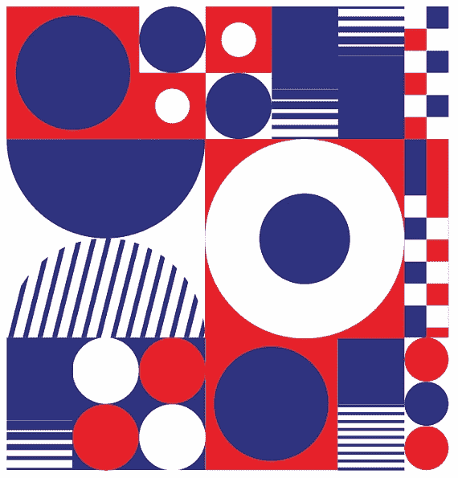

放在以前只能通过搜索引擎的以图搜图或者逛花瓣，Pinterest等网站随机碰运气。但是这样既浪费时间又不能保证输出质量，往往是得不偿失。你是否曾经想象或求助过是否能有一款产品，只要你给它一张图，它就能分析并提取有用的关键词，让你快速找到查找方向呢？

# 背景

今年AIGC技术的日渐成熟，AI绘画领域也迎来了春天，其中的佼佼者 Midjourney 也进入了我们的视野，其凭借优质的生成效果得到了大众的推崇。它实现了通过发送一句话就能得到画面的 “文生图” 新创作模式。

经过版本迭代 Midjourney 拥有了一项新指令/describe，可以通过大数据原理让AI猜测图片的构成元素。实现”图生文” “图生图”的功能，解决知识不够而无法总结画面元素的难题。

# 反推提示词

## 准备

1.  一个可以访问discord的网络和Midjourney付费账号

1.  已本地保存的参考图

## 步骤

1.  打开discord，进入可以使用Midjourney机器人的频道

1.  在下方输入框中输入/，会自动跳出辅助选项，直接选择/describe即可（如果没有跳出，也可以在输入框中输入完整指令：/describe  然后回车激活

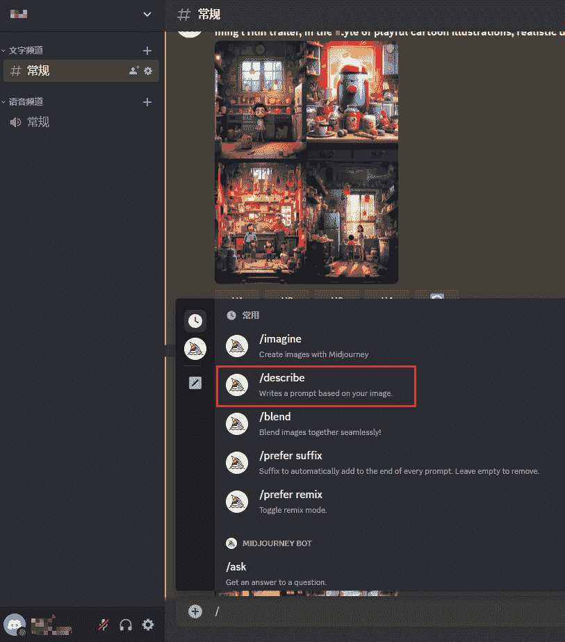

1.  选择命令后，这时需要点击上传本地的参考图，然后回车发送命令

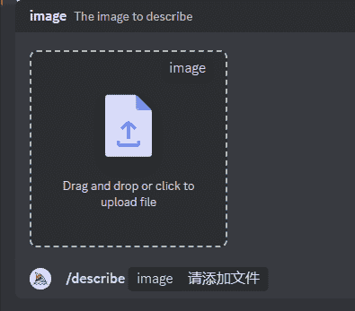

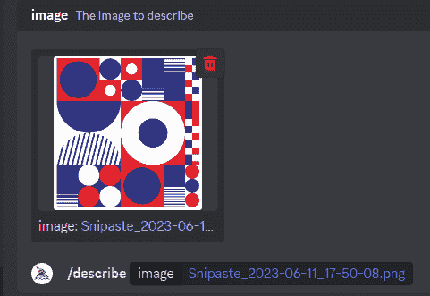

1.  命令发出后，MJ服务器开始计算后返回结果，这个过程会等待一会，时间在半分钟左右

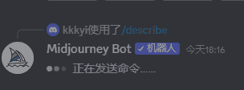

1.  当计算完成，机器人会发送过来4个猜测的提示词方案，此时你就可以通过阅读理解参考图的画面元素了

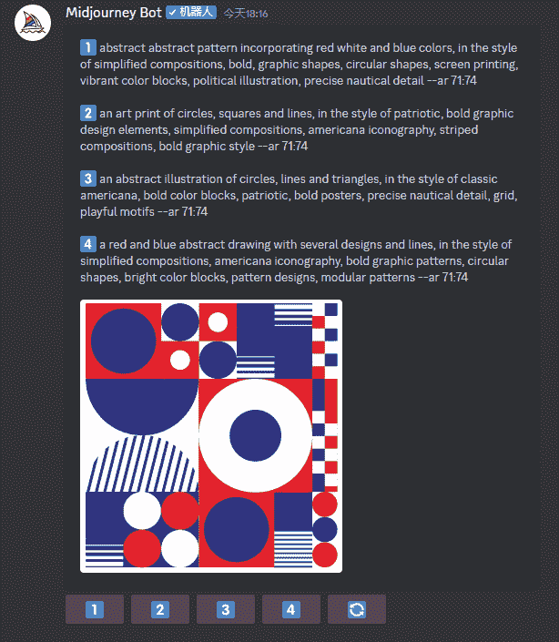

# 优化提示词，输出作品

Midjourney反推出的提示词都是基于它现有的神经网络的猜测，所以这其中就涉及到猜中概率问题。如果你的参考图有类似的图被大量训练，猜中的概率就会很高，提示词就更准确。反之Mjdjourney给出的提示词就可能只是擦边。

## 提示词验证

验证方法就是点击机器人发过来的消息下面与上面方案编号对应的1234，这个操作会发送一条 “文生图” 命令给Midjourney，然后等待Midjourney返回生成结果来判断提示词的准确性

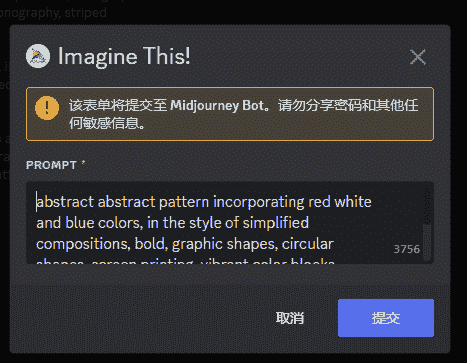

## 提示词总结

通过结合返回的生成图和提示词对比，经过提取相近词和总结，再加入自己理解的关键词重新生成来判断提示词的准确性，发现图案元素过于复杂，这代表提示词不准确或者缺少关键提示词

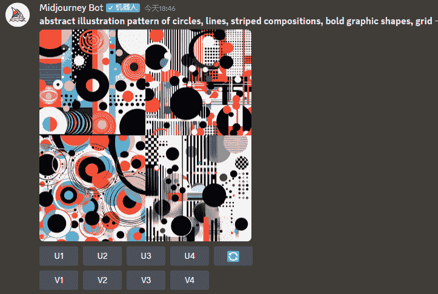

## 重新反推

点击机器人发送的提示词这条消息的这个刷新按钮，可以让Midjourney重新反推提示词，然后再重复上面的步骤,不断调整提示词直到找到满意的作品。

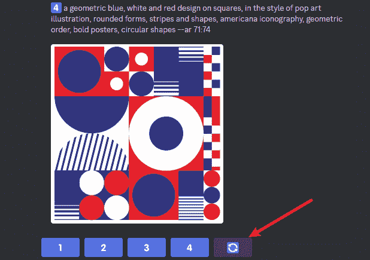

## 更多参考图

有可能经过三四次的重复反推依然没有找到准确的提示词，这时就可以考虑反推更多相似的图片，从中找到共同点

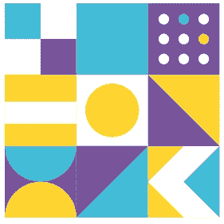

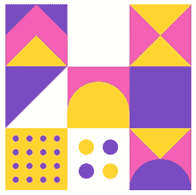

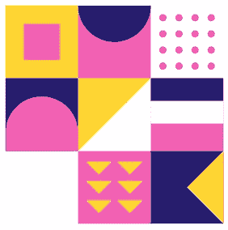

## 引用参考图

通过更多的参考图找到了恰当的提示词，但是依然无法生成出上面这种效果？那么就可以将这些参考图的链接作为参考引用放入提示词输入命令中，再加上合适的提示词就能生成更精准的的相似作品

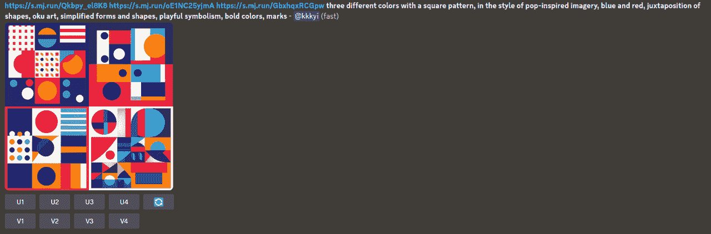

# 生成结果

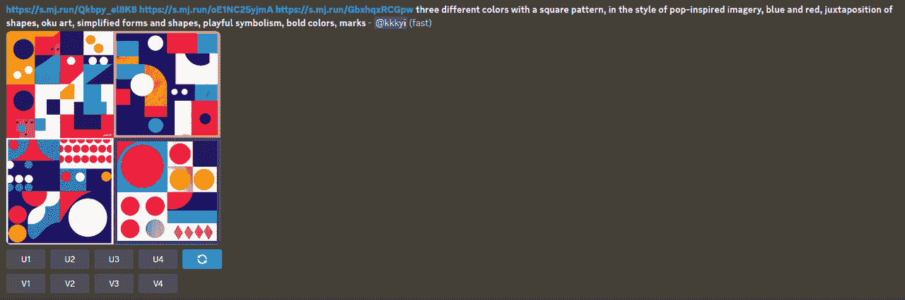

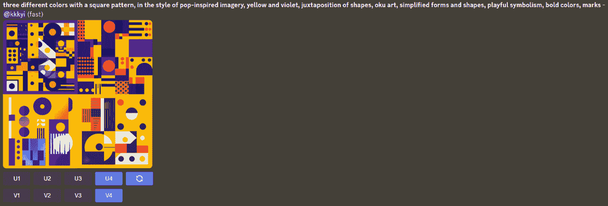

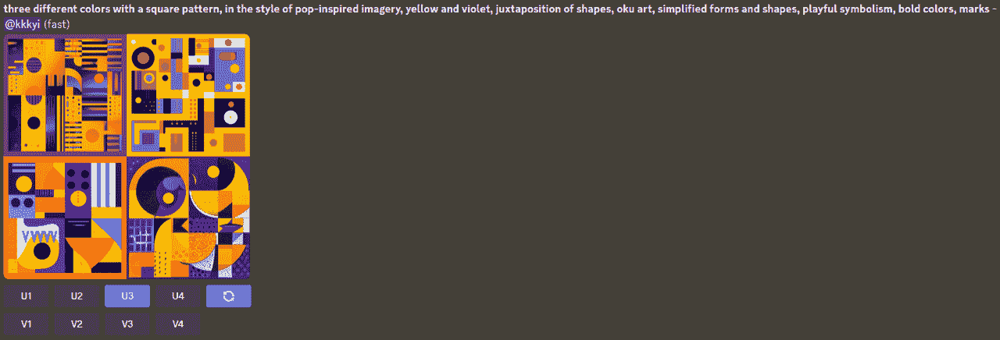

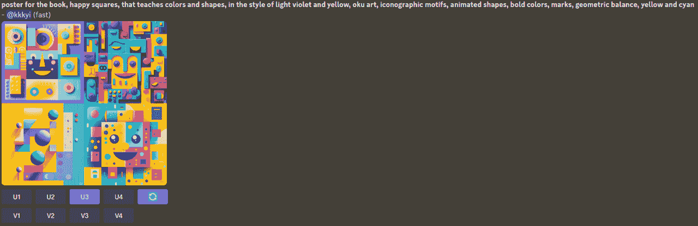

# 最后

以上就是通过Midjourney的反推提示词命令生成相似作品的过程和后续优化处理方法，Midjourney的问题就是出图不可控，优点就是能产生更多的灵感，缺点就是需要花时间在反复测试和优化命令上，欢迎大家关注我的👸号，我会不定期整理发布AIGC相关的知识、技巧和资源干货，谢谢！

> 关注**👸号**，加入**AI****实战交流群**，掌握全面专业的**行业资讯**、**工具分享**、**变现指南**和**实战教程**，开启你的AI智慧之旅👇👇

联系🛰️**JUGO737Y****（备注来意）**

👸号：**橙创****AI**

**群聊二维码**：

