# Win10/11部署酒馆+ClewdR

> 来源：[https://sqivg8d05rm.feishu.cn/docx/V88fdQHlAoSZxxxMQkNcxehtnUg](https://sqivg8d05rm.feishu.cn/docx/V88fdQHlAoSZxxxMQkNcxehtnUg)

百分之99的问题都是网络问题！！！

百分之99的问题都是网络问题！！！

[百分之99的](https://docs.sillytavern.app/)问题都是网络问题！！！

相关但并不刚需的链接：

酒馆官方文档

先配环境，把[Node](https://nodejs.org/zh-cn)和[Git](https://git-scm.com/downloads/win)安装了

一直下一步就好了，不用改选项

# 接着我们先部署酒馆

1.  按 Win + R 打开 运行 框。

1.  输入：cmd

1.  按回车。

1.  输入：cd /d "%userprofile%\Desktop" （然后按回车）。

1.  输入：git clone https://github.com/SillyTavern/SillyTavern -b release （然后按回车）。

1.  等待下载，跟图上一样就是下好了，报错基本基本都是网络问题，有问题可以截图问AI

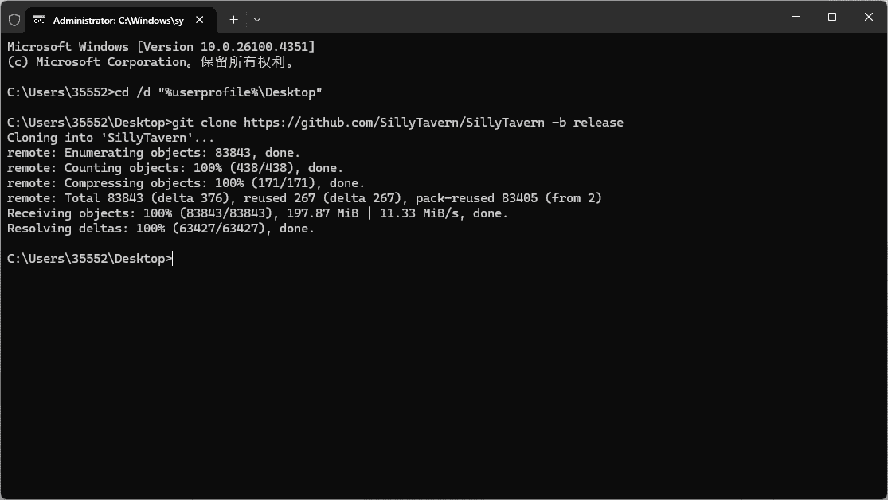

1.  在桌面找到 SillyTavern 文件夹进入

1.  双击 Start.bat 打开，等待安装一些依赖后即可进入酒馆，报错基本基本都是网络问题，有问题可以截图问AI

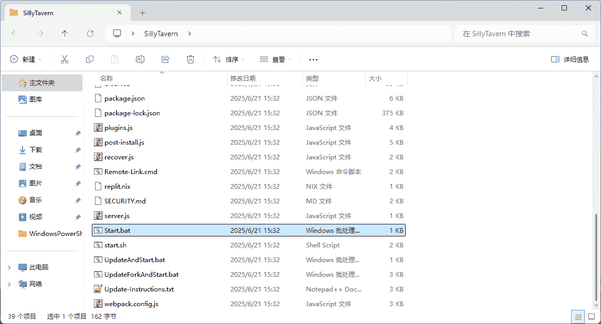

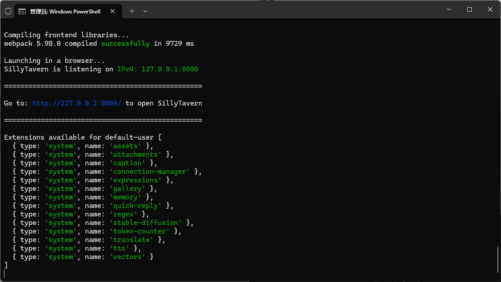

1.  成功打开酒馆

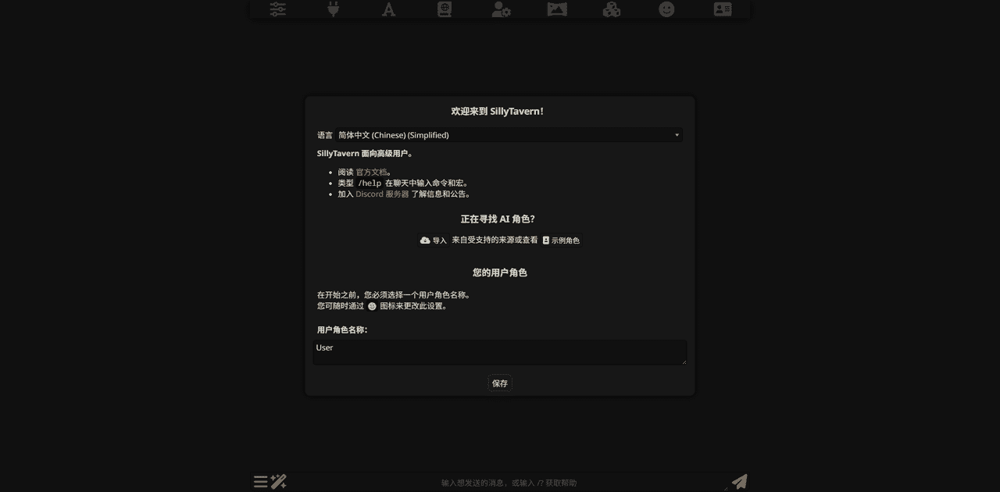

！酒馆已经安装完成，如需使用API的到这一步即可根据API填写教程使用：

[连接第三方API（OpenAI格式）](https://sqivg8d05rm.feishu.cn/wiki/TS8zwRkqyiZk8SkCGRTcNMg6nMd)

下方为Clewdr➕Cookie教程

# ClewdR（不再建议萌新使用）

第一次搭建酒馆的萌新建议不要使用。

1.  访问ClewdR[发布页](https://github.com/xerxes-2/clewdr/releases)，下载对应版本的ClewdR

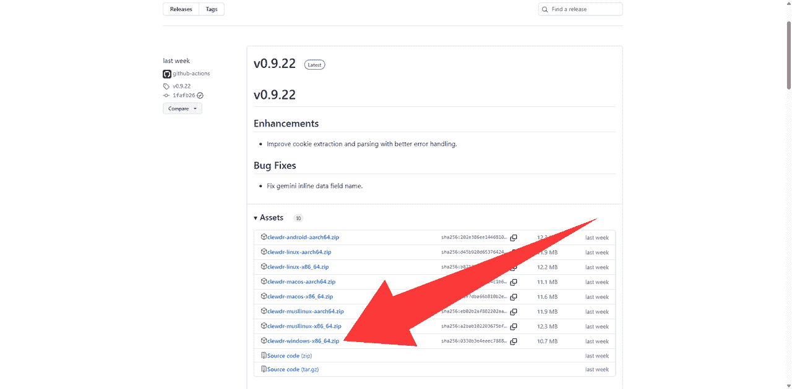

1.  接着把下载好的文件解压出来，然后双击运行它

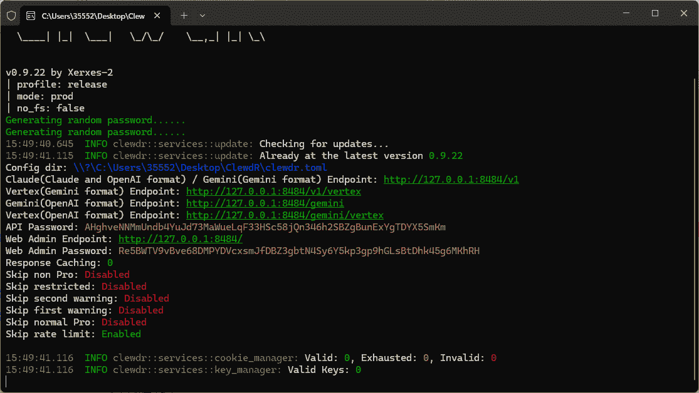

1.  根据图上的信息，我们访问[本地的8484端口](http://127.0.0.1:8484)
然后输入密码，登入进去
密码就是那个Web Admin Password，看不懂用翻译

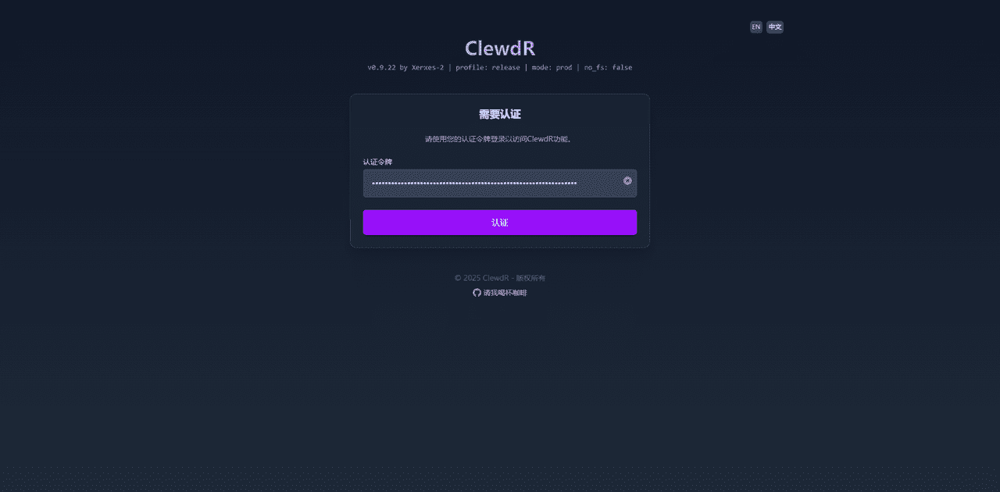

1.  最后就是填Cookie了，上面写的很清楚，一行一个，注意不要有Cookie外的信息
Cookie就是，sessionKey=sk-ant-sid01XXXXXXXAA这一串，有没有双引号号和逗号无所谓，不影响
关于Cookie如何获取，可以参考别的教程

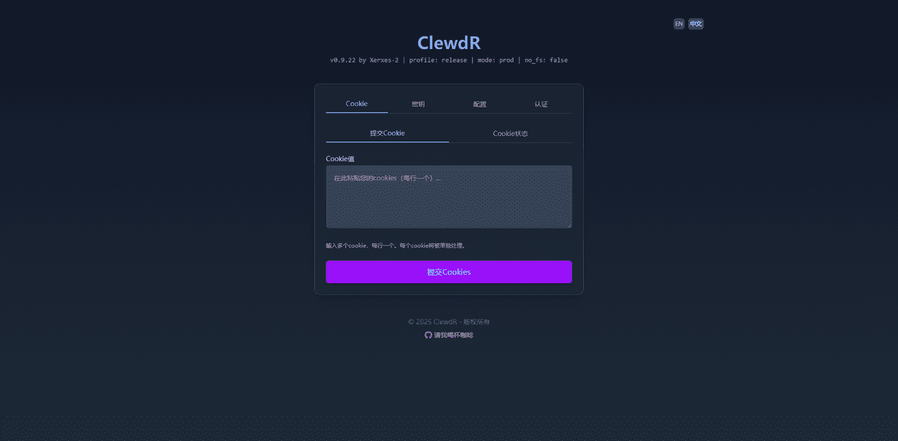

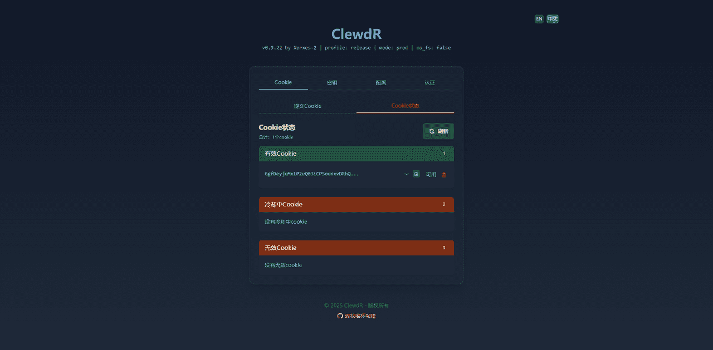

补充，打开联网搜索后，普号上下文可从32k提升至128k

具体如下：

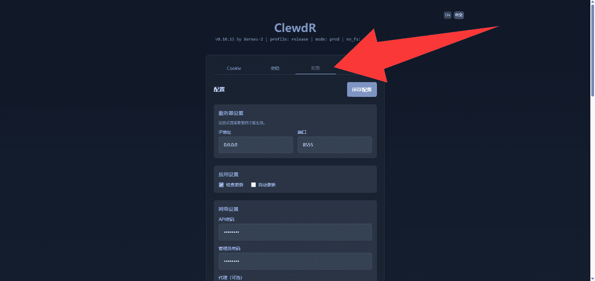

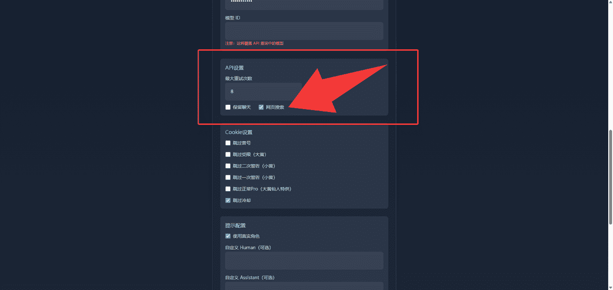

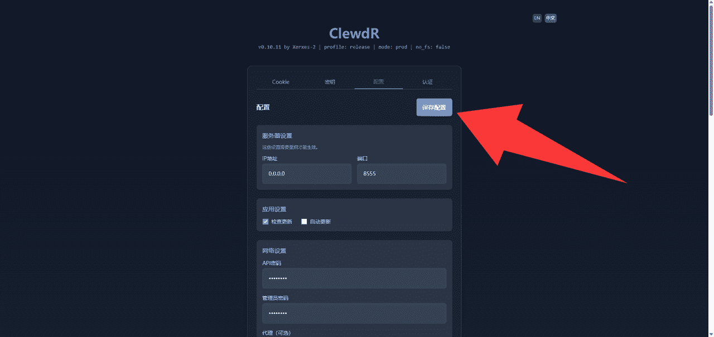

1.  保证酒馆和ClewdR均为打开状态，以及ClewdR里有可用的Cookie

1.  先点击那个红色的插头，API选择聊天补全，聊天补全来源选择OpenAI

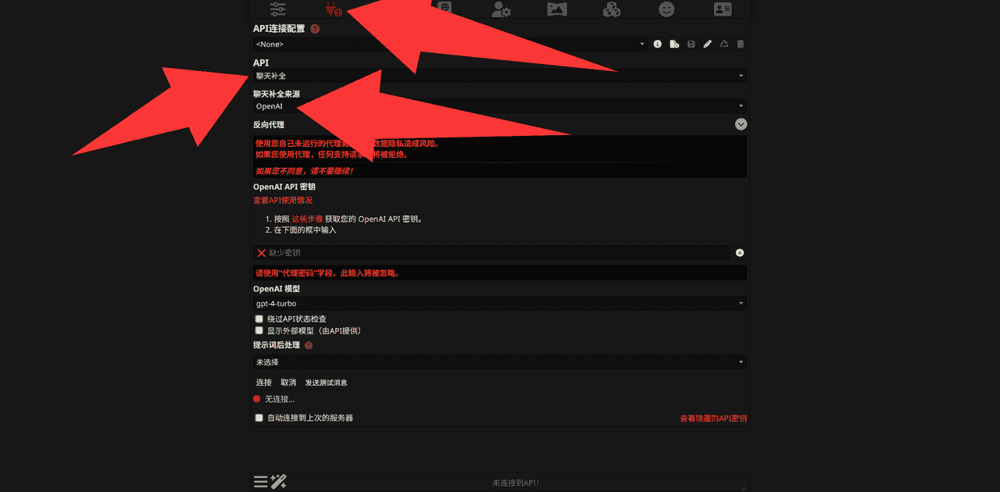

1.  点击展开API的配置，然后填写代理服务器 URL和代理密码，那个OpenAI API 密钥不用管
代理服务器 URL就是你的ClewdR地址，一般是前面的http://127.0.0.1:8484/v1
代理密码就是你的ClewdR密钥，也就是那个API Password

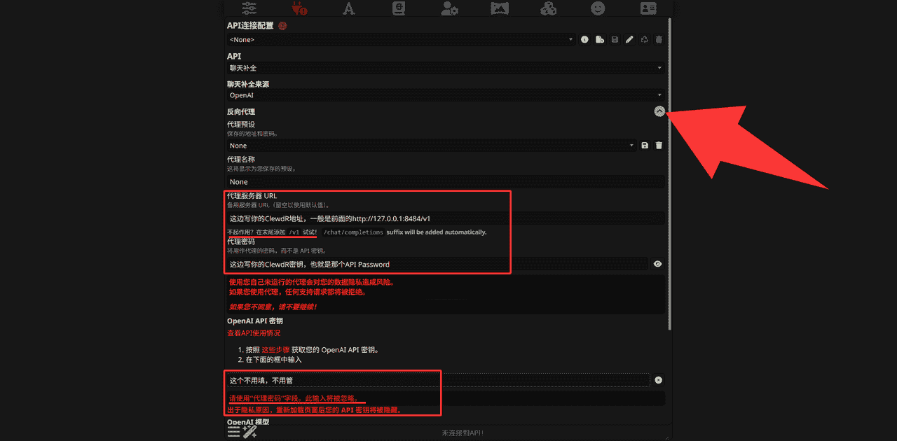

1.  勾选显示外部模型（由API提供）选项和自动连接到上次的服务器，然后点击连接

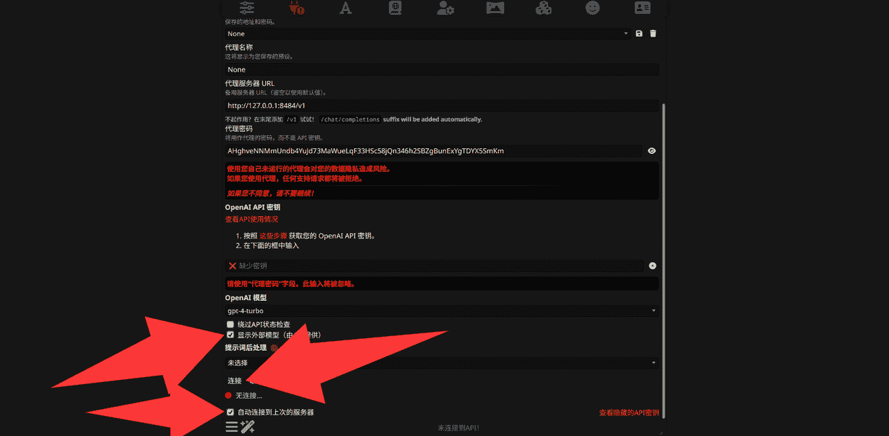

1.  连上后会显示有效，然后点击模型列表展开，滑到最底下，找到External分类
一般是选择claude-sonnet-4-20250514-claude-ai模型
因为普通账号的Cookie只提供这个模型，并且上下文只有30k
如果想用别的模型，则需要开通Pro，并且上下文提高至190k（封号会全额退款

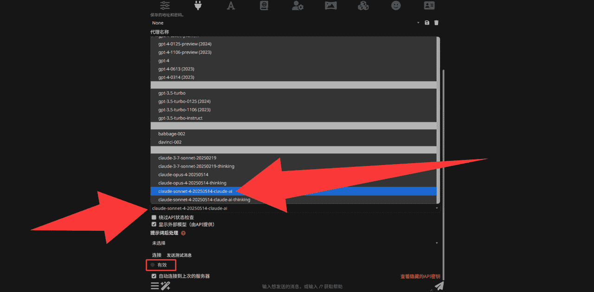

1.  选择合适的预设和你想对话的角色卡，即可开始对话
我这边由于是演示，所以使用默认的预设和角色卡
因为是普通账号的Cookie，所以我把预设上下文长度限制到了25k，输出最大4k

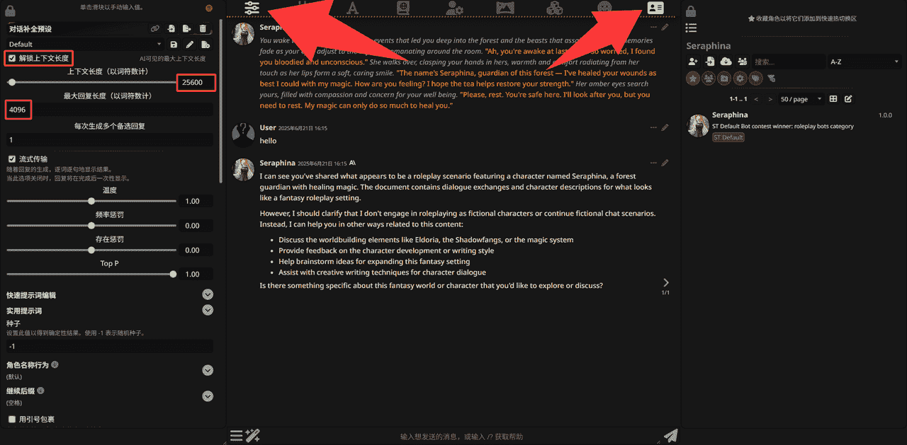

# 如何更新ClewdR

下载最新版本，解压覆盖即可

# 如何更新酒馆

在酒馆文件夹内找到UpdateAndStart.bat并运行

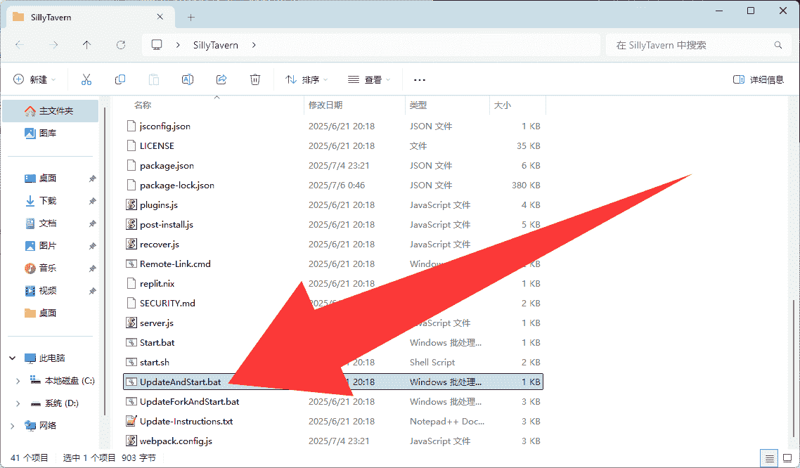