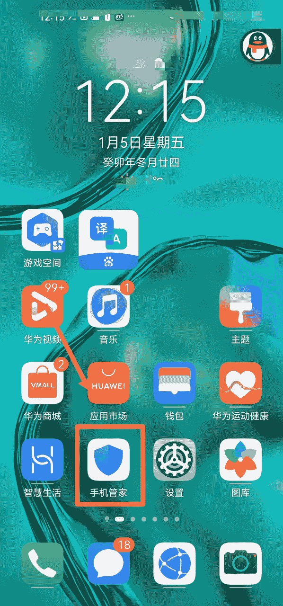
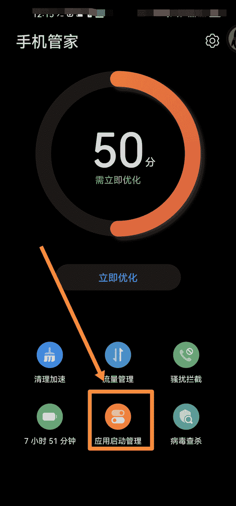
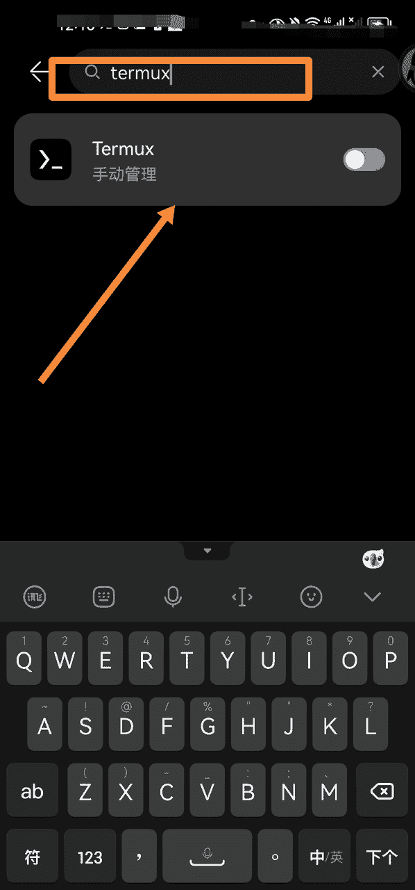
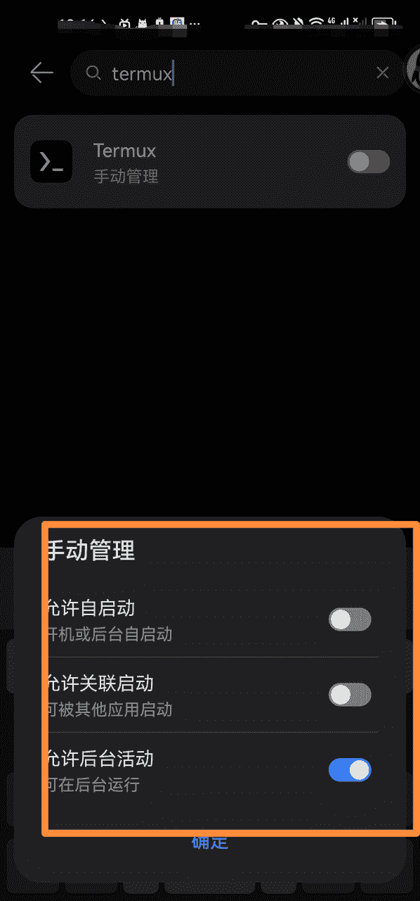

# 保活

> 来源：[https://sqivg8d05rm.feishu.cn/docx/LlZgdmRfnoS7MJxKINocH9MknHb](https://sqivg8d05rm.feishu.cn/docx/LlZgdmRfnoS7MJxKINocH9MknHb)

## 华为/荣耀手机 防止termux/zerotermux杀后台（使用酒馆卡顿）的方法

**作用**：**解决了华为/荣耀手机使用termux/zerotermux部署**的本地酒馆/clewd卡顿，回复慢的问题

ps：导入不了破限、酒馆回复超过两分钟等一系列问题如果出现问题，先试着按下列的方法调整，如果调整之后还是出现问题，再考虑是其它情况

（其它的手机我没有，所以就等其它大佬更新吧）

**快捷方法**：打开手机管家——打开其中的应用启动管理——找到termux——将其调成手动管理——打开允许后台活动（如果不懂快捷方法写的文字说明，下面有实操图）

1.如下图，找到图中框选的手机管家

2.如下图，打开手机管家后，找到应用启动管理并打开

3.如下图，在搜索框中输入termux/zerotermux找到app

4.最后，如下图框选的样子，调成手动管理，并且打开允许后台活动

**然后，卡顿的问题就能解决了**

写在后面（常见错误及补充）：

1.如果出不来上图所示的**允许后台活动的调整框**，点击按钮（变蓝）先调成自动管理**，然后再次点击（变****灰**）按钮调成手动管理，允许后台活动的调整框就会重新出现。

2.按上面步骤调完之后，termux会一直挂在后台，关后台进程也关不掉，想要关掉的话，先点击按钮（变蓝）调成自动管理，然后删后台即可删除（貌似有更好的办法，但是我笨比不会，等我会了再更新更好地删除后台方法），下次想要开启termux的时候的时候，再按之前提到的步骤来保活就好

3.有朋友使用的是aidlux部署的本地clewd（比如我），如果遇到类似的问题，也可以举一反三，按照上面的步骤，找到aidmux，将其调成手动管理-允许后台活动