# PC 一键开启Claude酒馆之门（原名：真·一键脚本，脚本内置注册cookie功能）

> 来源：[https://sqivg8d05rm.feishu.cn/docx/QVXAdUjDDooTmixDa0Icj1YCnec](https://sqivg8d05rm.feishu.cn/docx/QVXAdUjDDooTmixDa0Icj1YCnec)

**真·一键脚本**

又名：灵钥 - 一键开启Claude酒馆之门

**作者：灵**

Claude宝宝教程：[Claude宝宝教程](https://sqivg8d05rm.feishu.cn/wiki/BBocw85QTiA8EXkNcUZcT2pCnIe)

> 3.10.1版本更新已完成

> 如果有希望添加的功能，可以来[【](https://github.com/LINKlang/SillyTavern-Clewd-auto/issues/1)FR】脚本后续添加功能 · Issue #1 · LINKlang/SillyTavern-Clewd-auto 提出

## 使用[一键脚本](https://github.com/LINKlang/SillyTavern-Clewd-auto)：

### 准备阶段

**魔法：用来访问国外网络的魔法**

**邮**箱：不建议使用临时邮箱/国内（qq、163）邮箱，推荐 Outlook / Gmail (现在不建议别名了)

[**手机**](https://sqivg8d05rm.feishu.cn/docx/QVXAdUjDDooTmixDa0Icj1YCnec?subFrom=quote_container&from=tab_link&wiki_version=2#part-OpLPdfbKCokTlEx6pqsc3Nctn3c)**号：需要一**次性的手机短信验证，可在 这里 获取教程

### 通过链接下载[一键脚本](https://github.com/LINKlang/SillyTavern-Clewd-auto/releases/latest)

> 赞助验证需要[爱发电赞助](https://afdian.com/a/silly_clewd_auto)vip3档及以上

### 使用一键脚本注册/登录 claude账号

#### 自动完成网络等检验过后选择模式一


#### 选择已安装的浏览器（Edge/Chrome）

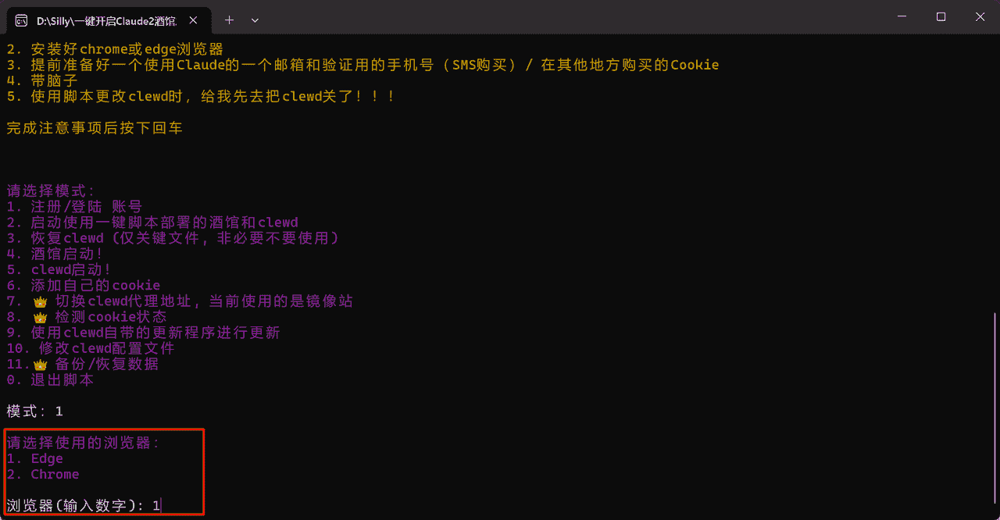

#### 完成填写邮箱，邮件验证码，昵称，手机号，手机号验证码

+   [手机号获取方法点我](https://sqivg8d05rm.feishu.cn/docx/QVXAdUjDDooTmixDa0Icj1YCnec#doxcn2UArWkeqkfJeWLdMpvkgYb)

脚本自动获取并填写cookie

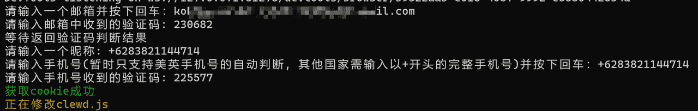

#### 创建更多的cookie

这句话的意思是，是否要通过不同的邮箱添加更多的cookie（因为一个cookie用不了很长时间），你上次使用的什么方法进入获取cookie，输入y后还是用的同样方法

> 比如你是注册claude账号，输入y后，也是进入的注册claude账号流程


#### 脚本会自动启动酒馆和clewd

> 启动后酒馆使用问题，请看[酒馆使用教程](https://sqivg8d05rm.feishu.cn/docx/QVXAdUjDDooTmixDa0Icj1YCnec#doxcnB6aq6Tvo2dKjHqP8LjqLre)

### 启动使用一键脚本部署的酒馆和clewd

显而易见，这个选项就是用脚本注册/登陆过账号，后续启动用的

### 恢复clewd (clewd出现缺失文件或文本错误使用)

这个功能就是在clewd损坏时用的

不建议用，Cookie容易丢失，虽然已经做过Cookies保护了

### 直接开启酒馆/Clewd

单独开启酒馆/Clewd用的，方便某一个报错导致退出后，单独重启

### 添加自己的cookie

> 已迁移至[修改clewd配置文件](https://sqivg8d05rm.feishu.cn/wiki/QupDwUGhJiiZP6kLfuDcit3LnRg#OMxedzcdEo9wCQxjO3bcb00hnnr)的第六项

### 使用clewd自带的更新程序进行更新

运行后会自动调用clewd文件夹里的update程序进行更新

### 修改clewd配置文件

进入该项后，会弹出修改页面，其中会有一些预设

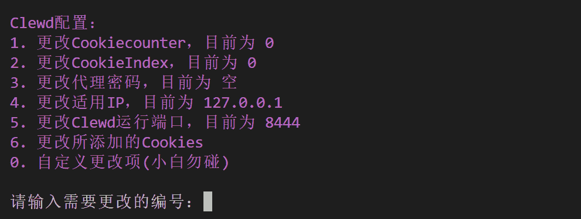

前5项特别简单，就不细讲了

#### 更改所添加的Cookies

第六项就是源添加自己的cookie的功能，新添加了删除功能

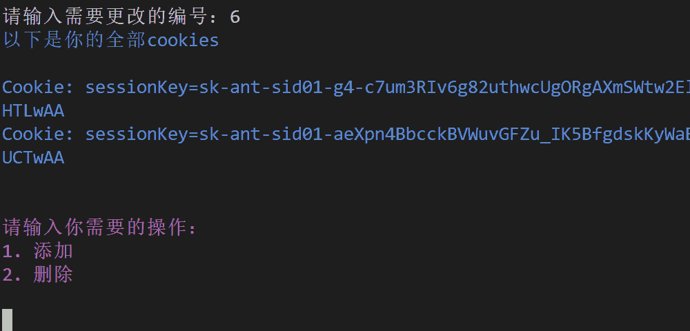

##### 添加

因脚本编程语言的限制，无法自动截取所有的Cookies，所以需要手动结束输入

先把所有的文本都丢进来

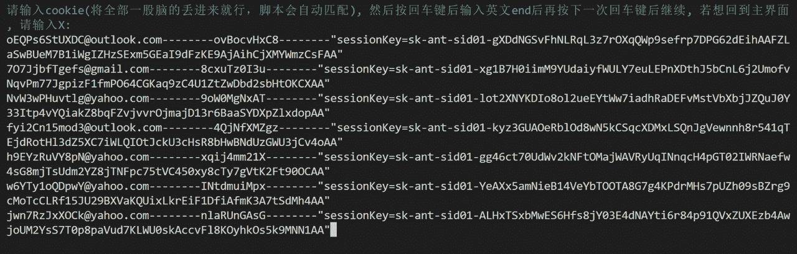

然后再按下一次回车，输入end

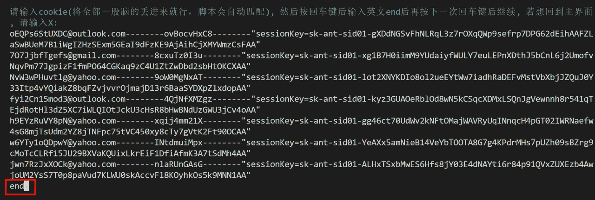

最后再按下一次回车，就好了

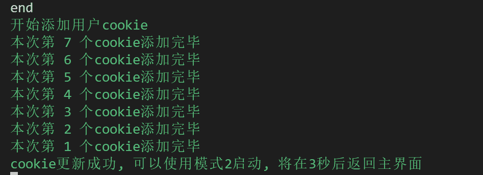

### 设置

### 以下为[赞助验证后](https://sqivg8d05rm.feishu.cn/docx/QVXAdUjDDooTmixDa0Icj1YCnec#doxcniGf8U8hZjshLZq62eA1efg)独有功能

#### 切换clewd代理地址

##### 选择你想要使用的代理

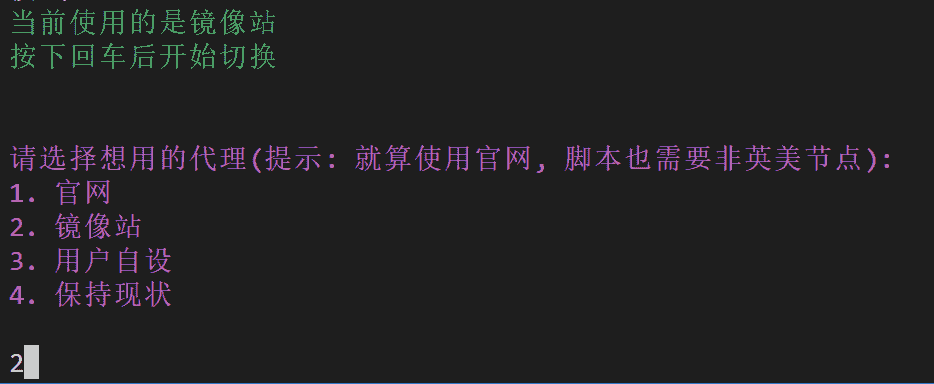

选择后就会自动修改

#### 检测cookie状态

进入该选项后，脚本会通过修改clewd配置文件的方案，让clewd遍历并检测cookie可用性

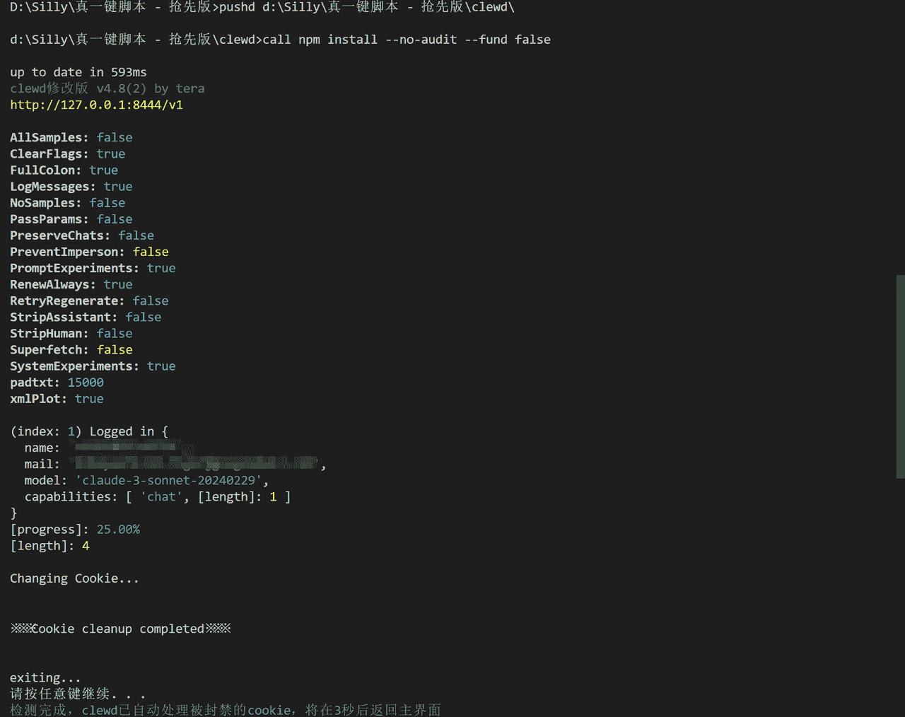

#### 备份/恢复数据

进入该项后首先需要选择是备份还是恢复

##### 备份

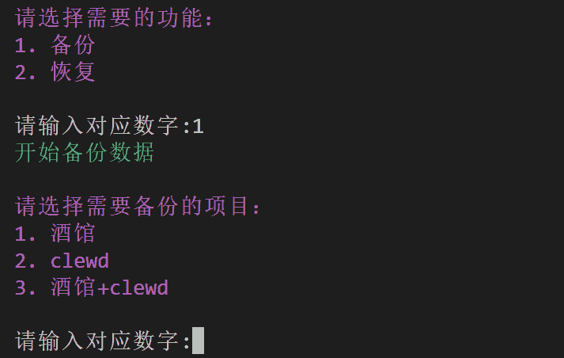

进入备份选项后，首先需要选择需要备份的项目（三个选项同理，故只演示酒馆）

完成选择备份项目后，会弹出文件保存窗口，选择任意位置保存即可

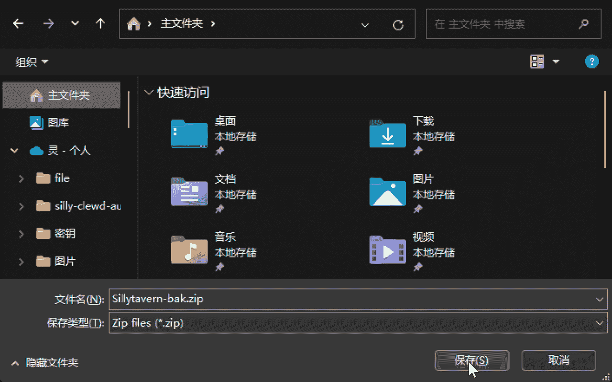

##### 恢复

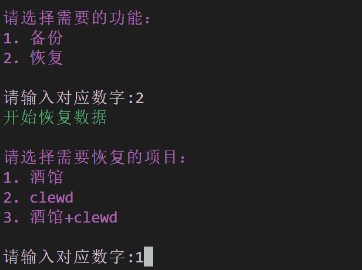

进入恢复选项后，首先需要选择需要恢复的项目（三个选项同理，故只演示酒馆）

完成选择恢复项目后，会弹出文件选择窗口，选择之前备份的文件即可

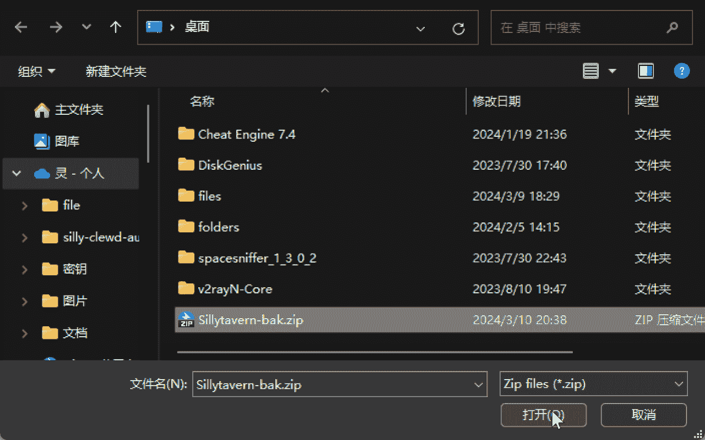

## 获取手机号：

### 注册 [sms-activate](https://sms-activate.org/cn) 账号

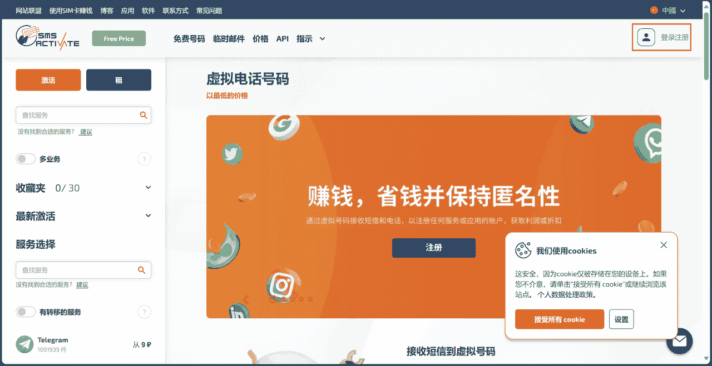

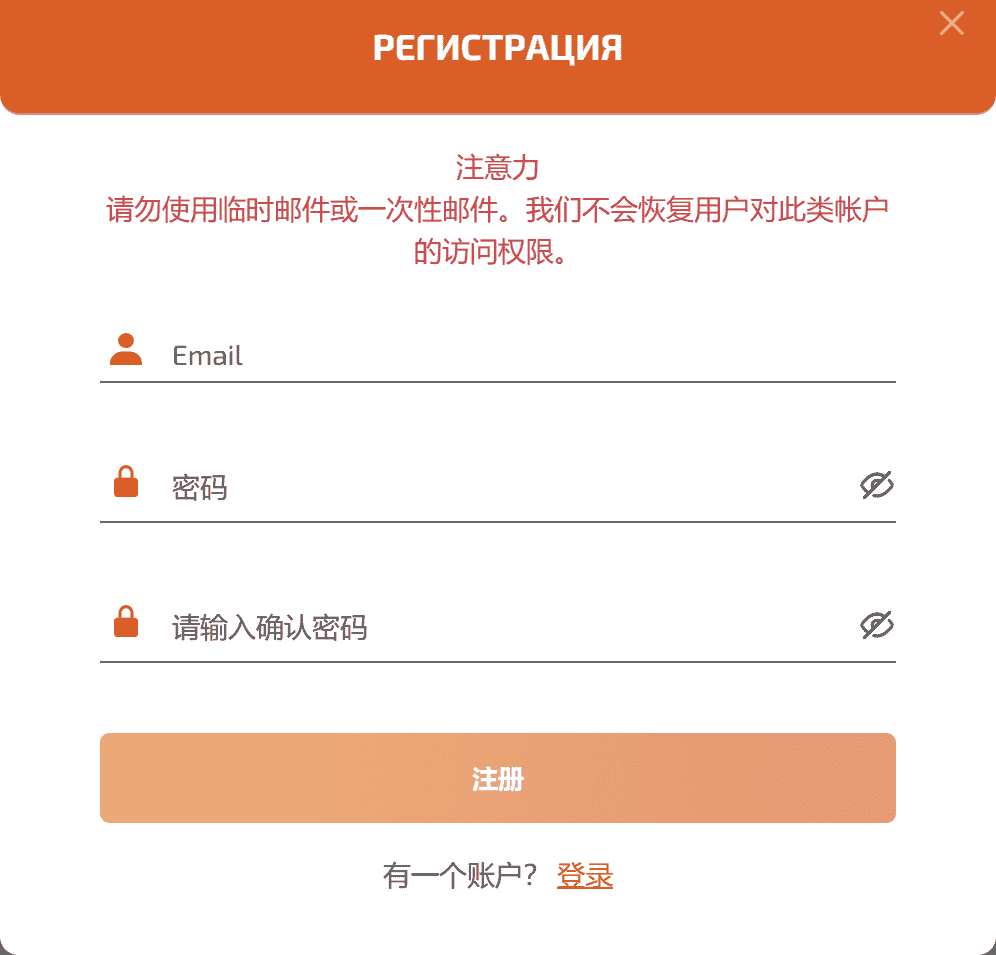

### 向 [sms-activate 充值](https://sms-activate.org/cn/buy)

> **注意，这里的佣金的意思是手续费**

> 比如你只充2美元，但是需要支付2.1美元

**点击标题的链接进入充值页面**

推荐使用 支付宝 进行充值，最低充值 2 美元（会自动换汇）

如果有其他你可以使用的充值方式也可以使用

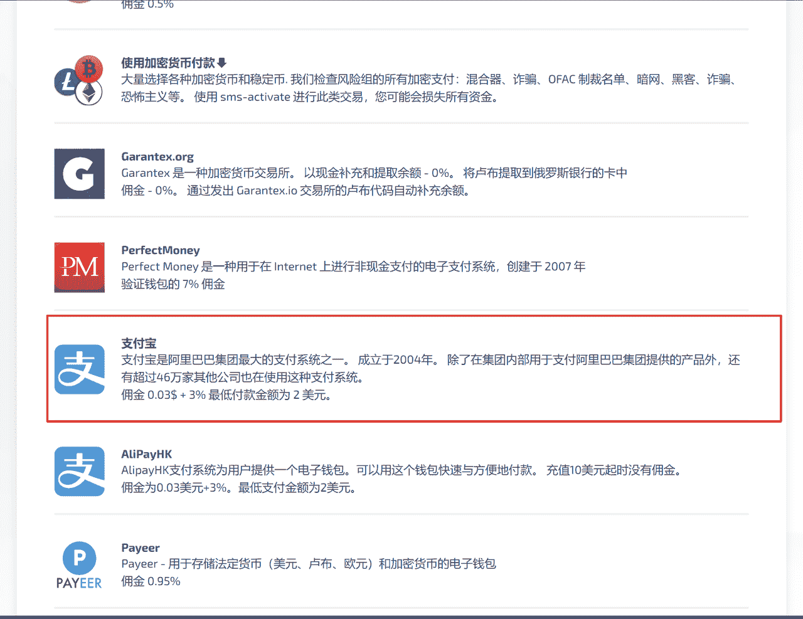

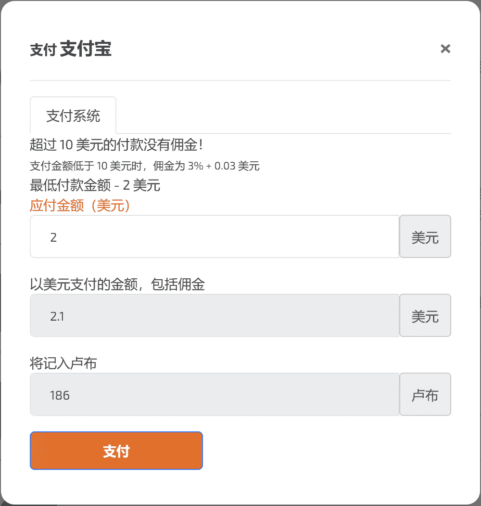

### **购买虚拟手机号**

服务选 Any other ，地区选择除英美两国之外的其他国家。

> 如果收不到验证码，服务搜Claude也不是不行

比如：印度尼西亚

点击需要的国家的手机号旁边的购物车图标购买

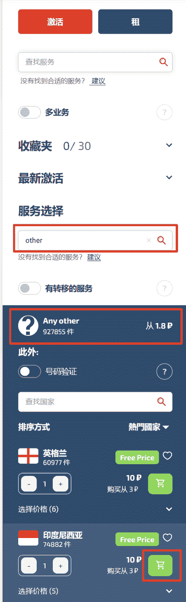

### 收取验证码

购买过后自动进入收取页面

**先在****sms**点击✅，再在一键脚本中输入手机号收取验证码

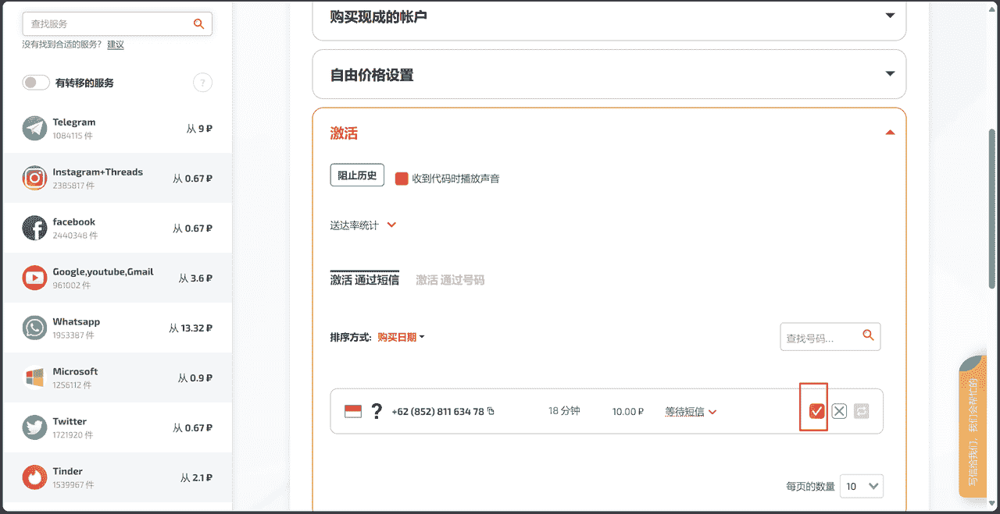

> [跳回原位](https://sqivg8d05rm.feishu.cn/docx/QVXAdUjDDooTmixDa0Icj1YCnec#doxcn0JlQIpUHbv8RkU0VuhJWsg)

## 脚本常见错误大全（未完成）：

### 酒馆无法使用

酒馆使用教程：[酒馆使用](https://sqivg8d05rm.feishu.cn/wiki/Nazdwr3H9inZs6k1aIQcFPA0nth)

当你已经 **注册/登录 **完了claude账号，进入酒馆页面的时候，一些人底部的输入框会提示以下内容


这种情况只需要点击[以下图片](https://sqivg8d05rm.feishu.cn/wiki/QupDwUGhJiiZP6kLfuDcit3LnRg#R6LudPOnCoVkEYx1N57cMn4dnJc)这个图标，进入接口页面，然后点击Reverse Proxy[、将Pr](https://sqivg8d05rm.feishu.cn/wiki/QupDwUGhJiiZP6kLfuDcit3LnRg#KTOhdILrmoNwbEx6CTPcDwuGndE)[oxy ](https://sqivg8d05rm.feishu.cn/wiki/QupDwUGhJiiZP6kLfuDcit3LnRg#U7X7dQVm5odNNtxzgJzczHcdnkf)Server URL改成这段文本，并给Proxy Password里填入任意字符，再点击连接按钮即可，图片教程


```
http://127.0.01:8444/v1
```

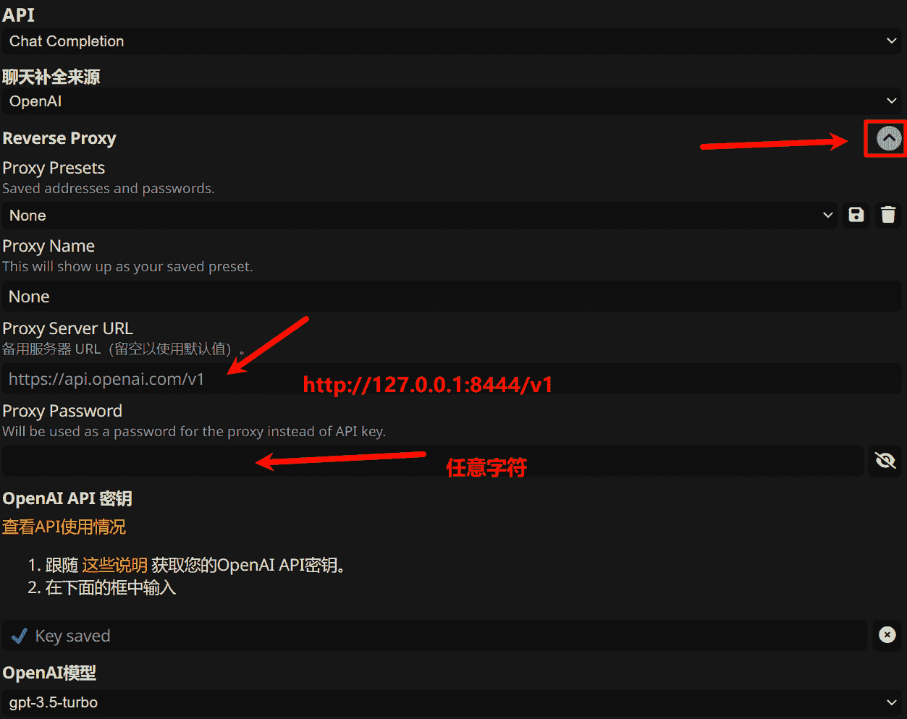

最后，回到[ai响应配置](https://sqivg8d05rm.feishu.cn/wiki/QupDwUGhJiiZP6kLfuDcit3LnRg#Jcbjdj7bToKqkExLD69cyS6QnAh)，点击 **保存**


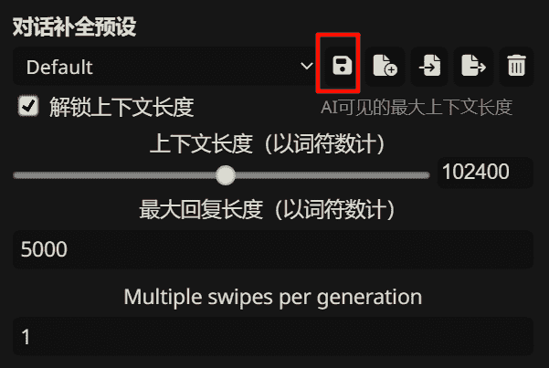

### 双击程序没反应

#### alt+tab打开详情

#### 勾选解除锁定，应用后重试


### 错误：更新cookie全程时出现问题

#### 报错信息: [Errno 2] No such file or directory: 'clewd\\config.js'

文件丢失，重新下载脚本

> 赞助版可以使用恢复clewd功能

#### 报错信息: [Errno 13] Permission denied: 'clewd\\config.js'

##### 检查是否使用记事本打开了clewd文件夹里的config.js

##### 解决方法二：

###### alt+tab打开详情

###### 检查是否勾选只读（关掉只读）/是否有安全选项（有的话就勾选解除锁定）

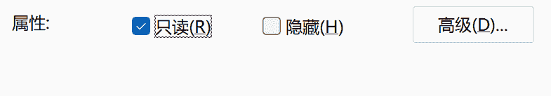

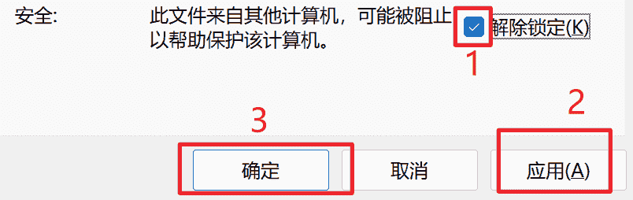

####