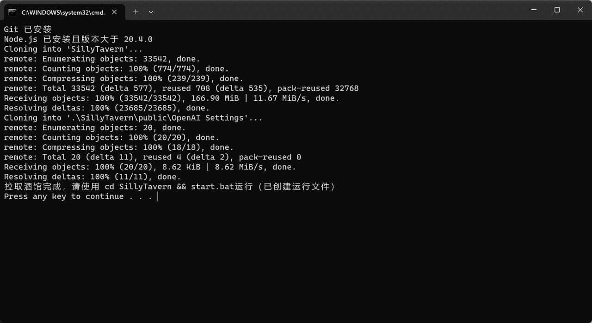

# PC本地自动部署酒馆

> 来源：[https://sqivg8d05rm.feishu.cn/docx/TzcUdPX5loF3AuxH8mdcpXminnb](https://sqivg8d05rm.feishu.cn/docx/TzcUdPX5loF3AuxH8mdcpXminnb)

## 注：无法单独使用，这个是用来连云端的

> 本脚本内置了比赛接口，现已无法使用

> 请使用[PC 一键开启Claude酒馆之门（真·一键脚本）](https://sqivg8d05rm.feishu.cn/wiki/QupDwUGhJiiZP6kLfuDcit3LnRg)

## PC本地自动部署酒馆

**作者：灵**** **

> [PC 本地一键部署 Clewd+酒馆](https://sqivg8d05rm.feishu.cn/wiki/QupDwUGhJiiZP6kLfuDcit3LnRg)告：想要一键注册并使用自己的claude账号进行玩耍？来看看 吧

### 下载部署脚本

> 有Github账号的人可以访问 [GitHub - LINKlan](https://github.com/LINKlang/sillytavern_config)g/sillytavern_config 这里给作者点个star

> 这对作者十分重要，pls！

打开 [GitHub镜像站 - LINKlan](https://github.hscsec.cn/LINKlang/sillytavern_config)g/sillytavern_config 下载Releases里的bat文件

### 运行脚本，自动检测环境并抓取酒馆

**把下载的文件放**到一个容易找到的文件夹里，重命名为一键安装酒馆，运行脚本，出现这样的页面就是好了。

### 运行文件夹里的start.bat

完成！可以享受你的酒馆了

> 酒馆里的使用教程可以参考[酒馆入门](https://sqivg8d05rm.feishu.cn/wiki/J8NDwc06JiuHXmk5cP2csfP6nmd)