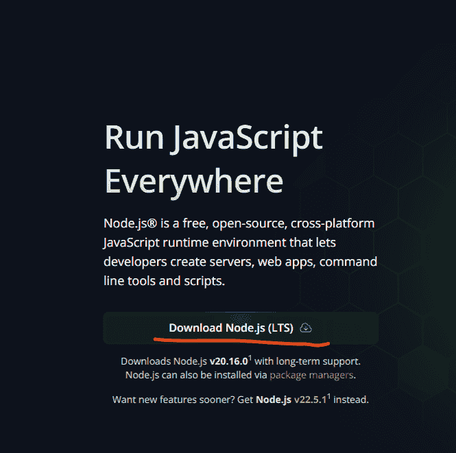
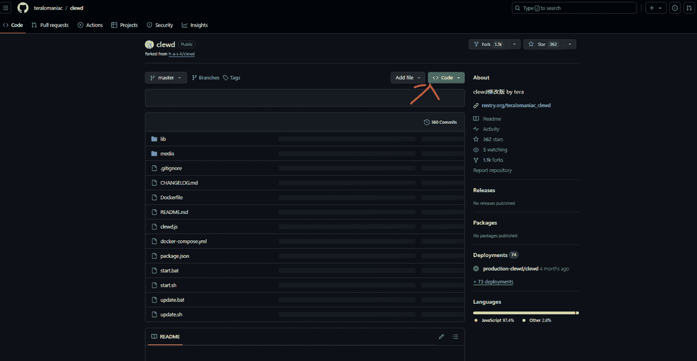
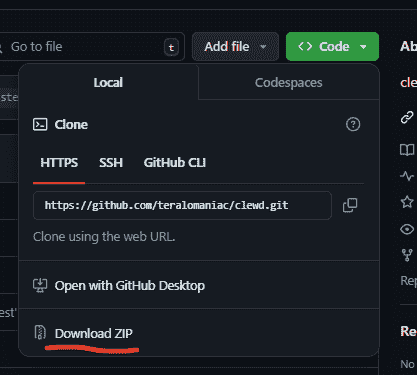
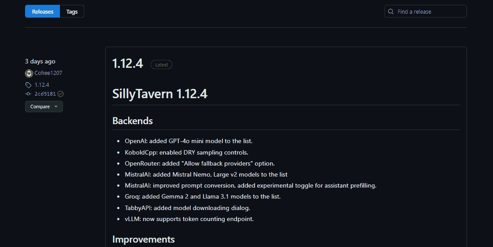
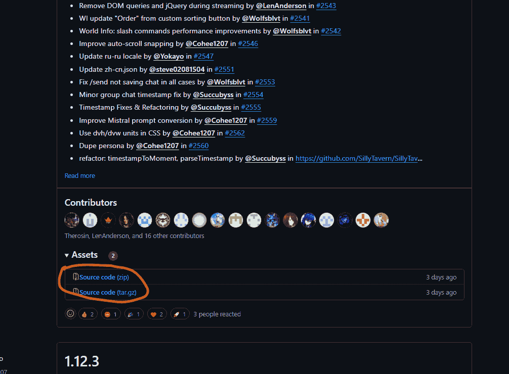
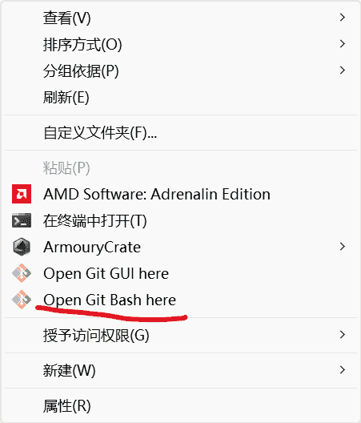
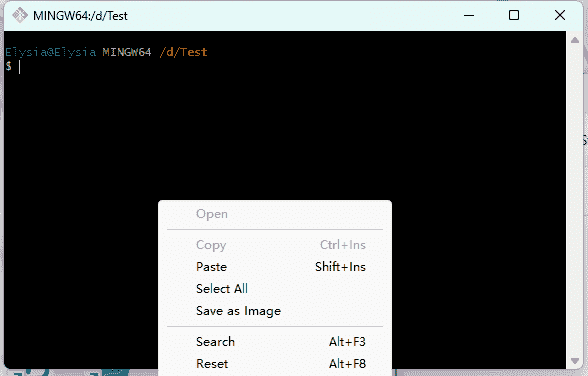
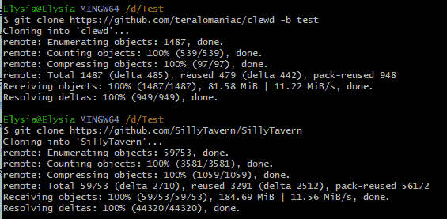
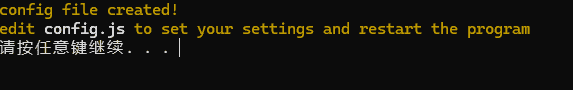
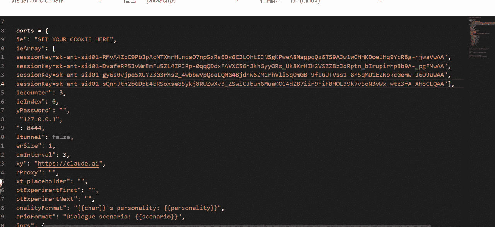

# PC本地部署Clewd+酒馆

> 来源：[https://sqivg8d05rm.feishu.cn/docx/ReeodVSN3oxQ7jxSH86czuxhnnh](https://sqivg8d05rm.feishu.cn/docx/ReeodVSN3oxQ7jxSH86czuxhnnh)

作者

安装全程都需要一个优良的魔法网络环境

觉得看不懂？没关系，用隔壁的[灵一键包](https://sqivg8d05rm.feishu.cn/wiki/QupDwUGhJiiZP6kLfuDcit3LnRg) / [初一键包](https://sqivg8d05rm.feishu.cn/wiki/Yx68wLZkciDr84k9mTRcROqjnTf)或者找这个好心人 完善教程

**先下载必要的运行环境**[**Node.js**](https://nodejs.org/en)



# 下载方法方法一

然后去酒馆的Github里面下载[Clewd](https://github.com/teralomaniac/clewd)和[酒馆](https://github.com/SillyTavern/SillyTavern/releases)压缩包

以下是Clewd修改版的压缩包





酒馆的找到你喜欢的版本，这里以最新版为例



往下滑



这两个压缩包随机下载一个即可

解压即可

# 下载方法方法二

下载[git](https://gitforwindows.org/)然后在你需要下载的文件夹右键选择Open Git bash here



git clone项目地址，，打开会进入这么一个页面，把下面的命令行复制粘贴进去就好了

粘贴右键Paste



下载酒馆SillyTavern

```
git clone https://github.com/SillyTavern/SillyTavern
```

下载Clewd

```
git clone https://github.com/teralomaniac/clewd -b test
```

保证命令行是完整的复制进去不要多字符



这样就把代码拉取到本地了

# 运行

运行start.bat文件

Clewd没有config文件则先第一次运行start.bat文件后跳出config文件



其中CookieArray里填入你的Cookie，Cookie的形式是sessionKey=sk-ant-sid01-xxxxx-AA这样的形式。

填入CookieArray

比如

"CookieArray": ["cookie1","cookie2","cookie3"],

初的多Cookie一键整理格式：https://clewd.pages.dev/



一般http://127.0.0.1:8444就是clewd的内网地址了，反代即为http://127.0.0.1:8444/v1，然后运行酒馆等配置完成就能用了，注意使用本地clewd需要魔法环境

# 更新

如果你是用下载方法一，只能去GitHub重新下载压缩包更新了，保存好必要文件导入新版本就行了

如果你是用下载方法二，运行update.bat即可更新