# PC端使用住宅+指纹浏览器进行安全的注册

> 来源：[https://sqivg8d05rm.feishu.cn/docx/DjvRdsvZVo5X7exJp6vcTlydnme](https://sqivg8d05rm.feishu.cn/docx/DjvRdsvZVo5X7exJp6vcTlydnme)

# 先说屁话（猫师傅补充前言:若可以选择,尽量使用ipv6的住宅ip,在猫师傅教程里会有对应提醒）

呃，目前来说，A社的检测越来越严格了

会在你登入或者注册的时候，检测你的环境，如果不正常容易秒Ban

所以获取了Cookie之后，最好就是不要二次登入，容易被ban号

关于如何保活Cookie，其实你只要七天内使用过这个Cookie，就不会失效

如果要是一直没有使用的话，你也可以在Clewd的config.js文件里

把Cookiecounter改成-1，然后运行一次Clewd即可

Cookiecounter选项

0为报错更换Cookie，正数为依据响应次数更换Cookie（报错依旧更换），-1为自动轮询清除无效Cookie，可在config.js内自定义

# 正式开始

首先，访问[ipfoxy](https://app.ipfoxy.com/registration)进行注册和登入（呃，注册和登入就不用教了吧

注册和登入完成后，就是购买动态住宅（可以免费领取200M，基本都是够用的

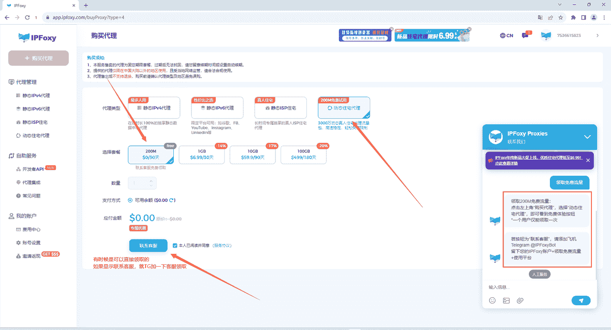

弄到住宅流量之后，我们下[载指纹浏览](https://www.bitbrowser.cn/)器（注册和安装就不用教了吧....

安装打开后，我们回到ipfoxy，生成我们的动态住宅配置

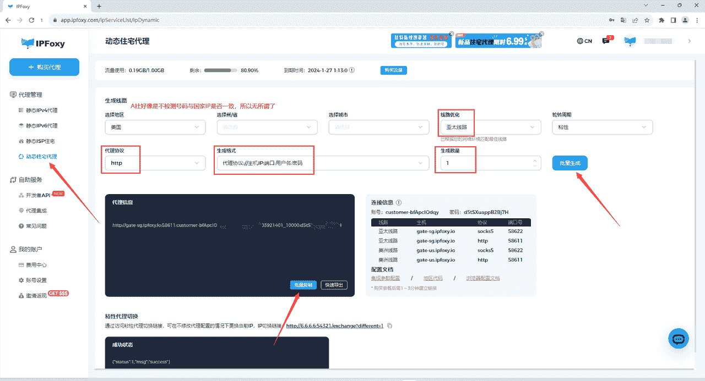

然后我们复制刚刚生成的那一串代理信息到安装好的指纹浏览器里，直接把内容粘贴到代理主机

它就会自动识别并且拆分，最后保存就行了

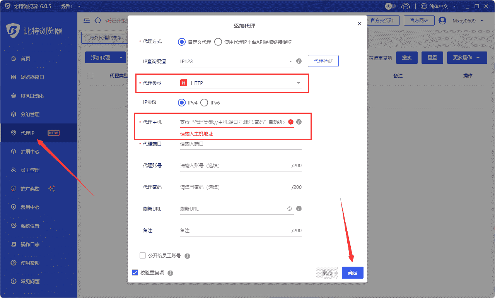

接着我们创建浏览器，并且使用代理，代理IP选择你刚刚保存的就行了

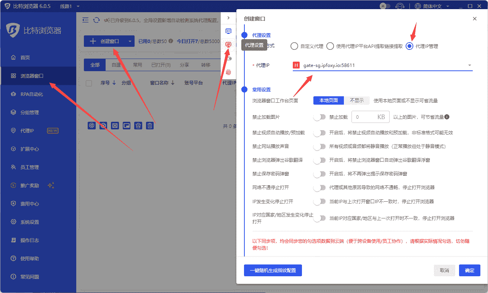

别的设置可以你也可以参考我的

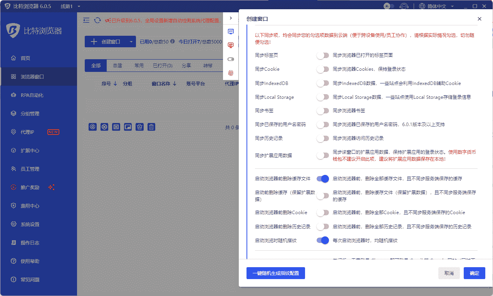

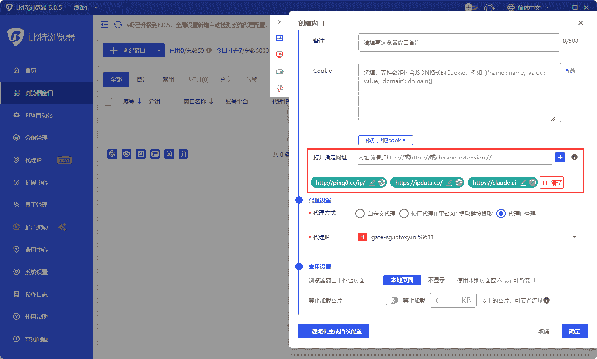

前面两个网址是检测IP风险的，有需要你就加上

没啥问题你就点右下角的确定，就可以创建了

```
http://ping0.cc/ip/
```

```
https://ipdata.co/
```

创建完成打开浏览器后，你就可以看到你的IP已经改变了

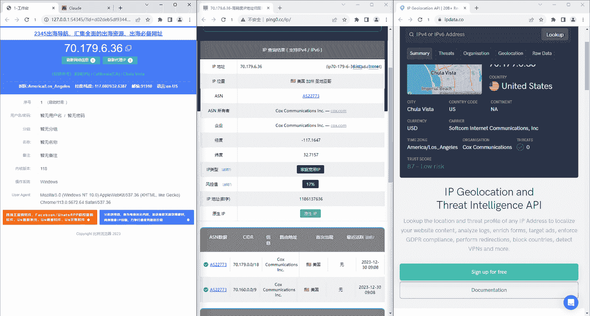

剩下的就是注册Claude，然后提取Cookie了，别的教程已经很详细了，不再赘述

# 接下来是猫师傅对于住宅ip注册的一点方法

一[点题外话：I](https://app.ipfoxy.com/registration)pfoxy的200m免费住宅流量可以通过其本身的动态ip套娃白嫖（具体方法是通过指纹浏览器和住宅ip在ipfoxy上再次进行注册账号，手机号码可以选择5sim中other的英国虚拟号）

## 接下来补充通过Adspower Browser指纹浏览器注册cookie的方法

在注册之前，将魔法的节点调整至非亚洲区域节点，随后打开Adspower Browser将代理填入并且检测是否连接（连接成功状态为绿色，且确保代理地址是美国地区）

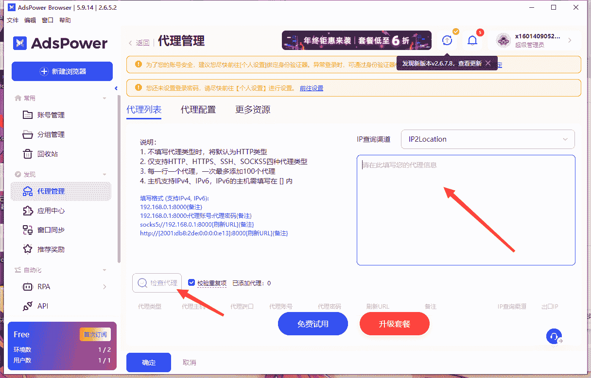

在创建浏览器之前，下载一个插件EditThisCookie（此插件目的是为了方便提取cookie并且抹除浏览痕迹，在教程最后会有提及）

（插件网址：https://chromewebstore.google.com/detail/editthiscookie/fngmhnnpilhplaeedifhccceomclgfbg?hl=zh-CN）

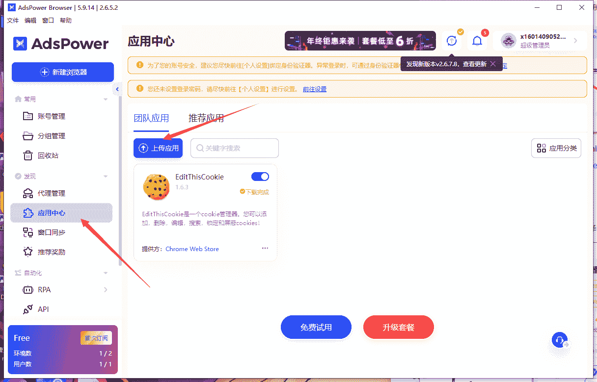

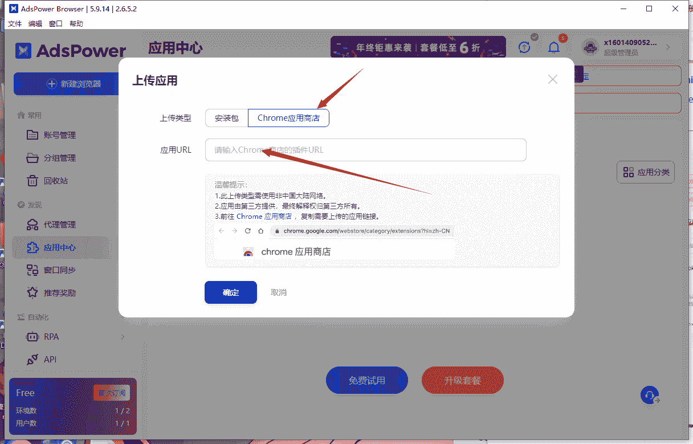

随后新建浏览器，在这一步确保内核选择已经下载好的，选择智能匹配会默认给你随便选择一个，导致需要下载对应内核

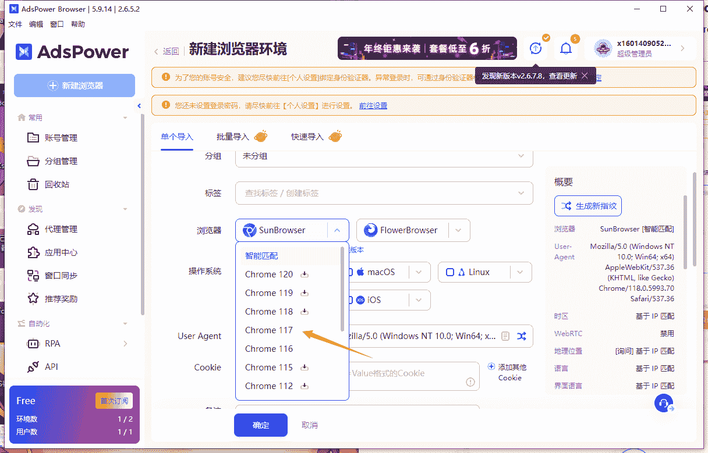

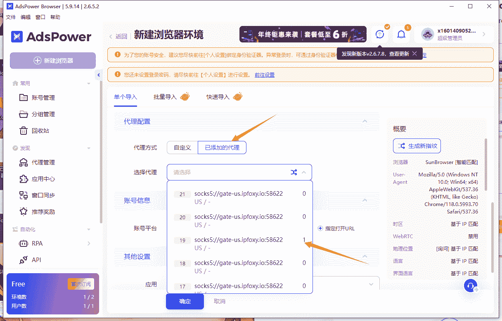

随后选择确定并且创建浏览器即可。（其余部分与鼻炎老婆的教程大差不差）

### 接下来补充关于插件的使用方法和刷新住宅ip的方法

ipfoxy刷新住宅ip的网址：http://6.6.6.6:54321/exchange?different=1 使用指纹浏览器打开一个新的网页粘贴并且刷新该页面即可刷新ip（注：查询ip的网页也需要刷新才能看见ip的改动）

以下是ipv6的格式

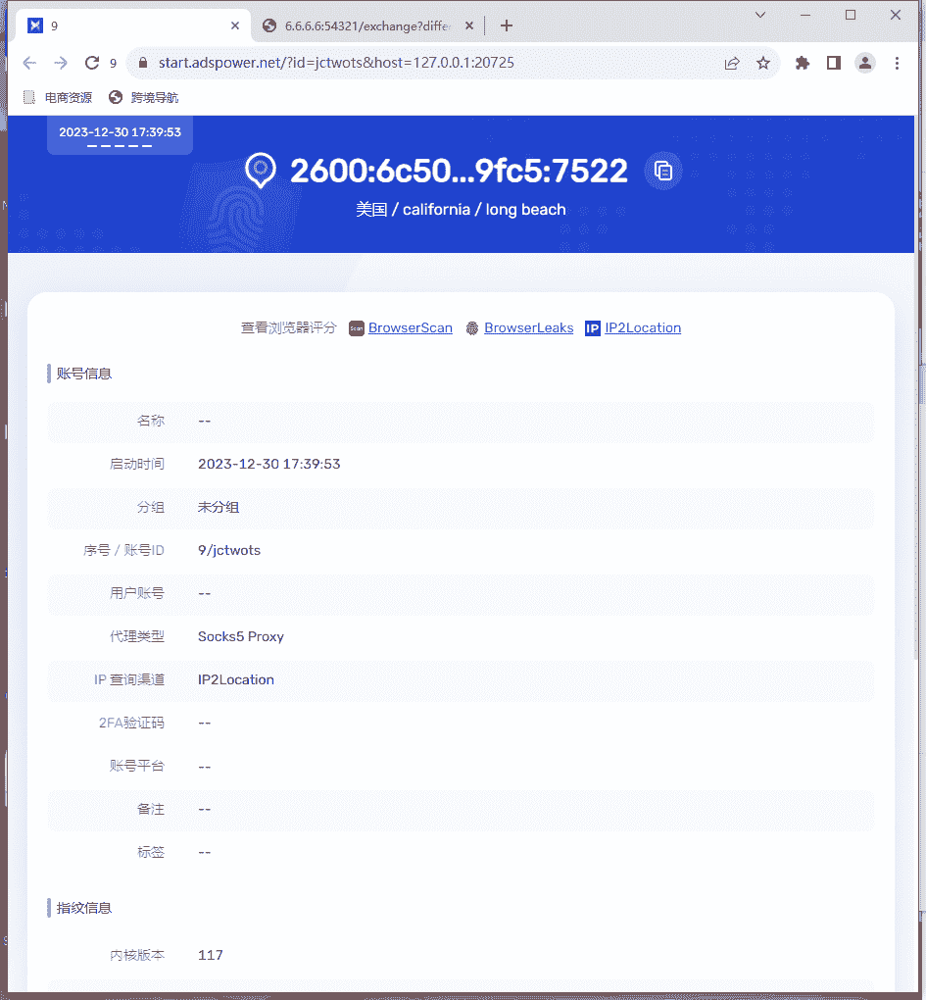

关于EditThisCookie插件的使用

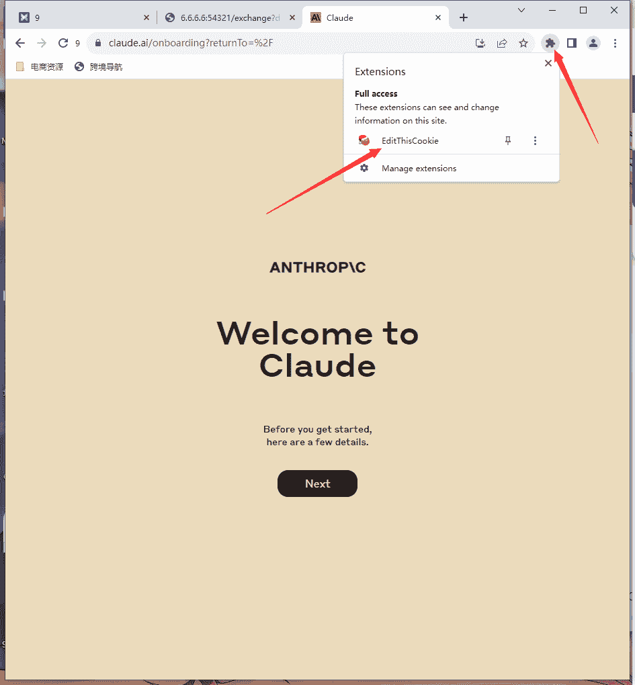

以下页面可能偶尔显示不出，再次重复上面的操作即可

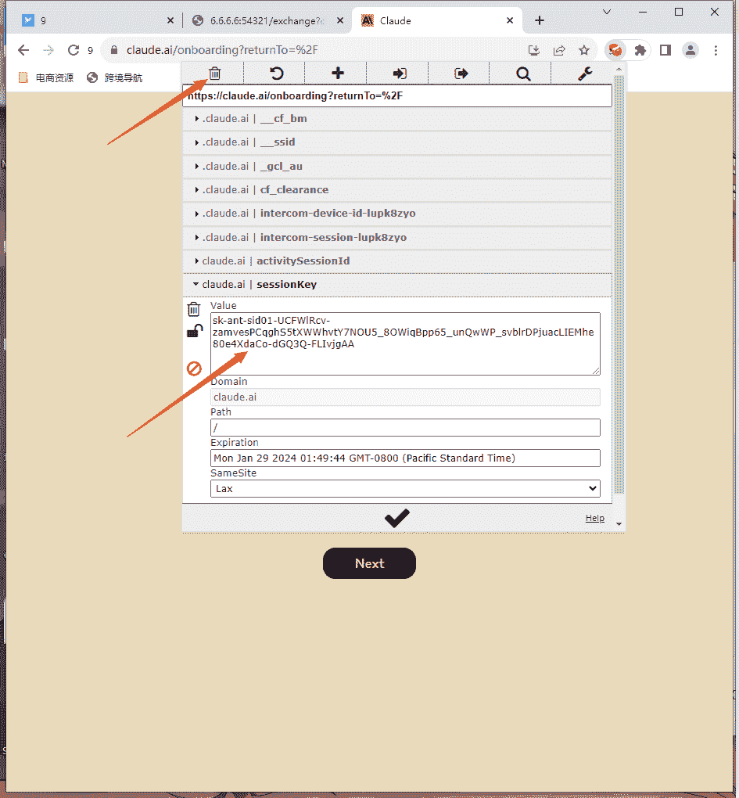

（注：将Cookie提取完并且删除此浏览痕迹后即可关闭claude官网刷新ip再次注册新的Cookie）

最后的最后，邮箱登录和接码平台的登录可以使用正常浏览器，说不定能节省住宅流量哦~（笑）