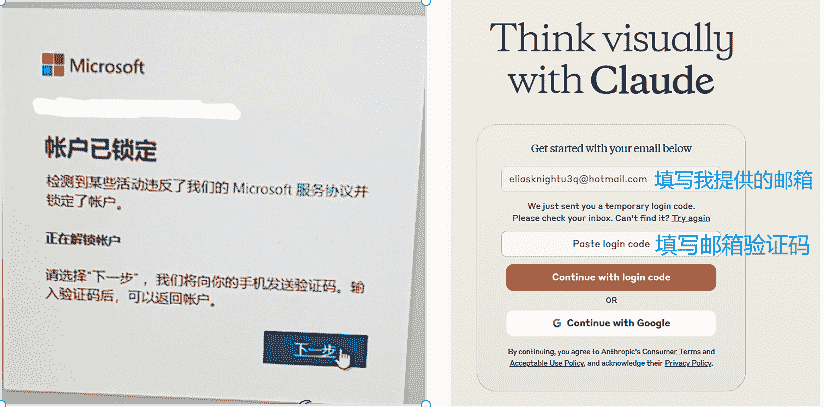
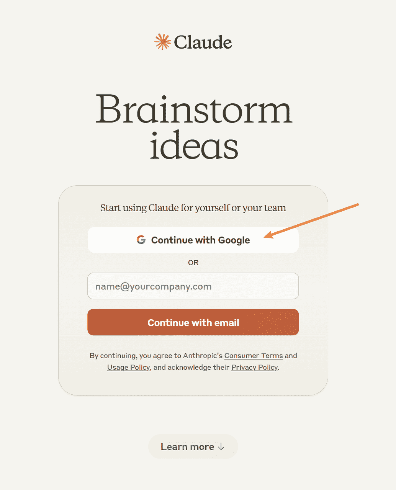
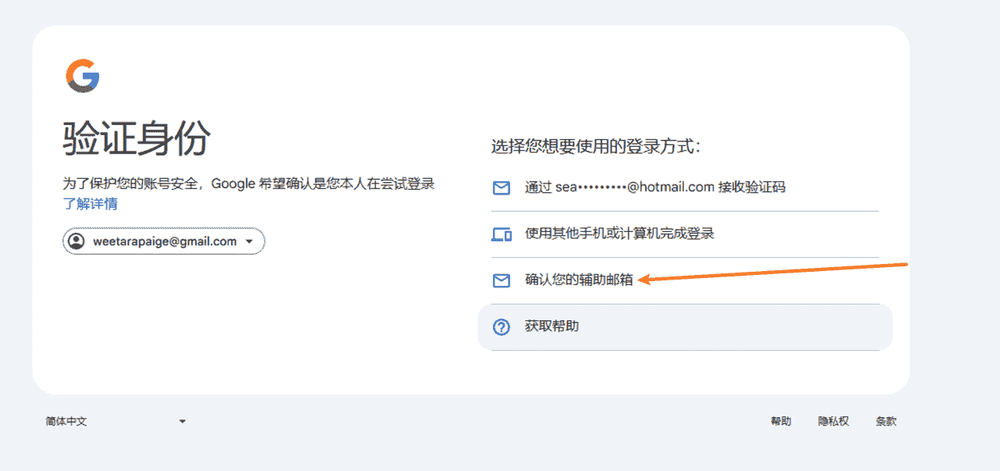
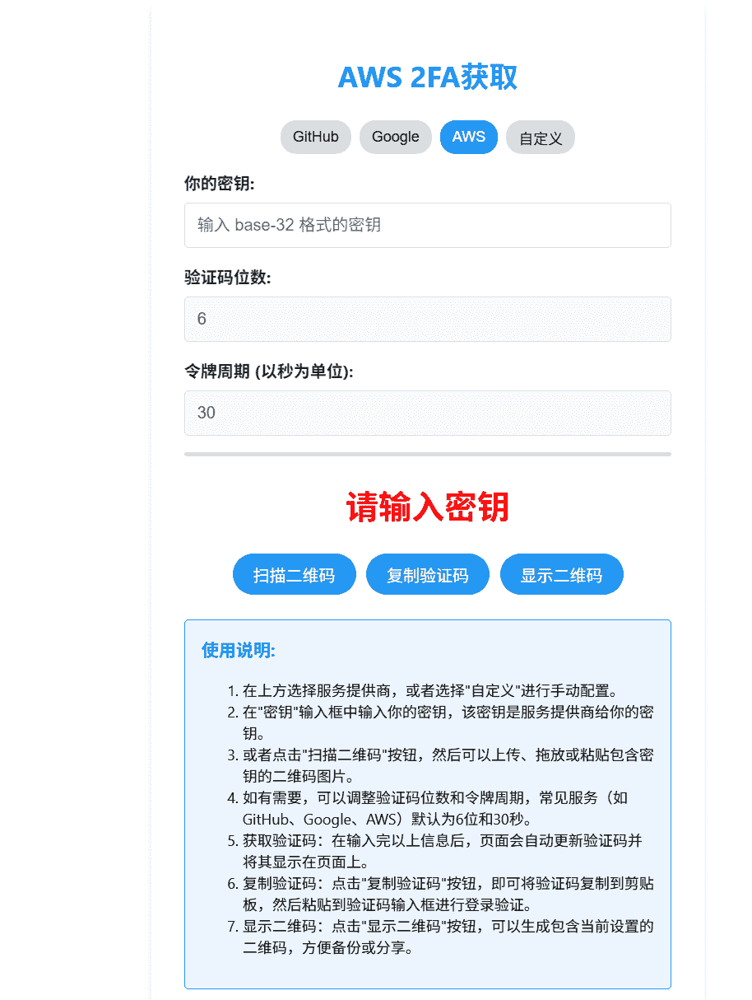

# 水秋喵小店账号使用教程

> 来源：[https://sqivg8d05rm.feishu.cn/docx/BxMHdYHO3o0WIExxtzxcM3t7nId](https://sqivg8d05rm.feishu.cn/docx/BxMHdYHO3o0WIExxtzxcM3t7nId)

酒馆教程首页（含交流群号）：[Claude宝宝教程](https://sqivg8d05rm.feishu.cn/wiki/BBocw85QTiA8EXkNcUZcT2pCnIe)

**API中转教程：**[连接第三方API（OpenAI格式）](https://sqivg8d05rm.feishu.cn/wiki/TS8zwRkqyiZk8SkCGRTcNMg6nMd)

> **酒馆用户请不要登录，直接使用****Cookie****。** [关于酒馆是什么的说明](https://sqivg8d05rm.feishu.cn/docx/BxMHdYHO3o0WIExxtzxcM3t7nId?from=pages&ccm_open_type=lark_docs_wiki_All#part-Wmx4dkcYvo87aoxaEl8cauRCnYe)

# 微软邮箱说明（**酒馆用户请不要登录**）

格式：邮箱 ---- 邮箱密码 ---- Cookie。

举例：abc@outlook.com----abc----"sessionKey=sk-ant-sid01-XXXQAA"

点击淘宝消息中的发货链接获取。

# 网页版登录教程

**在学习与工作中使用。**

## 第一步：登录邮箱（**酒馆用户不登录**）

1.  进入Outlook邮箱网站：h**ttps://outl**ook.live.com （建议先暂时关闭魔法）

1.  输入我们提供的Outlook/Hotmail邮箱与邮箱密码。

1.  如果邮箱显示“账户被锁定”，点击下一步并验证您个人的手机号。

1.  国内手机号即可，仅供验证，邮箱并不会与手机号绑定。邮箱会存在注册Claude时使用的验证码。

## 第二步：登录网页版（**酒馆用户请不要登录**）

1.  进入以下网页：

+   h**tt**ps://claude.**ai（推荐，官网，需要魔**法，登录时不要开翻译，包括自动翻译，会报错）

+   https://www.finechat.ai （镜像站，不需要魔法，不稳定，非必要不建议选择）

1.  输入邮箱账号(不需要填密码)，点击邮箱验证（Continue with email）

1.  输入邮箱内获得的验证码（没收到的话在垃圾邮件那找找）/点击按钮进入

1.  开始使用

# 酒馆

**娱乐用途**，使用AI进行**角色扮演与聊天**，使用破限进行**无限制**对话，搭建较为复杂。

脚本：选择对应Clewd设置中的添加Cookie。

手动搭建：将Cookie前面的邮箱和密码删掉再统一填入CookieArray中，可用 clewd.pages.dev 一键整理。

报错请查阅群公告，群机器人教程。

完整教程(有群号，问水秋去，大懒喵！)：[Claude宝宝教程](https://sqivg8d05rm.feishu.cn/wiki/BBocw85QTiA8EXkNcUZcT2pCnIe)

# 谷歌邮箱版

已直接提供Cookie，除非需要官网使用/充值，否则不要登录！

推荐使用无痕浏览模式访问。

1.  开魔法进入官网，尽量使用us节点：https://claude.ai/

1.  点击谷歌登录，输入谷歌邮箱和密码。

1.  验证身份，选择确认您的辅助邮箱，输入最后的邮箱。

1.  登录完成，在官网使用/充值**。**

### 谷歌邮箱重要注意事项

1.  **谷歌账号风控严格**

+   避免使用不同IP地址频繁登录账号，以免触发风控机制。

1.  **登录环境建议**

+   推荐使用无痕模式（Incognito Mode）并通过美国节点登录，避免因频繁切换节点或IP地区导致账号异常。

1.  **邮箱转发设置**

+   登录后请立即设置转发邮箱地址，以减少频繁登录的需求，降低账号风险。

1.  **双重验证（2FA）设置(http://**34.217.193.103:3000)

+   登录后建议启用双重验证（2FA），并妥善保存二维码或备份密钥（Secret Key），以防遗失。

---