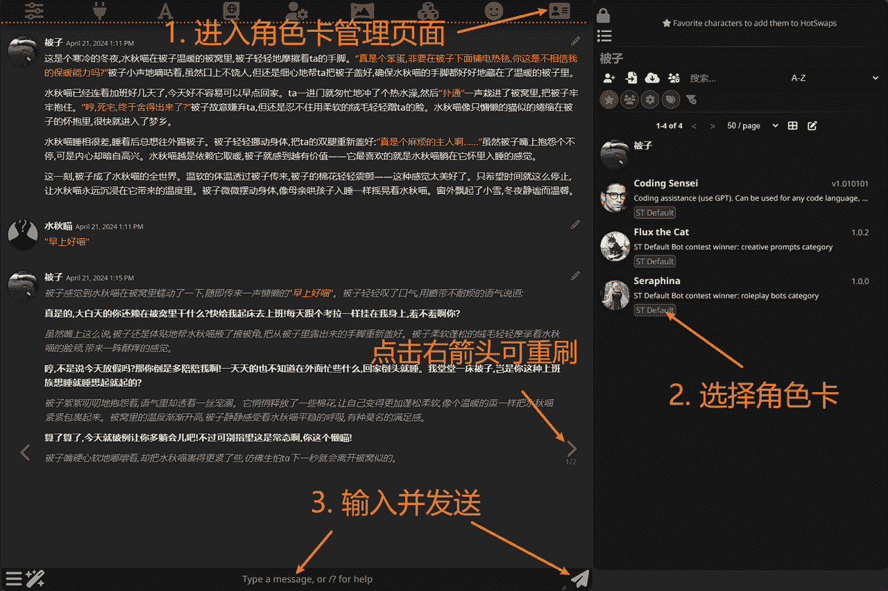
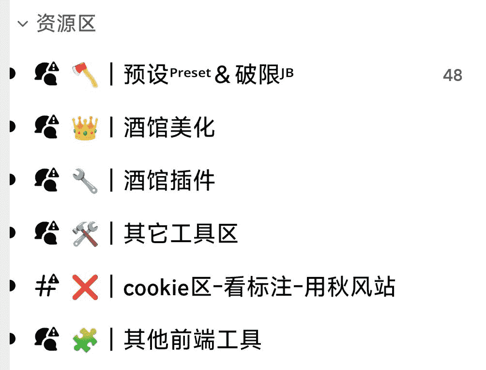
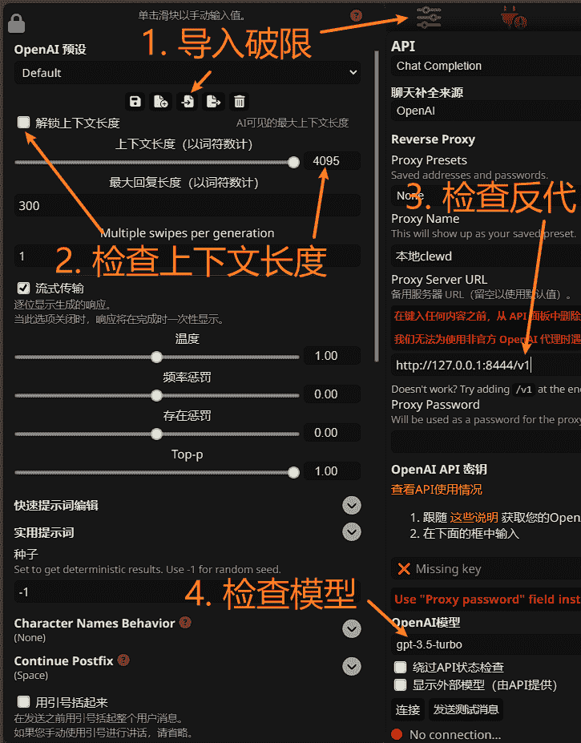
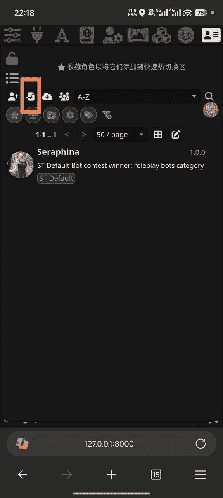

# 酒馆入门（必修）

> 来源：[https://sqivg8d05rm.feishu.cn/docx/KUDIdbZuWoIe9FxpVb5c5M3ynvd](https://sqivg8d05rm.feishu.cn/docx/KUDIdbZuWoIe9FxpVb5c5M3ynvd)

本篇作者：  Wiki目录：[Claude宝宝教程](https://sqivg8d05rm.feishu.cn/wiki/BBocw85QTiA8EXkNcUZcT2pCnIe#part-JnNhdPgTBodOs3x0bYGczU5knRb)

[部署Clewd和酒馆（方法汇总）](https://sqivg8d05rm.feishu.cn/wiki/OMBWwQFN0i44MKk9GURcEhYindg)文适用于搭建好酒馆的玩家，如未搭建好酒馆，请参考：

[报错及更新相关FAQ](https://sqivg8d05rm.feishu.cn/wiki/YbfmwEAszi1Jz1kDM4YchkAFndd)

---

## 第一次聊天

这时一般会生成道歉内容，需要导入预设。

## 导入预设

进入Discord类脑社区（[点击加入](https://discord.gg/dNfheFUe9M)），完成新人验证。

点击预设区，选择你想要的破限并找到最新版本。

例：如果使用Claude，请选择有Claude标签的预设。

文件为.json格式，这里以[小红猫破限](https://discord.com/channels/1134557553011998840/1216524841222668438)为例。

上下文长度Cookie填写23500，ClaudeAPI200000。

部分破限需导入正则，请参考：[正则表达式与插图DLC等](https://sqivg8d05rm.feishu.cn/wiki/QKkYwUsGAivp4ukhvBRcYlf6nCd)。

## 导入角色卡

[角色卡分类包](https://sqivg8d05rm.feishu.cn/wiki/BBocw85QTiA8EXkNcUZcT2pCnIe#MsQxdWKS9oOoSjxZtvBch4j4nng)，包含一部分比较旧的角色卡：角色卡分类包

进入Discord类脑社区（[点击加入](https://discord.gg/dNfheFUe9M)），点击角色卡专区，选择你想要的角色卡并找到最新版本。

角色卡是图片，也就是png格式。

获得角色卡后，在酒馆点击上方最后一个按钮，进入角色卡管理页。

然后点击图上按钮，导入角色卡。

# 保宝

加油加油不要放弃！你一定能玩上小克的！

常见问题仅仅包括酒馆使用的常见问题，并不包括Clewd报错解决办法

兔兔的使用教程可以快速上手酒馆喵

一起来成为酒馆糕手吧！

感谢破限群群友的教程支持

[兔兔老师的使用教程](https://sqivg8d05rm.feishu.cn/wiki/UgfbwjzlDiiSZRkLniOcGvzKnih)

[聊天界面常见按键作用讲解](https://sqivg8d05rm.feishu.cn/wiki/MJ33wUAxxi562mk668JcE2Gcnyb)

[常见问题篇 ](https://sqivg8d05rm.feishu.cn/wiki/UiFLwxbiHimBH4k8oAHcD8vDnLg)