# 分阶段的人设：正则表达式触发世界书（装修中）

> 来源：[https://sqivg8d05rm.feishu.cn/docx/Zow2djJ4NonkPixzESHcdZhznGd](https://sqivg8d05rm.feishu.cn/docx/Zow2djJ4NonkPixzESHcdZhznGd)

**原标题：**《通过正则表达式来自动触发世界书以节省token和更好地触发不同好感度等不同阶段下人物的性格》

> **原作者：** ——使用或修改后使用时请将此教程链接加进卡的介绍内

**润色：** [

许可证：CC BY-NC 4.0 https://cre](https://creativecommons.org/licenses/list.zh-hans)ativecommons.org/licenses/list.zh-hans

> 本教程使用该网站编写和测试正则表达式：https://regex101.com。

# 功能介绍

通常我们玩单人角色**卡时，角色**的性格或特点是单**一**的**，会遵**循写在角色描述 (Description) 里的设定。那么有没有什么办法，让角色在不同的阶段表现出不同的特点呢？比如像攻略型恋爱游戏一样，角色好感度达到一定值以后会解锁新的行为。该教程借助酒馆的正则表达式 (Regex) 和世界书，为此提供了一些思路。这里以最容易理解的“好感度系统”为例。

> 在继续阅读之前，确保你熟悉**世界书**（[点击跳转](https://sqivg8d05rm.feishu.cn/wiki/ZJ9Yw0X7JipJrlkAoT0cku54nMb)）的运作原理。

## 通常的思路

如果不使用正则表达式（以下简称“正则”），通常我们会在角色描述框或世界书内，把对角色的要求一条条列出，如图所示：

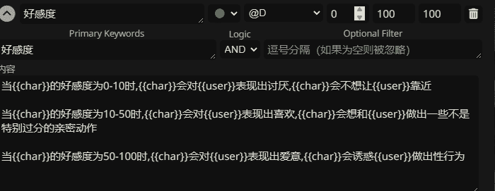

这样做有几个缺点：

1.  **导致人设的混乱。**因为 Claude 不能准确识别和计算数字，它可能会把其他阶段的人设运用在当前阶段。

1.  **难以****在对应阶段写出完整的人设****。**因为 Claude 检索上下文文字的能力有限，所以每段世界书内容都不宜太长。

1.  **浪费 tokens。**写下所有阶段的表现，意味着每次发送给 AI 的 prompt 中都包含一整段内容，而其中一部分是当前阶段用不到的。

## 改进的思路

针对以上缺点，理想的情况是，在某个阶段，只触发该阶段的人设，如图所示：

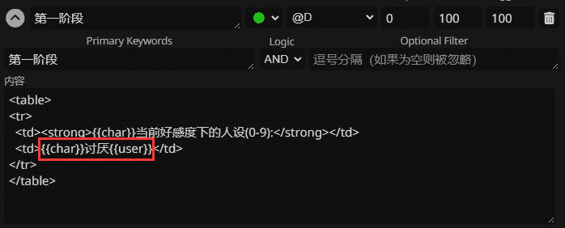

由于该世界书只有在第一阶段才能触发，因此不会出现人设混乱的情况，并且也大大增加了可以填写的 token 数量。你甚至可以写：

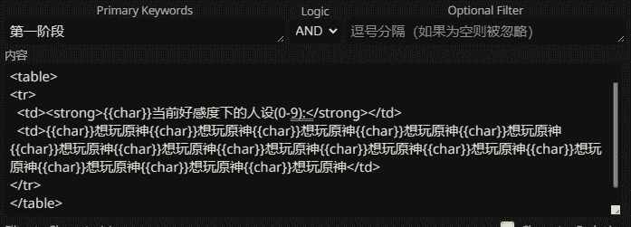

这里提供了一个示例世界书，可以下载尝试一下（现已不推荐使用 HTML 格式）：


[好感度.json](https://internal-api-drive-stream.feishu.cn/space/api/box/stream/download/all/RqBsbNUUOoyxKgxIWRpctO6DnAe)

## 正则的作用

[对于正则表达式，完全](https://github.com/ziishaned/learn-regex/blob/master/translations/README-cn.md)没有接触过的朋友可以先看一些视频或文章（点击进入github）了解其作用。简而言之，它可以通过使用字符串来描述、匹配一系列符合某个规则的字符串。

<https://player.bilibili.com/player.html?bvid=1da4y1p7iZ>

**酒馆提供了替代**匹配文**字的功能。简而言之，它可以检测**文中的字符，然后用你预期的字符来替代原有的字符。举个例子，当你的角色好感度达到10，被它匹配（即检测）到10以后，它能把原本的文字“第一阶段**”替换为“第二阶段”**。因为 Claude 的逻辑水平有限，所以 Claude 本身是没有“检测到数字，然后输出相应阶段”的能力的，因此如果不使用正则，Claude 很有可能乱输出阶段。通过正则，我们就能实现不同阶段的全自动替换。

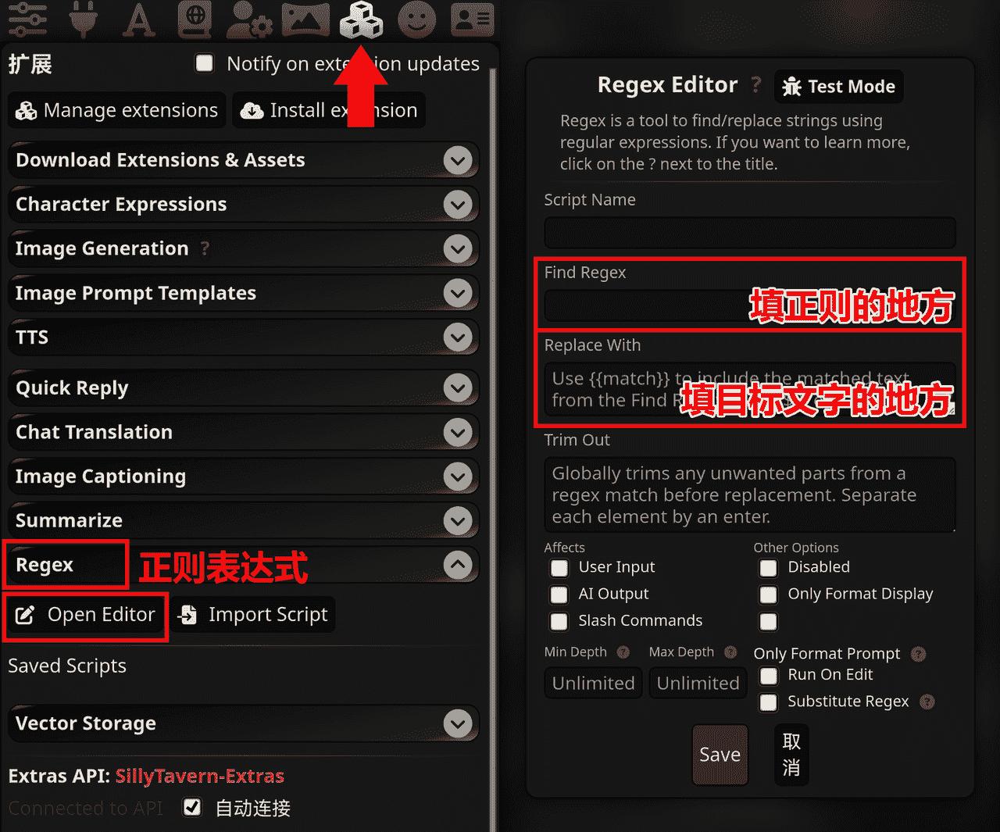

更详细的功能介绍参见[正则表达式与插图DLC等](https://sqivg8d05rm.feishu.cn/wiki/QKkYwUsGAivp4ukhvBRcYlf6nCd)。在本教程方法中，只需要勾选 AI Output 和 Run On Edit 两项即可（如下图），不要勾选其他项。

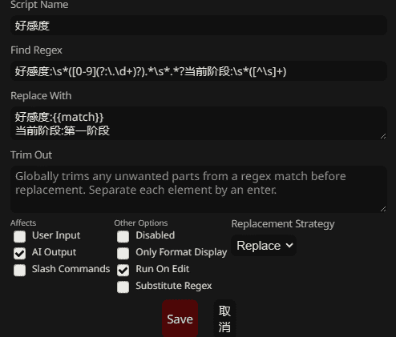

## 整体思路

当**然，在一切**开始以前，你要先确保你的状态栏中有“好感度”和“当前阶段”两项，否则从一开始就无从触发。通常，在第一条消息 (Greeting Message) 的状态栏代码块中至少需要包含以下两条：

```
好感度:0
当前阶段:第一阶段
```

> **关于全半角：**

> 如果按照下面提供的正则，“好感度”和“当前阶段”后的冒号既可以用全角“：”，也可以用半角“:”。

---

# 正则书写

综上所述，正则自动替换的方法的主要优点是：阶段分明，人设鲜明，节省 tokens。现在我将通过具体的例子，告诉你正则该如何书写。下一节再将将关键词和世界书匹配起来。

## 基本格式

现在我们需要当角色对你的好感度在0-9之间时，表现出的性格处于第一阶段（如讨厌你）。也就是说，我们需要正则匹配到“好感度:”后为0-9之间的任意一个数字之后，再把“当前阶段:”后的文字替换成“第一阶段”。

明白这一原理后，我们就可以开始写第一阶段的正则了（直接复制，不需要换行或空格）：

```
/好感度[:：][^\d]*([0-9]\b(?:\.\d+)?).*\s*.*?当前阶段[:：]\s*([^\s]+)/gm
```

这一正则可以分为六个部分：

> **/**表示格式，自行了解；

> **好感度[:：][^\d]***用于**消除数字之前**可能出现的任何乱七八糟**的非数字字符**；

> ([**0-9]**\b(?:\.\d+)?)用于匹配数字，这里表示的是匹配0-9。这一部分是你接下来所有要写的正则里面唯一需要改动的部分；

> **.*\s*.*?**用于**消除数字之后**可能出现的任何乱七八糟**的字符**；

> 当前**阶段[:：]\s*([**^\s]+)用于消除“**当前阶**段:”之后可能出现的任何乱七八糟的字符；

> **/gm**表示格式和修饰符，自行了解。

我们可以来看一下实际匹配的效果（如下图）。可以看到，不论数字5前后有什么字符，当前阶段后面有什么字符，都能被这个正则匹配到（有颜色的字符表示匹配上了）。

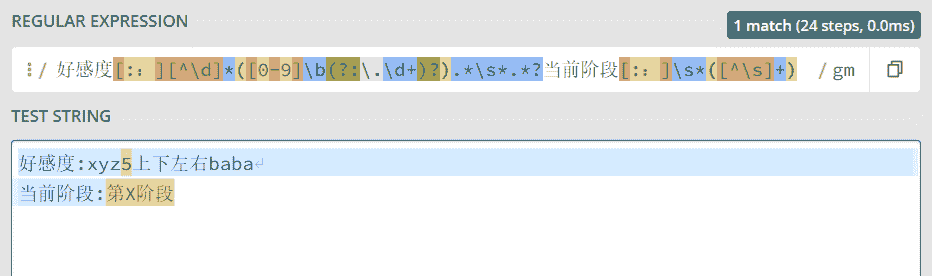

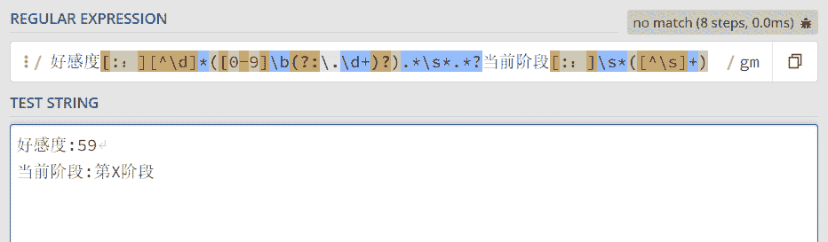

但在好感度后面输入数字59，此时就无法被([0-9]\b(?:\.\d+)?)匹配到了，这是其中的\b发挥了作用。

> \b表示**单词边界**，要求5后面不能出现任何数字、字母或下划线，否则就无法被匹配。这样做是为了避免好感度升高到10以上后，被0-9的正则误删。

---

## 改变数字

那么，如果我要进入**好感度更高的**其他阶段，或者我希望第一阶段的好感度要求不是0-9，那么该怎么写呢？首先要记住我们需要改的只有([0-9]\b(?:\.\d+)?)这一部分的正则。更准确地说，是其中的[0-9]\b部分，因为后面的(?:\.\d+)?表示匹配小数的情况，比如匹配1.5，一般不太用到，也无需更改。

### 每级10点的表达

先以10-19第二阶段为例，我们只需要把([0-9]\b(?:\.\d+)?)改成([1]\d{1}\b(?:\.\d+)?)：

```
/好感度[:：][^\d]*([1]\d{1}\b(?:\.\d+)?).*\s*.*?当前阶段[:：]\s*([^\s]+)/gm
```

这里原本的[0-9]\b变成了[1]\d{1}\b。

> [1]表示十位上的数字为1；

> \d{1}表示十位数字后面还有一位数；

> \b单词边界，这里是为了防止好感度达到100时被替换成10。

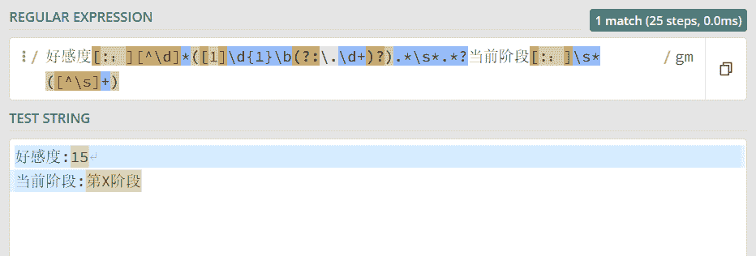

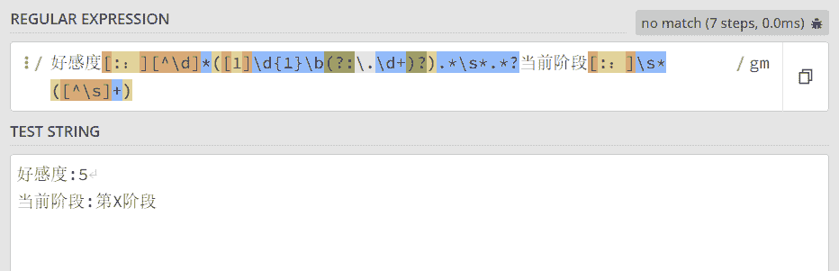

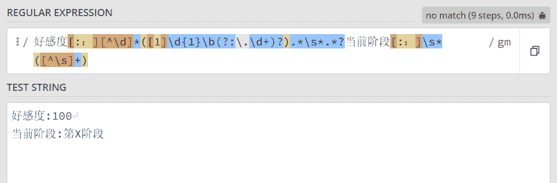

同理，([2]\d{1}\b(?:\.\d+)?)就匹配以2开头的两位数（这里可以不用\b，但加也没关系）。以此类推，只需要改变[ ]里的数字即可。

---

### 每级小于10点的表达

如果你需要10-15这种细分的，可以把([0-9]\b(?:\.\d+)?)改成([1][0-5]\b(?:\.\d+)?)：

```
/好感度[:：][^\d]*([1][0-5]\b(?:\.\d+)?).*\s*.*?当前阶段[:：]\s*([^\s]+)/gm
```

这里原本的[0-9]变成了[1][0-5]。

> [1]表示十位上的数字为1；

> [0-5]表示个位上的数字在0-5之间。

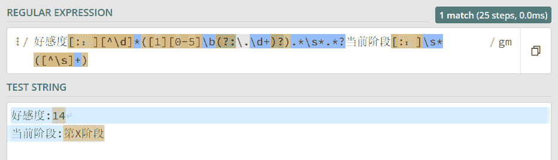

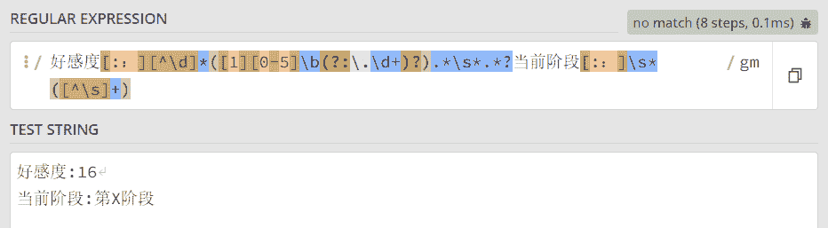

同理，十位和个位可以根据需要改变，比如60-67就是([6][0-7]\b(?:\.\d+)?)。

> **小贴士：**

> 每级10点好感度也可以用这种方式书写，如10-19就是([1][0-9]\b(?:\.\d+)?)。你可以按需自选。

---

### 每级大于10点的表达

如果你需要10-49这种大跨度的，可以把([0-9]\b(?:\.\d+)?)改成([1-4]\d{1}\b(?:\.\d+)?)或([1-4][0-9]\b(?:\.\d+)?)即可，它们的意思相同：

```
/好感度[:：][^\d]*([1-4]\d{1}\b(?:\.\d+)?).*\s*.*?当前阶段[:：]\s*([^\s]+)/gm
```

```
/好感度[:：][^\d]*([1-4][0-9]\b(?:\.\d+)?).*\s*.*?当前阶段[:：]\s*([^\s]+)/gm
```

这里原本的[0-9]变成了[1-4]\d{1}或[1-4][0-9]。

> [1-4]表示十位数字在1-4之间；

> \d{1}表示十位数字后面还有一个数字；

> 或[0-9]表示个位数字在1-9之间。

---

### 其他表达

1.  如果你希望是0-10为一级，而非0-9，那么只需要把([0-9]\b(?:\.\d+)?)改成([0-9]\b|10\b(?:\.\d+)?)即可：

```
/好感度[:：][^\d]*([0-9]\b|10\b(?:\.\d+)?).*\s*.*?当前阶段[:：]\s*([^\s]+)/gm
```

这里在[0-9]\b后面多了一个|10\b。

> | 表示“或”的意思。[0-9]\b|10\b表示0-9的数字或10都可以被匹配。

1.  如果你希望是0-19为一级，把([0-9]\b(?:\.\d+)?)改成([1]*[0-9]\b(?:\.\d+)?)或([1]*\d{1}\b(?:\.\d+)?)即可：

```
/好感度[:：][^\d]*([1]*[0-9]\b(?:\.\d+)?).*\s*.*?当前阶段[:：]\s*([^\s]+)/gm
```

```
/好感度[:：][^\d]*([1]*\d{1}\b(?:\.\d+)?).*\s*.*?当前阶段[:：]\s*([^\s]+)/gm
```

这里的[0-9]\b变成了[1]*[0-9]\b或[1]*\d{1}\b。

> *表示它前面的字符出现0次或1次。在这里[1]*就表示没有十位或者十位为1。同理，如果是0-29就可以表达为[1-2]*。

---

## 简单模板

这里我们提供了常见的五段均分的简单模板，如果不想看上文可以直接复制套用。

1.  0-19

```
/好感度[:：][^\d]*([1]*[0-9]\b(?:\.\d+)?).*\s*.*?当前阶段[:：]\s*([^\s]+)/gm
```

1.  20-39

```
/好感度[:：][^\d]*([2-3]\d{1}(?:\.\d+)?).*\s*.*?当前阶段[:：]\s*([^\s]+)/gm
```

1.  40-59

```
/好感度[:：][^\d]*([4-5]\d{1}(?:\.\d+)?).*\s*.*?当前阶段[:：]\s*([^\s]+)/gm
```

1.  60-79

```
/好感度[:：][^\d]*([6-7]\d{1}(?:\.\d+)?).*\s*.*?当前阶段[:：]\s*([^\s]+)/gm
```

1.  80-100

```
/好感度[:：][^\d]*([8-9]\d{1}|100(?:\.\d+)?).*\s*.*?当前阶段[:：]\s*([^\s]+)/gm
```

---

## 替换文字

[我们匹配](https://regex101.com/)中字符以后，要对这些字符进行替换。开启网页（点击跳转）左侧列表中的 Substitution（替换）选项，可以对酒馆的替换功能进行模拟。

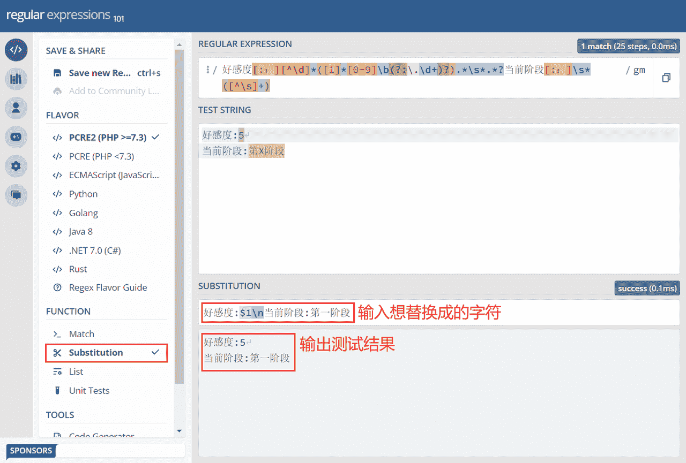

在网页测试完毕后，就可以把替换内容填写入酒馆正则替换的相应位置了。注意：

1.  在酒馆内不需要填写换行符，直接按回车即可；

1.  在酒馆内实现 $1 的替换功能，需要酒馆版本达到 1.11.3 以上。低于该版本只能使用{{match}}。

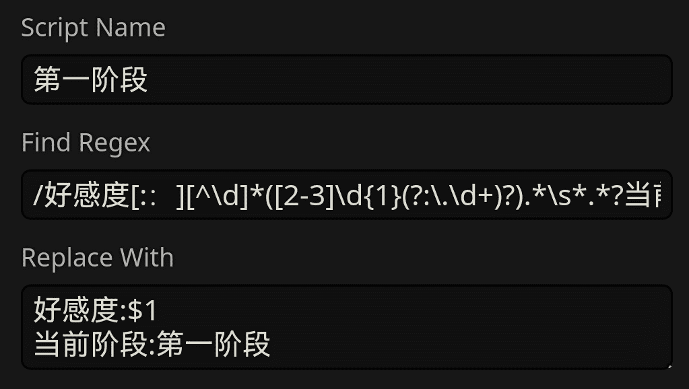

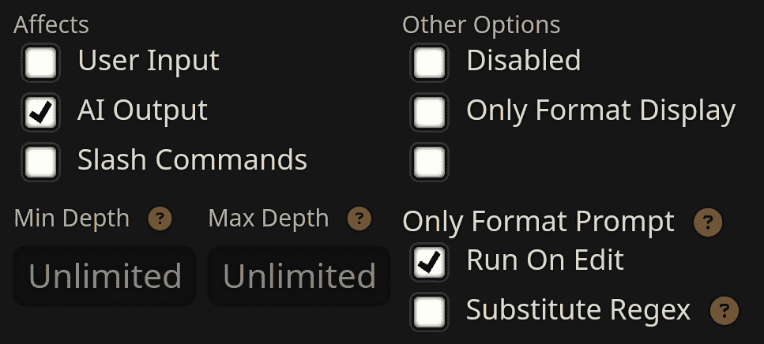

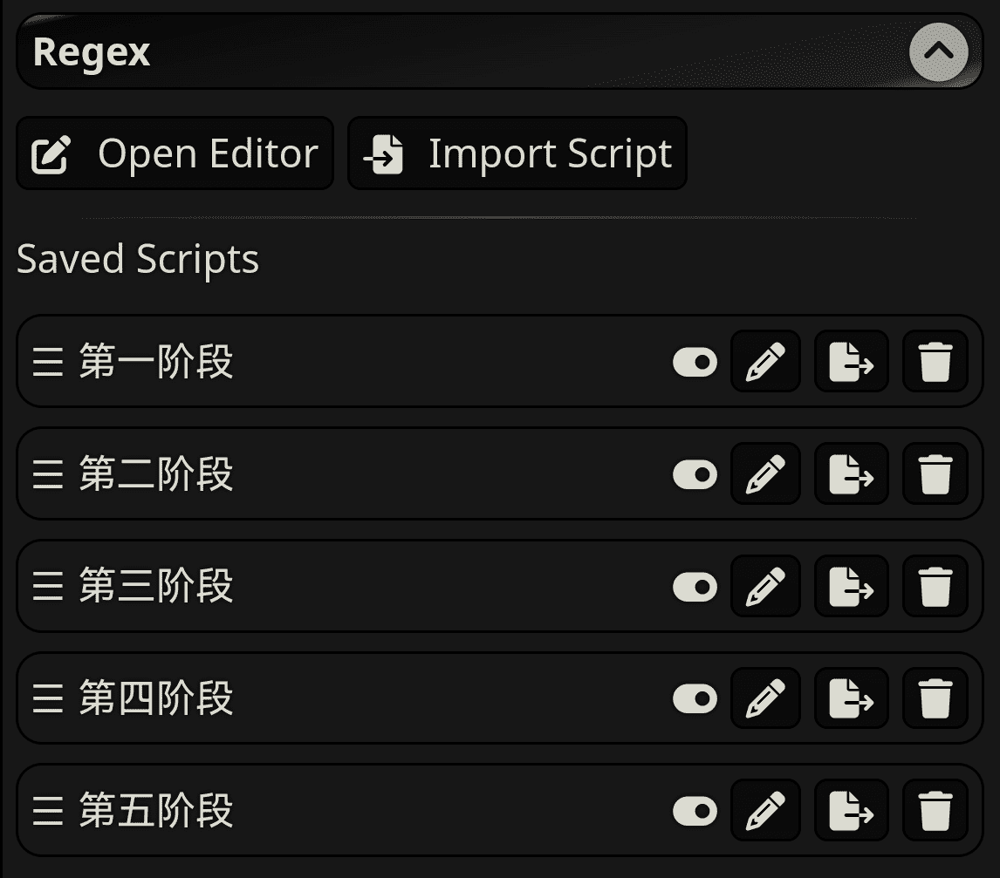

Import Script 可以导入从别处下载的正则（也需要较高版本酒馆）。这里提供最基本的格式供复制使用，第二阶段、第三阶段自行修改。

```
好感度:$1
当前阶段:第一阶段
```

> **小贴士：**

> 如果你喜欢“好感度:0/100”这种百分比的写法，你可以在$1之后加上/100。

---

# 匹配世界书

## 阶段世界书

正则匹配完后还需要激活世界书,这里以“第一阶[段”为例](https://sqivg8d05rm.feishu.cn/wiki/ZJ9Yw0X7JipJrlkAoT0cku54nMb)。再三强调，请确保你熟悉世界书（点击跳转）。

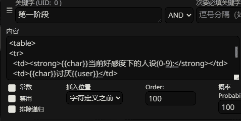

1.  **内容**

按照写角色卡的方法来写，推荐使用 YMAL 格式。（可以把设定丢进 ChatGPT 让它改成 YMAL 格式。）

1.  **插入位置**

世界书的插入位置需要你自己来控制。第一阶段人设可以靠近角色描述，但后面阶段的人设插入位置越后越好，因为一般进入第二阶段时已经进行了较多轮第一阶段对话，聊天历史中的性格对 Claude 也有很大的影响。

1.  **扫描深度**

世界书推荐设置扫描深度1-2。如果扫描深度过大，可能会导致匹配到聊天历史中的其他好感度阶段导致 prompt 混乱。

1.  **状态**

普通🟢触发即可，不要设置为常数🔵。

1.  **其他**

其他都无关紧要。顺序 (Order) 什么的无所谓，看情况自己修改。

> 因为要复制或导入正则，所以使用时候不推荐写特别多的阶段。

## 状态栏规则世界书

如**果不做限制，C**laude 有可能会使你的好感度数字飞速上**升，那么即**使加正则，游玩体验其实也**没有很大差别。所以我们通常会**希望角色好感度缓慢增加，因此需要在（通常会有的）状态栏规则内加入好感度规则。并且不要忘记在（Insert the <status> as a fenced code block…）状态栏世界书内也加入“当前阶段:{{stage}}”。

你可以参考 discord [@夏莱](https://discord.com/channels/1134557553011998840/1217842638552563713/1217842638552563713)佬的世界书，[@林夜无霜](https://discord.com/channels/1134557553011998840/1164634716926914571/1164634716926914571)佬的尤尔妮世界书也是（我玩过的中）比较详细的。这里仅提供一个思路。状态栏规则的世界书可以这样写：

> 好感度描述了{{user}}对{{char}}的言行的正负反馈值。当{{user}}对{{char}}做出友好的举动，或做出有利于{{char}}的事情时，好感度会增加。当{{user}}伤害{{char}}，使{{char}}感到难过，或者做出不利于{{char}}的行为时，好感度会减少。请注意，每次好感度增加不超过 3 分，大多数情况下只增加 1 分。

```
## Hier are some illustrative rules for the content in &quot;&lt;StatusBlock&gt;&quot;.
&lt;StatusRule&gt;
1. 好感度: The 好感度 describes the positive or negative feedback value of {{user}}&#x27;s words and actions towards {{char}}. When {{user}} acts friendly towards {{char}} or does something beneficial for {{char}}, the 好感度 increases. Conversely, when {{user}} hurts or upsets {{char}}, or behaves in ways that are detrimental to {{char}}, the 好感度 decreases. Note that the 好感度 increases by no more than 3 points each time, and it mostly increases by 1 point.
2. ……
&lt;/StatusRule&gt;
```

---

# 多人角色卡

对于多人角色卡，可能需要 xx 对 xx（包含user）的好感度：

修改正则为：

```
角色1对([^\s]*)的好感度:[^\d]*([0-9]\b(?:\.\d+)?).*\s*.*?当前阶段:\s ([^\s]+)/gm
```

同理，只需修改([0-9]\b(?:\.\d+)?)部分

替换为：

```
角色1对$1的好感度:$2
当前阶段:第一阶段
```

$1表示替换第一个小括号里的内容，即名字；$2表示替换第二个小括号里的内容，即数值（同样需要酒馆版本高于 1.11.3）

---

> 如果有问题，请在Discord 艾特 反馈。

