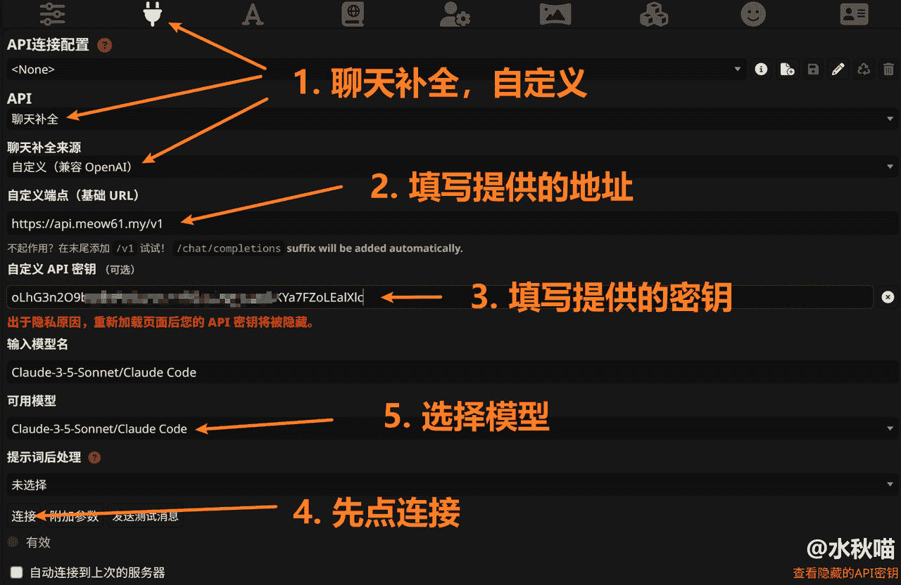
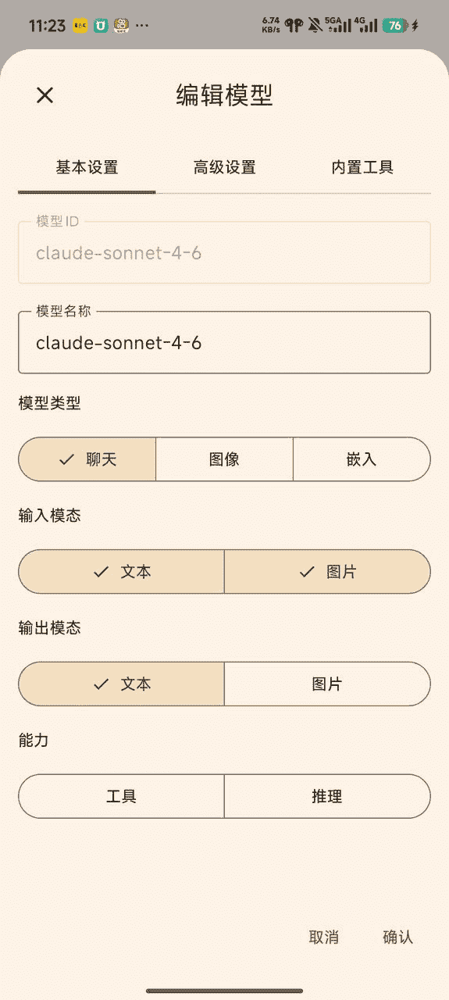

# 连接第三方API（OpenAI格式）

> 来源：[https://sqivg8d05rm.feishu.cn/docx/AHYdd9TGXo5c0axc3ARceRwpnid](https://sqivg8d05rm.feishu.cn/docx/AHYdd9TGXo5c0axc3ARceRwpnid)

猪咪笨笨酒馆：https://qm.qq.com/q/qQZAhHzSKe

本文为第三方API使用自定义（兼[容OAI格式](https://h5.m.taobao.com/awp/core/detail.htm?ft=t&id=924386149588)）[的填写教程，](https://h5.m.taobao.com/awp/core/detail.htm?ft=t&id=801966990488)黑心恰饭广告：水秋喵的小店 水秋喵的小店

[如何获取&使用Gemini API](https://sqivg8d05rm.feishu.cn/wiki/AS93wkBv6i6FPyk1a8CclaJYnvf)emini API 获取教程：

# 酒馆填写

没有酒馆的可参考教程：[部署Clewd和酒馆（方法汇总）](https://sqivg8d05rm.feishu.cn/wiki/OMBWwQFN0i44MKk9GURcEhYindg)

1.  点击插头，API选聊天补全，聊天补全来源选自定义。

1.  将API地址填写到自定义端点里，密钥填在自定义API密钥里

1.  先点连接，再选择模型，不要点测试信息，直接尝试聊天

注意：每次切换破限后都要检查本界面

纯萌新教程：[酒馆使用](https://sqivg8d05rm.feishu.cn/wiki/Nazdwr3H9inZs6k1aIQcFPA0nth)

## 错误排除

[酒馆使用/更新/报错合集](https://sqivg8d05rm.feishu.cn/wiki/UvSBw91lNiyS7Pkx4RIcJzJTnvc)

## 酒馆交流方式

+   酒馆完整教程，主页有q群[Claude宝宝教程](https://sqivg8d05rm.feishu.cn/wiki/BBocw85QTiA8EXkNcUZcT2pCnIe)

# ChatBox

官网/下载地址：https://chatboxai.app/zh

网页版：https://web.chatboxai.app/

设置 模型提供方 添加

# RikkaHub

https://rikka-ai.com/download

Claude-3-5-Sonnet/Claude Code           Claude-3-7-Sonnet-Thinking/Claude Code

Claude-3-7-Sonnet/Claude Code',                     'Claude-4-1-Opus-Thinking/Claude Code',              'Claude-4-1-Opus/Claude Code',                       'Claude-4-5-Sonnet-Thinking/Claude Code',            'Claude-4-5-Sonnet/Claude Code',                     'Claude-4-5-Sonnet/Cookie [128k]',                   'Claude-4-Opus-Thinking/Claude Code',                'Claude-4-Opus/Claude Code',                         'Claude-4-Sonnet-Thinking/Claude Code',              'Claude-4-Sonnet/Claude Code',                       'Claude-4-Sonnet/Cookie [128k]',                     'Gemini-2.5-Pro/AI Studio',                          'Gemini-2.5-Pro/GCP',                                'Gemini-2.5-Pro/GCP [24小时卡mini]',                 'claude-3-5-haiku-20241022',                         'claude-3-5-sonnet-20240620',                        'claude-3-5-sonnet-20241022',                        'claude-3-7-sonnet-20250219',                        'claude-3-7-sonnet-20250219-thinking',               'claude-opus-4-1-20250805',                          'claude-opus-4-1-20250805-thinking',                 'claude-opus-4-20250514',                            'claude-opus-4-20250514-thinking',                   'claude-sonnet-4-20250514',                          'claude-sonnet-4-20250514-thinking',                 'claude-sonnet-4-5-20250929',                        'claude-sonnet-4-5-20250929-thinking'