# 酒馆使用/更新/报错合集

> 来源：[https://sqivg8d05rm.feishu.cn/docx/Hg0OdWvwLopeXyxrvbUcoEGEnag](https://sqivg8d05rm.feishu.cn/docx/Hg0OdWvwLopeXyxrvbUcoEGEnag)

猫妈施工中...

如果有其他奇奇怪怪的错误可以在群里私聊猫妈 会第一时间把内容更新在此板块

宝宝可以浏览下方目录来进行快速跳转↓

# 1.Clewd/酒馆更新篇

## 1.1 Clewd正常更新

### 1.1.1. 云端VPS更新clewd (1panel面板)

首先进入到你的VPS服务器面板后台（注意不是hostvds账户后台）

左边菜单中找到“主机--终端”

然后在终端中输入以下两个代码：

先输入

cd clewd 然后回车

这个指令会切换到相应文件夹，然后再输入更新代码

bash update.sh

然后你的终端就会显示正在下载，下载更新完成之后去重启clewd就大功告成啦

### 1.1.2 手机Termux更新clewd

首先启动termux，来到主菜单

先选择“选项3 clewd设置”

然后选择“选项0 更新clewd”

然后选择“选项2 几乎全面更新”

接着termux就会自动下载最新版本的clewd，如果提示更新失败的话可以换个魔法再试试看

一般情况下没什么问题会自动更新完成 这个时候杀termux的后台重新进入脚本即可√

### 1.1.3 电脑（PC）更新clewd

挂魔法进入坎佬的clewd GitHub

https://github.com/teralomaniac/clewd.git

左边的分支这里选择“test”

切换好分支之后，点击右边绿色的“Code”--Download zip

下载之后解压，运行一次start.bat 等config.js文件生成之后关闭窗口，打开config.js填写好曲奇等项目之后再次启动clewd（start.bat）即可

## 1.2 Clewd更新报错“-17” 需重装Clewd

近期各位使用曲奇报错403频繁，根据指点在更新Clewd之后报错“-17”导致Clewd无法使用无限重启（如下图所示）

最简单的方法就是——重装clewd

### 1.2.1 安卓重装clewd

如果你是安卓一键包的话，重启termux--clewd设置--更新clewd--几乎全面更新

应该就可以解决这个问题

### 1.2.2 云端VPS酒馆重装clewd（1panel面板）

进入到你的服务器后台面板，在左边菜单中找到网站--运行环境--node.js--clewd

在最右侧找到删除按钮--强制删除

然后我们找到安装Clewd的文件夹页面，左边菜单--主机--文件--root

一般路径在主页面的root文件夹中

（如果在root文件夹找不到clewd文件夹的话，可以去主机--文件--opt--1panel--apps的文件夹中看一看 一般都会有clewd文件夹）

选中clewd文件夹，在上方选择删除，勾选永久删除文件夹 确认即可删除

接着我们来到左边菜单--主机--终端

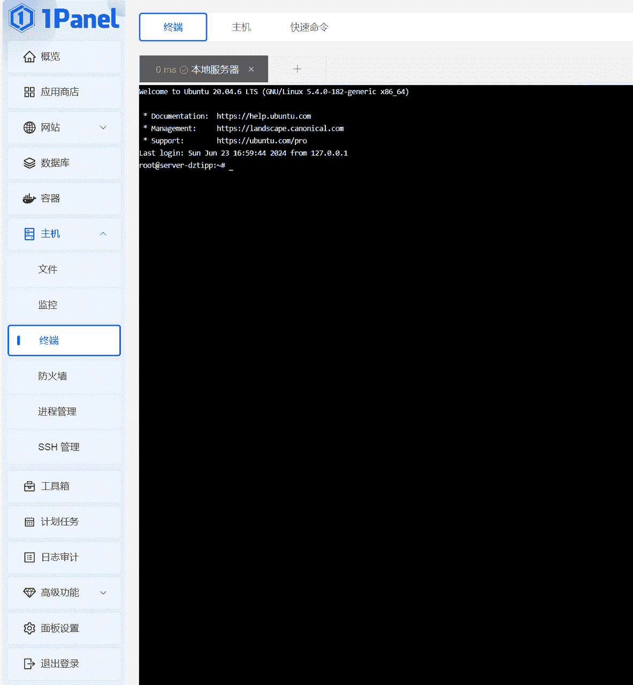

直接复制粘贴以下代码 回车即可

git clone -b test https://github.com/teralomaniac/clewd.git

看见进度条到100%之后即下载完成（在下载完成之前不要离开此页面 如果下载失败可以刷新浏览器再试一次）

接着，我们再次来到刚刚的网站--运行环境--node.js的页面，点击左上角蓝色按钮，创建运行环境

名称输入clewd

源码目录选择/root/clewd

应用端口输入8444

你只需要修改这三个项目就行，其他的不用管，具体可以参考下方图片

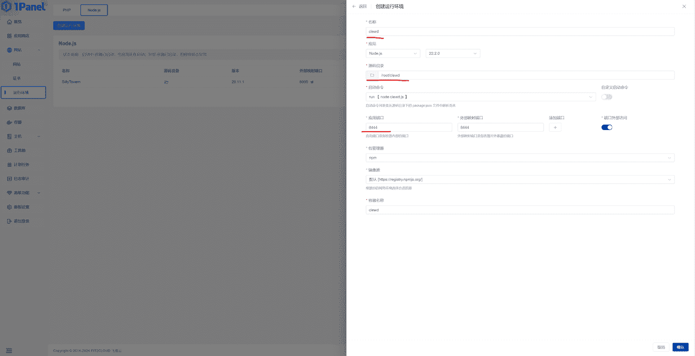

然后点击右下角确认，等待系统自动安装Clewd

等待约1分钟之后，回到Clewd文件夹，看见“config.js”文件出现之后即安装完成

（一般来说，你应该知道Clewd文件夹在哪，不然你也不会装曲奇了）

不知道文件夹在哪也没关系，刚刚上面已经写了一遍，我再搬过来↓

左边菜单--主机--文件--root

（如果在root文件夹找不到clewd文件夹的话，可以去主机--文件--opt--1panel--apps的文件夹中看一看 一般都会有clewd文件夹）

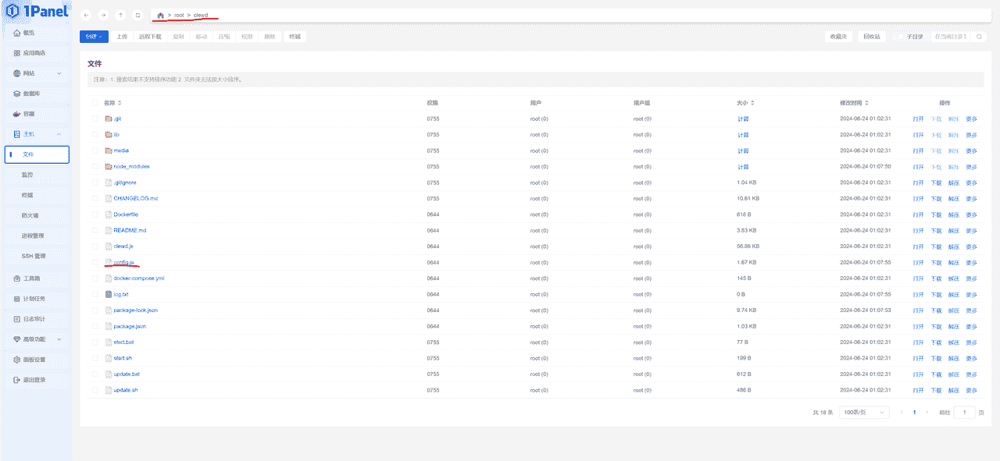

到了这里你就可以进config.js重新装填你的曲奇了，如果不会装填可以看教程2.4（来这重装clewd的应该都会装吧

OK，装填好曲奇之后，来到左边容器这里，重启一下clewd

但是不要忘记，你是新装的clewd，需要修改一下网络设置

容器--clewd--更多--编辑

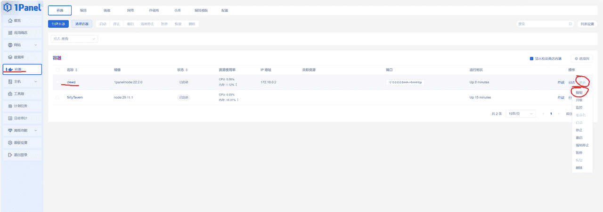

“网络”改为host，下面一栏的“IPV4”全部删除，点击右下角确认即可(clewd会自动重启 不用手动重启)

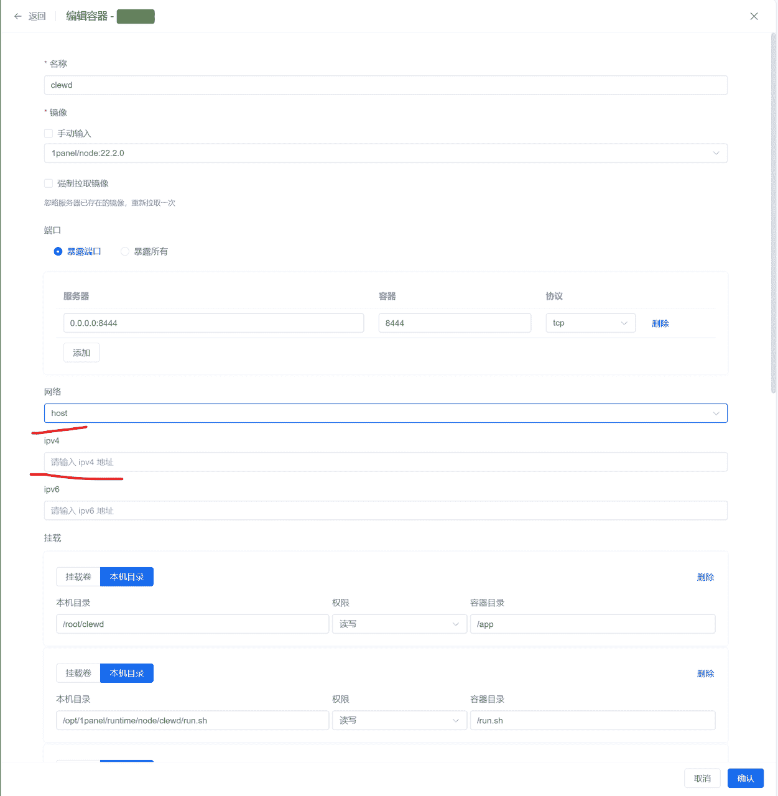

至此，clewd已经重新安装配置完成，你可以去酒馆和你的赛博老婆赛博老公继续happy了，猫妈课堂下课.

### 1.2.3 PC本地重装clewd

挂魔法进入坎佬的clewd GitHub

https://github.com/teralomaniac/clewd.git

左边的分支这里选择“test”

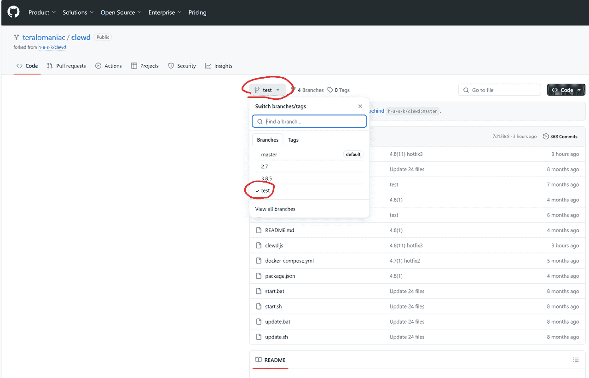

切换好分支之后，点击右边绿色的“Code”--Download zip

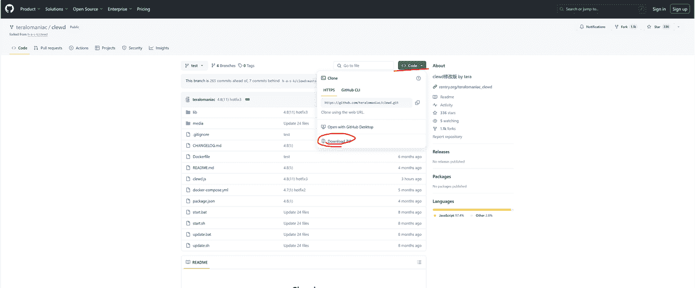

下载之后解压，运行一次start.bat 等config.js文件生成之后关闭窗口，打开config.js填写好曲奇等项目之后再次启动clewd（start.bat）即可

## 1.3 酒馆更新

### 1.3.1 云端VPS更新酒馆

先进入到你的vps面板后台（注意不是hostvds的后台哦）

来到左边菜单页面，找到“主机--终端”

进入终端后，依次输入以下的两个代码：

先输入cd指令 然后回车，切换到酒馆文件夹

cd SillyTavern

切换到酒馆文件夹之后，输入更新指令 然后回车

git pull --rebase --autostash

然后终端会自动进行下载 下载完成之后去重启酒馆(SillyTavern)即可

### 1.3.2 手机Termux更新酒馆

进入termux，等待脚本加载完成之后

选择“选项4 酒馆设置”

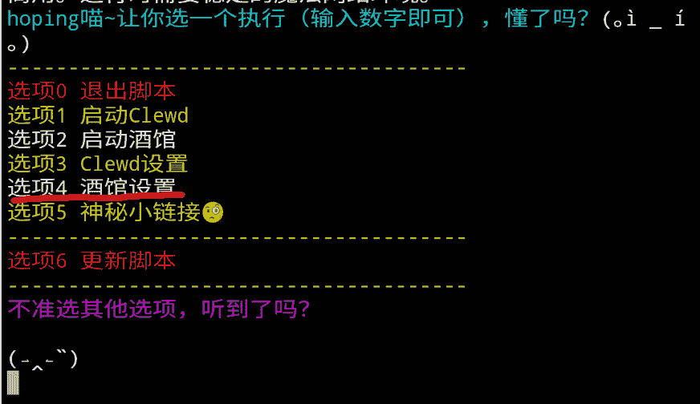

接着选择“选项0 更新酒馆”

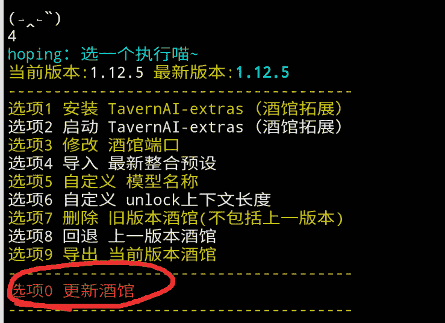

然后选择“选项2 几乎全面更新”

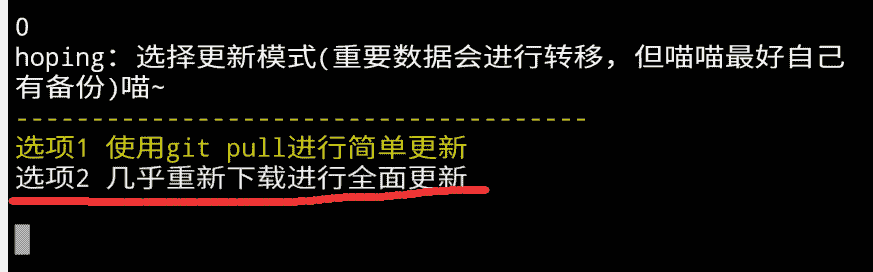

接着termux就会自动下载最新版本的酒馆，如果提示更新失败的话可以换个魔法再试试看

一般情况下没什么问题会自动更新完成 这个时候杀termux的后台重新进入脚本即可√

### 1.3.3 电脑（PC）更新酒馆

如果你的PC一键包更新失败或者出问题的话，可以试试看简单粗暴的更新方法--下载个最新的

进入酒馆的Github

https://github.com/SillyTavern/SillyTavern

然后点击绿色的“Code”会出现一个菜单

点击这个Download ZIP

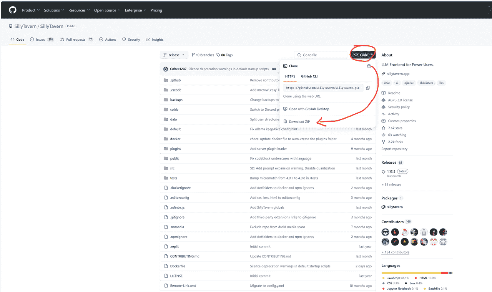

然后你的电脑会下载一份酒馆的压缩包，将其解压之后就是一个新的酒馆了

点“start.bat”会启动酒馆

然后你会发现新的酒馆数据是空的（

问题不大，找到你旧的酒馆目录，把目录下的“data”文件夹复制粘贴到新版酒馆目录下，替换掉data文件夹然后重启酒馆就行√

# API/曲奇的装填与使用

## 2.1 曲奇（Cookie）装填

### 2.1.1 VPS的酒馆如何装填cookie

首先，进入你的服务器面板，在左上角找到网站--运行环境--node.js--clewd 右侧有一个源码目录，点一下clewd的文件夹按钮

ps：手机端ui显示有bug，如果找不到这个地方的话可以直接找文件夹路径：

左边菜单--主机--文件--root--clewd--config.js

如果是早期搭建的酒馆，路径可能为旧版路径：

左边菜单--主机--文件--opt--1panel--apps-clewd--config.js

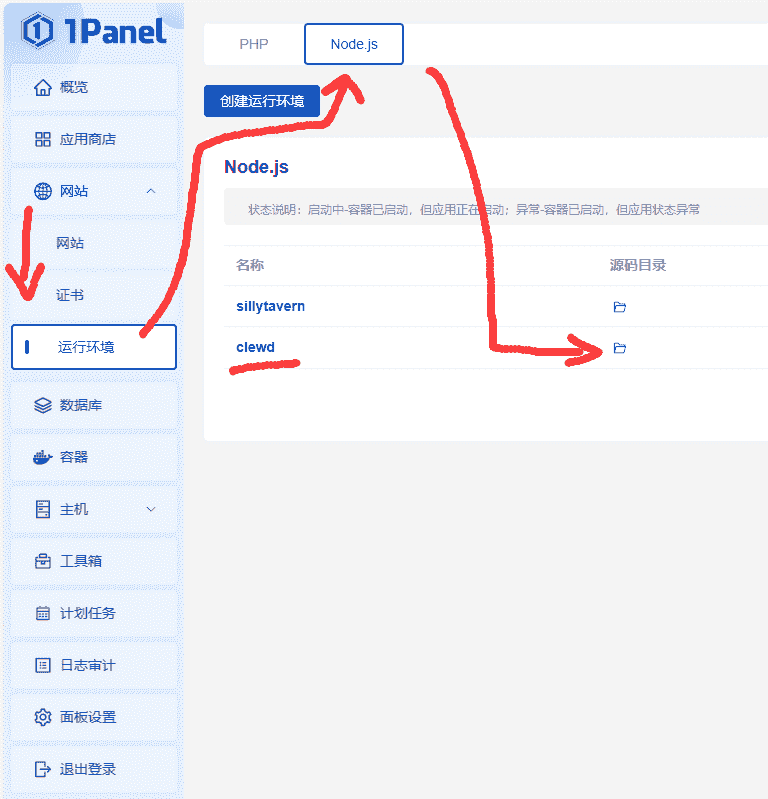

接着往下滑动，找到一个叫“config.js”的文件，将其打开

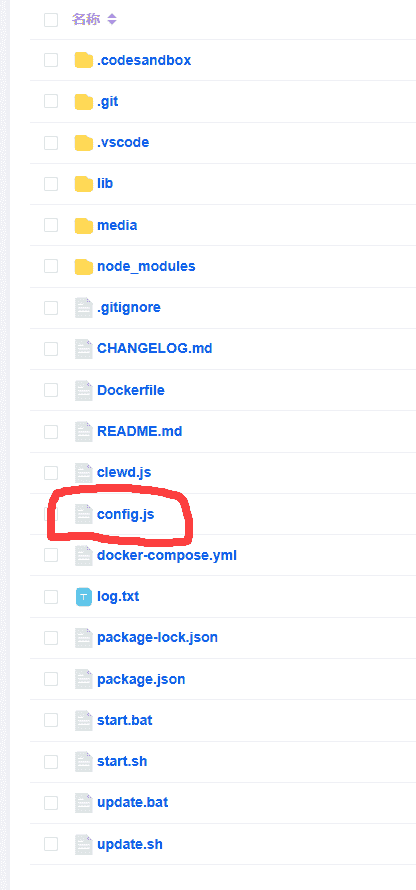

接着，将曲奇填入到“CookieArray“的中括号里，如图所示

ps：可以先来初宝网站一键整理cookie，整理之后直接复制粘贴填入即可：https://clewd.pages.dev/

注意！是填入“CookieArray”里，而不是“WastedCookie”

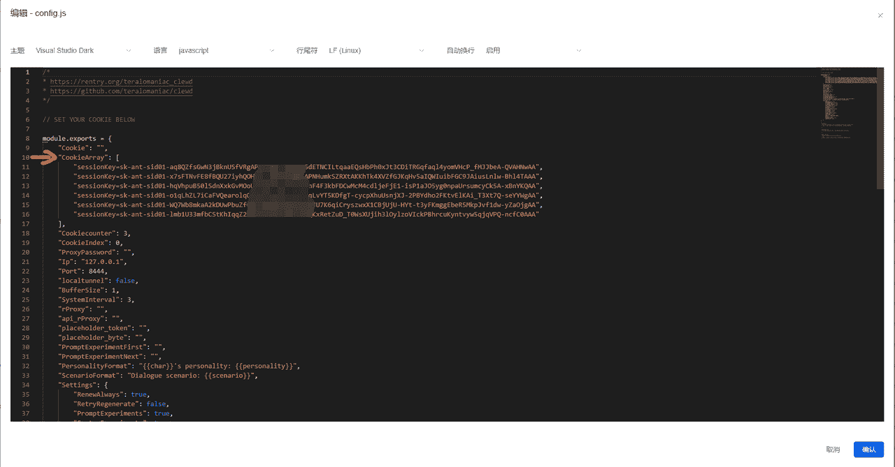

填好cookie之后点击确认，左侧菜单找到”容器“，进入”容器“之后单选clewd，重启即可

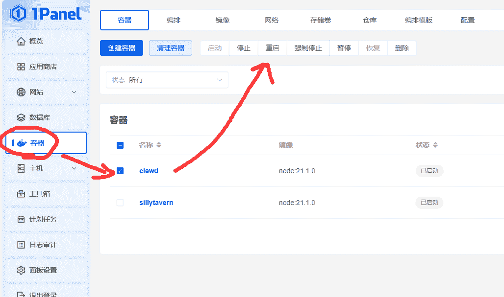

重启之后等待20秒，在clewd这个选项的最右边有个“日志”（手机端ui显示不完全，往右滑动就能看见），点开日志查看clewd运行情况,如下图所示即为成功

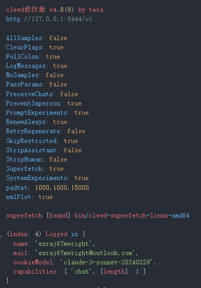

！注意 ！

如果装填完曲奇之后，酒馆里面依旧爆红无法正常使用

那 绝 对 是 你 填 装 的 时 候 出 问 题 了

来自猫妈实测血压160的怨念↑

错误排查顺序如下：

1.回到config.js里面，检查有没有红色波浪线或者其他错误提示，尤其是看看你填写的那些曲奇里

是不是每个曲奇后面都跟了英文逗号

是不是每个曲奇后面都跟了英文逗号

是不是每个曲奇后面都跟了英文逗号

英文逗号！！！！

错误案例↓（一堆曲奇里有个没有跟逗号的导致全局报错）（这个是以VPS装填曲奇举例）

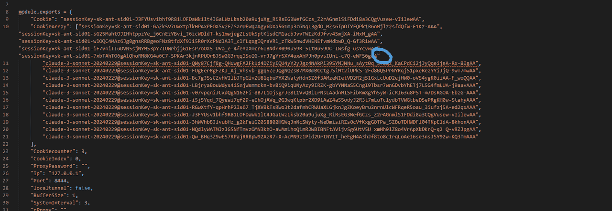

2.装填的曲奇格式不正确，曲奇的格式一般为"sessionKey=skxxxxxxxxAA"，购买曲奇自动发货前面的卡号邮箱密码不用管，只需要带引号的部分

3.检查一下是不是保存曲奇之后没有去“容器”里面重启clewd，不重启的话clewd不会刷新cookie，自然会无效

4.检查一下你的酒馆插头按钮里面的反代填写了没有，不填写反代的话自然连接不上

### 2.1.2 安卓Termux装填曲奇

首先进入termux主页

选择“选项3 clewd设置”

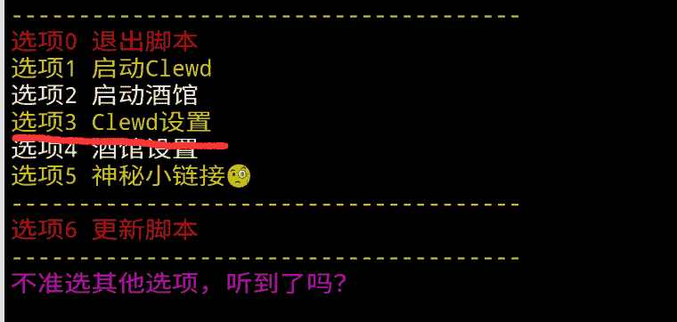

然后选择“选项3 添加cookies”

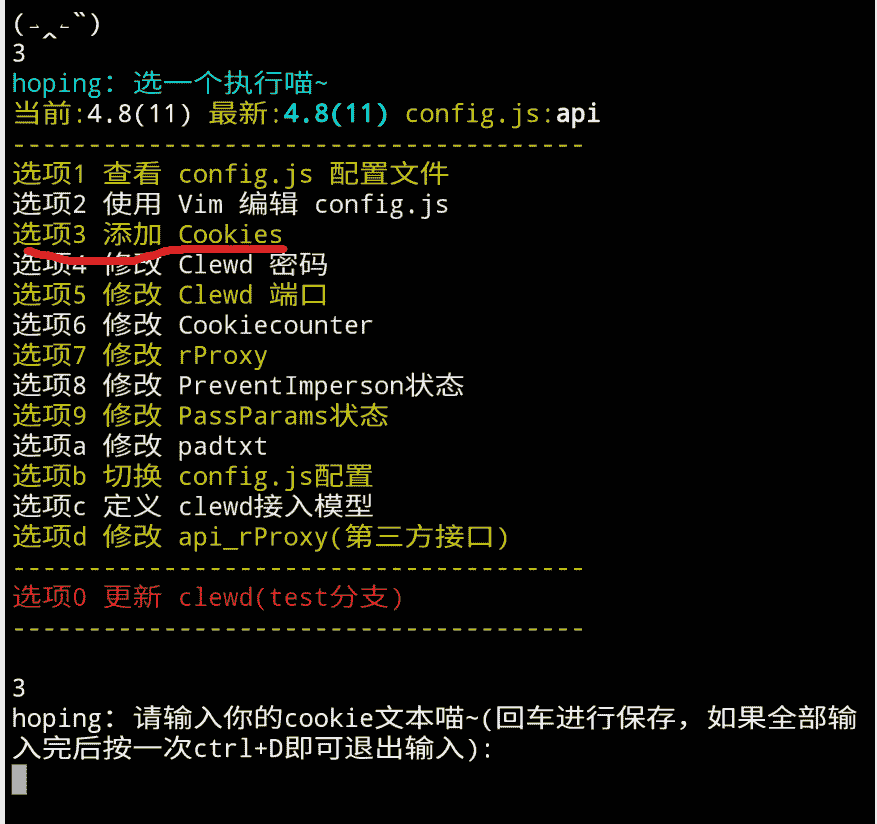

然后会显示“请输入你的cookie文本”

这个时候你就可以复制粘贴刚刚烤的曲奇或者是买的曲奇啦

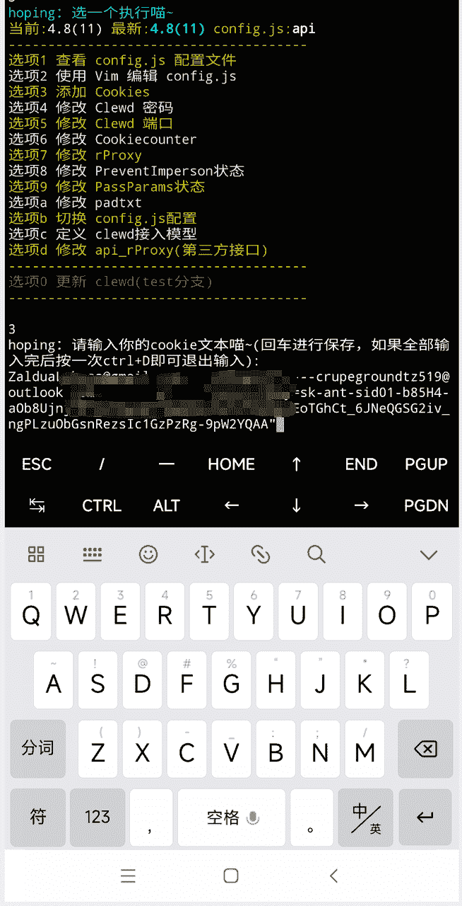

然后我们需要点击一下右下角键盘的“回车键” 这样才可以确认导入

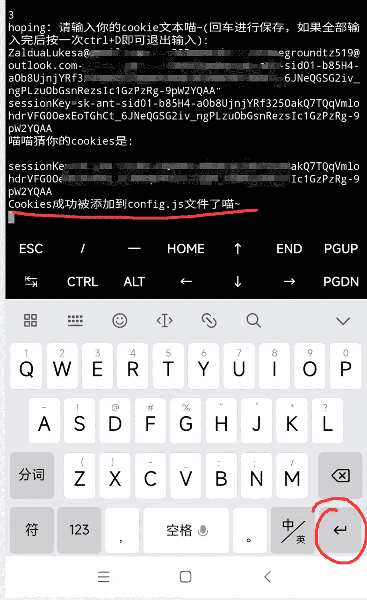

看见显示“cookies成功被添加到config.js文件了喵~”之后 才是真正导入成功哦

然后我们点击一下CTRL键，再点击小键盘的D键退出脚本就可以了√

接着去启动clewd 如果是正常显示曲奇就是没问题的了 如图所示↓

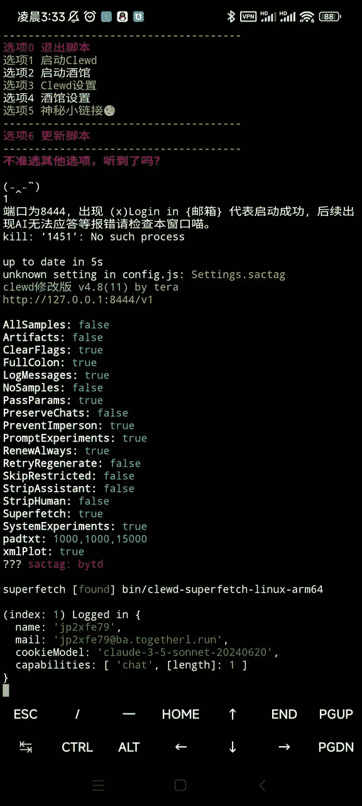

[酒馆使用/更新/报错合集](https://sqivg8d05rm.feishu.cn/wiki/UvSBw91lNiyS7Pkx4RIcJzJTnvc#HbuPdW4vZokpoJxkIjfcttflnab)图上所示，启动clewd之后加载出了曲奇和信息就是没问题的状态 接下来去酒馆里面连接clewd即可

如果遇到了307之类的报错，请看报错篇

### 2.1.3 电脑（PC）装填曲奇

首先来到初宝的一键整理曲奇网站

https://clewd.pages.dev/

把你购买的曲奇或者是搓的曲奇 全都丢进去 小工具会自动整理出所有曲奇 然后点一键复制

打开你的clewd文件夹

右键编辑config.js（或者用记事本的方式打开）

将整理过后的曲奇 放进CookieArray的中括号里

正确的格式是这样的"CookieArray":["cookie","cookie","cookie"],

然后保存文件，启动clewd就行√

注意：请确保你的符号全是英文/每个曲奇要用英文逗号隔开

否则启动clewd会出现报错

## 2.2 oai格式第三方反代使用教程

[连接第三方API（OpenAI格式）](https://sqivg8d05rm.feishu.cn/wiki/TS8zwRkqyiZk8SkCGRTcNMg6nMd)

请移步至此教学篇观看↑

# 猫妈的曲奇/API报错自助纠错篇 以及一些话

首先想让各位宝宝知道的是，你在哪里购买的cookie或者api，其商家/客服有责任帮你解决问题。请不要去DC类脑频道问东问西，类脑是各位创作者和技术人员交流技术，发挥创作的地方，不是大家的售后平台，为了维护社区良好的交流氛围请不要在DC社区说有关淘宝或者天卡周卡BC卡之类的字眼，以免影响创作者们的正常交流。如果你的酒馆使用过程中出了问题，请及时到你所购买的商家那里咨询答疑。

以下是猫妈总结的常见报错，基本上99%的报错都会在下方出现，请根据你的问题选择合适的解决方式自助解决，实在遇到了难题再去找商家咨询，谢谢宝宝喵

另外 如果出现了这些错误里没有的东西，请私聊告诉我，我会第一时间加上

## 3.1 报错自查--cookie

### 报错400 Extra inputs are not permitted （最新）

修改 clewd 的 config 文件

将 PassParams 的值改为 false  重启clewd即可

### 报错529“Overloaded”（最新）

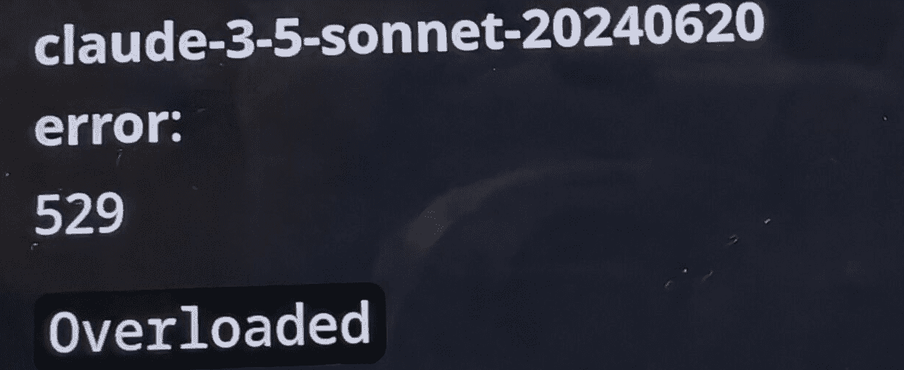

如图所示，使用曲奇报错529 overloaded

原因：A社官方服务器炸了，杂鱼服务器等官方修吧

解决方式：钓鱼的时候，你除了等还能干什么（

### 报错400“stop_sequences”错误

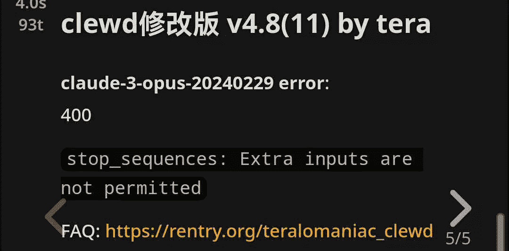

如图所示，7月29日凌晨新出现的错误 报错400“stop_sequences”

原因：A社发癫修改了某些东西，禁用了曲奇的“stop_sequences”

解决方式：更新clewd到最新即可（test分支）

### 报错403错误（常见）

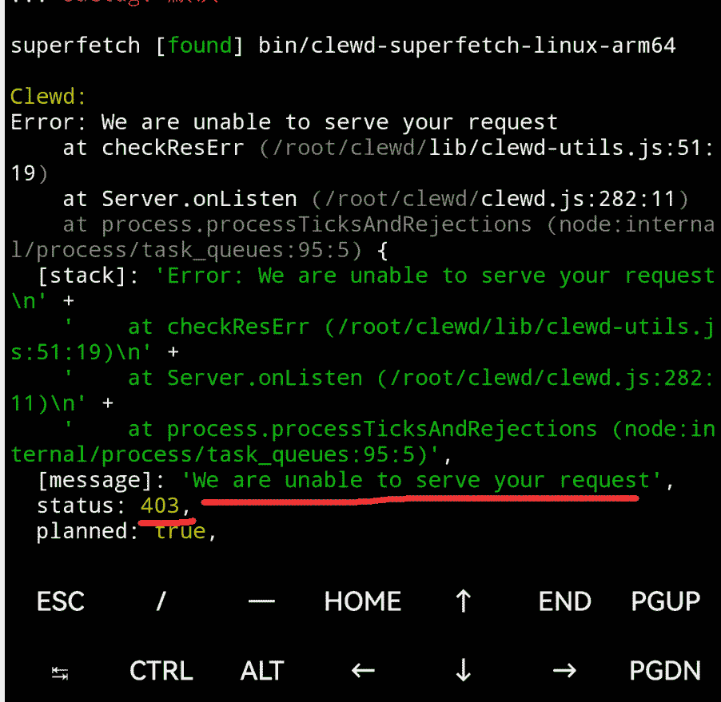

如图所示，使用曲奇出现报错为403，信息为“We are unable to serve your request”的字样

原因：魔法节点不稳定/魔法地区不支持

解决方式：换节点或者魔法重启clewd即可，如果继续报错就继续换节点，直到正常√

### 报错“Unexpected  token xxxx JSON”（307错误）（常见）

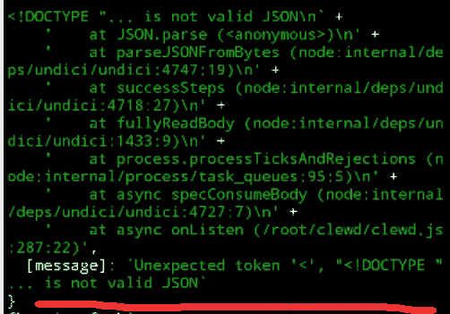

如图所示，使用曲奇出现报错为“Unexpected  token xxxx JSON”的字样，只要含有xxxxJSON的字样就是同样的问题

原因：魔法节点不稳定/魔法太杂鱼

解决方式：换节点或者魔法重启clewd即可，如果继续报错就继续换节点，直到正常√

### 报错“429 rate limit”（常见）

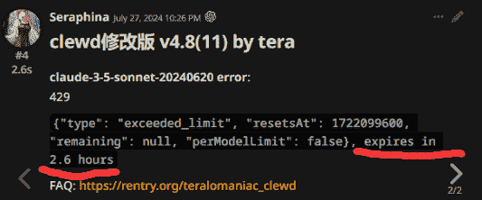

如图所示，使用曲奇时出现429报错

原因：该曲奇已经被榨干了（到达使用额度），通常普通曲奇的使用次数为10-15次CD4小时

解决方式：等待冷却时间/购买新的曲奇装填

### 报错“413 too long/Token budget exceeded."

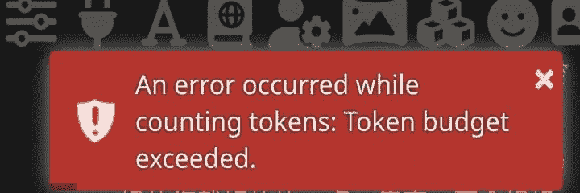

如图所示，报错413 too long（找不到图了 无所谓） 或者Token budget exceeded.

原因：上下文设置出错，需要修改

解决方式：酒馆左上角第一个按钮点开，修改上下文和回复长度 如果是曲奇的话推荐上下文修改为21000，回复长度修改为4000

### 报错“null”

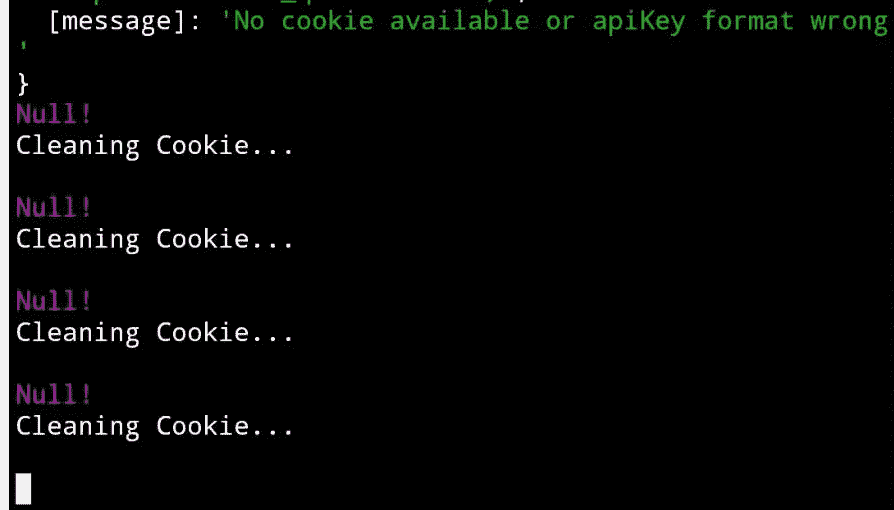

如图所示，clewd后台报错紫色“null”

原因：曲奇被杀了（悲）

解决方式：重新搓曲奇或者买新的曲奇吧，曲奇寿命短是这样的

### 无限报错“Changing Cookie...”

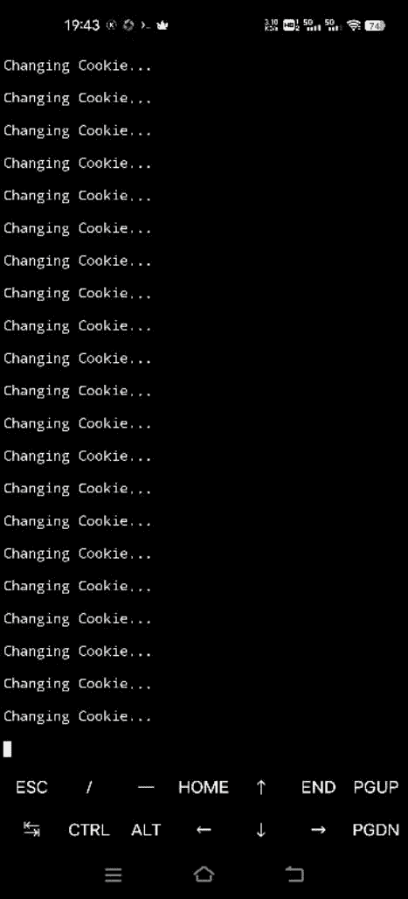

如图所示，后台无限报错“Changing Cookie...”

原因：酒馆内模型选择错误，导致clewd无法选中曲奇

解决方式：酒馆内插头里面模型选择“gpt3.5”或正确模型即可（选择gpt3.5的话会自动兼容曲奇模型）

或者更新clewd 新版clewd会解决这个问题

### 报错“400 401 404 405”

这类错误一般都比较稀有，只要是4开头的4xx错误基本上都是网络问题，换节点或者魔法重启clewd即可

## 3.2 报错自查--API

### 报错400 Extra inputs are not permitted （最新）

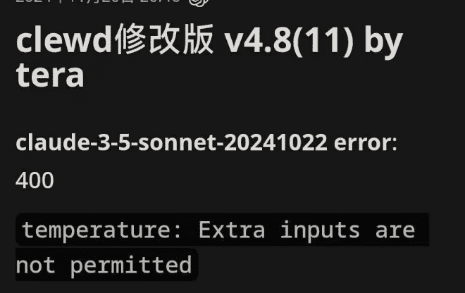

修改 clewd 的 config 文件

将 PassParams 的值改为 false  重启clewd即可

### 无效的令牌/密钥（常见）

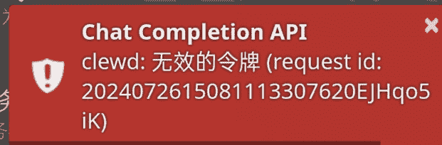

如图所示，在使用API的过程中出现“无效的令牌/密钥”报错

原因非常多，请根据以下原因自查自纠，总有一款适合你的解决方式

原因1：购买了B的卡，但使用的反代是C的反代（反过来也一样）

解决方式：买的B卡就填写B卡的中转反代，买的是C卡就填写C卡的中转反代。

原因2：因前缀oaiKey引发的无效密钥报错

解决方式：如果你是走clewd的话，需要在密钥前加上“oaiKey:”的前缀/如果你是走直连的话，则不需要加前缀

举例：

如果你走clewd，那么你的酒馆反代就是http://127.0.0.1:8444/v1 此时密钥需要加上oaiKey:的前缀

相反 如果你是直连的话 那么你的酒馆反代应该是自动发货的中转地址 此时密钥不加oaiKey:前缀

原因3：oaiKey的K 没有大写/oaiKey:的冒号用的是中文冒号（需要用英文冒号）

解决方式： 再读一遍上面的话↑

原因4：新的密钥忘记保存了，导致酒馆使用的还是旧密钥

解决方式：检查一下你现在酒馆插头里面的密钥是不是最新的，如果不是的话就填写最新的，然后插头里有一个保存按钮，点一下保存即可√

### 报错“Received no valid replies at all”（常见）

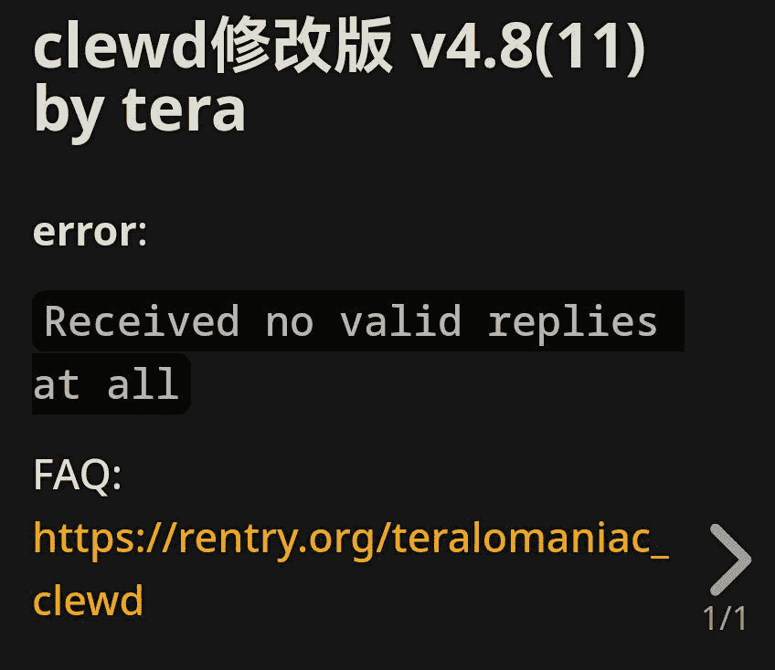

如图所示，发送消息时显示“Received no valid replies at all”

原因：API近期不稳定（9.7开始），一般常见于3.5s模型，目前3.5s渠道基本上都炸了，这个报错是接口使用该模型空回复的报错

解决方式：要么继续刷新对话硬玩3.5s，要么换其他的模型先玩当代餐

### 报错“IP concurrent request limit exceeded”（常见）

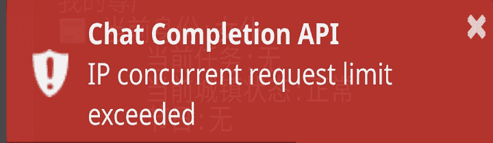

如图所示，报错“IP concurrent request limit exceeded”

原因：你所使用的节点发送请求已达到上限,你可以理解成你使用的网络节点的这个位置已经被别人占了

解决方式：更换节点，关闭梯子，切换wifi或者流量，多试试看总会成功的

尽量不要用便宜人多的热门梯子，因为用的人多了自然会被别人占坑位

### 报错“fetch failed”(常见）

如图所示，报错“fetch failed”

原因1：一般报错这个都是魔法的节点问题，或者网络不稳定

解决方式：换节点或者魔法再次对话基本上就可以解决√

原因2：有可能是你的apiproxy（中转地址）没有正确填写

解决方式：检查一下Clewd的apiproxy是否修改为正确的地址

### 无法连接API，报错“No cookies”

这个没有找到报错图

原因：你的代理密码（密钥）那里可能缺了什么东西或者密钥格式不对/API密钥那一栏要留空！

解决方式：检查一下你的密钥是不是漏了什么，猫妈猜你的oaiKey前缀的K没大写/API密钥那里什么都不填写，密钥是要填进代理密码里面的！

### B卡直连失败 无法连接到API

B卡直连失败的原因有两种

原因1：http://api.chronicgoodnose.xyz/v1

直连B卡需要在中转地址后加一个v1

原因2：反代没问题的情况下无法直连，那么就大概率是你的网络问题了，换网络试试看

通常情况下，不管自动发货给你的是什么中转地址，如果你要走直连的话，酒馆插头里面中转反代填写后检查一下有没有v1，记得加上v1

比如B卡的中转反代:http://api.chronicgoodnose.xyz/

如果你要在酒馆里直连的话 就需要加上v1

即http://api.chronicgoodnose.xyz/v1

然后再填写密钥

### C卡直连失败 无法连接到API

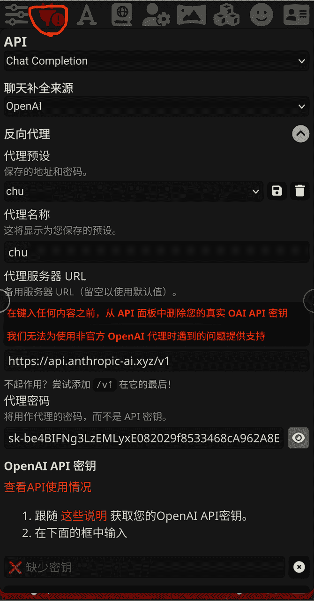

如图，在正确输入中转地址和代理密码的情况下连接不上C卡

原因：C卡对网络有一定需求，你的网络无法连接到C卡/也有可能是你的密钥不正确

解决方法：确认你的中转地址和密钥输入正确的情况下，开魔法或者换节点再连接，直到插头显示连接成功

### C卡 报错“overloaded!”

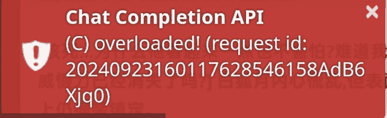

如图上所示，C卡报错（C）overloaded!

原因：当前使用的模型炸了，等初维护，先玩其他的

解决方法：先试试看刷新几次对话，如果连续几次都是这样报错，就私聊客服汇报一下什么模型报错overload，然后客服看见了会第一时间反馈，等修就好了，如果初没睡的话会第一时间修

### 报错“Unexpected  4xx 5xx”

没图

原因：报错4开头的400 401 402之类的是你的网络问题，换节点或者魔法重启clewd一般就可以解决

报错5开头的 500 502基本上是接口那边有问题，等待维护即可

### 报错“Not Found/403 404 oai_api"

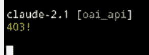

如图所示，酒馆前台显示“Not Found”/后台显示403！ 404！的报错

原因：可能是你的网络波动，或者是apiproxy没有修改正确

解决方式：先去重新修改一下apiproxy（安卓端的termux需要选项d之后手动输入y来确认修改apiproxy）

修改完之后重启clewd即可，如果还是不行可以考虑再换一下节点试试

### 报错“413 too long/Token budget exceeded."

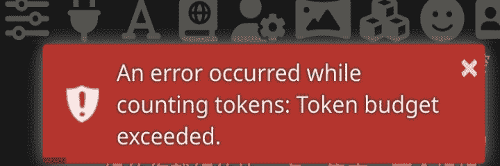

如图所示，报错413 too long（找不到图了 无所谓） 或者Token budget exceeded.

原因：上下文设置出错，需要修改

解决方式：酒馆左上角第一个按钮点开，修改上下文和回复长度 如果是API的话推荐上下文修改为80000-100000，回复长度修改为4000

## 3.3 常见导入问题和使用识图功能

不管是角色卡还是正则，一般情况下导入出错都会报错这个↑ 基本上都是下载的过程中有问题 或者文件有问题

这里猫妈妈建议你检查一下文件格式对不对

如果是角色卡，一般情况下角色卡的文件格式为png或者json

如果是正则 破限（预设） 世界书，一般的格式都是json

如果你发现你下载的东西是什么7z zip等后缀，这个后缀是压缩包，解压一下就可以把真正的文件拿出来了√

### 我破限导入和插头的反代设置哪去了？

来到酒馆上方小人头按钮

聊天窗口设置-修改为Advanced

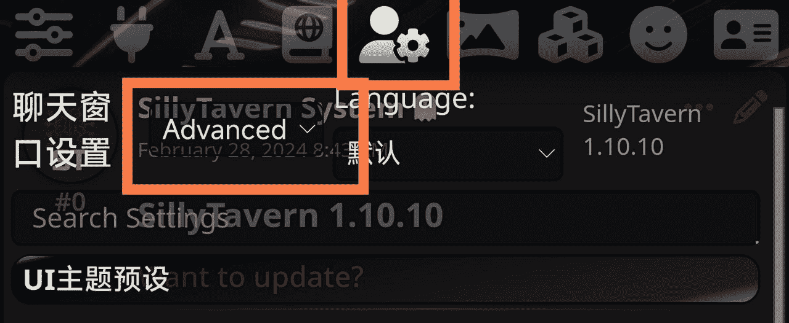

### 角色卡篇--如何正确下载角色卡

手机的话通常不会出现这种下载破损角色卡的问题，直接按住保存就行

一般情况下都是电脑浏览器保存图片会这样

正确用电脑保存角色卡的方式↓ 这里以猫妈妈我的触手巢穴为例子

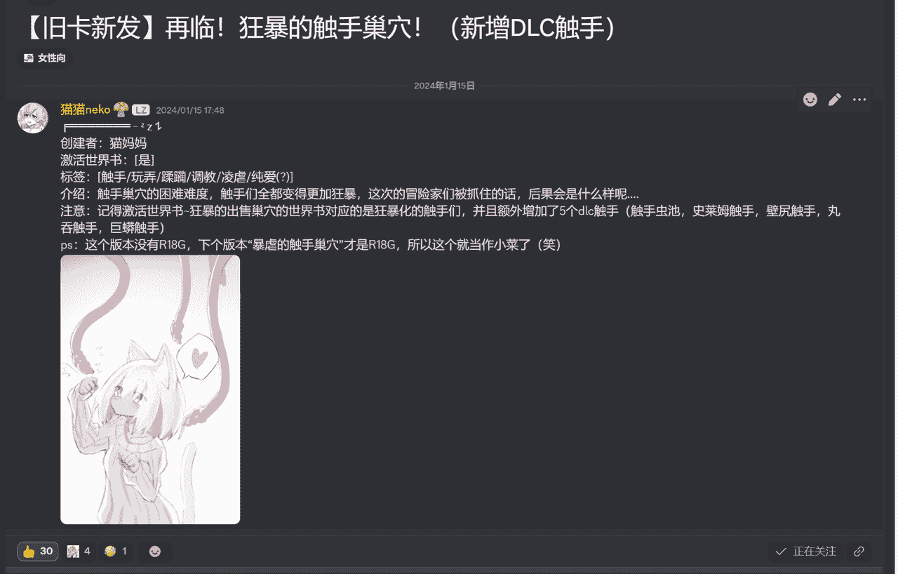

点进帖子找到角色卡之后，先点击图片

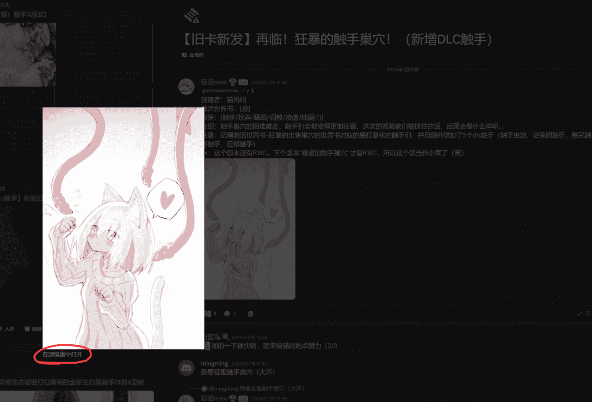

这里有一行小字“在浏览器中打开”

点一下我们会跳转到新的页面

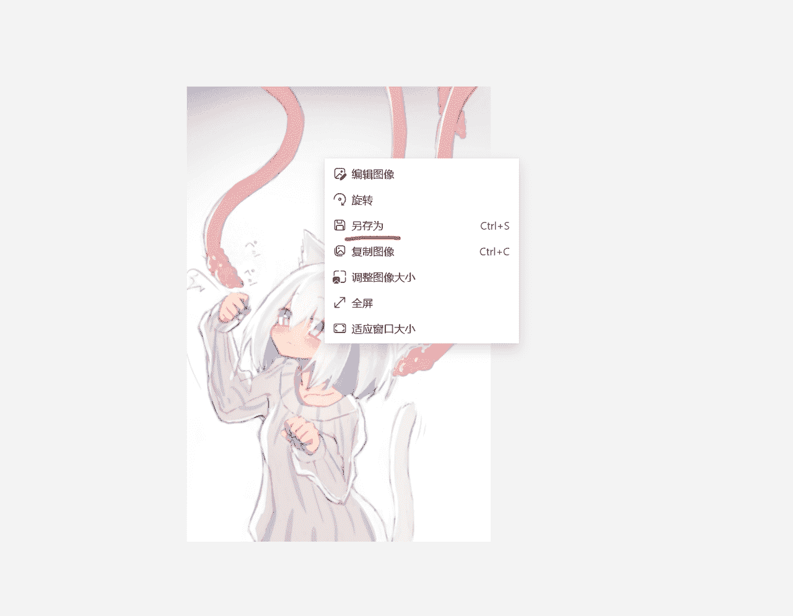

在新跳转的页面 保存/另存为

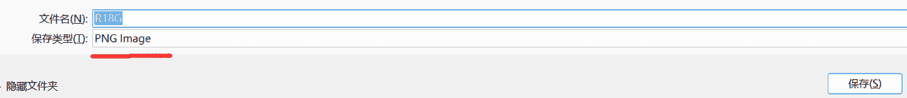

注意格式要PNG的哦 这样保存完之后就可以正常导入了

如果还是不行的话可以试试看换浏览器，常规来讲，90%的人都可以这样保存成功

### 正则篇--如何正确导入正则

这个其实没什么好讲的2333

一般来说，正则的格式是“json”

检查一下你下载的正则是不是json，因为有的作者会打包成压缩包发在dc上，猫妈也已经见了不少笨宝宝导入压缩包然后出现文件错误了（

如果下载的是7z zip rar这样的文件，请用解压工具将其解压出来，然后在导入正则

下面是导入正则的正确方法↓

点开酒馆右上角倒数第三个按钮

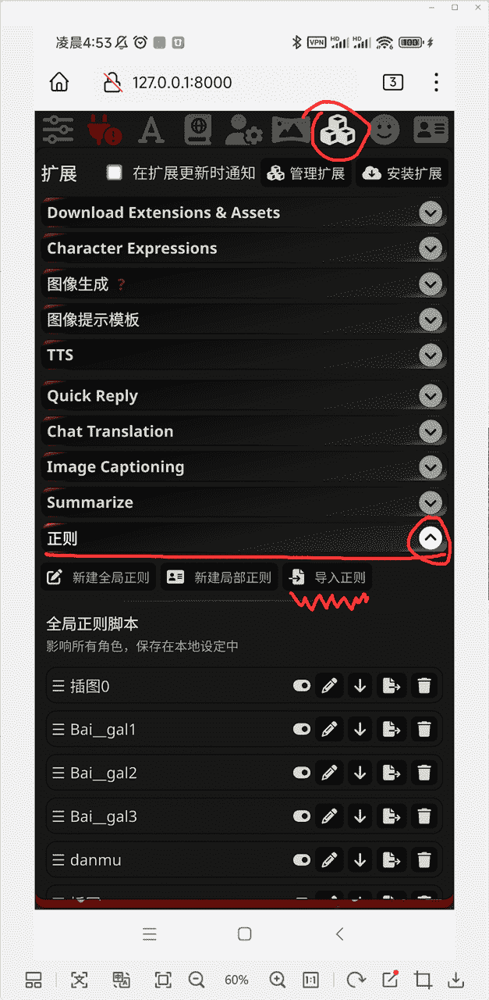

会出现一个菜单，然后有一个正则（老版酒馆没有汉化 正则叫“regex”）

然后点开正则的菜单，点一下导入正则这个按钮 选择好文件就可以导入成功了√

### 如何使用Claude的识图功能

目前只有支持识图的API接口才可以使用识图功能

首先如图所示，使用直连的方式连接到API（这里以C卡直连举例）

（注意是直连，不是走clewd，目前clewd不支持传递识图参数，所以使用clewd无法让claude进行识图。）

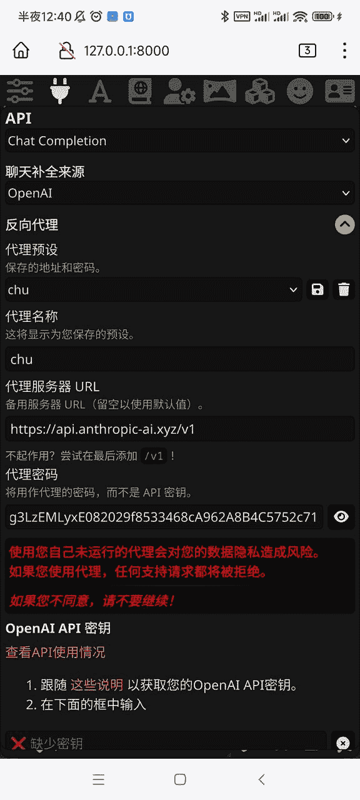

然后选择好你的模型，这里推荐使用Claude3.5sonnet，其次是Claude3Opus

（因为3.5s的识图能力比op要强）

接着来到左上角第一个按钮（就是你切换破限的那个按钮）

往下拉一下 这里有一个“发送内联图片” 要打勾

内联图片质量建议设置为“低”（因为文件过大无法上传 所以设置成低其实够用）

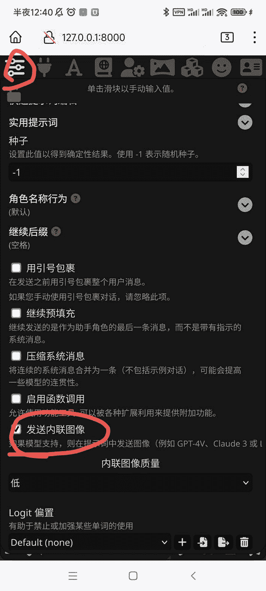

接着我们就可以找角色对话识图了，找你想要对话的角色卡之后，在对话页面的左下角有一个魔法棒的按钮 点开

选择“附加文件”

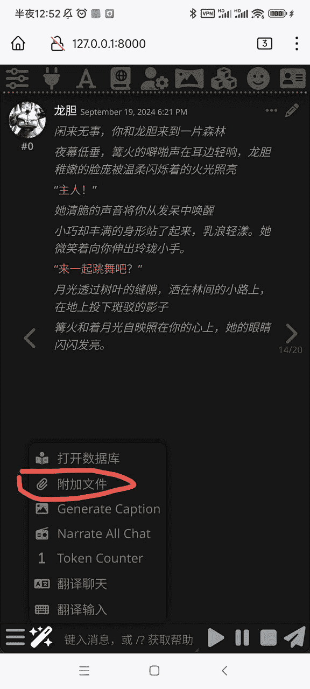

选择好附加文件之后，给角色说帮你看一下图片（或者其他的玩法都行，这里是举例）

我这里随便选一个表情包举例，然后点击发送

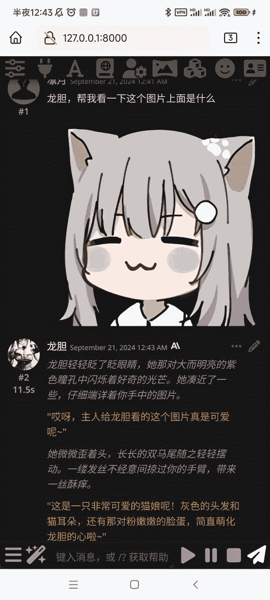

然后ai就可以识图作出回应啦~（龙胆可爱捏ww）

差不多就这么简单，如果ai无法识图请检查你是否开启了内联图片功能 或者是否是直连（C卡直连才能识图）

如果设置没问题还没做出回应估计是抽风了，重新发送一次应该就可以了√

玩的开心喵

另外附赠一下识图玩法举例，其他识图玩法可以自己想一想

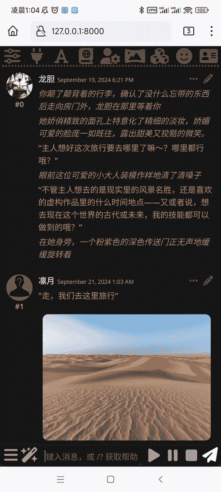

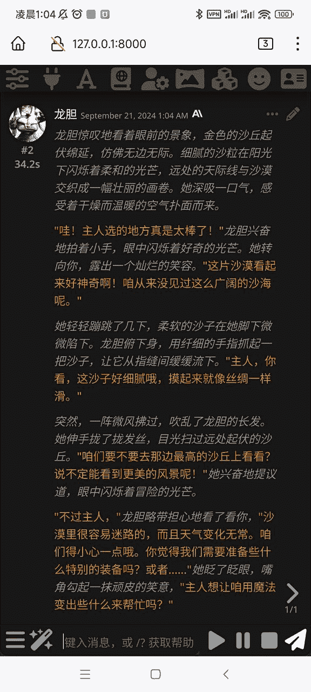