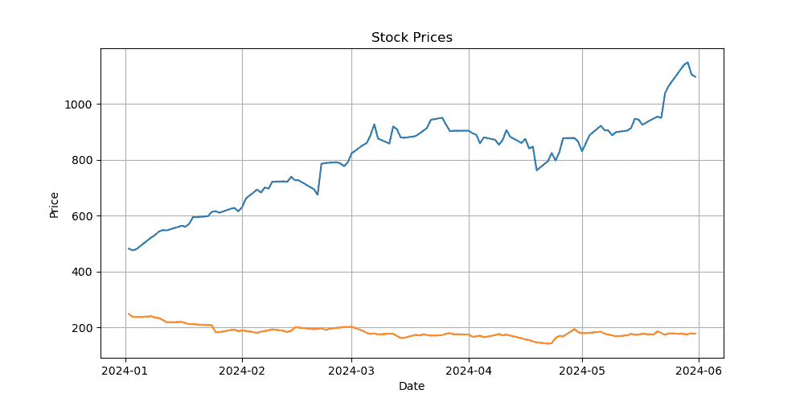

# 06-基于 AutoGen 的多智能体应用构建

> 来源：https://zsyhjtnsa5.feishu.cn/docx/MGpOdIUbIoQkBFxOgcmc7pvHnAe

## AutoGen 入门与基础对话

### AI 智能体与多智能体系统简介

AI 智能体（AI Agent）: 可以将其理解为一个能够感知其环境、进行决策并采取行动以实现特定目标的自主软件实体。它不仅仅是被动地响应，而是可以主动地规划和执行任务。

多智能体系统（Multi-Agent System，MAS）: 由多个相互作用的智能体组成的系统。这些智能体可以协作（Cooperation）、竞争（Competition）或共存（Coexistence），共同解决单个智能体难以处理的复杂问题。例如，一个智能体负责规划，另一个负责执行代码，还有一个负责撰写报告。

#### 为什么需要多智能体系统？

1. **任务分解：** 复杂任务可以分解为更小的子任务，分配给具有专门技能的智能体。
2. **专业化：** 每个智能体可以专注于特定的领域或能力（如编码、写作、数据分析）。
3. **鲁棒性：** 系统不会因为单个组件的失败而完全瘫痪。
4. **可扩展性：** 更容易通过添加新的智能体来扩展系统的功能。

### AutoGen 框架核心理念与优势

AutoGen 是由微软开发的一个开源框架，旨在简化和标准化多智能体应用的开发。其核心理念是提供构建块和模式，让开发者能够轻松地：

+ 创建多样化的智能体：定义具有不同角色、能力和配置（如使用不同 LLM）的智能体。
+ 编排智能体对话：设计和管理智能体之间的复杂交互流程，包括顺序对话、群聊等。
+ 集成工具和人类反馈：让智能体能够调用外部函数（工具）或在需要时请求人类输入。

#### AutoGen 的优势：

+ **灵活性：** 支持多种对话模式和智能体配置。
+ **可扩展性：** 易于添加新智能体或集成新工具。
+ **易用性：** 提供了高级抽象，简化了多智能体交互的实现。
+ **人类参与：** 可以无缝地将人类用户或审批者集成到智能体工作流中。

### 环境搭建与配置

#### 安装必要的库

首先，我们需要安装 AutoGen 库以及本课程后续可能用到的一些辅助库。打开您的终端或命令行工具，运行以下命令：

```
pip install --user -i https://pypi.tuna.tsinghua.edu.cn/simple pyautogen==0.2.25 chess==1.10.0 matplotlib numpy pandas yfinance
```

+ `pip install`：Python 的包管理工具，用于安装库。
+ `--user`：将库安装到用户目录下，避免权限问题。
+ `-i https://pypi.tuna.tsinghua.edu.cn/simple`：指定使用清华大学的 PyPI 镜像源，可以加快下载速度。
+ `pyautogen==0.2.25`：安装指定版本的 AutoGen 库，确保与课程内容兼容。
+ `chess`、`matplotlib`、`numpy`、`pandas`、`yfinance`：这些是后续实验中可能会用到的库，我们在此一并安装。

#### 配置 DeepSeek API

AutoGen 需要通过配置来知道如何连接到大语言模型（LLM）。我们将使用 DeepSeek API。请创建一个 Python 字典来存储配置信息。

```
# autogen_module_1_config.py
# !!! 重要提示 !!!
# 1. 请将 "YOUR_DEEPSEEK_API_KEY" 替换为您自己的 DeepSeek API 密钥。
# 2. 请确保 base_url 指向正确的 DeepSeek API 地址。
# 3. 为了安全起见，强烈建议使用环境变量等方式管理您的 API 密钥，而不是直接硬编码在代码中。
#    此处为了教学方便，我们直接写入字典。
llm_config = {
    # 模型名称，请根据您可用的 DeepSeek 模型填写
    "model": "deepseek-chat",
    # 您的 DeepSeek API 密钥
    "api_key": "YOUR_DEEPSEEK_API_KEY",
    # DeepSeek API 的基础 URL
    "base_url": "https://api.deepseek.com/v1", # 请确认这是正确的地址
    # 您可以根据需要添加其他 DeepSeek API 支持的参数，例如 temperature, max_tokens 等
    # "temperature": 0.7,
}

# 您可以将此 llm_config 保存到一个单独的 .py 文件 (例如 config.py)
# 然后在其他脚本中通过 from config import llm_config 来导入使用
```

请务必将 `"YOUR_DEEPSEEK_API_KEY"` 替换为您真实的 DeepSeek API 密钥。`base_url` 也需要确认是 DeepSeek 官方提供的正确 API 地址。`model` 则填写您希望使用的 DeepSeek 模型名称（例如 `deepseek-chat` 或 `deepseek-coder`）。

### AutoGen 核心组件：ConversableAgent

`ConversableAgent` 是 AutoGen 中最基础也是最重要的构建块之一。顾名思义，它代表一个能够参与对话的智能体。我们可以通过配置它来实现不同的行为和角色。

#### 关键初始化参数：

+ `name`（`str`）：智能体的唯一名称，用于在对话中识别身份。
+ `system_message`（`str`，可选）：设置智能体的角色、背景或指令。这会作为对话的初始上下文信息发送给 LLM，极大地影响智能体的行为和回复风格。
+ `llm_config`（`dict` or `False`）：用于配置 LLM 连接。

  + 如果提供一个字典（如此前的 `llm_config`），智能体将使用该配置连接 LLM 来生成回复。
  + 如果设置为 `False`，智能体本身不会调用 LLM，通常用于需要人类输入或仅执行代码/工具的代理（如 `UserProxyAgent` 或后续会介绍的执行器代理）。
+ `human_input_mode`（`str`，可选）：控制该智能体何时以及如何征求人类用户输入。常用选项：

  + `"ALWAYS"`：在收到消息后，总是等待人类输入，并将人类输入作为回复。
  + `"NEVER"`：从不征求人类输入，完全自主运行（除非其自身无法生成有效回复）。
  + `"TERMINATE"`：当收到无法处理或需要人类输入的请求时，如果人类用户输入 `"exit"`，则终止对话。
+ `is_termination_msg`（`Callable`，可选）：一个函数（通常是 `lambda` 函数），用于判断收到的消息是否应该终止对话。该函数接收一个消息字典作为输入，如果判断为终止消息，则返回 `True`。

现在，让我们通过实验来实际使用这些概念。

### 实验 1.1：配置与第一个智能体

在这个实验中，我们将创建一个简单的 `ConversableAgent`，配置它使用 DeepSeek API，并让它生成一个回复。

```
# experiment_1_1_single_agent.py

import pprint
from autogen import ConversableAgent

# --- 配置 DeepSeek API ---
# !!! 请确保将 YOUR_DEEPSEEK_API_KEY 替换为您的真实密钥 !!!
llm_config = {
    "model": "deepseek-chat",  # 或者您选择的其他 DeepSeek 模型
    "api_key": "YOUR_DEEPSEEK_API_KEY",
    "base_url": "https://api.deepseek.com/v1"
}

# --- 创建第一个 ConversableAgent ---
# 我们创建一个名为 "简单聊天机器人" 的智能体
# 它使用我们配置的 llm_config (DeepSeek API)
# human_input_mode 设置为 "NEVER"，意味着它将自主回复，不等待用户输入
agent = ConversableAgent(
    name="简单聊天机器人",
    llm_config=llm_config,
    human_input_mode="NEVER",
    system_message="你是一个乐于助人的AI助手。" # 可以给它一个简单的系统消息
)

# --- 与智能体进行单次交互 ---
# 我们使用 generate_reply 方法来获取智能体对单个消息的回复
# messages 是一个列表，包含一个或多个消息字典
# 每个消息字典包含 "role" (通常是 "user") 和 "content" (消息内容)
reply = agent.generate_reply(
    messages=[{"content": "你好，给我讲个关于程序员的笑话。", "role": "user"}]
)

# --- 打印回复 ---
print("智能体的回复:")
pprint.pprint(reply)

# --- 尝试不带上下文的第二次交互 ---
# 注意：generate_reply 是无状态的，它不会记住之前的交互
# 除非你在 messages 列表中提供完整的对话历史
reply_follow_up = agent.generate_reply(
    messages=[{"content": "能再讲一个吗？", "role": "user"}]
)

print("\n无上下文的第二次回复:")
pprint.pprint(reply_follow_up)
```

**代码解释：**

1. 我们导入了 `ConversableAgent` 和 `pprint`（用于美化打印输出）。
2. 定义了 `llm_config`，指定使用 DeepSeek API（请确保替换 API Key）。
3. 实例化了一个 `ConversableAgent`，命名为 "简单聊天机器人"，配置了 `llm_config` 和 `human_input_mode="NEVER"`，并给了一个简单的系统消息。
4. 调用 `agent.generate_reply()` 方法，传入一个包含用户请求的消息列表。这个方法会调用 DeepSeek API 来生成回复。
5. 打印返回的 `reply`。这通常是一个字符串，即 LLM 生成的回复内容。
6. 我们进行了第二次调用 `generate_reply`，询问“能再讲一个吗？”。注意，由于 `generate_reply` 本身是无状态的，第二次调用时 LLM 并不知道第一次讲了什么笑话，所以它的回复可能与第一次的笑话无关。要实现带有记忆的对话，我们需要使用 `initiate_chat`。

运行此脚本，您应该能看到 DeepSeek 模型生成的关于程序员的笑话。

### 实验 1.2：双智能体喜剧表演

现在，让我们更进一步，创建两个智能体，让它们像脱口秀演员一样进行对话。我们将使用 `initiate_chat` 方法来启动和管理这场对话，并设置终止条件。

```
# experiment_1_2_two_agent_comedy.py

import pprint
from autogen import ConversableAgent

# --- 配置 DeepSeek API ---
# !!! 请确保将 YOUR_DEEPSEEK_API_KEY 替换为您的真实密钥 !!!
llm_config = {
    "model": "deepseek-chat",
    "api_key": "sk-620597a739604d839c585b4dd3f746eb",
    "base_url": "https://api.deepseek.com/v1"
}

# --- 创建两个喜剧演员智能体 ---

# 演员 Cathy
cathy = ConversableAgent(
    name="Cathy",
    system_message="你的名字是 Cathy，你是一位脱口秀喜剧演员。"
                   "你擅长讲简短的笑话。"
                   "当你想结束对话时，你说 '我得走了'。", # 指导结束语
    llm_config=llm_config,
    human_input_mode="NEVER",
    # is_termination_msg 定义了如何判断 Cathy 的消息是否表示结束
    is_termination_msg=lambda msg: "我得走了" in msg.get("content", "").strip(),
)

# 演员 Joe
joe = ConversableAgent(
    name="Joe",
    system_message="你的名字是 Joe，你是一位脱口秀喜剧演员。"
                   "你的任务是从 Cathy 上一个笑话的哏（punchline）开始接下一个笑话。" # 独特的行为指令
                   "你也要讲简短的笑话。"
                   "当你想结束对话时，你说 '演出结束' 或 '再见'。", # Joe 的结束语
    llm_config=llm_config,
    human_input_mode="NEVER",
    # Joe 的终止条件可以更复杂
    is_termination_msg=lambda msg: any(phrase in msg.get("content", "").strip() for phrase in ["演出结束", "再见"]),
)

# --- 发起对话 ---
# Joe 发起对话，Cathy 是接收者
# message 是 Joe 说的第一句话
# max_turns 控制对话的最大轮数（一次来回算一轮，所以 max_turns=2 大约是4条消息）
# 对话可能会因为达到 max_turns 或触发了 is_termination_msg 而结束
chat_result = joe.initiate_chat(
    recipient=cathy,
    message="我是 Joe。Cathy，让我们开始说段子吧！你先来。",
    max_turns=3, # 稍微增加轮数，看看能否自然结束
)

# --- 分析对话结果 ---
print("\n--- 对话结束 ---")

print("\n对话历史:")
# 检查 chat_history 是否为空或 None，虽然在此场景下不太可能，但好习惯
if chat_result.chat_history:
    pprint.pprint(chat_result.chat_history)
    print("\n最后一条消息:")
    # 使用 chat_history[-1] 获取最后一条消息
    pprint.pprint(chat_result.chat_history[-1])
else:
    print("对话历史为空。")
    print("\n最后一条消息: (无)")


print("\n对话摘要 (默认):")
pprint.pprint(chat_result.summary)

print("\n对话成本 (token使用情况等):")
pprint.pprint(chat_result.cost)
```

**代码解释：**

1. 我们创建了两个 `ConversableAgent`：`cathy` 和 `joe`。
2. 每个智能体都有独特的 `system_message`，定义了它们的名字、角色和特定的对话行为（Joe 需要根据 Cathy 的 punchline 接话）。
3. 每个智能体都定义了 `is_termination_msg` lambda 函数。这个函数检查智能体生成的回复内容是否包含特定的结束语。如果包含，该智能体的这次发言就会结束整个对话。
4. 我们使用 `joe.initiate_chat(recipient=cathy, ...)` 来启动对话。Joe 先发言，Cathy 回复，然后轮流进行。


1. `max_turns=3` 设置了对话的最大轮数。对话将在达到 3 轮或任一智能体说了结束语时停止。

2. `chat_result` 对象包含了对话的完整信息，我们打印了：

+   `chat_history`： 一个包含所有消息的列表，展示了对话的全过程。
+   `last_message`： 最后一条消息的内容。
+   `summary`： `AutoGen` 生成的对话摘要（默认可能比较简单）。
+   `cost`： 与调用 LLM 相关的成本信息，通常包括使用的 token 数量等。

运行此脚本，您将看到 Cathy 和 Joe 使用 DeepSeek API 进行的多轮脱口秀对话，并可能在达到 3 轮之前因为某一方说了结束语而停止。观察 `chat_history` 可以清晰地看到它们之间的互动流程。

### 小结：

在本模块中，我们了解了 AI 智能体和多智能体系统的基本概念，认识了 `AutoGen` 框架。我们成功搭建了开发环境，配置了 DeepSeek API，并掌握了 `AutoGen` 的核心组件 `ConversableAgent` 的基本用法。通过两个实验，我们实践了如何创建单个智能体并获取回复（`generate_reply()`），以及如何创建两个智能体并让它们进行可控的、可终止的多轮对话（`initiate_chat()`）。

# 编排多智能体：顺序与协作

在模块一中，我们学习了如何创建单个智能体以及如何让两个智能体进行基础对话。现在，我们将探索更强大的多智能体交互方式。本模块将聚焦于如何编排多个具有不同职责的智能体，让它们按照预定的顺序进行对话，协作完成一个更复杂的任务，并了解如何在流程中引入人类的参与。

## 多智能体协作模式：顺序对话

当一个任务可以被清晰地分解为一系列按顺序执行的步骤时，顺序对话模式就非常有用。想象一个流水线，每个工位（智能体）负责处理一部分工作，然后将结果传递给下一个工位。

### 为什么需要顺序协作？

1. 结构化流程：适用于具有明确先后顺序的任务，如客户服务流程、报告生成步骤等。

2. 职责分离：每个智能体可以专注于流水线上的特定环节，提高效率和专业性。

3. 信息聚焦：每个对话环节可以集中处理特定的信息或子任务。

`AutoGen` 提供了 `initiate_chats` 功能来实现这种顺序对话流程。

## 使用 `initiate_chats` 编排顺序对话

`initiate_chats` 函数允许我们定义一个包含多个对话“任务”的列表。`AutoGen` 会按照列表中的顺序，依次执行这些对话。

### `chats` 列表结构：

`initiate_chats` 接收一个名为 `chats` 的列表作为主要参数。列表中的每个元素都是一个字典，定义了一个独立的对话环节（或任务）。每个字典通常包含以下关键键：

+   `sender`（`Agent`）： 发起该对话环节的智能体。
+   `recipient`（`Agent`）： 接收该对话环节消息的智能体。
+   `message`（`str` or `Callable`）： 发送的初始消息。可以是固定的字符串，也可以是一个函数（后续模块会涉及）。
+   `max_turns`（`int`）： 该对话环节的最大轮数。
+   `summary_method`（`str`， 可选）: 指定如何为这个对话环节生成摘要。常用的有：

+   `"last_msg"`： 使用最后一条消息作为摘要（或其内容）。

+   `"reflection_with_llm"`： 调用 LLM 对对话历史进行反思，生成更智能的摘要（需要提供 `summary_args`）。

+   `summary_args`（`dict`， 可选）: 当 `summary_method` 需要额外参数时使用，例如为 `"reflection_with_llm"` 提供摘要提示（`prompt`）。

+   `clear_history`（`bool`， 可选， 默认为 `True`）: 是否在当前对话环节结束后清除参与智能体的内部历史记录。设置为 `False` 可以让智能体在后续环节中“记住”之前发生的事情，但这也会增加传递给 LLM 的上下文长度。

+   ... 其他可选参数。

## 对话间的信息传递

在顺序对话中，虽然每个环节相对独立，但我们通常需要在环节之间传递信息：

1. 隐式传递（通过 `clear_history=False`）: 如果将 `clear_history` 设置为 `False`，参与该环节的智能体会保留其内部对话历史。当同一个智能体参与后续环节时，它可以“记住”之前的信息。但这会累积上下文，可能导致成本增加或超出 LLM 的上下文窗口限制。

2. 显式传递（通过摘要）: 使用 `summary_method`（尤其是 `"reflection_with_llm"`）可以生成包含关键信息的摘要。虽然 `AutoGen` 目前没有内建机制将一个环节的摘要直接作为输入注入下一个环节，但开发者可以在外部逻辑中获取 `chat_results` 中的摘要，并在构建下一个环节的 `message` 时动态地包含这些信息（这属于更高级的编排技巧）。在 `initiate_chats` 的基本用法中，摘要主要用于回顾和记录。

## 引入人类参与

有时，自动化流程需要在关键节点获取用户的输入或确认。我们可以通过以下方式实现：

+   设置 `human_input_mode="ALWAYS"`： 将某个 `ConversableAgent` 的 `human_input_mode` 设置为 `"ALWAYS"`。当轮到这个智能体发言时，它不会调用 LLM，而是会暂停并等待用户在控制台中输入内容。用户输入的内容将作为该智能体的回复，继续传递给对话流程中的下一个智能体。

+   使用 `UserProxyAgent`（更推荐）: `AutoGen` 提供了一个专门的 `UserProxyAgent` 类，它通常配置为 `human_input_mode="ALWAYS"` 并且 `llm_config=False`。它主要的作用就是代表人类用户，接收来自其他智能体的消息，并提示人类输入。我们将在后续模块或更复杂的场景中看到它的应用。在当前示例中，使用 `ConversableAgent` 并设置 `human_input_mode="ALWAYS"` 也能达到类似效果。

## 实验 2.1：客户入职流程

现在，让我们通过一个模拟产品客户入职的场景来实践顺序对话。我们将创建多个智能体，分别负责收集用户的姓名/地点、兴趣偏好，以及最后根据收集到的信息提供有趣的互动。其中一个代理将代表用户，接收其他代理的询问并等待我们输入答案。

```python
# experiment_2_1_customer_onboarding.py

import pprint
from autogen import ConversableAgent, initiate_chats

# --- 配置 DeepSeek API ---
# !!! 请确保将 YOUR_DEEPSEEK_API_KEY 替换为您的真实密钥 !!!
llm_config = {
    "model": "deepseek-chat",
    "api_key": "YOUR_DEEPSEEK_API_KEY",
    "base_url": "https://api.deepseek.com/v1"
}

# --- 创建所需的智能体 ---

# 1. 收集个人信息智能体
onboarding_personal_information_agent = ConversableAgent(
    name="收集个人信息专员",
    system_message='''你是友好的客户入职专员。
    你的任务是帮助新客户开始使用我们的产品。
    你需要收集客户的姓名和所在地。
    不要询问其他信息。当你收集到所有信息后，回复 'TERMINATE'。''',
    llm_config=llm_config,
    code_execution_config=False, # 不需要执行代码
    human_input_mode="NEVER", # 自主运行
    # 这个智能体可以通过回复 TERMINATE 来结束它当前的对话环节
    is_termination_msg=lambda msg: "terminate" in msg.get("content", "").lower(),
)

# 2. 收集主题偏好智能体
onboarding_topic_preference_agent = ConversableAgent(
    name="收集主题偏好专员",
    system_message='''你是友好的客户入职专员。
    你的任务是帮助新客户开始使用我们的产品。
    你需要收集客户感兴趣的新闻主题偏好。
    不要询问其他信息。
    当你收集到所有信息后，回复 'TERMINATE'。''',
    llm_config=llm_config,
    code_execution_config=False,
    human_input_mode="NEVER",
    is_termination_msg=lambda msg: "terminate" in msg.get("content", "").lower(),
)

# 3. 客户互动智能体
customer_engagement_agent = ConversableAgent(
    name="客户互动专员",
    system_message='''你是一位乐于助人的客户服务专员。
    你的任务是根据用户的个人信息（姓名、地点）和主题偏好，为客户提供一些有趣的内容。
    这可以是有趣的事实、笑话或者与用户偏好主题相关的简短故事。
    确保内容引人入胜且有趣！
    完成后回复 'TERMINATE'。''',
    llm_config=llm_config,
    code_execution_config=False,
    human_input_mode="NEVER",
    # 注意：这个智能体也需要一个终止条件
    is_termination_msg=lambda msg: "terminate" in msg.get("content", "").lower(),
)

# 4. 客户代理（代表人类用户）
# 这个代理配置为始终等待人类输入
customer_proxy_agent = ConversableAgent(
    name="客户代理",
    llm_config=False, # 不调用 LLM 生成回复
    code_execution_config=False,
    human_input_mode="ALWAYS", # 总是等待用户输入
    # 代理本身也可以通过特定输入结束对话，例如用户输入 "terminate"
    is_termination_msg=lambda msg: "terminate" in msg.get("content", "").lower(),
)


# --- 定义顺序对话任务列表 ---
# 这是一个包含三个对话环节的列表
chats = [
    # 第一个环节：收集姓名和地点
    {
        "sender": onboarding_personal_information_agent, # 信息专员发起
        "recipient": customer_proxy_agent,              # 询问客户代理
        "message":
            "您好！我是入职专员，很高兴能帮助您开始使用我们的产品。"
            "请问您的名字和您所在的城市是？",
        "summary_method": "reflection_with_llm", # 使用 LLM 生成摘要
        "summary_args": {
            "summary_prompt": "请将客户信息总结为 JSON 对象: "
                              "{'name': '客户姓名', 'location': '客户所在地'}",
        },
        "max_turns": 2,      # 最多允许2轮交互（专员提问 -> 用户回答 -> 专员确认/结束）
        "clear_history": True # 结束后清除历史，避免上下文累积过长
    },
    # 第二个环节：收集主题偏好
    {
        "sender": onboarding_topic_preference_agent, # 偏好专员发起
        "recipient": customer_proxy_agent,           # 询问客户代理
        "message":
                "太棒了！为了给您提供更个性化的内容，请问您对哪些新闻主题感兴趣？"
                "（例如：科技、财经、体育、娱乐等）",
        "summary_method": "reflection_with_llm",
        "summary_args": {
            "summary_prompt": "请总结客户感兴趣的主题列表: "
                              "{'topics': ['主题1', '主题2', ...]}",
        },
        "max_turns": 1,        # 只需要1轮（专员提问 -> 用户回答）
        "clear_history": False # !! 设置为 False，让互动专员能"看到"这个环节的信息 !!
                               # （虽然这里信息主要靠system message传递给互动专员，
                               #  但保留历史是一种可选的信息传递方式）
    },
    # 第三个环节：客户互动
    {
        "sender": customer_engagement_agent,  # 互动专员发起
        "recipient": customer_proxy_agent,    # 与客户代理互动
        # 注意：这里的 message 比较通用。互动专员需要依赖它的 system_message
        # 以及可能从对话历史中获取的信息（如果 clear_history=False）来生成个性化内容。
        # 一个更健壮的设计可能是在此处动态构建 message，包含之前环节收集到的信息摘要。
        "message": "现在，让我根据您的信息为您找点乐子吧！",
        "max_turns": 1,         # 互动专员提供内容 -> 用户确认/结束
        "summary_method": "reflection_with_llm",
    },
]

# --- 启动顺序对话 ---
# initiate_chats 会按顺序执行 chats 列表中的每个对话环节
# 它会返回一个包含每个环节结果的列表
print("--- 开始客户入职流程 ---")
chat_results = initiate_chats(chats)
print("--- 客户入职流程结束 ---")


# --- 打印每个环节的摘要和成本 ---
print("\n--- 各环节摘要 ---")
for i, chat_result in enumerate(chat_results):
    print(f"\n环节 {i+1} 摘要:")
    pprint.pprint(chat_result.summary)

print("\n--- 各环节成本 ---")
for i, chat_result in enumerate(chat_results):
    print(f"\n环节 {i+1} 成本:")
    pprint.pprint(chat_result.cost)
```

### 运行说明与交互：


### 运行脚本

在您的终端中运行 `python experiment_2_1_customer_onboarding.py`。

### 第一环节

- 您会看到 "收集个人信息专员" 的提问：“请问您的名字和您所在的城市是？”
- 程序会显示 >>>>>>>> 使用者請提供回覆（請輸入 `'exit'` 以退出，或按 Enter 跳過）：
- 在光标处输入您的姓名和城市（例如：“张三 北京”），然后按 Enter。
- 信息专员可能会根据其 LLM 判断是否已收集足够信息，如果判断完成，它会回复类似 "好的，信息已收到。`TERMINATE`" 的内容，结束第一个环节。

### 第二环节

- 接着，您会看到 "收集主题偏好专员" 的提问：“请问您对哪些新闻主题感兴趣？”
- 再次在提示符后输入您的兴趣（例如：“科技 人工智能”），按 Enter。
- 偏好专员收到回答后，可能会回复 "好的，谢谢您的分享。`TERMINATE`"，结束第二个环节。

### 第三环节

- 最后，"客户互动专员" 会发言，尝试根据它理解到的信息（主要来自它的 `system_message` 指导，以及可能残留的历史信息）提供有趣的内容。例如，它可能会说：“北京的朋友张三您好！既然您对科技和人工智能感兴趣，您知道吗……”
- 它发言后，由于 `max_turns=1`，这个环节通常会直接结束（除非互动专员的回复触发了客户代理的终止条件）。

### 结果输出

流程结束后，脚本会打印出每个对话环节由 LLM 生成的摘要和相关的成本信息。

### 关键点观察

- 顺序执行：对话严格按照 `chats` 列表定义的顺序进行。
- 角色扮演：每个智能体根据其 `system_message` 扮演不同的角色并执行特定任务。
- 人类输入：`customer_proxy_agent` 成功地暂停了流程，等待并接收了我们（人类用户）的输入。
- 信息流动（挑战）：在这个基础示例中，信息主要是通过智能体的 `system_message` 指导其行为，以及部分依赖 `clear_history=False` 保留的上下文。在更复杂的应用中，可能需要更明确的机制（如动态构建消息或使用共享状态）来确保信息在不同环节间准确传递。`summary_method="reflection_with_llm"` 主要用于生成回顾性的摘要，而不是直接作为下一环节的输入。

### 小结

在本模块中，我们学习了如何使用 `initiate_chats` 函数来编排一系列顺序执行的对话环节。我们了解了如何定义每个环节的参与者、消息、控制参数（如 `max_turns`）以及如何使用 `summary_method` 生成摘要。我们还实践了如何通过设置 `human_input_mode="ALWAYS"` 让代表用户的代理能够接收人类的实时输入，从而将人类无缝地集成到多智能体工作流中。通过客户入职的实验，我们直观地看到了多智能体按顺序协作完成任务的过程。

# 提升智能体能力：反思与嵌套

在前面的模块中，我们学习了如何让智能体进行基础对话和按顺序协作。然而，要让智能体系统能够处理更复杂、需要更高质量输出的任务，我们需要引入更高级的设计模式。本模块将介绍两种强大的模式：“反思”（Reflection）和“嵌套对话”（Nested Chats），并介绍一个新的智能体类型 `AssistantAgent`。

## 设计模式：反思（Reflection）

反思模式的核心思想是迭代改进。它模仿了人类在创作或解决问题时的过程：我们先产生一个初步的想法或草稿，然后对其进行审视、评估和批判，根据反馈进行修改，如此反复，直到达到满意的结果。

在 AutoGen 中，反思通常通过至少两个智能体来实现：

1. 生成者（Generator/Worker）：负责根据任务要求创建初步的输出。例如，一个 `Writer` 智能体负责撰写文章初稿。

1. 反思者（Reflector/Critic）：负责审视生成者的输出，根据一定的标准（可以在其 `system_message` 中定义）提供具体的、建设性的反馈。例如，一个 `Critic` 智能体负责评审文章的清晰度、简洁性或是否符合要求。

### 工作流程

1. 用户或另一个智能体向生成者提出任务。
1. 生成者产生初步输出。
1. 生成者的输出被传递给反思者。
1. 反思者评估输出，并生成反馈。
1. 反馈被传递回生成者。
1. 生成者根据反馈修改其输出。
1. 这个过程可以重复多轮（通过 `max_turns` 控制），直到满足某个停止条件（如反思者认为质量达标，或达到最大轮数）。

### 优势

- 提高质量：通过迭代反馈和修正，显著提升最终输出的质量。
- 模拟批判性思维：引入了评估和改进的环节，使输出更周全。
- 任务分解：将“生成”和“评估”两个不同的认知任务分配给专门的智能体。

## 核心组件：AssistantAgent 简介

目前为止，我们主要使用了 `ConversableAgent`。AutoGen 还提供了一个常用的子类：`AssistantAgent`。

`AssistantAgent` 继承自 `ConversableAgent`，并进行了一些预配置，使其更适合扮演“助手”或“执行者”的角色，特别是那些需要执行代码或使用工具（Function Calling/Tool Use，后续模块会详细介绍）的任务。

### 与 `ConversableAgent` 的主要异同

- 继承关系：`AssistantAgent` 是 `ConversableAgent` 的子类，拥有其所有功能。
- 默认 `system_message`：`AssistantAgent` 有一个默认的系统消息，指导它解决任务，并在需要时使用代码或工具。这个默认消息通常比 `ConversableAgent` 的空系统消息更具体。（我们在 Lesson 5 的示例中打印过它的默认消息）。
- 代码/工具倾向：设计上更倾向于被配置为可以生成和执行代码或调用函数。
- 通用性：`ConversableAgent` 更通用，可以扮演任何对话角色。`AssistantAgent` 则是针对特定“助手”场景的便捷封装。

在很多场景下，尤其是不涉及代码执行或复杂工具使用的场景，`ConversableAgent` 和 `AssistantAgent` 可以互换使用，关键在于如何通过 `system_message`、`llm_config`、`human_input_mode` 等参数来定义它们的具体行为。在本模块的实验中，我们将混合使用两者。

## 设计模式：嵌套对话（Nested Chats）

嵌套对话允许在一个正在进行的主对话流程中，根据特定条件动态地触发一个或多个并行的子对话流程。这非常适合需要“会中会”或“专家咨询”的场景。

想象一下主流程是项目经理（如 `Critic`）和工程师（如 `Writer`）讨论项目方案。当讨论到某个技术细节时，项目经理可以暂停主讨论，去分别咨询安全专家、性能专家和合规专家（这些是子对话），收集完所有专家的意见后，再回到主流程中，将汇总的意见反馈给工程师。

### 实现方式

`ConversableAgent`（及其子类）提供了 `register_nested_chats()` 方法来实现此功能。

### 关键参数

- `chat_queue`（list）：一个列表，定义了需要触发的嵌套对话（子对话）。列表中的每个元素通常是一个字典，结构类似于 `initiate_chats` 中的任务字典，包含 `recipient`、`message`、`max_turns`、`summary_method` 等，用于定义这个子对话如何进行。
- `trigger`（`Agent` or `str` or `Callable`）：定义触发嵌套对话的条件。
  - `Agent` 对象：当这个指定的 `Agent` 发送消息给注册了嵌套对话的 `Agent` 时，触发嵌套对话。
  - 字符串（`Agent` 名称）：同上，通过名称指定触发者。
  - `Callable`（函数）：提供一个函数，该函数接收发送方的 `Agent` 对象作为输入，如果函数返回 `True`，则触发嵌套对话。这提供了更灵活的触发逻辑。
- `reset_config`（bool，可选）：是否在嵌套对话结束后重置触发者的配置（通常保持默认）。

### 工作流程

1. 智能体 A（例如 `Critic`）注册了一个由智能体 B（例如 `Writer`）触发的嵌套对话 `chat_queue`。
1. 主对话正常进行。
1. 当智能体 B 向智能体 A 发送消息时，触发条件满足。
1. 主对话暂停。
1. AutoGen 按照 `chat_queue` 中定义的顺序，依次执行其中定义的子对话。每个子对话通常是智能体 A 与 `chat_queue` 中指定的 `recipient`（例如 `SEO_reviewer`）之间进行的。
1. 所有子对话执行完毕。
1. （可选）可以配置对子对话的结果进行汇总或处理。
1. 主对话从暂停处继续，智能体 A 现在可以利用嵌套对话中收集到的信息来生成其对智能体 B 消息的回复。

### 优势

- 动态咨询：在需要时引入专家意见，而不必预先安排在固定流程中。
- 关注点分离：将特定问题的讨论隔离在子对话中，保持主流程的清晰。
- 并行处理（概念上）：虽然实际执行可能是顺序的，但它模拟了同时咨询多方的过程。
- 模块化：可以方便地添加或移除专家（嵌套对话）。

## 实验 3.1：带反馈的博客文章创作

这个实验将结合反思和嵌套对话模式，创建一个更完善的内容创作流程。

**任务：** 撰写一篇关于 `DeepLearning.AI` 的简短（100 字以内）且引人入胜的博客文章。


```
# experiment_3_1_blog_post_reflection.py

import pprint
import autogen

# --- 配置 DeepSeek API ---
# !!! 请确保将 YOUR_DEEPSEEK_API_KEY 替换为您的真实密钥 !!!
llm_config = {
    "model": "deepseek-chat",
    "api_key": "YOUR_DEEPSEEK_API_KEY",
    "base_url": "https://api.deepseek.com/v1"
}

# --- 定义任务 ---
task = '''
写一篇关于 DeepLearning.AI 的简短（100字以内）且引人入胜的博客文章（包含标题）。
'''

# --- 创建 Writer Agent (使用 AssistantAgent) ---
# AssistantAgent 适合扮演执行具体任务的角色
writer = autogen.AssistantAgent(
    name="作家",
    system_message="你是一位作家。你需要根据给定的主题创作引人入胜且简洁的博客文章（包含标题）。"
                   "你会根据收到的反馈来修改你的文章，并给出改进后的版本。"
                   "最终只需返回你完成的作品，不要加额外的评论。",
    llm_config=llm_config,
)

# --- 创建 Critic Agent (使用 ConversableAgent) ---
# ConversableAgent 同样可以扮演 Critic 角色
critic = autogen.ConversableAgent(
    name="评论家",
    # is_termination_msg 用于让 Critic 可以通过说 "TERMINATE" 来结束整个对话
    is_termination_msg=lambda x: x.get("content", "").strip().endswith("TERMINATE"),
    llm_config=llm_config,
    system_message="你是一位评论家。你负责审阅作家的作品，并提供具体的、建设性的反馈，"
                   "以帮助提高内容的质量。请确保反馈清晰、简洁。如果认为作品质量足够好，回复 '质量达标，TERMINATE'。",
)


# --- 第一步：基础反思对话 ---
print("--- 开始基础反思流程 (Writer vs Critic) ---")

# Critic 发起对话，向 Writer 提出任务
# max_turns=2 意味着 Writer 写初稿 -> Critic 反馈 -> Writer 修改 -> Critic 最终评价/结束
res_reflection = critic.initiate_chat(
    recipient=writer,
    message=task,
    max_turns=2,
    summary_method="last_msg" # 使用最后一条消息作为摘要
)

print("--- 基础反思流程结束 ---")

# 打印最后的消息，通常是 Critic 的最终评价或 Writer 的最终修改稿
print("\n基础反思流程最后消息:")
if res_reflection.chat_history:
    pprint.pprint(res_reflection.chat_history[-1])
else:
    print("对话历史为空。")

print("\n基础反思流程摘要:")
pprint.pprint(res_reflection.summary)

print("-" * 80) # 分隔符

# --- 第二步：引入嵌套对话进行多角度评审 ---

print("\n--- 开始带有嵌套评审的流程 ---")

# 创建评审团队
# 使用 AssistantAgent，因为它们扮演执行特定评审任务的角色
seo_reviewer = autogen.AssistantAgent(
    name="SEO评审员",
    llm_config=llm_config,
    system_message="你是一位SEO评审员，以优化内容以利于搜索引擎、确保排名靠前和吸引自然流量而闻名。"
                   "请确保你的建议简洁（3个要点以内）、具体且切中要害。"
                   "在评审开始时说明你的角色。",
)

legal_reviewer = autogen.AssistantAgent(
    name="法务评审员",
    llm_config=llm_config,
    system_message="你是一位法务评审员，以确保内容合法合规、没有任何潜在法律问题而闻名。"
                   "请确保你的建议简洁（3个要点以内）、具体且切中要害。"
                   "在评审开始时说明你的角色。",
)

ethics_reviewer = autogen.AssistantAgent(
    name="伦理评审员",
    llm_config=llm_config,
    system_message="你是一位伦理评审员，以确保内容在道德上健全、没有任何潜在伦理问题而闻名。"
                   "请确保你的建议简洁（3个要点以内）、具体且切中要害。"
                   "在评审开始时说明你的角色。",
)

# 创建元评审员，负责汇总反馈
meta_reviewer = autogen.AssistantAgent(
    name="元评审员",
    llm_config=llm_config,
    system_message="你是一位元评审员，负责汇总和审阅其他评审员的意见，并就内容给出最终的综合建议。",
)

# 定义一个函数，用于生成传递给评审员的消息
# 这个函数会获取 Writer 发送给 Critic 的最新消息（即文章内容）
def reflection_message(recipient, messages, sender, config):
    print(f"\n触发嵌套对话: Critic 将向 {recipient.name} 发送审阅请求...")
    # 获取 Critic 对话历史中最后一条来自 sender (Writer) 的消息
    writer_message = recipient.chat_messages_for_summary(sender)[-1]['content']
    return f"请评审以下内容：\n\n{writer_message}"

# 定义嵌套对话列表
# 当 Writer 向 Critic 发送消息时，Critic 会依次与这个列表中的评审员进行对话
review_chats = [
    {
        "recipient": seo_reviewer,
        "message": reflection_message, # 使用函数动态生成消息
        "summary_method": "reflection_with_llm", # 让LLM总结评审意见
        "summary_args": {"summary_prompt": "将评审意见总结为JSON对象: {'评审员': '', '评审意见': ''}"},
        "max_turns": 1 # 每个评审员只进行一轮评审
    },
    {
        "recipient": legal_reviewer,
        "message": reflection_message,
        "summary_method": "reflection_with_llm",
        "summary_args": {"summary_prompt": "将评审意见总结为JSON对象: {'评审员': '', '评审意见': ''}"},
        "max_turns": 1
    },
    {
        "recipient": ethics_reviewer,
        "message": reflection_message,
        "summary_method": "reflection_with_llm",
        "summary_args": {"summary_prompt": "将评审意见总结为JSON对象: {'评审员': '', '评审意见': ''}"},
        "max_turns": 1
    },
    # 最后，让元评审员汇总所有反馈
    {
        "recipient": meta_reviewer,
        # 给元评审员一个明确的指令，让它参考之前的对话历史（包含其他评审员的意见）
        "message": "请汇总所有评审员的反馈，并对写作给出最终的修改建议。",
        "max_turns": 1
    },
]

# 将嵌套对话注册到 Critic Agent 上
# trigger=writer 表示当 Writer 发送消息给 Critic 时，触发 review_chats
critic.register_nested_chats(
    review_chats,
    trigger=writer,
)

# 重新发起带嵌套评审的对话
# 同样是 Critic 发起，Writer 响应
# max_turns=2 意味着:
# 1. Critic -> Writer (任务)
# 2. Writer -> Critic (初稿) -> 触发嵌套评审 (Critic 与 Reviewers 对话) -> Critic 汇总反馈给 Writer
# 3. Writer -> Critic (修改稿)
# 4. Critic -> Writer (最终评价/TERMINATE) 或 Critic -> 触发嵌套评审 -> ... (如果需要多轮修改)
res_nested = critic.initiate_chat(
    recipient=writer,
    message=task,
    max_turns=2, # 保持2轮主对话，观察嵌套流程
    summary_method="last_msg"
)

print("--- 带有嵌套评审的流程结束 ---")

print("\n嵌套评审流程最后消息:")
if res_nested.chat_history:
    pprint.pprint(res_nested.chat_history[-1])
else:
    print("对话历史为空。")

print("\n嵌套评审流程摘要:")
pprint.pprint(res_nested.summary) 
```

## 代码解释与运行观察

### 第一步：基础反思

- 我们创建了 `writer` 和 `critic`。让 `Writer` 生成初稿，`Critic` 提供反馈
- `critic.initiate_chat()` 启动对话，`max_turns=2` 允许一轮写作和一轮反馈/修改。
- 运行到分隔符 `---` 时，基础反思流程完成。观察输出，可以看到 `Writer` 的初稿和 `Critic` 的反馈（或者 `Writer` 的修改稿）。

### 第二步：嵌套评审

- 我们创建了 `seo_reviewer`、`legal_reviewer`、`ethics_reviewer` 和 `meta_reviewer`。
- `reflection_message` 函数用于动态地将 `Writer` 的最新文章内容传递给各个评审员。
- `review_chats` 列表定义了嵌套对话的顺序和内容，最后由 `meta_reviewer` 汇总。
- `critic.register_nested_chats(review_chats, trigger=writer)` 是关键步骤，它告诉 `critic`：当 `writer` 给你发消息时，先暂停主对话，去执行 `review_chats` 里定义的这些子对话。
- 再次调用 `critic.initiate_chat()`。当 `writer` 发送第一稿给 `critic` 时，您会在控制台看到类似 `触发嵌套对话: Critic 将向 SEO评审员 发送审阅请求...` 的打印信息，表明嵌套对话已启动。
- `critic` 会依次与 SEO、Legal、Ethics 评审员进行一轮对话，然后与 `meta_reviewer` 对话以获取汇总建议。
- 之后，主对话恢复，`critic` 会将（可能结合了所有评审意见的）反馈发送给 `writer`。
- 由于 `max_turns=2`，`writer` 会进行一次修改，然后 `critic` 给出最终评价。
- 观察最终的输出和摘要，对比第一步的结果，理论上第二步的结果应该更全面，因为它考虑了多个角度的评审意见。

### 注意

LLM 的输出具有随机性，每次运行结果可能略有不同。评审员和 `Critic` 的反馈质量也依赖于 DeepSeek 模型的能力和给定的 `system_message`。

### 小结

在本模块中，我们深入探讨了两种提升智能体系统能力的关键设计模式：反思（Reflection）和嵌套对话（Nested Chats）。我们了解了反思模式如何通过迭代反馈改进输出质量，并简要介绍了 `AssistantAgent` 及其与 `ConversableAgent` 的关系。更重要的是，我们学习了如何使用 `register_nested_chats` 方法实现嵌套对话，允许智能体在主流程中动态地咨询其他“专家”智能体。通过带反馈的博客文章创作实验，我们先实践了基础的反思流程，然后将其扩展为一个包含多角度嵌套评审的更复杂、更健壮的内容生成工作流。

# 智能体与外部工具交互

前面的模块主要关注智能体之间的对话和协作。然而，要让智能体真正强大并能解决现实世界的问题，它们需要能够与外部世界进行交互——获取实时信息、执行计算、操作数据库或控制其他系统。这就是“工具使用”（Tool Use）或“函数调用”（Function Calling）设计模式发挥作用的地方。

## 设计模式：工具使用（Tool Use / Function Calling）

工具使用模式允许我们将外部功能（如 Python 函数、API 调用等）封装成“工具”，并让智能体能够在需要时通过对话“调用”这些工具。

### 为什么需要工具？

1. **扩展能力：** LLM 本身不擅长精确计算、实时数据检索或执行特定领域的复杂逻辑。工具弥补了这些不足。

2. **连接现实：** 让智能体能够查询数据库、调用 API、读写文件、控制硬件等，与真实世界的系统和服务互动。

3. **提高可靠性：** 对于需要精确结果的任务（如数学计算、数据查询），使用经过验证的工具函数通常比依赖 LLM 的自由生成更可靠。

4. **状态交互：** 工具可以用来读取或修改外部系统的状态（例如，更新数据库记录、在棋盘上移动棋子）。

## AutoGen 的工具使用机制：`register_function` 与 `function_map`

AutoGen 提供了一种简洁的方式来注册 Python 函数作为智能体可用的工具。这涉及到两个关键部分：配置调用者（Caller）和配置执行者（Executor）。

### 1. 配置调用者：`register_function`

`register_function` 函数主要用于配置调用者智能体，让它知道存在哪些工具、这些工具的功能是什么、以及应该由哪个执行者来运行。


# AutoGen 工具注册与配置

## register_function 参数说明

```
autogen.register_function(
    function_spec,       # 要注册的函数对象或包含函数定义的字典 caller=caller_agent, # 调用该函数的智能体
    executor=executor_agent, # 执行该函数的智能体
    name="tool_name",    # 智能体调用时使用的工具名称 (默认为函数名)
    description="Description of what the tool does." # 工具的功能描述，LLM 会参考它来决定何时调用
)
```

+ `function_spec`：最简单的方式是直接传入 Python 函数对象（例如 `get_legal_moves`）。

+ `caller`：发起工具调用的智能体实例。这个智能体通常配置了 LLM（`llm_config` 不为 `False`），LLM 会根据对话上下文、智能体的系统消息以及注册工具的 `name` 和 `description` 来决定是否生成函数调用请求。

+ `executor`：负责执行该工具的智能体实例。

+ `name`：调用者和框架内部用来识别工具的名称。

+ `description`：对工具功能的文字描述。这对于调用者非常重要，因为 LLM 主要依赖这个描述来理解工具的作用，从而决定何时以及如何（传递什么参数）来调用它。描述应清晰、准确。

`register_function` 会更新 `caller` 智能体的内部配置，特别是其传递给 LLM 的工具列表信息（如果 `caller` 使用了支持工具调用的 LLM）。

## 2. 配置执行者：`function_map`

当调用者生成一个函数调用请求后，AutoGen 框架会将该请求路由给指定的 `executor`。对于执行者智能体（尤其是那些不依赖 LLM 来理解请求，例如 `llm_config=False` 的代理或 `UserProxyAgent`），我们需要明确告知它能实际执行哪些函数，以及这些函数的名称与 Python 函数对象的对应关系。这通过在初始化执行者智能体时提供 `function_map` 参数来实现。

```
executor_agent = ConversableAgent(
    name="ExecutorName",
    llm_config=False, # 通常执行者不需要 LLM 来决定执行哪个函数# ... 其他参数 ...
    function_map={"tool_name_1": python_function_1,"tool_name_2": python_function_2,# ... 更多工具 ...
    }
)
```

+ `function_map`（`dict`）：一个字典，键是智能体在对话中使用的工具名称（应与 `register_function` 中的 `name` 一致），值是对应的 Python 函数对象。

### 工作流程总结

1. 开发者定义 Python 函数作为工具。

1. 使用 `register_function` 配置调用者，让它知道工具的存在、描述和执行者。

1. 在初始化执行者时，使用 `function_map` 提供工具名到实际 Python 函数的映射。

1. 调用者在其 LLM 的帮助下，根据需要生成函数调用请求（包含工具名和参数）。

1. AutoGen 将请求路由给执行者。

1. 执行者根据收到的工具名，在 `function_map` 中查找对应的 Python 函数。

1. 执行者调用找到的 Python 函数，传入参数。

1. Python 函数执行并返回结果。

1. 执行者将函数结果包装成消息，回复给调用者。

1. 调用者收到结果，继续对话。

理解 `register_function`（配置调用者）和 `function_map`（配置执行者）的区别对于成功实现工具调用至关重要。

## 状态管理与工具交互

工具通常需要与外部状态进行交互。例如，一个数据库查询工具需要连接数据库，一个文件写入工具需要访问文件系统，我们即将进行的国际象棋实验则需要与棋盘状态交互。

在 AutoGen 中，管理这种外部状态有几种常见方式：

1. 全局变量（简单场景）：对于像单个棋盘这样的简单状态，可以直接在 Python 脚本中使用全局变量（如此示例）。工具函数直接读写这个全局变量。这适用于简单或教学场景，但在复杂应用中可能导致维护困难。

1. 封装在执行者内部：可以将状态（如数据库连接、棋盘对象）作为执行者智能体（Executor Agent）的内部属性。工具函数在执行时通过 `self` 或传递的参数访问执行者实例的状态。这更符合面向对象的原则。

1. 外部状态管理器：对于更复杂的状态，可以创建一个专门的状态管理类或模块，工具函数通过这个管理器来读写状态。

在本模块的实验中，我们将使用全局变量的方式来管理棋盘状态，以便聚焦于工具注册和调用的核心机制。

## 实验 4.1：对话式国际象棋

让我们构建一个简单的对话式国际象棋游戏。我们将创建两个玩家智能体，它们可以通过调用工具来获取合法的棋步并在棋盘上移动棋子。

依赖：需要 `python-chess` 库（已在模块一安装）。


```python
# experiment_4_1_chess_game_notebook_style.py

import pprint
import chess
# import chess.svg # Not used directly to avoid Jupyter dependency
from typing_extensions import Annotated
import logging # Import logging
import sys # Import sys

import autogen
from autogen import ConversableAgent, register_function

# --- Basic Logging Setup ---
# Helps in debugging the flow
logging.basicConfig(stream=sys.stdout, level=logging.INFO)
logger = logging.getLogger(__name__)

# --- 配置 DeepSeek API ---
# !!! 请确保将 YOUR_DEEPSEEK_API_KEY 替换为您的真实密钥 !!!
llm_config = {
    "model": "deepseek-chat",
    "api_key": "YOUR_DEEPSEEK_API_KEY",
    "base_url": "https://api.deepseek.com/v1"
}

# --- 初始化棋盘状态 ---
board = chess.Board()
made_move = False
logger.info(f"Chess board initialized. White's turn: {board.turn == chess.WHITE}")

# --- 定义工具函数 (Closer to Notebook version) ---

def get_legal_moves() -> Annotated[str, "获取当前棋盘状态下所有合法走法的列表 (UCI格式)"]:
    """获取当前棋盘状态下所有合法走法的列表 (UCI格式)。"""
    logger.info("Executing get_legal_moves()")
    legal_moves_uci = [move.uci() for move in board.legal_moves]
    if not legal_moves_uci:
        logger.warning("No legal moves available.")
        return "没有合法的走法了。游戏可能结束。"
    response = "可能的走法有: " + ",".join(legal_moves_uci)
    # logger.debug(f"get_legal_moves response: {response}")
    return response

def make_move(move: Annotated[str, "一个 UCI 格式的走法字符串, 例如 'e2e4'"]) -> Annotated[str, "执行该走法后的结果描述，或错误信息"]:
    """在棋盘上执行一个 UCI 格式的走法。"""
    global board, made_move
    logger.info(f"Executing make_move() with move: {move}")
    try:
        # 使用 push_uci, 更接近 notebook
        board.push_uci(move)
        made_move = True # 设置标志位
        logger.info(f"Move {move} successful. made_move set to True.")

        # 打印棋盘状态 (文本)
        print("\n--- 棋盘状态更新 ---")
        print(board)
        print(f"轮到: {'Black' if board.turn == chess.BLACK else 'White'}")
        print("--------------------\n")

        # 返回简单的成功信息，让 Agent 自己判断下一步
        # Get the piece name for the return message (as in notebook)
        move_obj = chess.Move.from_uci(move) # Need move object again for piece info
        piece = board.piece_at(move_obj.to_square)
        piece_symbol = piece.unicode_symbol() if piece else ''
        piece_name = chess.piece_name(piece.piece_type).capitalize() if piece else ''

        return (f"成功移动 {piece_name} ({piece_symbol}) "
                f"从 {chess.SQUARE_NAMES[move_obj.from_square]} "
                f"到 {chess.SQUARE_NAMES[move_obj.to_square]}.")

    except ValueError as e:
        # Invalid move format or illegal move in push_uci
        logger.error(f"Error in make_move for '{move}': {e}")
        legal_moves_uci = [m.uci() for m in board.legal_moves]
        suggestion = f" 试试这些: {','.join(legal_moves_uci[:5])}..." if legal_moves_uci else ""
        return f"错误: 走法 '{move}' 不合法或格式错误。 {e}.{suggestion}"
    except Exception as e:
        logger.error(f"Unexpected error in make_move for '{move}': {e}")
        return f"错误: 处理走法 '{move}' 时发生意外: {e}"


# --- 创建智能体 (as per Notebook) ---

player_white = ConversableAgent(
    name="白方玩家",
    system_message="你是国际象棋棋手，执白棋。"
                   "轮到你时，先调用 `get_legal_moves()` 获取所有合法走法。"
                   "然后，从中选择一个走法，并调用 `make_move(move)` 来执行 (move 是 UCI 格式)。",
    llm_config=llm_config,
    human_input_mode="NEVER", # Ensure agents run autonomously
)

player_black = ConversableAgent(
    name="黑方玩家",
    system_message="你是国际象棋棋手，执黑棋。"
                   "轮到你时，先调用 `get_legal_moves()` 获取所有合法走法。"
                   "然后，从中选择一个走法，并调用 `make_move(move)` 来执行 (move 是 UCI 格式)。",
    llm_config=llm_config,
    human_input_mode="NEVER", # Ensure agents run autonomously
)

# 使用 Notebook 的简单 check_made_move
def check_made_move(msg):
    """检查 made_move 标志位，如果为 True 则重置并返回 True。"""
    global made_move
    # logger.debug(f"check_made_move called. Current made_move: {made_move}. Message role: {msg.get('role')}")
    # 这个函数的主要作用是在嵌套聊天中，当一方成功移动后，
    # 棋盘代理发出移动结果，然后这个检查返回 True，结束当前嵌套聊天，
    # 让主流程得以继续（轮到对方）。
    if made_move:
        logger.info("check_made_move: made_move is True, resetting and returning True.")
        made_move = False
        return True
    else:
        # logger.debug("check_made_move: made_move is False, returning False.")
        return False

board_proxy = ConversableAgent(
    name="棋盘代理",
    llm_config=False,
    is_termination_msg=check_made_move, # Terminates the nested chat turn
    default_auto_reply="请根据指示调用工具走棋。", # More specific default reply
    human_input_mode="NEVER",
    # !!! 添加 function_map !!!
    function_map={
        "get_legal_moves": get_legal_moves,
        "make_move": make_move,
    }
)

# --- 注册工具 (仍然需要) ---
for caller in [player_white, player_black]:
    register_function(
        get_legal_moves,
        caller=caller,
        executor=board_proxy,
        name="get_legal_moves",
        description="获取当前所有合法的棋步 (UCI格式)。必须在选择走法前调用。",
    )
    register_function(
        make_move,
        caller=caller,
        executor=board_proxy,
        name="make_move",
        description="执行一个指定的 UCI 格式的棋步。",
    )

# --- 注册嵌套聊天 (按照 Notebook 结构) ---
# This setup implies turn management via nested chats.
# When Black sends message to White, trigger nested chat: Proxy -> White
player_white.register_nested_chats(
    trigger=player_black, # Triggered by the opponent
    chat_queue=[
        {
            "sender": board_proxy, # The proxy initiates the turn by sending the message
            "recipient": player_white, # The current player receives
            "summary_method": "last_msg",
            "silent": False, # Let's see the nested chat messages for debugging
        }
    ],
)

# When White sends message to Black, trigger nested chat: Proxy -> Black
player_black.register_nested_chats(
    trigger=player_white, # Triggered by the opponent
    chat_queue=[
        {
            "sender": board_proxy,
            "recipient": player_black,
            "summary_method": "last_msg",
            "silent": False, # Let's see the nested chat messages for debugging
        }
    ],
)

# --- 开始游戏 ---
print("--- 开始国际象棋游戏 (Notebook Style) ---")
print("初始棋盘:")
print(board)
print("--------------------\n")

# Reset board just in case
board.reset()
made_move = False

# Black initiates the main chat, prompting White to move
# The main chat might have few turns, control flow happens in nested chats
chat_result = player_black.initiate_chat(
    player_white,
    message="让我们开始下棋吧！白方先行，请走棋。",
    max_turns=4, # Allow for White's move and Black's response (approx 2 game turns)
)

print("\n--- 游戏结束 ---")

print("\n最后几条对话消息:")
if chat_result.chat_history:
    for msg in chat_result.chat_history[-6:]: # Print last 6 messages
        pprint.pprint(msg)
else:
    print("无对话历史。")

print("\n最终棋盘状态:")
print(board)
game_result = "进行中"
if board.is_checkmate(): game_result = "将杀!"
elif board.is_stalemate(): game_result = "逼和!"
elif board.is_insufficient_material(): game_result = "和棋 (子力不足)!"
elif board.can_claim_draw(): game_result = "和棋 (可宣告)!"
elif board.is_game_over(): game_result = board.result() + " (其他原因)"
elif not board.legal_moves: game_result = "已无合法走法，但非标准结束状态"

print(f"游戏结果: {game_result}")
```


## 代码解释

1. **设置：** 导入所需库（`autogen`，`chess`），配置 DeepSeek API（`llm_config`），并初始化一个全局的国际象棋棋盘（`board`）和一个移动标志（`made_move`）。

2. **定义工具：** 创建了两个 `Python` 函数：

+   `get_legal_moves()`：获取当前棋盘上所有合法的走法。

+   `make_move(move)`：在棋盘上执行指定的走法 `move`，更新棋盘状态，并设置 `made_move` 标志。

3. **创建智能体：**

+   `player_white` / `player_black`：两个玩家智能体，它们的系统消息指示它们必须先调用 `get_legal_moves`，然后根据结果调用 `make_move`。它们使用 DeepSeek（`llm_config`）来理解指令和选择走法。

+   `board_proxy`：一个不使用 LLM（`llm_config=False`）的执行者代理。它的关键作用是：

+   通过 `function_map` 知道如何执行 `get_legal_moves` 和 `make_move` 这两个函数。

+   通过 `is_termination_msg=check_made_move` 来判断一个玩家的回合是否结束（主要依据是 `make_move` 是否成功执行）。

4. **注册工具：** 使用 `register_function` 告知玩家智能体（调用者）存在这两个工具，并且应由 `board_proxy`（执行者）来执行。

5. **开始游戏：** 使用 `initiate_chat` 启动对话，让黑方提示白方先行。对话将在玩家之间轮流进行，工具调用会被自动路由给 `board_proxy` 执行。设置了最大对话轮数（`max_turns`）作为结束条件之一。

6. **结束：** 打印最后几条消息、最终棋盘状态和游戏结果。

### 运行观察（简化版）

1.  游戏开始，打印初始棋盘。

2.  白方智能体接收到开始指令。

3.  白方调用 `get_legal_moves`，`board_proxy` 执行并返回合法走法列表。

4.  白方根据列表选择走法，调用 `make_move`，`board_proxy` 执行移动并更新棋盘（打印新棋盘），然后设置 `made_move=True`。

5.  `board_proxy` 的 `check_made_move` 检测到移动已完成，判定白方回合结束。

6.  轮到黑方，重复步骤 3-5。

7.  双方轮流下棋，直到达到 `max_turns` 或棋盘出现游戏结束状态。

8.  打印最终结果。

### 可能的变化

+   **LLM 的选择：** DeepSeek 模型选择的具体走法可能会有所不同。有时它可能选择简单的，有时可能选择奇怪的。

+   **错误处理：** 如果 LLM 生成了非法的 UCI 走法，`make_move` 函数会返回错误信息，玩家智能体应该（根据其底层 LLM 的能力）尝试理解错误并可能重新选择走法。

+   **评论：** 玩家在移动后的评论内容是 LLM 自由生成的，每次可能不同。

+   **结束时机：** 游戏可能因为 `max_turns` 耗尽而结束，也可能因为棋盘上出现将杀、逼和等状态而提前结束。

简而言之，这段代码通过让玩家智能体按规则调用已注册的 `Python` 函数（工具），并由一个专门的执行者代理来执行这些函数并管理回合状态，模拟了两个 AI 进行国际象棋对弈的过程。

## 四小结

在本模块中，我们学习了至关重要的“工具使用”设计模式，它极大地扩展了 AI 智能体的能力边界。我们理解了为何需要工具，以及 AutoGen 如何通过 `register_function` 机制将 `Python` 函数注册为智能体可调用的工具，区分了“调用者”和“执行者”的角色。我们还探讨了工具与外部状态交互的管理方式。通过实现一个对话式国际象棋游戏，我们亲手定义了与棋盘状态交互的工具函数，创建了能够按规则调用工具的玩家智能体，并设置了一个执行者代理来实际运行工具并管理游戏流程。这使我们能够创建一个可以通过自然语言（和函数调用）进行交互的简单棋类应用。

# 使用编码智能体进行金融分析

在此前的模块中，我们的智能体主要通过对话和调用预定义的、相对简单的工具函数进行交互。然而，AutoGen 的一个强大之处在于它能够让智能体生成和执行代码，从而处理更复杂、更动态的任务，例如数据分析、模拟、与复杂 API 交互等。本模块将聚焦于如何构建能够编写和执行代码的智能体，并通过一个金融分析的例子来实践。

## AutoGen 的代码生成与执行能力

AutoGen 允许智能体（通常是 `AssistantAgent`）根据任务需求生成代码片段（如 `Python` 或 `Shell` 脚本）。然后，这些代码可以被另一个专门配置的智能体（执行者）接收并执行。

### 核心流程

1.  **任务描述：** 用户或上游智能体向“代码编写者”智能体提出需要通过代码解决的任务。

2.  **代码生成：** 代码编写者（配置了 LLM）理解任务，并生成相应的代码块。代码块通常包含语言标识符（如 ```python）。

3.  **代码传递：** 生成的代码块作为消息内容传递给“代码执行者”智能体。

4.  **（可选）人类确认：** 执行者可以配置为在执行前等待人类用户确认（`human_input_mode="ALWAYS"`）。

5.  **代码执行：** 执行者使用配置好的代码执行环境（本地命令行、`Docker` 等）来运行代码。

6.  **结果反馈：** 代码执行的输出（标准输出、标准错误）或执行状态（成功/失败）被捕获，并作为结果消息回复给代码编写者。

7.  **迭代与修正：** 代码编写者接收执行结果。如果成功，它可能会根据结果进行下一步分析或总结；如果失败（有错误），它应该尝试理解错误信息并生成修正后的代码，再次请求执行。这个生成-执行-反馈的循环可以持续进行。

## 代码执行器的配置

为了让智能体能够执行代码，我们需要配置一个代码执行环境。AutoGen 提供了多种方式，一个常用且安全的选择是 `LocalCommandLineCodeExecutor`。

### LocalCommandLineCodeExecutor

这个执行器会在本地启动一个命令行进程（如 `Python` 解释器）来执行代码。

```python
from autogen.coding import LocalCommandLineCodeExecutor

# 创建执行器实例
executor = LocalCommandLineCodeExecutor(
    # 设置代码执行的超时时间（秒），防止无限运行
    timeout=60,
    # 指定一个工作目录，代码文件和输出文件将保存在这里
    # AutoGen 会自动创建这个目录（如果不存在）
    work_dir="coding",
    # （可选）可以传入一个函数列表，这些函数将在执行环境中可用（见 5.4 节）
    # functions=[my_func1, my_func2],
)
```

+   **`timeout`：** 防止代码执行时间过长。

+   **`work_dir`：** 非常重要。AutoGen 通常会将生成的代码保存到这个目录下的一个临时 `.py` 文件中，然后执行它。代码中产生的任何文件（如图表、数据文件）也会默认保存在这个目录下。

### 将执行器配置给智能体

创建代码执行者智能体时，需要通过 `code_execution_config` 参数将执行器实例关联给它：

```python
code_executor_agent = ConversableAgent(
    name="代码执行代理",
    llm_config=False,  # 执行者通常不需要 LLM
    # 关联代码执行配置
    code_execution_config={
        "executor": executor  # 将上面创建的 executor 实例传入
        # 也可以直接在这里定义配置字典，AutoGen 会尝试创建默认执行器
        # "work_dir": "coding",
        # "use_docker": False,  # 明确不使用 Docker (需要额外安装和配置)
    },
    human_input_mode="ALWAYS",  # 通常配置为需要人工确认执行
    # ...
)
```

## 编码任务中的智能体角色

执行代码生成任务通常需要至少两个智能体协作：

1.  代码编写者（`Code Writer`）:

+   **角色：** 理解任务，生成代码。

+   **实现：** 通常使用 `AssistantAgent`，因为它默认的系统消息适合解决问题和编写代码。需要配置 `llm_config`（如 DeepSeek）来驱动其代码生成能力。

+   **关键配置：** `llm_config`。`code_execution_config` 通常设为 `False`（它不负责执行）。

2.  代码执行者（`Code Executor`）:

+   **角色：** 接收代码，执行代码，报告结果。

+   **实现：** 可以使用 `ConversableAgent` 或 `UserProxyAgent`。关键是配置 `code_execution_config` 指向一个有效的执行器（如 `LocalCommandLineCodeExecutor` 实例）。`llm_config` 通常设为 `False`。

+   **关键配置：** `code_execution_config`，`human_input_mode`（通常 `ALWAYS` 或 `TERMINATE` 以引入人工控制）。

## 实验 5.1：基础金融图表绘制

**任务：** 创建一个显示 `NVDA` （英伟达） 和 `TSLA` （特斯拉） 从年初至今（Year-to-Date，`YTD`）的股价收益图表，并将图表保存为 `ytd_stock_gains.png` 文件。

我们将设置一个代码编写者和一个需要人工确认的代码执行者来完成这个任务。

```python
# experiment_5_1_stock_plot_udf_final.py

import datetime
import pprint
import os

# from IPython.display import Image # 用于在Jupyter环境中显示图片，命令行运行时注释掉
import pandas as pd  # 全局导入 Pandas

# 导入必要的库 (假设已安装)
try:
    import yfinance
    import matplotlib.pyplot as plt
except ImportError:
    print("请先安装 yfinance 和 matplotlib: pip install --user yfinance matplotlib")
    exit()

import autogen
from autogen import ConversableAgent, AssistantAgent
from autogen.coding import LocalCommandLineCodeExecutor
import logging
import sys
import traceback  # 导入 traceback 用于更详细的错误输出

# 禁用 AutoGen 的默认 INFO 日志，避免过多输出
logging.getLogger("autogen").setLevel(logging.WARNING)

# --- 配置 DeepSeek API ---
# !!! 请确保将 YOUR_DEEPSEEK_API_KEY 替换为您的真实密钥 !!!
llm_config = {
    "model": "deepseek-chat",  # 或 "deepseek-coder"
    "api_key": "YOUR_DEEPSEEK_API_KEY",
    "base_url": "https://api.deepseek.com/v1"
    # "temperature": 0.5
}

# --- 定义用户自定义函数 (UDFs) ---
def get_stock_prices(stock_symbols, start_date, end_date) -> 'pd.DataFrame':  # 使用字符串类型注解
    """获取指定股票代码在给定日期范围内的每日收盘价。

    Args:
        stock_symbols (str or list): 单个股票代码字符串或包含多个股票代码的列表。
        start_date (str): 开始日期，格式 'YYYY-MM-DD'。
        end_date (str): 结束日期，格式 'YYYY-MM-DD'。

    Returns:
        pandas.DataFrame: 包含收盘价的DataFrame，索引为日期，列为股票代码。
                          如果出错则返回空的DataFrame。
    """
    # 在函数内部导入必要的库，确保 Executor 环境可用
    import pandas as pd
    import yfinance

    print(f"--- UDF: get_stock_prices called with symbols={stock_symbols}, start={start_date}, end={end_date} ---")
    try:
        # 添加 User-Agent 避免被某些源禁止
        yf_headers = {'User-Agent': 'Mozilla/5.0 (Windows NT 10.0; Win64; x64) AppleWebKit/537.36 (KHTML, like Gecko) Chrome/91.0.4472.124 Safari/537.36'}
        stock_data = yfinance.download(stock_symbols, start=start_date, end=end_date, headers=yf_headers, progress=False)
        if stock_data.empty:
             print("--- UDF: get_stock_prices - No data returned from yfinance ---")
             return pd.DataFrame()
        # 处理单/多股票代码返回的数据结构差异
        if isinstance(stock_symbols, str) or len(stock_symbols) == 1:
             if 'Close' in stock_data.columns:
                 print("--- UDF: get_stock_prices - Returning single symbol Close prices ---")
                 symbol_name = stock_symbols if isinstance(stock_symbols, str) else stock_symbols[0]
                 df_close = stock_data[['Close']].copy()
                 df_close.rename(columns={'Close': symbol_name}, inplace=True)
                 return df_close
             else:
                 print("--- UDF: get_stock_prices - Single symbol data missing 'Close' column ---")
                 return pd.DataFrame()
        elif 'Close' in stock_data.columns.get_level_values(0):
             print("--- UDF: get_stock_prices - Returning multiple symbols Close prices ---")
             # 确保返回的 DataFrame 索引是 DatetimeIndex
             df_close = stock_data['Close']
             if not isinstance(df_close.index, pd.DatetimeIndex):
                 df_close.index = pd.to_datetime(df_close.index)
             return df_close
        else:
```


# 股票 YTD 收益率绘制脚本

## `get_stock_prices` 异常处理

```python
print("--- UDF: get_stock_prices - Multi-symbol data missing 'Close' column ---")

return pd.DataFrame()

except Exception as e:

    print(f"--- UDF: get_stock_prices - Error fetching stock data: {e} ---")

    print(traceback.format_exc()) # 打印完整错误追踪

    return pd.DataFrame()
```

## `plot_stock_ytd_gains` 函数定义

```python
def plot_stock_ytd_gains(stock_prices_df: 'pd.DataFrame', filename="stock_ytd_gains_plot.png"): # 使用字符串类型注解
    """计算并绘制年初至今(YTD)的股票收益率曲线图。

    Args:

        stock_prices_df (pandas.DataFrame): 包含每日收盘价的DataFrame，索引为日期。

        filename (str): 保存图表的文件名。

    Returns:

        str: 指示绘图是否成功以及文件保存路径的消息。

    """

    # 在函数内部导入必要的库

    import pandas as pd

    import matplotlib.pyplot as plt

    import traceback

    print(f"--- UDF: plot_stock_ytd_gains called. Input type: {type(stock_prices_df)}, Filename: {filename} ---")

    # 增强输入检查

    if not isinstance(stock_prices_df, pd.DataFrame) or stock_prices_df.empty:

        print("--- UDF: plot_stock_ytd_gains - Invalid input DataFrame ---")

        return "错误：输入的股票价格数据无效或为空。"

    try:

        # 复制 DataFrame 避免修改原始数据

        df_copy = stock_prices_df.copy()

        # 确保索引是 DatetimeIndex

        if not isinstance(df_copy.index, pd.DatetimeIndex):

            df_copy.index = pd.to_datetime(df_copy.index)

            print(f"--- UDF: plot_stock_ytd_gains - Converted index to DatetimeIndex ---")

        # 找到年初第一个有效的交易日数据点

        first_valid_idx = df_copy.first_valid_index()

        if first_valid_idx is None:

            print("--- UDF: plot_stock_ytd_gains - No valid data points found ---")

            return "错误：股票价格数据中没有有效的起始点。"

        print(f"--- UDF: plot_stock_ytd_gains - First valid index: {first_valid_idx} ---")

        first_day_prices = df_copy.loc[first_valid_idx]

        # 确保 first_day_prices 是 Series 类型，并且处理可能的 NaN/0

        first_day_prices = first_day_prices.astype(float).replace(0, pd.NA).ffill().bfill()

        print(f"--- UDF: plot_stock_ytd_gains - First day prices used for normalization:\n{first_day_prices} ---")

        if first_day_prices.isnull().any():

            missing_cols = first_day_prices[first_day_prices.isnull()].index.tolist()

            print(f"--- UDF: plot_stock_ytd_gains - Could not determine valid first day prices for: {missing_cols} ---")

            return f"错误: 无法确定股票 {missing_cols} 的有效年初价格。"

        # 计算 YTD 收益率: (当前价格 / 年初价格) - 1

        # 使用 .astype(float) 确保类型正确

        ytd_gains = (df_copy.astype(float).div(first_day_prices.astype(float), axis='columns')) - 1 # 按列对齐除法

        print(f"--- UDF: plot_stock_ytd_gains - Calculated YTD gains (showing head):\n{ytd_gains.head()} ---")

        # --- 绘图 ---

        plt.figure(figsize=(12, 6))

        for column in ytd_gains.columns:

            # 绘制前检查数据类型和是否有NaN

            if pd.api.types.is_numeric_dtype(ytd_gains[column]):

                plt.plot(ytd_gains.index, ytd_gains[column] * 100, label=str(column)) # 确保label是字符串

            else:

                print(f"--- UDF: plot_stock_ytd_gains - Skipping non-numeric column for plotting: {column} ---")

        plt.title("股票年初至今 (YTD) 收益率")

        plt.xlabel("日期")

        plt.ylabel("YTD 收益率 (%)")

        # 只有在有有效的线条绘制时才显示图例

        if any(pd.api.types.is_numeric_dtype(ytd_gains[col]) for col in ytd_gains.columns):

            plt.legend()

        plt.grid(True)

        plt.tight_layout()

        plt.savefig(filename)

        plt.close() # 关闭图形，避免在非Jupyter环境中显示

        print(f"--- UDF: plot_stock_ytd_gains - Successfully saved plot to {filename} ---")

        return f"成功绘制 YTD 收益率图表并保存为 {filename}"

    except Exception as e:

        print(f"--- UDF: plot_stock_ytd_gains - Error during plotting: {e}\n{traceback.format_exc()} ---")

        return f"绘制图表时出错: {e}"
```

## 创建 `LocalCommandLineCodeExecutor` 代码执行器

```python
executor = LocalCommandLineCodeExecutor(

    timeout=120,

    work_dir="coding_udf", # 使用新的工作目录

    functions=[get_stock_prices, plot_stock_ytd_gains], # 传入函数列表

)
```

## 创建智能体

### 1. `ConversableAgent` 代码执行者（需要人工确认）

```python
code_executor_agent = ConversableAgent(

    name="代码执行专员_UDF",

    llm_config=False,

    code_execution_config={"executor": executor}, # 配置执行器

    human_input_mode="ALWAYS", # 每次执行前需要人工按 Enter 确认

    default_auto_reply="请继续。如果任务完成，请回复 'TERMINATE'。",

)
```

### 2. `AssistantAgent` 代码编写者（需要更新 `system_message`）

```python
# 获取原始的 AssistantAgent 默认系统消息

base_system_message = AssistantAgent(name="temp").system_message

# 添加关于可用 UDFs 的信息

# format_functions_for_prompt 会生成类似 "You have access to the following user defined functions..." 的文本

udf_prompt = executor.format_functions_for_prompt()

updated_system_message = base_system_message + "\n" + udf_prompt + \

                         "\n请优先使用这些用户定义的函数来解决任务。" \

                         "你需要编写调用这些函数的 Python 代码。" \

                         "这些函数可以被直接调用，因为它们已经在执行环境中被定义 (你不需要写 'from functions import ...')" \

                         "确保在调用函数前打印将要传递给函数的参数值，并在调用后打印函数返回的结果，以便调试。" \

                         "如果一个函数调用失败，请分析错误信息并尝试修正参数或流程。" \

                         "最终任务是生成图表文件。"

code_writer_agent_udf = AssistantAgent(

    name="代码编写专员_UDF",

    system_message=updated_system_message, # 使用更新后的系统消息

    llm_config=llm_config,

    code_execution_config=False, # 它不执行代码

)
```

## 打印更新后的系统消息

```python
print("--- 更新后的代码编写专员系统消息 (部分) ---")

print(updated_system_message[-1300:]) # 打印更多内容查看

print("-" * 50)
```

## 定义任务消息

```python
today_str = datetime.datetime.now().strftime('%Y-%m-%d')

# 确保开始日期至少是几天前，避免没有交易数据

start_of_year_dt = datetime.datetime.strptime(f"{datetime.datetime.now().year}-01-01", '%Y-%m-%d')

# 如果今天是1月1日或2日，可能需要从去年开始，或者有特殊处理，这里简化为当年第一天

start_of_year = start_of_year_dt.strftime('%Y-%m-%d')

message_udf = f"今天是 {today_str}。\n" \

              f"请使用用户定义的函数:\n" \

              f"1. 调用 `get_stock_prices` 获取 NVDA 和 TSLA 从 {start_of_year} 到 {today_str} 的每日收盘价。\n" \

              f"2. 调用 `plot_stock_ytd_gains` 使用上一步获取的数据计算并绘制 YTD 收益率图。\n" \

              f"3. 将图表保存为 'stock_prices_YTD_plot_udf.png'。\n" \

              f"请生成调用这些函数的 Python 代码，并打印必要的调试信息。"
```

## 开始对话

```python
print("--- 开始使用 UDF 进行金融图表绘制任务 ---")

# 重置工作目录（可选，确保每次运行环境干净）

if os.path.exists("coding_udf"):

    import shutil

    # shutil.rmtree("coding_udf") # 如果需要完全清空

# os.makedirs("coding_udf", exist_ok=True)

chat_result_udf = code_executor_agent.initiate_chat(

    recipient=code_writer_agent_udf,

    message=message_udf,

)

print("--- 任务结束 ---")
```

## 尝试显示生成的图表

```python
plot_file_path_udf = os.path.join("coding_udf", "stock_prices_YTD_plot_udf.png")

if os.path.exists(plot_file_path_udf):

    print(f"\n任务完成，图表已保存到: {plot_file_path_udf}")

    # 如果在 Jupyter 环境中，可以取消注释下一行来显示图片

    # from IPython.display import Image

    # display(Image(filename=plot_file_path_udf))

else:

    print(f"\n错误：未在指定路径 {os.path.abspath('coding_udf')} 找到图表文件 {os.path.basename(plot_file_path_udf)}。请检查代码执行过程和错误信息。")

# 打印最后几条消息

print("\n最后几条对话消息 (UDF):")

if chat_result_udf.chat_history:

    for msg in chat_result_udf.chat_history[-5:]:

        pprint.pprint(msg)
```


# 代码解释说明

## 1. 设置与导入
导入所需库，配置 `DeepSeek API`。添加了更健壮的错误处理（如 `traceback`）和日志/打印语句。

## 2. 用户自定义函数（UDFs）

定义了 `get_stock_prices` 和 `plot_stock_ytd_gains` 两个核心函数。

### 关键修复
在函数内部添加了必要的 `import` 语句（例如，`import pandas as pd`），以确保它们在 `Executor` 的隔离环境中也能找到依赖库。

### 类型注解
将 Pandas `DataFrame` 的类型注解改为字符串形式（`'pd.DataFrame'`），避免在 `Executor` 加载函数定义时因 `pd` 未定义而报错。

### 健壮性
增强了数据获取（如添加 `User-Agent`）和数据处理（如处理空数据、确保索引类型、处理起始价格为 `0` 或 `NaN`）的逻辑。

### 调试信息
在 UDF 内部添加了 `print` 语句，输出调用参数和关键步骤信息。

## 3. 配置执行器
创建 `LocalCommandLineCodeExecutor`，并通过 `functions=[...]` 参数将上面定义的两个 UDF 传入。这意味着执行器知道这两个函数存在，并能在其环境中直接调用它们。

## 4. 配置智能体

### code_executor_agent
依然配置为需要人工确认（`human_input_mode="ALWAYS"`），并关联了包含 UDF 的 `executor`。

### code_writer_agent_udf
其 `system_message` 通过 `executor.format_functions_for_prompt()` 动态添加了关于可用 UDFs 的描述。

系统消息明确指示它优先使用这些 UDF，并且不需要写 `from functions import ...`（因为 UDFs 是直接注入执行环境的），只需编写调用这些函数的 Python 代码。

要求它在生成的代码中打印调试信息。

## 5. 任务消息
任务消息明确要求智能体按步骤调用 `get_stock_prices` 和 `plot_stock_ytd_gains` 函数。

## 6. 启动对话
`code_executor_agent` 向 `code_writer_agent_udf` 发起对话。

## 7. 执行流程（预期）

`code_writer_agent_udf` 理解任务和可用的 UDFs，生成调用这两个函数的 Python 代码。

代码被发送给 `code_executor_agent`。

用户按 `Enter` 确认执行。

`executor` 执行生成的代码。这段代码会直接调用已注入环境的 `get_stock_prices` 和 `plot_stock_ytd_gains` Python 函数。

UDF 函数内部的 `print` 语句会显示执行过程。

如果 UDF 执行成功，`plot_stock_ytd_gains` 会保存图表文件，并返回成功消息。

执行结果返回给 `code_writer_agent_udf`。

如果一切顺利，`code_writer_agent_udf` 可能会回复 `TERMINATE` 结束对话。

## 8. 结果检查
脚本最后检查图表文件是否存在。

## 运行观察（预期）

您会看到更新后的系统消息打印出来。

`code_writer_agent_udf` 应该生成一段调用 `get_stock_prices(...)` 和 `plot_stock_ytd_gains(...)` 的 Python 代码，而不是生成包含 `yfinance.download(...)` 和 `plt.plot(...)` 的完整代码。

在确认执行后，您会看到 UDF 函数内部的 `print` 语句输出，显示函数被调用的信息以及数据获取/处理的步骤。

最终，如果网络和数据正常，应该会提示图表已成功保存到 `coding_udf` 目录下的 `stock_prices_YTD_plot_udf.png` 文件。



## 小结

在本模块中，我们解锁了 AutoGen 让智能体生成和执行代码的核心能力，这极大地扩展了它们解决实际问题的范围。我们学习了配置代码执行环境（特别是 `LocalCommandLineCodeExecutor` 及其 `work_dir` 和 `timeout` 参数）的方法，并理解了通常需要代码编写者（如 `AssistantAgent`）和代码执行者（配置了 `code_execution_config` 的 `ConversableAgent` 或 `UserProxyAgent`）两个角色的协作模式。我们实践了从任务描述到代码生成、用户确认、代码执行、结果反馈乃至错误修正的完整循环。更重要的是，我们探讨并实践了通过定义和使用用户自定义函数（UDFs），并结合 `executor` 的 `functions` 参数和 `format_functions_for_prompt()` 方法来更新编写者系统消息，可以显著提高代码生成任务的可靠性、效率和安全性。金融图表绘制的实验直观地展示了这两种代码生成策略的差异和 UDFs 的优势。

# 复杂协作：群聊与管理

在前面的模块中，我们主要探索了点对点（`initiate_chat`）和顺序（`initiate_chats`）的智能体交互模式。虽然这些模式很有用，但现实中的许多复杂任务需要更灵活、更动态的协作方式，可能涉及多个不同角色的专家同时参与，根据需要进行非线性的讨论和任务交接。AutoGen 的“群聊”（Group Chat）功能正是为此设计的。

## 设计模式：多智能体协作（Group Chat）

群聊模式模拟了一个团队会议或协作空间，其中包含多个具有不同专长和职责的智能体。它们可以在一个共享的对话空间中进行交流，共同推进任务的完成。

### 适用场景

- **复杂问题解决**：需要结合多种技能（如规划、研究、编码、写作、评审）才能完成的任务。
- **非线性流程**：任务步骤不是严格线性的，可能需要根据中间结果动态调整计划或引入不同角色的专家。
- **模拟团队协作**：创建一个虚拟团队来自动化原本需要多人协作的工作流。

### 核心组件

#### GroupChat
代表群聊本身的对象。它负责管理群聊中的智能体成员和消息历史。

- `agents`（list）：包含参与群聊的所有智能体对象的列表。
- `messages`（list）：存储群聊的完整对话历史。
- `max_round`（int）：限制群聊进行的最大轮数（一轮通常指所有或部分智能体发言一次的周期，具体取决于发言者选择策略）。
- `admin_name`（str，可选）：指定群聊管理员的名称（通常是代表用户的代理）。
- `allowed_or_disallowed_speaker_transitions`（dict，可选）：用于定义自定义的发言者转换规则（见 6.3 节）。
- `speaker_transitions_type`（str，可选）：指定 `allowed_or_disallowed_speaker_transitions` 是“允许”列表还是“禁止”列表（默认为 `None`，表示使用默认轮转或自动选择）。

#### GroupChatManager
扮演群聊“主持人”或“协调者”的角色。它负责管理群聊的对话流程，根据一定的策略选择下一个发言的智能体。

- `groupchat`（`GroupChat`）：关联要管理的 `GroupChat` 实例。
- `llm_config`（dict 或 `False`）：管理器本身也可以配置 LLM。当使用自动发言人选择策略（默认）时，管理器会利用 LLM 分析对话历史和成员描述，来决定下一个最适合发言的智能体。如果 `llm_config=False`，则通常需要提供明确的发言者选择逻辑或使用简单的轮转模式。

## 定义群聊成员与角色

构建群聊的第一步是定义参与其中的智能体及其各自的角色和能力。这通常通过创建具有明确 `name` 和精心设计的 `system_message`（以及可能的 `description`）的 `ConversableAgent` 或 `AssistantAgent` 实例来完成。

- **明确职责**：`system_message` 应清晰地说明该智能体的职责、专长、工作方式以及可能的输出格式。
- **区分能力**：确保不同智能体具有互补的技能，例如：

  - **规划者（Planner）**：负责分解任务，制定计划。
  - **工程师/编码员（Engineer/Coder）**：负责编写和调试代码。
  - **执行者（Executor）**：负责安全地执行代码。
  - **研究员（Researcher）**：负责查找信息（可能通过工具）。
  - **写作者（Writer）**：负责整合信息，撰写报告或文章。
  - **评论家/评审员（Critic/Reviewer）**：负责评估和提供反馈。
  - **管理员/用户代理（Admin/UserProxy）**：代表人类用户，提供任务输入、反馈和最终确认。

## 对话流程管理

`GroupChatManager` 负责决定在每一步由哪个智能体发言。AutoGen 支持多种发言者选择策略：

### 默认轮转（Round Robin）
如果 `GroupChatManager` 的 `llm_config` 设置为 `False` 或未提供，它会按照 `groupchat.agents` 列表中的顺序依次让每个智能体发言。这是最简单的模式。

### 自动选择（Auto）
如果 `GroupChatManager` 配置了 LLM（`llm_config` 不为 `False`），并且没有提供自定义转换规则，它会分析当前的对话历史、每个智能体的描述（如果提供了 `description` 参数）以及系统消息，然后利用 LLM 推断出下一个最应该发言的智能体。这种方式更智能，但也更不可预测，且会消耗额外的 LLM token。

### 自定义转换规则（Manual/Allowed/Disallowed）
通过在创建 `GroupChat` 时设置 `allowed_or_disallowed_speaker_transitions` 和 `speaker_transitions_type` 参数，可以精确地控制发言流程。

- `allowed_or_disallowed_speaker_transitions` 是一个字典，键是发言者智能体对象，值是一个包含该发言者之后允许（如果 `speaker_transitions_type="allowed"`）或禁止（如果 `speaker_transitions_type="disallowed"`）发言的智能体对象的列表。
- `speaker_transitions_type` 设置为 `"allowed"` 或 `"disallowed"`。
- 这种方式可以强制执行特定的工作流程，例如：`Planner` 制定计划后只能由 `Engineer` 发言，`Engineer` 写完代码后只能由 `Executor` 发言等。

## 人类角色的参与

在群聊中引入人类参与通常通过添加一个代表用户的代理来实现，这个代理通常：

- 命名为 `Admin` 或 `UserProxy`。
- `human_input_mode` 设置为 `ALWAYS` 或 `TERMINATE`。
- `llm_config` 通常设为 `False`。
- 作为群聊任务的发起者。
- 可以在对话过程中被其他智能体请求提供反馈或决策。
- 可以通过 `system_message` 指导其何时应该介入。
- 当使用自定义转换规则时，可以明确定义何时以及可以与哪些智能体进行交互。

## 实验 6.1：多智能体金融分析报告

**任务：** 撰写一篇关于英伟达（Nvidia）过去一个月股价表现的博客文章（假设今天是 2024-06-02）。

我们将创建一个包含多个角色的群聊来自动化这个任务：

- `Admin`（`UserProxy`）：发起任务，提供反馈。
- `Planner`：规划任务步骤（获取股价、可能的相关新闻、分析、写作）。
- `Engineer`：编写获取数据的 Python 代码。
- `Executor`：执行代码。
- `Writer`：整合结果并撰写博客文章。

```
# experiment_6_1_group_chat_report.py

import pprint

import os

import datetime

import logging

import sys

import autogen

from autogen import ConversableAgent, AssistantAgent, GroupChat, GroupChatManager

# 注意：这个实验依赖于上一个模块的代码执行能力，确保相关库已安装

# 禁用 AutoGen 的默认 INFO 日志，避免过多输出

logging.getLogger("autogen").setLevel(logging.WARNING)

# --- 配置 DeepSeek API ---

# !!! 请确保将 YOUR_DEEPSEEK_API_KEY 替换为您的真实密钥 !!!

# !!! 群聊和规划可能需要更强的模型，如果 deepseek-chat 效果不足，考虑升级模型或增加 max_round

llm_config = {

    "model": "deepseek-chat", # 或更高能力的模型

    "api_key": "YOUR_DEEPSEEK_API_KEY",

    "base_url": "https://api.deepseek.com/v1"

}

# --- 定义任务 ---

# 假设今天是 2024-06-02

today_date = "2024-06-02"

task = f"请撰写一篇关于英伟达 (Nvidia, 股票代码 NVDA) 在过去一个月股价表现的博客文章。\n" \

       f"重点分析价格趋势、任何显著的波动及其可能的原因（如果能找到相关信息）。\n" \

       f"文章需要包含标题，并以 Markdown 格式编写。\n" \

       f"今天的日期是 {today_date}。"

# --- 创建群聊成员智能体 ---

# 1. Admin (代表用户)

#    发起任务，并在 Writer 完成初稿后提供反馈（或结束流程）

user_proxy = autogen.ConversableAgent(

    name="Admin",

    system_message="你是管理员。你的职责是提出任务，并在作家完成后审阅博客文章。"

                   "如果文章可以，回复 '批准'。如果有修改意见，请明确提出。"

                   "当作家根据你的意见修改完成或你最初就满意时，回复 '批准' 以结束流程。",

    code_execution_config=False, # Admin 不执行代码

    llm_config=llm_config, # Admin 可能需要 LLM 来理解和生成反馈

    human_input_mode="TERMINATE", # 允许用户在 Admin 回复前输入反馈或 'exit'

    is_termination_msg=lambda x: x.get("content", "").strip().lower() == "批准", # Admin 说 "批准" 时结束

)

# 2. Planner (规划者)

planner = autogen.ConversableAgent(

    name="Planner",

    system_message="你是一位规划专家。给定一个任务，请制定一个清晰的、分步的计划来完成它。"

                   "确定完成任务所需的信息，特别是那些需要通过代码获取的信息 (例如，股价数据、新闻)。"

                   "指示需要编写什么样的代码（例如，使用 yfinance 获取数据）。"

                   "在每个步骤被其他成员（如 Engineer, Executor）完成后，评估进展并指导下一步。"

                   "如果某个步骤失败，尝试提出替代方案或要求更多信息。",

    description="规划者：制定任务计划，指导执行流程，并在必要时调整计划。", # description 对自动选择发言者有用

    llm_config=llm_config,

    human_input_mode="NEVER",

)

# 3. Engineer (工程师)

engineer = autogen.AssistantAgent(

    name="Engineer",

    llm_config=llm_config,


```python
    system_message="你是一名 Python 工程师。你会根据 Planner 提供的计划编写 Python 代码。"

                   "确保代码包含必要的库导入和错误处理。"

                   "将代码放在 ```python ``` 块中。"
                   "如果 Planner 的要求不清晰或无法实现，请提出问题。",
    description="工程师：根据计划编写 Python 代码以获取所需数据或执行任务。", # description 对自动选择发言者有用
    code_execution_config=False, # Engineer 只写代码，不执行
)

# 4. Executor (执行者)
#    使用字典配置来执行代码，工作目录为 "coding_group"
executor = autogen.ConversableAgent(
    name="Executor",
    system_message="你负责执行由 Engineer 编写的 Python 代码。"
                   "报告完整的执行结果（包括成功时的输出和失败时的错误信息）。",
    description="执行者：执行 Python 代码并报告结果。", # description 对自动选择发言者有用
    human_input_mode="NEVER",
    code_execution_config={
        "last_n_messages": 3, # 参考最近3条消息来执行代码
        "work_dir": "coding_group", # 指定工作目录
        "use_docker": False, # 明确不使用 Docker
    },
    llm_config=False, # Executor 通常不需要 LLM
)

# 5. Writer (写作者)
writer = autogen.ConversableAgent(
    name="Writer",
    llm_config=llm_config,
    system_message="你是一位财经科技作家。"
                   "你的任务是根据 Planner 的计划以及 Executor 提供的代码执行结果（如股价数据、分析结果），"
                   "撰写一篇流畅、引人入胜的博客文章（Markdown 格式，包含标题）。"
                   "文章应该整合所有相关信息，并分析 Nvidia 过去一个月的股价表现。"
                   "你会接收来自 Admin 的反馈并据此修改你的文章。"
                   "完成写作或修改后，请明确说明，例如 '博客文章初稿已完成:' 或 '已根据反馈修改:'。",
    description="作家：根据数据和分析结果撰写博客文章，并根据 Admin 的反馈进行修改。", # description 对自动选择发言者有用
)

# --- 定义群聊 ---

# 创建智能体列表
agents = [user_proxy, planner, engineer, executor, writer]

# 创建 GroupChat 实例
groupchat = autogen.GroupChat(
    agents=agents,
    messages=[], # 初始消息为空
    max_round=5, # 增加最大轮数以允许更复杂的交互和可能的代码修正
    # admin_name="Admin", # 指定管理员，用于流程控制或总结
    # speaker_selection_method="auto" # 可以显式指定，默认也是 auto (如果 manager 有 llm_config)
    # --- （可选）添加自定义发言者转换规则 ---
    # 例如，强制 Planner 之后 Engineer 发言，Engineer 之后 Executor 发言等
    # allowed_or_disallowed_speaker_transitions={
    #     planner: [engineer],
    #     engineer: [executor],
    #     executor: [planner, writer], # 执行后可能需要 Planner 指示下一步或 Writer 开始写作
    #     writer: [user_proxy],      # 写完后给 Admin 审阅
    #     user_proxy: [planner, writer] # Admin 可以重新要求规划或让 Writer 修改
    # },
    # speaker_transitions_type="allowed", # 使用 'allowed' 规则
)

# 创建 GroupChatManager
# 管理器使用 LLM (llm_config) 来自动选择下一个发言者（因为我们没有完全定义 allowed_transitions）
manager = autogen.GroupChatManager(
    groupchat=groupchat,
    llm_config=llm_config # Manager 使用 LLM 来协调对话流程
)

# --- 开始群聊 ---
print("--- 开始多智能体金融分析报告任务 ---")

# 由 user_proxy (Admin) 发起群聊，提出任务
# manager 负责根据对话内容和智能体描述，选择下一个发言者
chat_result = user_proxy.initiate_chat(
    manager,
    message=task,
)

print("--- 任务流程结束 ---")

# 打印最后几条消息，查看最终结果（通常是 Writer 的最终报告或 Admin 的批准）
print("\n--- 最后几条对话消息 ---")
if chat_result.chat_history:
    for msg in chat_result.chat_history[-6:]: # 打印最后6条
        pprint.pprint(msg)
else:
    print("无对话历史。")

# 可以在 coding_group 文件夹中查找可能生成的代码文件或数据文件
print(f"\n请检查工作目录 'coding_group' 中可能生成的文件。")
```

## 代码解释说明

1. 设置：导入库，配置 DeepSeek API。
1. 任务定义：设定了要完成的具体任务：撰写关于 Nvidia 近一个月股价表现的博客文章。
1. 创建智能体：

+   `user_proxy` (Admin)：发起任务，审阅最终报告，允许人工介入（`human_input_mode="TERMINATE"`），并在回复 "批准" 时结束对话。
+   `planner`：负责制定执行计划，指导流程。
+   `engineer`：根据计划编写 Python 代码（获取数据）。
+   `executor`：执行工程师编写的代码，使用字典配置，工作目录为 `coding_group`。
+   `writer`：根据数据结果撰写 Markdown 格式的博客文章，并接收 Admin 的反馈。
+   `description` 参数：为 `Planner`、`Engineer`、`Executor`、`Writer` 添加了 `description`，这有助于 `GroupChatManager` 在使用自动发言人选择模式时，更好地理解每个智能体的角色。

1. 定义群聊（`GroupChat`）：

+   将所有创建的智能体放入 `agents` 列表。
+   设置了最大轮数 `max_round=15`。
+   注释掉了自定义发言者转换规则部分。这意味着我们将依赖 `GroupChatManager` 的自动选择能力。如果需要严格控制流程，可以取消注释并调整 `allowed_or_disallowed_speaker_transitions`。

1. 创建管理器（`GroupChatManager`）：

+   关联了上面创建的 `groupchat`。
+   配置了 `llm_config`：这使得管理器能够使用 DeepSeek API 来分析对话并智能地选择下一个最合适的发言者。

1. 开始群聊：

+   由 `user_proxy` 调用 `initiate_chat`，并将 `manager` 作为对话的“接收者”（实际上是协调者）。
+   `user_proxy` 发送初始的任务 `message`。

1. 结束与检查：对话结束后，打印最后几条消息，并提示用户检查 `coding_group` 工作目录。

## 运行观察

1. `Admin` 发起：对话由 `Admin` 提出任务开始。
1. `Planner` 接手：`Manager` 可能会选择 `Planner` 发言，让其制定计划（例如，需要获取 NVDA 一个月的收盘价）。
1. `Engineer` 编码：`Planner` 指示后，`Manager` 可能选择 `Engineer` 发言，编写获取股价的 Python 代码（使用 `yfinance`）。
1. `Executor` 执行：`Engineer` 写完代码后，`Manager` 可能选择 `Executor` 发言。`Executor` 会（根据配置）执行代码。您可能需要在此步骤（如果 `Executor` 也配置了 `human_input_mode`）或在 `Admin` 环节进行确认。代码执行结果（股价数据或错误信息）会被报告回群聊。
1. `Writer` 写作：如果数据获取成功，`Manager` 可能会选择 `Planner` 再次发言（确认数据可用，指示写作），然后选择 `Writer` 发言。`Writer` 会根据数据撰写博客文章初稿。
1. `Admin` 审阅：`Writer` 完成初稿后，`Manager` 应该会选择 `Admin`（`user_proxy`）发言。此时：

+   程序会暂停，等待您的输入（因为 `human_input_mode="TERMINATE"`）。
+   您可以输入修改意见（例如：“请增加对 XX 事件的分析”），然后按 Enter。`Writer` 应该会接收到反馈并进行修改。
+   您也可以直接输入 "批准"（或 "exit" 强制退出），然后按 Enter，来结束整个流程。

1. （可选）迭代：如果您提供了修改意见，流程可能会回到 `Writer`，甚至可能需要 `Planner` 或 `Engineer` 再次介入（如果需要补充数据或代码）。
1. 结束：当 `Admin` 输入 "批准" 后，满足 `is_termination_msg` 条件，群聊结束。

## 对比默认与自定义发言顺序

**默认（Auto）：** 流程更灵活，但也可能不按我们预想的严格顺序进行。`Manager` 的 LLM 可能做出意想不到的选择。

**自定义（Allowed）：** 流程更可控，严格按照我们定义的转换规则进行。例如，可以确保 `Planner` 之后一定是 `Engineer`。但这可能缺乏灵活性，例如，如果 `Executor` 执行失败，它可能无法直接将问题反馈给 `Engineer`，而必须先经过 `Planner`。

这个实验展示了如何利用 Group Chat 模式协调多个具有专门技能的智能体，以自动化完成一个需要多步骤、多角色参与的复杂任务，并允许人类在关键节点进行监督和反馈。

### 小结

在本模块中，我们迈入了更高级的多智能体协作领域，学习了 AutoGen 的群聊（Group Chat）功能。我们了解到，群聊模式适用于那些需要多个具有不同专业技能的智能体进行非线性、动态协作的复杂任务。我们掌握了核心组件 `GroupChat`（用于定义成员和消息历史）和 `GroupChatManager`（用于协调对话流程）的使用方法。我们探讨了如何为群聊中的每个智能体定义清晰的角色和职责，并通过 `system_message` 和 `description` 来体现。此外，我们还了解了 `GroupChatManager` 管理对话流程的不同策略：简单的轮转模式、智能的自动选择模式（依赖 LLM），以及精确控制流程的自定义发言者转换规则（使用 `allowed_or_disallowed_speaker_transitions`）。最后，我们实践了如何将代表人类的 `Admin`/`UserProxy` 无缝集成到群聊中，以发起任务、提供反馈和进行最终审批。金融分析报告的实验生动地展示了一个虚拟团队如何通过群聊协作，自动化地完成从规划、编码、执行到写作的完整流程。

# 总结与展望

恭喜您完成了《AI Agentic Design Patterns with AutoGen》课程的主要学习内容！在过去的六个模块中，我们一起探索了 AutoGen 框架的强大功能，并通过一系列实验掌握了构建和编排多智能体系统的核心方法。本模块将对所学知识进行总结，探讨设计多智能体系统的最佳实践，并展望未来的应用方向。

## 关键 Agentic Design Patterns 回顾

我们在课程中学习并实践了多种强大的智能体设计模式，它们是构建复杂 AI 应用的基石：

1. 基础对话（Basic Conversation）：（模块一）

+   使用 `ConversableAgent` 创建智能体。
+   通过 `system_message` 定义角色和行为。
+   使用 `generate_reply` 进行单轮交互，使用 `initiate_chat` 进行多轮对话。
+   控制对话流程（`max_turns`，`is_termination_msg`）。

1. 顺序对话编排（Sequential Chat Orchestration）：（模块二）

+   使用 `initiate_chats` 按预定顺序执行一系列对话环节。
+   适用于结构化的、按步骤进行的工作流。
+   通过 `human_input_mode` 或 `UserProxyAgent` 引入人类参与。

1. 反思（Reflection）：（模块三）

+   利用一个智能体（如 `Critic`）审视另一个智能体（如 `Writer`）的输出。
+   通过迭代反馈提高最终结果的质量。
+   模拟批判性思维和改进过程。

1. 嵌套对话（Nested Chats）：（模块三）

+   使用 `register_nested_chats` 在主对话流程中动态触发子对话。
+   适用于需要“会中会”或多角度专家咨询的场景。
+   实现更灵活、模块化的交互。

1. 工具使用 / 函数调用（Tool Use / Function Calling）：（模块四）

+   通过 `register_function` 和 `function_map` 让智能体能够调用外部 Python 函数。
+   扩展智能体能力，使其能够执行计算、查询数据、与外部系统交互。
+   连接虚拟智能体与现实世界。

1. 代码生成与执行（Code Generation & Execution）：（模块五）

+   利用 `AssistantAgent` 生成代码。
+   配置 `ConversableAgent` 或 `UserProxyAgent` 及 `LocalCommandLineCodeExecutor` 来安全地执行代码。
+   实现生成-执行-反馈-修正的自动化编程或数据分析循环。
+   通过用户自定义函数（UDFs）提高代码生成的可靠性和效率。

1. 群聊协作（Group Chat Collaboration）：（模块六）

+   使用 `GroupChat` 和 `GroupChatManager` 构建多智能体协作环境。
+   适用于需要多个不同角色专家进行非线性、动态协作的复杂任务。
+   通过自动或手动配置的发言者选择策略管理对话流程。

掌握这些模式，您就能够根据不同的任务需求，灵活地组合和设计出强大的多智能体解决方案。

## 设计多智能体系统的最佳实践与注意事项

构建高效、可靠的多智能体系统需要仔细考量：

1. **明确的角色与职责：**

+   为每个智能体精心设计 `system_message` 和 `description`，清晰定义其目标、能力、限制和期望的输出格式。这是影响智能体行为最关键的因素之一。

1. 有效的提示工程（Prompt Engineering）：

+   不仅仅是系统消息，任务描述、反馈指令等都需要清晰、具体、无歧义。好的提示能极大提升 LLM 的表现。

1. **状态管理与信息流动：**

+   思考如何在不同的智能体或对话环节之间有效地传递必要的信息。是依赖对话历史（`clear_history=False`），还是通过摘要，或是更复杂的外部状态管理机制？选择取决于任务的复杂度和对上下文长度的敏感度。

1. **错误处理与鲁棒性：**


# AutoGen 多智能体系统设计指南

智能体（尤其是代码生成、工具调用）可能会出错。设计流程时要考虑如何捕获错误、让智能体能够理解错误信息并尝试修正（例如，重新生成代码、调整计划、请求人类帮助）。

## 成本与效率

每次调用 LLM 都会产生费用（token 消耗）。复杂的协作、长对话历史、使用 LLM 进行反思或发言人选择都会增加成本。需要权衡效果与成本。

考虑使用缓存（`cache` 参数）、限制对话轮数（`max_turns`）、使用更经济的模型（如果适用）等方法来控制成本。

## 人类在环（Human-in-the-Loop）

对于关键决策、代码执行或最终结果审核，引入人工节点（`human_input_mode`、`UserProxyAgent`）是保证安全和质量的重要手段。

## 选择合适的交互模式

简单问答 -> 单智能体或 `initiate_chat`。

固定流程 -> `initiate_chats`。

迭代改进 -> 反思模式（`+initiate_chat`）。

专家咨询 -> 嵌套对话。

需要外部能力 -> 工具使用。

需要代码能力 -> 代码生成与执行。

复杂、动态协作 -> 群聊（`GroupChat`）。

## AutoGen 的局限性与展望

AutoGen 是一个强大的框架，但也有其局限性：

+ **复杂性管理：** 随着智能体数量和交互复杂度的增加，设计、调试和管理整个系统会变得非常困难。

+ **调试挑战：** 追踪复杂的多智能体对话和内部状态变化可能很棘手。虽然日志有所帮助，但更高级的调试工具仍在发展中。

+ **依赖 LLM：** 系统的整体表现高度依赖于底层 LLM（如 DeepSeek）的能力、稳定性和遵循指令的程度。LLM 的幻觉、偏见或不稳定性会直接影响系统。

+ **可预测性：** 尤其是在使用自动发言人选择或允许智能体自主规划时，系统的行为可能不完全可预测。

+ **持续发展：** AutoGen 仍在快速发展中，API 和功能可能会发生变化。

### 展望

+ 多智能体系统是实现更复杂、更自主 AI 应用的重要方向。

+ AutoGen 社区活跃，未来可能会有更强大的编排能力、更完善的调试工具、更丰富的预置智能体和工具出现。

+ 与其他框架和工具（如 LangChain、LlamaIndex）的集成可能会进一步增强其能力。

+ 结合更强大的基础模型（如未来版本的 DeepSeek），多智能体系统的能力将持续提升。

## 在实际项目中应用 AutoGen 与 DeepSeek

您现在已经掌握了使用 AutoGen 和 DeepSeek 构建多智能体系统的基础。以下是一些潜在的应用方向：

+ **自动化工作流：** 自动生成报告、处理客户请求、执行数据清洗和分析流程。

+ **专业助手：** 构建具有特定领域知识和能力的虚拟助手，例如编程助手、研究助理、法律顾问初稿生成器等。

+ **模拟与仿真：** 创建模拟环境，让多个智能体在其中互动，用于测试策略、进行社会科学研究或游戏开发。

+ **创意生成：** 让多个具有不同“创意风格”的智能体协作生成文案、故事、设计概念等。

+ **教育与培训：** 开发交互式教学智能体或模拟特定场景供学习者练习。

关键在于将复杂问题分解，为每个子任务或角色设计合适的智能体，并选择恰当的交互模式将它们有效地组织起来。
