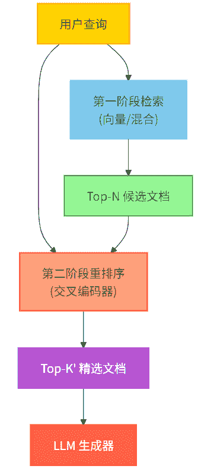

# 检索增强生成（RAG）深度实践

> 来源：[https://zsyhjtnsa5.feishu.cn/docx/EVlKd6llgojx0axy1pJcMcM9nnc](https://zsyhjtnsa5.feishu.cn/docx/EVlKd6llgojx0axy1pJcMcM9nnc)

## 第一章 RAG 导论：增强语言模型知识能力的必要性

**学习目标：**

在本章学习结束后，学员应能：

1.  **系统性地阐述** 标准大型语言模型 （LLM） 在知识获取、时效性、准确性和领域特异性方面存在的固有局限性。

2.  **精确地定义** 检索增强生成 （Retrieval-Augmented Generation， RAG） 的概念，并阐述其作为一种解决方案的核心机制。

3.  **详细描述** RAG 的高层级工作流程，包括检索、增强和生成三个关键阶段及其相互关系。

4.  **深入分析** RAG 相较于标准 LLM 在提高事实性、引入外部知识、增强可解释性及优化知识更新效率方面的核心优势。

5.  **辨证地比较** RAG 与模型微调 （Fine-tuning） 在目标、机制、成本和适用场景上的本质区别，为后续技术选型提供理论基础。

**关键词：** 大型语言模型 （Large Language Model， LLM）、知识局限性 （Knowledge Limitation）、幻觉 （Hallucination）、知识截止 （Knowledge Cutoff）、检索增强生成 （Retrieval-Augmented Generation， RAG）、信息检索 （Information Retrieval）、向量嵌入 （Vector Embedding）、向量数据库 （Vector Database）、上下文增强 （Context Augmentation）、模型微调 （Fine-tuning）、事实准确性 （Factual Accuracy）、可解释性 （Interpretability）

### § 1.1 引言：大型语言模型的辉煌与局限

大型语言模型（LLMs），如 GPT 系列、Claude 系列、Llama 系列以及本课程后续将关注的 DeepSeek 等，已在自然语言理解和生成方面取得了革命性的进展。它们能够撰写文章、回答问题、翻译语言、编写代码，展现出惊人的通用智能潜力。这些成就主要归功于其庞大的参数规模、先进的 Transformer 架构（通常基于自注意力机制）以及在海量文本数据上进行的预训练。

然而，正如任何技术都有其边界，LLMs 亦非万能。当我们尝试将它们应用于需要高度精确性、实时性或特定领域知识的企业级或专业场景时，其固有的局限性便开始显现。这些局限性不仅影响了输出的可靠性，也限制了其在关键业务流程中的深度应用。理解这些局限性的本质，是认识到为何需要如“检索增强生成（RAG）”这类补充技术，并将 LLM 能力有效落地的关键第一步。本章旨在深入剖析 LLM 的知识相关局限，并正式引入 RAG 作为应对这些挑战的核心策略。

### § 1.2 知识的边界：大型语言模型的内在局限性

尽管 LLMs 在预训练阶段接触了互联网规模的文本数据，看似无所不知，但其“知识”体系存在以下几个关键的内在限制：

#### § 1.2.1 事实幻觉（Factual Hallucination）: 概率生成而非事实查找的固有副作用

LLMs 的核心机制是基于其训练数据学习到的统计规律，以概率最高的方式预测下一个词（或 Token），从而生成连贯的文本。它们并非如数据库或知识图谱那样进行精确的事实查找和验证。这种基于概率的生成机制，虽然赋予了它们流畅表达和一定程度的“创造性”，但也导致了“幻觉”现象的产生——即模型可能自信地生成听起来合理但实际上与事实不符、缺乏依据或完全捏造的信息。例如，在回答需要精确数据或引用来源的问题时，模型可能编造看似真实的数字或文献。这种“一本正经地胡说八道”在娱乐性应用中或许可以容忍，但在需要高可靠性的金融、医疗、法律或企业决策支持场景中，则是不可接受的严重缺陷。

#### § 1.2.2 知识截止（Knowledge Cutoff）: 静态训练数据导致的时效性缺失

训练一个 LLM 需要巨大的计算资源和时间成本，因此，模型的预训练通常并非实时进行。模型所“学习”到的知识，被“冻结”在了其训练数据集的最后时间点。对于该时间点之后发生的新事件、发布的新产品、更新的法规政策、乃至最新的科学发现或市场动态，模型是“无知”的。直接向模型询问这些最新信息，它要么回答不知道，要么可能基于过时的信息给出错误的答案。这种知识的时效性缺失，限制了 LLM 在需要实时信息或快速响应变化的动态环境中的应用。

#### § 1.2.3 缺乏对私有/领域特定知识的访问（Lack of Access to Private/Domain-Specific Data）: 通用性与专业性的矛盾

公开训练的 LLMs 主要基于互联网上的公共文本数据。它们无法访问特定组织内部的专有信息，例如公司的内部政策文档、项目管理数据、客户关系记录、未公开的财务报表、独特的产品规格、内部流程规范等。同样，对于高度专业化或利基的领域知识，通用模型可能理解不够深入或缺乏必要的术语和背景。这意味着标准 LLM 无法直接回答“我们公司上季度的销售额是多少？”或“解释一下我们内部项目 X 的最新进展”这类问题，也难以在特定专业领域（如罕见病诊断、特定法律条款解释）提供足够精确和深入的支持。

#### § 1.2.4 缺乏可验证性与透明度（Lack of Verifiability and Transparency）: 黑盒带来的信任挑战

由于 LLM 内部复杂的神经网络结构和基于概率的生成过程，其回答的推理路径通常难以追踪，如同一个“黑盒”。用户很难知道模型是基于哪些信息得出结论的，也无法轻易核实其答案的来源和准确性。这种透明度的缺乏，在需要决策依据或审计追踪的场景下，会严重影响用户对模型输出的信任度。

综上所述，幻觉、知识时效性缺失、无法访问私有/领域知识以及缺乏可验证性，是标准 LLM 在知识层面普遍存在的四大局限。正是为了克服这些局限，业界发展出了检索增强生成（RAG）技术。

### § 1.3 检索增强生成（RAG）概念解析

#### § 1.3.1 定义与核心理念：结合检索，赋能生成

**检索增强生成（Retrieval-Augmented Generation， RAG）** 是一种将信息检索（Information Retrieval， IR）系统与大型语言模型（LLM）相结合的技术范式。其核心理念在于，在让 LLM 生成回答之前，先从一个或多个外部知识源（External Knowledge Sources）（如文档集合、数据库、网站内容等）中，检索（Retrieve）出与用户当前查询相关的、准确的信息片段。然后，将这些检索到的信息作为额外的上下文（Context），连同原始查询一起，提供（Augment）给 LLM，引导其在此基础上生成（Generate）最终的回答。

+   可以形象地将 RAG 理解为让 LLM 进行“开卷考试”。标准 LLM 如同一个博闻强记但只能“闭卷”考试的学生，依赖其内部已有的知识储备。而 RAG 系统则像一个允许学生在考试时查阅指定参考资料（外部知识库）的“开卷”考生。通过查阅资料，考生（LLM）能够给出更准确、更有依据、且可能包含最新信息的答案。

#### § 1.3.2 RAG 的高层级工作流程：三步曲

一个典型的 RAG 系统通常按以下三个核心阶段运作：

1.  检索阶段（Retrieval Phase）: 查找相关证据

    +   **输入：** 用户的查询语句（User Query）。

    +   **处理：**

    +   **查询理解/转换（Query Understanding/Transformation）：** 系统首先理解用户查询的意图，有时会对查询进行转换或扩展以提高检索效果（例如，使用同义词、生成子问题等）。

    +   表示学习（Representation Learning）：利用文本嵌入模型（Text Embedding Model）将查询语句和预处理过的外部知识库中的文档块（Chunks）都转换为高维语义向量（Semantic Vectors）。这些向量捕捉了文本的含义。

    +   相似度搜索（Similarity Search）：在向量数据库（Vector Database）或索引中，使用查询向量搜索与之最相似（通常基于余弦相似度等度量）的 N 个文档块向量。

    +   **输出：** 返回与查询最相关的 Top-K 个文档块（Retrieved Context / Documents）。

1.  增强阶段（Augmentation Phase）: 准备考试材料

    +   **输入：** 用户的原始查询（Original Query）和检索到的相关文档块（Retrieved Context）。

    +   **处理：** 将检索到的一个或多个文档块的内容，与原始查询一起，按照预设的提示模板（Prompt Template）进行整合。这个模板通常会明确指示 LLM 如何利用提供的上下文。

    +   **输出：** 一个包含丰富上下文信息的增强提示（Augmented Prompt）。

1.  生成阶段（Generation Phase）: LLM 开卷作答

    +   **输入：** 增强提示（Augmented Prompt）。

    +   **处理：** 将增强提示发送给大型语言模型（LLM Generator）。LLM 利用其强大的语言理解和生成能力，重点依据增强提示中提供的上下文信息，来生成最终的回答。

    +   **输出：** 一个基于检索到的知识、更准确、更可靠的最终答案（Final Answer）。

（注：在一个完整的教学环境中，此处应配有一张清晰的 RAG 工作流程图）

### § 1.4 RAG 方法的核心优势

相比于直接使用标准 LLM，采用 RAG 策略能够带来多方面的显著优势：

+   **增强事实准确性，显著减少幻觉**

    这是 RAG 最核心的价值。通过强制 LLM 基于检索到的、通常来自可信来源的外部证据进行回答，可以大幅度降低其凭空捏造信息（幻觉）的概率。答案不再仅仅依赖于模型内部模糊的统计关联，而是有了明确的事实基础。

+   访问最新知识和私有/领域特定数据

    RAG 打破了 LLM 的知识时间限制和范围限制。知识库可以包含最新的信息（如实时新闻、市场数据接口返回的内容）或企业内部的专有文档。知识的更新只需要维护外部知识库，而无需重新训练昂贵的大型模型，这使得知识更新更加灵活和经济。

+   **提高透明度和可信度**

    由于答案是基于明确检索到的上下文生成的，RAG 系统通常可以提供答案的来源（例如，引用的文档片段或链接）。这使得用户可以自行核实信息的准确性，增加了对系统输出结果的信任度，也满足了某些场景下的可追溯性要求。

+   **知识更新的效率与成本效益**

    相较于通过微调甚至重新训练 LLM 来注入新知识，更新 RAG 系统中的外部知识库通常成本更低、速度更快。只需对新增或修改的文档进行处理、嵌入和索引即可。这使得 RAG 成为一种更具适应性和经济性的知识管理方式。

### § 1.5 对比分析：RAG vs 模型微调（Fine-tuning）

在寻求提升 LLM 在特定场景下表现时，RAG 和微调是两种最常被提及的技术。理解它们的本质区别对于做出正确的技术选型至关重要。

#### § 1.5.1 微调的角色：适配行为而非注入知识

**模型微调（Fine-tuning）** 是指在一个已经预训练好的 LLM 基础上，使用一个特定任务相关的、带有标签的数据集进行额外的训练，以调整模型内部的参数（权重）。微调的核心目标通常不是向模型注入新的事实性知识，而是优化模型在特定任务上的表现、使其输出更符合特定的格式、风格或遵循更复杂的指令。例如，可以微调模型以更好地生成特定类型的代码、模仿某个品牌的写作风格、或稳定地输出特定结构的 JSON。

#### § 1.5.2 RAG 与微调的核心差异

#### § 1.5.3 技术选型决策框架

在选择 RAG 或微调时，应考虑以下问题：

1.  问题的核心是“知识缺失”还是“能力/行为不足”？

    +   **如果模型缺乏必要**的最新或私有信息，导致无法回答或回答错误 -> 优先考虑 RAG。

    +   如果模型知道相关信息，但输出格式不对、风格不符、或在特定任务上表现不够好 -> 优先考虑微调。

2.  知识是否需要频繁更新？

    +   如果是 -> **RAG 更具优势**。

3.  是否需要严格的事实准确性和可追溯性？

    +   如果是 -> **RAG 通常是更好的选择**。

4.  是否有足够的、高质量的标注数据来进行微调？

    +   如果没有 -> **微调可能不可行或效果不佳**。

5.  资源和技术能力如何？

    +   构建 RAG 系统需要集成检索组件；微调需要数据准备和训练能力。评估团队的技术栈和资源。

6.  是否可以结合使用？

    +   **是**。RAG 和微调并非完全互斥，有时可以结合使用以达到最佳效果。例如，可以先微调模型使其更好地遵循指令或输出特定格式，然后结合 RAG 让其访问外部知识。

### § 1.6 本章小结

本章从大型语言模型（LLM）的辉煌成就出发，深入剖析了其在知识层面存在的固有局限性，包括事实幻觉、知识截止、无法访问私有/领域知识以及缺乏可验证性。这些局限性促使我们寻求增强 LLM 能力的方法。检索增强生成（RAG）作为一种关键解决方案被引入，其核心机制在于“先检索、后生成”，通过整合外部知识库的信息来赋能 LLM。我们详细阐述了 RAG 的高层级工作流程（检索-增强-生成）及其带来的核心优势：提升准确性、利用最新/私有知识、增强可信度以及高效的知识更新。最后，本章对 RAG 与模型微调进行了辨证比较，明确了两者在目标、机制和适用场景上的关键区别，为后续章节的技术深入和实践应用奠定了理论基础。理解 RAG 的必要性和基本原理，是掌握并有效利用这一强大技术的起点。

### § 1.7 展望：深入 RAG 的技术栈

既然我们已经理解了为何需要 RAG 及其基本工作原理，接下来的章节将深入探讨构建一个高效、可靠的 RAG 系统所涉及的关键技术环节。我们将逐一解构 RAG 流程中的核心组件：如何有效地加载和处理源文档（数据加载与清洗），如何将文本切分成适合检索的单元（文本分块策略），如何选择和使用嵌入模型将文本转化为向量（嵌入模型分析），如何利用向量数据库进行高效存储和检索（向量数据库原理与优化），以及如何设计更复杂的检索策略和优化生成过程。准备好进入 RAG 的技术深水区！

**建议的课堂互动/思考题：**

1.  请结合您自身使用 LLM 的经验，分享一个具体的“幻觉”例子，并思考如果采用 RAG，可能如何避免这个问题？

2.  设想一个您所在公司或行业的具体场景，其中标准 LLM 因缺乏特定知识而无法满足需求。描述这个场景，并思考 RAG 如何能提供解决方案？

3.  讨论：在构建一个需要模仿特定人物（如莎士比亚）写作风格的应用时，应该优先考虑 RAG 还是微调？为什么？如果目标是创建一个能回答关于莎士比亚生平最新研究成果的问答系统呢？

4.  RAG 引入了外部知识库，这是否意味着 RAG 系统就完全不会产生幻觉了？为什么？（提示：考虑检索失败或检索到错误信息的情况）

## 第二章 RAG 流程解析：数据准备与知识索引

### § 2.1 引言：构建 RAG 的基石 - 数据准备与索引

在第一章中，我们探讨了标准大型语言模型（LLM）在知识方面的局限性，并阐述了检索增强生成（RAG）作为一种关键解决方案的必要性及其核心理念——即通过结合外部知识源来增强 LLM 的回答能力。我们理解到 RAG 的高层级工作流程包含检索（Retrieve）、增强（Augment）和生成（Generate）三个核心阶段。

本章我们将深入 RAG 流程的**前端**，聚焦于构建高效、可靠 RAG 系统的基础——数据准备与知识索引。这个阶段的目标是将原始的、多样化的外部知识源（如文档、网页、数据库记录等）转化为一种结构化的、可供快速检索的格式。这通常涉及一个关键的数据处理流水线：

1.  数据加载（Data Loading）: 从各种来源获取原始数据。

2.  文本分块（Text Chunking/Splitting）: 将加载的数据（尤其是长文本）分割成更小、更易于处理和检索的单元。

3.  文本嵌入（Text Embedding）: 利用嵌入模型将文本块转化为捕捉其语义信息的数字向量。

4.  存储与索引（Storage & Indexing）: 将文本块、其对应的向量以及可能的元数据存入专门的向量存储或数据库中，并建立索引以支持快速相似度搜索。

这个数据准备和索引阶段的质量直接决定了后续检索阶段的效果，进而影响整个 RAG 系统的最终性能。正如一句古老的工程格言所说，“Garbage In， Garbage Out”（垃圾进，垃圾出），在 RAG 的世界里同样适用。一个精心设计和执行的数据流水线是构建高性能 RAG 应用的不可或缺的前提。本章将详细探讨这一流水线中的各个关键环节。

### § 2.2 数据加载：从源头获取知识

RAG 系统的强大之处在于其能够利用外部知识。而这一切的起点，就是将这些知识的载体——各种形式的数据——加载到处理流程中。

#### § 2.2.1 数据源的多样性

企业和个人拥有的知识往往散布在各种不同的数据源中，RAG 系统需要具备处理这种多样性的能力。常见的数据源类型包括：

+   纯文本文件（.txt, .md）: 结构相对简单，易于处理。

+   文档文件（.pdf, .docx, .pptx）: 包含丰富的格式信息，可能含有表格、图片等非文本元素，提取文本内容相对复杂。

+   **网页内容（HTML）:** 需要解析 HTML 结构，去除导航、广告等无关元素，提取核心文本内容。

+   结构化数据（Databases， CSV， JSON）: 虽然 RAG 主要处理非结构化文本，但有时也需要整合来自数据库或结构化文件中的信息。

+   **应用程序接口（APIs）:** 通过调用 API 从内部系统（如 CRM， ERP）或外部服务（如新闻源）获取实时数据。


## § 2.2 文档加载与文本提取

+   笔记应用/协作平台：如 Notion， Evernote， Confluence 等。

### § 2.2.2 文档加载器 （Document Loaders/Connectors）

为了简化从不同数据源加载数据的过程，现代 RAG 开发框架（如 `LangChain`， `LlamaIndex`）提供了文档加载器 （Document Loaders） 或 数据连接器 （Data Connectors） 的概念。

+   作用：这些加载器封装了与特定数据源交互的细节（如文件读取、API 调用、网页抓取、数据库连接等），并将原始数据转换为统一的、通常包含文本内容 （ `page_content` ） 和元数据 （ `metadata` ） 的文档对象 （ `Document` ） 格式，方便后续处理。

+   示例：

+   `FileSystemLoader` / `DirectoryLoader`： 加载本地文件或目录下的文件。

+   `WebBaseLoader` / `UnstructuredURLLoader`： 从 URL 加载网页内容。

+   `PyPDFLoader` / `UnstructuredPDFLoader`： 加载 PDF 文件。

+   `Docx2txtLoader`： 加载 Word 文档。

+   `CSVLoader`： 加载 CSV 文件。

+   `JSONLoader`： 加载 JSON 文件。

+   特定数据库加载器（如 `SQLDatabaseLoader`， `NotionLoader` 等）。

+   价值：使用标准化的加载器可以提高代码的可维护性和可扩展性，使得切换或添加新的数据源更加容易。

### § 2.2.3 文本提取的挑战与实践

从格式复杂的数据源（尤其是 PDF 和网页）中准确、完整地提取文本内容是数据加载阶段的关键挑战。

+   PDF 处理：

+   挑战：PDF 格式复杂，可能包含扫描图片（需要 OCR）、多栏布局、嵌入式表格、复杂的字体编码等，直接提取文本容易出错或丢失格式信息。

+   实践：

+   使用成熟的库，如 `PyMuPDF` （ `fitz` ） 或 `pdfminer.six` 进行基础文本提取。

+   对于包含图片或复杂布局的 PDF，考虑使用 `Unstructured` 库或专门的文档解析服务（如 AWS Textract， Azure AI Document Intelligence， Google Document AI），它们通常结合了 OCR 和布局分析能力。

+   注意处理 OCR 错误：光学字符识别 （OCR） 的质量至关重要，因为识别错误会引入语义噪声（改变词义）和格式噪声（破坏结构），这些错误会直接传递并降低下游 RAG 的检索和生成性能。

+   网页 （HTML） 处理：

+   挑战：网页包含大量非核心内容（导航栏、广告、页脚、脚本、样式），需要有效过滤。动态加载内容 （JavaScript 渲染） 可能需要更复杂的抓取技术 （如 `Selenium`， `Playwright`）。

+   实践：

+   使用 `BeautifulSoup` 或 `lxml` 等库解析 HTML DOM 树。

+   基于 HTML 标签（如 `<p>`， `<h1>`， `<body>` 等）或 CSS 选择器定位并提取主要内容区域。

+   编写规则或使用现成库（如 `goose3`， `readability-lxml`）去除无关标签和内容。

+   对于需要 JS 渲染的页面，使用浏览器自动化工具或专门的网页抓取服务。

+   通用原则：

+   元数据保留：在提取文本的同时，尽可能保留有用的元数据，如来源文件名、URL、文档标题、创建日期、章节信息等。这些元数据在后续的检索过滤和结果呈现中非常有价值。

+   健壮性：加载过程需要能够处理文件不存在、格式错误、网络中断等异常情况。

## § 2.3 文本分块：将知识切分为可检索单元

原始文档（尤其是长文档）通常太大，无法直接作为单个单元进行嵌入和检索，也可能超出 LLM 的上下文窗口限制。因此，需要将加载的文本内容分块 （Chunking） 或 切分 （Splitting） 成更小的、语义上相对连贯的单元。

### § 2.3.1 分块的必要性与核心目标

分块的主要目的包括：

1.  适应模型限制：确保每个块的大小适合嵌入模型的最大输入长度，并且检索到的上下文组合后不超过生成 LLM 的上下文窗口限制。

1.  提高检索精度：较小的块通常包含更聚焦的信息，可以减少检索时的噪声，提高与特定查询匹配的精度。

1.  平衡上下文与粒度：在保证块足够小以实现精确检索的同时，尽量保留足够的上下文信息，以便 LLM 能够理解其含义。

### § 2.3.2 基础分块策略回顾与局限

几种基础策略各有优劣：

+   固定大小分块 （Fixed-Size Chunking）: 按固定字符/词/Token 数切分。简单但容易切断语义。

+   递归字符分块 （Recursive Character Chunking）: 尝试按预定义的层次结构（如段落 -> 句子 -> 词）进行切分，直到满足块大小限制。这是目前许多框架（如 `LangChain`）的默认和常用策略，因为它在保留一定结构的同时具有较好的通用性。

+   句子分块 （Sentence Splitting）: 按句子切分。保留句子完整性，但可能缺乏上下文。

+   段落分块 （Paragraph Splitting）: 按段落切分。通常能保留较好的上下文，但块大小不一。

这些基础策略的主要局限在于它们主要依赖文本的物理结构或长度，而较少考虑语义内容的连贯性。这可能导致：

+   一个完整的想法或论点被分割到不同的块中。

+   一个块中包含多个不相关的主题。

+   对于表格、代码等非标准文本结构处理效果不佳。

### § 2.3.3 高级分块策略概览

为了克服基础策略的局限，业界发展了更智能的分块方法：

+   语义分块 （Semantic Chunking）: 利用嵌入向量计算句子间的语义距离，在语义发生显著变化的地方进行切分，旨在创建主题更内聚的块。然而，这种方法计算成本较高，其实际效果相对于精心调整的基础分块策略的提升程度，在不同任务上仍是一个活跃的研究和辩论领域。

+   Agentic Chunking: 使用 LLM 本身来分析文本内容和结构，动态决定最佳切分点，模仿人类的理解方式。这种方法更智能、适应性更强，但实现复杂度和运行成本也显著提高。

+   模态感知分块 （Modality-Aware Chunking）: 专门处理包含表格、图像等多模态内容的文档，将不同模态的元素作为独立单元处理（如提取表格为 Markdown）或进行专门转换（如生成图像描述）。

+   内容/结构感知分块 （Content/Structure-Aware Chunking）: 利用 Markdown 标题、HTML 标签或文档的显式层次结构（如章节）进行切分，试图更好地保留作者的组织意图，对格式规范的文档效果较好。

（注意：本章仅作概览介绍，这些高级策略的具体实现和选择将在后续章节或高级课程中深入探讨。）

### § 2.3.4 关键参数的影响：块大小与重叠

无论采用何种分块策略，`Chunk Size` 和 `Chunk Overlap` 都是需要仔细配置的关键参数：

+   `Chunk Size`:

+   核心权衡：较小的块通常检索精度更高（噪声少），但包含的上下文有限，可能无法让 LLM 充分理解；较大的块上下文更丰富，但可能包含更多无关信息，稀释核心内容，且增加处理成本和超出 LLM 上下文窗口的风险。

+   影响因素：最佳大小没有固定答案，高度依赖于源文本的信息密度、嵌入模型和 LLM 的上下文窗口限制、以及下游任务的需求。通常需要通过实验来寻找平衡点。例如，`LangChain` 中 `RecursiveCharacterTextSplitter` 的 `chunk_size` 参数通常以 Token 数量计。

+   `Chunk Overlap`:

+   目的：在相邻块之间重复一小部分内容（如几十到上百个 Token），以确保跨越块边界的句子或思想的完整性得以保留，减少因硬性切分导致的信息丢失风险。

+   权衡：重叠会增加数据的总冗余度，导致索引变大，相应增加存储和（可能的）计算成本。

+   设置：通常设置为块大小的 10-20% 是一个常见的起点，但同样需要根据实际效果进行调整。

### § 2.3.5 数据预处理在分块前的关键作用

再次强调，分块的效果高度依赖于输入文本的质量。在执行任何分块策略之前，进行彻底的数据预处理至关重要：

+   `Text Cleaning`: 移除无关内容（页眉页脚、广告、导航栏）、修正 OCR 错误、标准化格式（空格、换行符）、处理特殊字符等。未清理的噪声会严重干扰分块逻辑和后续的嵌入、检索效果。

+   `Structure Parsing`: 对于 PDF、HTML 等，准确解析其结构，区分标题、段落、列表、表格等，有助于选择更合适的结构感知分块策略。

+   `Metadata Extraction`: 提取并关联有用的元数据（来源、日期、作者、章节等），这些元数据可以与文本块一起存储，用于后续的过滤或结果呈现。

+   `Quality Filtering / Deduplication`: 移除低质量、无关或重复的内容，避免污染知识库，提高信噪比。

一个健壮的预处理流程是实现高质量分块的前提。

## § 2.4 文本嵌入：将语义转化为向量

将文本块成功切分后，下一步是将这些文本单元转换为机器能够理解和比较的数学表示形式——嵌入向量 （`Embeddings`）。

### § 2.4.1 嵌入的核心概念：语义空间的映射

如前所述，文本嵌入的目标是将具有相似含义的文本映射到高维向量空间中相近的位置。嵌入模型通过在海量数据上学习语言的统计模式，能够捕捉词语、句子乃至段落的深层语义信息，并将其编码为密集的数值向量 （通常是包含几百到几千个浮点数的列表）。

### § 2.4.2 嵌入模型的作用与选择考量

`Embedding Model` 是执行这种文本到向量转换的核心引擎。选择一个合适的嵌入模型对 RAG 的检索性能至关重要。主要考量因素包括：

+   性能与领域适应性：模型在标准基准（如 MTEB）上的表现是一个参考，但更重要的是其在目标领域特定任务上的实际检索效果。通用模型可能无法很好地捕捉专业术语的细微差别或特定领域的语义关系，因此需要在真实场景或领域数据集上进行评估。

+   `Dimensionality`: 输出向量的维度大小（例如，`BAAI/bge-m3` 是 1024 维）。更高维度理论上可能捕捉更丰富的信息，但也意味着更大的存储需求、更高的向量计算成本以及可能更长的检索延迟。需要根据应用需求和硬件能力权衡。

+   `Context Window`: 模型能处理的最大输入文本长度。必须确保所选嵌入模型的上下文窗口大于或等于分块策略产生的最大块大小，否则长块信息会被截断，导致嵌入质量下降。

+   `Multilingual Support`: 如果知识库包含多种语言，或者需要支持跨语言查询（用一种语言提问，查找另一种语言的文档），则必须选择支持所需语言或具备跨语言能力的嵌入模型。

+   `Cost & Speed`: 使用商业 API 模型（如 `OpenAI`， `Cohere`， 硅基流动）会产生调用费用，通常按 Token 计费；而使用本地部署的开源模型则需要承担硬件购置、电力和维护成本。同时，不同模型的推理速度（生成嵌入向量的延迟和吞吐量）也直接影响数据索引和实时查询的效率。

+   开源 vs。闭源 / 微调潜力 （Open vs。Closed / Fine-tuning Potential）: 是否需要基于私有数据进一步优化嵌入模型以提升领域适应性？开源模型（如 `BGE`， `Sentence-Transformers` 等）通常提供了这种微调的可能性，而闭源 API 模型则通常不开放此功能。这是一个重要的战略选择。

在本课程的实践中，我们将重点使用 `BAAI/bge-m3` 模型（通过硅基流动 API 访问），它是一个在众多基准上表现优异且支持中英文的强大嵌入模型，维度为 1024。

### § 2.4.3 嵌入过程：从文本块到向量列表

实际的嵌入过程通常涉及：

1.  将准备好的文本块列表 （`Chunks`） 输入给嵌入模型（通过 API 调用或本地模型推理）。

1.  嵌入模型处理每个文本块，为每个块生成一个对应的高维向量。

1.  API 或模型返回一个向量列表（或包含向量及其他信息的结构化数据），其顺序通常与输入的文本块列表相对应。

这个过程可能需要分批处理（`Batching`）大量文本块以提高效率。需要注意处理 API 调用可能出现的错误（如速率限制、认证失败等）。

## § 2.5 向量存储与索引：构建可检索的知识库

生成了文本块的嵌入向量后，我们需要一个地方来高效地存储这些向量（以及原始文本块和元数据），并能够根据用户查询向量快速找到最相似的向量。这就是向量数据库 （`Vector Database`） 或 向量存储 （`Vector Store`） 发挥作用的地方。

### § 2.5.1 为何需要专门的向量存储？

传统的数据库（如关系型数据库 `SQL` 或文档数据库 `NoSQL`）主要设计用于精确匹配或基于预定义字段的查询，它们并不擅长处理高维向量空间中的相似度搜索 （`Similarity Search`）。对数百万甚至数十亿的高维向量进行暴力（穷举）相似度计算是极其低效和不切实际的。向量数据库通过采用专门的近似最近邻 （`Approximate Nearest Neighbor`， `ANN`） 索引算法来解决这个问题，这些算法能够在牺牲极小的精度（找到的可能不是绝对最近的邻居，但非常接近）的情况下，实现数量级上的查询速度提升。

### § 2.5.2 向量数据库/存储核心概念

+   核心功能：

+   存储高维向量及其关联数据（原始文本块、元数据）。

+   基于输入的查询向量，快速找到与之最相似的 K 个存储向量（`Top-K ANN search`）。

+   （通常）支持基于元数据的过滤查询（`Metadata Filtering`），允许在相似度搜索的同时或之前/之后应用筛选条件（如“来源为 `policy.pdf` 且日期在 2023 年之后的文档块”）。

+   常见选项 （名称提及）:

+   库/本地：`Faiss` （Facebook 开源库）， `ChromaDB` （开源， 易于本地使用）， `Annoy`。

+   数据库/服务端：`Weaviate` （开源）， `Qdrant` （开源）， `Milvus` （开源）， `Pinecone` （商业 SaaS）， `Zilliz Cloud` （基于 `Milvus` 的 SaaS）。

+   云服务集成：`AWS OpenSearch` （向量引擎）， `Azure AI Search` （向量搜索）， `Google Vertex AI Vector Search`。

+   关键考量：性能（查询速度 `QPS`、召回率 `Recall`）、可扩展性（能处理多大规模的数据）、成本（存储和查询费用）、易用性（API 和 SDK）、部署方式（本地/云/托管）、社区支持、特定功能（如混合搜索能力、过滤效率、实时更新支持）。

在本课程的实践中，我们将使用 `ChromaDB`，因为它是一个开源且易于在本地环境中快速设置和使用的向量存储方案。

### § 2.5.3 索引构建过程：将向量组织起来

将数据添加到向量存储的过程称为 `索引` （`Indexing`）。其基本步骤包括：

1.  将每个文本块的内容 （ `document` ）、其对应的嵌入向量 （ `embedding` ）、一个唯一的 ID （ `id` ） 以及可选的元数据 （ `metadata` ） 准备好。

1.  调用向量存储的添加/插入/索引接口（例如 `ChromaDB` 的 `collection.add()` 方法），将这些信息批量添加到指定的集合 （ `Collection` ） 中。

1.  向量存储内部会使用选定的 `ANN` 索引算法（如 `HNSW`， `IVF` 等）来组织这些向量，构建数据结构（如多层图、倒排文件）以加速后续的相似度搜索查询。

这个过程通常在数据准备阶段一次性完成（对于静态知识库），或者在知识库需要更新时增量进行。

### § 2.5.4 本地存储 vs。云存储初步考量

+   本地存储 （如 `ChromaDB`， `Faiss`）:

+   优点：数据完全保留在本地，无网络延迟（查询时），通常无直接使用成本（除硬件外）。非常适合开发、测试、小型应用或对数据隐私要求极高的场景。

+   缺点：需要自行管理部署、维护、备份和扩展；规模受限于本地硬件资源。

+   云向量数据库 （如 `Pinecone`， `Zilliz Cloud`， 云厂商服务）:

+   优点：可轻松扩展以处理海量数据，通常提供高可用性和托管运维，降低了运维负担，按需付费。适合生产环境、大规模应用。

+   缺点：数据需要传输到云端（可能有隐私和合规顾虑），存在网络延迟，有持续的使用成本。

## § 2.6 本章小结与展望

本章详细阐述了构建 RAG 系统所需的基础数据处理流水线，包括数据加载、文本分块、文本嵌入和向量存储与索引四个关键阶段。我们探讨了处理多样化数据源的挑战与方法，分析了不同文本分块策略的核心思想与参数权衡，理解了文本嵌入如何将语义转化为可计算的向量，并认识到向量数据库在高效存储和检索这些向量中的核心作用。强调了数据质量（通过预处理保证）和合理配置（分块参数、嵌入模型、存储方案）对整个 RAG 流程性能的基础性影响。


至此，我们已经将原始知识转化为了一个结构化的、包含语义信息的、可供检索的知识库。掌握了这些数据准备和索引的技术，我们就可以进入 RAG 流程的下一个核心阶段——信息检索。下一章将深入探讨如何根据用户查询有效地从这个构建好的知识库中检索出最相关的信息，涉及不同的检索算法、优化策略以及如何评估检索效果。

建议的课堂互动/思考题：

1. 对于一份包含大量图表和图片的 PDF 格式公司年度报告，在“数据加载”阶段需要特别注意哪些挑战？你会优先考虑使用哪些工具或方法来提取信息？

1. 假设你要为一个包含长篇法律合同的知识库选择分块策略。比较“句子分块”和“段落分块”的优缺点。你会更倾向于哪种？为什么？或者你会考虑更高级的策略吗？

1. 在“文本嵌入”阶段，如果我们发现通用的嵌入模型（如 `BAAI/bge-m3`）在处理公司内部高度专业的术语时效果不佳（相似度计算不准确），你会考虑哪些可能的解决方案？（提示：回顾 §1.5 和 §2.4.2）

1. 讨论：在开发初期或快速原型验证阶段，选择像 `ChromaDB` 这样的本地向量存储相比于一开始就使用云向量数据库，可能有哪些优势和劣势？

# 第三章 RAG 流程解析：信息检索与上下文选择

## § 3.1 引言：从索引到检索 - 寻找相关知识

在第二章中，我们详细探讨了 RAG 系统的基础构建阶段：如何从多样化的数据源加载信息，通过精心的文本分块策略将其转化为合适的单元，利用嵌入模型赋予这些单元语义向量表示，并最终将文本、向量及元数据高效地存储在向量数据库（如 `ChromaDB`）中并建立索引。至此，我们拥有了一个结构化的、蕴含语义信息、并为快速查询做好准备的知识索引库。

现在，我们将进入 RAG 流程的核心环节——信息检索（Information Retrieval）。本章的目标是阐述当用户提出查询时，系统如何有效地从这个庞大的知识索引库中定位并提取出最相关的信息片段（Context）。这个检索阶段的质量直接决定了后续增强和生成阶段的输入质量，是整个 RAG 系统性能的关键瓶颈之一。一个优秀的检索器需要能够准确理解用户查询的意图，并从可能数百万甚至数十亿的知识片段中，精确地召回那些真正有助于回答问题的“证据”。

本章将深入探讨实现高效检索的核心机制，包括基于向量相似度的搜索、结合传统关键词搜索的混合策略、通过重排序提升检索精度的方法，并简要介绍更高级的检索范式以及评估检索效果的关键指标。

## § 3.2 核心检索机制：向量相似度搜索

现代 RAG 系统中最核心、最普遍的检索机制是基于向量嵌入的语义相似度搜索（Vector Similarity Search）。其基本思想是：如果两个文本片段在语义上是相似的，那么它们的嵌入向量在向量空间中也应该是相近的。

### § 3.2.1 查询嵌入（Query Embedding）

检索流程的第一步是将用户的查询语句（`User Query`）使用与构建知识库索引相同的嵌入模型（例如 `BAAI/bge-m3`），转化为一个查询向量（`Query Vector`）。保持嵌入模型的一致性至关重要，因为它确保了查询向量和文档块向量位于同一个语义空间中，使得它们之间的距离或相似度计算具有意义。

```
graph LRA[用户查询 (文本)] --> B(嵌入模型);B --> C[查询向量 (高维)];
```

### § 3.2.2 相似度度量（Similarity Metrics）

一旦获得了查询向量和知识库中存储的文档块向量，就需要一种方法来量化它们之间的“相似性”或“接近程度”。常用的相似度度量方法包括：

+ 余弦相似度（Cosine Similarity）：最常用。它衡量两个向量之间夹角的余弦值，忽略向量的长度（大小），只关注它们的方向。值域为 [-1， 1]，值越接近 1 表示方向越一致，语义越相似。计算公式为：

`Similarity = (A · B) / (||A|| * ||B||)`

其中 `A · B` 是向量点积，`||A||` 和 `||B||` 分别是向量 `A` 和 `B` 的 L2 范数（长度）。

+ 点积（Dot Product）：计算两个向量对应元素的乘积之和。结果受向量长度影响。对于归一化（长度为 1）的向量，点积等价于余弦相似度。

+ 欧氏距离（Euclidean Distance / L2 Distance）：计算向量空间中两个点之间的直线距离。距离越小表示越相似。

+ 曼哈顿距离（Manhattan Distance / L1 Distance）：计算两个向量对应元素差的绝对值之和。

向量数据库在创建索引时通常允许指定使用哪种距离度量（如 `ChromaDB` 中通过 `metadata={"hnsw:space": "cosine"}` 指定余弦距离）。选择哪种度量取决于嵌入模型的特性和训练方式，但余弦相似度因其对向量长度不敏感的特性，在文本嵌入领域应用最为广泛。

### § 3.2.3 近似最近邻搜索（Approximate Nearest Neighbor，ANN）

对于包含大量向量的知识库，对查询向量与库中每一个向量都计算精确相似度（称为精确最近邻搜索或暴力搜索）在计算上是不可行的，会导致极高的查询延迟。

因此，向量数据库普遍采用近似最近邻（ANN）搜索算法。ANN 算法通过构建特殊的索引结构（如第二章提到的 HNSW 图、IVF 索引等），能够在牺牲极小的召回率（可能找不到绝对最相似的那个向量，但能找到非常相似的）的前提下，极大地加速查询过程，将搜索时间复杂度从线性降低到亚线性甚至对数级别。

+ 核心权衡：ANN 搜索是在查询速度（Query Speed / Latency）、召回率（Recall / Accuracy）和资源消耗（Memory Usage / Index Build Time）之间进行的权衡。不同的 ANN 算法和参数配置适用于不同的场景。

+ Top-K 检索：用户的目标通常不是只找最相似的一个结果，而是找到最相似的 K 个结果（例如 K=3， 5， 10）。ANN 搜索通常直接支持返回 Top-K 最相似的向量及其对应的文档块。选择合适的 K 值也很重要，K 太小可能遗漏关键信息，K 太大则可能引入过多噪声。

## § 3.3 超越基础相似度：关键词与混合搜索

单纯依赖语义相似度有时并不足够。用户查询可能包含必须精确匹配的关键词（如产品名称、人名、特定术语），或者语义相似的文档可能并未包含这些关键词。此外，嵌入模型可能无法完美捕捉所有细微的语义差别。

### § 3.3.1 关键词搜索（Sparse Vectors）的价值

传统的关键词搜索技术，通常基于稀疏向量（Sparse Vectors）表示（与嵌入模型的密集向量 Dense Vectors 相对），仍然具有不可替代的价值。

+ 常用算法：

+ TF-IDF（Term Frequency-Inverse Document Frequency）：衡量一个词在文档中的重要性（词频高且在整个库中稀有则重要性高）。

+ BM25（Best Matching 25）：TF-IDF 的一种改进算法，是现代搜索引擎（如 Elasticsearch， OpenSearch）中常用的文本相关性评分算法，考虑了词频、文档长度等因素。

+ 优势：

+ 擅长精确匹配（Exact Match）查询中的关键词。

+ 能捕捉词频信息和术语重要性。

+ 技术成熟，计算相对高效。

+ 劣势：

+ 无法理解语义相似性（同义词、近义词、概念关联）。

+ 对措辞变化敏感。

### § 3.3.2 混合搜索（Hybrid Search）：结合优势

为了结合语义搜索的深度理解能力和关键词搜索的精确匹配能力，混合搜索（Hybrid Search）应运而生，并已成为许多生产级 RAG 系统的标准配置。

+ 核心思想：同时执行语义搜索（基于密集向量）和关键词搜索（基于稀疏向量，如 BM25），然后将两者的结果进行融合（Fusion），生成一个综合排序的最终结果列表。

+ 融合策略：如何合并两个不同的排序列表是关键。常用策略包括：

+ 加权组合（Weighted Combination）：为语义得分和关键词得分分配权重（例如，`final_score = alpha * semantic_score + (1 - alpha) * keyword_score`），然后按最终得分排序。需要调整权重 `alpha` 来平衡两者贡献。

+ 倒数排序融合（Reciprocal Rank Fusion，RRF）：一种更常用且效果通常更好的方法。它不依赖于原始分数的大小（因为不同算法的分数范围可能差异很大），而是基于文档在每个列表中的排名（Rank）。每个文档的 RRF 分数是其在各列表中排名的倒数之和（通常是 `1 / (rank + k)`，`k` 是一个常数如 60）。RRF 倾向于提升那些在多个检索方法中都排名靠前的文档，鲁棒性较好。许多现代搜索系统（如 Azure AI Search， MongoDB Atlas Search）都支持 RRF。

+ 价值：混合搜索能够显著提高检索的相关性和鲁棒性，既能找到概念上相关的内容，又能确保包含关键术语的文档被优先考虑，从而为后续的 LLM 生成提供更全面、更精确的上下文。

## § 3.4 精度提升：重排序（Re-ranking）

即使是混合搜索，其返回的 Top-K 结果中仍然可能包含部分不那么相关或冗余的信息。为了进一步提升检索结果的精度（Precision），特别是在最终传递给 LLM 的上下文数量有限（例如只取 Top-3）的情况下，引入重排序（Re-ranking）阶段非常有价值。

### § 3.4.1 为何需要重排序？

+ 第一阶段检索的局限：无论是向量搜索还是混合搜索，为了保证速度，其使用的模型（嵌入模型、BM25）通常是相对“轻量级”的，其相关性判断可能不够精细。它们更侧重于召回（Recall），即尽可能多地找回潜在相关的文档。

+ 目标：重排序的目标是在一个较小的候选集（例如，第一阶段检索出的 Top-N 个文档，N 可能=50 或 100）上，使用一个更强大、计算更密集但更精确的相关性判断模型，对这些候选文档进行重新打分和排序，最终选出最相关的 Top-K' 个（K' 通常远小于 N，例如 3 或 5）用于生成。

### § 3.4.2 交叉编码器（Cross-Encoders）：精细相关性判断

执行重排序任务最常用的模型是交叉编码器（`Cross-Encoders`）。

+ 工作机制：与嵌入模型（属于双编码器 `Bi-Encoders`，独立处理查询和文档）不同，交叉编码器将用户查询和单个候选文档块作为一个整体对（Pair）输入给一个强大的 Transformer 模型（如 BERT 或其变种）。模型可以直接分析查询词语与文档词语之间的交互和细微关联，从而对该文档块与查询的具体相关性给出一个更准确的分数。

+ 优势：由于能够进行深度的交互式分析，交叉编码器的相关性判断精度通常远高于基于向量距离的双编码器模型。

+ 劣势：计算成本非常高。因为它需要对每一个查询-文档对都执行一次完整的 Transformer 模型推理。这就是为什么它只适用于对第一阶段检索返回的较小候选集进行重排序，而不适合直接用于大规模文档库的初次检索。

+ 模型选择：存在多种开源（如 `bge-reranker-v2-m3`，`ms-marco-MiniLM-L-12-v2` 等，可在 Hugging Face 找到）和商业 API（如 Cohere Rerank， Voyage AI Reranker）的交叉编码器模型可供选择。它们在精度、速度和成本上有所不同。

### § 3.4.3 集成重排序到 RAG 流程

典型的包含重排序的两阶段检索流程如下：

1. 第一阶段检索（Recall）：使用向量搜索或混合搜索，从整个知识库中快速召回一个相对较大的候选集（Top-N，例如 N=50）。

1. 第二阶段重排序（Precision）：将这 N 个候选文档块与用户查询一起，输入给交叉编码器模型。

1. 最终选择：获取交叉编码器为每个文档块计算的相关性分数，按分数从高到低排序，选择最终的 Top-K' 个文档块（例如 K'=3）作为上下文传递给 LLM 生成器。

```
graph TD
    A["用户查询"]:::query
    B["第一阶段检索<br>(向量/混合)"]:::retrieval
    C["Top-N 候选文档"]:::candidates
    D["第二阶段重排序<br>(交叉编码器)"]:::rerank
    E["Top-K' 精选文档"]:::results
    F["LLM 生成器"]:::generator

    A --> B
    B --> C
    A --> D
    C --> D
    D --> E
    E --> F

    classDef query fill:#FFD700,stroke:#FFA500,stroke-width:2px,color:black;
    classDef retrieval fill:#87CEEB,stroke:#1E90FF,stroke-width:2px;
    classDef candidates fill:#98FB98,stroke:#32CD32,stroke-width:2px;
    classDef rerank fill:#FFA07A,stroke:#FF6347,stroke-width:2px;
    classDef results fill:#BA55D3,stroke:#9932CC,stroke-width:2px,color:white;
    classDef generator fill:#FF6347,stroke:#FF0000,stroke-width:2px,color:white;
```



引入重排序通常能显著提升 RAG 系统最终答案的质量，尤其是在处理复杂查询或信息密集的知识库时，但需要接受其带来的额外计算延迟和可能的成本增加。

## § 3.5 高级检索策略概览（Brief Overview）

除了上述的核心机制外，还存在一系列更高级的检索策略，旨在解决特定挑战或进一步优化性能。此处仅作简要介绍，为后续学习提供方向：

### § 3.5.1 查询转换（Query Transformations）

在进行检索之前，利用 LLM 对原始用户查询进行改写或扩展，以期获得更好的检索效果。常见方法包括：

+ HyDE（Hypothetical Document Embeddings）：生成一个假设性的答案，用答案的嵌入进行检索。

+ Multi-Query：将原始查询分解或扩展为多个子查询，分别检索后合并结果。

+ Step-Back Prompting：生成一个更概括性的查询，结合原始查询和概括查询的检索结果。

+ Query Decomposition：将复杂问题分解为多个简单的子问题分别检索。

这些方法有助于处理模糊查询、提高召回率或提供更丰富的背景信息，但会增加 LLM 调用成本和延迟。

### § 3.5.2 上下文窗口管理策略（Context Window Management Strategies）

旨在解决“小块检索精度高但上下文少”与“大块上下文多但检索精度低”的矛盾。

+ Small-to-Big / Sentence Window Retrieval：基于小的单元（如句子）进行检索以保证精度，但在找到相关单元后，提取其周围更大范围的上下文（如整个段落或前后几个句子）提供给 LLM。

+ Parent Document Retriever：索引和检索较小的“子块”，但最终返回包含该子块的、更大的“父文档”给 LLM。

这些策略试图兼顾检索的精确性和生成的连贯性。

### § 3.5.3 多向量与图谱方法（Multi-Vector & Graph-Based Approaches）

+ Multi-Vector Retrievers：为每个文档块生成多个向量表示（例如，一个代表摘要，一个代表全文，或使用 ColBERT 的词元级嵌入），在检索时利用这些多样的表示。

+ Graph-Based RAG：利用知识图谱（Knowledge Graph）中实体和关系的结构化信息进行检索，或者将文本转化为图结构再检索，可能有助于处理需要复杂推理或关系理解的查询。

这些高级策略通常需要更复杂的实现和更深入的理解，适用于特定场景下的性能优化。

## § 3.6 评估检索性能（Evaluating Retrieval Performance）

仅仅实现了检索流程还不够，我们需要知道它的效果如何。评估检索阶段的性能对于诊断 RAG 系统瓶颈、指导优化方向至关重要。

### § 3.6.1 为何要单独评估检索？

RAG 是一个多阶段流水线，最终答案的质量受到检索和生成两个阶段共同的影响。如果最终答案不好，可能是因为检索没找到相关信息，也可能是因为 LLM 没能很好地利用找到的信息。单独评估检索阶段的性能，可以帮助我们隔离问题，判断瓶颈是在于“找得准”还是“说得好”。

### § 3.6.2 关键检索评估指标

评估信息检索系统性能有多种标准指标，常用的包括：

+ 召回率@k（Recall@k）：在系统返回的前 k 个结果中，包含了多少比例的所有相关文档？（衡量查全率，越高越好）

+ 公式：`Recall@k = (True Positives @k) / (Total Relevant Documents)`


+   精确率@k （Precision@k）: 在系统返回的前 k 个结果中，有多少比例是真正相关的？（衡量查准率，越高越好）

+   公式：`Precision@k = (True Positives @k) / k`

+   平均倒数排名 （Mean Reciprocal Rank， MRR）: 第一个相关文档排在第几位的倒数的平均值。关注找到第一个相关结果的速度。（越高越好，最大为 1）

+   归一化折扣累积增益 （Normalized Discounted Cumulative Gain， NDCG@k）: 不仅考虑结果是否相关，还考虑其相关性的等级（如非常相关、一般相关、不相关），并对排名靠前的相关结果给予更高权重。（衡量排序质量，越高越好，最大为 1）

选择哪个或哪些指标取决于应用的具体需求。例如，对于需要找到所有相关信息的法律研究场景，Recall 可能更重要；对于只需要找到一个最佳答案的问答场景，MRR 或 Precision@1 可能更受关注。

### § 3.6.3 评估数据集的重要性

要计算上述指标，前提是需要一个评估数据集，其中包含：

+   一组代表性的查询 （Queries）。

+   对于每个查询，需要有人工标注的、明确哪些文档块是相关的 （Relevant Documents），甚至可能需要标注相关性的等级（用于 NDCG）。

构建这样一个高质量的“黄金数据集 （Golden Dataset）”本身就是一个挑战，但对于进行可靠的、可重复的检索性能评估和比较不同检索策略的效果至关重要。

## § 3.7 本章小结与展望

本章深入探讨了 RAG 流程的核心驱动阶段——信息检索。我们从最基础的向量相似度搜索出发，理解了查询嵌入、相似度度量和 ANN 搜索在其中的作用。认识到纯语义搜索的局限性后，我们引入了结合传统关键词搜索的混合搜索策略及其常用的 RRF 融合方法。为了进一步提升精度，我们学习了重排序的概念，特别是利用交叉编码器进行第二阶段精细相关性判断的方法。此外，我们还简要了解了包括查询转换、上下文窗口管理、多向量和图谱方法在内的高级检索策略概览。最后，我们强调了独立评估检索性能的重要性，并介绍了 Recall@k， Precision@k， MRR， NDCG 等关键评估指标。

掌握了如何有效地从知识库中检索信息之后，我们已经准备好进入 RAG 流程的最后阶段：如何将检索到的上下文与原始查询有效地结合，并利用 LLM 生成最终的高质量答案。下一章将聚焦于上下文增强与生成合成的技巧与挑战。

## § 3.8 课堂互动与思考题

1. 在什么情况下，单纯的向量相似度搜索可能不足以满足用户的查询需求？请举例说明，并解释为何混合搜索可能效果更好。

1. 解释交叉编码器（用于重排序）与双编码器（用于嵌入生成和初步检索）在工作机制上的核心区别是什么？为什么这种区别导致了它们在精度和速度上的显著差异？

1. 假设你的 RAG 系统在评估中表现出较高的 Recall@10 但较低的 Precision@3。这意味着什么？你会优先考虑引入哪种技术（例如，更好的嵌入模型、混合搜索、重排序）来改善这种情况？为什么？

1. 构建一个用于评估检索性能的“黄金数据集”需要哪些要素？为什么说构建这样的数据集本身就是一个挑战？

# 第四章 RAG 流程解析：向量数据库内部机制与优化

## § 4.1 引言：高效检索的引擎室 - 向量数据库

在前两章中，我们已经走过了 RAG 系统数据处理流水线的前半部分：从加载多样化的原始数据、通过精心分块将其转化为语义单元，到利用嵌入模型生成高维向量表示。我们最终获得了一个结构化的、蕴含语义信息的知识索引库，存储在如 ChromaDB 这样的向量存储中。

然而，仅仅存储向量是不够的。RAG 系统的核心在于能够快速、准确地从这个可能包含数百万甚至数十亿向量的库中，根据用户查询向量检索出最相似的邻居。正如第三章所探讨的，传统的数据库不擅长此道，我们需要专门的向量数据库 （Vector Database） 来充当这个高效检索的“引擎室”。

本章将深入向量数据库的内部，探索其支撑快速相似度搜索的核心技术——近似最近邻 （ANN） 索引算法。我们将比较不同索引算法的机制、优劣和适用场景。此外，还将探讨在实际应用中至关重要的元数据过滤策略、应对海量数据的扩展技术、处理动态知识更新的机制，以及在云托管与本地部署之间进行选择的考量。理解向量数据库的内部工作原理和优化策略，对于构建性能卓越、成本可控且满足特定业务需求的 RAG 系统至关重要。

## § 4.2 向量索引算法：加速相似度搜索的关键

向量数据库的核心竞争力在于其高效执行相似度搜索的能力，而这主要依赖于其内部使用的向量索引算法。

### § 4.2.1 索引的必要性：超越暴力搜索

最直观的查找相似向量的方法是计算查询向量与数据库中每一个向量的距离或相似度，然后排序选出最近的 K 个。这种精确最近邻 （Exact Nearest Neighbor， ENN） 或暴力搜索 （Brute-force Search） 方法虽然能保证找到绝对最相似的结果（100% 召回率），但其计算复杂度与数据库中的向量数量成线性关系 （`O(N)`）。当向量数量达到百万级或更高时，这种方法的查询延迟会变得无法接受，完全不适用于实时 RAG 应用。

因此，向量数据库普遍采用近似最近邻 （Approximate Nearest Neighbor， ANN） 搜索算法。ANN 算法通过构建特定的数据结构（索引）来组织向量，能够在查询时避免与所有向量进行比较，从而以牺牲极小的召回率精度（例如，找到 99% 准确的最近邻，而非 100%）为代价，换取数量级上的查询速度提升（例如，达到亚线性甚至对数复杂度）。对于绝大多数 RAG 应用而言，这种速度与精度之间的权衡是完全可以接受且必要的。

### § 4.2.2 常见 ANN 索引算法详解

存在多种 ANN 索引算法，各有特点，适用于不同场景。理解它们的机制和权衡有助于选择合适的向量数据库和配置。

+   Flat 索引 （暴力搜索基线）:

+   机制：不构建复杂的索引结构，仅存储原始向量。查询时，计算查询向量与库中所有向量的精确距离。

+   优点：100% 召回率保证。内存占用最低（仅向量本身）。

+   缺点：查询速度极慢，完全不具备可扩展性。

+   适用场景：仅适用于极小规模（如几万）的向量数据集，或者在进行元数据过滤后，剩余的候选向量数量非常少（例如，过滤比例 > 98-99%）的特殊情况。也常作为评估其他 ANN 算法召回率的基准。

+   IVF （Inverted File Index - 倒排文件索引）:

+   机制：基于聚类的思想。在构建索引时，使用 k-means 等算法将所有向量划分到 `nlist` 个簇 （Cluster） 中，每个簇有一个中心点 （Centroid）。查询时，先计算查询向量与所有簇中心的距离，找到最近的 `nprobe` 个簇，然后仅在这些被选中的簇内部进行局部的（通常是暴力的）搜索。

+   优点：相较于基于图的 HNSW，内存占用通常较低，因为它主要存储簇中心和向量归属信息。对于静态数据集，调整 `nprobe` 参数可以在速度和召回率之间取得较好的平衡。在需要返回大量结果 （large top-K） 的查询中表现相对较好。

+   缺点：查询速度通常慢于 HNSW。对数据更新（插入/删除）非常敏感，新增数据可能需要重新聚类整个数据集才能维持性能，成本高昂。因此，在动态数据集场景下逐渐被 HNSW 或 DiskANN 取代。

+   关键参数：`nlist` （聚类数量，影响索引构建时间和查询粒度），`nprobe` （查询时搜索的簇数量，直接影响速度与召回率的权衡）。

+   PQ （Product Quantization - 乘积量化）:

+   机制：这主要是一种向量压缩技术，常与 IVF （形成 IVF-PQ） 或 HNSW 等索引结合使用，旨在大幅降低内存占用。它将高维向量切分成多个低维子向量，然后对每个子向量空间分别进行量化（例如，使用 k-means 找到少量代表性的子向量中心点），最终用一个短代码（如几个字节）来表示原始的高维向量。查询时的距离计算也在压缩后的表示上进行近似计算。

+   优点：显著减少内存/存储需求，对于内存成本敏感或超大规模数据集非常有用。加速距离计算。

+   缺点：是一种有损压缩，会牺牲一定的召回率精度。压缩率越高，精度损失越大。

+   关键参数：子向量数量 `m`，每个子向量的量化位数 `nbits`。

+   HNSW （Hierarchical Navigable Small World - 层次化可导航小世界图）:

+   机制：目前非常流行的基于图（Graph） 的 ANN 算法。它构建一个多层的导航图结构。底层包含所有向量节点，层级越高，节点越稀疏，节点间的“跳跃”距离越长。每层内部节点之间存在基于距离的连接。查询时，从顶层图的入口点开始，贪婪地在每一层沿着指向查询向量方向的边导航，逐步接近目标，最终在最底层图中进行精细搜索。

+   优点：通常能提供非常高的查询速度 （QPS） 和高召回率，尤其是在内存充足的情况下。在速度和精度之间取得了很好的平衡。

+   缺点：内存消耗非常大，因为它需要存储复杂的图结构（节点间的连接关系）以及向量本身。对数据更新（特别是删除）的鲁棒性相对较差，频繁更新可能导致性能下降，有时需要重建索引。

+   关键参数：`M` （构建图时每个节点的最大连接数），`efConstruction` （构建索引时的搜索范围参数），`efSearch` （查询时的搜索范围参数）。这些参数共同影响索引构建时间、查询速度、召回率和内存占用。

+   DiskANN:

+   机制：同样是基于图的算法，但特别为索引主要存储在 SSD（固态硬盘）而非完全加载到内存（RAM） 的场景优化。它通常将完整的图结构和全精度向量存储在 SSD 上，仅在内存中保留一个较小的导航结构或量化表示。查询时通过优化的磁盘 I/O 模式来访问 SSD 上的数据。

+   优点：能够经济高效地处理远超内存容量的超大规模向量数据集（数十亿甚至更多），显著降低了硬件成本。在 SSD 上依然能保持高召回率和不错的查询速度。更重要的是，DiskANN 对于数据更新（插入、删除）的处理非常鲁棒，通常不需要像 HNSW 那样频繁地重建索引。查询延迟也相对稳定。

+   缺点：查询延迟通常略高于纯内存的 HNSW。性能依赖于快速的 SSD 存储。

### § 4.2.3 索引算法的选择考量

选择哪种索引算法并非易事，需要根据应用的具体需求进行权衡：

+   数据集大小与内存预算：如果数据集不大且内存充足，HNSW 通常是速度和精度的优选。如果数据集巨大无法装入内存，或者希望显著降低内存成本，DiskANN （需快速 SSD） 或结合 PQ 的方法 （如 IVF-PQ， HNSW-PQ，需接受精度损失） 值得考虑。

+   数据动态性（更新频率）：如果数据经常更新（插入、删除），DiskANN 的鲁棒性优势明显。HNSW 对插入相对友好，但删除操作可能影响性能。IVF 对更新非常不友好。

+   查询延迟要求：对延迟要求极高（如实时推荐），纯内存 HNSW 可能最快。DiskANN 的延迟通常也较低且稳定。

+   召回率要求：如果绝对不能容忍近似带来的精度损失（极少见），只能用 Flat（但牺牲速度）。大多数场景下，良好配置的 HNSW 或 DiskANN 能提供非常高的召回率 （95%+）。PQ 会降低召回率。

+   特定查询模式：如果需要返回大量结果 （large K），IVF 可能有一定优势。

许多现代向量数据库允许用户为同一个数据集创建和使用不同类型的索引，或者提供自动选择/调优的功能。

## § 4.3 元数据过滤：结合属性约束的相似度搜索

在现实世界的 RAG 应用中，用户查询往往不仅仅基于语义相似度，还需要满足特定的属性条件。例如，“查找关于‘易速鲜花’的、发布在 2024 年之后的公司政策文档”，或者“搜索与‘玫瑰花语’相关的、来源是‘官方花卉百科’的段落”。这就需要在向量相似度搜索的同时，应用元数据过滤 （Metadata Filtering）。

### § 4.3.1 元数据过滤的重要性

+   提高相关性：确保返回的结果不仅语义相关，而且符合用户指定的其他约束条件（如时间范围、来源、类别、作者等）。

+   个性化：根据用户属性或偏好过滤知识库内容。

+   访问控制：基于用户权限过滤可访问的文档。

+   多租户：在共享知识库中为不同租户隔离数据。

### § 4.3.2 过滤策略：前置过滤 vs。 后置过滤

向量数据库处理元数据过滤主要有两种策略，它们在性能和结果保证上存在显著差异：

+   前置过滤 （Pre-filtering）:

+   机制：先应用元数据过滤器，从整个数据库中筛选出满足属性条件的文档 ID 子集。然后，仅在这个子集上执行 ANN 相似度搜索。

+   优点：保证最终返回的 Top-K 个结果（如果存在足够多的满足条件的文档）都符合过滤条件。逻辑简单直观。

+   缺点：通常严重影响查询性能，尤其是当过滤条件选择性不高（即过滤后剩余的文档数量仍然很大）时。因为预先过滤破坏了 ANN 索引（如图结构）的完整性和优化路径，可能导致搜索退化为在过滤后的子集上进行效率低下的扫描。在大型数据集上，性能下降可能非常显著。

+   后置过滤 （Post-filtering）:

+   机制：先执行 ANN 相似度搜索，从整个数据库中找出初始的 Top-N 个最相似的候选向量（`N` 通常需要设置得比最终期望的 `K` 大，例如 `N=10*K` 或更大）。然后，再对这 `N` 个候选结果应用元数据过滤器，剔除不符合条件的，最终返回最多 `K` 个满足条件的结果。

+   优点：查询速度通常远快于前置过滤，因为它充分利用了完整的、未被破坏的 ANN 索引结构进行高效的初始搜索。

+   缺点：不保证最终能返回 `K` 个结果。如果初始召回的 `N` 个候选中，大部分都不满足过滤条件，最终返回的结果数量可能远少于 `K`，甚至为空。为了缓解这个问题，往往需要增大初始检索的 `N` 值，这会增加第一阶段 ANN 搜索的负担。

### § 4.3.3 集成过滤方法 （Integrated Filtering）

认识到前置和后置过滤的明显缺点，一些先进的向量数据库开始探索集成过滤 （Integrated Filtering） 的方法，试图将过滤操作更紧密地融入 ANN 搜索过程中，以期获得接近后置过滤的速度，同时尽量保证结果数量：

+   思路：在构建 ANN 索引（如图）时，考虑元数据信息，或者在查询时让 ANN 算法能够智能地跳过不满足过滤条件的节点/区域，而不是完全破坏索引结构或进行大量无效的后期过滤。

+   示例：Qdrant 提出的可过滤 HNSW （Filterable HNSW），通过在图结构中添加额外的“长链接”来保持图在过滤条件下的连通性。其查询规划器会根据过滤条件的预估选择性（Cardinality Estimation），动态决定是使用优化过的图索引还是直接扫描元数据索引。libSQL 则利用其将向量存储在标准 SQL 表中的特性，允许在执行向量搜索函数的同时应用 `WHERE` 子句。

选择哪种策略？

+   性能优先，可接受结果数不确定：后置过滤通常是首选，但需要仔细调整初始召回数量 `N`。

+   必须保证返回 `K` 个满足条件的结果 （不计成本）: 前置过滤可以做到，但在大数据量下性能堪忧。

+   寻求最佳平衡：考察您选择的向量数据库是否支持高效的集成过滤方法。

理解您使用的向量数据库如何实现元数据过滤，并进行性能测试，对于设计高效且满足业务需求的 RAG 系统至关重要。

## § 4.4 扩展向量搜索以处理海量数据

当知识库规模增长到数十亿甚至更多向量时，单机部署的向量数据库将面临内存容量、查询延迟和吞吐量的瓶颈。扩展向量搜索能力成为必然需求。

### § 4.4.1 扩展面临的挑战

+   内存限制：索引结构（尤其是 HNSW）和向量本身可能需要巨大的内存。

+   查询延迟：随着数据量增大，即使使用 ANN，单次查询所需的时间也会增加。

+   查询吞吐量 （QPS）: 单个节点能够处理的每秒查询次数有限。

+   高可用性与容错：单点故障可能导致服务中断。

### § 4.4.2 水平扩展：分片 （Sharding / Partitioning）

+   机制：将整个数据集（向量、文档、元数据及其索引）水平分割成多个较小的部分（称为分片或分区），并将这些分片分布到不同的物理服务器节点上。

+   优点：

+   存储扩展：每个节点只需存储一部分数据，突破单机内存和磁盘容量限制。

+   查询并行化：查询可以被路由到包含相关数据的特定分片（如果可能），或者并行地发送到所有分片，汇总结果。这可以降低查询延迟并提高总吞吐量。

+   挑战：

+   数据分布策略：如何均匀地划分数据以避免“热点”分片？（如基于哈希、基于范围、基于向量聚类）。

+   查询路由：需要一个协调器或代理来接收查询，并决定将其发送到哪些分片。

+   结果合并：需要有效地合并来自不同分片的结果并进行最终排序。

+   动态调整：数据增长时如何添加新节点并重新平衡分片？

### § 4.4.3 高可用与读扩展：复制 （Replication）


## § 4.4 分片与复制

+ **机制：** 为每个数据分片创建一个或多个副本 （`Replica`），并将这些副本分布在不同的物理节点（甚至不同的可用区或数据中心）。

+ **优点：**

+ **容错与高可用：** 如果一个持有某分片（或其副本）的节点发生故障，其他持有副本的节点可以继续提供服务，避免单点故障。

+ **读性能扩展：** 读取查询可以被负载均衡到同一分片的多个副本上，提高总的读取吞吐量。

+ **挑战：**

+ **数据一致性：** 如何确保对主分片的写入操作能够及时、可靠地同步到所有副本？

+ **同步复制：** 保证强一致性，但增加写入延迟。

+ **异步复制：** 写入速度快，但副本数据可能暂时落后于主分片，存在短暂不一致窗口。

+ **副本管理：** 需要机制来检测节点故障、提升副本为主节点、以及处理网络分区等问题（常使用 `Raft` 等共识协议或主从复制机制）。

分布式向量数据库（如 `Milvus`， `Weaviate` 等）通常会内置对分片和复制的支持，并提供相应的配置和管理接口。

### § 4.4.4 硬件加速

利用专门的硬件可以进一步提升向量计算的效率：

+ **`GPU` 加速：** `GPU` 拥有大量的并行处理核心，非常适合执行向量相似度计算中密集的数学运算。许多向量数据库或库（如 `Faiss`）提供 `GPU` 加速版本。

+ **`CPU` 指令集：** 利用现代 `CPU` 的 `SIMD` 指令（如 `AVX2`， `AVX512`）也可以加速向量运算。

## § 4.5 处理动态数据：实时更新与增量索引

许多 `RAG` 应用场景（如新闻摘要、实时监控、动态知识库）需要知识库能够频繁地更新，包括添加新信息、修改现有信息或删除过时信息。然而，如前所述，一些传统的 `ANN` 索引（特别是 `IVF` 和 `HNSW`）在设计时更偏向于静态数据集，频繁的更新可能导致索引性能下降或需要昂贵的重建。

### § 4.5.1 数据更新的挑战

+ **索引结构退化：** 插入新向量可能破坏 `HNSW` 图的最优结构；删除向量可能在图中留下“空洞”或断开连接，影响导航效率。`IVF` 的聚类中心可能因数据分布变化而不再准确。

+ **重建成本高：** 完全重建大型 `ANN` 索引可能需要数小时甚至数天，期间服务可能降级或中断。

### § 4.5.2 应对动态数据的策略

+ **选择对更新友好的算法：** `DiskANN` 在设计上就考虑了高更新率，其性能对插入和删除操作相对不敏感。一些现代的 `HNSW` 实现也改进了对增删操作的处理能力，但仍需关注性能变化。

+ 增量索引 （`Incremental Indexing`）: 数据库或库支持在不完全重建的情况下，向现有索引中添加新数据或标记删除数据。对于标记删除的数据，可能需要定期进行后台“压缩”或“清理”操作来回收空间和优化结构。

+ 分段索引 （`Segmented Indexing`）: 将数据分成多个段（`Segment`），更新只影响包含被修改数据的段，或者新数据被写入新的段。查询时需要合并来自多个段的结果。这是 `Milvus` 等系统采用的策略之一。

+ **定期重建计划：** 对于更新不是极其频繁且允许维护窗口的场景，可以制定定期（如每晚、每周）重建索引的计划。

选择向量数据库时，务必考察其实时或近实时数据更新的支持程度以及在动态负载下的性能表现。

## § 4.6 部署模型：云托管 vs。 本地部署

将向量数据库投入生产使用，面临一个重要的部署决策：是使用云服务商提供的托管向量数据库服务，还是在自己的基础设施上本地部署开源向量数据库？

### § 4.6.1 云托管向量数据库 （`Cloud-Managed Vector Databases`）

+ **示例：** `Pinecone`， `Zilliz Cloud` （`Milvus` 托管）， `Qdrant Cloud`， `Weaviate Cloud Services`， 以及 `AWS`/`Azure`/`GCP` 提供的集成向量搜索服务。

+ **优点：**

+ **易于部署与管理：** 无需关心底层服务器、安装、配置、备份、扩展等运维工作，由服务商负责。

+ **高可用性与可扩展性：** 通常内置了高可用架构和按需自动扩展能力。

+ **快速启动：** 可以快速开始使用，缩短产品上市时间。

+ **可能集成高级功能：** 如内置的混合搜索、更优化的过滤、管理控制台等。

+ **缺点：**

+ **成本：** 通常采用按使用量（存储、查询、计算单元）或订阅模式收费，大规模使用时成本可能较高。

+ **数据隐私/安全顾虑：** 数据存储在第三方云平台，需要仔细评估服务商的安全措施、合规认证和数据处理协议。

+ **控制权与灵活性受限：** 对底层配置、网络环境、版本选择等的控制力较低。

+ **厂商锁定风险：** 迁移到其他平台可能困难。

### § 4.6.2 本地部署向量数据库 （`Self-Hosted Vector Databases`）

+ **示例：** 在自己的服务器（物理机、虚拟机、或云主机 `EC2`/`VM`）上安装和运行开源的 `Milvus`， `Qdrant`， `Weaviate`， `ChromaDB` 等。

+ **优点：**

+ **完全的数据控制与隐私：** 数据保留在自己控制的环境中，满足最高级别的安全和合规要求。

+ **成本潜力：** 对于大规模、长期、稳定的负载，自行优化基础设施的成本可能低于云服务。

+ **高度灵活性与定制化：** 完全控制部署环境、配置参数、网络设置、版本选择。

+ **无厂商锁定：** 基于开源软件，迁移自由度高。

+ **缺点：**

+ **高昂的运维负担：** 需要投入大量时间和专业知识进行安装、配置、监控、备份、扩展、故障排除和安全加固。

+ **基础设施成本：** 需要自行承担服务器、存储、网络等硬件或云资源成本。

+ **技术门槛高：** 需要具备数据库管理、分布式系统、网络安全等方面的专业技能。

+ **可用性与扩展性需自行保障：** 需要自行设计和实现高可用架构和扩展方案。

### § 4.6.3 决策因素

选择哪种部署模型取决于组织的技术实力、运维能力、预算、数据敏感性要求、对控制权的需求、预期的规模和增长速度等因素。许多组织可能会在开发测试阶段使用本地部署或轻量级云服务，而在生产阶段根据需求迁移到更强大的托管服务或大规模自建集群。

## § 4.7 数据库选择与调优考量

选择并优化向量数据库是一个需要综合考量的过程。

### § 4.7.1 关键选择标准回顾

在选择向量数据库时，应评估以下因素：

+ **支持的索引算法：** 是否提供适合您场景的索引类型（`HNSW`， `DiskANN`， `IVF` 等）？

+ **元数据过滤能力：** 如何实现过滤（前置/后置/集成）？性能如何？

+ **扩展性：** 是否支持分片和复制？扩展是否方便？

+ **数据更新：** 对实时更新的支持程度如何？性能影响多大？

+ **性能基准：** 查询速度 （`QPS`）、召回率 （`Recall`）、索引构建时间等指标的表现。

+ **部署模型：** 是否提供符合需求的云托管或本地部署选项？

+ **成本结构：** `API` 调用费用、存储费用、或自建成本。

+ **易用性：** `API/SDK` 是否友好？文档是否完善？社区是否活跃？

+ **生态系统集成：** 与常用的 `RAG` 框架（`LangChain`， `LlamaIndex`）或 `MLOps` 平台的集成程度。

+ **安全与合规特性：** 访问控制、加密、审计日志等。

### § 4.7.2 参数调优的重要性

即使选择了合适的数据库和索引类型，通常还需要根据具体的工作负载进行参数调优才能达到最佳性能。例如：

+ **`HNSW`:** 调整 `M`， `efConstruction`， `efSearch` 参数可以在索引构建速度、查询速度、召回率和内存占用之间找到平衡点。

+ **`IVF`:** 调整 `nlist`， `nprobe` 参数影响聚类效果和查询范围，从而影响速度与召回率。

调优通常需要基于真实的查询负载和数据分布进行实验和基准测试来确定最佳参数组合。

## § 4.8 本章小结与展望

本章深入探讨了向量数据库在 `RAG` 系统中扮演的关键角色及其内部工作机制。我们理解了为何需要专门的向量数据库以及近似最近邻 （`ANN`） 搜索的必要性。通过比较 `Flat`， `IVF`， `PQ`， `HNSW`， `DiskANN` 等主流索引算法，我们掌握了它们各自的原理、优缺点和适用场景。我们还分析了元数据过滤的不同策略（前置 vs。 后置 vs。 集成）及其对性能的影响，探讨了通过分片和复制来扩展向量搜索以应对海量数据挑战的方法，并讨论了处理动态数据更新的关键技术。此外，本章还辨析了云托管与本地部署两种部署模型的利弊，为企业根据自身情况做出选择提供了依据。最后，我们总结了选择和调优向量数据库的关键考量因素。

理解向量数据库的内部机制和优化策略，对于构建一个能够在速度、精度、成本和可维护性之间达到良好平衡的高效 `RAG` 系统至关重要。有了经过精心准备和索引的知识库，以及高效的检索能力，我们现在可以将目光转向 `RAG` 流程的最后阶段：如何将检索到的信息有效地呈现给 `LLM`，并引导其生成最终的、高质量的、基于证据的回答。下一章将聚焦于上下文增强与生成合成。

## § 4.9 课堂互动与思考题

1.  解释为什么在大型知识库（例如包含数百万文档块）的 `RAG` 系统中，几乎必须使用 `ANN` 搜索而不是精确最近邻搜索？`ANN` 搜索的核心权衡是什么？

1.  对比 `HNSW` 和 `DiskANN` 这两种基于图的 `ANN` 索引算法。在什么场景下你会优先选择 `DiskANN`？在什么场景下 `HNSW` 可能仍然是更好的选择？

1.  假设你正在构建一个需要根据用户角色（管理员 vs。 普通用户）过滤知识库内容的 `RAG` 应用。在选择向量数据库的过滤策略时，你会倾向于前置过滤还是后置过滤？为什么？需要注意哪些潜在问题？

1.  你的 `RAG` 应用需要处理一个每天都会新增数千条新闻文章的知识库。在选择向量数据库和索引策略时，你会特别关注哪些特性？为什么？

1.  讨论：对于一个初创公司，资源有限但对数据隐私（例如处理用户上传的文档）有较高要求，在选择向量数据库部署模型（云托管 vs。 本地部署）时，他们可能面临哪些艰难的权衡？你会建议他们如何起步？

# 第五章 RAG 流程解析：上下文增强与生成合成

## § 5.1 引言：连接检索与生成 - 语境化的挑战

在前几章中，我们已经系统地探讨了 `RAG` 系统的数据准备、索引构建（第二章）以及信息检索（第三章）的关键技术环节。我们学习了如何将原始知识转化为可检索的向量化知识库，并通过向量相似度搜索、混合搜索、重排序等策略，从库中高效地定位并提取出与用户查询最相关的信息片段。

然而，`RAG` 的流程并未止步于检索。仅仅找到相关的文档块是不够的，我们还需要将这些检索到的“证据”有效地整合并呈现给大型语言模型 （`LLM`），引导它生成最终的、高质量的、基于这些证据的回答。这个连接检索结果与最终生成输出的关键桥梁，我们称之为上下文增强 （`Context Augmentation`） 与 生成合成 （`Generation Synthesis`） 阶段。

本章将深入探讨这一阶段面临的挑战与相应的解决方案。我们将研究如何处理检索到的上下文——可能过多、过少、包含噪声甚至相互矛盾——以适应 `LLM` 的输入限制并优化其理解能力。我们将讨论上下文工程（包括压缩与选择）的技巧，分析处理冲突信息的策略，并重点阐述提示工程 （`Prompt Engineering`） 在确保生成内容忠实于 （`Faithful to`） 检索证据和实现来源引用 （`Citation`） 中的核心作用。此外，我们还将探讨是否以及何时需要通过微调 （`Fine-tuning`） 生成器 `LLM` 本身来进一步提升其在 `RAG` 任务上的表现。精通上下文增强与生成合成，是确保 `RAG` 系统能够将检索到的高质量信息最终转化为用户满意的、可靠答案的关键。

## § 5.2 上下文工程：优化传递给 `LLM` 的信息

在检索阶段之后，我们通常会得到一个包含多个（`Top-K`）相关文档块的列表。然而，直接将所有这些原始文本块拼接起来并传递给 `LLM` 往往不是最优策略，原因如下：

+ 上下文窗口限制 （`Context Window Limits`）: `LLMs` 都有其能处理的最大输入长度（上下文窗口）。检索到的所有文档块总长度可能轻易超过这个限制。

+ “迷失在中间”效应 （`Lost in the Middle`）: 研究表明，`LLMs` 在处理长上下文时，对于位于输入中间部分的信息的利用效率可能会降低，性能下降。

+ 噪声与冗余 （`Noise & Redundancy`）: 检索到的文档块中，即使是相关的，也可能包含大量与用户查询不直接相关的“噪声”信息，或者多个块之间存在内容重叠（冗余）。

+ 成本与延迟 （`Cost & Latency`）: 向 `LLM` 发送更长的上下文意味着更高的 `API` 调用成本（按 `Token` 计费）和更长的推理时间。

因此，需要进行上下文工程 （`Context Engineering`），对检索到的信息进行筛选、压缩或重构，以优化最终传递给 `LLM` 的上下文。

### § 5.2.1 上下文选择 （`Context Selection`）

最基础的方法是只选择一部分检索到的文档块。

+ `Top-K` 截断 （`Top-K Truncation`）: 这是最简单直接的方式，即只取由检索器（或重排序器）返回的排名最高的 `K` 个文档块。选择合适的 `K` 值需要权衡：`K` 太小可能丢失必要信息，`K` 太大则可能引入噪声或超出限制。`K` 的值通常需要根据实验确定。

+ 基于阈值的选择 （`Threshold-based Selection`）: 只选择那些相关性得分（例如，向量相似度或重排序得分）高于某个预设阈值的文档块。这有助于过滤掉相关性不高的结果，但可能导致返回的上下文数量不稳定。

### § 5.2.2 上下文压缩 （`Context Compression`）

更进一步的方法是尝试减少所选上下文的长度，同时尽量保留关键信息。

+ 基于规则或启发式的过滤 （`Rule-based Filtering`）: 例如，只保留包含特定关键词或符合特定模式的句子；或者根据文档结构（如只取摘要部分）进行筛选。

+ 基于模型的过滤 （`Model-based Filtering`）: 利用（通常是更小、更快的）模型来评估每个检索到的文档块或其中句子的重要性，并进行筛选。

+ LLM 驱动的过滤：使用 `LLM` 判断每个块与查询的实际相关性，丢弃不相关的块 （例如 `LangChain` 的 `LLMChainFilter`）。

+ 嵌入相似度过滤：计算每个块的嵌入与查询嵌入的相似度，过滤掉低于阈值的块 （例如 `LangChain` 的 `EmbeddingsFilter`）。

+ 基于模型的摘要或抽取 （`Summarization/Extraction`）:

+ 抽取式：利用 `LLM` 或专门的信息抽取模型，从每个文档块中提取出与查询直接相关的句子或事实，拼接成新的上下文。

+ 生成式：利用 `LLM` 对每个文档块或整个检索到的上下文集合进行摘要，生成一个更短的、包含核心信息的文本。

+ 权衡：抽取通常能更好地保留原始信息，但可能不够连贯；摘要更连贯，但有信息丢失或被模型“改写”的风险。两者都会增加额外的 `LLM` 调用成本和延迟。

+ 专用压缩工具 （`Specialized Compression Tools`）: 存在一些研究工作和工具（如 `LLMLingua`）尝试通过分析上下文中的信息熵或语言模型困惑度，以更智能的方式移除冗余或可预测的词语/句子，实现较高的压缩率，同时尽量保持语义完整性。

上下文工程的目标是在信息完整性、简洁性、`LLM` 处理能力和成本效率之间找到最佳平衡点。

## § 5.3 处理冲突与噪声：确保信息一致性

`RAG` 系统从外部知识源检索信息，这些信息源本身可能包含错误、过时或相互矛盾的内容。当检索到多个文档块时，它们之间也可能存在不一致。如果将这些有冲突或包含大量噪声的上下文直接喂给 `LLM`，可能会导致其“精神错乱”，生成不准确、逻辑混乱甚至自相矛盾的回答。

### § 5.3.1 冲突信息的来源

+ 知识库本身的不一致：源文档包含错误信息、不同版本的文档内容冲突、数据过时等。

+ 检索结果的噪声：检索算法召回了部分相关但包含错误细节的文档，或者召回了主题相关但观点对立的文档（例如，关于某个有争议话题的不同报道）。

+ 动态信息的快速变化：对于接入实时数据源（如新闻流）的 `RAG`，信息本身可能在短时间内发生变化和冲突。

### § 5.3.2 应对策略

处理冲突和噪声信息是一个重要的挑战，需要多方面的策略：

1. 提高知识库质量 （`Upstream Quality Control`）: 这是最根本的解决方式。通过数据清洗、事实核查、版本控制、去重等手段，努力确保注入知识库的信息本身是准确和一致的。但这往往成本高昂且难以完全实现。

1. 优化检索与重排序 （`Refine Retrieval & Ranking`）: 调整检索算法、使用混合搜索、引入高质量的重排序模型，目标是尽量只召回最相关、最高质量的上下文，从源头上减少冲突信息的进入。

1. 利用元数据进行优先级排序 （`Leverage Metadata for Prioritization`）: 如果文档块有关联的元数据，如来源权威性、发布日期等，可以在整合上下文时或通过 `Prompt` 指示 `LLM` 优先考虑来自更权威或更新来源的信息。

1. LLM 指令引导 （`Prompting for Conflict Resolution`）: 在增强提示中明确指示 `LLM` 如何处理潜在的冲突：

+ 要求识别冲突："请检查以下信息是否存在矛盾之处。"

+ 要求基于证据权衡："如果信息冲突，请指出冲突点，并基于你认为更可靠的证据进行回答，或说明存在不同观点。"

+ 要求保持谨慎："如果信息不一致或不确定，请明确说明，避免给出绝对性判断。"


+   **提供决策规则：** "如果来源 A 和 B 的信息冲突，请优先采用来源 A 的信息。"

1.  多数表决或置信度加权 （Majority Voting / Confidence Weighting）: 如果检索到多个来源都支持某个事实，而少数来源有冲突，可以设计机制让 LLM 倾向于采纳多数观点，或者根据来源的置信度得分进行加权。

1.  引入事实验证步骤 （Fact-Checking Step）: 在 LLM 生成初步答案后，增加一个独立的步骤，使用外部工具或另一个 LLM 实例，对答案中的关键事实进行核查，并可能触发修正。

1.  复杂 RAG 架构 （Advanced RAG Architectures）: 一些更高级的 RAG 框架，如 Self-RAG 或 Corrective-RAG （CRAG），内置了自我反思或修正机制。例如，模型可以判断检索到的信息是否足够或相关，如果不足，则触发额外的检索（如网络搜索）；如果发现冲突，则尝试进行修正或选择性忽略。

处理冲突信息是确保 RAG 系统鲁棒性和可靠性的关键环节，通常需要结合多种策略进行综合治理。

## § 5.4 提示工程：引导 LLM 忠实生成与引用来源

将经过筛选和处理的上下文传递给 LLM 后，如何确保 LLM 能够忠实地 （Faithfully） 基于这些信息进行回答，而不是忽略上下文、依赖其内部知识或再次产生幻觉？并且，如何让它能够像写论文一样引用 （Cite） 其信息来源？这主要依赖于精心设计的提示工程 （Prompt Engineering）。

### § 5.4.1 确保生成内容的忠实性 （Ensuring Faithfulness）

RAG 本身通过提供上下文就已经在很大程度上促进了忠实性。但通过 Prompt 进一步强化这一点非常重要：

+   **明确的指令是基础：** 在 Prompt 中必须包含清晰、强烈的指示，要求 LLM 严格基于提供的上下文信息来回答问题。

+   示例指令：“请仅根据以下提供的文档片段回答问题。”，“务必使用所附上下文中的信息来形成答案。”，“禁止使用上下文之外的任何知识。”

+   **处理未知情况的指令：** 明确告知 LLM，如果上下文中找不到答案，应该如何回应。这对于防止模型在信息不足时进行猜测至关重要。

+   示例指令：“如果在上下文中找不到答案，请直接回答‘根据提供的资料，我无法回答这个问题。’”，“不要编造信息。”

+   **结构化输入：** 使用清晰的分隔符（如 `---`， `"""`， `[CONTEXT]`）来区分上下文、用户问题和指令，帮助 LLM 理解输入的不同部分。

+   **角色扮演 （可选但有效）:** 让 LLM 扮演一个需要严谨、基于证据的角色，如“研究助理”、“事实核查员”。

+   自我修正提示 （Self-Correction Prompting）: 可以设计两步提示：第一步让 LLM 生成初步答案，第二步让它（或另一个 LLM）检查该答案是否完全由提供的上下文支持，并进行修正。

### § 5.4.2 实现来源引用 （Enabling Citation）

让 RAG 系统能够引用来源，极大地增强了其透明度和可信度。实现方式通常有：

+   **在上下文中包含标识符：** 在准备上下文时，为每个检索到的文档块附加一个唯一的标识符（例如，`[doc_1]`， `[source_A]`， 或原始文件名/段落编号）。

+   **在 Prompt 中明确要求引用：** 指示 LLM 在其回答中，对每个关键信息点或论断，附加上支持该信息的上下文标识符。

+   示例指令：“请在回答中引用支持你观点的具体文档编号，例如 `[doc_1]`。”，“对于每个关键事实，请在句末注明其来源，如 (来源：内部政策文档 V3.pdf)。”

+   **指定引用格式：** 可以要求 LLM 按照特定的格式输出引用，例如脚注、尾注或括号内的编号。

+   **训练模型进行引用：** 更高级的方法是微调 LLM，使其能够更自然、更准确地学习如何在生成文本的同时进行引用。有些研究（如 ALoFTRAG）甚至训练模型先输出引用标识，再生成基于该引用的文本片段。

有效的提示工程是确保 RAG 系统不仅知识渊博，而且诚实可靠的关键。

## § 5.5 微调生成器：超越 Prompt 的模型能力适配

虽然 RAG 和精心的提示工程可以解决许多问题，但在某些情况下，我们可能还需要对执行生成任务的 LLM 本身进行微调 （Fine-tuning），以进一步优化其在 RAG 场景下的表现。

### § 5.5.1 微调生成器的动机

RAG 主要解决了知识供给的问题，而微调生成器则侧重于提升模型利用这些知识的技能和适配特定需求的行为。以下情况可能需要考虑微调生成器：

+   **提升特定风格/格式遵循能力：** 如果即使通过复杂的 Prompt，模型仍然难以稳定地输出非常特定或复杂的格式（如某种法律文书、特定 JSON 结构），或者难以模仿非常独特的品牌语调，微调可以将其“内化”为模型的默认行为。

+   **增强复杂指令理解：** 对于极其复杂、包含多重约束的任务指令，微调可能比超长 Prompt 更有效。

+   **优化特定 RAG 任务技能：**

+   **信息综合：** 微调可以增强模型从多个检索到的、可能零散的文档块中连贯地综合信息的能力。

+   **精确引用：** 微调可以训练模型更可靠、更准确地生成来源引用。

+   **处理噪声/冲突 （潜在）:** 可能可以通过微调使其对上下文中的噪声或轻微冲突更具鲁棒性（但效果有限，不能完全替代 §5.3 中的策略）。

+   **领域适应性：** 微调可以使用包含领域特定 `{上下文， 查询， 期望答案}` 的样本，让模型更好地理解该领域的术语、缩写和特有的表达方式，从而生成更专业、更地道的回答。

+   **使用更小模型：** 如果希望使用一个参数量较小的 LLM 来降低成本或实现本地部署，微调可能是提升其在特定 RAG 任务上达到“足够好”性能的必要手段。研究表明，微调对小模型性能的提升可能比对大模型更显著。

### § 5.5.2 微调的数据与过程

+   **数据：** 需要构建一个高质量的微调数据集，其样本通常包含：

+   代表性的用户查询 （Query）。

+   模拟 RAG 系统检索到的相关上下文 （Context）。

+   理想的、忠实于上下文的回答 （Ideal Answer），可能还包含期望的引用格式。

+   可以使用人工标注、现有 QA 数据集，甚至利用更强大的 LLM（如 GPT-4）来合成 （Synthesize） 微调数据。

+   **过程：**

+   选择一个合适的基础 LLM（通常是开源模型）进行微调。

+   采用监督微调 （Supervised Fine-tuning， SFT） 的方式，让模型学习在给定查询和上下文的情况下，生成期望的答案。

+   通常使用参数高效微调 （Parameter-Efficient Fine-Tuning， PEFT） 技术（如 LoRA， QLoRA）来显著降低训练所需的计算资源和时间，同时减少对模型原始通用能力的遗忘。

### § 5.5.3 RAG 与生成器微调的协同

RAG 和微调生成器通常被视为互补而非替代关系：

+   RAG 提供知识，微调塑造技能。

+   对于知识更新频繁、强调事实准确性的场景，RAG 是基础。

+   对于需要深度定制模型行为、风格、格式或提升特定任务熟练度的场景，微调是有效的补充手段。

+   **最佳实践：** 通常建议先尝试优化 RAG 的检索阶段和 Prompt 工程，因为这通常成本更低、见效更快。只有当这些方法达到瓶颈，或者对模型行为有非常特定的要求时，才考虑投入资源进行生成器的微调。将 RAG 与经过微调的生成器结合使用，可能在某些复杂场景下获得最佳效果。

## § 5.6 本章小结与展望

本章聚焦于 RAG 流程中连接检索与生成的关键环节——上下文增强与生成合成。我们认识到，将检索到的原始信息直接传递给 LLM 面临着上下文窗口限制、噪声干扰、信息冲突以及 LLM 可能不忠实于证据等挑战。为了应对这些挑战，我们探讨了上下文工程的必要性，包括上下文选择和压缩技术，旨在优化传递给 LLM 的信息质量和数量。我们分析了处理检索结果中冲突与噪声信息的多种策略，强调了提高知识库质量、优化检索、利用元数据以及通过 Prompt 工程引导 LLM 处理不一致性的重要性。

本章还重点阐述了提示工程在确保 RAG 系统忠实性和实现来源引用中的核心作用，强调了明确指令、结构化输入和处理未知情况的重要性。最后，我们讨论了在 RAG 场景下微调生成器 LLM 的动机、过程和适用场景，明确了其作为一种更深层次优化手段，主要用于适配模型行为、风格或提升特定 RAG 相关技能，并通常与 RAG 本身形成互补关系。

掌握上下文增强和生成合成的技术，是确保 RAG 系统能够将高质量的检索结果最终转化为准确、可靠、用户满意答案的“最后一公里”。至此，我们已经完整地剖析了 RAG 流程的各个主要阶段。下一章（如果规划中有）将可能转向 RAG 系统的整体评估、监控与生产化部署的考量。

## § 5.7 课堂互动与思考题

1.  为什么说直接将 RAG 检索到的所有 Top-K 文档块拼接起来喂给 LLM 通常不是最佳策略？请至少列举三个原因。

1.  假设你的 RAG 系统检索到了两段关于公司某项政策的描述，但这两段描述在某个细节上存在矛盾。你会优先考虑采用哪些方法来处理这种情况？请说明理由。

1.  设计一个 Prompt 片段，用于指示 LLM 在回答用户关于“XX 产品特性”的问题时，必须基于提供的上下文，并且如果答案中提到了具体的技术指标，需要引用对应的文档来源标识（例如 `[doc_source_id]`）。

1.  在什么情况下，你认为仅仅优化 RAG 的检索阶段和 Prompt 工程可能不够，而需要考虑对生成器 LLM 本身进行微调？请举例说明。

1.  讨论：上下文压缩技术（如摘要或抽取）虽然能减少传递给 LLM 的 Token 数量，但也可能带来信息丢失的风险。在设计 RAG 系统时，你会如何权衡压缩带来的效率/成本优势与潜在的信息损失风险？

# 第六章：RAG 系统评估：端到端与组件化方法

## § 6.1 引言：衡量 RAG 系统整体表现的复杂性

经过前五章的学习，我们已经系统性地掌握了构建 RAG 系统的完整技术流水线，从理解其必要性（第一章），到数据准备与索引（第二章），再到信息检索（第三章）、向量数据库优化（第四章），以及最终的上下文增强与生成合成（第五章）。一个看似完整的 RAG 系统已经初具雏形。

然而，构建完成仅仅是第一步。我们如何知道这个 RAG 系统是“好”的？ “好”具体意味着什么？它是否准确地回答了用户的问题？它的回答是否真的基于我们提供的知识库？检索到的信息是否都是必要的？相比直接使用 LLM，它的提升效果有多大？这些问题引出了 RAG 系统评估的核心议题。

评估 RAG 系统具有其独特的复杂性。它并非像传统的分类或回归任务那样，有单一、明确的正确答案和简单的量化指标。RAG 的性能是一个多维度、多阶段的综合体现，既涉及到检索阶段的准确性 （Accuracy） 和效率 （Efficiency），也涉及到生成阶段的忠实性 （Faithfulness）、相关性 （Relevance） 和流畅性 （Fluency）。因此，有效的评估需要同时关注端到端 （End-to-End） 的整体表现和组件化 （Component-wise） 的内部诊断。

本章旨在深入探讨 RAG 系统的评估方法论。我们将首先介绍衡量系统整体输出质量的端到端评估指标，如答案相关性、忠实度和完整性。随后，我们将回顾并整合前几章涉及的组件化评估指标（特别是检索阶段），理解它们如何影响最终结果。接着，我们将重点介绍自动化的评估框架（如 RAGAS）及其核心原理（包括 LLM 作为裁判），并分析其优势与局限性。最后，我们将强调人工评估在捕捉主观质量和细微错误方面的不可替代性，并讨论如何构建有效的评估与反馈循环以驱动 RAG 系统的持续迭代优化。掌握科学的评估方法，是确保 RAG 系统真正达到预期目标、并在实际应用中持续改进的关键。

## § 6.2 端到端评估指标：衡量最终输出质量

端到端评估着眼于 RAG 系统最终呈现给用户的答案，判断其是否满足用户的需求和质量标准。这些指标通常需要结合用户问题 （Query）、生成的答案 （Generated Answer） 以及检索到的上下文 （Retrieved Context） 进行综合评判，有时还需要参考理想的“黄金答案” （Ground Truth Answer）。

### § 6.2.1 答案相关性 （Answer Relevance）

+   **定义：** 衡量生成的答案与原始用户查询的关联程度。一个高相关性的答案应该直接、清晰地回应用户的问题。

+   **重要性：** 这是评估 RAG 系统有效性的基本前提。即使答案在事实上是准确的（基于上下文），如果它偏离了用户的问题，那么这个答案也是无用的。

+   **评估方法：**

+   **人工评估：** 由人类评估者阅读查询和答案，主观判断答案是否切题，通常使用评分等级（如 1-5 分）。

+   自动化评估 （LLM-as-a-Judge）: 使用另一个强大的 LLM（“裁判 LLM”）来评估答案与查询的相关性。通常需要设计精巧的 Prompt 指示裁判 LLM 进行打分或判断。例如，可以问裁判 LLM：“请评估以下答案对于问题的相关性，打分范围 1-5 分：\n 问题：`{query}`\n 答案：`{answer}`”。

+   **基于嵌入的相似度：** 计算用户查询的嵌入向量与生成答案的嵌入向量之间的余弦相似度。得分越高通常表示语义越接近，可能相关性越高。但这比较粗略，可能无法捕捉细微的偏差。

### § 6.2.2 答案忠实度/基石性 （Faithfulness / Groundedness）

+   **定义：** 衡量生成的答案在多大程度上得到了其所依据的检索上下文的支持。一个忠实的答案不应包含上下文中没有的信息，也不应与上下文中的信息相矛盾。

+   **重要性：** 这是 RAG 相比标准 LLM 的核心优势所在，直接关系到答案的可靠性和减少幻觉的能力。低忠实度意味着 RAG 系统未能有效利用检索到的知识，或者 LLM 仍然在“自由发挥”。

+   **评估方法：**

+   **人工评估：** 人类评估者需要同时阅读生成的答案和检索到的上下文，逐句检查答案中的每个声明是否能在上下文中找到依据。这通常比较耗时。

+   自动化评估 （LLM-as-a-Judge）: 这是 RAGAS 等框架的核心功能之一。通常做法是将答案分解为一系列独立的声明（Statement），然后让裁判 LLM 判断每一个声明是否能被提供的上下文所支持。最终的忠实度得分是所有声明中被支持比例的某种度量。Prompt 示例：“请判断以下声明是否可以完全由提供的上下文所支持？回答‘是’或‘否’。\n 上下文：`{context}`\n 声明：`{statement}`”。

+   **挑战：** 自动分解声明和进行支持性判断本身也依赖 LLM 的能力，可能存在误差。

### § 6.2.3 答案完整性 （Answer Completeness）

+   **定义：** 衡量生成的答案是否全面地回应了用户查询的所有方面，特别是当查询比较复杂或包含多个子问题时。这通常需要参考一个理想的、全面的黄金答案 （Ground Truth Answer）。

+   **重要性：** 一个相关且忠实的答案如果遗漏了用户关心的关键信息，其价值也会打折扣。

+   **评估方法：**

+   **人工评估 （需黄金答案）:** 比较生成的答案与预先准备好的黄金答案，判断是否覆盖了所有关键信息点。

+   自动化评估 （需黄金答案， LLM-as-a-Judge）: 让裁判 LLM 比较生成的答案和黄金答案，评估前者在语义上包含了后者多少比例的信息。可能使用语义相似度、摘要对比、或基于 LLM 的评分。Prompt 示例：“请比较以下两个答案，评估‘生成答案’在多大程度上覆盖了‘黄金答案’中的关键信息，打分 1-5 分。\n 黄金答案：`{ground_truth_answer}`\n 生成答案：`{generated_answer}`”。

除了上述核心指标外，有时还会评估答案的简洁性 （Conciseness）、无害性 （Harmlessness）、流畅度 （Fluency） 等其他质量维度。

## § 6.3 组件化评估回顾与整合：诊断瓶颈所在

端到端指标告诉我们 RAG 系统最终表现如何，但当表现不佳时，我们需要深入内部，诊断问题出在哪个环节。这就需要进行组件化评估，尤其是对 RAG 流程中至关重要的检索阶段。

### § 6.3.1 检索评估 （Recall， Precision， MRR， NDCG） 的作用

我们在 § 3.6 中已经详细介绍了检索评估的关键指标。在此重申它们在 RAG 系统诊断中的重要性：

+   **Recall@k （召回率）:** 衡量检索器找到所有相关信息的能力。低召回率意味着很多应该被 LLM 看到的“证据”根本没被找到，LLM 自然无法基于它们生成完整或准确的答案。这是 RAG 性能的上限。

+   Precision@k （精确率）: 衡量检索器返回结果的信噪比。低精确率意味着返回的 Top-K 上下文中混入了大量无关信息，这不仅可能干扰 LLM 的理解，还会增加处理成本和延迟。

+   **MRR （平均倒数排名）:** 衡量检索器多快能找到第一个相关结果。对于只需要一个最佳答案的场景比较重要。

+   NDCG@k （归一化折扣累积增益）: 衡量返回结果列表的整体排序质量，特别是当相关性有不同等级时。

**整合理解：**

+   高 Recall， 低 Precision: 检索器找回了大部分相关信息，但也带入了很多噪声。问题可能在于检索算法不够精确，或者需要加强重排序。


### § 6.3.1 检索评估：Recall 与 Precision

+   低 `Recall`，高 `Precision`: 检索器找到的结果都很相关，但遗漏了很多重要的信息。问题可能在于查询理解不足、嵌入模型不适合、或知识库本身覆盖不全。

+   低 `Recall`，低 `Precision`: 这是最糟糕的情况，检索器既没找全也没找准。需要全面审视整个检索流程（查询处理、嵌入、索引、搜索算法）。

通过单独评估检索性能，我们可以判断出 `RAG` 系统的问题是源于“没找到”相关信息，还是“找到了但没用好”。

### § 6.3.2 生成评估（流畅度，语法等）

虽然 `RAG` 主要目标是提升事实性，但生成答案的语言质量（如流畅度 `Fluency`，语法正确性 `Grammaticality`，连贯性 `Coherence`）也是用户体验的重要组成部分。评估这些方面通常：

+   依赖人工评估：由人类阅读者对答案的自然度和可读性进行打分。

+   或使用自动化工具：如语法检查工具、或利用另一个 `LLM` 来评分（例如，“请评估以下文本的流畅性和语法，打分 1-5 分”）。

### § 6.3.3 如何关联组件性能与端到端结果

建立组件性能（尤其是检索指标）与端到端指标（如忠实度、相关性）之间的关联是理解 `RAG` 系统工作机制和进行有效优化的关键。

+   实验分析：通过系统性地改变检索阶段的参数（如 `Top-K` 数量、使用/禁用重排序、更换嵌入模型）或生成阶段的 `Prompt`，观察其对端到端指标的影响。

+   错误归因（`Error Analysis`）: 对端到端评估中失败的案例进行深入分析，判断失败的主要原因是检索错误（上下文不相关、不完整或包含冲突）还是生成错误（`LLM` 未能理解或遵循上下文、回答偏离问题）。

+   相关性研究：尝试量化检索指标（如 `Context Precision`/`Recall` - `RAGAS` 提供）与生成指标（如 `Faithfulness`/`Answer Relevance`）之间的相关性。

理解这种关联有助于我们更有针对性地进行优化：如果问题主要出在检索，就去改进嵌入、索引或检索策略；如果检索结果尚可但生成答案不佳，就去优化 `Prompt` 工程或考虑微调生成器。

## § 6.4 自动化评估框架：提高效率与规模化

人工评估虽然准确，但成本高昂、速度慢且难以规模化，尤其是在需要频繁迭代和比较不同 `RAG` 配置的场景下。因此，自动化的评估框架应运而生。

### § 6.4.1 RAGAS 框架详解（核心指标与计算方式）

`RAGAS`（`Retrieval-Augmented Generation Assessment`）是目前最流行和广泛使用的 `RAG` 自动化评估框架之一。其核心特点是尽可能减少对人工标注的“黄金答案”的依赖（部分指标是 `reference-free` 的），并利用 `LLM` 作为裁判来量化评估 `RAG` 输出的多个关键维度。

`RAGAS` 的核心指标及其（简化的）计算思路包括：

+   `Faithfulness`（忠实度）:

+   **目标：** 衡量答案中的声明是否都得到了检索到的上下文的支持。

+   计算方式（`LLM-as-a-Judge`）:

1.  使用 `LLM` 将生成的答案分解为一系列独立的陈述句（`Statements`）。

1.  对于每一个陈述句，让裁判 `LLM` 判断它是否可以仅凭提供的上下文推断出来或得到支持。

1.  计算被支持的陈述句数量占总陈述句数量的比例，作为忠实度得分。

+   **特点：** `Reference-free`（不需要黄金答案）。

+   `Answer Relevance`（答案相关性）:

+   **目标：** 衡量答案与原始用户查询的匹配程度。

+   计算方式（`LLM-as-a-Judge`）:

1.  使用 `LLM` 根据原始查询和生成的答案，生成几个可能的、更简洁的问题，这些问题理应能被这个答案所回答。

1.  计算原始查询的嵌入向量与这些生成的问题的嵌入向量之间的平均余弦相似度。相似度越高，表明答案越能抓住原始查询的核心。

+   **特点：** `Reference-free`。

+   `Context Precision`（上下文精确率）:

+   **目标：** 衡量检索到的上下文中，真正对生成答案有用的信息所占的比例（信噪比）。

+   计算方式（`LLM-as-a-Judge`，需要问题和上下文）:

1.  让裁判 `LLM` 逐句分析上下文，判断每一句是否真的必要（`Relevant and Necessary`）用来回答给定的问题。

1.  计算必要句子数量占上下文总句子数量的比例。

+   **特点：** `Reference-free`。用于评估检索器返回结果的质量。

+   `Context Recall`（上下文召回率）:

+   **目标：** 衡量检索到的上下文是否包含了回答问题所需的所有必要信息。这个指标通常需要黄金答案（`Ground Truth Answer`）。

+   计算方式（`LLM-as-a-Judge`，需要问题和黄金答案）:

1.  让裁判 `LLM` 判断，仅凭检索到的上下文，是否足以生成与黄金答案内容相当的回答。

1.  或者，将黄金答案分解为句子，判断每个句子是否能被检索到的上下文所支持。计算支持比例。

+   **特点：** 需要参考黄金答案。用于评估检索器是否“找全”了信息。

**`RAGAS` 使用：** 通常通过 `Python` 库调用，输入所需的数据（查询、答案、上下文、有时需要黄金答案），即可获得各项指标的评分。

### § 6.4.2 其他框架概览

除了 `RAGAS`，还有其他一些值得关注的 `RAG` 评估框架/工具：

+   `TruLens`: 提供对 `LLM` 应用（包括 `RAG`）的评估和可观测性工具，也包含类似 `RAGAS` 的三元评估指标（答案相关性、忠实度、上下文相关性），同样利用 `LLM` 或嵌入模型进行计算。

+   `DeepEval`: 一个专注于 `LLM` 评估的开源框架，支持多种评估指标，包括专门为 `RAG` 设计的指标（如 `RAGAS` 指标的实现），并允许用户自定义评估指标和评估流程。

+   `ARES`（`Automated RAG Evaluation System`）: 一个旨在通过生成合成评估数据并进行统计推断来更高效、更低成本地评估 `RAG` 系统的方法。

+   `LangChain` / `LlamaIndex` 评估模块：这些流行的 `RAG` 开发框架也内置了评估功能，可以方便地集成 `RAGAS` 或其他评估方法到开发流程中。

选择哪个框架取决于具体需求、易用性、社区支持以及是否需要特定指标或功能。

### § 6.4.3 LLM 作为裁判（`LLM-as-a-Judge`）的原理与局限性

自动化评估框架（尤其是 `RAGAS`）的核心是使用大型语言模型自身作为“裁判”（`LLM-as-a-Judge`）来评价另一个 `LLM`（或 `RAG` 系统）的输出质量。

+   **原理：** 利用强大的 `LLM`（通常是 `GPT-4` 或同级别模型）理解自然语言指令、上下文和细微差别的能力，让它扮演评估者的角色。通过精心设计的 `Prompt`，指示裁判 `LLM` 对答案的相关性、忠实度、完整性等进行评分或判断。

+   **优势：**

+   自动化与效率：无需大量人工标注即可进行规模化评估。

+   捕捉语义：能够理解复杂的语义关系，进行比基于嵌入相似度更细致的评估。

+   灵活性：可以通过修改 `Prompt` 来评估不同的质量维度或适应特定标准。

+   **局限性：**

+   成本：调用强大的裁判 `LLM`（如 `GPT-4`）本身就有成本。

+   裁判自身的偏见/局限性：裁判 `LLM` 本身也可能存在偏见、知识局限或幻觉，其判断并非绝对准确可靠。

+   `Prompt` 敏感性：评估结果可能高度依赖于给裁判 `LLM` 的 `Prompt` 设计。

+   一致性问题：同一个裁判 `LLM` 对于同一个输入，有时也可能给出不完全一致的评分。

+   无法完全替代人类判断：对于需要深度领域知识、复杂伦理考量或主观创造性评估的任务，`LLM` 裁判可能力不从心。

尽管存在局限性，`LLM-as-a-Judge` 目前已成为自动化评估 `RAG` 等生成式 AI 系统最实用、最有效的方法之一，关键在于理解其能力边界，并审慎使用。

## § 6.5 人工评估与反馈循环：不可或缺的质量保障

尽管自动化评估框架提供了效率和规模，但人工评估（`Human Evaluation`）在 `RAG` 系统质量保障中仍然扮演着不可或缺的角色，特别是在以下方面：

### § 6.5.1 人工评估的必要性

+   捕捉主观质量：诸如答案的自然度、同理心、创造性、用户满意度等主观感受，目前 `LLM` 裁判难以准确衡量。

+   发现细微错误：人类评估者（尤其是领域专家）更能发现答案中隐藏的、细微的事实错误、逻辑谬误或与特定领域知识不符之处。

+   理解复杂场景/意图：对于非常规的、隐含的用户意图或需要深度领域背景知识才能判断的场景，人类评估更可靠。

+   建立黄金标准：人工标注是创建高质量评估数据集（用于计算指标或训练 `LLM` 裁判）的基础。

+   最终质量把关：在系统上线前或重大更新后，进行一轮人工抽样评估是确保质量的重要环节。

### § 6.5.2 构建评估标注流程

有效的人工评估通常需要一个结构化的流程和清晰的指南：

1.  定义评估维度与标准：明确要评估哪些方面（相关性、忠实度、流畅度、安全性等），并为每个维度制定清晰、客观的评分标准（例如，5 分制评分细则）。

1.  设计评估任务：向评估者呈现必要的信息（查询、答案、上下文、可能还有黄金答案），并要求他们根据标准进行评分或判断。

1.  选择与培训评估者：根据任务需求选择合适的评估者（普通用户？领域专家？），并提供充分的培训，确保他们理解评估标准和工具使用。

1.  使用标注平台/工具：利用专门的数据标注平台（如 `Label Studio`，`Amazon SageMaker Ground Truth` 等）或自建工具来管理评估任务、收集结果、并确保标注一致性（例如，引入多人标注和一致性检查）。

1.  数据分析：对收集到的评估结果进行统计分析，识别常见问题模式和改进方向。

### § 6.5.3 利用评估结果进行迭代优化

无论是自动化评估还是人工评估，其最终目的都是驱动 `RAG` 系统的持续改进。评估结果应该被用来：

1.  诊断问题根源：结合端到端和组件化评估结果，定位性能瓶颈（是检索问题？生成问题？特定数据问题？）.

1.  指导优化方向：

+   如果检索 `Recall` 低 -> 优化嵌入模型/分块策略/查询扩展。

+   如果检索 `Precision` 低 -> 优化重排序/过滤阈值。

+   如果 `Faithfulness` 低 -> 优化 `Prompt` 强调忠实性/处理冲突信息/改进上下文压缩。

+   如果 `Answer Relevance` 低 -> 优化 `Prompt` 理解用户意图/改进查询理解。

1.  比较不同方案：使用评估指标来量化比较不同 `RAG` 配置（如不同模型、不同参数、不同 `Prompt`）的效果，做出数据驱动的决策。

1.  建立反馈循环：将评估（尤其是来自真实用户的反馈或标注）制度化，纳入产品的迭代开发流程中，形成“评估 -> 诊断 -> 优化 -> 再评估”的闭环。

## § 6.6 本章小结与展望

本章深入探讨了 `RAG` 系统评估这一关键环节。我们认识到评估 `RAG` 的复杂性，需要结合端到端指标（如答案相关性、忠实度、完整性）和组件化指标（特别是检索阶段的 `Recall`，`Precision` 等）进行综合分析。为了提高效率和规模，我们重点学习了自动化评估框架（以 `RAGAS` 为代表）及其核心技术——`LLM` 作为裁判，理解了其工作原理、优势和局限性。同时，我们也强调了人工评估在捕捉主观质量、发现细微错误和建立黄金标准方面的不可替代性。最终，评估的目的是服务于迭代优化，通过建立有效的反馈循环，持续提升 `RAG` 系统的性能、可靠性和用户满意度。

掌握科学的评估方法论，是确保 `RAG` 系统从“可用”迈向“好用”乃至“卓越”的必经之路。有了评估的“标尺”，我们才能更自信地将 `RAG` 系统投入生产环境。下一章将聚焦于 `RAG` 系统生产化部署所面临的工程挑战和最佳实践。

## § 6.7 课堂互动与思考题

1.  在评估 `RAG` 系统的答案时，为什么“忠实度（`Faithfulness`）”和“答案相关性（`Answer Relevance`）”同样重要，缺一不可？请举例说明一个答案可能相关但不忠实，或者忠实但不相关的情况。

1.  假设你使用 `RAGAS` 对你的 `RAG` 系统进行了评估，发现 `Faithfulness` 得分很高，但 `Context Recall` 得分较低。这通常意味着什么问题？你会考虑从哪些方面进行优化？

1.  你认为在哪些场景下，完全依赖自动化评估（如 `LLM-as-a-Judge`）可能存在较大风险？为什么在这些场景下人工评估仍然重要？

1.  除了本章提到的指标，你认为在评估一个面向企业内部员工的 `RAG` 知识库问答系统时，还有哪些重要的、可能需要额外关注的评估维度？

1.  如何设计一个简单的实验来比较两种不同 `RAG` 检索策略（例如，纯向量搜索 vs。 向量搜索+重排序）的效果？你需要准备什么？关注哪些指标？

# 第七章 RAG 系统生产化：部署、监控与最佳实践

## § 7.1 引言：从实验到生产 - 工程化的挑战

在前面的章节中，我们已经系统性地学习了构建 `RAG` 系统的核心技术原理、流程环节以及评估方法。我们掌握了如何准备数据、构建索引、执行检索、增强上下文并引导 `LLM` 生成基于证据的回答，同时也学会了如何科学地评估系统的性能。理论上，我们已经具备了搭建一个功能性 `RAG` 系统的能力。

然而，将一个在实验环境中表现良好的 `RAG` 系统成功地部署到生产环境（`Production Environment`），并确保其稳定、高效、安全、经济地持续运行，是一个充满挑战的工程化过程。生产环境意味着系统需要服务真实用户、处理更大规模的数据、应对更高的并发请求、满足严格的性能指标（如延迟、吞吐量）、保障数据安全与合规，并具备完善的监控和运维能力。从“能用”到“好用”再到“可靠运行”，需要跨越巨大的工程鸿沟。

本章将聚焦于 `RAG` 系统生产化所面临的关键工程挑战及其应对策略。我们将探讨典型的生产架构设计与部署模式，分析性能优化（延迟、吞吐量）与可扩展性的实现方法，研究成本管理与监控的最佳实践，强调安全与合规在生产环境中的核心地位，并再次审视知识库的持续更新与维护问题。掌握这些生产化的考量和实践，是将 `RAG` 技术真正转化为可靠的企业级服务、创造持续业务价值的最后也是最关键的一步。

## § 7.2 架构设计与部署模式

将 `RAG` 系统投入生产，首先需要一个健壮、可扩展的系统架构。

### § 7.2.1 典型的 `RAG` 生产架构

一个典型的生产级 `RAG` 系统通常包含以下松耦合的组件/服务（通常部署为微服务）：

1.  **API 网关 / 用户接口（`API Gateway` / `User Interface`）**:

+   作为系统的入口，接收用户请求（来自 Web 应用、移动 App、内部系统等）。

+   负责认证、授权、速率限制、请求路由等。

1.  **编排服务（`Orchestration Service`）**:

+   核心逻辑控制器，负责协调整个 `RAG` 流程。

+   接收来自网关的请求，调用查询处理服务、检索服务和生成服务。

+   管理会话状态（如果需要多轮对话）。

1.  **查询处理服务（`Query Processing Service`）**（可选但常见）:

+   负责对用户原始查询进行预处理，如：

+   查询理解与意图识别。

+   执行查询转换/扩展（如 `HyDE`，`Multi-Query`）。

+   调用嵌入模型获取查询向量。

1.  **检索服务（`Retrieval Service`）**:

+   接收处理后的查询（或查询向量），与向量数据库交互执行相似度搜索（及可能的混合搜索）。

+   可能包含重排序逻辑（调用重排序模型服务）。

+   返回相关的文档块列表给编排服务。

1.  **生成服务（`Generation Service`）**:

+   接收原始查询和检索到的上下文，构建增强提示。

+   调用 `LLM`（如 `DeepSeek API` 或私有部署的 `LLM` 服务）获取最终答案。

+   可能包含对生成结果的后处理（如格式化、安全过滤）。

1.  **向量数据库（`Vector Database`）**: 存储和索引知识库向量（如第四章所述）。应独立部署，具备高可用和扩展性。

1.  **嵌入模型服务（`Embedding Model Service`）**（可选）: 如果使用本地部署的嵌入模型，需要将其部署为一个独立的服务，供查询处理服务和（可能的）知识库更新流程调用。

1.  **重排序模型服务（`Reranker Model Service`）**（可选）: 如果使用重排序，需要部署重排序模型服务供检索服务调用。

1.  **知识库管理服务（`Knowledge Base Management Service`）**（后台）: 负责处理文档的加载、分块、嵌入、索引更新等后台任务，通常与向量数据库交互。

（注：此处应配有一张展示这些组件及其交互关系的架构图）

这种微服务化的架构提供了良好的灵活性、可扩展性和容错性。每个组件可以独立开发、部署、扩展和升级。

### § 7.2.2 实时 vs。 异步 `RAG`

根据应用场景对响应时间的要求，`RAG` 系统可以采用不同的处理模式：

+   **实时 `RAG`（`Real-time` / `Synchronous` `RAG`）**:

+   **机制：** 整个 `RAG` 流程（查询处理 -> 检索 -> 生成）在一个同步的请求-响应周期内完成。用户发起请求后，等待系统返回最终答案。

+   **适用场景：** 对话机器人、实时问答、交互式搜索等需要即时反馈的场景。


### § 7.2.1 实时 RAG （Synchronous RAG）

+ **挑战：** 对整个流程的端到端延迟要求非常高。任何一个环节（特别是检索和 LLM 生成）的耗时都会直接影响用户体验。需要高度优化的组件和架构。

### § 7.2.2 异步 RAG （Asynchronous RAG）

+ **机制：** 用户提交请求后，系统立即返回一个“处理中”的响应，然后在后台执行耗时的 RAG 流程。处理完成后，通过回调、通知或让用户稍后查询的方式将结果交付。

+ **适用场景：** 报告生成、文档摘要、数据分析等不需要即时结果的任务。

+ **优势：** 对单个组件的延迟容忍度更高，可以执行更复杂的、耗时更长的检索或生成策略。更容易实现批处理。

+ **实现：** 通常需要引入消息队列（如 RabbitMQ， Kafka）和后台任务处理框架（如 Celery）来管理异步任务。

选择哪种模式取决于具体的业务需求和对延迟的容忍度。

### § 7.2.3 容器化与服务编排 （Docker， Kubernetes）

为了简化部署、提高可移植性并实现自动化管理，生产环境中的 RAG 系统组件通常会被容器化 （Containerized），最常用的技术是 Docker。

+ **Docker：** 将每个服务（如编排服务、检索服务、向量数据库实例等）及其依赖打包成独立的、轻量级的容器镜像。

+ 服务编排 （Orchestration）: 对于包含多个容器的复杂应用，需要使用服务编排工具来自动化部署、扩展、网络配置、负载均衡和故障恢复等任务。Kubernetes （K8s） 是目前业界标准的服务编排平台。

+ **Kubernetes 提供了：**

+ 声明式配置管理。

+ 自动水平扩展 （Horizontal Pod Autoscaler， HPA）。

+ 服务发现与负载均衡。

+ 滚动更新与回滚。

+ 自愈能力（自动重启失败的容器）。

**使用 Docker 和 Kubernetes** 可以构建一个标准化、可重复、弹性且易于管理的 RAG 生产环境。

## § 7.3 性能优化与可扩展性

生产环境通常面临着比实验环境高得多的负载和更严格的性能要求。

### § 7.3.1 延迟优化 （Latency Optimization）

端到端延迟是影响实时 RAG 应用用户体验的关键因素。优化需要关注整个流程中的瓶颈：

+ **查询处理：**

+ 优化查询转换 LLM 的调用（如果使用），选择更快的模型或简化 Prompt。

+ 优化嵌入模型推理速度（选择更快模型、硬件加速、量化）。

+ **检索：**

+ **向量数据库调优：** 选择合适的索引算法和参数（见第四章），确保足够的内存或快速 SSD。

+ **缓存：** 缓存常见的查询向量或检索结果。

+ **并行化：** 如果需要查询多个来源或执行复杂检索策略，尽可能并行处理。

+ **重排序成本：** 评估重排序带来的延迟增加，选择合适的重排序模型或考虑是否必须。

+ **生成：**

+ **LLM 选择：** 更大的 LLM 通常更慢。选择满足需求的最快模型。

+ **Prompt 长度：** 优化上下文工程，减少传递给 LLM 的 Token 数量。

+ **流式输出（Streaming）：** 对于对话应用，使用 LLM API 的流式输出功能，可以显著改善用户的感知延迟，即使总生成时间不变。

+ **硬件加速/推理优化：** 对于自部署的 LLM，使用 vLLM， TensorRT-LLM 等框架进行推理优化。

+ **网络延迟：** 优化服务间的网络通信，例如部署在同一区域或可用区，使用高效的网络协议。

### § 7.3.2 吞吐量优化 （Throughput Optimization）

吞吐量 （Throughput），通常以每秒查询数 （Queries Per Second， QPS） 衡量，代表系统处理并发请求的能力。

+ **水平扩展 （Horizontal Scaling）：** 这是提高吞吐量的主要手段。通过运行多个服务实例（容器/Pod），并将请求负载均衡 （Load Balancing） 到这些实例上，可以线性地提高系统的处理能力。Kubernetes 的 HPA 可以根据 CPU/内存使用率或其他指标自动调整实例数量。

+ **异步处理：** 对于非实时任务，使用异步处理和消息队列可以解耦服务，让每个组件能以自己的最大速率处理任务，提高整体吞吐量。

+ **批处理 （Batching）：**

+ **嵌入：** 尽可能将多个文本块合并进行批量嵌入，通常比逐个嵌入效率高得多。

+ **检索/生成：** 如果应用场景允许，将多个查询或生成任务打包进行批量处理，可以摊销固定开销，提高效率。

+ **资源优化：** 确保每个服务实例分配了足够的 CPU、内存和网络资源，避免资源瓶颈。

### § 7.3.3 扩展策略回顾 （Scalability Patterns Revisited）

回顾第四章关于向量数据库扩展的内容，分片和复制同样适用于 RAG 系统的其他组件：

+ **向量数据库：** 通过分片扩展存储容量和写性能，通过复制提高读吞吐量和可用性。

+ **编排/检索/生成服务：** 通常是无状态的（或状态存储在外部，如 Redis/DB），易于通过增加实例数量进行水平扩展。负载均衡器负责将请求分发到健康的实例。

+ **嵌入/重排序模型服务：** 如果是计算密集型，也需要水平扩展并可能需要 GPU 资源。

设计时应考虑哪些组件可能成为瓶颈，并为其规划好扩展策略。

## § 7.4 成本管理与监控

在生产环境中控制 RAG 系统的运营成本至关重要。

### § 7.4.1 成本构成分析

需要全面理解 RAG 系统的成本来源：

+ **LLM API 调用费：** 通常是**最主要的变动成本**。包括生成服务调用的 Token 费用（输入上下文+输出答案）以及可能的查询处理、上下文压缩等环节的 LLM 调用。

+ **嵌入模型 API 调用费：** 如果使用 API 获取嵌入向量，每次文档索引或用户查询都会产生费用。

+ **向量数据库费用：**

+ **云托管：** 存储费用（基于数据量/维度）、计算单元费用（基于查询负载/实例规格）、数据传输费用等。

+ **本地部署：** 服务器硬件购置/租赁、电力、存储、网络、运维人力成本。

+ **计算资源费用：** 运行编排、检索、生成等服务以及可能自部署的模型服务所需的 CPU、内存、GPU（如果需要）的成本（云主机费用或自建成本）。

+ **其他：** 网络流量、日志存储、监控工具、标注平台（如果需要）等费用。

### § 7.4.2 关键监控指标

为了有效管理成本和性能，需要建立完善的监控体系，跟踪关键指标：

+ **API 调用监控：**

+ 每个 LLM/嵌入 API 的**调用次数**。

+ 每次调用的**输入 Token 数**和**输出 Token 数**。

+ API 调用**延迟**。

+ API **错误率**。

+ **资源监控：**

+ 各服务实例的 **CPU 使用率**、**内存使用率**。

+ GPU 使用率（如果使用）。

+ **网络 I/O**。

+ **磁盘 I/O** 和**存储空间使用率**（特别是向量数据库）。

+ **系统性能监控：**

+ 端到端**请求延迟**。

+ 系统**吞吐量 （QPS）**。

+ 各组件（检索、生成）的**处理时间**。

+ **成本监控：**

+ 实时或准实时地**估算 API 调用成本**。

+ 监控云资源或基础设施的总成本。

+ **质量监控 （关联评估）: **

+ 抽样评估答案的**忠实度、相关性**等指标（可以使用 §6.4 的自动化方法）。

+ 用户**反馈率**或**满意度评分**。

**工具：** 常用的监控工具包括 Prometheus + Grafana （开源）， Datadog， Dynatrace， New Relic， 以及云厂商自带的监控服务 （如 AWS CloudWatch， Azure Monitor， Google Cloud Monitoring）。

### § 7.4.3 成本优化策略

基于监控数据和对成本构成的理解，可以实施多种优化策略：

+ **模型选择优化：** 为不同任务选择**性价比最高**的 LLM 和嵌入模型。避免过度使用昂贵的大模型。

+ **Prompt 优化：** 精简 Prompt 和上下文长度，减少 Token 消耗。

+ **智能缓存：** 对 LLM 调用、嵌入生成、甚至检索结果进行缓存，避免重复计算。

+ **资源自动伸缩：** 使用 Kubernetes HPA 等工具，根据实际负载动态调整服务实例数量，避免资源浪费。

+ **向量数据库优化：** 选择合适的索引参数以平衡性能和内存；考虑使用 PQ 等压缩技术降低存储成本（需接受精度损失）；选择合适的托管计划或优化本地部署资源。

+ **批处理：** 尽可能使用批处理来提高 API 调用和计算效率。

+ **使用本地/开源模型：** 对于嵌入或某些生成任务，如果硬件和运维能力允许，切换到本地部署的开源模型可以显著降低或消除 API 调用成本。

成本优化是一个持续的过程，需要在性能、质量和费用之间不断权衡。

## § 7.5 安全与合规考量

生产环境对安全和合规的要求远高于实验环境。

### § 7.5.1 数据隐私与访问控制 （再强调）

+ **数据传输加密：** 确保所有网络通信（用户到网关、服务间、服务到外部 API）都使用 TLS/SSL 加密。

+ **静态数据加密：** 对存储在数据库、向量数据库、文件系统中的敏感数据进行加密。

+ **最小权限原则：** 严格控制服务账户和用户访问数据的权限。使用 IAM 角色、数据库用户权限、API Key 权限等进行细粒度控制。

+ **私有化部署优势：** 对于处理高度敏感数据的场景，私有化部署 RAG 系统（包括 LLM 和向量数据库）仍然是保障数据主权的最佳方式。

### § 7.5.2 输入/输出过滤与防护

+ **Prompt 注入防护：** 对用户输入进行严格的清理和验证，防止恶意用户通过构造特殊的输入来操纵 Prompt，从而绕过安全限制或引导模型执行恶意操作。

+ **敏感信息过滤：** 在输入传递给 LLM 之前和 LLM 输出返回给用户之前，增加过滤层，识别和屏蔽/脱敏 PII 或其他敏感词汇。

+ **有害内容检测：** 对 LLM 的生成结果进行扫描，检测并阻止生成不当、攻击性或非法内容。可以使用专门的内容安全 API 或模型。

### § 7.5.3 审计与日志记录

+ **全面的日志：** 记录所有关键操作：API 请求、用户查询、检索到的上下文 ID、LLM 输入/输出、工具调用、配置更改、访问控制事件等。

+ **安全审计：** 定期审计日志，检查异常访问、潜在的安全威胁和合规性问题。

+ **日志存储与安全：** 确保存储日志的基础设施本身是安全的，防止日志被篡改或未授权访问。设置合理的日志保留策略。

## § 7.6 知识库更新与维护 （再强调）

**RAG 系统价值的核心**在于其能够利用外部知识。确保知识库的时效性、准确性和完整性是生产运维的关键任务。

### § 7.6.1 自动化更新流水线

+ **目标：** 尽可能自动化知识库的更新过程，减少人工干预，提高效率和一致性。

+ **实现：**

+ 建立数据管道 （Data Pipeline），自动从源头（如数据库、CMS、共享文件夹、API）拉取最新数据。

+ 集成数据清洗、预处理、分块、嵌入脚本到流水线中。

+ 自动调用向量数据库的更新/添加接口，将新数据或更新后的数据索引进去。

+ 使用 Airflow， Kubeflow Pipelines， 或云厂商的数据集成服务来编排和调度流水线。

### § 7.6.2 索引更新策略 （增量 vs。 重建）

+ **增量更新：** 只添加新数据或更新修改过的数据。效率高，但可能导致索引碎片化或（对于某些索引类型如 HNSW）长期性能下降。

+ **定期重建：** 定期（如每天、每周）完全重新构建索引。可以保证最优的索引结构和性能，但成本高，可能需要停机窗口或蓝绿部署策略。

+ **选择：** 取决于数据更新频率、允许的停机时间、向量数据库对增量更新的支持程度以及对性能的要求。DiskANN 等算法对增量更新更友好。

### § 7.6.3 版本控制与回滚

+ **知识源版本控制：** 对原始文档或数据源进行版本控制（如使用 Git）。

+ 索引版本控制 （如果数据库支持）: 某些向量数据库允许创建索引快照或版本，方便在更新出错时快速回滚到上一个稳定状态。

+ **监控更新效果：** 在索引更新后，需要监控 RAG 系统的评估指标，确保更新没有引入负面影响。

## § 7.7 本章小结与展望

本章深入探讨了将 RAG 系统从原型推向生产环境所面临的关键**工程挑战和最佳实践。**我们首先勾勒了典型的生产级 RAG 架构，通常采用微服务、容器化 （Docker） 和服务编排 （Kubernetes） 来实现灵活性、可扩展性和可靠性，并区分了实时与异步 RAG 的应用场景。接着，我们分析了性能优化的关键——延迟和吞吐量，探讨了从查询处理到检索、生成的各个环节的优化策略，以及水平扩展（分片、复制）和硬件加速的作用。成本管理与监控是生产运维的核心，我们分析了成本构成，明确了关键监控指标，并提出了模型选择、Prompt 优化、缓存、资源伸缩等优化策略。

本章还特别强调了**安全与合规**在**生产环境中的至高无上性**，涵盖了数据隐私、访问控制、输入/输出过滤、日志审计等方面。最后，我们再次审视了知识库的持续更新与维护问题，强调了自动化更新流水线、合理的索引策略以及版本控制的重要性。

成功地生产化 RAG 系统，需要将前几章学习的 RAG 技术原理与扎实的软件工程、系统运维、安全实践相结合。这是一个涉及架构设计、性能调优、成本控制、安全保障和持续维护的复杂过程。掌握这些生产化的考量，是将 RAG 技术真正转化为稳定、可靠、创造持续价值的企业级服务的关键。

至此，我们已经覆盖了 RAG 系统的核心技术流程、评估方法和生产化实践。最后一章将展望 RAG 技术的前沿架构和未来发展趋势。

## § 7.8 课堂互动与思考题

1. 对比实时 RAG 和异步 RAG，你认为哪种模式更适合构建一个为内部员工提供复杂报告自动化生成的系统？为什么？需要哪些额外的技术组件来支持异步模式？

1. 假设你的 RAG 应用在生产环境中遇到了性能瓶颈，监控显示端到端延迟过高。你会按照什么样的思路去定位和解决这个问题？（提示：从架构组件和流程环节入手分析）

1. 在你的 RAG 系统中，LLM API 调用费用是主要的成本来源。除了更换更便宜的 LLM 模型，你还能采取哪些具体的优化措施来降低 Token 消耗？

1. 为什么说在生产环境中，对用户输入进行 Prompt 注入防护和对 LLM 输出进行有害内容检测是必要的安全措施？它们分别防范了哪些风险？

1. 讨论：对于一个知识更新非常频繁（例如每小时都有新数据加入）的 RAG 系统，在向量数据库索引更新策略上，你会更倾向于频繁的增量更新还是定期的完全重建？需要考虑哪些因素？

# 第八章：高级 RAG 架构与未来趋势

## § 8.1 引言：超越标准 RAG - 探索前沿范式

在贯穿本课程的学习过程中，我们已经系统地掌握了标准 RAG（有时被称为 Naive RAG 或 Vanilla RAG）的设计原理、实现流程、评估方法以及生产化部署的关键考量。标准 RAG 通过结合外部知识检索，已经显著提升了大型语言模型 （LLM） 在事实准确性、知识时效性和领域适应性方面的能力。

然而，**随着研究的深入和应用场景的日益复杂，**标准 RAG 模型的局限性也逐渐显现。例如，它可能难以处理需要多步推理的问题，检索到的上下文质量可能不稳定（噪声、冲突、不相关），或者无法充分利用知识库中更深层次的结构信息（如图谱关系）。为了克服这些挑战，研究界和工业界正在积极探索和发展一系列高级 RAG 架构 （Advanced RAG Architectures） 和前沿范式 （Frontier Paradigms）。

本章旨在带领读者超越标准 RAG 的范畴，概览当前 RAG 领域一些最受关注的高级架构和未来发展趋势。我们将探讨如何赋予 RAG 自我反思与修正的能力（如 Self-RAG， CRAG），如何将其与 Agentic AI 结合以实现更复杂的任务规划与执行（Agentic RAG），如何处理多模态知识源（Multimodal RAG），以及如何利用知识图谱增强检索与推理（Graph RAG）。此外，我们还将讨论 RAG 与其他技术（如微调、结构化查询）的深度融合潜力，并展望 RAG 技术面临的持续挑战和未来研究方向。理解这些前沿进展，有助于我们把握 RAG 技术的演进脉络，并在未来的实践中应用更强大、更智能的解决方案。

## § 8.2 高级 RAG 架构详解

标准 RAG 流程相对线性：检索 -> 增强 -> 生成。高级 RAG 架构则引入了更复杂的交互、反馈循环和决策机制。

### § 8.2.1 Self-RAG / Corrective-RAG （CRAG）: 自我反思与修正能力

+ **动机：** 标准 RAG 的检索质量并不总是完美的。有时检索到的文档可能不相关、不充分或包含错误信息。直接将这些有问题的上下文喂给 LLM 会导致生成质量下降。

+ **核心思想：** 赋予 RAG 系统**自我评估和修正检索结果**的能力。

+ Self-RAG 机制 （示例）:

1. **检索：** 首先进行初步的文档检索。

1. 评估检索结果 （Reflection）: 使用 LLM（或专门训练的评估模型）判断检索到的每个文档块是否相关 （Relevance），以及是否能完全支持 （Support） 回答用户的问题。

1. 条件性生成 （Conditional Generation）: 根据评估结果，动态决定下一步行动：


+   如果文档相关且能支持回答 -> 基于该文档生成答案。

+   如果文档相关但不足以回答 -> 可能需要继续检索或生成需要额外信息的提示。

+   如果文档不相关 -> 完全忽略该文档，可能触发重新检索或直接回答（如果无需外部知识）。

1.  **生成时引用：** 在生成答案的同时，引用支持该答案的文档片段（类似 Citation）。

### Corrective-RAG （CRAG） 机制（示例）

1.  **检索：** 初步检索文档。

1.  **评估检索相关性：** 对每个文档进行相关性评估（可以用轻量级模型）。

1.  触发修正 （Correction Trigger）:

+   如果评估结果表明文档相关性高 -> 直接使用这些文档进行生成。

+   如果评估结果模棱两可或相关性低 -> 触发知识修正 （Knowledge Refinement） 步骤。

1.  **知识修正：** 对于被判定为需要修正的文档，系统会执行额外的操作来获取更准确的信息，最常见的做法是利用网络搜索引擎 （Web Search） 对模糊或不确定的信息点进行补充查询。

1.  **整合与生成：** 将原始检索结果与（可能的）网络搜索补充结果进行优化整合，然后传递给 LLM 生成最终答案。

+   **价值：** 通过引入自我评估和修正环节，提高 RAG 系统对检索结果质量变化的鲁棒性，减少对低质量上下文的依赖，从而提升最终答案的准确性和可靠性。但这会增加系统的复杂度和潜在的延迟/成本。

### § 8.2.2 Agentic RAG: 结合 Agent 进行多步检索与推理

+   **动机：** 用户的查询有时并非简单的信息查找，可能需要多步骤的推理、信息综合或与外部工具的交互才能回答。标准 RAG 的单次检索可能不足以覆盖所有必要信息。

+   **核心思想：** 将 RAG 的检索能力封装成一个或多个“工具（Tool）”，然后由一个具备规划能力的 AI Agent 来决定何时、如何以及查询什么来调用这些 RAG 工具（以及可能的其他工具，如计算器、代码执行器、API 调用等），以完成复杂任务。

+   **机制示例：**

1.  **任务接收：** Agent 接收用户复杂查询（如“比较 A 公司和 B 公司最近一年的财务表现，并分析 A 公司股价上涨的主要原因”）。

1.  **规划：** Agent 制定计划，可能包括：

+   步骤 1: 调用 RAG 工具查询 A 公司的财报摘要。

+   步骤 2: 调用 RAG 工具查询 B 公司的财报摘要。

+   步骤 3: 调用 RAG 工具或 Web Search 工具查询 A 公司近期的重大新闻。

+   步骤 4: （可能） 调用计算工具分析数据。

+   步骤 5: 综合所有信息生成最终报告。

1.  **工具执行：** Agent 按照计划，依次（或并行）调用 RAG 工具和其他工具，获取所需信息。

1.  **结果整合与生成：** Agent （LLM） 接收所有工具返回的结果，进行最终的分析、推理和报告生成。

+   **价值：** 使得 RAG 能够处理需要多步推理、信息迭代获取和整合的复杂问题，超越了简单问答的范畴。它将 RAG 从一个被动的信息提供者，转变为 Agent 完成任务时可以主动调用的“知识获取模块”。

### § 8.2.3 Multimodal RAG: 处理图文、音视频等多模态知识

+   **动机：** 现实世界中的知识并非仅以文本形式存在，大量的有价值信息蕴含在图像、图表、音频、视频中。标准 RAG 主要处理文本，无法利用这些多模态信息。

+   **核心思想：** 扩展 RAG 系统，使其能够理解、索引、检索和利用多模态数据源。

+   **关键技术：**

+   **多模态嵌入（Multimodal Embeddings）：** 使用能够将不同模态（如文本和图像）映射到同一个语义向量空间的嵌入模型（如 `CLIP`，`BLIP` 等）。这使得可以用文本查询来检索相关图像，反之亦然。

+   **多模态 LLM（Multimodal Large Language Models，MLLMs）：** 如 `GPT-4V`，`Gemini`，`LLaVA` 等，它们不仅能理解文本，还能直接理解图像（甚至视频/音频）内容。

+   **数据提取与转换：** 需要专门的工具来从文档中提取图像、表格等，并可能需要利用 MLLM 将其转换为文本描述（如图像描述、表格摘要）或生成专门的嵌入。

+   工作流程示例 （图文 RAG）:

1.  **索引阶段：**

+   从文档中提取文本块和图像。

+   使用多模态嵌入模型为文本块和图像分别生成嵌入向量，存入向量数据库。

+   （可选/常见）使用 MLLM 为图像生成文本描述，并将描述与图像关联存储。

1.  **检索阶段：**

+   用户提出查询（可能包含文本和/或图像）。

+   使用多模态嵌入模型将查询转换为向量。

+   在向量数据库中同时搜索相似的文本块向量和图像向量。

1.  **增强与生成阶段：**

+   将检索到的相关文本块和图像（或其描述）一起提供给 MLLM。

+   MLLM 基于图文并茂的上下文生成回答。

+   **价值：** 使 RAG 系统能够利用更丰富、更多样化的信息来源，回答涉及视觉内容或跨模态理解的问题，极大扩展了 RAG 的应用场景（如理解带图表的报告、基于图片搜索产品、视频内容问答等）。

### § 8.2.4 Graph RAG: 利用知识图谱增强检索与推理

+   **动机：** 标准 RAG 通常将知识库视为独立的文本块集合，忽略了信息之间可能存在的结构化关系 （Relationships）。知识图谱 （Knowledge Graphs，KGs） 擅长显式地表示实体 （Entities） 及其之间的关系。

+   **核心思想：** 将知识图谱引入 RAG 流程，利用其结构化信息来增强检索的相关性、精确性或支持更复杂的推理。

+   **实现方式（多样化）:**

+   **KG 作为补充上下文：** 在进行文本块检索的同时，也从 KG 中检索与查询实体相关的子图或关系信息，将两者结合作为上下文提供给 LLM。

+   **KG 指导检索：** 先利用 KG 理解查询中的实体和关系，然后基于图谱结构来指导向量检索的方向或过滤检索结果（例如，只检索与特定实体有特定关系的文档块）。

+   **迭代式查询：** 在多步推理中，利用 KG 进行关系遍历，获取中间结果，再用这些结果进行下一轮的文本或图谱检索（Agentic RAG 的一种体现）。

+   **统一索引：** 尝试将文本语义信息和图谱结构信息融合到统一的向量表示或索引中。

+   **价值：**

+   **利用关系信息：** 可以回答涉及实体间复杂关系的问题（如“A 公司的 CEO 毕业的大学，其校友创办的另一家公司有哪些？”）。

+   **提高精度：** 图谱的结构化信息可以帮助消除歧义，过滤不相关的文本块。

+   **增强推理：** 为需要多跳关系推理的问题提供显式的结构支持。

+   **信息整合：** KG 可以作为整合来自不同来源的碎片化信息的框架。

+   **挑战：** 构建和维护高质量的知识图谱本身就是一个复杂的过程；如何有效地将图谱信息与文本信息融合并呈现给 LLM 仍是研究热点。

## § 8.3 RAG 与其他技术的融合

RAG 并非孤立存在，而是可以与其他 AI 技术有效结合，取长补短。

### § 8.3.1 RAG + Fine-tuning 的深度协同

我们在 § 5.5 中已经讨论过 RAG 与生成器微调的互补性。这里再次强调其协同价值：

+   协同场景 1: 微调提升 RAG 技能

+   **做法：** 先通过 RAG 提供知识，然后收集 RAG 系统的交互数据（查询、检索上下文、理想答案），用这些数据微调生成器 LLM。

+   **目标：** 让 LLM 更擅长理解和利用 RAG 提供的上下文，例如，更流畅地综合多个文档块的信息、更精确地生成引用、更好地遵循基于上下文回答的指令。微调的是“如何使用 RAG”的技能，而非知识本身。

+   协同场景 2: RAG 增强微调模型知识

+   **做法：** 先对 LLM 进行领域微调，使其掌握特定领域的术语、风格和基础知识。然后，再结合 RAG，为其提供该领域内最新的、动态变化的或私有的具体信息。

+   **目标：** 让模型既具备领域的“基础素养”（通过微调），又能访问“实时细节”（通过 RAG）。

这种深度协同有望在复杂应用中实现 1+1 > 2 的效果。

### § 8.3.2 RAG 与结构化数据查询的结合

**RAG 主要处理非结构化文本。** 但现实中的知识往往也存在于结构化的数据库 （SQL Databases，NoSQL Databases） 中。将 RAG 与结构化数据查询能力结合，可以实现更全面的信息获取。

+   **实现方式：**

+   Text-to-SQL + RAG:

1.  用户用自然语言提问。

1.  系统首先判断问题是需要查询结构化数据库还是非结构化知识库（或两者都需要）。

1.  如果需要查数据库，利用一个 LLM（或专门的 Text-to-SQL 模型）将自然语言转换为 SQL 查询语句。

1.  执行 SQL 查询，获取结构化数据结果。

1.  如果还需要非结构化信息，执行 RAG 流程检索文本块。

1.  将 SQL 查询结果（可能需要格式化为文本）和 RAG 检索到的文本块一起提供给最终的 LLM 生成器，生成综合回答。

+   **将结构化数据文本化后索引：** 将数据库中的表或记录转换为自然语言描述的文本，然后将其与其他文档一起加入 RAG 的知识库进行索引。查询时统一进行语义检索。实现简单，但可能丢失结构化数据的精确性和查询灵活性。

+   **价值：** 能够回答同时涉及结构化数据（如“查询 ID 为 123 的订单状态”）和非结构化知识（如“解释一下该订单产品的退货政策”）的复杂问题。

## § 8.4 当前挑战与未来研究方向

尽管 RAG 技术取得了巨大进展，但仍面临一些持续的挑战和活跃的研究方向：

### § 8.4.1 长上下文处理 vs。 RAG 的演进

随着 LLM 本身的上下文窗口长度不断增加**（达到百万甚至更长），一个自然的问题是：我们还需要 RAG 吗？ 是否可以直接将所有文档“塞给”长上下文 LLM？

+   **当前观点：**

+   **RAG 仍然重要：**

+   **成本：** 将海量文档全部输入给长上下文 LLM 的成本（Token 费用）可能极其高昂。RAG 通过检索筛选，只提供少量最相关的上下文，成本效益更高。

+   **性能：** “大海捞针”问题依然存在，即使上下文窗口很大，LLM 在超长文本中精确查找和利用特定信息的性能（“迷失在中间”等问题）仍可能下降。RAG 的检索步骤可以帮助聚焦。

+   **知识更新：** RAG 提供了一种更灵活、低成本的知识更新机制。

+   **角色可能演变：** 长上下文能力可能改变 RAG 的实现方式。例如，检索阶段可能可以返回更长、更完整的文档片段；或者 RAG 的重点可能从弥补上下文长度不足，转向更侧重于从海量信息中筛选最相关、最高质量的证据。

+   **未来趋势：** RAG 和长上下文 LLM 很可能会共存并相互结合，而不是完全替代。研究方向包括如何最优地结合两者的优势。

### § 8.4.2 更智能的检索与上下文理解

+   **挑战：** 如何超越简单的向量相似度，实现更深层次的语义理解和相关性判断？如何让检索过程更好地适应查询的复杂性和意图？

+   **研究方向：**

+   自适应检索 （Adaptive Retrieval）: 根据查询的类型（简单事实？复杂推理？比较？）动态调整检索策略（Top-K 数量、是否用 Reranker、是否需要查询转换）。

+   细粒度检索 （Fine-grained Retrieval）: 从文档块级别深入到句子甚至短语级别的检索，以获得更精确的匹配。

+   **隐式知识利用：** 研究如何让 RAG 不仅利用检索到的显式文本，还能结合 LLM 自身的隐式知识进行更丰富的推理。

+   **上下文交互建模：** 研究 LLM 如何更好地理解和利用上下文片段之间的关系和潜在冲突。

### § 8.4.3 评估的标准化与自动化

+   **挑战：** RAG 评估指标众多，缺乏统一标准；自动化评估（尤其是 LLM-as-a-Judge）的可靠性和成本仍需改进。

+   **研究方向：**

+   开发更全面、更可靠、更低成本的自动化评估指标和框架。

+   构建更大规模、更多样化的、带有高质量人工标注的 RAG 评估基准数据集。

+   研究如何更有效地结合自动化评估和人工评估。

### § 8.4.4 安全性、鲁棒性与可解释性

+   **挑战：** RAG 系统可能继承 LLM 和外部知识源的偏见；可能受到对抗性攻击（如污染知识库）；检索和生成过程的“黑盒”特性影响可信度。

+   **研究方向：**

+   检测和缓解知识库和生成过程中的偏见。

+   增强 RAG 系统对噪声输入和恶意攻击的鲁棒性。

+   开发更好的技术来解释 RAG 系统的决策过程（例如，更清晰地展示检索证据如何支持最终答案的生成）。

## § 8.5 总结与学习资源推荐

本章我们探索了标准 RAG 之外的前沿领域，概览了多种旨在克服其局限性的高级 RAG 架构。Self-RAG/CRAG 通过引入自我评估和修正机制，提升了系统对检索质量的鲁棒性。Agentic RAG 将 RAG 封装为 Agent 的工具，使其能够处理需要多步规划和信息获取的复杂任务。Multimodal RAG 则打破了文本的限制，将图像、音视频等多模态信息纳入知识源。Graph RAG 尝试利用知识图谱的结构化关系增强检索与推理能力。

我们还讨论了 RAG 与微调 （Fine-tuning） 的深度协同潜力，以及与结构化数据查询结合的可能性。最后，我们审视了 RAG 技术面临的持续挑战，特别是在长上下文时代的演进、智能检索、评估标准化以及安全性、鲁棒性和可解释性方面的未来研究方向。

RAG 作为一个充满活力和快速发展的领域，其边界正在不断扩展。掌握这些高级概念和未来趋势，将有助于我们设计和构建下一代更强大、更智能的信息处理和问答系统。

**学习资源推荐（回顾与补充）：**

+   **关注前沿论文：** 持续关注 arXiv （`cs.CL`，`cs.LG`） 和顶级 AI 会议（ACL，EMNLP，NeurIPS，ICML 等）上关于 RAG 的最新研究论文，了解 Self-RAG，CRAG，Multimodal RAG，Graph RAG 等具体实现和评估。

+   **顶尖研究团队博客：** 关注 OpenAI，Google AI，Meta AI，Anthropic，DeepSeek AI 以及相关大学研究组（如 Stanford HAI，Berkeley AI Research）的官方博客，获取对 RAG 新进展的解读。

+   **开源 RAG 框架文档：** 深入研究 LangChain，LlamaIndex 等框架的高级 RAG 功能文档和教程，它们通常会快速跟进并实现最新的 RAG 技术。

+   **行业报告与综述：** 查找关于 RAG 技术趋势、挑战和市场应用的行业分析报告或学术综述文章。

RAG 的探索之旅远未结束，持续学习将是跟上这一激动人心领域发展的关键。

## § 8.6 课堂互动与思考题

1.  对比标准 RAG，Self-RAG 或 CRAG 主要解决了什么问题？它引入了哪些新的复杂性或成本？

1.  Agentic RAG 与标准 RAG 的核心区别是什么？请设想一个适合使用 Agentic RAG 而非标准 RAG 的具体任务场景。

1.  你认为 Multimodal RAG 最有潜力的应用领域有哪些？实现 Multimodal RAG 需要克服哪些关键技术挑战？

1.  讨论：你认为 RAG 和超长上下文 LLM 在未来会是竞争关系还是互补关系？为什么？

1.  除了本章提到的，你认为 RAG 技术未来还可能有哪些重要的发展方向或面临的挑战？

# 附录：实操演练（待完成）

好的，我们来梳理一下现有课程 （`ds01` 到 `ds07`） 中与 RAG 相关的实操场景，并结合我们撰写的 RAG 教材（1-8 章），进行排序并补充必要的演练场景。

一、 现有 RAG 相关实操场景梳理与排序 （从易到难）

1.  **场景 1：【GUI 操作】使用 Cherry Studio 构建 RAG 知识库问答 （源自 `ds03`）**

+   **难度：** ★☆☆☆☆ （入门 - 主要为图形界面操作）

+   **内容：** 利用 Cherry Studio 软件，导入本地文档（如 `PDF`，`TXT`，`DOCX`）构建知识库，选择嵌入模型 （`BAAI/bge-m3`），然后在 Cherry Studio 的助手界面启用该知识库进行问答。

+   **核心技能点：** 理解 RAG 基本概念、使用现成工具构建和查询本地知识库、体验 RAG 效果。无需编码。

+   **对应教材章节：** 主要体现第一章（RAG 概念）和第二章（数据加载、嵌入、存储概念）。

1.  **场景 2：【平台操作】使用 Dify 平台构建 RAG 应用 （源自 `ds07`，模块 4）**

+   **难度：** ★★☆☆☆ （初级 - 平台配置与可视化编排）

+   **内容：** 在 Dify 平台上创建知识库，上传文档，配置嵌入模型 （`BAAI/bge-m3`） 和可选的重排模型 （`BAAI/bge-reranker-v2-m3`），配置分块和预处理规则。然后，在 Dify 的可视化 Chatflow 或 Workflow 中，将知识库检索节点集成到应用流程中，配置 Prompt，实现基于知识库的问答应用。

+   **核心技能点：** 理解 RAG 完整流程、使用 LLMOps 平台进行 RAG 应用构建与配置、理解嵌入/重排/分块等参数的作用。少量或无需编码。

+   **对应教材章节：** 覆盖第一章、第二章、第三章（检索模式、重排概念）、第五章（Prompt 工程）。


## 场景 3：【代码基础】Python 实现简单的 RAG 流程 （源自 ds05， 模块 5）

+ **难度：** ★★★☆☆ （中级 - `Python` 基础与核心 `RAG` 逻辑）

+ **内容：** 编写 `Python` 脚本，定义一个小型文本知识库（列表形式），使用硅基流动 `API` 调用 `BAAI/bge-m3` 获取知识库和查询的嵌入向量，使用 `numpy` 计算余弦相似度进行检索，构建增强 `Prompt`，最后调用 `DeepSeek Chat API` 生成答案。

+ **核心技能点：** 理解 `RAG` 核心算法流程、`Python` 编程、`API` 调用（嵌入、`LLM`）、向量相似度计算。

+ **对应教材章节：** 重点实践第一章（流程）、第二章（嵌入）、第三章（向量相似度搜索）、第五章（增强 `Prompt`、生成）。

## 场景 4：【代码进阶】构建基于 `ChromaDB` 和 `Gradio` 的智能客服助手 （源自 ds05， 模块 6）

+ **难度：** ★★★★☆ （中高级 - 集成向量数据库与 `Web UI`）

+ **内容：** 在场景 3 的基础上，引入本地向量数据库 `ChromaDB` 进行知识片段和向量的持久化存储与检索。实现从本地文件夹加载多种文档格式（`TXT`、`MD`、`PDF`、`DOCX`）并进行分块。将 `RAG` 逻辑封装成函数，并使用 `Gradio` 创建一个简单的 `Web` 界面，供用户交互式提问。

+ **核心技能点：** `Python` 文件处理（多种格式）、文本分块、与本地向量数据库交互（索引、查询）、`Web UI` 构建 （`Gradio`）、将 `RAG` 流程封装为应用。

+ **对应教材章节：** 实践第二章（加载、分块、存储索引）、第三章（向量检索）、第四章（本地向量数据库使用）、第五章（生成），并涉及应用集成。

## 二、 需要补充的演练场景 （基于教材内容）

根据我们撰写的 `RAG` 教材内容，以下是一些重要的技术点，在现有实操场景中覆盖不足或不够深入，建议补充相应的演练场景：

### 场景 5：【代码实践】文本分块策略对比与选择

+ **难度：** ★★★☆☆ （中级 - 需要理解不同分块器原理）

+ **目的：** 让学员直观感受不同分块策略对检索上下文质量的影响（对应教材 § 2.3）。

+ **简述实现步骤：**

1. 选择一篇中等长度、结构较清晰的文档（例如 `Markdown` 或纯文本）。

1. 使用 `RAG` 框架库（如 `LangChain` 或 `LlamaIndex`，因为它们内置了多种 `Splitter`）加载该文档。

1. 分别使用**至少两种**不同的分块策略进行处理：

   + 策略 A：`RecursiveCharacterTextSplitter` （设置合适的 `chunk_size` 和 `chunk_overlap`）。

   + 策略 B：`CharacterTextSplitter` （基于简单分隔符，如 `\n\n`） 或 `SentenceTransformersTokenTextSplitter` （基于 `Token` 限制，更精确控制大小）。

   + （可选进阶）策略 C: `SemanticChunker` （如果环境支持且效果明显）。

1. 对于**同一个**示例文档，打印出两种策略产生的前几个文本块 （`Chunks`）。

1. 设计 1-2 个针对该文档内容的具体查询 （`Query`）。

1. **（可选，简化评估）** 不必进行完整的 `RAG`，而是让学员目视检查 （`Qualitative Analysis`）：对于给定的查询，哪种分块策略产生的文本块看起来更相关、包含的噪声更少、上下文更连贯？

1. **讨论：** 引导学员讨论不同策略的优缺点、适用场景以及参数（如 `chunk_size`，`overlap`）的影响。

+ **核心技能点：** 使用 `RAG` 框架的文本分割器、理解不同分块策略的原理与差异、参数调整、定性评估分块效果。

### 场景 6：【代码实践】实现并评估重排序 （`Re-ranking`）

+ **难度：** ★★★★☆ （中高级 - 需要引入重排序模型）

+ **目的：** 让学员掌握在 `RAG` 流程中加入重排序步骤以提升检索精度的具体方法（对应教材 § 3.4）。

+ **简述实现步骤：**

1. 基于**场景 3 或 4** 的 `Python` `RAG` 代码。

1. **选择重排序模型：**

   + 方案 A （推荐，较简单）: 使用 `sentence-transformers` 库加载一个开源的交叉编码器模型（如 `cross-encoder/ms-marco-MiniLM-L-6-v2` 或效果更好的 `BAAI/bge-reranker-base` / `bge-reranker-large`，注意模型大小和下载）。

   + 方案 B （如果可行）: 调用 `Cohere Rerank API` 或其他提供 `Reranker` 服务的 `API`。

1. **修改检索逻辑：**

   + 在初始检索阶段（向量搜索），获取一个更大数量的候选文档块（例如，`Top-K=10` 或 `20`，而不是最终所需的 3 个）。

   + 将用户查询 （`Query`） 和这 `Top-K` 个候选文档块，传递给加载好的重排序模型 （交叉编码器） 或 `API`。

   + 交叉编码器会对每个 （`Query`，`Document`） 对输出一个相关性得分。

   + 根据重排序模型返回的得分，对这 `Top-K` 个候选文档块进行重新排序。

   + 选择重排序后**得分最高**的 `Top-K'` 个文档块（例如 `K'=3`）作为最终的上下文。

1. **对比测试：** **选择几个**在**基础 `RAG`** 中效果一般（例如，检索到的 `Top-3` 上下文包含一些不相关内容）的查询，分别使用带重排序和不带重排序的流程进行测试。

1. **比较：** 对比两种情况下最终生成的答案质量，以及传递给 `LLM` 的上下文的相关性，直观感受重排序带来的精度提升。

+ **核心技能点：** 理解重排序原理、使用交叉编码器模型/`API`、修改 `RAG` 检索流程、对比评估重排序效果。

### 场景 7：【代码实践】结合元数据过滤进行检索

+ **难度：** ★★★★☆ （中高级 - 需要向量数据库支持元数据过滤）

+ **目的：** 实践如何在 `RAG` 中结合文档的元数据（如来源、日期、类别）进行更精确的检索（对应教材 § 4.3）。

+ **简述实现步骤：**

1. 基于**场景 4** 的代码（使用了 `ChromaDB` 和本地文档加载）。

1. **修改数据加载与索引：**

   + 在 `load_and_chunk_data` 函数中，为每个 chunk 生成更丰富的 `metadata` 字典，例如：`{"source": "policy_v1.pdf", "category": "HR", "effective_date": "2024-01-01"}`。确保元数据与 chunk 内容相关联。

   + 在 `index_knowledge_base` 函数调用 `collection.add()` 时，确保将 `metadatas` 列表正确传入。

1. **实现过滤查询：**

   + 修改 `get_rag_answer` 函数中的 `ChromaDB` 查询部分。

   + 使用 `ChromaDB` 的 `where` 参数来指定元数据过滤条件。例如，查找来源为某个特定文件或类别为 `"HR"` 的文档块：

   ```python
   results = collection.query(
       query_embeddings=[query_embedding],
       n_results=N_RESULTS_RETRIEVAL,
       where={"source": "policy_v1.pdf"}  # 示例：精确匹配过滤
       # 或者使用更复杂的过滤，如 {"category": "HR", "effective_date": {"$gte": "2024-01-01"}}
       # (具体语法参考 ChromaDB 文档)
       include=['documents', 'metadatas', 'distances']
   )
   ```

   + **（可选，演示不同策略）** 尝试实现后置过滤 （`Post-filtering`）：先检索较多结果 （如 `n_results=20`），然后在 `Python` 代码中根据 `results['metadatas']` 筛选满足条件的 `Top-K'`。对比与直接使用 `where` 参数（前置或集成过滤，取决于 `ChromaDB` 实现）的效果和性能差异（如果数据量足够大的话）。

1. **测试：** 设计包含元数据约束的查询（例如，“查找关于 2024 年后生效的 HR 政策中的休假规定”），观察返回结果是否满足过滤条件。

+ **核心技能点：** 在索引时添加元数据、使用向量数据库的元数据过滤查询 （`where` 子句）、理解前置/后置过滤概念。

### 场景 8：【代码/评估实践】实现基本的 `RAG` 忠实度与相关性评估

+ **难度：** ★★★★☆ （中高级 - 涉及评估概念和可能的手动标注）

+ **目的：** 让学员初步掌握评估 `RAG` 输出质量的核心指标（忠实度、相关性），并实践简单的评估方法（对应教材 § 6.2， § 6.5）。

+ **简述实现步骤：**

1. **准备评估数据 （关键）:** 需要一个小型的、预先准备好的评估集，包含：

   + 几个**查询 （`Query`）**。

   + 对于每个查询，**人工标注**出知识库中哪些文档块是真正相关且必要的 （`Ground Truth Context`）。

   + 对于每个查询，**人工编写**一个基于 `Ground Truth Context` 的理想答案 （`Ground Truth Answer`）。

   + （这个数据集可以由讲师提前准备好）

1. **运行 `RAG` 系统：** 使用**场景 4** 或 **场景 6** 的 `RAG` 代码，对评估集中的每个 `Query` 运行一次，记录下系统：

   + 检索到的上下文 （`Retrieved Context`）。

   + 生成的答案 （`Generated Answer`）。

1. 人工评估 （Manual Evaluation）:

   + **答案相关性评估：** 对于每个 `Query`，比较 `Generated Answer` 与 `Query` 的相关程度，打分（例如 1-5 分）。

   + **答案忠实度评估：** 对于每个 `Query`，**仔细比对** `Generated Answer` 中的每一句话，是否都能在 `Retrieved Context` 中找到依据？计算忠实陈述的比例或进行定性判断（完全忠实/部分忠实/不忠实）。

   + **（可选）上下文精确率评估：** 对比 `Retrieved Context` 和 `Ground Truth Context`，判断前者中有多少内容是真正相关的。

   + **（可选）上下文召回率评估：** 判断 `Retrieved Context` 是否包含了所有 `Ground Truth Context` 中的关键信息。

1. **结果记录与分析：** 将评估结果记录下来，分析系统的主要问题（是检索不准？还是生成不忠实？）。

1. **（进阶，如果环境和时间允许）:** 引入 `RAGAS` 库，尝试使用其自动化评估功能（如计算 `Faithfulness`，`Answer Relevance`），并与人工评估结果进行比较，讨论自动化评估的优缺点。

+ **核心技能点：** 理解 `RAG` 核心评估指标（相关性、忠实度）、人工评估方法、准备评估数据的概念、（可选） 使用自动化评估工具。

## 整合后的实操演练路径

这条路径考虑了从易到难，从工具使用到平台配置，再到代码实现，并逐步引入更高级的 `RAG` 技术点和评估方法：

1. 【`GUI` 热温】`Cherry Studio` `RAG` 体验 （场景 1）

1. 【平台实战】`Dify` `RAG` 应用构建 （场景 2）

1. 【代码入门】`Python` 基础 `RAG` 实现 （场景 3）

1. 【代码集成】`Gradio` + `ChromaDB` 客服助手 （场景 4）

1. 【优化探索 1】文本分块策略对比 （新增场景 5 - 基于场景 4 代码修改或使用框架）

1. 【优化探索 2】实现并评估重排序 （新增场景 6 - 基于场景 3 或 4 代码修改）

1. 【优化探索 3】`RAG` 结合元数据过滤 （新增场景 7 - 基于场景 4 代码修改）

1. 【质量保障】基本 `RAG` 评估实践 （新增场景 8 - 基于场景 4 或 6 的输出进行评估）

这个演练路径覆盖了 `RAG` 的核心流程、关键优化技术和基本的评估方法，与我们撰写的教材内容高度契合，能够为学员提供一个从入门到进阶的完整 `RAG` 实操体验。
