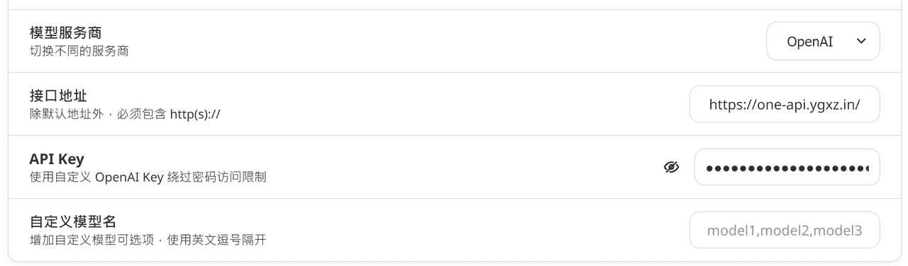
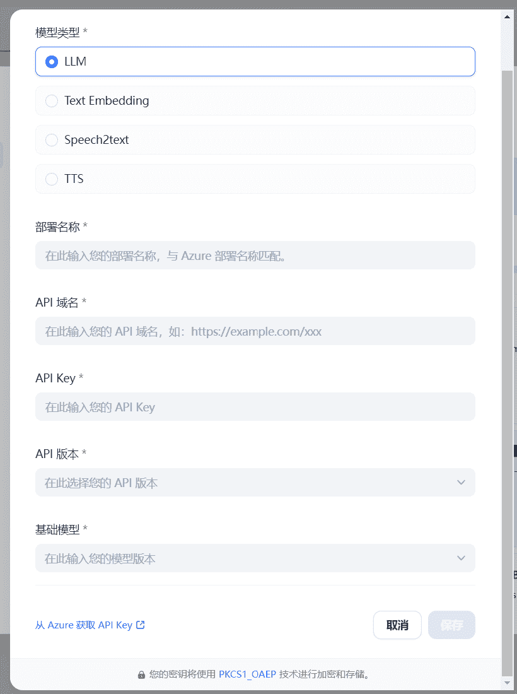

# 如何调用OpenAI API Key

> 来源：[https://zsyhjtnsa5.feishu.cn/docx/LJvMdyMDQoCheuxl18jc3kTbn0a](https://zsyhjtnsa5.feishu.cn/docx/LJvMdyMDQoCheuxl18jc3kTbn0a)

# 基准代码

安装 openai包，本实验手册使用是1.6.1版本

```
pip install -i https://pypi.tuna.tsinghua.edu.cn/simple openai==1.6.1
```

确认openai版本

```
import pkg_resources

openai_version = pkg_resources.get_distribution(&quot;openai&quot;).version
print(openai_version)
```

**基准代码1** ：流式输出

```
import os
from openai import OpenAI

client = OpenAI(  
    api_key=&quot;sk-xxxx&quot;,
    base_url=&quot;https://freeapi.huaqloud.com/v1&quot;
)

stream = client.chat.completions.create(
    model=&quot;gpt-3.5-turbo&quot;,
    messages=[
        {&quot;role&quot;: &quot;system&quot;, &quot;content&quot;: &quot;You are a helpful assistant.&quot;},
        {&quot;role&quot;: &quot;user&quot;, &quot;content&quot;: &quot;证明必达格拉斯定理&quot;}
    ],
    stream=True,
)

for chunk in stream:
    if not chunk.choices or chunk.choices[0].delta.content is None:
        continue

    print(chunk.choices[0].delta.content, end=&quot;&quot;)
print()
```

> 这段Python脚本使用了OpenAI的API，以生成来自GPT-3.5-turbo模型的回应。用户的消息是中文，要求证明勾股定理（"证明必达格拉斯定理"）。脚本设置为流式响应，意味着它会在生成回应的同时，逐块打印出来。

> 下面是对脚本的简要解释：

1.  导入openai库，这是OpenAI API的Python客户端。

1.  创建了一个OpenAI类的实例，并将API密钥和基础URL作为参数传递。

1.  使用client.chat.completions.create()方法创建了一个聊天完成。这个方法接受一个model参数，指定使用的模型（在这种情况下，是"gpt-3.5-turbo"），以及一个messages参数，这是要发送给模型的消息列表。列表中的每条消息都是一个字典，有两个键：role（可以是"system"、"user"或"assistant"）和content（消息的内容）。

1.  stream参数设置为True，意味着响应将被流式处理。

1.  然后，脚本进入一个循环，在生成每个块的响应时打印出来。如果一个块没有任何选择或其内容是None，则跳过它。

1.  最后，使用一个空的print()语句在输出的末尾打印一个换行符。
请注意，你需要用你实际的API密钥替换"sk-xxxx"，并用OpenAI API的实际基础URL替换"https://freeapi.huaqloud.com/v1"。

**基准代码2**：交互式应答

```
import os
from openai import OpenAI

client = OpenAI(  
    api_key=&quot;sk-xxxx&quot;,
    base_url=&quot;https://freeapi.huaqloud.com/v1&quot;
)

history = [
    {&quot;role&quot;: &quot;system&quot;, &quot;content&quot;: &quot;You are an intelligent assistant. You always provide well-reasoned answers that are both correct and helpful.&quot;},
    {&quot;role&quot;: &quot;user&quot;, &quot;content&quot;: &quot;Hello, introduce yourself to someone opening this program for the first time. Be concise.&quot;},
]

while True:
    response = client.chat.completions.create(
        model=&quot;gpt-3.5-turbo&quot;, 
        messages=history,
        temperature=0.7,
    )
    
    print(response.choices[0].message.content)
    history.append({&quot;role&quot;: &quot;assistant&quot;, &quot;content&quot;: response.choices[0].message.content})
    history.append({&quot;role&quot;: &quot;user&quot;, &quot;content&quot;: input(&quot;&gt; &quot;)})
```

> 这段代码使用了OpenAI的GPT-3.5-turbo模型来创建一个简单的聊天助手。下面是对代码中每个部分的详细解释：

1.  首先，你导入了os和openai模块。os模块是Python的标准库，用于与操作系统交互。openai模块是OpenAI的Python客户端，用于与OpenAI的API进行交互。

1.  接下来，你创建了一个OpenAI对象，该对象需要api_key和base_url。这些信息用于让你的程序与OpenAI的API进行通信。

1.  你定义了一个名为history的列表，该列表包含一系列消息。每个消息都是一个字典，包含一个“角色”（可以是“系统”、“用户”或“助手”）和一个“内容”（消息的文本）。这个历史记录被用作聊天模型的输入。

1.  然后，你进入了一个无限循环。在每次迭代中，你都会向OpenAI的API发送一个请求，请求一个新的聊天完成。你使用了client.chat.completions.create方法来完成这个任务。这个方法需要一个模型名（在这个例子中是"gpt-3.5-turbo"），一个历史消息列表，和一个“温度”参数（这个参数控制生成文本的随机性，值越高生成的文本越随机，值越低生成的文本越确定）。

1.  OpenAI的API会返回一个响应，这个响应中包含了模型生成的新消息。你打印了这个新消息的内容。

1.  最后，你将新消息添加到历史记录中，并从用户那里获取新的输入，也将其添加到历史记录中。然后，循环重新开始，使用更新的历史记录生成新的响应。
这个程序将会持续运行，直到你手动停止它。在每次迭代中，它都会打印出模型的响应，并等待用户的输入。

**注意：**为了演示方便，以下所有代码的调试均使用Jutpyter Noetbook，关于在vscode中使用Jupter Notebook请参照 https://code.visualstudio.com/docs/datascience/jupyter-notebooks

# 直接调用 OpenAI

**适用场景**：coding的机器肉身在国内，但是机器的灵魂可以随时在国际互联网上遨游

适配直接调用OpenAI的基准代码1：

```
import os
from openai import OpenAI

client = OpenAI(  
    api_key=&quot;sk-xxx&quot;, # 此处使用openai官方key，怎么获取本文不讨论
    # base_url=&quot;https://api.openai.com/v1&quot; # 既然是直接访问官方站点，这个变量可以不用声明
)

stream = client.chat.completions.create(
    model=&quot;gpt-3.5-turbo&quot;,
    messages=[
        {&quot;role&quot;: &quot;system&quot;, &quot;content&quot;: &quot;You are a helpful assistant.&quot;},
        {&quot;role&quot;: &quot;user&quot;, &quot;content&quot;: &quot;证明必达格拉斯定理&quot;}
    ],
    stream=True,
)

for chunk in stream:
    if not chunk.choices or chunk.choices[0].delta.content is None:
        continue

    print(chunk.choices[0].delta.content, end=&quot;&quot;)
print()
```

尝试调用一下官方的base_url

```
import requests
import json

headers = {&quot;Content-Type&quot;: &quot;application/json&quot;}
data = {&quot;key1&quot;: &quot;value1&quot;, &quot;key2&quot;: &quot;value2&quot;}

response = requests.get(&#x27;https://api.openai.com/&#x27;, headers=headers, data=json.dumps(data))
print(response.text)  # 打印响应内容
```

输出如下：

```
{
    &quot;message&quot;: &quot;Welcome to the OpenAI API! Documentation is available at [https://platform.openai.com/docs/api-reference&quot;](https://platform.openai.com/docs/api-reference%22)
}
```

# 使用 API Proxy 中继

**适用场景：**

+   不能保证随时漫游的， 但是至少有那么一小会可以出去透口气使用某个托管网站创建API Proxy

+   有一个域名（要足够的纯净）

**核心功能代码：**

```
export default { async fetch(request) { const url = new URL(request.url); url.host = &#x27;api.openai.com&#x27;; return fetch(url, { headers: request.headers, method: request.method, body: request.body }); }, };
```

> 这是一段JavaScript代码，它定义了一个对象并导出（export default）。这个对象有一个名为fetch的异步方法，该方法接收一个请求（request）作为参数。

> 以下是每一行代码的解释：

> 1行：export default是ES6模块的语法，它表示默认导出一个对象。

> 2行：定义了一个异步函数（async fetch(request)），它接收一个request参数。这个参数应该是一个请求对象，包含了一个请求的所有信息，如URL、头部、方法、主体等。

> 3行：创建一个新的URL对象（new URL(request.url)）。这个对象的构造函数接收一个字符串参数，表示要解析的URL。然后，这个新创建的URL对象被赋值给url变量。

> 4行：将url.host的值设置为'api.openai.com'。这意味着无论request.url的主机部分原本是什么，现在都被替换为'api.openai.com'。

> 5行：使用全局的fetch函数发起一个新的请求。这个函数的参数包括：

+   url：请求的URL，已经被修改为'api.openai.com'。

+   一个对象，包含：

+   headers：请求的头部，直接使用了原始请求的头部（request.headers）。

+   method：请求的方法，如"GET"、"POST"等，直接使用了原始请求的方法（request.method）。

+   body：请求的主体，直接使用了原始请求的主体（request.body）。
6-7行：定义对象的结束。
这段代码的主要功能是，接收一个请求，修改其URL的主机部分为'api.openai.com'，然后发起一个新的请求。这在某些情况下是有用的，比如当你需要通过一个代理服务器访问OpenAI的API时。

**两种实现方法**：

1.  vercel实现方法：https://github.com/cloudzun/vercel-openai-deploy

1.  cloudflare实现方法：https://cloud.tencent.com/developer/article/2304066

这两种方法在实现上最大的区别是，vercel对DNS配置要求低，cloudflare要求把DNS域名托管到它的网站上，略有些强势了。

如果不方便自己创建，可以使用某个代理：https://bridge.huaqloud.com/api

查询api proxy

```
import requests
import json

headers = {&quot;Content-Type&quot;: &quot;application/json&quot;}
data = {&quot;key1&quot;: &quot;value1&quot;, &quot;key2&quot;: &quot;value2&quot;}

response = requests.get(&#x27;https://bridge.huaqloud.com/api/&#x27;, headers=headers, data=json.dumps(data))
print(response.text)  # 打印响应内容
```

输入一般情况下应该是：

```
{
    &quot;message&quot;: &quot;Welcome to the OpenAI API! Documentation is available at [https://platform.openai.com/docs/api-reference&quot;](https://platform.openai.com/docs/api-reference%22)
}
```

适配API Proxy的基准代码1：

```
import os
from openai import OpenAI

client = OpenAI(  
    api_key=&quot;sk-xxx&quot;, # 此处使用openai官方key，怎么获取本文不讨论
    base_url=&quot;https://bridge.huaqloud.com/api/v1&quot; # 此处使用api proxy地址，注意需要带上/v1
)

stream = client.chat.completions.create(
    model=&quot;gpt-3.5-turbo&quot;,
    messages=[
        {&quot;role&quot;: &quot;system&quot;, &quot;content&quot;: &quot;You are a helpful assistant.&quot;},
        {&quot;role&quot;: &quot;user&quot;, &quot;content&quot;: &quot;证明必达格拉斯定理&quot;}
    ],
    stream=True,
)

for chunk in stream:
    if not chunk.choices or chunk.choices[0].delta.content is None:
        continue

    print(chunk.choices[0].delta.content, end=&quot;&quot;)
print()
```

套壳软件中 OpenAI Key的调用（以NetxChat为例）



# 使用 Azure OpenAI

**适用场景：**拥有启用了Azure OpenAI服务的Azure订阅，在这种情况下对网络没有要求，常规联网就可以。

[**官方示例**](https://learn.microsoft.com/zh-cn/azure/ai-services/openai/chatgpt-quickstart?tabs=command-line%2Cpython-new&pivots=programming-language-python)**代码：**

```
import os
from openai import AzureOpenAI

client = AzureOpenAI(
  azure_endpoint =&quot;https://xxxxx.openai.azure.com/&quot;, # API端点
  api_key=&quot;xxxxx&quot;,  # API key
  api_version=&quot;2023-05-15&quot; # API 版本
)

response = client.chat.completions.create(
    model=&quot;gpt-35-turbo&quot;, # model = &quot;deployment_name&quot;.
    messages=[
        {&quot;role&quot;: &quot;system&quot;, &quot;content&quot;: &quot;You are a helpful assistant.&quot;},
        {&quot;role&quot;: &quot;user&quot;, &quot;content&quot;: &quot;Does Azure OpenAI support customer managed keys?&quot;},
        {&quot;role&quot;: &quot;assistant&quot;, &quot;content&quot;: &quot;Yes, customer managed keys are supported by Azure OpenAI.&quot;},
        {&quot;role&quot;: &quot;user&quot;, &quot;content&quot;: &quot;Do other Azure AI services support this too?&quot;}
    ]
)

print(response.choices[0].message.content)
```

> 这段代码使用了Azure版本的OpenAI的GPT-3.5-turbo模型（在这里被命名为"gpt-35-turbo"）来创建一个聊天助手。这个版本的OpenAI API与标准版本的OpenAI API在使用上有些许不同，但基本概念是相同的。下面是对代码中每个部分的详细解释：

1.  首先导入了os和openai模块。os模块是Python的标准库，用于与操作系统交互。openai模块是OpenAI的Python客户端，用于与OpenAI的API进行交互。

1.  接下来，创建了一个AzureOpenAI对象，该对象需要Azure的azure_endpoint、api_key和api_version。这些信息用于让你的程序与Azure版的OpenAI的API进行通信。

1.  使用了client.chat.completions.create方法来向OpenAI的API发送一个请求，请求一个新的聊天完成。这个方法需要一个模型名（在这个例子中是"gpt-35-turbo"），和一个历史消息列表。历史消息列表包含一系列消息，每个消息都是一个字典，包含一个“角色”（可以是“系统”、“用户”或“助手”）和一个“内容”（消息的文本）。这个历史记录被用作聊天模型的输入。

1.  OpenAI的API会返回一个响应，这个响应中包含了模型生成的新消息。你打印了这个新消息的内容。
这个代码片段是一个单次的聊天完成请求，它不会持续等待用户的输入。相反，它只是发送一个请求，打印出响应，然后结束。

**要点：**

1.  部署的名称需要和模型的名称保持一致

1.  AOAI里的模型名称一般没有小数点，比如gpt-35-turbo，更多有关模型的信息请参阅：Azure OpenAI 服务模型

适配AOAI的基准代码1：流式应答

```
import os
from openai import AzureOpenAI

client = AzureOpenAI(
  azure_endpoint =&quot;https://xxxxx.openai.azure.com/&quot;, # API端点
  api_key=&quot;xxxxx&quot;,  # API key
  api_version=&quot;2023-05-15&quot; # API 版本
)

stream = client.chat.completions.create(
    model=&quot;gpt-35-turbo&quot;, # 注意此处的模型名称
    messages=[
        {&quot;role&quot;: &quot;system&quot;, &quot;content&quot;: &quot;You are a helpful assistant.&quot;},
        {&quot;role&quot;: &quot;user&quot;, &quot;content&quot;: &quot;证明毕达哥拉斯定理&quot;}
    ],
    stream=True,
)

for chunk in stream:
    if not chunk.choices or chunk.choices[0].delta.content is None:
        continue

    print(chunk.choices[0].delta.content, end=&quot;&quot;)
print()
```

适配AOAI的基准代码2：交互式应答

```
import os
from openai import AzureOpenAI

client = AzureOpenAI(
  azure_endpoint =&quot;https://xxxxx.openai.azure.com/&quot;, # API端点
  api_key=&quot;xxxxx&quot;,  # API key
  api_version=&quot;2023-05-15&quot; # API 版本
)

history = [
    {&quot;role&quot;: &quot;system&quot;, &quot;content&quot;: &quot;You are an intelligent assistant. You always provide well-reasoned answers that are both correct and helpful.&quot;},
    {&quot;role&quot;: &quot;user&quot;, &quot;content&quot;: &quot;Hello, introduce yourself to someone opening this program for the first time. Be concise.&quot;},
]

while True:
    response = client.chat.completions.create(
        model=&quot;gpt-35-turbo&quot;, 
        messages=history,
        temperature=0.7,
    )
    
    print(response.choices[0].message.content)
    history.append({&quot;role&quot;: &quot;assistant&quot;, &quot;content&quot;: response.choices[0].message.content})
    history.append({&quot;role&quot;: &quot;user&quot;, &quot;content&quot;: input(&quot;&gt; &quot;)})
    
    
```

套壳软件中Azure OpenAI的调用（以DIFY为例）



# 使用 API Gateway 分发管理Key

**适用场景：**

+   有专门的出海服务器或者稳定的IaaS/PaaS/CaaS托管环境，可以自主部署和持续稳定运行服务

+   需要对API Key进行更多的管理和配置，比如：多租户管理，额度管理以及需要把AOAI的Key转成OpenAI的key

+   推荐解决方案：使用One-API提供的[API Gateway](https://github.com/songquanpeng/one-api)：

样例：

```
https://chat.huaqloud.com/#/?settings={&quot;key&quot;:&quot;sk-cbsdaUEgK9a8aQvuF7891dF19c3641Ae8887Ae5a41809977&quot;,&quot;url&quot;:&quot;https://api.huaqloud.com&quot;}
```

适配API Gateway的基准代码1：

```
import os
from openai import OpenAI

client = OpenAI(  
    api_key=&quot;sk-cbsdaUEgK9a8aQvuF7891dF19c3641Ae8887Ae5a41809977&quot;, # API Key
    base_url=&quot;https://api.huaqloud.com/v1&quot; # API Gateway 服务器地址
)

stream = client.chat.completions.create(
    model=&quot;gpt-3.5-turbo&quot;,
    messages=[
        {&quot;role&quot;: &quot;system&quot;, &quot;content&quot;: &quot;You are a helpful assistant.&quot;},
        {&quot;role&quot;: &quot;user&quot;, &quot;content&quot;: &quot;证明费马大定理&quot;}
    ],
    stream=True,
)

for chunk in stream:
    if not chunk.choices or chunk.choices[0].delta.content is None:
        continue

    print(chunk.choices[0].delta.content, end=&quot;&quot;)
print()
```

注意：看上去是不是平淡无奇，但是在这个样例中，后台的key资源实际上是AOAI提供的。

# LLM 本地运行的平替解决方案： LM Studio

**适用场景：**

+   需要在一个完全封闭的场景中测试LLM开发

+   不需要有彪悍的GPU，但是需要有较多的内存（可用内存10G以上）以及较多的可用磁盘空间（可用磁盘空间在20GB以上），

+   同时要有一定的耐心（毕竟是模型经过一定程度的剪裁才能在普通设备运行的使用CPU进行推理）

```
  GGUF(以前称为GGML)是**一种量化方法，允许用户使用CPU来运行LLM，但也可以将其某些层加载到GPU以提高速度**。 虽然使用CPU进行推理通常比使用GPU慢，但对于那些在CPU或苹果设备上运行模型的人来说，这是一种非常好的格式。 如果你想同时利用CPU和GPU, GGUF是一个非常好的格式。
```

官方网站：[LM Studio](https://lmstudio.ai/)

推荐模型：chinese-alpaca-2-7b.Q8_0.gguf

**官方示例代码**

```
# Chat with an intelligent assistant in your terminal
from openai import OpenAI

# Point to the local server
client = OpenAI(base_url=&quot;http://localhost:1234/v1&quot;, api_key=&quot;not-needed&quot;)

history = [
    {&quot;role&quot;: &quot;system&quot;, &quot;content&quot;: &quot;You are an intelligent assistant. You always provide well-reasoned answers that are both correct and helpful.&quot;},
    {&quot;role&quot;: &quot;user&quot;, &quot;content&quot;: &quot;Hello, introduce yourself to someone opening this program for the first time. Be concise.&quot;},
]

while True:
    completion = client.chat.completions.create(
        model=&quot;local-model&quot;, # this field is currently unused
        messages=history,
        temperature=0.7,
        stream=True,
    )

    new_message = {&quot;role&quot;: &quot;assistant&quot;, &quot;content&quot;: &quot;&quot;}
    
    for chunk in completion:
        if chunk.choices[0].delta.content:
            print(chunk.choices[0].delta.content, end=&quot;&quot;, flush=True)
            new_message[&quot;content&quot;] += chunk.choices[0].delta.content

    history.append(new_message)
    
    # Uncomment to see chat history
    # import json
    # gray_color = &quot;\033[90m&quot;
    # reset_color = &quot;\033[0m&quot;
    # print(f&quot;{gray_color}\n{&#x27;-&#x27;*20} History dump {&#x27;-&#x27;*20}\n&quot;)
    # print(json.dumps(history, indent=2))
    # print(f&quot;\n{&#x27;-&#x27;*55}\n{reset_color}&quot;)

    print()
    history.append({&quot;role&quot;: &quot;user&quot;, &quot;content&quot;: input(&quot;&gt; &quot;)})
```

> 这段代码是一个使用OpenAI聊天模型的Python程序，它在你的本地终端中创建了一个聊天助手。以下是主要部分的概述：

1.  **导入模块和初始化客户端**：首先，代码从openai库中导入了OpenAI类，并实例化了一个OpenAI对象。这个对象指向一个本地服务器（http://localhost:1234/v1），并使用一个不必要的API密钥（"not-needed"）。

1.  **定义历史记录**：定义了一个名为history的列表，它包含了聊天的历史记录。列表中的每个元素都是一个包含"role"（角色）和"content"（内容）的字典。

1.  **无限循环**：然后，代码进入了一个无限循环，在循环中，程序会持续地生成聊天回复并接收用户输入。

+   **创建聊天完成**：在每次循环中，代码首先使用client.chat.completions.create方法创建一个聊天完成。这个方法需要一个模型名（在这个例子中是"local-model"，但这个字段当前未使用），一个历史消息列表，一个"temperature"参数（控制生成文本的随机性），以及一个"stream"参数（如果设置为True，API会以流的形式返回聊天完成，这意味着你可以在完成生成时获取部分结果）。

+   **处理聊天完成**：然后，代码创建了一个新的消息字典，并将其"role"设为"assistant"，"content"设为空字符串。接着，代码遍历了聊天完成的每一部分（每一"chunk"），打印出每一部分的内容，并将这些内容添加到新消息的"content"中。

+   **更新历史记录**：然后，代码将新消息添加到历史记录中。

+   **显示历史记录**：这一部分代码被注释掉了，但如果你取消注释，它会打印出整个聊天历史。

+   **接收用户输入**：最后，代码接收用户的输入，并将其添加到历史记录中。
这个程序会持续运行，直到你手动停止它。在每次迭代中，它都会打印出模型的回复，并等待用户的输入。

适配LM Studio的基准代码1：

```
import os
from openai import OpenAI

client = OpenAI(  
    api_key=&quot;not-needed&quot;, #这一行也可以注释掉
    base_url=&quot;http://localhost:1234/v1&quot; #如果不在本机调用，则将localhost替换成计算机名或者IP地址
)

stream = client.chat.completions.create(
    model=&quot;gpt-3.5-turbo&quot;,
    messages=[
        {&quot;role&quot;: &quot;system&quot;, &quot;content&quot;: &quot;You are a helpful assistant.&quot;},
        {&quot;role&quot;: &quot;user&quot;, &quot;content&quot;: &quot;证明必达格拉斯定理&quot;}
    ],
    stream=True,
)

for chunk in stream:
    if not chunk.choices or chunk.choices[0].delta.content is None:
        continue

    print(chunk.choices[0].delta.content, end=&quot;&quot;)
print()
```

# 实现方法对比

如果有条件，推荐使用API Gateway的方式。

# 其他应用和工具的配置

如果使用类似flowsie的工具测试无代码低代码开发或者使用类似chatgpt-next-web的套壳工具，只要当前已经通过文中涉及的某种方式获得了api_key 和 base_url，只需要填充到对应位置即可。

# 附录

## 实验用OpenAI Key

+   临时key：sk-a8IZAhEPVp6lMRwB00813d07E0Dd453399909e6182D79e40

+   端点：https://one-api.ygxz.in/

+   Api key申请地址 https://one-api.ygxz.in/

## 使用环境变量存储敏感配置

通常，我们不会直接在代码中硬编码敏感信息，如API密钥。这样做可能会导致敏感信息的泄露，特别是当你的代码需要在版本控制系统中共享时。

一种更好的做法是将这些敏感信息存储在环境变量中，然后在代码中通过os.getenv函数来获取这些信息。这样，你就可以在不修改代码的情况下，通过改变环境变量的值来改变这些敏感信息。

以下是如何修改你的代码来实现这一点：

```
import os
from openai import OpenAI

# 从环境变量中获取API密钥和base_url
api_key = os.getenv(&quot;OPENAI_API_KEY&quot;)
base_url = os.getenv(&quot;BASE_URL&quot;)

client = OpenAI(  
    api_key=api_key,
    base_url=base_url
)

stream = client.chat.completions.create(
    model=&quot;gpt-3.5-turbo&quot;,
    messages=[
        {&quot;role&quot;: &quot;system&quot;, &quot;content&quot;: &quot;You are a helpful assistant.&quot;},
        {&quot;role&quot;: &quot;user&quot;, &quot;content&quot;: &quot;证明必达格拉斯定理&quot;}
    ],
    stream=True,
)

for chunk in stream:
    if not chunk.choices or chunk.choices[0].delta.content is None:
        continue

    print(chunk.choices[0].delta.content, end=&quot;&quot;)
print()
```

然后，你可以在运行你的Python脚本之前，通过命令行来设置这些环境变量。例如，在Unix或Linux系统中，你可以使用以下命令：

```
export OPENAI_API_KEY=your_api_key
export BASE_URL=your_base_url
python your_script.py
```

在Windows系统中，你可以使用以下命令：

```
set OPENAI_API_KEY=your_api_key
set BASE_URL=your_base_url
python your_script.py
```

请记住，你需要将your_api_key和your_base_url替换为你的实际API密钥和base_url。

## 使用.env存储敏感配置

如果你想使用 .env 文件来存储你的环境变量，你可以使用 python-dotenv 库来加载 .env 文件中的环境变量。以下是如何修改你的代码来实现这一点：

首先，你需要在你的项目根目录下创建一个 .env 文件，并在其中设置你的环境变量：

```
OPENAI_API_KEY=your_api_key
BASE_URL=your_base_url
```

然后，你可以使用 python-dotenv 库来加载这些环境变量：

```
from dotenv import load_dotenv
import os
from openai import OpenAI

# 加载 .env 文件中的环境变量
load_dotenv()

# 从环境变量中获取API密钥和base_url
api_key = os.getenv(&quot;OPENAI_API_KEY&quot;)
base_url = os.getenv(&quot;BASE_URL&quot;)

client = OpenAI(  
    api_key=api_key,
    base_url=base_url
)

stream = client.chat.completions.create(
    model=&quot;gpt-3.5-turbo&quot;,
    messages=[
        {&quot;role&quot;: &quot;system&quot;, &quot;content&quot;: &quot;You are a helpful assistant.&quot;},
        {&quot;role&quot;: &quot;user&quot;, &quot;content&quot;: &quot;证明必达格拉斯定理&quot;}
    ],
    stream=True,
)

for chunk in stream:
    if not chunk.choices or chunk.choices[0].delta.content is None:
        continue

    print(chunk.choices[0].delta.content, end=&quot;&quot;)
print()
```

请注意，你需要先安装 python-dotenv 库，你可以使用以下命令来安装：

```
pip install python-dotenv
```

然后，你就可以运行你的Python脚本了，python-dotenv 会自动加载 .env 文件中的环境变量。

## 安装 openai python库

看起来你在尝试安装 openai Python 库时遇到了问题。错误信息表明 distro.exe 文件无法写入，这可能是由于权限问题或者其他原因。

以下是一些可能的解决方案：

1.  以管理员权限运行你的命令提示符或者终端，然后再尝试安装 openai 库。

1.  尝试在一个虚拟环境中安装 openai 库。你可以使用 venv 模块创建一个虚拟环境，然后在这个环境中安装库。以下是创建和使用虚拟环境的步骤：

```
# 创建虚拟环境
python -m venv env

# 激活虚拟环境
# Windows
env\Scripts\activate
# Unix or MacOS
source env/bin/activate

# 在虚拟环境中安装 openai
pip install openai==1.2.0
```

1.  如果以上方法都无法解决问题，你可能需要检查你的 Python 和 pip 是否正确安装，或者尝试更新你的 pip 版本。你可以使用以下命令更新 pip：

```
python -m pip install --upgrade pip
```

## FreeGPT

```
docker run -p 3040:3040 ghcr.io/missuo/freegpt35
```