# LangChain WorkShop

> 来源：[https://zsyhjtnsa5.feishu.cn/docx/Zf89d3mF8oy9oExFd4ncZQjNnPg](https://zsyhjtnsa5.feishu.cn/docx/Zf89d3mF8oy9oExFd4ncZQjNnPg)

> 经过严谨测试，本段代码在大多数情况下能够正常运行，尽管存在少数已明确标注的特殊场景可能出现问题。若在执行过程中遇到困难，建议按照以下顺序进行故障排查：

1.  首先确认所有的软件包版本是否与实验手册中所列的版本一致。正确的版本能确保代码的稳定运行。

1.  确保所有路径设置正确，包括虚拟环境（venv）路径和文件路径。详细的路径检查步骤可在实验步骤中找到。

1.  网络问题可能会影响代码的执行，考虑使用在线的 Jupyter Notebook 可以避免部分网络问题。

1.  若上述步骤无法解决问题，可能是由于 Large Language Model (LLM) 的质量限制所致。此时，可以考虑使用质量更高的模型。或者尝试调整提示词。

> 以上步骤旨在帮助解决代码执行过程中可能遇到的问题，确保实验的顺利进行。

# LangChain运行环境准备

+   本次实验的代码均为python

+   为了配合理解章节内容理解示例代码运行机制，使用Juypter Notebook会是一个比较好的选择。

+   对于综合演练和项目实操，建议使用VS Code运行相关实例代码

## 安装Python和Notebook

+   安装 python：https://www.liaoxuefeng.com/wiki/1016959663602400/1016959856222624

+   安装 Jypter Notebook：https://zhuanlan.zhihu.com/p/33105153

+   VS Code的安装和初始化配置：https://code.visualstudio.com/docs/setup/windows

+   在VS Code上配置Python环境：https://code.visualstudio.com/docs/python/python-quick-start

+   在VS Code上配置https://code.visualstudio.com/docs/datascience/jupyter-notebooks

## 实现 Python 虚拟环境 venv

为了确保示例代码运行顺利，强烈建议使用专门Python Venv

> 虚拟环境的主要特性：

+   用来包含支持一个项目（库或应用程序）所需的特定 Python 解释器、软件库和二进制文件。 它们在默认情况下与其他虚拟环境中的软件以及操作系统中安装的 Python 解释器和库保持隔离。

+   包含在一个目录中，根据惯例被命名为项目目录下的venv 或 .venv，或是有许多虚拟环境的容器目录下，如 ~/.virtualenvs。

+   不可签入 Git 等源代码控制系统。

+   被视为是可丢弃性的 —— 应当能够简单地删除并从头开始重建。 你不应在虚拟环境中放置任何项目代码。

+   不被视为是可移动或可复制的 —— 你只能在目标位置重建相同的环境。

以下是创建并设置虚拟环境的详细步骤：

1.  打开命令行工具（例如Windows的命令提示符或PowerShell，MacOS的Terminal）。

1.  创建一个新的虚拟环境。在命令行中，运行以下命令：

```
python -m venv c:\path\lcenv
```

1.  激活你的虚拟环境。在Windows上，运行以下命令：

```
c:\path\lcenv\Scripts\activate
```

1.  在激活的虚拟环境中，使用 pip 安装 ipykernel，这是一个提供 Jupyter 内核的库

```
 pip install -i https://pypi.tuna.tsinghua.edu.cn/simple ipykernel
```

1.  接下来，将你的虚拟环境添加为 Jupyter 的一个新内核

```
python -m ipykernel install --user --name=lcenv
```

请注意，你需要将c:\path\lcenv替换为你的实际路径。

## 获取LLM API Key

+   授课过程中，讲师会提供OPENAI_API_KEY和OPENAI_API_BASE供随堂练习。

+   也建议大家从LLM官方或者第三方渠道获取API资源做课后练习或者项目开发测试。

+   也可以在本地部署LLM实现离线\封闭演练开发，只要确保本地LLM使用OpenAI兼容的API模式，代码一般不需要进行调整(考虑到不同LLM确实存在功能上的差异，可能输出结果确实可能会有所不同)。

有关API Key的调用以及实现本地LLM基础架构的诸多细节，请参考以下两篇文档：

+   如何调用OpenAI API Key：https://zsyhjtnsa5.feishu.cn/docx/LJvMdyMDQoCheuxl18jc3kTbn0a

+   实现本地LLM基础架构：https://zsyhjtnsa5.feishu.cn/docx/Qkewdoz0jocEpzxoWyycosbjnhd

## 基本调用

安装包

```
pip install -i https://pypi.tuna.tsinghua.edu.cn/simple openai==1.6.1 langchain==0.1.4 langchain-community==0.0.16 langchain-core==0.1.17 langchain-experimental==0.0.49 langchain-openai==0.0.2.post1
```

**OpenAI 原生调用方法**

```
from openai import OpenAI

client = OpenAI(api_key=&#x27;sk-xxxx&#x27;, base_url=&#x27;https://api.huaqloud.com/v1&#x27;)

prompt_text = &quot;您是一位专业的鲜花店文案撰写员。对于售价为{}元的{}，您能提供一个吸引人的简短描述吗？&quot;

flowers = [&quot;玫瑰&quot;, &quot;百合&quot;, &quot;康乃馨&quot;]
prices = [&quot;50&quot;, &quot;30&quot;, &quot;20&quot;]

for flower, price in zip(flowers, prices):
    prompt = prompt_text.format(price, flower)
    response = client.completions.create(
        model=&quot;gpt-3.5-turbo-instruct&quot;,
        prompt=prompt,
        max_tokens=1000
    )
    print(response.choices[0].text.strip())
```

> 这段代码的主要目的是使用OpenAI的GPT-3.5-turbo-instruct模型生成一些文本。以下是代码的主要流程：

+   导入OpenAI类，这是openai模块的一部分，用于与OpenAI的API进行交互。

+   创建OpenAI类的实例，初始化时需要提供API密钥和基础URL。

+   定义输入提示，这里使用了一个名为prompt_text的格式化字符串，将花的名称和价格插入到提示中。

+   定义两个列表，一个包含花的名称，另一个包含花的价格。

+   使用zip函数将花的名称和价格配对，然后遍历每一对花和价格。

+   对于每一对花和价格，将价格和花的名称插入到输入提示中，然后将输入提示发送到OpenAI的API，并获取API的响应。

+   打印API的响应。
在这个过程中，openai模块用于与OpenAI的API进行交互，zip函数用于将花的名称和价格配对。

**LangChain运行方式**

首先在notebook第一段输入以下代码，声明环境变量

```
%env OPENAI_API_KEY=sk-xxx
%env OPENAI_API_BASE=https://api.huaqloud.com/v1
```

> 这段代码是在Jupyter Notebook环境中设置环境变量的方式。%env是一个Jupyter Notebook的魔法命令，用于获取、设置和列出环境变量。

> 这里，OPENAI_API_KEY和OPENAI_API_BASE是被设置的环境变量。

+   OPENAI_API_KEY是用于访问OpenAI API的密钥。这是一个敏感信息，通常不会直接在代码中显示，而是通过环境变量或其他安全方式提供。

+   OPENAI_API_BASE是OpenAI API的基础URL。这个URL是API请求的基础路径，具体的API路径会附加在这个URL后面。
这两个环境变量可能在后续的代码中被用来构造对OpenAI API的请求。

调用 Text模型

```
import os
from langchain.llms import OpenAI

# 从环境变量中读取API密钥和base_url
# API_SECRET_KEY = os.getenv(&quot;OPENAI_API_KEY&quot;)
# BASE_URL = os.getenv(&quot;OPENAI_API_BASE&quot;)

llm = OpenAI(      
    model=&quot;gpt-3.5-turbo-instruct&quot;,
    temperature=0.8,
    max_tokens=60,)
response = llm.predict(&quot;请给我的花店起个名字。&quot;)
print(response)
```

> 这段Python代码主要用于使用OpenAI的语言模型（在这里是"gpt-3.5-turbo-instruct"）来生成预测。

> 以下是每行代码的详细解释：

+   import os：导入Python的os模块，该模块提供了许多与操作系统交互的函数。

+   from langchain.llms import OpenAI：从langchain.llms模块导入OpenAI类。

+   API_SECRET_KEY = os.getenv("OPENAI_API_KEY")：从环境变量中获取名为"OPENAI_API_KEY"的值，并将其赋值给API_SECRET_KEY变量。

+   BASE_URL = os.getenv("OPENAI_API_BASE")：从环境变量中获取名为"OPENAI_API_BASE"的值，并将其赋值给BASE_URL变量。

+   llm = OpenAI(：创建一个OpenAI类的实例，并将其赋值给llm变量。

+   model="gpt-3.5-turbo-instruct",：设置要使用的语言模型为"gpt-3.5-turbo-instruct"。

+   temperature=0.8,：设置生成文本的随机性。值越高，输出越随机；值越低，输出越确定。

+   max_tokens=60,)：设置生成文本的最大长度为60个tokens。

+   response = llm.predict("请给我的花店起个名字。")：调用predict方法，输入"请给我的花店起个名字。"，并将返回的预测结果赋值给response变量。

+   print(response)：打印预测结果。

调用Chat模型

```
import os

# 从环境变量中获取API密钥和base_url
# API_SECRET_KEY = os.getenv(&quot;OPENAI_API_KEY&quot;)
# BASE_URL = os.getenv(&quot;OPENAI_API_BASE&quot;)

from langchain_openai import ChatOpenAI
chat = ChatOpenAI(
    model=&quot;gpt-3.5-turbo&quot;,
    temperature=0.8,
    max_tokens=60
)

from langchain.schema import (
    HumanMessage,
    SystemMessage
)

messages = [
    SystemMessage(content=&quot;你是一个很棒的智能助手。&quot;),
    HumanMessage(content=&quot;请给我的花店起个名。&quot;)
]

response = chat.invoke(messages)
print(response)
```

> 这段Python代码主要用于使用OpenAI的语言模型（在这里是"gpt-3.5-turbo"）来进行聊天式的预测。以下是每行代码的详细解释：

+   1-4. 从环境变量中获取名为"OPENAI_API_KEY"和"OPENAI_API_BASE"的值，并将其分别赋值给API_SECRET_KEY和BASE_URL变量。这些环境变量可能在后续的代码中被用来构造对OpenAI API的请求。

+   5-10. 创建一个ChatOpenAI类的实例，并将其赋值给chat变量。设置要使用的语言模型为"gpt-3.5-turbo"，设置生成文本的随机性为0.8，设置生成文本的最大长度为60个tokens。

+   12-15. 从langchain.schema模块导入HumanMessage和SystemMessage类。这两个类可能用于构造聊天消息。

+   17-21. 创建一个包含两个消息的列表。第一个消息是一个SystemMessage，内容为"你是一个很棒的智能助手。"；第二个消息是一个HumanMessage，内容为"请给我的花店起个名。"。

+   23 调用chat对象的invoke方法，输入之前创建的消息列表，将返回的聊天预测结果赋值给response变量。

+   24 打印聊天预测结果。

# 模型 I/O

## 提示模板

```
# 导入LangChain中的提示模板
from langchain import PromptTemplate
# 创建原始模板
template = &quot;&quot;&quot;您是一位专业的鲜花店文案撰写员。\n
对于售价为 {price} 元的 {flower_name} ，您能提供一个吸引人的简短描述吗？
&quot;&quot;&quot;
# 根据原始模板创建LangChain提示模板
prompt = PromptTemplate.from_template(template) 
# 打印LangChain提示模板的内容
print(prompt)

input_variables=[&#x27;flower_name&#x27;, &#x27;price&#x27;] 
output_parser=None 
partial_variables={} 
template=&quot;&quot;&quot;
您是一位专业的鲜花店文案撰写员。

对于售价为 {price} 元的 {flower_name} ，您能提供一个吸引人的简短描述吗？
&quot;&quot;&quot;
template_format=&#x27;f-string&#x27; 
validate_template=True

# 设置OpenAI API Key和BASE URL
import os
# API_SECRET_KEY = os.getenv(&quot;OPENAI_API_KEY&quot;)
# BASE_URL = os.getenv(&quot;OPENAI_API_BASE&quot;)

# 导入LangChain中的OpenAI模型接口
from langchain import OpenAI
# 创建模型实例
model = OpenAI(model_name=&#x27;gpt-3.5-turbo-instruct&#x27;)
# 输入提示
input = prompt.format(flower_name=[&quot;玫瑰&quot;], price=&#x27;50&#x27;)
# 得到模型的输出
output = model(input)
# 打印输出内容
print(output)    
```

> 这段代码的目标是生成一个关于售价为50元的玫瑰的吸引人的简短描述。这段Python代码使用了langchain库来生成一个鲜花店文案。以下是每一部分的详细解释：

+   **导入提示模板**：从langchain库中导入PromptTemplate类。

+   **创建原始模板**：定义一个字符串template，其中包含两个占位符{price}和{flower_name}。

+   **创建LangChain提示模板**：使用PromptTemplate.from_template方法，将原始模板转换为LangChain提示模板。

+   打印LangChain提示模板的内容：打印出提示模板的内容。

+   **设置输入变量和模板参数**：定义输入变量（flower_name和price），输出解析器（这里没有设置，所以为None），部分变量（这里没有设置，所以为空字典），模板格式（设置为f-string），以及是否验证模板（设置为True）。

+   设置OpenAI API Key和BASE URL：从环境变量中获取OpenAI API Key和BASE URL。

+   导入LangChain中的OpenAI模型接口：从langchain库中导入OpenAI类。

+   **创建模型实例**：创建一个OpenAI模型实例，模型名称为gpt-3.5-turbo-instruct。

+   **输入提示**：使用提示模板的format方法，将输入变量（flower_name和price）填充到模板中，生成最终的提示。

+   **得到模型的输出**：将最终的提示输入到模型中，得到模型的输出。

+   **打印输出内容**：打印出模型的输出内容。

## 复用提示模板

```
# 导入LangChain中的提示模板
from langchain import PromptTemplate
# 创建原始模板
template = &quot;&quot;&quot;您是一位专业的鲜花店文案撰写员。\n
对于售价为 {price} 元的 {flower_name} ，您能提供一个吸引人的简短描述吗？
&quot;&quot;&quot;
# 根据原始模板创建LangChain提示模板
prompt = PromptTemplate.from_template(template) 
# 打印LangChain提示模板的内容
print(prompt)

# 设置OpenAI API Key和BASE URL
import os
API_SECRET_KEY = os.getenv(&quot;OPENAI_API_KEY&quot;)
BASE_URL = os.getenv(&quot;OPENAI_API_BASE&quot;)

# 导入LangChain中的OpenAI模型接口
from langchain import OpenAI
# 创建模型实例
model = OpenAI(model_name=&#x27;gpt-3.5-turbo-instruct&#x27;)

# 多种花的列表
flowers = [&quot;玫瑰&quot;, &quot;百合&quot;, &quot;康乃馨&quot;]
prices = [&quot;50&quot;, &quot;30&quot;, &quot;20&quot;]

# 生成多种花的文案
for flower, price in zip(flowers, prices):
    # 使用提示模板生成输入
    input_prompt = prompt.format(flower_name=flower, price=price)

    # 得到模型的输出
    output = model(input_prompt)

    # 打印输出内容
    print(output)
```

> 这段代码的主要目的是使用OpenAI的GPT-3.5-turbo-instruct模型为不同的花生成吸引人的描述。以下是代码的主要流程：

+   导入PromptTemplate类，这是langchain模块的一部分，用于创建输入提示模板。

+   创建一个原始的输入提示模板，然后使用PromptTemplate.from_template方法将其转换为PromptTemplate实例。

+   从环境变量中获取OpenAI的API密钥和基础URL。

+   导入OpenAI类，这是langchain模块的一部分，用于与OpenAI的API进行交互。

+   创建OpenAI类的实例，初始化时需要提供API密钥、基础URL以及模型名称。

+   定义一个花的列表和一个价格的列表。

+   对于每种花和对应的价格，使用PromptTemplate实例的format方法生成输入提示，然后将输入提示发送到OpenAI的API，并获取API的响应。

+   打印API的响应。
在这个过程中，os模块用于获取环境变量，langchain模块用于创建输入提示模板和与OpenAI的API进行交互。

## 解析输出

安装包

```
pip install -i https://pypi.tuna.tsinghua.edu.cn/simple  pandas==2.1.0
```

```
# 通过LangChain调用模型
from langchain import PromptTemplate, OpenAI

# 导入OpenAI Key和BASE URL
import os
API_SECRET_KEY = os.getenv(&quot;OPENAI_API_KEY&quot;)
BASE_URL = os.getenv(&quot;OPENAI_API_BASE&quot;)

# 创建原始提示模板
prompt_template = &quot;&quot;&quot;您是一位专业的鲜花店文案撰写员。
对于售价为 {price} 元的 {flower_name} ，您能提供一个吸引人的简短描述吗？
{format_instructions}&quot;&quot;&quot;

# 创建模型实例
model = OpenAI(model_name=&#x27;gpt-3.5-turbo-instruct&#x27;)

# 导入结构化输出解析器和ResponseSchema
from langchain.output_parsers import StructuredOutputParser, ResponseSchema
# 定义我们想要接收的响应模式
response_schemas = [
    ResponseSchema(name=&quot;description&quot;, description=&quot;鲜花的描述文案&quot;),
    ResponseSchema(name=&quot;reason&quot;, description=&quot;问什么要这样写这个文案&quot;)
]
# 创建输出解析器
output_parser = StructuredOutputParser.from_response_schemas(response_schemas)

# 获取格式指示
format_instructions = output_parser.get_format_instructions()
# 根据原始模板创建提示，同时在提示中加入输出解析器的说明
prompt = PromptTemplate.from_template(prompt_template, 
                partial_variables={&quot;format_instructions&quot;: format_instructions}) 

# 数据准备
flowers = [&quot;玫瑰&quot;, &quot;百合&quot;, &quot;康乃馨&quot;]
prices = [&quot;50&quot;, &quot;30&quot;, &quot;20&quot;]

# 创建一个空的DataFrame用于存储结果
import pandas as pd
df = pd.DataFrame(columns=[&quot;flower&quot;, &quot;price&quot;, &quot;description&quot;, &quot;reason&quot;]) # 先声明列名

for flower, price in zip(flowers, prices):
    # 根据提示准备模型的输入
    input = prompt.format(flower_name=flower, price=price)

    # 获取模型的输出
    output = model(input)
    
    # 解析模型的输出（这是一个字典结构）
    parsed_output = output_parser.parse(output)

    # 在解析后的输出中添加“flower”和“price”
    parsed_output[&#x27;flower&#x27;] = flower
    parsed_output[&#x27;price&#x27;] = price

    # 将解析后的输出添加到DataFrame中
    df.loc[len(df)] = parsed_output  

# 打印字典
print(df.to_dict(orient=&#x27;records&#x27;))

# 打印DataFrame
# print(df)

# 保存DataFrame到CSV文件
df.to_csv(&quot;flowers_with_descriptions.csv&quot;, index=False)
```

> 这段代码的主要目的是使用 LangChain 库和 OpenAI 的语言模型，生成对不同花卉的描述和对应的原因，并将结果存储在一个 pandas DataFrame 中。以下是代码的详细步骤：

+   导入所需的库和模块：langchain，os 和 pandas。langchain 是主要的库，用于处理语言模型的输入和输出；os 用于获取环境变量；pandas 用于数据处理。

+   获取 OPENAI_API_KEY 和 BASE_URL 环境变量，这两个变量用于访问 OpenAI 的 API。

+   创建一个原始的提示模板，该模板将被用于生成语言模型的输入。

+   创建一个 OpenAI 的模型实例，使用的模型是 'gpt-3.5-turbo-instruct'。

+   导入 StructuredOutputParser 和 ResponseSchema，并定义期望的响应模式，包括 "description"（描述）和 "reason"（原因）。

+   使用 StructuredOutputParser 从响应模式创建一个输出解析器。

+   获取格式指示，并根据原始模板和格式指示创建提示。

+   准备花卉和价格的数据。

+   创建一个空的 pandas DataFrame 用于存储结果。

+   对于每种花卉和对应的价格，使用提示格式化模型的输入，获取模型的输出，解析模型的输出，并将解析后的输出添加到 DataFrame 中。

+   打印 DataFrame 的字典形式和表格形式。

+   可以选择将 DataFrame 保存为 CSV 文件。

# 提示工程

## ChatPromptTemplate

```
# 导入聊天消息类模板
from langchain.prompts import (
    ChatPromptTemplate,
    SystemMessagePromptTemplate,
    HumanMessagePromptTemplate,
)
# 模板的构建
template=&quot;你是一位专业顾问，负责为专注于{product}的公司起名。&quot;
system_message_prompt = SystemMessagePromptTemplate.from_template(template)
human_template=&quot;公司主打产品是{product_detail}。&quot;
human_message_prompt = HumanMessagePromptTemplate.from_template(human_template)
prompt_template = ChatPromptTemplate.from_messages([system_message_prompt, human_message_prompt])

# 格式化提示消息生成提示
prompt = prompt_template.format_prompt(product=&quot;鲜花装饰&quot;, product_detail=&quot;创新的鲜花设计。&quot;).to_messages()

# 下面调用模型，把提示传入模型，生成结果
import os
# os.environ[&quot;OPENAI_API_KEY&quot;] = &#x27;your OpenAI Key&#x27;
from langchain.chat_models import ChatOpenAI
chat = ChatOpenAI()
result = chat(prompt)
print(result)
```

> 这段代码主要完成了以下步骤：

+   **导入必要的类**：从 langchain.prompts 导入了 ChatPromptTemplate，SystemMessagePromptTemplate 和 HumanMessagePromptTemplate。这些类用于创建和格式化聊天提示。

+   **创建系统消息模板**：用 SystemMessagePromptTemplate.from_template(template) 创建了一个系统消息模板。这个模板会设置聊天助手的行为，告诉它你是一位专业顾问，负责为专注于某种产品的公司起名。

+   **创建人类消息模板**：用 HumanMessagePromptTemplate.from_template(human_template) 创建了一个人类消息模板。这个模板表示用户的请求，告诉助手公司主打的产品是什么。

+   **创建聊天提示模板**：用 ChatPromptTemplate.from_messages([system_message_prompt, human_message_prompt]) 创建了一个聊天提示模板，这个模板将系统消息和人类消息组合在一起。

+   **格式化提示**：用 prompt_template.format_prompt(product="鲜花装饰", product_detail="创新的鲜花设计。").to_messages() 格式化提示，将模板中的占位符替换为具体的内容。

+   设置OpenAI API Key：用 os.environ["OPENAI_API_KEY"] = 'your OpenAI Key' 设置你的OpenAI API Key。这是调用OpenAI API的凭证。

+   **创建聊天模型**：用 ChatOpenAI() 创建了一个聊天模型。

+   **生成结果**：用 chat(prompt) 将格式化后的提示传入聊天模型，生成回应。然后用 print(result) 打印出结果。

## FewShot

```
# 1. 创建一些示例
samples = [

  {
    &quot;flower_type&quot;: &quot;玫瑰&quot;,
    &quot;occasion&quot;: &quot;爱情&quot;,
    &quot;ad_copy&quot;: &quot;玫瑰，浪漫的象征，是你向心爱的人表达爱意的最佳选择。&quot;
  },
  {
    &quot;flower_type&quot;: &quot;康乃馨&quot;,
    &quot;occasion&quot;: &quot;母亲节&quot;,
    &quot;ad_copy&quot;: &quot;康乃馨代表着母爱的纯洁与伟大，是母亲节赠送给母亲的完美礼物。&quot;
  },
  {
    &quot;flower_type&quot;: &quot;百合&quot;,
    &quot;occasion&quot;: &quot;庆祝&quot;,
    &quot;ad_copy&quot;: &quot;百合象征着纯洁与高雅，是你庆祝特殊时刻的理想选择。&quot;
  },
  {
    &quot;flower_type&quot;: &quot;向日葵&quot;,
    &quot;occasion&quot;: &quot;鼓励&quot;,
    &quot;ad_copy&quot;: &quot;向日葵象征着坚韧和乐观，是你鼓励亲朋好友的最好方式。&quot;
  }
]

# 2. 创建一个提示模板
from langchain.prompts.prompt import PromptTemplate
prompt_sample = PromptTemplate(input_variables=[&quot;flower_type&quot;, &quot;occasion&quot;, &quot;ad_copy&quot;], 
                               template=&quot;鲜花类型: {flower_type}\n场合: {occasion}\n文案: {ad_copy}&quot;)
print(prompt_sample.format(**samples[0]))

# 3. 创建一个FewShotPromptTemplate对象
from langchain.prompts.few_shot import FewShotPromptTemplate
prompt = FewShotPromptTemplate(
    examples=samples,
    example_prompt=prompt_sample,
    suffix=&quot;鲜花类型: {flower_type}\n场合: {occasion}&quot;,
    input_variables=[&quot;flower_type&quot;, &quot;occasion&quot;]
)
print(prompt.format(flower_type=&quot;野玫瑰&quot;, occasion=&quot;爱情&quot;))

# 4. 把提示传递给大模型
import os
# os.environ[&quot;OPENAI_API_KEY&quot;] = &#x27;你的OpenAI API Key&#x27;
from langchain.llms import OpenAI
model = OpenAI(model_name=&#x27;text-davinci-003&#x27;)
result = model(prompt.format(flower_type=&quot;野玫瑰&quot;, occasion=&quot;爱情&quot;))
print(result)
```

> 这段Python代码使用了langchain库来生成一个关于野玫瑰和爱情场合的广告文案。以下是每一部分的详细解释：

+   **创建示例**：定义了一个名为samples的列表，其中包含四个字典，每个字典都包含flower_type（鲜花类型）、occasion（场合）和ad_copy（广告文案）三个键值对。

+   **创建一个提示模板**：定义了一个字符串模板，其中包含三个占位符{flower_type}、{occasion}和{ad_copy}。然后，使用PromptTemplate类创建了一个提示模板prompt_sample。

+   创建一个FewShotPromptTemplate对象：使用FewShotPromptTemplate类创建了一个对象prompt。这个对象使用了前面定义的samples和prompt_sample，并定义了一个新的占位符字符串suffix，以及输入变量flower_type和occasion。

+   **把提示传递给大模型**：首先，从环境变量中获取OpenAI API Key（这行代码被注释掉了，你需要用你自己的API Key替换掉'你的OpenAI API Key'）。然后，使用OpenAI类创建了一个模型对象model。最后，将prompt对象格式化后的字符串传递给model，并打印出模型的输出结果。

>

**使用示例选择器优化成本**

+   当示例数量过多时，一次性将所有示例发送给模型是不现实且低效的。同时，每次包含过多的 Token 也会浪费流量，因为 OpenAI 是按照 Token 数量来收取费用。

+   LangChain 提供了示例选择器，可以选择最合适的样本。这需要安装向量数据库，如本例中的Qdrant。

安装包

```
pip install -i https://pypi.tuna.tsinghua.edu.cn/simple qdrant-client==1.7.0
```

需要使用Docker启动一个Qdrant数据库

> Qdrant(opens in a new tab)（读作：quadrant)是一个向量相似性搜索引擎。它提供了一个生产就绪的服务，带有一个方便的API来存储、搜索和管理点——带有额外的负载的向量。 Qdrant被定制为支持扩展过滤。它使得它对所有类型的神经网络或基于语义的匹配、分面搜索和其他应用程序都有用。

```
docker run -p 6333:6333 qdrant/qdrant
```

```
# 5. 使用示例选择器
from langchain.prompts.example_selector import SemanticSimilarityExampleSelector
from langchain.vectorstores import Qdrant
from langchain.embeddings import OpenAIEmbeddings

# 初始化示例选择器
example_selector = SemanticSimilarityExampleSelector.from_examples(
    samples,
    OpenAIEmbeddings(),
    Qdrant,
    k=1
)

# 创建一个使用示例选择器的FewShotPromptTemplate对象
prompt = FewShotPromptTemplate(
    example_selector=example_selector, 
    example_prompt=prompt_sample, 
    suffix=&quot;鲜花类型: {flower_type}\n场合: {occasion}&quot;, 
    input_variables=[&quot;flower_type&quot;, &quot;occasion&quot;]
)
print(prompt.format(flower_type=&quot;红玫瑰&quot;, occasion=&quot;爱情&quot;))
```

> 这段Python代码使用了langchain库来生成一个关于红玫瑰和爱情场合的广告文案。以下是每一部分的详细解释：

+   **导入所需的模块和类**：从langchain.prompts.example_selector导入SemanticSimilarityExampleSelector，从langchain.vectorstores导入Qdrant，从langchain.embeddings导入OpenAIEmbeddings。

+   **初始化示例选择器**：使用SemanticSimilarityExampleSelector.from_examples方法创建一个示例选择器example_selector。这个方法需要四个参数：示例（samples）、嵌入（OpenAIEmbeddings()）、向量存储（Qdrant）和最近邻数量（k=1）。

+   创建一个使用示例选择器的FewShotPromptTemplate对象：使用FewShotPromptTemplate类创建一个对象prompt。这个对象使用了前面定义的示例选择器example_selector和示例提示prompt_sample，并定义了一个新的占位符字符串suffix，以及输入变量flower_type和occasion。

+   **格式化提示并打印**：使用prompt对象的format方法，将输入变量（flower_type和occasion）填充到模板中，生成最终的提示，并打印出来。

## CoT

```
# 设置环境变量和API密钥
import os
# API_SECRET_KEY = os.getenv(&quot;OPENAI_API_KEY&quot;)
# BASE_URL = os.getenv(&quot;OPENAI_API_BASE&quot;)

# 创建聊天模型
from langchain.chat_models import ChatOpenAI
llm = ChatOpenAI(temperature=0)

# 设定 AI 的角色和目标
role_template = &quot;你是一个为花店电商公司工作的AI助手, 你的目标是帮助客户根据他们的喜好做出明智的决定&quot;

# CoT 的关键部分，AI 解释推理过程，并加入一些先前的对话示例（Few-Shot Learning）
cot_template = &quot;&quot;&quot;
作为一个为花店电商公司工作的AI助手，我的目标是帮助客户根据他们的喜好做出明智的决定。 

我会按部就班的思考，先理解客户的需求，然后考虑各种鲜花的涵义，最后根据这个需求，给出我的推荐。
同时，我也会向客户解释我这样推荐的原因。

示例 1:
  人类：我想找一种象征爱情的花。
  AI：首先，我理解你正在寻找一种可以象征爱情的花。在许多文化中，红玫瑰被视为爱情的象征，这是因为它们的红色通常与热情和浓烈的感情联系在一起。因此，考虑到这一点，我会推荐红玫瑰。红玫瑰不仅能够象征爱情，同时也可以传达出强烈的感情，这是你在寻找的。

示例 2:
  人类：我想要一些独特和奇特的花。
  AI：从你的需求中，我理解你想要的是独一无二和引人注目的花朵。兰花是一种非常独特并且颜色鲜艳的花，它们在世界上的许多地方都被视为奢侈品和美的象征。因此，我建议你考虑兰花。选择兰花可以满足你对独特和奇特的要求，而且，兰花的美丽和它们所代表的力量和奢侈也可能会吸引你。
&quot;&quot;&quot;
from langchain.prompts import ChatPromptTemplate, HumanMessagePromptTemplate, SystemMessagePromptTemplate
system_prompt_role = SystemMessagePromptTemplate.from_template(role_template)
system_prompt_cot = SystemMessagePromptTemplate.from_template(cot_template)

# 用户的询问
human_template = &quot;{human_input}&quot;
human_prompt = HumanMessagePromptTemplate.from_template(human_template)

# 将以上所有信息结合为一个聊天提示
chat_prompt = ChatPromptTemplate.from_messages([system_prompt_role, system_prompt_cot, human_prompt])

prompt = chat_prompt.format_prompt(human_input=&quot;我想为我的女朋友购买一些花。她喜欢粉色和紫色。你有什么建议吗?&quot;).to_messages()

# 接收用户的询问，返回回答结果
response = llm(prompt)
print(response)
```

> 这段代码的整个流程是：先设定 AI 的角色和目标，然后解释 AI 的推理过程，接着接收用户的询问，最后返回符合逻辑的答案。这是一个典型的 AI 对话模型的工作流程。

+   **设置环境变量和API密钥**：这里首先设置你的 OpenAI API 密钥，这个密钥是用来访问 OpenAI 的 API 的。这是使用 OpenAI 的前提条件。

+   **创建聊天模型**：使用 ChatOpenAI 类创建一个聊天模型，temperature 参数设置为 0，表示生成的文本将更加确定和一致。这有助于得到更准确的答案。

+   **设定 AI 的角色和目标**：在 role_template 中，设定了 AI 的角色和目标，即作为一个为花店电商公司工作的 AI 助手，目标是帮助客户根据他们的喜好做出明智的决定。这有助于指导 AI 的行为。

+   **CoT 的关键部分**：在 cot_template 中，AI 解释了它的推理过程，并加入了一些先前的对话示例。这是 Few-Shot Learning 的一个示例，可以帮助 AI 更好地理解任务。

+   **用户的询问**：human_template 是用户询问的模板，human_input 是用户将在运行时提供的实际询问。这是输入到模型的实际问题。

+   将以上所有信息结合为一个聊天提示：这里将所有的提示信息结合到一起，形成一个完整的聊天提示。这是输入到模型的完整信息。

+   **接收用户的询问，返回回答结果**：最后，将聊天提示输入到模型中，模型会返回一个答案，并打印出来。这是模型的输出结果。

# 输出解析

## Pydantic（JSON）解析器

安装包

```
pip install -i https://pypi.tuna.tsinghua.edu.cn/simple pydantic==1.10.12
```

```
# 设置OpenAI API密钥
import os
# os.environ[&quot;OPENAI_API_KEY&quot;] = &#x27;Your OpenAI API Key&#x27;

# 创建模型实例
from langchain import OpenAI
# from langchain.chat_models import ChatOpenAI
model = OpenAI(model_name=&#x27;gpt-3.5-turbo-instruct&#x27;)
# model = ChatOpenAI(model_name=&#x27;gpt-4&#x27;)

# ------Part 2
# 创建一个空的DataFrame用于存储结果
import pandas as pd
df = pd.DataFrame(columns=[&quot;flower_type&quot;, &quot;price&quot;, &quot;description&quot;, &quot;reason&quot;])

# 数据准备
flowers = [&quot;玫瑰&quot;, &quot;百合&quot;, &quot;康乃馨&quot;]
prices = [&quot;50&quot;, &quot;30&quot;, &quot;20&quot;]

# 定义我们想要接收的数据格式
from pydantic import BaseModel, Field
class FlowerDescription(BaseModel):
    flower_type: str = Field(description=&quot;鲜花的种类&quot;)
    price: int = Field(description=&quot;鲜花的价格&quot;)
    description: str = Field(description=&quot;鲜花的描述文案&quot;)
    reason: str = Field(description=&quot;为什么要这样写这个文案&quot;)

# ------Part 3
# 创建输出解析器
from langchain.output_parsers import PydanticOutputParser
output_parser = PydanticOutputParser(pydantic_object=FlowerDescription)

# 获取输出格式指示
format_instructions = output_parser.get_format_instructions()
# 打印提示
print(&quot;输出格式：&quot;,format_instructions)


# ------Part 4
# 创建提示模板
from langchain import PromptTemplate
prompt_template = &quot;&quot;&quot;您是一位专业的鲜花店文案撰写员。
对于售价为 {price} 元的 {flower} ，您能提供一个吸引人的简短中文描述吗？
{format_instructions}&quot;&quot;&quot;

# 根据模板创建提示，同时在提示中加入输出解析器的说明
prompt = PromptTemplate.from_template(prompt_template, 
       partial_variables={&quot;format_instructions&quot;: format_instructions}) 

# 打印提示
print(&quot;提示：&quot;, prompt)

# ------Part 5
for flower, price in zip(flowers, prices):
    # 根据提示准备模型的输入
    input = prompt.format(flower=flower, price=price)
    # 打印提示
    print(&quot;提示：&quot;, input)

    # 获取模型的输出
    output = model(input)

    # 解析模型的输出
    parsed_output = output_parser.parse(output)
    parsed_output_dict = parsed_output.dict()  # 将Pydantic格式转换为字典

    # 将解析后的输出添加到DataFrame中
    df.loc[len(df)] = parsed_output.dict()

# 打印字典
print(&quot;输出的数据：&quot;, df.to_dict(orient=&#x27;records&#x27;))
```

> 这段代码的主要目标是使用OpenAI的模型生成一些描述鲜花的文案，并将结果存储在一个DataFrame中。以下是每个部分的详细解释：

+   **设置OpenAI API密钥**：这部分代码设置了OpenAI API的密钥，这是使用OpenAI服务的凭证。

+   **创建模型实例**：这部分代码创建了一个OpenAI模型的实例，模型名称为'gpt-3.5-turbo-instruct'。

+   **数据准备**：这部分代码创建了一个空的DataFrame，用于存储结果。然后，定义了一些鲜花的种类和价格。接着，定义了一个Pydantic模型，用于描述期望的输出格式。

+   **创建输出解析器**：这部分代码创建了一个输出解析器，用于将模型的输出解析为FlowerDescription对象。

+   **创建提示模板**：这部分代码创建了一个提示模板，用于生成模型的输入。提示模板中包含了输出格式的说明。

+   **生成文案并存储结果**：这部分代码遍历了所有的鲜花和价格，对于每一种鲜花，都生成了一个提示，然后将提示作为输入传给模型。模型的输出被解析为FlowerDescription对象，然后将解析后的结果添加到DataFrame中。

> 最后，打印了DataFrame中的所有数据。

> 注意：受限于模型的输出质量，这段代码执行成功的机率可能没有预期的高，可以考虑使用质量更好（更贵）的模型或者对提示词进行进一步优化。

正常结果如下：

```
输出格式： The output should be formatted as a JSON instance that conforms to the JSON schema below.

As an example, for the schema {&quot;properties&quot;: {&quot;foo&quot;: {&quot;title&quot;: &quot;Foo&quot;, &quot;description&quot;: &quot;a list of strings&quot;, &quot;type&quot;: &quot;array&quot;, &quot;items&quot;: {&quot;type&quot;: &quot;string&quot;}}}, &quot;required&quot;: [&quot;foo&quot;]}
the object {&quot;foo&quot;: [&quot;bar&quot;, &quot;baz&quot;]} is a well-formatted instance of the schema. The object {&quot;properties&quot;: {&quot;foo&quot;: [&quot;bar&quot;, &quot;baz&quot;]}} is not well-formatted.

Here is the output schema:
```
{&quot;properties&quot;: {&quot;flower_type&quot;: {&quot;title&quot;: &quot;Flower Type&quot;, &quot;description&quot;: &quot;\u9c9c\u82b1\u7684\u79cd\u7c7b&quot;, &quot;type&quot;: &quot;string&quot;}, &quot;price&quot;: {&quot;title&quot;: &quot;Price&quot;, &quot;description&quot;: &quot;\u9c9c\u82b1\u7684\u4ef7\u683c&quot;, &quot;type&quot;: &quot;integer&quot;}, &quot;description&quot;: {&quot;title&quot;: &quot;Description&quot;, &quot;description&quot;: &quot;\u9c9c\u82b1\u7684\u63cf\u8ff0\u6587\u6848&quot;, &quot;type&quot;: &quot;string&quot;}, &quot;reason&quot;: {&quot;title&quot;: &quot;Reason&quot;, &quot;description&quot;: &quot;\u4e3a\u4ec0\u4e48\u8981\u8fd9\u6837\u5199\u8fd9\u4e2a\u6587\u6848&quot;, &quot;type&quot;: &quot;string&quot;}}, &quot;required&quot;: [&quot;flower_type&quot;, &quot;price&quot;, &quot;description&quot;, &quot;reason&quot;]}
```
提示： input_variables=[&#x27;flower&#x27;, &#x27;price&#x27;] partial_variables={&#x27;format_instructions&#x27;: &#x27;The output should be formatted as a JSON instance that conforms to the JSON schema below.\n\nAs an example, for the schema {&quot;properties&quot;: {&quot;foo&quot;: {&quot;title&quot;: &quot;Foo&quot;, &quot;description&quot;: &quot;a list of strings&quot;, &quot;type&quot;: &quot;array&quot;, &quot;items&quot;: {&quot;type&quot;: &quot;string&quot;}}}, &quot;required&quot;: [&quot;foo&quot;]}\nthe object {&quot;foo&quot;: [&quot;bar&quot;, &quot;baz&quot;]} is a well-formatted instance of the schema. The object {&quot;properties&quot;: {&quot;foo&quot;: [&quot;bar&quot;, &quot;baz&quot;]}} is not well-formatted.\n\nHere is the output schema:\n```\n{&quot;properties&quot;: {&quot;flower_type&quot;: {&quot;title&quot;: &quot;Flower Type&quot;, &quot;description&quot;: &quot;\\u9c9c\\u82b1\\u7684\\u79cd\\u7c7b&quot;, &quot;type&quot;: &quot;string&quot;}, &quot;price&quot;: {&quot;title&quot;: &quot;Price&quot;, &quot;description&quot;: &quot;\\u9c9c\\u82b1\\u7684\\u4ef7\\u683c&quot;, &quot;type&quot;: &quot;integer&quot;}, &quot;description&quot;: {&quot;title&quot;: &quot;Description&quot;, &quot;description&quot;: &quot;\\u9c9c\\u82b1\\u7684\\u63cf\\u8ff0\\u6587\\u6848&quot;, &quot;type&quot;: &quot;string&quot;}, &quot;reason&quot;: {&quot;title&quot;: &quot;Reason&quot;, &quot;description&quot;: &quot;\\u4e3a\\u4ec0\\u4e48\\u8981\\u8fd9\\u6837\\u5199\\u8fd9\\u4e2a\\u6587\\u6848&quot;, &quot;type&quot;: &quot;string&quot;}}, &quot;required&quot;: [&quot;flower_type&quot;, &quot;price&quot;, &quot;description&quot;, &quot;reason&quot;]}\n```&#x27;} template=&#x27;您是一位专业的鲜花店文案撰写员。\n对于售价为 {price} 元的 {flower} ，您能提供一个吸引人的简短中文描述吗？\n{format_instructions}&#x27;
提示： 您是一位专业的鲜花店文案撰写员。
对于售价为 50 元的 玫瑰 ，您能提供一个吸引人的简短中文描述吗？
The output should be formatted as a JSON instance that conforms to the JSON schema below.

As an example, for the schema {&quot;properties&quot;: {&quot;foo&quot;: {&quot;title&quot;: &quot;Foo&quot;, &quot;description&quot;: &quot;a list of strings&quot;, &quot;type&quot;: &quot;array&quot;, &quot;items&quot;: {&quot;type&quot;: &quot;string&quot;}}}, &quot;required&quot;: [&quot;foo&quot;]}
the object {&quot;foo&quot;: [&quot;bar&quot;, &quot;baz&quot;]} is a well-formatted instance of the schema. The object {&quot;properties&quot;: {&quot;foo&quot;: [&quot;bar&quot;, &quot;baz&quot;]}} is not well-formatted.

Here is the output schema:
```
{&quot;properties&quot;: {&quot;flower_type&quot;: {&quot;title&quot;: &quot;Flower Type&quot;, &quot;description&quot;: &quot;\u9c9c\u82b1\u7684\u79cd\u7c7b&quot;, &quot;type&quot;: &quot;string&quot;}, &quot;price&quot;: {&quot;title&quot;: &quot;Price&quot;, &quot;description&quot;: &quot;\u9c9c\u82b1\u7684\u4ef7\u683c&quot;, &quot;type&quot;: &quot;integer&quot;}, &quot;description&quot;: {&quot;title&quot;: &quot;Description&quot;, &quot;description&quot;: &quot;\u9c9c\u82b1\u7684\u63cf\u8ff0\u6587\u6848&quot;, &quot;type&quot;: &quot;string&quot;}, &quot;reason&quot;: {&quot;title&quot;: &quot;Reason&quot;, &quot;description&quot;: &quot;\u4e3a\u4ec0\u4e48\u8981\u8fd9\u6837\u5199\u8fd9\u4e2a\u6587\u6848&quot;, &quot;type&quot;: &quot;string&quot;}}, &quot;required&quot;: [&quot;flower_type&quot;, &quot;price&quot;, &quot;description&quot;, &quot;reason&quot;]}
```
提示： 您是一位专业的鲜花店文案撰写员。
对于售价为 30 元的 百合 ，您能提供一个吸引人的简短中文描述吗？
The output should be formatted as a JSON instance that conforms to the JSON schema below.

As an example, for the schema {&quot;properties&quot;: {&quot;foo&quot;: {&quot;title&quot;: &quot;Foo&quot;, &quot;description&quot;: &quot;a list of strings&quot;, &quot;type&quot;: &quot;array&quot;, &quot;items&quot;: {&quot;type&quot;: &quot;string&quot;}}}, &quot;required&quot;: [&quot;foo&quot;]}
the object {&quot;foo&quot;: [&quot;bar&quot;, &quot;baz&quot;]} is a well-formatted instance of the schema. The object {&quot;properties&quot;: {&quot;foo&quot;: [&quot;bar&quot;, &quot;baz&quot;]}} is not well-formatted.

Here is the output schema:
```
{&quot;properties&quot;: {&quot;flower_type&quot;: {&quot;title&quot;: &quot;Flower Type&quot;, &quot;description&quot;: &quot;\u9c9c\u82b1\u7684\u79cd\u7c7b&quot;, &quot;type&quot;: &quot;string&quot;}, &quot;price&quot;: {&quot;title&quot;: &quot;Price&quot;, &quot;description&quot;: &quot;\u9c9c\u82b1\u7684\u4ef7\u683c&quot;, &quot;type&quot;: &quot;integer&quot;}, &quot;description&quot;: {&quot;title&quot;: &quot;Description&quot;, &quot;description&quot;: &quot;\u9c9c\u82b1\u7684\u63cf\u8ff0\u6587\u6848&quot;, &quot;type&quot;: &quot;string&quot;}, &quot;reason&quot;: {&quot;title&quot;: &quot;Reason&quot;, &quot;description&quot;: &quot;\u4e3a\u4ec0\u4e48\u8981\u8fd9\u6837\u5199\u8fd9\u4e2a\u6587\u6848&quot;, &quot;type&quot;: &quot;string&quot;}}, &quot;required&quot;: [&quot;flower_type&quot;, &quot;price&quot;, &quot;description&quot;, &quot;reason&quot;]}
```
提示： 您是一位专业的鲜花店文案撰写员。
对于售价为 20 元的 康乃馨 ，您能提供一个吸引人的简短中文描述吗？
The output should be formatted as a JSON instance that conforms to the JSON schema below.

As an example, for the schema {&quot;properties&quot;: {&quot;foo&quot;: {&quot;title&quot;: &quot;Foo&quot;, &quot;description&quot;: &quot;a list of strings&quot;, &quot;type&quot;: &quot;array&quot;, &quot;items&quot;: {&quot;type&quot;: &quot;string&quot;}}}, &quot;required&quot;: [&quot;foo&quot;]}
the object {&quot;foo&quot;: [&quot;bar&quot;, &quot;baz&quot;]} is a well-formatted instance of the schema. The object {&quot;properties&quot;: {&quot;foo&quot;: [&quot;bar&quot;, &quot;baz&quot;]}} is not well-formatted.

Here is the output schema:
```
{&quot;properties&quot;: {&quot;flower_type&quot;: {&quot;title&quot;: &quot;Flower Type&quot;, &quot;description&quot;: &quot;\u9c9c\u82b1\u7684\u79cd\u7c7b&quot;, &quot;type&quot;: &quot;string&quot;}, &quot;price&quot;: {&quot;title&quot;: &quot;Price&quot;, &quot;description&quot;: &quot;\u9c9c\u82b1\u7684\u4ef7\u683c&quot;, &quot;type&quot;: &quot;integer&quot;}, &quot;description&quot;: {&quot;title&quot;: &quot;Description&quot;, &quot;description&quot;: &quot;\u9c9c\u82b1\u7684\u63cf\u8ff0\u6587\u6848&quot;, &quot;type&quot;: &quot;string&quot;}, &quot;reason&quot;: {&quot;title&quot;: &quot;Reason&quot;, &quot;description&quot;: &quot;\u4e3a\u4ec0\u4e48\u8981\u8fd9\u6837\u5199\u8fd9\u4e2a\u6587\u6848&quot;, &quot;type&quot;: &quot;string&quot;}}, &quot;required&quot;: [&quot;flower_type&quot;, &quot;price&quot;, &quot;description&quot;, &quot;reason&quot;]}
```
输出的数据： [{&#x27;flower_type&#x27;: &#x27;玫瑰&#x27;, &#x27;price&#x27;: 50, &#x27;description&#x27;: &#x27;这束玫瑰花色鲜艳，花朵饱满，香气浓郁，是表达爱意、祝福和感激的最佳选择。无论是情人节、生日、结婚纪念日还是母亲节，都能收到意想不到的惊喜。赶快为你心爱的人订购吧！&#x27;, &#x27;reason&#x27;: &#x27;玫瑰是世界上最受欢迎的花之一，它象征着爱情、热情和浪漫。我们专业的鲜花店为您精心挑选和包装，让您的心意通过这束玫瑰表达得更加完美。&#x27;}, {&#x27;flower_type&#x27;: &#x27;百合&#x27;, &#x27;price&#x27;: 30, &#x27;description&#x27;: &#x27;百合，一种清新淡雅的花卉，花瓣洁白如雪，散发出淡淡的芳香，是表达真挚感情的最佳选择。它的花朵寓意纯洁、高贵和祝福，可以用来送给自己的爱人或是亲朋好友，让他们感受到你的关爱和祝福。价格实惠，是您的最佳选择。&#x27;, &#x27;reason&#x27;: &#x27;百合作为一种代表纯洁和高贵的花卉，具有独特的美感和芬芳，能够让人感受到浪漫和温馨的氛围，是您最好的选择。&#x27;}, {&#x27;flower_type&#x27;: &#x27;康乃馨&#x27;, &#x27;price&#x27;: 20, &#x27;description&#x27;: &#x27;这束20元的康乃馨，色彩鲜艳，花朵饱满，花语为爱情和美好，是送给爱人、朋友或家人的完美礼物。它们能够表达你对对方的爱意和祝福，让收到的人感受到温暖和幸福。不论是生日、纪念日、情人节还是母亲节，都是送康乃馨的最佳时机。让这束康乃馨为你的重要日子增添浪漫和温馨。&#x27;, &#x27;reason&#x27;: &#x27;康乃馨是一种典雅、浪漫的鲜花，能够表达爱意和美好祝愿，是送礼的最佳选择。&#x27;}]
```

使用 bejson.com 调整格式之后

```
[{
        &#x27;flower_type&#x27;: &#x27;玫瑰&#x27;,
        &#x27;price&#x27;: 50,
        &#x27;description&#x27;: &#x27;这束玫瑰花色鲜艳，花朵饱满，香气浓郁，是表达爱意、祝福和感激的最佳选择。无论是情人节、生日、结婚纪念日还是母亲节，都能收到意想不到的惊喜。赶快为你心爱的人订购吧！&#x27;,
        &#x27;reason&#x27;: &#x27;玫瑰是世界上最受欢迎的花之一，它象征着爱情、热情和浪漫。我们专业的鲜花店为您精心挑选和包装，让您的心意通过这束玫瑰表达得更加完美。&#x27;
}, {
        &#x27;flower_type&#x27;: &#x27;百合&#x27;,
        &#x27;price&#x27;: 30,
        &#x27;description&#x27;: &#x27;百合，一种清新淡雅的花卉，花瓣洁白如雪，散发出淡淡的芳香，是表达真挚感情的最佳选择。它的花朵寓意纯洁、高贵和祝福，可以用来送给自己的爱人或是亲朋好友，让他们感受到你的关爱和祝福。价格实惠，是您的最佳选择。&#x27;,
        &#x27;reason&#x27;: &#x27;百合作为一种代表纯洁和高贵的花卉，具有独特的美感和芬芳，能够让人感受到浪漫和温馨的氛围，是您最好的选择。&#x27;
}, {
        &#x27;flower_type&#x27;: &#x27;康乃馨&#x27;,
        &#x27;price&#x27;: 20,
        &#x27;description&#x27;: &#x27;这束20元的康乃馨，色彩鲜艳，花朵饱满，花语为爱情和美好，是送给爱人、朋友或家人的完美礼物。它们能够表达你对对方的爱意和祝福，让收到的人感受到温暖和幸福。不论是生日、纪念日、情人节还是母亲节，都是送康乃馨的最佳时机。让这束康乃馨为你的重要日子增添浪漫和温馨。&#x27;,
        &#x27;reason&#x27;: &#x27;康乃馨是一种典雅、浪漫的鲜花，能够表达爱意和美好祝愿，是送礼的最佳选择。&#x27;
}]
```

## 自动修复解析器（OutputFixingParser)

模拟报错

```
# 导入所需要的库和模块
from langchain.output_parsers import PydanticOutputParser
from pydantic import BaseModel, Field
from typing import List

# 使用Pydantic创建一个数据格式，表示花
class Flower(BaseModel):
    name: str = Field(description=&quot;name of a flower&quot;)
    colors: List[str] = Field(description=&quot;the colors of this flower&quot;)
# 定义一个用于获取某种花的颜色列表的查询
flower_query = &quot;Generate the charaters for a random flower.&quot;

# 定义一个格式不正确的输出
misformatted = &quot;{&#x27;name&#x27;: &#x27;康乃馨&#x27;, &#x27;colors&#x27;: [&#x27;粉红色&#x27;,&#x27;白色&#x27;,&#x27;红色&#x27;,&#x27;紫色&#x27;,&#x27;黄色&#x27;]}&quot;

# 创建一个用于解析输出的Pydantic解析器，此处希望解析为Flower格式
parser = PydanticOutputParser(pydantic_object=Flower)
# 使用Pydantic解析器解析不正确的输出
parser.parse(misformatted)
```

加特效

```
# 从langchain库导入所需的模块
from langchain.chat_models import ChatOpenAI
from langchain.output_parsers import OutputFixingParser

# 设置OpenAI API密钥
import os


# 使用OutputFixingParser创建一个新的解析器，该解析器能够纠正格式不正确的输出
new_parser = OutputFixingParser.from_llm(parser=parser, llm=ChatOpenAI())

# 使用新的解析器解析不正确的输出
result = new_parser.parse(misformatted) # 错误被自动修正
print(result) # 打印解析后的输出结果
```

> 这段代码主要是用来创建一个解析器，它能够处理和修正格式错误的输出。这个解析器的名字叫做 OutputFixingParser，它是从 langchain 库中导入的。

> 在 OutputFixingParser 的内部，它首先尝试使用一个叫做 PydanticOutputParser 的解析器来处理输出。如果 PydanticOutputParser 可以成功处理输出，那么 OutputFixingParser 就会直接返回这个结果。

> 然而，如果 PydanticOutputParser 无法处理输出，也就是说输出的格式有错误，那么 OutputFixingParser 就会启动备用方案。它会把这个格式错误的输出和一个格式化的指令传递给一个大模型，这个大模型在这段代码中是 ChatOpenAI。

> ChatOpenAI 是一个能够与OpenAI API进行交互的模块，它会接收到 OutputFixingParser 传递过来的格式错误的输出和格式化的指令，然后进行相应的修复操作。

> 所以，这段代码的主要目的是创建一个能够自动修正格式错误的解析器，并使用它来处理可能的格式错误。当它遇到不能处理的格式错误时，它会调用一个更大的模型来进行修复。这样，无论输出的格式是否正确，这个解析器都能够返回一个格式正确的输出。

## 重试解析器（RetryWithErrorOutputParser)

```
# 定义一个模板字符串，这个模板将用于生成提问
template = &quot;&quot;&quot;Based on the user question, provide an Action and Action Input for what step should be taken.
{format_instructions}
Question: {query}
Response:&quot;&quot;&quot;

# 定义一个Pydantic数据格式，它描述了一个&quot;行动&quot;类及其属性
from pydantic import BaseModel, Field
class Action(BaseModel):
    action: str = Field(description=&quot;action to take&quot;)
    action_input: str = Field(description=&quot;input to the action&quot;)

# 使用Pydantic格式Action来初始化一个输出解析器
from langchain.output_parsers import PydanticOutputParser
parser = PydanticOutputParser(pydantic_object=Action)

# 定义一个提示模板，它将用于向模型提问
from langchain.prompts import PromptTemplate
prompt = PromptTemplate(
    template=&quot;Answer the user query.\n{format_instructions}\n{query}\n&quot;,
    input_variables=[&quot;query&quot;],
    partial_variables={&quot;format_instructions&quot;: parser.get_format_instructions()},
)
prompt_value = prompt.format_prompt(query=&quot;What are the colors of Orchid?&quot;)

# 定义一个错误格式的字符串
bad_response = &#x27;{&quot;action&quot;: &quot;search&quot;}&#x27;
parser.parse(bad_response) # 如果直接解析，它会引发一个错误
```

分析错误

```
from langchain.output_parsers import OutputFixingParser
from langchain.chat_models import ChatOpenAI
fix_parser = OutputFixingParser.from_llm(parser=parser, llm=ChatOpenAI())
parse_result = fix_parser.parse(bad_response)
print(&#x27;OutputFixingParser的parse结果:&#x27;,parse_result)
```

加特效

```
# 初始化RetryWithErrorOutputParser，它会尝试再次提问来得到一个正确的输出
from langchain.output_parsers import RetryWithErrorOutputParser
from langchain.llms import OpenAI
retry_parser = RetryWithErrorOutputParser.from_llm(
    parser=parser, llm=OpenAI(temperature=0)
)
parse_result = retry_parser.parse_with_prompt(bad_response, prompt_value)
print(&#x27;RetryWithErrorOutputParser的parse结果:&#x27;,parse_result)
```

以下是一个使用 Mermaid 创建的流程图，详细描述了这段代码的执行流程

```
graph TB
A[创建RetryWithErrorOutputParser对象] --&gt; B[调用parse_with_prompt方法]
B --&gt; C{解析出错?}
C --&gt;|Yes| D[根据原始提示重新提问]
D --&gt; B
C --&gt;|No| E[打印解析结果]
```

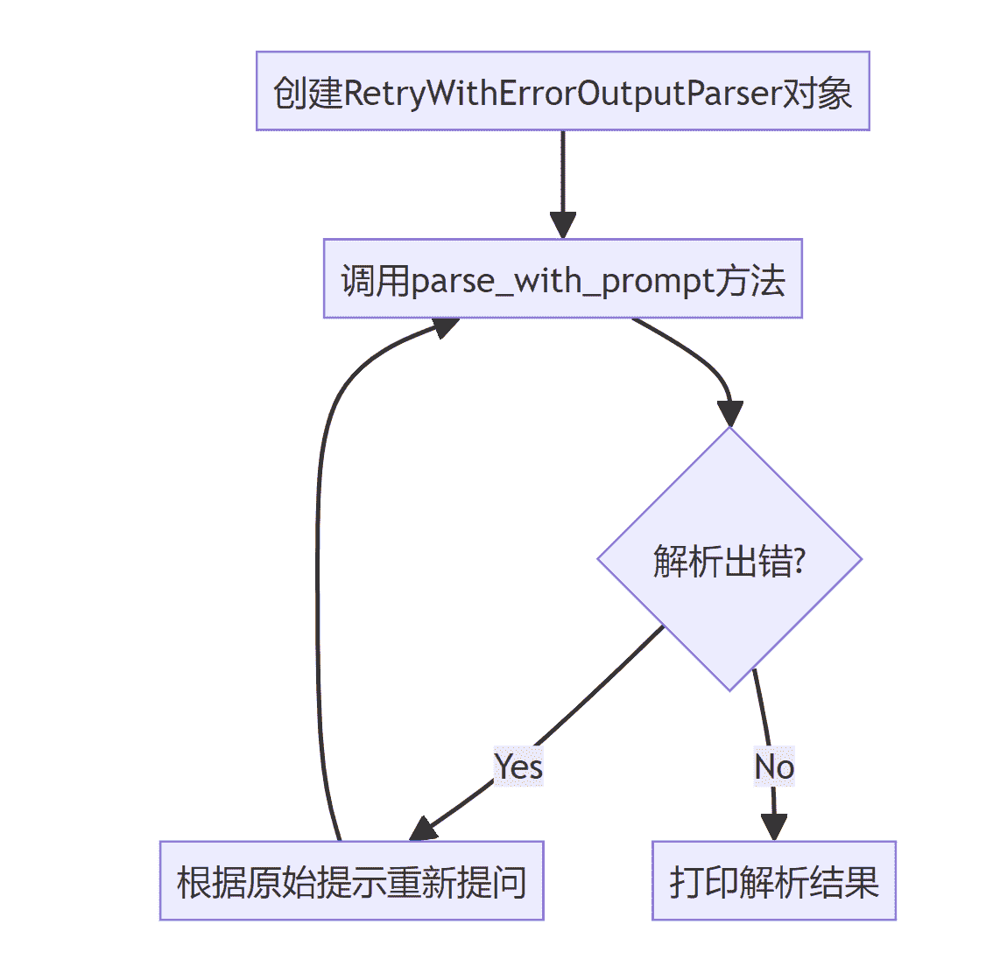

这个流程图的解释如下：

1.  创建 RetryWithErrorOutputParser 对象。

1.  调用 parse_with_prompt 方法尝试解析输出。

1.  判断解析是否出错。

+   如果解析出错，根据原始提示重新提问，然后回到步骤2，再次尝试解析。

+   如果解析没有出错，打印解析结果。

> 更新代码

```
from pydantic import BaseModel, Field
from langchain.output_parsers import PydanticOutputParser, RetryWithErrorOutputParser
from langchain.llms import OpenAI
from langchain.prompts import PromptTemplate

class Action(BaseModel):
    action: str = Field(description=&quot;action to take&quot;)
    action_input: str = Field(description=&quot;input to the action&quot;)

parser = PydanticOutputParser(pydantic_object=Action)

prompt = PromptTemplate(
    template=&quot;Answer the user query.\n{format_instructions}\n{query}\n&quot;,
    input_variables=[&quot;query&quot;],
    partial_variables={&quot;format_instructions&quot;: parser.get_format_instructions()},
)
prompt_value = prompt.format_prompt(query=&quot;What are the colors of Orchid?&quot;)

retry_parser = RetryWithErrorOutputParser.from_llm(
    parser=parser, llm=OpenAI(temperature=0)
)

good_response = &#x27;{&quot;action&quot;: &quot;search&quot;, &quot;action_input&quot;: &quot;Orchid colors&quot;}&#x27;
parse_result = retry_parser.parse_with_prompt(good_response, prompt_value)
print(&#x27;RetryWithErrorOutputParser的parse结果:&#x27;, parse_result)

```

> 这段代码主要是在使用pydantic和langchain库来处理和解析一些输入和输出。

+   首先，从pydantic库中导入了BaseModel和Field，然后定义了一个Action类，这个类有两个字段：action和action_input，都是字符串类型。

+   然后，从langchain.output_parsers导入了PydanticOutputParser和RetryWithErrorOutputParser，这两个类用于解析输出。

+   从langchain.llms导入了OpenAI，这个类可能是用于与OpenAI交互。

+   从langchain.prompts导入了PromptTemplate，这个类用于创建提示。

+   创建了一个PydanticOutputParser对象，用Action类作为参数。

+   创建了一个PromptTemplate对象，模板字符串包含"Answer the user query.\n{format_instructions}\n{query}\n"，输入变量是["query"]，部分变量是{"format_instructions": parser.get_format_instructions()}。

+   使用prompt.format_prompt(query="What are the colors of Orchid?")来格式化提示。

+   创建了一个RetryWithErrorOutputParser对象，使用parser和OpenAI(temperature=0)作为参数。

+   定义了一个字符串good_response，然后使用retry_parser.parse_with_prompt(good_response, prompt_value)来解析这个字符串。

+   最后，打印出解析结果。

# 使用Chain串联组件

## 最简单的链：LLMChain

**传统方法**

```
#----第一步 创建提示
# 导入LangChain中的提示模板
from langchain import PromptTemplate
# 原始字符串模板
template = &quot;{flower}的花语是?&quot;
# 创建LangChain模板
prompt_temp = PromptTemplate.from_template(template) 
# 根据模板创建提示
prompt = prompt_temp.format(flower=&#x27;玫瑰&#x27;)
# 打印提示的内容
print(prompt)

#----第二步 创建并调用模型 
# 导入LangChain中的OpenAI模型接口
from langchain import OpenAI
# 创建模型实例
model = OpenAI(temperature=0)
# 传入提示，调用模型，返回结果
result = model(prompt)
print(result)
```

> 这段代码的主要目的是使用langchain库的OpenAI模型，根据给定的提示生成预测结果。以下是代码的详细解释：

+   导入所需的库：从langchain库中导入了PromptTemplate，OpenAI和LLMChain类。

+   创建原始字符串模板：定义了一个字符串模板"{flower}的花语是?"。

+   创建模型实例：使用OpenAI类创建了一个模型实例，其中temperature参数设置为0，这意味着生成的文本将尽可能地确定性。

+   创建LLMChain：使用LLMChain类创建了一个实例，其中llm参数是之前创建的模型实例，prompt参数是从字符串模板创建的PromptTemplate实例。

+   调用LLMChain，返回结果：将"玫瑰"作为参数传入LLMChain实例，调用模型进行预测，得到了结果。

+   打印结果：打印出预测结果。

加特效，使用LLM Chain进行调用

```
# 导入所需的库
from langchain import PromptTemplate, OpenAI, LLMChain
# 原始字符串模板
template = &quot;{flower}的花语是?&quot;
# 创建模型实例
llm = OpenAI(temperature=0)
# 创建LLMChain
llm_chain = LLMChain(
    llm=llm,
    prompt=PromptTemplate.from_template(template))
# 调用LLMChain，返回结果
result = llm_chain(&quot;玫瑰&quot;)
print(result)
```

> 这段代码的主要目的是使用langchain库的OpenAI模型，根据给定的提示生成预测结果。以下是代码的详细解释：

+   导入所需的库：从langchain库中导入了PromptTemplate，OpenAI和LLMChain类。

+   创建原始字符串模板：定义了一个字符串模板"{flower}的花语是?"。

+   创建模型实例：使用OpenAI类创建了一个模型实例，其中temperature参数设置为0，这意味着生成的文本将尽可能地确定性。

+   创建LLMChain：使用LLMChain类创建了一个实例，其中llm参数是之前创建的模型实例，prompt参数是从字符串模板创建的PromptTemplate实例。

+   调用LLMChain，返回结果：将"玫瑰"作为参数传入LLMChain实例，调用模型进行预测，得到了结果。

+   打印结果：打印出预测结果。

```
graph TD
    A[开始]:::red --&gt; B{导入库}:::blue
    B --&gt; C[创建字符串模板]:::green
    B --&gt; D[创建OpenAI模型实例]:::yellow
    C --&gt; E[创建PromptTemplate实例]:::purple
    D --&gt; F[创建LLMChain实例]:::orange
    E --&gt; F
    F --&gt; G[调用LLMChain实例进行预测]:::pink
    G --&gt; H[打印预测结果]:::cyan
    H --&gt; I[结束]:::grey
    classDef red fill:#f8d7da;
    classDef blue fill:#cce5ff;
    classDef green fill:#d4edda;
    classDef yellow fill:#fff3cd;
    classDef purple fill:#d6d8db;
    classDef orange fill:#fde2e4;
    classDef pink fill:#f5c6cb;
    classDef cyan fill:#d1e7dd;
    classDef grey fill:#e2e3e5;
```

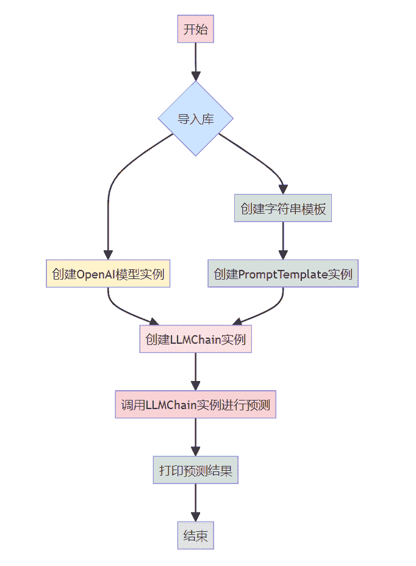

```
{&#x27;flower&#x27;: &#x27;玫瑰&#x27;, &#x27;text&#x27;: &#x27;\n\n爱情、美丽、浪漫、温柔、热情、欢乐、尊敬、感激、祝福、纯洁、永恒。&#x27;}
```

> 把提示模板的构建和模型的调用封装在一起了。

## 链的调用方法

直接调用链

```
prompt = PromptTemplate(
    input_variables=[&quot;flower&quot;, &quot;season&quot;],
    template=&quot;{flower}在{season}的花语是?&quot;,
)
llm_chain = LLMChain(llm=llm, prompt=prompt)
print(llm_chain({
    &#x27;flower&#x27;: &quot;玫瑰&quot;,
    &#x27;season&#x27;: &quot;夏季&quot; }))
```

> 这段代码的目的是根据给定的提示（在这种情况下是"玫瑰在夏季的花语是?"），使用OpenAI模型生成预测结果。以下是代码的详细解释：

+   创建原始字符串模板：使用PromptTemplate类创建了一个实例，其中input_variables参数是一个列表，包含了模板中的变量名，template参数是一个字符串模板"{flower}在{season}的花语是?"。

+   创建LLMChain实例：使用LLMChain类创建了一个实例，其中llm参数是之前创建的模型实例，prompt参数是从字符串模板创建的PromptTemplate实例。

+   调用LLMChain，返回结果：将一个字典{'flower': "玫瑰", 'season': "夏季"}作为参数传入LLMChain实例，调用模型进行预测，得到了结果。

+   打印结果：打印出预测结果。

**run 方法**

```
# 导入所需的库
from langchain import PromptTemplate, OpenAI, LLMChain
# 原始字符串模板
template = &quot;{flower}的花语是?&quot;
# 创建模型实例
llm = OpenAI(temperature=0)
# 创建LLMChain
llm_chain = LLMChain(
    llm=llm,
    prompt=PromptTemplate.from_template(template))
# 使用run方法调用LLMChain，返回结果
llm_chain(&quot;玫瑰&quot;)
```

**predict方法**

```
# 导入所需的库
from langchain import PromptTemplate, OpenAI, LLMChain
# 原始字符串模板
template = &quot;{flower}的花语是?&quot;
# 创建模型实例
llm = OpenAI(temperature=0)
# 创建LLMChain
llm_chain = LLMChain(
    llm=llm,
    prompt=PromptTemplate.from_template(template))
# 使用predict方法调用LLMChain，返回结果
result = llm_chain.predict(flower=&quot;玫瑰&quot;)
print(result)
```

**apply 方法**

apply 方法允许我们针对输入列表运行链，一次处理多个输入。

```
prompt = PromptTemplate(
    input_variables=[&quot;flower&quot;, &quot;season&quot;],
    template=&quot;{flower}在{season}的花语是?&quot;,
)
llm_chain = LLMChain(llm=llm, prompt=prompt)
print(llm_chain({
    &#x27;flower&#x27;: &quot;玫瑰&quot;,
    &#x27;season&#x27;: &quot;夏季&quot; }))

# apply允许您针对输入列表运行链
input_list = [
    {&quot;flower&quot;: &quot;玫瑰&quot;,&#x27;season&#x27;: &quot;夏季&quot;},
    {&quot;flower&quot;: &quot;百合&quot;,&#x27;season&#x27;: &quot;春季&quot;},
    {&quot;flower&quot;: &quot;郁金香&quot;,&#x27;season&#x27;: &quot;秋季&quot;}
]
result = llm_chain.apply(input_list)
print(result)
```

**generate 方法**

generate 方法类似于 apply，只不过它返回一个 LLMResult 对象，而不是字符串。LLMResult 通常包含模型生成文本过程中的一些相关信息，例如令牌数量、模型名称等

```
prompt = PromptTemplate(
    input_variables=[&quot;flower&quot;, &quot;season&quot;],
    template=&quot;{flower}在{season}的花语是?&quot;,
)
llm_chain = LLMChain(llm=llm, prompt=prompt)
print(llm_chain({
    &#x27;flower&#x27;: &quot;玫瑰&quot;,
    &#x27;season&#x27;: &quot;夏季&quot; }))

# apply允许您针对输入列表运行链
input_list = [
    {&quot;flower&quot;: &quot;玫瑰&quot;,&#x27;season&#x27;: &quot;夏季&quot;},
    {&quot;flower&quot;: &quot;百合&quot;,&#x27;season&#x27;: &quot;春季&quot;},
    {&quot;flower&quot;: &quot;郁金香&quot;,&#x27;season&#x27;: &quot;秋季&quot;}
]
result = llm_chain.generate(input_list)
print(result)
```

## 顺序链 Sequential Chain

```
# 导入所需的库
import os


from langchain.llms import OpenAI
from langchain.chains import LLMChain
from langchain.prompts import PromptTemplate
from langchain.chains import SequentialChain

# 这是第一个LLMChain，用于生成鲜花的介绍，输入为花的名称和种类等知识型说明
llm = OpenAI(temperature=.7)
template = &quot;&quot;&quot;
你是一个植物学家。给定花的名称和类型，你需要为这种花写一个200字左右的介绍。

花名: {name}
颜色: {color}
植物学家: 这是关于上述花的介绍:&quot;&quot;&quot;
prompt_template = PromptTemplate(input_variables=[&quot;name&quot;, &quot;color&quot;], template=template)
introduction_chain = LLMChain(llm=llm, prompt=prompt_template, output_key=&quot;introduction&quot;)

# 这是第二个LLMChain，用于根据鲜花的介绍写出鲜花的评论
llm = OpenAI(temperature=.7)
template = &quot;&quot;&quot;
你是一位鲜花评论家。给定一种花的介绍，你需要为这种花写一篇200字左右的评论。

鲜花介绍:
{introduction}
花评人对上述花的评论:&quot;&quot;&quot;
prompt_template = PromptTemplate(input_variables=[&quot;introduction&quot;], template=template)
review_chain = LLMChain(llm=llm, prompt=prompt_template, output_key=&quot;review&quot;)

# 这是第三个LLMChain，用于根据鲜花的介绍和评论写出一篇自媒体的文案
template = &quot;&quot;&quot;
你是一家花店的社交媒体经理。给定一种花的介绍和评论，你需要为这种花写一篇社交媒体的帖子，300字左右。

鲜花介绍:
{introduction}
花评人对上述花的评论:
{review}

社交媒体帖子:
&quot;&quot;&quot;
prompt_template = PromptTemplate(input_variables=[&quot;introduction&quot;, &quot;review&quot;], template=template)
social_post_chain = LLMChain(llm=llm, prompt=prompt_template, output_key=&quot;social_post_text&quot;)

# 这是总的链，我们按顺序运行这三个链
overall_chain = SequentialChain(
    chains=[introduction_chain, review_chain, social_post_chain],
    input_variables=[&quot;name&quot;, &quot;color&quot;],
    output_variables=[&quot;introduction&quot;,&quot;review&quot;,&quot;social_post_text&quot;],
    verbose=True)

# 运行链，并打印结果
result = overall_chain({&quot;name&quot;:&quot;玫瑰&quot;, &quot;color&quot;: &quot;黑色&quot;})
print(result)
```

> 这段代码通过创建和连接多个LLMChain，实现了从花的名称和颜色生成花卉介绍、评论和社交媒体帖子的功能。

+   导入所需的库：这部分代码导入了所需的库和模块。

+   创建第一个LLMChain（语言模型链）：这个链用于生成花卉的介绍。它首先创建了一个OpenAI对象，然后定义了一个模板，该模板描述了如何根据花的名称和颜色生成介绍。然后，它创建了一个PromptTemplate对象，该对象将模板和输入变量关联起来。最后，它创建了一个LLMChain对象，该对象将OpenAI对象、PromptTemplate对象和输出键关联起来。

+   创建第二个LLMChain：这个链用于生成花卉的评论。它的创建过程与第一个LLMChain类似，只是模板和输入变量有所不同。

+   创建第三个LLMChain：这个链用于生成社交媒体帖子。它的创建过程与前两个LLMChain类似，只是模板和输入变量有所不同。

+   创建SequentialChain：这个链将前三个LLMChain按顺序连接起来。它接受一个链列表、一个输入变量列表和一个输出变量列表作为参数。

+   运行链并打印结果：这部分代码运行了SequentialChain，并打印了结果。它首先创建了一个字典，该字典包含了输入变量的值。然后，它调用了SequentialChain的__call__方法，将字典作为参数传入。最后，它打印了结果。

## 路由链 RouterChain

```
import warnings
warnings.filterwarnings(&#x27;ignore&#x27;)

# 设置OpenAI API密钥
import os


# 构建两个场景的模板
flower_care_template = &quot;&quot;&quot;
你是一个经验丰富的园丁，擅长解答关于养花育花的问题。
下面是需要你来回答的问题:
{input}
&quot;&quot;&quot;

flower_deco_template = &quot;&quot;&quot;
你是一位网红插花大师，擅长解答关于鲜花装饰的问题。
下面是需要你来回答的问题:
{input}
&quot;&quot;&quot;

# 构建提示信息
prompt_infos = [
    {
        &quot;key&quot;: &quot;flower_care&quot;,
        &quot;description&quot;: &quot;适合回答关于鲜花护理的问题&quot;,
        &quot;template&quot;: flower_care_template,
    },
    {
        &quot;key&quot;: &quot;flower_decoration&quot;,
        &quot;description&quot;: &quot;适合回答关于鲜花装饰的问题&quot;,
        &quot;template&quot;: flower_deco_template,
    }
]

# 初始化语言模型
from langchain.llms import OpenAI
llm = OpenAI()

# 构建目标链
from langchain.chains.llm import LLMChain
from langchain.prompts import PromptTemplate

chain_map = {}

for info in prompt_infos:
    prompt = PromptTemplate(
        template=info[&#x27;template&#x27;],
        input_variables=[&quot;input&quot;]
    )
    print(&quot;目标提示:\n&quot;, prompt)
    
    chain = LLMChain(
        llm=llm,
        prompt=prompt,
        verbose=True
    )
    chain_map[info[&quot;key&quot;]] = chain

# 构建路由链
from langchain.chains.router.llm_router import LLMRouterChain, RouterOutputParser
from langchain.chains.router.multi_prompt_prompt import MULTI_PROMPT_ROUTER_TEMPLATE as RounterTemplate

destinations = [f&quot;{p[&#x27;key&#x27;]}: {p[&#x27;description&#x27;]}&quot; for p in prompt_infos]
router_template = RounterTemplate.format(destinations=&quot;\n&quot;.join(destinations))
print(&quot;路由模板:\n&quot;, router_template)

router_prompt = PromptTemplate(
    template=router_template,
    input_variables=[&quot;input&quot;],
    output_parser=RouterOutputParser(),
)
print(&quot;路由提示:\n&quot;, router_prompt)

router_chain = LLMRouterChain.from_llm(
    llm,
    router_prompt,
    verbose=True
)

# 构建默认链
from langchain.chains import ConversationChain

default_chain = ConversationChain(
    llm=llm,
    output_key=&quot;text&quot;,
    verbose=True
)

# 构建多提示链
from langchain.chains.router import MultiPromptChain

chain = MultiPromptChain(
    router_chain=router_chain,
    destination_chains=chain_map,
    default_chain=default_chain,
    verbose=True
)

# 测试1
print(chain.run(&quot;如何为玫瑰浇水？&quot;))
# 测试2              
print(chain.run(&quot;如何为婚礼场地装饰花朵？&quot;))
# 测试3         
print(chain.run(&quot;如何区分阿豆和罗豆？&quot;))
```

> 这段代码的主要目标是使用OpenAI的语言模型来回答关于鲜花护理和鲜花装饰的问题。以下是代码的详细分析：

+   首先，定义了两个场景的模板：flower_care_template和flower_deco_template。这两个模板都包含一个占位符{input}，它将在运行时被实际的问题替换。

+   然后，构建了一个包含两个提示信息的列表prompt_infos。每个提示信息都包含一个键、一个描述和一个模板。

+   导入OpenAI类并创建一个实例llm。

+   导入LLMChain和PromptTemplate类。对于prompt_infos中的每个提示信息，创建一个PromptTemplate实例，并使用它和llm实例创建一个LLMChain实例。所有的LLMChain实例都被存储在chain_map字典中，键是提示信息的键。

+   导入LLMRouterChain、RouterOutputParser类和MULTI_PROMPT_ROUTER_TEMPLATE模板。创建一个包含所有目标的字符串destinations，并将其插入到路由模板中。然后，使用路由模板创建一个PromptTemplate实例，并使用它创建一个LLMRouterChain实例。

+   导入ConversationChain类并创建一个实例default_chain。

+   导入MultiPromptChain类并创建一个实例chain。这个实例包含了路由链、目标链和默认链。

+   最后，运行了三个测试。每个测试都是一个问题，这个问题被传递给chain实例，然后chain实例将问题传递给适当的LLMChain实例，并打印出结果。
在这段代码中，LLMChain对象用于处理特定类型的问题，而LLMRouterChain对象用于根据问题的类型选择正确的LLMChain对象。当有一个新的问题时，首先将问题传递给LLMRouterChain对象，它将决定哪个LLMChain对象应该处理这个问题，然后将问题传递给那个LLMChain对象。

以测试1： 如何为玫瑰浇水为例，流程是这样的

```
graph TD
    A[开始] --&gt; B[问题: 如何为玫瑰浇水]
    style B fill:#f9d0c4
    B --&gt; C[传递问题给MultiPromptChain]
    style C fill:#fae3cd
    C --&gt; D[MultiPromptChain将问题传递给LLMRouterChain]
    style D fill:#f0f0f0
    D --&gt; E[LLMRouterChain决定哪个LLMChain应该处理问题]
    style E fill:#d1e8e2
    E --&gt; F[问题被传递给对应的LLMChain]
    style F fill:#d4c4fb
    F --&gt; G[LLMChain使用OpenAI模型生成答案]
    style G fill:#f77f00
    G --&gt; H[结束，返回答案]
    style H fill:#C0FFEE
```

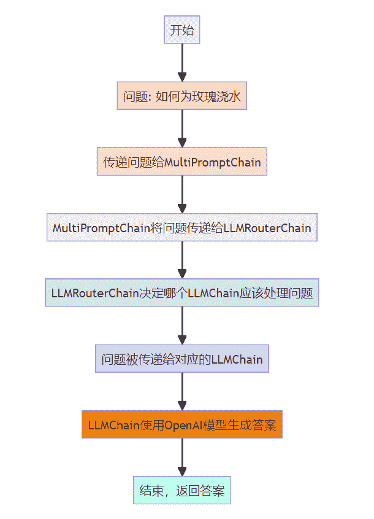

# 记忆

## ConversationChain

+   ConversationChain是一个聊天机器人中的组件。

+   它具有 AI 前缀和人类前缀的对话摘要格式。

+   内置的提示模板用于记录对话摘要。

+   这种对话格式与记忆机制有密切关联

```
from langchain import OpenAI
from langchain.chains import ConversationChain

# 初始化大语言模型
llm = OpenAI(
    temperature=0.5,
    model_name=&quot;gpt-3.5-turbo-instruct&quot;
)

# 初始化对话链
conv_chain = ConversationChain(llm=llm)

# 打印对话的模板
print(conv_chain.prompt.template)
```

> 这段代码主要做了以下几件事：

+   从langchain模块中导入OpenAI类。

+   从langchain.chains模块中导入ConversationChain类。

+   初始化一个OpenAI对象，这是一个大型语言模型，模型名称为"gpt-3.5-turbo-instruct"，并且设置了模型生成文本的温度为0.5。温度参数决定了模型输出的随机性，值越大输出越随机，值越小输出越确定。

+   使用初始化的大型语言模型llm来初始化一个ConversationChain对象。ConversationChain是一个用于处理对话的类，它使用大型语言模型来生成对话。

+   打印出ConversationChain对象的提示模板。这个模板是用于生成对话的，它定义了对话的格式和结构

## ConversationBufferMemory

在 LangChain 中，通过 ConversationBufferMemory（缓冲记忆）可以实现最简单的记忆机制

```
from langchain import OpenAI
from langchain.chains import ConversationChain
from langchain.chains.conversation.memory import ConversationBufferMemory

# 初始化大语言模型
llm = OpenAI(
    temperature=0.5,
    model_name=&quot;gpt-3.5-turbo-instruct&quot;)

# 初始化对话链
conversation = ConversationChain(
    llm=llm,
    memory=ConversationBufferMemory()
)

# 第一天的对话
# 回合1
conversation(&quot;我姐姐明天要过生日，我需要一束生日花束。&quot;)
print(&quot;第一次对话后的记忆:&quot;, conversation.memory.buffer)
```

```
# 回合2
conversation(&quot;她喜欢粉色玫瑰，颜色是粉色的。&quot;)
print(&quot;第二次对话后的记忆:&quot;, conversation.memory.buffer)
```

```
# 回合3 （第二天的对话）
conversation(&quot;我又来了，还记得我昨天为什么要来买花吗？&quot;)
print(&quot;/n第三次对话后时提示:/n&quot;,conversation.prompt.template)
print(&quot;/n第三次对话后的记忆:/n&quot;, conversation.memory.buffer)
```

+   ConversationChain的提示模板使用了{history}参数来传入聊天历史信息。

+   这种记忆机制允许LLM了解之前的对话内容。

+   存储所有内容为LLM提供了更多的信息，但增加了响应时间和成本。

+   太长的对话超过LLM的令牌数限制（例如4096个Token）时，无法完全记住。

## ConversationBufferWindowMemory

+   ConversationBufferWindowMemory是一种记忆策略，只保存最新的几次人类和AI互动。

+   这种策略类似于人类选择忘记一些较远的记忆，以保留最新、最重要的经历。

+   ConversationBufferWindowMemory在之前的"缓冲记忆"基础上增加了一个窗口值k，限制记忆的范围。

+   这种设计可以高效利用资源，专注于最新和相关的对话历史。

```
from langchain import OpenAI
from langchain.chains import ConversationChain
from langchain.chains.conversation.memory import ConversationBufferWindowMemory

# 创建大语言模型实例
llm = OpenAI(
    temperature=0.5,
    model_name=&quot;gpt-3.5-turbo-instruct&quot;)

# 初始化对话链
conversation = ConversationChain(
    llm=llm,
    memory=ConversationBufferWindowMemory(k=1)
)

# 第一天的对话
# 回合1
result = conversation(&quot;我姐姐明天要过生日，我需要一束生日花束。&quot;)
print(result)
# 回合2
result = conversation(&quot;她喜欢粉色玫瑰，颜色是粉色的。&quot;)
# print(&quot;\n第二次对话后的记忆:\n&quot;, conversation.memory.buffer)
print(result)

# 第二天的对话
# 回合3
result = conversation(&quot;我又来了，还记得我昨天为什么要来买花吗？&quot;)
print(result)
```

> 这段代码主要做了以下几件事：

+   导入了所需的模块和类，包括OpenAI，ConversationChain和ConversationBufferWindowMemory。

+   创建了一个OpenAI实例，这是一个大型语言模型，模型名称为"gpt-3.5-turbo-instruct"，并且设置了模型生成文本的温度为0.5。温度参数决定了模型输出的随机性，值越大输出越随机，值越小输出越确定。

+   初始化了一个ConversationChain对象，这是一个用于处理对话的类，它使用大型语言模型来生成对话。同时，为这个对话链设置了一个记忆机制，即ConversationBufferWindowMemory，这个记忆机制会记住最近的k轮对话，这里k=1，表示只记住最近的一轮对话。

+   进行了三轮对话，每轮对话后都打印出了对话结果。第一轮对话是用户表达了需要一束生日花束的需求，第二轮对话是用户提供了更多的信息，即喜欢粉色的玫瑰。第三轮对话是在第二天，用户询问模型是否还记得前一天的对话内容。

## ConversationSummaryMemory

ConversationSummaryMemory 有这么几个核心特点。

1.  汇总对话：此方法不是保存整个对话历史，而是每次新的互动发生时对其进行汇总，然后将其添加到之前所有互动的“运行汇总”中。

1.  使用 LLM 进行汇总：该汇总功能由另一个 LLM 驱动，这意味着对话的汇总实际上是由 AI 自己进行的。

1.  适合长对话：对于长对话，此方法的优势尤为明显。虽然最初使用的 Token 数量较多，但随着对话的进展，汇总方法的增长速度会减慢。与此同时，常规的缓冲内存模型会继续线性增长。

```
from langchain import OpenAI
from langchain.chains import ConversationChain
from langchain.chains.conversation.memory import ConversationBufferWindowMemory

# 创建大语言模型实例
llm = OpenAI(
    temperature=0.5,
    model_name=&quot;gpt-3.5-turbo-instruct&quot;)

from langchain.chains.conversation.memory import ConversationSummaryMemory

# 初始化对话链
conversation = ConversationChain(
    llm=llm,
    memory=ConversationSummaryMemory(llm=llm)
)

# 第一天的对话
# 回合1
result = conversation(&quot;我姐姐明天要过生日，我需要一束生日花束。&quot;)
print(result)
# 回合2
result = conversation(&quot;她喜欢粉色玫瑰，颜色是粉色的。&quot;)
# print(&quot;\n第二次对话后的记忆:\n&quot;, conversation.memory.buffer)
print(result)

# 第二天的对话
# 回合3
result = conversation(&quot;我又来了，还记得我昨天为什么要来买花吗？&quot;)
print(result)
```

> 这段代码主要做了以下几件事：

+   导入了所需的模块和类，包括OpenAI，ConversationChain和ConversationSummaryMemory。

+   创建了一个OpenAI实例，这是一个大型语言模型，模型名称为"gpt-3.5-turbo-instruct"，并且设置了模型生成文本的温度为0.5。温度参数决定了模型输出的随机性，值越大输出越随机，值越小输出越确定。

+   初始化了一个ConversationChain对象，这是一个用于处理对话的类，它使用大型语言模型来生成对话。同时，为这个对话链设置了一个记忆机制，即ConversationSummaryMemory，这个记忆机制会记住对话的摘要信息。

+   进行了三轮对话，每轮对话后都打印出了对话结果。第一轮对话是用户表达了需要一束生日花束的需求，第二轮对话是用户提供了更多的信息，即喜欢粉色的玫瑰。第三轮对话是在第二天，用户询问模型是否还记得前一天的对话内容。

## ConversationSummaryBufferMemory

+   ConversationSummaryBufferMemory结合了ConversationSummaryMemory和ConversationBufferWindowMemory的特点。

+   目标是在对话中总结早期互动并保留最近互动的原始内容。

+   使用max_token_limit参数来控制对话长度，当最新对话长度在300个字符以内时，保留原始对话内容。

+   当对话长度超过参数设定的长度时，模型将对超出长度的内容进行总结，以节省使用的Token数量。

```
from langchain import OpenAI
from langchain.chains import ConversationChain
from langchain.chains.conversation.memory import ConversationBufferWindowMemory

# 创建大语言模型实例
llm = OpenAI(
    temperature=0.5,
    model_name=&quot;gpt-3.5-turbo-instruct&quot;)

from langchain.chains.conversation.memory import ConversationSummaryBufferMemory

# 初始化对话链
conversation = ConversationChain(
    llm=llm,
    memory=ConversationSummaryBufferMemory(
        llm=llm,
        max_token_limit=300))

# 第一天的对话
# 回合1
result = conversation(&quot;我姐姐明天要过生日，我需要一束生日花束。&quot;)
print(result)
# 回合2
result = conversation(&quot;她喜欢粉色玫瑰，颜色是粉色的。&quot;)
# print(&quot;\n第二次对话后的记忆:\n&quot;, conversation.memory.buffer)
print(result)

# 第二天的对话
# 回合3
result = conversation(&quot;我又来了，还记得我昨天为什么要来买花吗？&quot;)
print(result)
```

> 这段代码主要做了以下几件事：

+   导入了所需的模块和类，包括OpenAI，ConversationChain和ConversationSummaryBufferMemory。

+   创建了一个OpenAI实例，这是一个大型语言模型，模型名称为"gpt-3.5-turbo-instruct"，并且设置了模型生成文本的温度为0.5。温度参数决定了模型输出的随机性，值越大输出越随机，值越小输出越确定。

+   初始化了一个ConversationChain对象，这是一个用于处理对话的类，它使用大型语言模型来生成对话。同时，为这个对话链设置了一个记忆机制，即ConversationSummaryBufferMemory，这个记忆机制会记住对话的摘要信息，最大记忆的token数量为300。

+   进行了三轮对话，每轮对话后都打印出了对话结果。第一轮对话是用户表达了需要一束生日花束的需求，第二轮对话是用户提供了更多的信息，即喜欢粉色的玫瑰。第三轮对话是在第二天，用户询问模型是否还记得前一天的对话内容。

# Agent 代理

## 通过代理实现ReAct框架

```
2b0926cb58d6e40adb8aa97b525d7727082eacb16861689121cf5b04e306238a
```

安装包

```
pip install -i https://pypi.tuna.tsinghua.edu.cn/simple google_search_results==2.4.2 numexpr==2.8.8
```

```
# 设置OpenAI和SERPAPI的API密钥
import os
os.environ[&quot;SERPAPI_API_KEY&quot;] = &#x27;SERPAPI_API_KEY&#x27;

# 导入所需库
from langchain.agents import load_tools
from langchain.agents import initialize_agent
from langchain.agents import AgentType
from langchain.llms import OpenAI

# 加载将用于控制代理的语言模型
llm = OpenAI(temperature=0)

# 加载工具，包括 serpapi（这是调用 Google 搜索引擎的工具）以及 llm-math（这是通过 LLM 进行数学计算的工具）
tools = load_tools([&quot;serpapi&quot;, &quot;llm-math&quot;], llm=llm)

# 使用工具、语言模型和代理类型来初始化代理
agent = initialize_agent(tools, llm, agent=AgentType.ZERO_SHOT_REACT_DESCRIPTION, verbose=True)

agent.run(&quot;目前市场上玫瑰花的平均价格是多少？如果我在此基础上加价15%卖出，应该如何定价？&quot;)
```

> 这段代码主要做了以下几件事：

+   首先，它设置了 SERPAPI 的 API 密钥。SERPAPI 是一个允许你从搜索引擎获取搜索结果的服务。

+   然后，它从 langchain.agents 模块导入了几个函数和类，包括 load_tools，initialize_agent 和 AgentType。

+   它创建了一个 OpenAI 对象，这可能是一个用于生成语言模型的对象。

+   使用 load_tools 函数加载了 "serpapi" 和 "llm-math" 这两个工具，并将之前创建的 OpenAI 对象作为参数传入。

+   使用 initialize_agent 函数初始化了一个代理，这个代理可能用于处理某种类型的任务。这里的 AgentType.ZERO_SHOT_REACT_DESCRIPTION 可能表示这是一个零射击反应描述代理，但具体含义需要查看 langchain.agents 的文档。

+   最后，它运行了代理，并传入了一个问题："目前市场上玫瑰花的平均价格是多少？如果我在此基础上加价15%卖出，应该如何定价？"。这可能是一个查询市场价格并计算加价后价格的任务。
注意：这段代码的具体功能和行为可能会根据 langchain.agents 和 langchain.llms 的实现有所不同。

```
graph TD
    A[设置 SERPAPI 和 OpenAI API 密钥]:::red
    B[导入 load_tools, initialize_agent, AgentType]:::blue
    C[创建 OpenAI 对象]:::green
    D[加载 serpapi 和 llm-math 工具]:::yellow
    E[初始化代理]:::purple
    F[运行代理并传入问题]:::orange
    G[使用搜索引擎查找玫瑰花的平均价格]:::pink
    H[计算平均价格的15%以确定加价]:::cyan
    I[将加价金额加到平均价格以确定最终售价]:::grey
    A --&gt; B
    B --&gt; C
    C --&gt; D
    D --&gt; E
    E --&gt; F
    F --&gt; G
    G --&gt; H
    H --&gt; I
    classDef red fill:#f8d7da;
    classDef blue fill:#cce5ff;
    classDef green fill:#d4edda;
    classDef yellow fill:#fff3cd;
    classDef purple fill:#d6d8db;
    classDef orange fill:#fde2e4;
    classDef pink fill:#f5c6cb;
    classDef cyan fill:#d1e7dd;
    classDef grey fill:#e2e3e5;
```

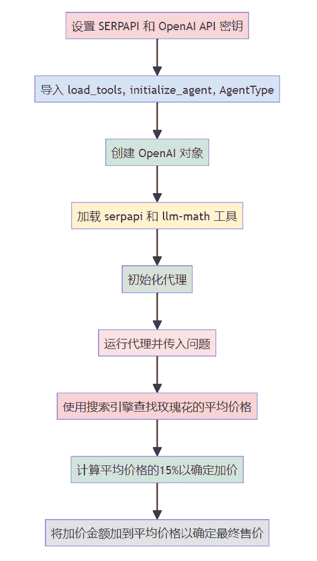

## 结构化工具对话代理Structured Tool Chat (有堵点)

## 自主询问搜索代理 Self-Ask with Search

Self-Ask with Search 也是 LangChain 中的一个有用的代理类型（SELF_ASK_WITH_SEARCH）。它利用一种叫做 “Follow-up Question（追问）”加“Intermediate Answer（中间答案）”的技巧，来辅助大模型寻找事实性问题的过渡性答案，从而引出最终答案。

```
import os
os.environ[&quot;SERPAPI_API_KEY&quot;] = &#x27;SERPAPI_API_KEY&#x27;

from langchain import OpenAI, SerpAPIWrapper 
from langchain.agents import initialize_agent, Tool
from langchain.agents import AgentType

llm = OpenAI(temperature=0)
search = SerpAPIWrapper()
tools = [
    Tool(
        name=&quot;Intermediate Answer&quot;, 
        func=search.run,
        description=&quot;useful for when you need to ask with search&quot;,
    )
]

self_ask_with_search = initialize_agent(
    tools, llm, agent=AgentType.SELF_ASK_WITH_SEARCH, verbose=True, handle_parsing_errors=True
)
self_ask_with_search.run(
    &quot;What is the capital of the country that uses plum blossom as its national flower?&quot;  
)
```

> 这段代码主要用于初始化一个搜索代理，并使用它来回答一个特定的问题。

+   首先，它设置了环境变量 "SERPAPI_API_KEY"，这是用于访问 SERPAPI 的 API 密钥。

+   然后，它从 langchain 包中导入了一些类和函数。

+   它创建了一个 OpenAI 对象 llm，这是一个语言模型，用于生成或理解文本。

+   它创建了一个 SerpAPIWrapper 对象 search，这是一个搜索工具，可以用来在互联网上搜索信息。

+   它创建了一个 Tool 对象列表 tools，这个列表中的每个工具都有一个名称、一个函数（在这种情况下，是 search.run 函数）和一个描述。

+   它使用 initialize_agent 函数创建了一个代理 self_ask_with_search，这个代理使用了上面创建的工具和语言模型。这个代理的类型是 SELF_ASK_WITH_SEARCH，这意味着它会使用搜索工具来帮助回答问题。verbose=True 表示代理在运行时会输出详细的日志，handle_parsing_errors=True 表示代理在解析输出时遇到错误会尝试再次处理。

+   最后，它使用 run 方法让代理回答一个问题："What is the capital of the country that uses plum blossom as its national flower?"。

```
graph TD
    A[设置 SERPAPI_API_KEY]:::red
    B[导入 OpenAI, SerpAPIWrapper, initialize_agent, Tool, AgentType]:::blue
    C[创建 OpenAI 对象]:::green
    D[创建 SerpAPIWrapper 对象]:::yellow
    E[创建工具列表]:::purple
    F[初始化代理]:::orange
    G[运行代理并传入问题]:::pink
    A --&gt; B
    B --&gt; C
    C --&gt; D
    D --&gt; E
    E --&gt; F
    F --&gt; G
    classDef red fill:#f8d7da;
    classDef blue fill:#cce5ff;
    classDef green fill:#d4edda;
    classDef yellow fill:#fff3cd;
    classDef purple fill:#d6d8db;
    classDef orange fill:#fde2e4;
    classDef pink fill:#f5c6cb;
```

+   多跳问题需要进行多步推理或多次查询才能得到最终答案。

+   多跳问题不能通过单一查询或信息源直接获得答案。

+   多跳问题需要跨越多个信息点或从多个数据来源组合和整合。

+   问题的答案依赖于另一个子问题的答案，而子问题的答案可能又依赖于另一个问题的答案。

+   人类解答多跳问题需要从不同的信息源中寻找一系列中间答案，然后结合这些中间答案得出最终结论。

+   "使用梅花作为国花的国家的首都是哪里?"是一个多跳问题，它先要推知使用玫瑰作为国花的国家，然后进一步询问该国家的首都。

## 计划与执行代理 Plan and execute

+   计划和执行代理通过制定计划和执行子任务来实现目标。

+   计划与解决（Plan-and-Solve）提示是受到 Plan-and-Solve 论文启发的。

+   该提示包括两个部分：通过制定计划将整个任务划分为子任务，然后按计划执行子任务。

+   这种代理的独特之处在于计划和执行由不同的大语言模型代理完成。计划由一个大语言模型代理负责推理，执行由另一个大语言模型代理负责调用工具。

安装包

```
pip install -i https://pypi.tuna.tsinghua.edu.cn/simple langchain-experimental==0.0.49
```

```
# 设置OpenAI和SERPAPI的API密钥
import os

os.environ[&quot;SERPAPI_API_KEY&quot;] = &#x27;SERPAPI_API_KEY&#x27;

from langchain.chat_models import ChatOpenAI
from langchain_experimental.plan_and_execute import PlanAndExecute, load_agent_executor, load_chat_planner
from langchain.llms import OpenAI
from langchain import SerpAPIWrapper
from langchain.agents.tools import Tool
from langchain import LLMMathChain

search = SerpAPIWrapper()
llm = OpenAI(temperature=0)
llm_math_chain = LLMMathChain.from_llm(llm=llm, verbose=True)
tools = [
    Tool(
        name = &quot;Search&quot;,
        func=search.run,
        description=&quot;useful for when you need to answer questions about current events&quot;
    ),
    Tool(
        name=&quot;Calculator&quot;,
        func=llm_math_chain.run,
        description=&quot;useful for when you need to answer questions about math&quot;
    ),
]
model = ChatOpenAI(temperature=0)
planner = load_chat_planner(model)
executor = load_agent_executor(model, tools, verbose=True)
agent = PlanAndExecute(planner=planner, executor=executor, verbose=True)

agent.run(&quot;在纽约，1束玫瑰多少美元，200美元可以买多少玫瑰?&quot;)
```

> 这段代码创建了一个能够使用搜索和数学计算来回答问题的代理，该代理使用了 OpenAI 和 SERPAPI 这两个工具。

+   首先，它设置了 SERPAPI的 API 密钥。SERPAPI 是一个可以获取搜索引擎结果的 API。

+   然后，它导入了一些需要的模块和类，包括 OpenAI、SerpAPIWrapper、Tool和 LLMMathChain。

+   它创建了一个 SERPAPI 的实例 search，一个 OpenAI 的实例 llm，以及一个 LLMMathChain 的实例 llm_math_chain。LLMMathChain 是一个可以处理数学问题的工具。

+   接下来，它创建了一个工具列表 tools，包括了一个搜索工具和一个计算器工具。这些工具将被用于回答问题。

+   然后，它创建了一个 ChatOpenAI 的实例 model，一个规划器 planner，以及一个执行器 executor。规划器和执行器将被用于处理问题和生成答案。

+   最后，它创建了一个 PlanAndExecute 的实例 agent，并使用该代理来回答一个问题："在纽约，1000万元人民币能买几套房子？"

```
graph TD
style A fill:#f8d7da
style B fill:#cce5ff
style C fill:#d4edda
style D fill:#fff3cd
style E fill:#d6d8db
style F fill:#fde2e4
style G fill:#f5c6cb
A[用户提问: 在纽约一个花束玫瑰花的平均价格] --&gt; B[搜索动作: 查找纽约玫瑰花束的平均价格]
B --&gt; C[搜索结果: 平均价格为\\$78.33]
C --&gt; D[计算动作: 100 / 78.33]
D --&gt; E[计算结果: 1.0]
E --&gt; F[回答动作: 用100美元可以购买1束花]
F --&gt; G[回答用户: 用100美元可以购买1束花]
```

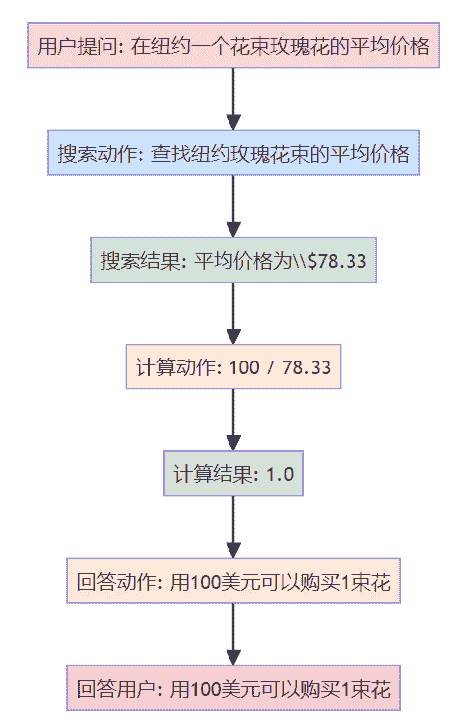

# LangChain 中的 Tool和 Toolkits

安装包

```
pip install -i https://pypi.tuna.tsinghua.edu.cn/simple arxiv==2.1.0
```

## 使用arXiv 工具开发科研助理

```
# 设置OpenAI API的密钥
import os 
# os.environ[&quot;OPENAI_API_KEY&quot;] = &#x27;Your Key&#x27; 

# 导入库
from langchain.chat_models import ChatOpenAI
from langchain.agents import load_tools, initialize_agent, AgentType

# 初始化模型和工具
llm = ChatOpenAI(temperature=0.0)
tools = load_tools(
    [&quot;arxiv&quot;],
)

# 初始化链
agent_chain = initialize_agent(
    tools,
    llm,
    agent=AgentType.ZERO_SHOT_REACT_DESCRIPTION,
    verbose=True,
)

# 运行链
agent_chain.run(&quot;介绍一下2005.14165这篇论文的创新点?&quot;)
```

> 这段Python代码的主要目的是使用OpenAI的API来获取和处理关于特定论文的信息。以下是每一部分的详细解释：

+   设置OpenAI API的密钥：这部分代码将你的OpenAI API密钥设置为环境变量，以便后续的代码可以使用它。这行代码目前被注释掉了，所以你需要用你的实际密钥替换'Your Key'，并取消注释。

+   导入库：这部分代码导入了几个Python库，这些库提供了与OpenAI API交互、处理数据和初始化模型等功能。

+   初始化模型和工具：这部分代码首先使用ChatOpenAI类创建了一个模型实例，然后加载了一些工具，这些工具可能用于处理数据或与API交互。

+   初始化链：这部分代码初始化了一个"agent chain"。这可能是一个处理数据和/或与API交互的流程。

+   运行链：这部分代码运行了上述初始化的"agent chain"，并传入了一个字符串"介绍一下2308.04889这篇论文的创新点?"作为参数。这可能会触发一系列的操作，例如查询特定的论文，并返回关于其创新点的信息。

## 工具箱范例（待开发）

# 检索增强生成RAG

## 文本嵌入

```
# 设置OpenAI的API密钥
import os
# os.environ[&quot;OPENAI_API_KEY&quot;] = &#x27;Your OpenAI Key&#x27;

# 初始化Embedding类
from langchain.embeddings import OpenAIEmbeddings
embeddings_model = OpenAIEmbeddings()

# Embed文本
embeddings = embeddings_model.embed_documents(
    [
        &quot;您好，有什么需要帮忙的吗？&quot;,
        &quot;哦，你好！昨天我订的花几天送达&quot;,
        &quot;请您提供一些订单号？&quot;,
        &quot;12345678&quot;,
    ]
)
print(len(embeddings), len(embeddings[0]))

# Embed查询
embedded_query = embeddings_model.embed_query(&quot;刚才对话中的订单号是多少?&quot;)
print(embedded_query[:3])
```

> 这段代码的主要目标是使用OpenAI的模型来生成文本的嵌入向量。以下是每个部分的详细解释：

+   **设置OpenAI API密钥**：这部分代码设置了OpenAI API的密钥，这是使用OpenAI服务的凭证。

+   **初始化Embedding类**：这部分代码从langchain.embeddings模块导入了OpenAIEmbeddings类，并创建了一个实例embeddings_model。

+   **嵌入文本**：这部分代码调用了embed_documents方法，将一系列的文本转化为嵌入向量。这些文本通常是一段对话的内容。每个文本都会被转化为一个嵌入向量，所有的嵌入向量会被存储在一个列表中。

+   **打印嵌入向量的长度**：这部分代码打印了嵌入向量列表的长度（即文本的数量），以及第一个嵌入向量的长度（即嵌入向量的维度）。

+   **嵌入查询**：这部分代码调用了embed_query方法，将一个查询文本转化为嵌入向量。

+   **打印嵌入查询的前三个元素**：这部分代码打印了嵌入查询向量的前三个元素。
总的来说，这段代码展示了如何使用OpenAI的模型来生成文本的嵌入向量，这些嵌入向量可以用于各种NLP任务，如文本分类、文本匹配等。

## 存储嵌入

```
# 设置OpenAI的API密钥
import os
# os.environ[&quot;OPENAI_API_KEY&quot;] = &#x27;Your OpenAI Key&#x27;

# 导入内存存储库，该库允许我们在RAM中临时存储数据
from langchain.storage import InMemoryStore

# 创建一个InMemoryStore的实例
store = InMemoryStore()

# 导入与嵌入相关的库。OpenAIEmbeddings是用于生成嵌入的工具，而CacheBackedEmbeddings允许我们缓存这些嵌入
from langchain.embeddings import OpenAIEmbeddings, CacheBackedEmbeddings

# 创建一个OpenAIEmbeddings的实例，这将用于实际计算文档的嵌入
underlying_embeddings = OpenAIEmbeddings()

# 创建一个CacheBackedEmbeddings的实例。
# 这将为underlying_embeddings提供缓存功能，嵌入会被存储在上面创建的InMemoryStore中。
# 我们还为缓存指定了一个命名空间，以确保不同的嵌入模型之间不会出现冲突。
embedder = CacheBackedEmbeddings.from_bytes_store(
    underlying_embeddings,  # 实际生成嵌入的工具
    store,  # 嵌入的缓存位置
    namespace=underlying_embeddings.model  # 嵌入缓存的命名空间
)

# 使用embedder为两段文本生成嵌入。
# 结果，即嵌入向量，将被存储在上面定义的内存存储中。
embeddings = embedder.embed_documents([&quot;你好&quot;, &quot;智能鲜花客服&quot;])
```

> 这段代码的主要目标是使用OpenAI的模型来生成文本的嵌入向量，并将这些嵌入向量存储在内存中。以下是每个部分的详细解释：

+   **设置OpenAI API密钥**：这部分代码设置了OpenAI API的密钥，这是使用OpenAI服务的凭证。

+   **导入内存存储库**：这部分代码从langchain.storage模块导入了InMemoryStore类，这个类可以在RAM中临时存储数据。

+   创建一个InMemoryStore的实例：这部分代码创建了一个InMemoryStore的实例，命名为store。

+   **导入与嵌入相关的库**：这部分代码从langchain.embeddings模块导入了OpenAIEmbeddings和CacheBackedEmbeddings类。OpenAIEmbeddings类用于生成嵌入，CacheBackedEmbeddings类用于缓存这些嵌入。

+   创建一个OpenAIEmbeddings的实例：这部分代码创建了一个OpenAIEmbeddings的实例，命名为underlying_embeddings。

+   创建一个CacheBackedEmbeddings的实例：这部分代码创建了一个CacheBackedEmbeddings的实例，命名为embedder。这个实例将为underlying_embeddings提供缓存功能，嵌入会被存储在上面创建的InMemoryStore中。我们还为缓存指定了一个命名空间，以确保不同的嵌入模型之间不会出现冲突。

+   **生成嵌入**：这部分代码调用了embedder.embed_documents方法，将两段文本转化为嵌入向量。这些嵌入向量将被存储在上面定义的内存存储中。
总的来说，这段代码展示了如何使用OpenAI的模型来生成文本的嵌入向量，并将这些嵌入向量存储在内存中，以便于后续的使用。

## 向量存储检索器

安装包

```
pip install -i https://pypi.tuna.tsinghua.edu.cn/simple chromadb==0.4.22
```

```
# 设置OpenAI的API密钥
import os
# os.environ[&quot;OPENAI_API_KEY&quot;] = &#x27;Your OpenAI Key&#x27;

# 导入文档加载器模块，并使用TextLoader来加载文本文件
from langchain.document_loaders import TextLoader
# loader = TextLoader(&#x27;LangChainSamples/OneFlower/易速鲜花花语大全.txt&#x27;, encoding=&#x27;utf8&#x27;)
loader = TextLoader(&#x27;花语大全.txt&#x27;, encoding=&#x27;utf8&#x27;)


# 使用VectorstoreIndexCreator来从加载器创建索引
from langchain.indexes import VectorstoreIndexCreator
index = VectorstoreIndexCreator().from_loaders([loader])

# 定义查询字符串, 使用创建的索引执行查询
query = &quot;玫瑰花的花语是什么？&quot;
result = index.query(query)
print(result) # 打印查询结果
```

> 这段代码的主要目标是从一个文本文件中创建一个索引，并使用这个索引来查询特定的信息。以下是每个部分的详细解释：

+   **设置OpenAI API密钥**：这部分代码导入了os模块，并设置了OpenAI API的密钥。这是使用OpenAI服务的凭证。

+   **加载文本文件**：这部分代码从langchain.document_loaders模块导入了TextLoader类，并创建了一个实例loader。这个实例用于加载一个名为'花语大全.txt'的文本文件。

+   **创建索引**：这部分代码从langchain.indexes模块导入了VectorstoreIndexCreator类，并创建了一个实例index。这个实例用于从加载器创建一个索引。

+   **定义查询字符串并执行查询**：这部分代码定义了一个查询字符串"玫瑰花的花语是什么？"，并使用创建的索引执行了查询。

+   **打印查询结果**：这部分代码打印了查询的结果。

# 连接数据库

**创建数据库**

```
# 导入sqlite3库
import sqlite3

# 连接到数据库
conn = sqlite3.connect(&#x27;FlowerShop.db&#x27;)
cursor = conn.cursor()

# 执行SQL命令来创建Flowers表
cursor.execute(&#x27;&#x27;&#x27;
        CREATE TABLE Flowers (
            ID INTEGER PRIMARY KEY, 
            Name TEXT NOT NULL, 
            Type TEXT NOT NULL, 
            Source TEXT NOT NULL, 
            PurchasePrice REAL, 
            SalePrice REAL,
            StockQuantity INTEGER, 
            SoldQuantity INTEGER, 
            ExpiryDate DATE,  
            Description TEXT, 
            EntryDate DATE DEFAULT CURRENT_DATE 
        );
    &#x27;&#x27;&#x27;)

# 插入5种鲜花的数据
flowers = [
    (&#x27;Rose&#x27;, &#x27;Flower&#x27;, &#x27;France&#x27;, 1.2, 2.5, 100, 10, &#x27;2023-12-31&#x27;, &#x27;A beautiful red rose&#x27;),
    (&#x27;Tulip&#x27;, &#x27;Flower&#x27;, &#x27;Netherlands&#x27;, 0.8, 2.0, 150, 25, &#x27;2023-12-31&#x27;, &#x27;A colorful tulip&#x27;),
    (&#x27;Lily&#x27;, &#x27;Flower&#x27;, &#x27;China&#x27;, 1.5, 3.0, 80, 5, &#x27;2023-12-31&#x27;, &#x27;An elegant white lily&#x27;),
    (&#x27;Daisy&#x27;, &#x27;Flower&#x27;, &#x27;USA&#x27;, 0.7, 1.8, 120, 15, &#x27;2023-12-31&#x27;, &#x27;A cheerful daisy flower&#x27;),
    (&#x27;Orchid&#x27;, &#x27;Flower&#x27;, &#x27;Brazil&#x27;, 2.0, 4.0, 50, 2, &#x27;2023-12-31&#x27;, &#x27;A delicate purple orchid&#x27;)
]

for flower in flowers:
    cursor.execute(&#x27;&#x27;&#x27;
        INSERT INTO Flowers (Name, Type, Source, PurchasePrice, SalePrice, StockQuantity, SoldQuantity, ExpiryDate, Description) 
        VALUES (?, ?, ?, ?, ?, ?, ?, ?, ?);
    &#x27;&#x27;&#x27;, flower)

# 提交更改
conn.commit()

# 关闭数据库连接
conn.close()
```

> 这段Python代码使用了sqlite3库来创建和操作一个SQLite数据库。以下是每一部分的详细解释：

+   导入sqlite3库：这是Python内置的轻量级数据库库。

+   连接到数据库：sqlite3.connect('FlowerShop.db')创建了一个连接到名为'FlowerShop.db'的SQLite数据库的连接对象。如果这个数据库不存在，那么它将被创建。

+   创建游标：conn.cursor()创建了一个游标对象，你可以使用它来执行SQL命令。

+   创建表：cursor.execute()执行了一个SQL命令，创建了一个名为'Flowers'的表，这个表有多个字段，如ID、Name、Type等。

+   插入数据：首先，创建了一个包含5种鲜花数据的列表。然后，对这个列表进行迭代，对于每种鲜花，都执行一个SQL INSERT命令，将鲜花的数据插入到'Flowers'表中。

+   提交更改：conn.commit()提交了对数据库的更改。在这个点上，所有的更改都会被永久保存到数据库中。

+   关闭数据库连接：conn.close()关闭了到数据库的连接。这是一个好的做法，因为它可以释放系统资源。

**使用Chain查询数据库**

```
# 导入langchain的实用工具和相关的模块
from langchain.utilities import SQLDatabase
from langchain.llms import OpenAI
from langchain_experimental.sql import SQLDatabaseChain

# 连接到FlowerShop数据库（之前我们使用的是Chinook.db）
db = SQLDatabase.from_uri(&quot;sqlite:///FlowerShop.db&quot;)

# 创建OpenAI的低级语言模型（LLM）实例，这里我们设置温度为0，意味着模型输出会更加确定性
llm = OpenAI(temperature=0, verbose=True)

# 创建SQL数据库链实例，它允许我们使用LLM来查询SQL数据库
db_chain = SQLDatabaseChain.from_llm(llm, db, verbose=True)

# 运行与鲜花运营相关的问题
response = db_chain.run(&quot;有多少种不同的鲜花？&quot;)
print(response)

response = db_chain.run(&quot;哪种鲜花的存货数量最少？&quot;)
print(response)

response = db_chain.run(&quot;平均销售价格是多少？&quot;)
print(response)

response = db_chain.run(&quot;从法国进口的鲜花有多少种？&quot;)
print(response)

response = db_chain.run(&quot;哪种鲜花的销售量最高？&quot;)
print(response)
```

> 这段Python代码使用了langchain库来查询一个名为"FlowerShop.db"的SQLite数据库。以下是每一部分的详细解释：

+   导入库：这部分代码导入了langchain库的一些模块。

+   连接到数据库：使用SQLDatabase.from_uri方法创建了一个连接到名为'FlowerShop.db'的SQLite数据库的SQLDatabase对象。

+   创建模型实例：使用OpenAI类创建了一个低级语言模型（LLM）实例，设置了温度为0，这意味着模型的输出会更加确定性。

+   创建数据库链实例：使用SQLDatabaseChain.from_llm方法创建了一个SQLDatabaseChain实例，它允许我们使用LLM来查询SQL数据库。

+   运行查询：使用db_chain.run方法运行了一系列与鲜花运营相关的问题，例如"有多少种不同的鲜花？"、"哪种鲜花的存货数量最少？"等，并打印出了每个问题的答案。

+   输出：每个问题的答案都被打印出来。

**使用Agent查询数据库**

```
import os
# os.environ[&quot;OPENAI_API_KEY&quot;] = &#x27;Your OpenAI Key&#x27;

from langchain.utilities import SQLDatabase
from langchain.llms import OpenAI
from langchain.agents import create_sql_agent
from langchain.agents.agent_toolkits import SQLDatabaseToolkit
from langchain.agents.agent_types import AgentType

# 连接到FlowerShop数据库
db = SQLDatabase.from_uri(&quot;sqlite:///FlowerShop.db&quot;)
llm = OpenAI(temperature=0, verbose=True)

# 创建SQL Agent
agent_executor = create_sql_agent(
    llm=llm,
    toolkit=SQLDatabaseToolkit(db=db, llm=llm),
    verbose=True,
    agent_type=AgentType.ZERO_SHOT_REACT_DESCRIPTION,
)

# 使用Agent执行SQL查询
questions = [
    &quot;哪种鲜花的存货数量最少？&quot;,
    &quot;平均销售价格是多少？&quot;,
]

for question in questions:
    response = agent_executor.run(question)
    print(response)
```

> 这段Python代码使用了langchain库来查询一个名为"FlowerShop.db"的SQLite数据库。以下是每一部分的详细解释：

+   导入库：这部分代码导入了langchain库的一些模块。

+   连接到数据库：使用SQLDatabase.from_uri方法创建了一个连接到名为'FlowerShop.db'的SQLite数据库的SQLDatabase对象。

+   创建模型实例：使用OpenAI类创建了一个低级语言模型（LLM）实例，设置了温度为0，这意味着模型的输出会更加确定性。

+   创建SQL Agent：使用create_sql_agent函数创建了一个SQL Agent，它使用了之前创建的LLM和数据库连接，并设置了类型为ZERO_SHOT_REACT_DESCRIPTION。

+   运行查询：使用agent_executor.run方法运行了一系列与鲜花运营相关的问题，例如"哪种鲜花的存货数量最少？"、"平均销售价格是多少？"等，并打印出了每个问题的答案。

# Callback： 引入异步通信机制

## 回调函数范例

```
def compute(x, y, callback):
    result = x + y
    callback(result)

def print_result(value):
    print(f&quot;The result is: {value}&quot;)

def square_result(value):
    print(f&quot;The squared result is: {value**2}&quot;)

# 使用print_result作为回调
compute(3, 4, print_result)  # 输出: The result is: 7

# 使用square_result作为回调
compute(3, 4, square_result)  # 输出: The squared result is: 49
```

> 这段Python代码定义了一个名为compute的函数，它接受两个数字和一个回调函数作为参数。compute函数将两个数字相加，然后将结果传递给回调函数。

> 此外，定义了两个可以作为回调函数的函数：print_result和square_result。print_result函数接受一个值并打印出来，而square_result函数接受一个值，将其平方后再打印出来。

> 在代码的最后两行，compute函数被调用了两次，每次都传入了不同的回调函数。第一次调用compute时，传入了print_result作为回调函数，所以它将打印出"3 + 4 = 7"的结果。第二次调用compute时，传入了square_result作为回调函数，所以它将打印出"(3 + 4)² = 49"的结果。

```
%autoawait

import asyncio

async def compute(x, y, callback):
    print(&quot;Starting compute...&quot;)
    await asyncio.sleep(0.5)  # 模拟异步操作
    result = x + y
    # callback(result)
    print(&quot;Finished compute...&quot;)

def print_result(value):
    print(f&quot;The result is: {value}&quot;)    

async def another_task():
    print(&quot;Starting another task...&quot;)
    await asyncio.sleep(1)
    print(&quot;Finished another task...&quot;)

async def main():
    print(&quot;Main starts...&quot;)
    task1 = asyncio.create_task(compute(3, 4, print_result))
    task2 = asyncio.create_task(another_task())
    
    await task1
    await task2
    print(&quot;Main ends...&quot;)

await main()
```

> 这段Python代码是一个简单的异步编程示例，使用了Python的asyncio库。以下是每部分的详细解释：

+   %autoawait：这是一个IPython魔法命令，它允许你在cell中直接使用await关键字，而不需要将它包含在async def函数中。

+   import asyncio：这行代码导入了Python的asyncio库，这是Python的内置库，用于处理异步I/O操作。

+   async def compute(x, y, callback):：这是一个异步函数，它接收两个数字和一个回调函数作为参数，然后模拟异步操作（通过await asyncio.sleep(0.5)暂停0.5秒），然后计算两个数字的和，并打印出"Finished compute..."。

+   def print_result(value):：这是一个普通的同步函数，它接收一个值作为参数，并打印出这个值。

+   async def another_task():：这是另一个异步函数，它模拟异步操作（通过await asyncio.sleep(1)暂停1秒），然后打印出"Finished another task..."。

+   async def main():：这是主异步函数，它首先打印出"Main starts..."，然后创建两个异步任务（task1和task2），并等待这两个任务完成，最后打印出"Main ends..."。

+   await main()：这行代码运行主异步函数。因为我们在cell的开始使用了%autoawait魔法命令，所以我们可以直接在cell中使用await关键字。

## 在组件中使用Callback处理器

安装包

```
pip install -i https://pypi.tuna.tsinghua.edu.cn/simple loguru==0.7.2
```

```
from loguru import logger

from langchain.callbacks import FileCallbackHandler
from langchain.chains import LLMChain
from langchain.llms import OpenAI
from langchain.prompts import PromptTemplate

logfile = &quot;output.log&quot;

logger.add(logfile, colorize=True, enqueue=True)
handler = FileCallbackHandler(logfile)

llm = OpenAI()
prompt = PromptTemplate.from_template(&quot;1 + {number} = &quot;)

# this chain will both print to stdout (because verbose=True) and write to &#x27;output.log&#x27;
# if verbose=False, the FileCallbackHandler will still write to &#x27;output.log&#x27;
chain = LLMChain(llm=llm, prompt=prompt, callbacks=[handler], verbose=True)
answer = chain.run(number=2)
logger.info(answer)
```

> 这段Python代码使用了loguru库进行日志记录，以及langchain库进行语言模型链的操作。以下是每一部分的详细解释：

+   导入库：这部分代码导入了loguru库和langchain库的一些模块。

+   设置日志文件：logfile = "output.log"设置了日志文件的名称。

+   添加日志处理器：logger.add(logfile, colorize=True, enqueue=True)添加了一个日志处理器，它将日志信息写入到指定的日志文件中，并启用了日志信息的颜色化和异步写入。

+   创建文件回调处理器：handler = FileCallbackHandler(logfile)创建了一个文件回调处理器，它可能会在某些事件发生时将信息写入到日志文件中。

+   创建低级语言模型（LLM）实例：llm = OpenAI()创建了一个OpenAI的LLM实例。

+   创建提示模板：prompt = PromptTemplate.from_template("1 + {number} = ")创建了一个提示模板，它将用于生成LLM的输入。

+   创建LLM链：chain = LLMChain(llm=llm, prompt=prompt, callbacks=[handler], verbose=True)创建了一个LLM链，它将使用上面创建的LLM、提示模板和回调处理器。verbose=True表示将打印出详细的运行信息。

+   运行LLM链：answer = chain.run(number=2)运行了LLM链，并将number参数设置为2。运行结果将被存储在answer变量中。

+   记录运行结果：logger.info(answer)将运行结果记录到日志中

## 自定义Callback处理器

```
# 设置OpenAI API密钥
import os
# os.environ[&quot;OPENAI_API_KEY&quot;] = &#x27;Your OpenAI Key&#x27;

import asyncio
from langchain import OpenAI
from langchain.chains import ConversationChain
from langchain.chains.conversation.memory import ConversationBufferMemory
from langchain.callbacks import get_openai_callback

# 初始化大语言模型
llm = OpenAI(temperature=0.5, model_name=&quot;text-davinci-003&quot;)

# 初始化对话链
conversation = ConversationChain(
    llm=llm,
    memory=ConversationBufferMemory()
)

# 使用context manager进行token counting
with get_openai_callback() as cb:
    # 第一天的对话
    # 回合1
    conversation(&quot;我姐姐明天要过生日，我需要一束生日花束。&quot;)
    print(&quot;第一次对话后的记忆:&quot;, conversation.memory.buffer)

    # 回合2
    conversation(&quot;她喜欢粉色玫瑰，颜色是粉色的。&quot;)
    print(&quot;第二次对话后的记忆:&quot;, conversation.memory.buffer)

    # 回合3 （第二天的对话）
    conversation(&quot;我又来了，还记得我昨天为什么要来买花吗？&quot;)
    print(&quot;/n第三次对话后时提示:/n&quot;,conversation.prompt.template)
    print(&quot;/n第三次对话后的记忆:/n&quot;, conversation.memory.buffer)

# 输出使用的tokens
print(&quot;\n总计使用的tokens:&quot;, cb.total_tokens)

# 进行更多的异步交互和token计数
async def additional_interactions():
    with get_openai_callback() as cb:
        await asyncio.gather(
            *[llm.agenerate([&quot;我姐姐喜欢什么颜色的花？&quot;]) for _ in range(3)]
        )
    print(&quot;\n另外的交互中使用的tokens:&quot;, cb.total_tokens)

# 运行异步函数
await additional_interactions()
```

> 这段Python代码使用了OpenAI的GPT-3模型进行对话生成。以下是每部分的详细解释：

+   导入必要的库和模块：这包括 os、asyncio、OpenAI、ConversationChain、ConversationBufferMemory和get_openai_callback。

+   初始化OpenAI模型：使用 OpenAI 类创建一个实例，设置温度为0.5，模型名称为 text-davinci-003。

+   初始化对话链：使用 ConversationChain 类创建一个实例，设置 llm 为 OpenAI 实例，内存为 ConversationBufferMemory 实例。

+   使用context manager进行token计数：使用 get_openai_callback 作为context manager，对话过程中生成的token会被计数。

+   进行对话：使用 conversation 实例进行对话，对话内容被添加到内存中。

+   输出使用的tokens：打印出对话过程中使用的总token数。

+   进行更多的异步交互和token计数：定义一个异步函数，使用 asyncio.gather 并发地运行多个异步任务，每个任务都是生成一次对话。然后打印出这些对话中使用的总token数。

+   运行异步函数：使用 await 关键字运行定义的异步函数。

>

## 用 get_openai_callback构造令牌计数器

```
# 设置OpenAI API密钥
import os
# os.environ[&quot;OPENAI_API_KEY&quot;] = &#x27;Your OpenAI Key&#x27;

import asyncio
from typing import Any, Dict, List

from langchain.chat_models import ChatOpenAI
from langchain.schema import LLMResult, HumanMessage
from langchain.callbacks.base import AsyncCallbackHandler, BaseCallbackHandler

# 创建同步回调处理器
class MyFlowerShopSyncHandler(BaseCallbackHandler):
    def on_llm_new_token(self, token: str, **kwargs) -&gt; None:
        print(f&quot;获取花卉数据: token: {token}&quot;)

# 创建异步回调处理器
class MyFlowerShopAsyncHandler(AsyncCallbackHandler):

    async def on_llm_start(
        self, serialized: Dict[str, Any], prompts: List[str], **kwargs: Any
    ) -&gt; None:
        print(&quot;正在获取花卉数据...&quot;)
        await asyncio.sleep(0.5)  # 模拟异步操作
        print(&quot;花卉数据获取完毕。提供建议...&quot;)

    async def on_llm_end(self, response: LLMResult, **kwargs: Any) -&gt; None:
        print(&quot;整理花卉建议...&quot;)
        await asyncio.sleep(0.5)  # 模拟异步操作
        print(&quot;祝你今天愉快！&quot;)

# 主要的异步函数
async def main():
    flower_shop_chat = ChatOpenAI(
        max_tokens=100,
        streaming=True,
        callbacks=[MyFlowerShopSyncHandler(), MyFlowerShopAsyncHandler()],
    )

    # 异步生成聊天回复
    await flower_shop_chat.agenerate([[HumanMessage(content=&quot;哪种花卉最适合生日？只简单说3种，不超过50字&quot;)]])

# 运行主异步函数
await main()
```

> 这段Python代码使用了langchain库来创建一个聊天模型，并使用异步编程来生成聊天回复。以下是每部分的详细解释：

+   导入必要的库和模块：这包括os、asyncio、typing以及langchain库中的一些模块。

+   定义同步和异步回调处理器：这两个类分别继承自BaseCallbackHandler和AsyncCallbackHandler，并重写了一些方法。这些方法在聊天模型生成新的token或者开始/结束生成时被调用。

+   定义主异步函数：这个函数首先创建一个ChatOpenAI实例，设置最大token数为100，启用流模式，并设置回调处理器。然后，它调用agenerate方法生成聊天回复。

+   运行主异步函数：使用await关键字运行主异步函数。因为我们在Jupyter notebook中，所以我们可以直接在cell中使用await关键字。

# CAMEL：实现角色扮演功能

```
# 设置OpenAI API密钥
import os
# os.environ[&quot;OPENAI_API_KEY&quot;] = &#x27;Your OpenAI Key&#x27;

# 导入所需的库
from typing import List
from langchain.chat_models import ChatOpenAI
from langchain.prompts.chat import (
    SystemMessagePromptTemplate,
    HumanMessagePromptTemplate,
)
from langchain.schema import (
    AIMessage,
    HumanMessage,
    SystemMessage,
    BaseMessage,
)

# 定义CAMELAgent类，用于管理与语言模型的交互
class CAMELAgent:
    def __init__(
        self,
        system_message: SystemMessage,
        model: ChatOpenAI,
    ) -&gt; None:
        self.system_message = system_message
        self.model = model
        self.init_messages()

    def reset(self) -&gt; None:
        &quot;&quot;&quot;重置对话消息&quot;&quot;&quot;
        self.init_messages()
        return self.stored_messages

    def init_messages(self) -&gt; None:
        &quot;&quot;&quot;初始化对话消息&quot;&quot;&quot;
        self.stored_messages = [self.system_message]

    def update_messages(self, message: BaseMessage) -&gt; List[BaseMessage]:
        &quot;&quot;&quot;更新对话消息列表&quot;&quot;&quot;
        self.stored_messages.append(message)
        return self.stored_messages

    def step(self, input_message: HumanMessage) -&gt; AIMessage:
        &quot;&quot;&quot;进行一步交互，并获取模型的响应&quot;&quot;&quot;
        messages = self.update_messages(input_message)

        output_message = self.model(messages)
        self.update_messages(output_message)

        return output_message
    
# 设置一些预设的角色和任务提示
assistant_role_name = &quot;花店营销专员&quot;
user_role_name = &quot;花店老板&quot;
task = &quot;整理出一个夏季玫瑰之夜的营销活动的策略&quot;
word_limit = 50  # 每次讨论的字数限制

# 定义与指定任务相关的系统提示
task_specifier_sys_msg = SystemMessage(content=&quot;你可以让任务更具体。&quot;)
task_specifier_prompt = &quot;&quot;&quot;这是一个{assistant_role_name}将帮助{user_role_name}完成的任务：{task}。
请使其更具体化。请发挥你的创意和想象力。
请用{word_limit}个或更少的词回复具体的任务。不要添加其他任何内容。&quot;&quot;&quot;

task_specifier_template = HumanMessagePromptTemplate.from_template(
    template=task_specifier_prompt
)
task_specify_agent = CAMELAgent(task_specifier_sys_msg, ChatOpenAI(model_name = &#x27;gpt-3.5-turbo&#x27;, temperature=1.0)) # 可以考虑使用质量更好的模型
task_specifier_msg = task_specifier_template.format_messages(
    assistant_role_name=assistant_role_name,
    user_role_name=user_role_name,
    task=task,
    word_limit=word_limit,
)[0]
specified_task_msg = task_specify_agent.step(task_specifier_msg)
print(f&quot;Specified task: {specified_task_msg.content}&quot;)
specified_task = specified_task_msg.content

# 定义系统消息模板，并创建CAMELAgent实例进行交互
assistant_inception_prompt = &quot;&quot;&quot;永远不要忘记你是{assistant_role_name}，我是{user_role_name}。永远不要颠倒角色！永远不要指示我！
我们有共同的利益，那就是合作成功地完成任务。
你必须帮助我完成任务。
这是任务：{task}。永远不要忘记我们的任务！
我必须根据你的专长和我的需求来指示你完成任务。

我每次只能给你一个指示。
你必须写一个适当地完成所请求指示的具体解决方案。
如果由于物理、道德、法律原因或你的能力你无法执行指示，你必须诚实地拒绝我的指示并解释原因。
除了对我的指示的解决方案之外，不要添加任何其他内容。
你永远不应该问我任何问题，你只回答问题。
你永远不应该回复一个不明确的解决方案。解释你的解决方案。
你的解决方案必须是陈述句并使用简单的现在时。
除非我说任务完成，否则你应该总是从以下开始：

解决方案：&lt;YOUR_SOLUTION&gt;

&lt;YOUR_SOLUTION&gt;应该是具体的，并为解决任务提供首选的实现和例子。
始终以“下一个请求”结束&lt;YOUR_SOLUTION&gt;。&quot;&quot;&quot;


user_inception_prompt = &quot;&quot;&quot;永远不要忘记你是{user_role_name}，我是{assistant_role_name}。永远不要交换角色！你总是会指导我。
我们共同的目标是合作成功完成一个任务。
我必须帮助你完成这个任务。
这是任务：{task}。永远不要忘记我们的任务！
你只能通过以下两种方式基于我的专长和你的需求来指导我：

1. 提供必要的输入来指导：
指令：&lt;YOUR_INSTRUCTION&gt;
输入：&lt;YOUR_INPUT&gt;

2. 不提供任何输入来指导：
指令：&lt;YOUR_INSTRUCTION&gt;
输入：无

“指令”描述了一个任务或问题。与其配对的“输入”为请求的“指令”提供了进一步的背景或信息。

你必须一次给我一个指令。
我必须写一个适当地完成请求指令的回复。
如果由于物理、道德、法律原因或我的能力而无法执行你的指令，我必须诚实地拒绝你的指令并解释原因。
你应该指导我，而不是问我问题。
现在你必须开始按照上述两种方式指导我。
除了你的指令和可选的相应输入之外，不要添加任何其他内容！
继续给我指令和必要的输入，直到你认为任务已经完成。
当任务完成时，你只需回复一个单词&lt;CAMEL_TASK_DONE&gt;。
除非我的回答已经解决了你的任务，否则永远不要说&lt;CAMEL_TASK_DONE&gt;。&quot;&quot;&quot;


# 根据预设的角色和任务提示生成系统消息
def get_sys_msgs(assistant_role_name: str, user_role_name: str, task: str):
    assistant_sys_template = SystemMessagePromptTemplate.from_template(
        template=assistant_inception_prompt
    )
    assistant_sys_msg = assistant_sys_template.format_messages(
        assistant_role_name=assistant_role_name,
        user_role_name=user_role_name,
        task=task,
    )[0]

    user_sys_template = SystemMessagePromptTemplate.from_template(
        template=user_inception_prompt
    )
    user_sys_msg = user_sys_template.format_messages(
        assistant_role_name=assistant_role_name,
        user_role_name=user_role_name,
        task=task,
    )[0]

    return assistant_sys_msg, user_sys_msg

assistant_sys_msg, user_sys_msg = get_sys_msgs(
    assistant_role_name, user_role_name, specified_task
)

# 创建助手和用户的CAMELAgent实例
assistant_agent = CAMELAgent(assistant_sys_msg, ChatOpenAI(temperature=0.2))
user_agent = CAMELAgent(user_sys_msg, ChatOpenAI(temperature=0.2))

# 重置两个agent
assistant_agent.reset()
user_agent.reset()

# 初始化对话互动
assistant_msg = HumanMessage(
    content=(
        f&quot;{user_sys_msg.content}。&quot;
        &quot;现在开始逐一给我介绍。&quot;
        &quot;只回复指令和输入。&quot;
    )
)

user_msg = HumanMessage(content=f&quot;{assistant_sys_msg.content}&quot;)
user_msg = assistant_agent.step(user_msg)

print(f&quot;Original task prompt:\n{task}\n&quot;)
print(f&quot;Specified task prompt:\n{specified_task}\n&quot;)

# 模拟对话交互，直到达到对话轮次上限或任务完成
chat_turn_limit, n = 30, 0
while n &lt; chat_turn_limit:
    n += 1
    user_ai_msg = user_agent.step(assistant_msg)
    user_msg = HumanMessage(content=user_ai_msg.content)
    print(f&quot;AI User ({user_role_name}):\n\n{user_msg.content}\n\n&quot;)

    assistant_ai_msg = assistant_agent.step(user_msg)
    assistant_msg = HumanMessage(content=assistant_ai_msg.content)
    print(f&quot;AI Assistant ({assistant_role_name}):\n\n{assistant_msg.content}\n\n&quot;)
    if &quot;&lt;CAMEL_TASK_DONE&gt;&quot; in user_msg.content:
        break
```

> 这段Python代码使用了一个假设的langchain库来创建一个聊天模型，并模拟了一个用户和助手之间的对话。以下是每部分的详细解释：

+   **导入必要的库和模块**：这包括os、typing以及langchain库中的一些模块。

+   **定义CAMELAgent类**：这个类用于管理与语言模型的交互。它有一些方法，如reset用于重置对话，init_messages用于初始化对话，update_messages用于更新对话，step用于进行一步交互并获取模型的响应。

+   **设置预设的角色和任务提示**：这里定义了助手和用户的角色名称，任务内容，以及每次讨论的字数限制。

+   **定义与指定任务相关的系统提示**：这里定义了一个系统提示，然后创建了一个CAMELAgent实例来获取更具体的任务提示。

+   **定义系统消息模板**：这里定义了两个系统消息模板，一个是助手的，一个是用户的。这些模板包含了一些规则和指示，用于指导对话的进行。

+   **生成系统消息**：这里根据预设的角色和任务提示，生成了助手和用户的系统消息。

+   **创建CAMELAgent实例**：这里创建了助手和用户的CAMELAgent实例，用于进行对话交互。

+   **初始化对话互动**：这里初始化了对话互动，首先是助手的消息，然后是用户的消息。

+   **模拟对话交互**：这里模拟了对话交互，直到达到对话轮次上限或任务完成。

```
graph TD
    A[设置OpenAI API密钥] --&gt; B[导入所需的库]
    B --&gt; C[定义CAMELAgent类]
    C --&gt;|init| D[初始化CAMELAgent]
    D --&gt;|reset| E[重置对话消息]
    D --&gt;|init_messages| F[初始化对话消息]
    D --&gt;|update_messages| G[更新对话消息列表]
    D --&gt;|step| H[进行一步交互，并获取模型的响应]
    C --&gt; I[设置预设的角色和任务提示]
    I --&gt; J[定义与指定任务相关的系统提示]
    J --&gt; K[定义系统消息模板]
    K --&gt; L[根据预设的角色和任务提示生成系统消息]
    L --&gt; M[创建助手和用户的CAMELAgent实例]
    M --&gt;|reset| N[重置两个agent]
    N --&gt; O[初始化对话互动]
    O --&gt; P[模拟对话交互]
    A:::red
    B:::blue
    C:::green
    D:::yellow
    E:::purple
    F:::cyan
    G:::pink
    H:::orange
    I:::lightgreen
    J:::lightblue
    K:::lightyellow
    L:::lightpurple
    M:::lightcyan
    N:::lightpink
    O:::lightorange
    P:::white
    classDef red fill:#f8d7da;
    classDef blue fill:#cce5ff;
    classDef green fill:#d4edda;
    classDef yellow fill:#fff3cd;
    classDef purple fill:#d6d8db;
    classDef cyan fill:#d1e7dd;
    classDef pink fill:#f5c0cb;
    classDef orange fill:#ffe5b4;
    classDef lightgreen fill:#d5e8d4;
    classDef lightblue fill:#d5e8e2;
    classDef lightyellow fill:#fff2cc;
    classDef lightpurple fill:#e1d5e7;
    classDef lightcyan fill:#d5e8e4;
    classDef lightpink fill:#f8cbad;
    classDef lightorange fill:#f8cbad;
    classDef white fill:#ffffff;
```

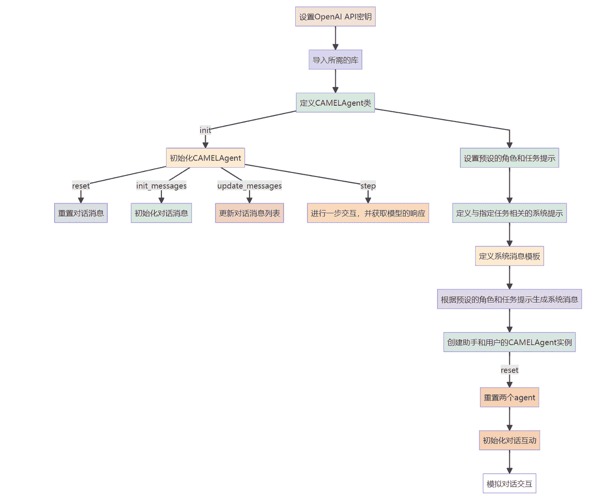

# 自治代理

## BabyAGI （没跑通）

安装包，建议在kaggle上跑

```
pip install faiss-cpu==1.7.4
```

```
# 设置API Key
import os
# os.environ[&quot;OPENAI_API_KEY&quot;] = &#x27;Your OpenAI Key&#x27;

# 导入所需的库和模块
from collections import deque
from typing import Dict, List, Optional, Any
from langchain.chains import LLMChain
from langchain.prompts import PromptTemplate
from langchain.embeddings import OpenAIEmbeddings
from langchain.llms import BaseLLM, OpenAI
from langchain.vectorstores.base import VectorStore
from pydantic import BaseModel, Field
from langchain.chains.base import Chain
from langchain.vectorstores import FAISS
import faiss
from langchain.docstore import InMemoryDocstore


# 定义嵌入模型
embeddings_model = OpenAIEmbeddings()
# 初始化向量存储
embedding_size = 1536
index = faiss.IndexFlatL2(embedding_size)
vectorstore = FAISS(embeddings_model.embed_query, index, InMemoryDocstore({}), {})

# 任务生成链
class TaskCreationChain(LLMChain):
    &quot;&quot;&quot;负责生成任务的链&quot;&quot;&quot;
    @classmethod
    def from_llm(cls, llm: BaseLLM, verbose: bool = True) -&gt; LLMChain:
        &quot;&quot;&quot;从LLM获取响应解析器&quot;&quot;&quot;
        task_creation_template = (
            &quot;You are a task creation AI that uses the result of an execution agent&quot;
            &quot; to create new tasks with the following objective: {objective},&quot;
            &quot; The last completed task has the result: {result}.&quot;
            &quot; This result was based on this task description: {task_description}.&quot;
            &quot; These are incomplete tasks: {incomplete_tasks}.&quot;
            &quot; Based on the result, create new tasks to be completed&quot;
            &quot; by the AI system that do not overlap with incomplete tasks.&quot;
            &quot; Return the tasks as an array.&quot;
        )
        prompt = PromptTemplate(
            template=task_creation_template,
            input_variables=[
                &quot;result&quot;,
                &quot;task_description&quot;,
                &quot;incomplete_tasks&quot;,
                &quot;objective&quot;,
            ],
        )
        return cls(prompt=prompt, llm=llm, verbose=verbose)
    
# 任务优先级链
class TaskPrioritizationChain(LLMChain):
    &quot;&quot;&quot;负责任务优先级排序的链&quot;&quot;&quot;
    @classmethod
    def from_llm(cls, llm: BaseLLM, verbose: bool = True) -&gt; LLMChain:
        &quot;&quot;&quot;从LLM获取响应解析器&quot;&quot;&quot;
        task_prioritization_template = (
            &quot;You are a task prioritization AI tasked with cleaning the formatting of and reprioritizing&quot;
            &quot; the following tasks: {task_names}.&quot;
            &quot; Consider the ultimate objective of your team: {objective}.&quot;
            &quot; Do not remove any tasks. Return the result as a numbered list, like:&quot;
            &quot; #. First task&quot;
            &quot; #. Second task&quot;
            &quot; Start the task list with number {next_task_id}.&quot;
        )
        prompt = PromptTemplate(
            template=task_prioritization_template,
            input_variables=[&quot;task_names&quot;, &quot;next_task_id&quot;, &quot;objective&quot;],
        )
        return cls(prompt=prompt, llm=llm, verbose=verbose)
    
# 任务执行链
class ExecutionChain(LLMChain):
    &quot;&quot;&quot;负责执行任务的链&quot;&quot;&quot;

    @classmethod
    def from_llm(cls, llm: BaseLLM, verbose: bool = True) -&gt; LLMChain:
        &quot;&quot;&quot;从LLM获取响应解析器&quot;&quot;&quot;
        execution_template = (
            &quot;You are an AI who performs one task based on the following objective: {objective}.&quot;
            &quot; Take into account these previously completed tasks: {context}.&quot;
            &quot; Your task: {task}.&quot;
            &quot; Response:&quot;
        )
        prompt = PromptTemplate(
            template=execution_template,
            input_variables=[&quot;objective&quot;, &quot;context&quot;, &quot;task&quot;],
        )
        return cls(prompt=prompt, llm=llm, verbose=verbose)
    
def get_next_task(
    task_creation_chain: LLMChain,
    result: Dict,
    task_description: str,
    task_list: List[str],
    objective: str,
) -&gt; List[Dict]:
    &quot;&quot;&quot;Get the next task.&quot;&quot;&quot;
    incomplete_tasks = &quot;, &quot;.join(task_list)
    response = task_creation_chain.run(
        result=result,
        task_description=task_description,
        incomplete_tasks=incomplete_tasks,
        objective=objective,
    )
    new_tasks = response.split(&quot;\n&quot;)
    return [{&quot;task_name&quot;: task_name} for task_name in new_tasks if task_name.strip()]


def prioritize_tasks(
    task_prioritization_chain: LLMChain,
    this_task_id: int,
    task_list: List[Dict],
    objective: str,
) -&gt; List[Dict]:
    &quot;&quot;&quot;Prioritize tasks.&quot;&quot;&quot;
    task_names = [t[&quot;task_name&quot;] for t in task_list]
    next_task_id = int(this_task_id) + 1
    response = task_prioritization_chain.run(
        task_names=task_names, next_task_id=next_task_id, objective=objective
    )
    new_tasks = response.split(&quot;\n&quot;)
    prioritized_task_list = []
    for task_string in new_tasks:
        if not task_string.strip():
            continue
        task_parts = task_string.strip().split(&quot;.&quot;, 1)
        if len(task_parts) == 2:
            task_id = task_parts[0].strip()
            task_name = task_parts[1].strip()
            prioritized_task_list.append({&quot;task_id&quot;: task_id, &quot;task_name&quot;: task_name})
    return prioritized_task_list


def _get_top_tasks(vectorstore, query: str, k: int) -&gt; List[str]:
    &quot;&quot;&quot;Get the top k tasks based on the query.&quot;&quot;&quot;
    results = vectorstore.similarity_search_with_score(query, k=k)
    if not results:
        return []
    sorted_results, _ = zip(*sorted(results, key=lambda x: x[1], reverse=True))
    return [str(item.metadata[&quot;task&quot;]) for item in sorted_results]


def execute_task(
    vectorstore, execution_chain: LLMChain, objective: str, task: str, k: int = 5
) -&gt; str:
    &quot;&quot;&quot;Execute a task.&quot;&quot;&quot;
    context = _get_top_tasks(vectorstore, query=objective, k=k)
    return execution_chain.run(objective=objective, context=context, task=task)


# BabyAGI 主类
class BabyAGI(Chain, BaseModel):
    &quot;&quot;&quot;BabyAGI代理的控制器模型&quot;&quot;&quot;

    task_list: deque = Field(default_factory=deque)
    task_creation_chain: TaskCreationChain = Field(...)
    task_prioritization_chain: TaskPrioritizationChain = Field(...)
    execution_chain: ExecutionChain = Field(...)
    task_id_counter: int = Field(1)
    vectorstore: VectorStore = Field(init=False)
    max_iterations: Optional[int] = None

    class Config:
        &quot;&quot;&quot;Configuration for this pydantic object.&quot;&quot;&quot;

        arbitrary_types_allowed = True

    def add_task(self, task: Dict):
        self.task_list.append(task)

    def print_task_list(self):
        print(&quot;\033[95m\033[1m&quot; + &quot;\n*****TASK LIST*****\n&quot; + &quot;\033[0m\033[0m&quot;)
        for t in self.task_list:
            print(str(t[&quot;task_id&quot;]) + &quot;: &quot; + t[&quot;task_name&quot;])

    def print_next_task(self, task: Dict):
        print(&quot;\033[92m\033[1m&quot; + &quot;\n*****NEXT TASK*****\n&quot; + &quot;\033[0m\033[0m&quot;)
        print(str(task[&quot;task_id&quot;]) + &quot;: &quot; + task[&quot;task_name&quot;])

    def print_task_result(self, result: str):
        print(&quot;\033[93m\033[1m&quot; + &quot;\n*****TASK RESULT*****\n&quot; + &quot;\033[0m\033[0m&quot;)
        print(result)

    @property
    def input_keys(self) -&gt; List[str]:
        return [&quot;objective&quot;]

    @property
    def output_keys(self) -&gt; List[str]:
        return []

    def _call(self, inputs: Dict[str, Any]) -&gt; Dict[str, Any]:
        &quot;&quot;&quot;Run the agent.&quot;&quot;&quot;
        objective = inputs[&quot;objective&quot;]
        first_task = inputs.get(&quot;first_task&quot;, &quot;Make a todo list&quot;)
        self.add_task({&quot;task_id&quot;: 1, &quot;task_name&quot;: first_task})
        num_iters = 0
        while True:
            if self.task_list:
                self.print_task_list()

                # Step 1: Pull the first task
                task = self.task_list.popleft()
                self.print_next_task(task)

                # Step 2: Execute the task
                result = execute_task(
                    self.vectorstore, self.execution_chain, objective, task[&quot;task_name&quot;]
                )
                this_task_id = int(task[&quot;task_id&quot;])
                self.print_task_result(result)

                # Step 3: Store the result in Pinecone
                result_id = f&quot;result_{task[&#x27;task_id&#x27;]}_{num_iters}&quot;
                self.vectorstore.add_texts(
                    texts=[result],
                    metadatas=[{&quot;task&quot;: task[&quot;task_name&quot;]}],
                    ids=[result_id],
                )

                # Step 4: Create new tasks and reprioritize task list
                new_tasks = get_next_task(
                    self.task_creation_chain,
                    result,
                    task[&quot;task_name&quot;],
                    [t[&quot;task_name&quot;] for t in self.task_list],
                    objective,
                )
                for new_task in new_tasks:
                    self.task_id_counter += 1
                    new_task.update({&quot;task_id&quot;: self.task_id_counter})
                    self.add_task(new_task)
                self.task_list = deque(
                    prioritize_tasks(
                        self.task_prioritization_chain,
                        this_task_id,
                        list(self.task_list),
                        objective,
                    )
                )
            num_iters += 1
            if self.max_iterations is not None and num_iters == self.max_iterations:
                print(
                    &quot;\033[91m\033[1m&quot; + &quot;\n*****TASK ENDING*****\n&quot; + &quot;\033[0m\033[0m&quot;
                )
                break
        return {}

    @classmethod
    def from_llm(
        cls, llm: BaseLLM, vectorstore: VectorStore, verbose: bool = False, **kwargs
    ) -&gt; &quot;BabyAGI&quot;:
        &quot;&quot;&quot;Initialize the BabyAGI Controller.&quot;&quot;&quot;
        task_creation_chain = TaskCreationChain.from_llm(llm, verbose=verbose)
        task_prioritization_chain = TaskPrioritizationChain.from_llm(
            llm, verbose=verbose
        )
        execution_chain = ExecutionChain.from_llm(llm, verbose=verbose)
        return cls(
            task_creation_chain=task_creation_chain,
            task_prioritization_chain=task_prioritization_chain,
            execution_chain=execution_chain,
            vectorstore=vectorstore,
            **kwargs,
        )
    

# 主执行部分
if __name__ == &quot;__main__&quot;:
    OBJECTIVE = &quot;分析一下北京市今天的气候情况，写出鲜花储存策略。&quot;
    llm = OpenAI(temperature=0)
    verbose = False
    max_iterations: Optional[int] = 6
    baby_agi = BabyAGI.from_llm(llm=llm, vectorstore=vectorstore, 
                                verbose=verbose, 
                                max_iterations=max_iterations)
    baby_agi({&quot;objective&quot;: OBJECTIVE})
```

> 这段代码是一个人工智能（AI）代理的实现，它可以创建、优先级排序和执行任务。这个AI代理被称为"BabyAGI"。

+   导入所需的库和模块：这部分代码导入了所有需要的Python库和模块。

+   定义嵌入模型和向量存储：这部分代码定义了一个嵌入模型（OpenAIEmbeddings）和一个向量存储（FAISS）。

+   定义任务生成链、任务优先级链和任务执行链：这些类是用于生成、优先级排序和执行任务的链。每个链都有一个从LLM（Language Model）获取响应解析器的方法。

+   定义获取下一个任务、优先级排序任务和执行任务的函数：这些函数用于获取下一个任务、优先级排序任务和执行任务。

+   定义BabyAGI主类：这个类是AI代理的主要控制器。它有一个任务列表，可以添加任务，打印任务列表，打印下一个任务，打印任务结果。它还有一个_call方法，用于运行代理。

+   主执行部分：这部分代码创建了一个BabyAGI实例，并运行了它。首先，它定义了一个目标（OBJECTIVE），然后创建了一个LLM（OpenAI），然后创建了一个BabyAGI实例，并运行了它。

> 这个AI代理的工作流程是这样的：首先，它会创建一个任务，然后将任务添加到任务列表中。然后，它会从任务列表中取出第一个任务，执行这个任务，并将结果存储起来。然后，它会根据这个结果创建新的任务，并将新的任务添加到任务列表中。然后，它会对任务列表进行优先级排序。这个过程会一直重复，直到满足某个结束条件。

```
graph TD
    style A fill:#6699CC;
    style B fill:#66CC99;
    style C fill:#FFCC99;
    style D fill:#FF99CC;
    style E fill:#99CCFF;
    style F fill:#CCCCFF;
    style G fill:#FF9999;
    style H fill:#FFFF99;
    style I fill:#99FFCC;
    style J fill:#FFCCFF;
    style K fill:#CC99FF;
    style L fill:#FFCC99;
    style M fill:#99FF99;
    style N fill:#FF99FF;
    style O fill:#99CC99;
    style P fill:#CC99CC;
    style Q fill:#99CCCC;
    style R fill:#9999FF;

    A[开始] --&gt; B[设置API Key]
    B --&gt; C[导入所需的库和模块]
    C --&gt; D[定义嵌入模型]
    D --&gt; E[初始化向量存储]
    E --&gt; F[定义任务生成链]
    F --&gt; G[定义任务优先级链]
    G --&gt; H[定义任务执行链]
    H --&gt; I[定义获取下一个任务的函数]
    I --&gt; J[定义优先级任务的函数]
    J --&gt; K[定义获取顶部任务的函数]
    K --&gt; L[定义执行任务的函数]
    L --&gt; M[定义BabyAGI主类]
    M --&gt; N[在主执行部分，设置目标]
    N --&gt; O[初始化LLM]
    O --&gt; P[初始化BabyAGI]
    P --&gt; Q[运行BabyAGI]
    Q --&gt; R[结束]
```

# 综合演练：实现客户聊天机器人

> 综合演练和项目演练所需的文件可以参阅 Langchain Workshop 项目库：https://gitee.com/cloudzun/langchan-workshop/。

> 如果直接运行代码库中的ipynb文件有异常，请参阅此文件中的代码和步骤进行修正。

在聊天机器人的实现过程中，遵循敏捷开发原则。

首先，集中精力开发基础版本的机器人，实现核心功能，如聊天交互。然后，逐步添加更多功能，如利用易速鲜花的企业知识库进行检索。用户可通过输入订单号查询订单状态或询问退货等常见问题。通过渐进式开发，逐步完善机器人功能，提供更多有用服务。

这个项目的具体技术实现步骤如下：

+   第一步：使用LangChain的ConversationChain实现基本的聊天对话工具。

+   第二步：利用LangChain的记忆功能，使聊天机器人能够记住用户之前的对话内容。

+   第三步：结合LangChain的检索功能，整合易速鲜花的内部文档资料，使聊天机器人能够根据自身知识和易速鲜花的业务流程提供专业的回答。

+   第四步（可选）：利用LangChain的数据库查询功能，用户可以输入订单号查询订单状态或了解存货情况等。

+   第五步：将聊天机器人部署在网络上，并发布供易速鲜花的内部员工和用户使用。

在上述五个步骤中，将使用了多项LangChain技术，包括提示工程、模型、链、代理、RAG和数据库检索等功能。

## 1.0 基本聊天

通过 LangChain 的 ConversationChain，实现一个最基本的聊天对话工具

```
# 设置OpenAI API密钥
import os
# os.environ[&quot;OPENAI_API_KEY&quot;] = &#x27;Your Key&#x27;

# 导入所需的库和模块
from langchain.schema import (
    HumanMessage,
    SystemMessage
)
from langchain.chat_models import ChatOpenAI

# 创建一个聊天模型的实例
chat = ChatOpenAI()

# 创建一个消息列表
messages = [
    SystemMessage(content=&quot;你是一个花卉行家。&quot;),
    HumanMessage(content=&quot;朋友喜欢淡雅的颜色，她的婚礼我选择什么花？&quot;)
]

# 使用聊天模型获取响应
response = chat(messages)
print(response)
```

> 这段Python代码实现了一个简单的聊天机器人，使用了langchain库的ChatOpenAI模型。

+   **设置OpenAI API密钥**：这段代码注释掉了一个设置OpenAI API密钥的语句。如果你需要使用OpenAI的服务，你需要取消这行代码的注释，并将'Your Key'替换为你的实际密钥。

+   **导入所需的库和模块**：这段代码导入了langchain.schema中的HumanMessage和SystemMessage类，以及langchain.chat_models中的ChatOpenAI类。

+   **创建一个聊天模型的实例**：使用ChatOpenAI类创建了一个聊天模型的实例。

+   **创建一个消息列表**：创建了一个包含两个消息的列表。第一个消息是一个SystemMessage，内容是"你是一个花卉行家。"；第二个消息是一个HumanMessage，内容是"朋友喜欢淡雅的颜色，她的婚礼我选择什么花？"。

+   **使用聊天模型获取响应**：将消息列表传递给聊天模型的实例，获取模型的响应。

+   **打印响应**：打印出聊天模型的响应。

进行多轮会话

```
# 设置OpenAI API密钥
import os
# os.environ[&quot;OPENAI_API_KEY&quot;] = &#x27;Your Key&#x27;

# 导入所需的库和模块
from langchain.schema import HumanMessage, SystemMessage
from langchain.chat_models import ChatOpenAI

# 定义一个命令行聊天机器人的类
class CommandlineChatbot:
    # 在初始化时，设置花卉行家的角色并初始化聊天模型
    def __init__(self):
        self.chat = ChatOpenAI()
        self.messages = [SystemMessage(content=&quot;你是一个花卉行家。&quot;)]

    # 定义一个循环来持续与用户交互
    def chat_loop(self):
        print(&quot;Chatbot 已启动! 输入&#x27;exit&#x27;来退出程序。&quot;)
        while True:
            user_input = input(&quot;你: &quot;)
            # 如果用户输入“exit”，则退出循环
            if user_input.lower() == &#x27;exit&#x27;:
                print(&quot;再见!&quot;)
                break
            # 将用户的输入添加到消息列表中，并获取机器人的响应
            self.messages.append(HumanMessage(content=user_input))
            response = self.chat(self.messages)
            print(f&quot;Chatbot: {response.content}&quot;)

# 如果直接运行这个脚本，启动聊天机器人
if __name__ == &quot;__main__&quot;:
    bot = CommandlineChatbot()
    bot.chat_loop()
```

> 这段代码是一个命令行聊天机器人的实现示例。它使用了LangChain的ChatOpenAI模型来实现聊天功能。

> 首先，通过设置OpenAI API密钥，确保能够访问OpenAI的API服务。

> 然后，导入所需的库和模块，包括langchain.schema中的HumanMessage和SystemMessage类，以及langchain.chat_models中的ChatOpenAI类。

> 接下来，定义了一个名为CommandlineChatbot的类，用于实现命令行聊天机器人。在初始化方法中，初始化了聊天模型，并设置了一个系统消息作为机器人的角色，这里设定为花卉行家。

> 然后，定义了一个chat_loop方法，用于持续与用户进行交互。在循环中，用户可以输入消息，如果输入为"exit"，则退出循环。否则，将用户的输入添加到消息列表中，并调用聊天模型的__call__方法进行对话。最后，打印出机器人的响应。

> 最后，如果直接运行这个脚本，会创建一个CommandlineChatbot的实例，并调用其中的chat_loop方法，启动聊天机器人。

> 这段代码提供了一个基本的命令行聊天机器人的实现框架，可以根据需求进行扩展和定制。

## 2.0 具备记忆功能

通过 ConversationBufferMemory 给 Chatbot 增加记忆

```
# 设置OpenAI API密钥
import os
# os.environ[&quot;OPENAI_API_KEY&quot;] = &#x27;Your Key&#x27;

# 导入所需的库和模块
from langchain.schema import HumanMessage, SystemMessage
from langchain.memory import ConversationBufferMemory
from langchain.prompts import (
    ChatPromptTemplate,
    MessagesPlaceholder,
    SystemMessagePromptTemplate,
    HumanMessagePromptTemplate,
)
from langchain.chains import LLMChain
from langchain.chat_models import ChatOpenAI

# 设置OpenAI API密钥
# os.environ[&quot;OPENAI_API_KEY&quot;] = &#x27;Your Key&#x27;  

# 带记忆的聊天机器人类
class ChatbotWithMemory:
    def __init__(self):

        # 初始化LLM
        self.llm = ChatOpenAI()

        # 初始化Prompt
        self.prompt = ChatPromptTemplate(
            messages=[
                SystemMessagePromptTemplate.from_template(
                    &quot;你是一个花卉行家。你通常的回答不超过30字。&quot;
                ),
                MessagesPlaceholder(variable_name=&quot;chat_history&quot;),
                HumanMessagePromptTemplate.from_template(&quot;{question}&quot;)
            ]
        )
        
        # 初始化Memory
        self.memory = ConversationBufferMemory(memory_key=&quot;chat_history&quot;, return_messages=True)
        
        # 初始化LLMChain with LLM, prompt and memory
        self.conversation = LLMChain(
            llm=self.llm,
            prompt=self.prompt,
            verbose=True,
            memory=self.memory
        )

    # 与机器人交互的函数
    def chat_loop(self):
        print(&quot;Chatbot 已启动! 输入&#x27;exit&#x27;来退出程序。&quot;)
        while True:
            user_input = input(&quot;你: &quot;)
            if user_input.lower() == &#x27;exit&#x27;:
                print(&quot;再见!&quot;)
                break
            
            response = self.conversation({&quot;question&quot;: user_input})
            print(f&quot;Chatbot: {response[&#x27;text&#x27;]}&quot;)

if __name__ == &quot;__main__&quot;:
    # 启动Chatbot
    bot = ChatbotWithMemory()
    bot.chat_loop()
```

+   这段代码是一个带有记忆功能的聊天机器人的实现示例。它使用了LangChain库中的各个模块来实现聊天功能。

+   首先，通过设置OpenAI API密钥，确保能够访问OpenAI的API服务。

+   然后，导入所需的库和模块，包括langchain.schema中的HumanMessage和SystemMessage类，以及langchain.memory、langchain.prompts、langchain.chains和langchain.chat_models中的其他类。

+   接下来，定义了一个名为ChatbotWithMemory的类，用于实现带有记忆功能的聊天机器人。在初始化方法中，初始化了LangChain的聊天模型ChatOpenAI，以及聊天模板ChatPromptTemplate。

+   在初始化方法中，还初始化了记忆模块ConversationBufferMemory，用于存储聊天的历史记录。

+   然后，使用LLMChain将聊天模型、聊天模板和记忆模块组合在一起，创建了一个聊天链conversation。

+   接下来，定义了一个chat_loop方法，用于持续与用户进行交互。在循环中，用户可以输入消息，如果输入为"exit"，则退出循环。否则，将用户的输入作为问题传递给聊天链，获取机器人的回答，并打印出来。

+   最后，如果直接运行这个脚本，会创建一个ChatbotWithMemory的实例，并调用其中的chat_loop方法，启动带有记忆功能的聊天机器人。

程序的核心是 ChatbotWithMemory 类，这是一个带有记忆功能的聊天机器人类。在这个类的初始化函数中，定义了一个对话缓冲区记忆，它会跟踪对话历史。在 LLMChain 被创建时，就整合了 LLM、提示和记忆，形成完整的对话链。

## 3.0 整合文档库具备检索机制

安装包

```
pip install -i https://pypi.tuna.tsinghua.edu.cn/simple pypdf==4.0.1 docx2txt==0.8
```

确保OneFlower目录已经拷贝到当前notebook所在位置，或者在脚本第三行进行定义

```
# 导入所需的库
import os
from langchain.text_splitter import RecursiveCharacterTextSplitter
from langchain.embeddings import OpenAIEmbeddings
from langchain.vectorstores import Qdrant
from langchain.memory import ConversationSummaryMemory
from langchain.chat_models import ChatOpenAI
from langchain.chains import ConversationalRetrievalChain
from langchain.document_loaders import PyPDFLoader
from langchain.document_loaders import Docx2txtLoader
from langchain.document_loaders import TextLoader

# 设置OpenAI API密钥
# os.environ[&quot;OPENAI_API_KEY&quot;] = &#x27;Your Key&#x27;  

# ChatBot类的实现-带检索功能
class ChatbotWithRetrieval:

    def __init__(self, dir):

        # 加载Documents
        base_dir = dir # 文档的存放目录
        documents = []
        for file in os.listdir(base_dir): 
            file_path = os.path.join(base_dir, file)
            if file.endswith(&#x27;.pdf&#x27;):
                loader = PyPDFLoader(file_path)
                documents.extend(loader.load())
            elif file.endswith(&#x27;.docx&#x27;) or file.endswith(&#x27;.doc&#x27;):
                loader = Docx2txtLoader(file_path)
                documents.extend(loader.load())
            elif file.endswith(&#x27;.txt&#x27;):
                loader = TextLoader(file_path)
                documents.extend(loader.load())
        
        # 文本的分割
        text_splitter = RecursiveCharacterTextSplitter(chunk_size=200, chunk_overlap=0)
        all_splits = text_splitter.split_documents(documents)
        
        # 向量数据库
        self.vectorstore = Qdrant.from_documents(
            documents=all_splits, # 以分块的文档
            embedding=OpenAIEmbeddings(), # 用OpenAI的Embedding Model做嵌入
            location=&quot;:memory:&quot;,  # in-memory 存储
            collection_name=&quot;my_documents&quot;,) # 指定collection_name
        
        # 初始化LLM
        self.llm = ChatOpenAI()
        
        # 初始化Memory
        self.memory = ConversationSummaryMemory(
            llm=self.llm, 
            memory_key=&quot;chat_history&quot;, 
            return_messages=True
            )
        
        # 设置Retrieval Chain
        retriever = self.vectorstore.as_retriever()
        self.qa = ConversationalRetrievalChain.from_llm(
            self.llm, 
            retriever=retriever, 
            memory=self.memory
            )

    # 交互对话的函数
    def chat_loop(self):
        print(&quot;Chatbot 已启动! 输入&#x27;exit&#x27;来退出程序。&quot;)
        while True:
            user_input = input(&quot;你: &quot;)
            if user_input.lower() == &#x27;exit&#x27;:
                print(&quot;再见!&quot;)
                break
            # 调用 Retrieval Chain  
            response = self.qa(user_input)
            print(f&quot;Chatbot: {response[&#x27;answer&#x27;]}&quot;)

if __name__ == &quot;__main__&quot;:
    # 启动Chatbot
    folder = &quot;OneFlower&quot; #素材地址
    bot = ChatbotWithRetrieval(folder)
    bot.chat_loop()
```

> 这段代码实现了一个带有检索功能的聊天机器人。它使用了LangChain库中的各个模块来实现。

+   首先，导入所需的库和模块，包括os、langchain.text_splitter、langchain.embeddings、langchain.vectorstores、langchain.memory、langchain.chat_models、langchain.chains和langchain.document_loaders等。

+   然后，定义了一个名为ChatbotWithRetrieval的类，用于实现带有检索功能的聊天机器人。在初始化方法中：

+   首先加载指定目录中的文档。根据文档的后缀，使用不同的加载器加载文档内容。加载的文档会被分割成小块，以便进行向量化和检索。

+   使用RecursiveCharacterTextSplitter将文档分割成小块，并使用OpenAIEmbeddings将文本转换为向量。

+   将分割后的文本块和对应的向量存储在Qdrant向量数据库中。

+   初始化LangChain的聊天模型ChatOpenAI和记忆模块ConversationSummaryMemory。记忆模块使用LLM模型和聊天历史记录来生成摘要，以便在检索过程中使用。

+   使用向量数据库创建一个检索器，并将检索器和聊天模型、记忆模块组合在一起，创建一个具有检索功能的聊天链qa。

+   定义了一个chat_loop方法，用于持续与用户进行交互。在循环中：

+   用户可以输入问题，如果输入为"exit"，则退出循环。

+   否则，调用检索链qa，获取机器人的回答，并打印出来。

+   如果直接运行这个脚本，会创建一个ChatbotWithRetrieval的实例，并调用其中的chat_loop方法，启动带有检索功能的聊天机器人。

> 这段代码提供了一个基本的带有检索功能的聊天机器人的实现框架，可以根据需求进行扩展和定制。

通过文档加载、文本分割、文档向量化以及检索功能，这个新的机器人除了常规的聊天功能，还能够检索存储在指定目录中的文档，并基于这些文档提供答案。

当用户输入一个问题时，机器人首先在向量数据库中查找与问题最相关的文本块。这是通过将用户问题转化为向量，并在数据库中查找最接近的文本块向量来实现的。然后，机器人使用 LLM（大模型）在这些相关的文本块上进一步寻找答案，并生成回答。

现在，新的 Chatbot 既能够回答一般性的问题，又能够回答易速鲜花内部问题。

## 4.0 部署 Chatbot

+   Gradio 更多是为了展示和演示机器学习模型。它提供了一种快速的方法，使非技术用户也能与机器学习模型进行交互，无需编写复杂的代码。

+   Streamlit 是为数据应用、仪表板和可视化设计的。它提供了多种小部件，使得用户可以与数据和模型进行交互。它非常 Pythonic，意味着它的使用方式非常自然，对于熟悉 Python 的人来说非常直观。

### A. 使用Gradio框架

安装包

```
pip install -i https://pypi.tuna.tsinghua.edu.cn/simple gradio==4.16.0
```

需要更新pydantic，还需要重启kernal以使其生效

```
pip install --upgrade pydantic
```

```
# 导入所需的库
import os
import gradio as gr
from langchain.text_splitter import RecursiveCharacterTextSplitter
from langchain.embeddings import OpenAIEmbeddings
from langchain.vectorstores import Qdrant
from langchain.memory import ConversationSummaryMemory
from langchain.chat_models import ChatOpenAI
from langchain.chains import ConversationalRetrievalChain
from langchain.document_loaders import PyPDFLoader
from langchain.document_loaders import Docx2txtLoader
from langchain.document_loaders import TextLoader

# 设置OpenAI API密钥
# os.environ[&quot;OPENAI_API_KEY&quot;] = &#x27;Your Key&#x27;  

class ChatbotWithRetrieval:
    def __init__(self, dir):

        # 加载Documents
        base_dir = &#x27;.\\OneFlower&#x27; # 文档的存放目录
        documents = []
        for file in os.listdir(base_dir): 
            file_path = os.path.join(base_dir, file)
            if file.endswith(&#x27;.pdf&#x27;):
                loader = PyPDFLoader(file_path)
                documents.extend(loader.load())
            elif file.endswith(&#x27;.docx&#x27;) or file.endswith(&#x27;.doc&#x27;):
                loader = Docx2txtLoader(file_path)
                documents.extend(loader.load())
            elif file.endswith(&#x27;.txt&#x27;):
                loader = TextLoader(file_path)
                documents.extend(loader.load())
        
        # 文本的分割
        text_splitter = RecursiveCharacterTextSplitter(chunk_size=200, chunk_overlap=0)
        all_splits = text_splitter.split_documents(documents)
        
        # 向量数据库
        self.vectorstore = Qdrant.from_documents(
            documents=all_splits, # 以分块的文档
            embedding=OpenAIEmbeddings(), # 用OpenAI的Embedding Model做嵌入
            location=&quot;:memory:&quot;,  # in-memory 存储
            collection_name=&quot;my_documents&quot;,) # 指定collection_name
        
        # 初始化LLM
        self.llm = ChatOpenAI()
        
        # 初始化Memory
        self.memory = ConversationSummaryMemory(
            llm=self.llm, 
            memory_key=&quot;chat_history&quot;, 
            return_messages=True
            )
        # 初始化对话历史
        self.conversation_history = &quot;&quot;

        # 设置Retrieval Chain
        retriever = self.vectorstore.as_retriever()
        self.qa = ConversationalRetrievalChain.from_llm(
            self.llm, 
            retriever=retriever, 
            memory=self.memory
            )

    def get_response(self, user_input):  # 这是为 Gradio 创建的新函数
        response = self.qa(user_input)
        # 更新对话历史
        self.conversation_history += f&quot;你: {user_input}\nChatbot: {response[&#x27;answer&#x27;]}\n&quot;
        return self.conversation_history

if __name__ == &quot;__main__&quot;:
    folder = &quot;OneFlower&quot;
    bot = ChatbotWithRetrieval(folder)

    # 定义 Gradio 界面
    interface = gr.Interface(
        fn=bot.get_response,  # 使用我们刚刚创建的函数
        inputs=&quot;text&quot;,  # 输入是文本
        outputs=&quot;text&quot;,  # 输出也是文本
        live=False,  # 实时更新，这样用户可以连续与模型交互
        title=&quot;易速鲜花智能客服&quot;,  # 界面标题
        description=&quot;请输入问题，然后点击提交。&quot;  # 描述
    )
    interface.launch()  # 启动 Gradio 界面
    # interface.launch(share=True)  # 启动 Gradio Pubelic访问
```

> 这段代码实现了一个基于检索的聊天机器人，并使用Gradio创建了一个Web界面。

+   **导入所需的库**：这段代码首先导入了一些Python库，这些库将在后续的代码中被使用。这些库包括os（用于处理操作系统相关的功能，如环境变量）、gradio（用于创建Web应用）、langchain（一个用于处理文本和创建聊天机器人的库）等。

+   **设置OpenAI API密钥**：这段代码注释掉了一个设置OpenAI API密钥的语句。OpenAI API密钥是使用OpenAI服务（如GPT-3等）所必需的。如果你需要使用这些服务，你需要取消这行代码的注释，并将'Your Key'替换为你的实际密钥。

+   **ChatBot类的实现**：这个类实现了一个基于检索的聊天机器人。它首先从指定的目录中加载文档，然后使用RecursiveCharacterTextSplitter将文档分割成小块，接着使用OpenAIEmbeddings将这些小块转换成向量，并将这些向量存储在Qdrant向量数据库中。然后，它使用ChatOpenAI初始化一个语言模型，并使用ConversationSummaryMemory初始化一个内存模块。最后，它使用ConversationalRetrievalChain设置一个检索链，这个检索链将用于生成机器人的回答。

+   **Gradio界面的创建**：这段代码使用Gradio创建了一个Web界面。这个界面包含一个标题和一个文本输入框。用户可以在这个输入框中输入他们的问题，然后点击"提交"按钮，机器人就会生成一个回答并显示在界面上。

+   **主函数**：这个函数首先创建一个ChatbotWithRetrieval实例，然后定义一个Gradio界面，并启动这个界面。这个界面的输入和输出都是文本，用户可以在这个界面上与机器人进行交互。

+   **运行主函数**：如果这个脚本是直接运行的（而不是被其他脚本导入的），那么就会运行主函数。这是一个常见的Python编程模式，用于区分脚本是被直接运行还是被导入。

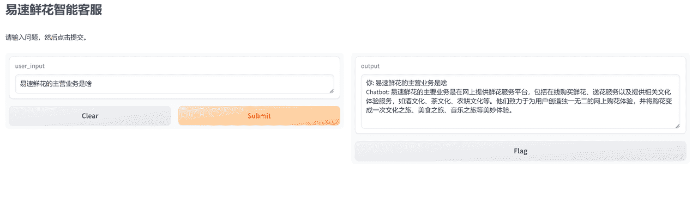

### B. 使用Streamlit 部署

需要在IDE环境中运行，以vscode为例，首先激活venv

```
PS C:\temp\lctest&gt; cd .\Scripts\
PS C:\temp\lctest\Scripts&gt; .\activate
(lctest) PS C:\temp\lctest\Scripts&gt; 
```

安装包

```
pip install -i https://pypi.tuna.tsinghua.edu.cn/simple streamlit==1.30.0
```

创建.env文件

```
OPENAI_API_KEY=sk-xxx
OPENAI_API_BASE=https://api.huaqloud.com/v1
```

代码

```
# 导入所需的库
import os
import streamlit as st
from langchain.text_splitter import RecursiveCharacterTextSplitter
from langchain.embeddings import OpenAIEmbeddings
from langchain.vectorstores import Qdrant
from langchain.memory import ConversationSummaryMemory
from langchain.chat_models import ChatOpenAI
from langchain.chains import ConversationalRetrievalChain
from langchain.document_loaders import PyPDFLoader
from langchain.document_loaders import Docx2txtLoader
from langchain.document_loaders import TextLoader

# 设置OpenAI API密钥
from dotenv import load_dotenv


load_dotenv()

OPENAI_API_KEY = os.getenv(&quot;OPENAI_API_KEY&quot;)
OPENAI_API_BASE = os.getenv(&quot;OPENAI_API_BASE&quot;)


# ChatBot类的实现
class ChatbotWithRetrieval:

    def __init__(self, dir):

        # 加载Documents
        base_dir = &#x27;.\\OneFlower&#x27; # 文档的存放目录
        documents = []
        for file in os.listdir(base_dir): 
            file_path = os.path.join(base_dir, file)
            if file.endswith(&#x27;.pdf&#x27;):
                loader = PyPDFLoader(file_path)
                documents.extend(loader.load())
            elif file.endswith(&#x27;.docx&#x27;) or file.endswith(&#x27;.doc&#x27;):
                loader = Docx2txtLoader(file_path)
                documents.extend(loader.load())
            elif file.endswith(&#x27;.txt&#x27;):
                loader = TextLoader(file_path)
                documents.extend(loader.load())
        
        # 文本的分割
        text_splitter = RecursiveCharacterTextSplitter(chunk_size=200, chunk_overlap=0)
        all_splits = text_splitter.split_documents(documents)
        
        # 向量数据库
        self.vectorstore = Qdrant.from_documents(
            documents=all_splits, # 以分块的文档
            embedding=OpenAIEmbeddings(), # 用OpenAI的Embedding Model做嵌入
            location=&quot;:memory:&quot;,  # in-memory 存储
            collection_name=&quot;my_documents&quot;,) # 指定collection_name
        
        # 初始化LLM
        self.llm = ChatOpenAI()
        
        # 初始化Memory
        self.memory = ConversationSummaryMemory(
            llm=self.llm, 
            memory_key=&quot;chat_history&quot;, 
            return_messages=True
            )
        
        # 设置Retrieval Chain
        retriever = self.vectorstore.as_retriever()
        self.qa = ConversationalRetrievalChain.from_llm(
            self.llm, 
            retriever=retriever, 
            memory=self.memory
            )

    def chat_loop(self):
        print(&quot;Chatbot 已启动! 输入&#x27;exit&#x27;来退出程序。&quot;)
        while True:
            user_input = input(&quot;你: &quot;)
            if user_input.lower() == &#x27;exit&#x27;:
                print(&quot;再见!&quot;)
                break
            # 调用 Retrieval Chain  
            response = self.qa(user_input)
            print(f&quot;Chatbot: {response[&#x27;answer&#x27;]}&quot;)

# Streamlit界面的创建
def main():
    st.title(&quot;易速鲜花聊天客服&quot;)

    # Check if the &#x27;bot&#x27; attribute exists in the session state
    if &quot;bot&quot; not in st.session_state:
        st.session_state.bot = ChatbotWithRetrieval(&quot;OneFlower&quot;)

    user_input = st.text_input(&quot;请输入你的问题：&quot;)
    
    if user_input:
        response = st.session_state.bot.qa(user_input)
        st.write(f&quot;Chatbot: {response[&#x27;answer&#x27;]}&quot;)

if __name__ == &quot;__main__&quot;:
    main()
```

运行

```
(lctest) PS C:\Users\cheng\langchan-workshop\notebook&gt; streamlit run chatbot.py
```

```
streamlit run chatbot.py
```

> 这段代码主要实现了一个基于检索的聊天机器人，并使用Streamlit创建了一个Web界面。

+   **导入所需的库**：这段代码首先导入了一些Python库，这些库将在后续的代码中被使用。这些库包括os（用于处理操作系统相关的功能，如环境变量）、streamlit（用于创建Web应用）、langchain（一个用于处理文本和创建聊天机器人的库）等。

+   **设置OpenAI API密钥**：这段代码从环境变量中获取OpenAI API密钥和API基础URL。这些信息是使用OpenAI服务（如GPT-3等）所必需的。

+   **ChatBot类的实现**：这个类实现了一个基于检索的聊天机器人。它首先从指定的目录中加载文档，然后使用RecursiveCharacterTextSplitter将文档分割成小块，接着使用OpenAIEmbeddings将这些小块转换成向量，并将这些向量存储在Qdrant向量数据库中。然后，它使用ChatOpenAI初始化一个语言模型，并使用ConversationSummaryMemory初始化一个内存模块。最后，它使用ConversationalRetrievalChain设置一个检索链，这个检索链将用于生成机器人的回答。

+   **Streamlit界面的创建**：这段代码使用Streamlit创建了一个Web界面。这个界面包含一个标题和一个文本输入框。用户可以在这个输入框中输入他们的问题，然后点击"Enter"键，机器人就会生成一个回答并显示在界面上。

+   **主函数**：这个函数首先检查Streamlit的会话状态中是否存在一个'bot'属性。如果不存在，就创建一个新的ChatbotWithRetrieval实例并存储在st.session_state.bot中。然后，它创建一个文本输入框，让用户可以输入他们的问题。如果用户输入了一个问题，就调用st.session_state.bot.qa(user_input)获取机器人的回答，并显示在界面上。

+   **运行主函数**：如果这个脚本是直接运行的（而不是被其他脚本导入的），那么就会运行主函数。这是一个常见的Python编程模式，用于区分脚本是被直接运行还是被导入。

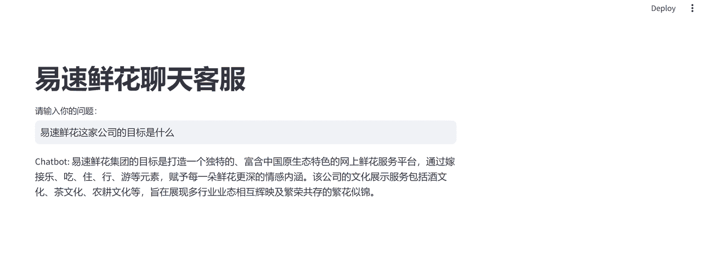

# 项目演练：构建基于本地知识库的智能问答系统

## 项目需求

**项目名称**: "易速鲜花"内部员工知识库问答系统

**项目介绍**: "易速鲜花"是一个大型在线鲜花销售平台，拥有独立的业务流程和规范，以及专门为员工编写的SOP手册。新员工入职培训时，会分享相关信息。然而，这些信息分散在内部网和HR部门目录中，查询不便；有时文档过长，员工无法快速找到所需内容；有时公司政策已更新，但员工手头的文档仍为旧版。

为满足上述需求，计划开发一套基于各种内部知识手册的"Doc-QA"系统。该系统将充分利用LangChain框架，处理从员工手册中产生的各种问题。问答系统将能够理解员工的问题，并基于最新的员工手册提供准确的答案。

## 技术框架

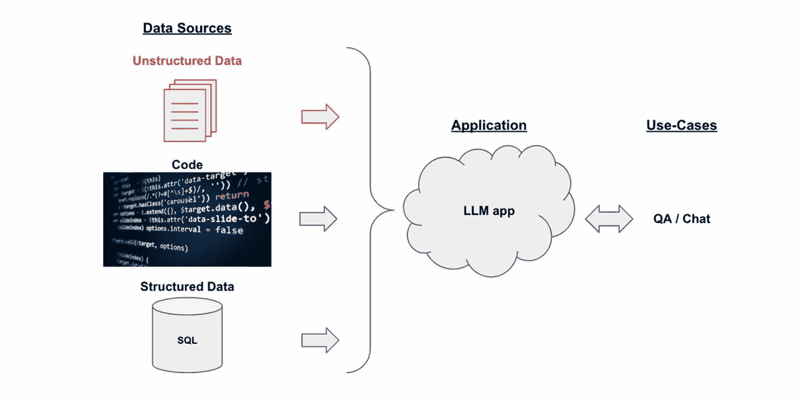

整个框架分为这样三个部分。

+   数据源（Data Sources）：数据可以有很多种，包括 PDF 在内的非结构化的数据（Unstructured Data）、SQL 在内的结构化的数据（Structured Data），以及 Python、Java 之类的代码（Code）。在这个示例中，我们聚焦于对非结构化数据的处理。

+   大模型应用（Application，即 LLM App）：以大模型为逻辑引擎，生成我们所需要的回答。用例（Use-Cases）：

+   大模型生成的回答可以构建出 QA/ 聊天机器人等系统。

## 核心实现机制

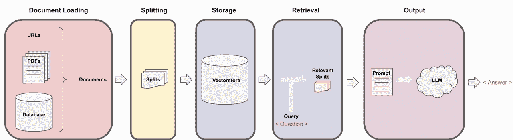

具体流程分为下面 5 步。

1.  **Loading****：文**档加载器把 Documents 加载为以 LangChain 能够读取的形式。

1.  **Splitting****：文**本分割器把 Documents 切分为指定大小的分割，我把它们称为“文档块”或者“文档片”。

1.  **Storage****：将**上一步中分割好的“文档块”以“嵌入”（Embedding）的形式存储到向量数据库（Vector DB）中，形成一个个的“嵌入片”。

1.  **Retrieval**：应用程序从存储中**检索**分割后的文档（例如通过比较余弦相似度，找到与输入问题类似的嵌入片）。

1.  **Output**：把问题和相似的嵌入片传递给语言模型（LLM），使用包含问题和检索到的分割的提示生成答案。

## 核心代码分析

首先激活venv，然后进入到项目目录

```
(lctest) PS C:\Users\cheng\langchan-workshop\ProjectDrill&gt; dir


    目录: C:\Users\cheng\langchan-workshop\ProjectDrill


Mode                 LastWriteTime         Length Name
----                 -------------         ------ ----
da----        2024/4/3   上午 9:35                OneFlower
da----        2024/4/3   上午 9:35                static
da----        2024/4/3   上午 9:35                templates
-a----       2024/1/30  上午 11:11            111 .env
-a----       2024/1/31   下午 5:41           3171 DocQA.py
```

.env

```
OPENAI_API_KEY=sk-xxx
OPENAI_API_BASE=https://api.huaqloud.com/v1
```

DocQA.py

```
# 设置OpenAI API密钥
import os
from dotenv import load_dotenv


load_dotenv()

OPENAI_API_KEY = os.getenv(&quot;OPENAI_API_KEY&quot;)
OPENAI_API_BASE = os.getenv(&quot;OPENAI_API_BASE&quot;)

# 1.Load 导入Document Loaders
from langchain.document_loaders import PyPDFLoader
from langchain.document_loaders import Docx2txtLoader
from langchain.document_loaders import TextLoader

# 加载Documents
base_dir = &#x27;.\\OneFlower&#x27; # 文档的存放目录  # Windows系统上需要使用双反斜杠
documents = []
for file in os.listdir(base_dir): 
    # 构建完整的文件路径
    file_path = os.path.join(base_dir, file)
    if file.endswith(&#x27;.pdf&#x27;):
        loader = PyPDFLoader(file_path)
        documents.extend(loader.load())
    elif file.endswith(&#x27;.docx&#x27;):
        loader = Docx2txtLoader(file_path)
        documents.extend(loader.load())
    elif file.endswith(&#x27;.txt&#x27;):
        loader = TextLoader(file_path)
        documents.extend(loader.load())

# 2.Split 将Documents切分成块以便后续进行嵌入和向量存储
from langchain.text_splitter import RecursiveCharacterTextSplitter
text_splitter = RecursiveCharacterTextSplitter(chunk_size=200, chunk_overlap=10)
chunked_documents = text_splitter.split_documents(documents)

# 3.Store 将分割嵌入并存储在矢量数据库Qdrant中
from langchain.vectorstores import Qdrant
from langchain.embeddings import OpenAIEmbeddings
vectorstore = Qdrant.from_documents(
    documents=chunked_documents, # 以分块的文档
    embedding=OpenAIEmbeddings(), # 用OpenAI的Embedding Model做嵌入
    location=&quot;:memory:&quot;,  # in-memory 存储
    collection_name=&quot;my_documents&quot;,) # 指定collection_name

# 4. Retrieval 准备模型和Retrieval链
import logging # 导入Logging工具
from langchain.chat_models import ChatOpenAI # ChatOpenAI模型
from langchain.retrievers.multi_query import MultiQueryRetriever # MultiQueryRetriever工具
from langchain.chains import RetrievalQA # RetrievalQA链

# 设置Logging
logging.basicConfig()
logging.getLogger(&#x27;langchain.retrievers.multi_query&#x27;).setLevel(logging.INFO)

# 实例化一个大模型工具 - OpenAI的GPT-3.5
llm = ChatOpenAI(model_name=&quot;gpt-3.5-turbo&quot;, temperature=0)

# 实例化一个MultiQueryRetriever
retriever_from_llm = MultiQueryRetriever.from_llm(retriever=vectorstore.as_retriever(), llm=llm)

# 实例化一个RetrievalQA链
qa_chain = RetrievalQA.from_chain_type(llm,retriever=retriever_from_llm)

# 5. Output 问答系统的UI实现
from flask import Flask, request, render_template
app = Flask(__name__) # Flask APP

@app.route(&#x27;/&#x27;, methods=[&#x27;GET&#x27;, &#x27;POST&#x27;])
def home():
    if request.method == &#x27;POST&#x27;:

        # 接收用户输入作为问题
        question = request.form.get(&#x27;question&#x27;)        
        
        # RetrievalQA链 - 读入问题，生成答案
        result = qa_chain({&quot;query&quot;: question})
        
        # 把大模型的回答结果返回网页进行渲染
        return render_template(&#x27;index.html&#x27;, result=result)
    
    return render_template(&#x27;index.html&#x27;)

if __name__ == &quot;__main__&quot;:
    app.run(host=&#x27;0.0.0.0&#x27;,debug=True,port=5000)
```

> 这段代码实现了一个基于检索的聊天机器人，并使用Flask创建了一个Web界面。

+   **设置OpenAI API密钥**：从环境变量中获取OpenAI API密钥。

+   **加载Documents**：从指定的目录中加载文档，支持.pdf、.docx、.doc和.txt格式的文件。

+   **文本的分割**：使用RecursiveCharacterTextSplitter将文档分割成小块。

+   **向量数据库**：使用Qdrant.from_documents方法将分割后的文档转换成向量，并存储在内存中。

+   **准备模型和Retrieval链**：实例化一个ChatOpenAI模型，实例化一个MultiQueryRetriever，并使用这两者实例化一个RetrievalQA链。

+   **Flask界面的创建**：创建一个Flask应用，定义一个路由处理函数，这个函数会接收用户的问题，调用RetrievalQA链生成答案，并将答案返回给用户。

+   **运行Flask应用**：如果这个脚本是直接运行的（而不是被其他脚本导入的），那么就会运行Flask应用。这是一个常见的Python编程模式，用于区分脚本是被直接运行还是被导入。

项目结构

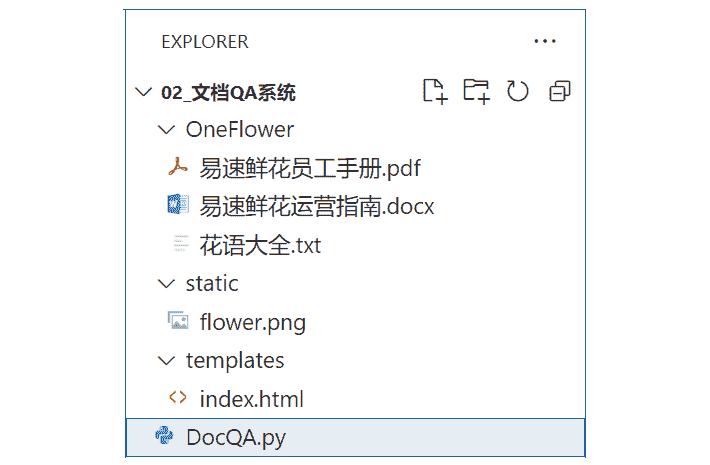

安装flask

```
pip install -i https://pypi.tuna.tsinghua.edu.cn/simple flask
```

运行

```
python DocQA.py
```

效果：http://localhost:5000

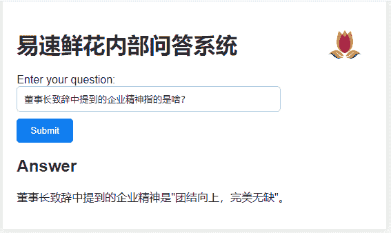