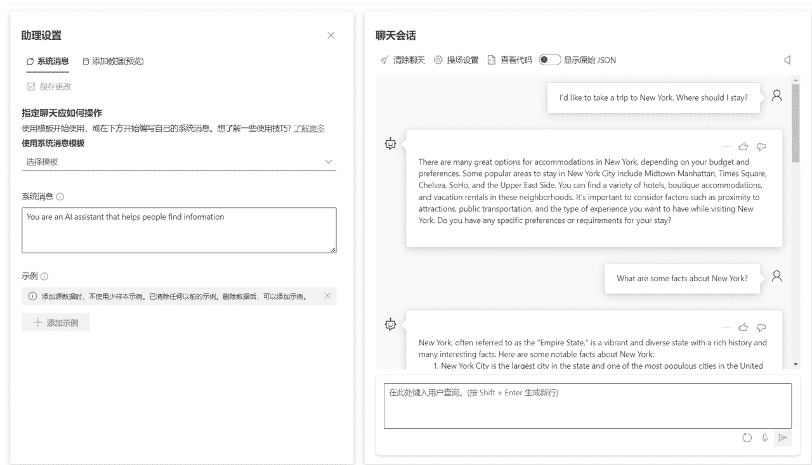
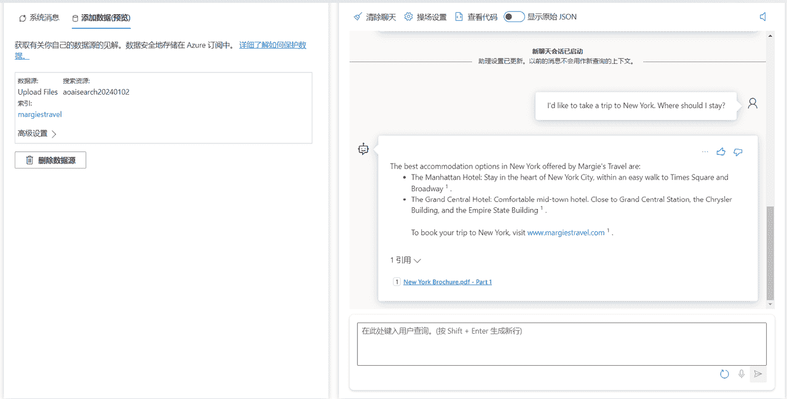
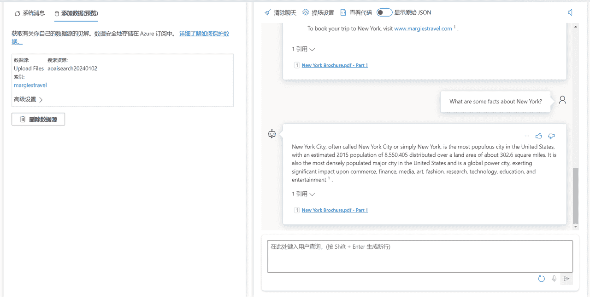
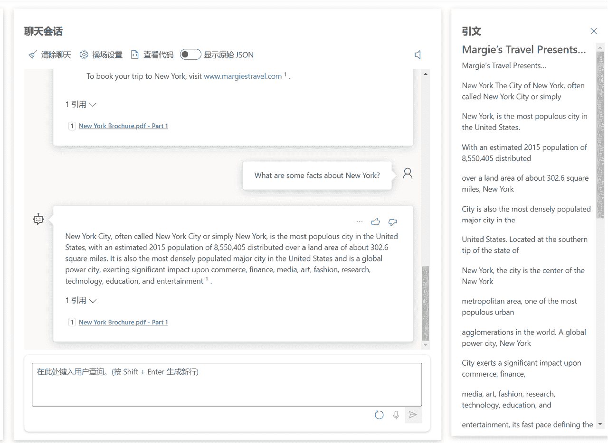

# AI-050：使用 Azure OpenAI 服务开发生成式 AI 解决方案

> 来源：[https://zsyhjtnsa5.feishu.cn/docx/WXV7du5hBoKJ7exPif1cMIJkn6g](https://zsyhjtnsa5.feishu.cn/docx/WXV7du5hBoKJ7exPif1cMIJkn6g)

> Azure OpenAI 服务提供对 OpenAI 强大语言模型的 REST API 访问，这些模型包括 GPT-4、GPT-4 Turbo with Vision、GPT-3.5-Turbo 和嵌入模型系列。 此外，新的 GPT-4 和 GPT-3.5-Turbo 模型系列现已正式发布。 这些模型可以轻松适应特定的任务，包括但不限于内容生成、汇总、图像理解、语义搜索和自然语言到代码的转换。 用户可以通过 REST API、Python SDK 或 Azure OpenAI Studio 中基于 Web 的界面访问该服务。

[使用 Azure OpenAI 服务开发生成](https://learn.microsoft.com/zh-cn/training/paths/develop-ai-solutions-azure-openai/)式 AI 解决方案 - Training

## 开始使用 Azure OpenAI 服务

### 访问 Azure OpenAI 服务

使用 Azure OpenAI 构建生成型 AI 解决方案的第一步是在 Azure 订阅中预配 Azure OpenAI 资源。 Azure OpenAI 服务目前处于受限访问状态。 用户需要在 https://aka.ms/oai/access 上申请服务访问权限。

有权访问 Azure OpenAI 服务后，可以通过在 Azure 门户中创建资源或使用 `Azure CLI` 开始。

Azure OpenAI 服务提供了对多种类型的模型的访问。 某些模型仅在选定区域中可用。 有关区域可用性，请参阅 Azure OpenAI 模型可用性指南。 可以为每个区域创建两个 Azure OpenAI 资源。

### 使用 Azure OpenAI Studio

Azure OpenAI Studio 提供对模型管理、部署、试验、自定义和学习资源的访问权限。

创建资源后，可以通过 Azure 门户访问 Azure OpenAI Studio，也可以在 https://oai.azure.com 通过使用 Azure OpenAI 资源实例登录来访问 Azure OpenAI Studio。 在登录工作流中，选择适当的目录、Azure 订阅和 Azure OpenAI 资源。

### 探索生成式 AI 模型的类型

Azure OpenAI 包括多种类型的模型：

+ GPT-4 模型是最新一代的生成式预训练 (GPT) 模型，可以根据自然语言提示生成自然语言和代码补全。

+ GPT 3.5 模型可以根据自然语言提示生成自然语言和代码补全。 具体而言，GPT-35-turbo 模型针对基于聊天的交互进行了优化，在大多数生成式 AI 方案中都表现良好。

+ 嵌入模型将文本转换为数字向量，并且在语言分析方案（例如比较文本源的相似性）中非常有用。

+ DALL-E 模型用于基于自然语言提示生成图像。 目前，DALL-E 模型处于预览阶段。 DALL-E 模型未在 Azure OpenAI Studio 界面中列出，并且不需要显式部署。

模型因速度、成本和完成特定任务的出色程度而异。 可以详细了解 Azure OpenAI 服务文档中介绍的差异和最新模型。

Azure OpenAI 服务模型 - Azure OpenAI

定价由令牌和模型类型决定。：[Azure OpenAI 服务 - 定价| Microsoft Azure](https://azure.microsoft.com/zh-cn/pricing/details/cognitive-services/openai-service/)

在 Azure OpenAI Studio 中，“模型”页列出了可用的基础模型（DALL-E 模型除外），并提供了通过微调基本模型来创建其他自定义模型的选项。 模型状态为“成功”意味着它们已成功训练，并且可被选择用于部署。

### 部署生成式 AI 模型

首先需要部署一个模型，以便进行 API 调用，从而接收提示完成。 创建新部署时，需要指出要部署的基础模型。 可以在一个或多个 Azure OpenAI 资源中实现任意数量的部署，只要它们的 TPM 总数在那个区域中低于 240K。 可通过多种方式部署基础模型。

+ 使用 Azure OpenAI Studio 进行部署：在 Azure OpenAI Studio 的“部署”页中，可以通过从菜单中选择模型名称来创建新部署。 可用的基础模型来自模型页中的列表。在 Studio 的“部署”页中，还可以查看所有部署的相关信息，包括部署名称、模型名称、模型版本、状态、创建日期等。

+ 使用 `Azure CLI` 进行部署：

+ 使用 REST API 进行部署：可以使用 REST API 部署模型。 在请求正文中，指定要部署的基础模型。 请参阅 Azure OpenAI 文档中的示例。

### 使用提示从模型中获取完成

部署模型后，可以测试其完成提示的方式。 提示是发送到部署模型的完成终结点的请求的文本部分。 响应被称为完成，可以采用文本、代码的形式或其他形式。

提示类型

+ 对内容进行分类

+ 生成新内容

+ 进行对话

+ 转换（翻译和符号转换）

+ 总结内容

+ 从断开的地方继续

+ 提供事实答复

完成质量

有几个因素会影响从生成式 AI 解决方案中获得的完成质量。

+ 提示的工程处理方式。 [单击此处详细了解提示工程](https://learn.microsoft.com/zh-cn/azure/cognitive-services/openai/concepts/prompt-engineering?portal=true)。

+ 模型参数（下文将介绍）

+ 训练模型的数据，可以通过[自定义模型微调](https://learn.microsoft.com/zh-cn/azure/cognitive-services/openai/how-to/fine-tuning?pivots=programming-language-studio?portal=true)进行调整

与通过提示工程和参数调整相比，你可以通过训练自定义模型更好地控制返回的完成。

进行调用

可以通过 REST API、`Python`、`C#` 或从 Studio 开始调用部署的模型。 如果部署的模型具有 `GPT-3.5` 或 `GPT-4` 模型库，请使用聊天完成文档，该文档具有与其他基础模型不同的请求终结点和变量。

### 在 Azure OpenAI Studio 的操场中测试模型

Playground 是 Azure OpenAI Studio 中的有用接口，可用于试验部署的模型，而无需开发自己的客户端应用程序。 Azure OpenAI Studio 提供了具有不同参数优化选项的多个操场。

[完成操场](https://learn.microsoft.com/zh-cn/azure/ai-services/openai/quickstart?tabs=command-line%2Cpython&pivots=programming-language-studio)

允许你通过文本输入文本输出接口调用部署的模型，并调整参数。 你需要在“部署”下选择模型的部署名称。 它提供一个简单的文本框，可以在其中提交提示以生成补全内容。 在此页中，可以快速循环访问和试验这些功能。

可以调整许多参数来更改模型的性能：

+ 温度：控制随机性。 降低温度意味着模型会产生更多重复性和确定性的回复。 提高温度会导致更多意外或创造性的回复。 请尝试调整温度或 `Top P` 值，但不要同时调整两者。

+ 最大长度(标记数)：对每个模型响应的标记数设置限制。 该 API 支持最多 4000 个标记，包括提示（包括系统消息、示例、消息历史记录以及用户查询）和模型的响应。 对于典型的英文文本，一个标记大约是四个字符。

+ 停止序列：使响应停止在所需点，例如句子或列表的末尾。 指定最多四个序列，模型将停止在响应中生成更多标记。 返回的文本不包含停止序列。

+ 最高概率(最高 P)：与温度类似，它控制着随机性，但使用不同的方法。 降低 `Top P` 值会将模型的标记选择范围缩小到可能性更高的标记。 增加 `Top P` 值会使模型既选择可能高的标记又选择可能性低的标记。 请尝试调整温度或 `Top P` 值，但不要同时调整两者。

+ 频率处罚：根据标记在文本中出现的频率，按比例降低标记重复的可能性。 这会降低在响应中重复完全相同文本的可能性。

+ 存在处罚：降低目前为止在文本中出现的任何标记重复的可能性。 这会增加在响应中引入新主题的可能性。

+ 响应前文本：在用户输入之后和模型响应之前插入文本。 这有助于为响应准备模型。

+ 响应后文本：在模型生成的响应之后插入文本以鼓励进一步的用户输入，就像对话建模一样。

[聊天操场](https://learn.microsoft.com/zh-cn/azure/ai-services/openai/chatgpt-quickstart?tabs=command-line%2Cpython&pivots=programming-language-studio)

基于对话传入消息传出界面。 可以使用系统消息初始化会话以设置聊天上下文。

在聊天操场中，可以添加少样本示例。“少样本”一词是指提供几个示例来帮助模型了解它需要执行的操作。 可以将其与零样本（指不提供任何示例）进行对比。

在助手设置中，可以提供用户输入和助手响应的少样本示例。 助手会尝试以你在系统消息中定义的语气、规则和格式来模拟这里包含的响应。

“聊天”操场还支持“完成”操场中不可用的其他参数。 其中包括：

+ 最大响应：对每个模型响应的标记数设置限制。 该 API 支持最多 4000 个标记，包括提示（包括系统消息、示例、消息历史记录以及用户查询）和模型的响应。 对于典型的英文文本，一个标记大约是四个字符。

+ 最高 P：与温度类似，它控制着随机性，但使用不同的方法。 降低 `Top P` 值会将模型的标记选择范围缩小到可能性更高的标记。 增加 `Top P` 值会使模型既选择可能高的标记又选择可能性低的标记。 请尝试调整温度或 `Top P` 值，但不要同时调整两者。

+ 包含的过去消息数：选择要包含在每个新 API 请求中的过去消息数。 包含过去的消息有助于为新用户查询提供模型上下文。 将此数字设置为 10 将包含 5 个用户查询和 5 个系统响应。

可以在聊天操场中查看“当前标记计数”。 由于 API 调用按标记定价，并且可以设置最大响应标记限制，因此需要留意当前标记计数，以确保对话不会超过最大响应标记计数。

### 练习 - 开始使用 Azure OpenAI 服务

https://microsoftlearning.github.io/mslearn-openai/Instructions/Exercises/01-get-started-azure-openai.html

Azure OpenAI 服务将 OpenAI 开发的生成式 AI 模型引入 Azure 平台，使您能够开发强大的人工智能解决方案，从 Azure 云平台提供的安全性、可扩展性和服务集成中受益。在这个练习中，您将学习如何通过将该服务作为 Azure 资源进行配置，并使用 Azure OpenAI Studio 部署和探索 OpenAI 模型来开始使用 Azure OpenAI。

使用 `chat playground` 测试会话关联性

```
如何使用生成式人工智能(AIGC)来帮助我推广一款新产品？
```

```
如果我想开发一个解决方案来完成这个任务，我需要哪些技能？
```

```
你能帮我找到学习这些技能的资源吗？
```

尝试使用少量示例进行实验

```
为一款新的高科技洗碗布创建一则广告
```

```
修改名为“爹爹乐Pro Max”的高科技洗碗布的广告，该产品由纳米材料制成，与普通刷洗刷相比，清洁时间减少一半，洁净度提升一倍。
```

```
请为“爹爹乐Pro Max”的高科技洗碗布常见一则广告，该产品由纳米材料制成，与普通刷洗刷相比，清洁时间减少一半，洁净度提升一倍。

请参照以下范例：使用专利吸水材料清洁地板的轻便型“超级一拖”的广告。

```

欢迎来到清洁的未来！超级一拖能够轻松应对最脏的地板。多亏了其专利吸水材料，它确保地板闪耀如新。看看这些特点：

- 轻巧的结构，使用起来方便。

- 高吸水性，让您可以将大量清洁肥皂水涂抹在地板上。

- 价格优惠。

请登录我们的网站 www.contoso.com 查看此款产品以及其他产品。

## 使用 Azure OpenAI 服务生成自然语言解决方案

### 将 Azure OpenAI 集成到应用中

Azure OpenAI (AOAI) 提供 C# 和 Python SDK 以及 REST API，开发人员可以使用该 API 向其应用程序添加 AI 功能。 Azure OpenAI 中的生成式 AI 功能通过模型提供。 Azure OpenAI 服务中可用的模型属于不同的系列，每个系列都有自己的重点。 若要使用这些模型之一，需要通过 Azure OpenAI 服务进行部署。

创建 Azure OpenAI 资源

可以通过 `Azure CLI` 和 Azure 门户 部署 AOAI 资源。 通过 Azure 门户 创建 AOAI 资源类似于部署单个 Azure AI 服务 资源，并且是 Azure AI 服务 服务的一部分。

1. 导航到 [Azure 门户](https://portal.azure.com/)

1. 搜索 Azure OpenAI，将其选中，然后单击“创建”

1. 为空字段输入适当的值，然后创建资源。

AOAI 的可能区域目前有限。 选择距离所在物理位置最近的区域。

创建资源后，你将获得可在应用中使用的密钥和终结点。

选择和部署模型

每个模型系列擅长不同的任务，并且每个系列中模型具有不同的功能。 模型系列分为三个主要系列：

+ 文本或生成式预训练转换器 (GPT) - 理解和生成自然语言和某些代码的模型。 这些模型最适合常规任务、对话和聊天格式。

+ 代码 - 代码模型基于 GPT 模型构建，并基于数百万行代码进行训练。 这些模型可以理解和生成代码，包括解释注释或自然语言以生成代码。

+ 嵌入 - 这些模型可以理解和使用嵌入，这是机器学习模型和算法可以使用的特殊数据格式。

本模块重点介绍常规 GPT 模型，其他模块将介绍其他模型。

已部署模型的身份验证和规范

在 AOAI 中部署模型时，选择一个部署名称来指定它。 配置应用时，需要指定资源终结点、密钥和部署名称，以指定要向其发送请求的部署模型。 这使你能够在同一资源中部署各种模型，并根据任务向相应的模型发出请求。

提示设计

输入提示的写入方式在 AI 模型的响应方式中起着很大的作用。 例如，如果出现简单请求（如“什么是 Azure OpenAI”）的提示，通常会获得类似于使用搜索引擎的通用答案。

但是，如果在你的答复中提供有关所需内容的详细信息，则会获得更具体的答案。

可用的终结点

可以通过 REST API 或当前可用于 Python 和 C# 的 SDK 访问 AOAI。 可用于与已部署模型交互的终结点的使用方式不同，并且某些终结点只能使用某些模型。 可用的终结点包括：

+ 完成 - 模型采用输入提示，并生成一个或多个预测完成

+ `ChatCompletion` - 模型采用聊天对话的形式接受输入（其中角色是使用他们发送的消息指定的），并生成下一个聊天完成

+ 嵌入 - 模型接受输入并返回该输入的矢量表示形式

> `Completion` 适用于所有 `gpt-3` 生成模型，而 `ChatCompletion` 是 `gpt-4` 模型唯一支持的选项，并且是使用 `gpt-35-turbo` 模型时的首选终结点。 本模块中的实验将 `gpt-35-turbo` 与 `ChatCompletion` 终结点结合使用。

### 使用 Azure OpenAI REST API

AOAI 提供了一个 REST API，用于交互和生成响应，开发人员可以使用这些响应将 AI 功能添加到其应用程序。 本单元介绍 API 的示例用法、输入和输出。

每次调用 REST API 时，都需要 Azure OpenAI 资源的终结点和密钥，以及为部署的模型提供的名称。 在以下示例中，使用以下占位符：

+ 完成：在 AOAI 资源中部署模型后，可以使用 `POST` 请求向服务发送提示。 一个终结点是 `completions`，用于生成提示的完成。

+ 聊天完成：与 `completions` 类似，`chat/completions` 会生成对提示的补全，但当提示是聊天交流时，效果最佳。


```
curl https://YOUR_ENDPOINT_NAME.openai.azure.com/openai/deployments/YOUR_DEPLOYMENT_NAME/chat/completions?api-version=2023-03-15-preview \
  -H &quot;Content-Type: application/json&quot; \
  -H &quot;api-key: YOUR_API_KEY&quot; \
  -d &#x27;{&quot;messages&quot;:[{&quot;role&quot;: &quot;system&quot;, &quot;content&quot;: &quot;You are a helpful assistant, teaching people about AI.&quot;},
{&quot;role&quot;: &quot;user&quot;, &quot;content&quot;: &quot;Does Azure OpenAI support multiple languages?&quot;},
{&quot;role&quot;: &quot;assistant&quot;, &quot;content&quot;: &quot;Yes, Azure OpenAI supports several languages, and can translate between them.&quot;},
{&quot;role&quot;: &quot;user&quot;, &quot;content&quot;: &quot;Do other Azure AI Services support translation too?&quot;}]}&#x27;
```

来自 API 的响应将类似于以下 JSON：

```
{
    &quot;id&quot;: &quot;chatcmpl-6v7mkQj980V1yBec6ETrKPRqFjNw9&quot;,
    &quot;object&quot;: &quot;chat.completion&quot;,
    &quot;created&quot;: 1679001781,
    &quot;model&quot;: &quot;gpt-35-turbo&quot;,
    &quot;usage&quot;: {
        &quot;prompt_tokens&quot;: 95,
        &quot;completion_tokens&quot;: 84,
        &quot;total_tokens&quot;: 179
    },
    &quot;choices&quot;: [
        {
            &quot;message&quot;:
                {
                    &quot;role&quot;: &quot;assistant&quot;,
                    &quot;content&quot;: &quot;Yes, other Azure AI Services also support translation. Azure AI Services offer translation between multiple languages for text, documents, or custom translation through Azure AI Services Translator.&quot;
                },
            &quot;finish_reason&quot;: &quot;stop&quot;,
            &quot;index&quot;: 0
        }
    ]
}
```

+ 嵌入：`embeddings` 对机器学习模型轻松使用的特定格式很有帮助。 若要从输入文本生成嵌入，请向 `embeddings` 终结点发出 `POST` 请求。

### 使用 Azure OpenAI SDK

除了上一单元中介绍的 REST API 外，用户还可以通过 C# 和 Python SDK 访问 Azure OpenAI 模型。通过 REST 和这些 SDK 提供相同的功能。

对于本单元中介绍的 SDK，需要 Azure OpenAI 资源的终结点和密钥，以及为部署的模型提供的名称。在以下代码片段中，使用以下占位符：

#### 安装库

首先，安装首选语言的客户端库。 C# SDK 是 REST API 的 .NET 适应，专为 Azure OpenAI 而构建，但它可用于连接到 Azure OpenAI 资源或非 Azure OpenAI 终结点。 Python SDK 由 OpenAI 生成和维护。以下范例以 Python 为例

```
pip install openai
```

#### 配置应用以访问 Azure OpenAI 资源

每种语言的配置略有不同，但两种语言都需要设置相同的参数。 必需的参数是 `endpoint`、`key` 和部署的名称，当向模型发送提示时，部署的名称被称为 `engine`。

将库添加到应用，并为客户端设置所需的参数。

```
# Add OpenAI library
import openai

openai.api_key = &#x27;&lt;YOUR_API_KEY&gt;&#x27;
openai.api_base =  &#x27;&lt;YOUR_ENDPOINT_NAME&gt;&#x27; 
openai.api_type = &#x27;azure&#x27; # Necessary for using the OpenAI library with Azure OpenAI
openai.api_version = &#x27;20xx-xx-xx&#x27; # Latest / target version of the API

deployment_name = &#x27;&lt;YOUR_DEPLOYMENT_NAME&gt;&#x27; # SDK calls this &quot;engine&quot;, but naming                                           # it &quot;deployment_name&quot; for clarity
```

#### 调用 Azure OpenAI 资源

配置与 Azure OpenAI 的连接后，将提示发送到 `Completion`、`ChatCompletion` 或 `Embedding` 的某个可用终结点。

```
prompt = &#x27;What is Azure OpenAI?&#x27;
response = openai.Completion.create(engine=deployment_name, prompt=prompt)
print(response.choices[0].text)
```

如果使用 `ChatCompletion`，则发送提示的格式不同。

```
response = openai.ChatCompletion.create(
    engine=deployment_name,
    messages=[
        {&quot;role&quot;: &quot;system&quot;, &quot;content&quot;: &quot;You are a helpful assistant.&quot;},
        {&quot;role&quot;: &quot;user&quot;, &quot;content&quot;: &quot;What is Azure OpenAI?&quot;}
    ]
)
print(response[&#x27;choices&#x27;][0][&#x27;message&#x27;][&#x27;content&#x27;])
```

响应对象包含多个值，例如 `total_tokens` 和 `finish_reason`。 响应对象的完成类似于以下完成：

```
&quot;Azure OpenAI is a cloud-based artificial intelligence (AI) service that offers a range of tools and services for developing and deploying AI applications. Azure OpenAI provides a variety of services for training and deploying machine learning models, including a managed service for training and deploying deep learning models, a managed service for deploying machine learning models, and a managed service for managing and deploying machine learning models.&quot;
```

在 C# 和 Python 中，`create` 调用可以包含可选参数，其中包括 `temperature` 和 `max_tokens`。本模块的实验室中包含了使用这些参数的示例。

### 练习 - 将 Azure OpenAI 集成到应用中

`https://microsoftlearning.github.io/mslearn-openai/Instructions/Exercises/02-natural-language-azure-openai.html`

通过 Azure OpenAI 服务，开发人员可以创建擅长理解自然人类语言的聊天机器人、语言模型和其他应用程序。Azure OpenAI 提供了访问预训练的 AI 模型的能力，以及一套 API 和工具，用于定制和微调这些模型以满足您应用程序的特定要求。在本练习中，您将学习如何在 Azure OpenAI 中部署一个模型，并在自己的应用程序中使用它来对文本进行摘要。

#### 实验核心代码解释

```
# 导入定义 AzureOpenAI 类的库或模块。

# 使用必要的配置初始化 Azure OpenAI 客户端。
client = AzureOpenAI(
         azure_endpoint = azure_oai_endpoint,  # Azure OpenAI 服务的端点 URL。
         api_key=azure_oai_key,               # 用于与 Azure OpenAI 服务认证的 API 密钥。
         api_version=&quot;2023-05-15&quot;             # 要使用的 API 版本。
         )

# 向 Azure OpenAI 模型发送请求，生成文本补全。
response = client.chat.completions.create(
    model=azure_oai_model,                   # 用于生成文本的模型名称。
    temperature=0.7,                         # 控制输出随机性的“温度”参数。
    max_tokens=120,                          # 生成的最大令牌（token）数量。
    messages=[                               # 构成对话的消息列表。
        {&quot;role&quot;: &quot;system&quot;, &quot;content&quot;: &quot;You are a helpful assistant.&quot;},  # 系统消息，用来设置上下文。
        {&quot;role&quot;: &quot;user&quot;, &quot;content&quot;: &quot;Summarize the following text in 20 words or less:\n&quot; + text}  # 用户提示。
    ]
 )
    
# 打印由 Azure OpenAI 模型提供的摘要。
# 假设响应对象有一个 &#x27;choices&#x27; 属性，其中包含带有摘要的 &#x27;message.content&#x27;。
print(&quot;摘要: &quot; + response.choices[0].message.content + &quot;\n&quot;)

```

注意：代码中的变量 `azure_oai_endpoint`、`azure_oai_key`、`azure_oai_model` 和 `text` 需要在代码之外被定义或者从配置中获取。

#### 安装依赖包

```
pip install python-dotenv openai==1.2.0
```

#### 修改 `.env`

+ `AZURE_OAI_ENDPOINT`：这是 Azure OpenAI 的 API 端点。
+ `AZURE_OAI_KEY`：这是用于访问 Azure OpenAI API 的密钥。
+ `AZURE_OAI_MODEL`：这是你想要使用的 OpenAI 模型的名称。

请确保这些值是从你的 Azure OpenAI 服务中正确获取的。

按照实验手册编辑 `test-openai-model.py` 文件，以下是标准版本

```
import os
from dotenv import load_dotenv

# Add Azure OpenAI package
from openai import AzureOpenAI

def main(): 
        
    try: 
    
        # Get configuration settings 
        load_dotenv()
        azure_oai_endpoint = os.getenv(&quot;AZURE_OAI_ENDPOINT&quot;)
        azure_oai_key = os.getenv(&quot;AZURE_OAI_KEY&quot;)
        azure_oai_model = os.getenv(&quot;AZURE_OAI_MODEL&quot;)
        
        # Read text from file
        text = open(file=&quot;../text-files/sample-text.txt&quot;, encoding=&quot;utf8&quot;).read()
        
        print(&quot;\nSending request for summary to Azure OpenAI endpoint...\n\n&quot;)
        
        # Add code to build request...
        # Initialize the Azure OpenAI client
        client = AzureOpenAI(
                azure_endpoint = azure_oai_endpoint, 
                api_key=azure_oai_key,  
                api_version=&quot;2023-05-15&quot;
                )

        # Send request to Azure OpenAI model
        response = client.chat.completions.create(
            model=azure_oai_model,
            temperature=0.7,
            max_tokens=120,
            messages=[
                {&quot;role&quot;: &quot;system&quot;, &quot;content&quot;: &quot;You are a helpful assistant.&quot;},
                {&quot;role&quot;: &quot;user&quot;, &quot;content&quot;: &quot;Summarize the following text in 20 words or less:\n&quot; + text}
            ]
        )
            
        print(&quot;Summary: &quot; + response.choices[0].message.content + &quot;\n&quot;)
        

    except Exception as ex:
        print(ex)

if __name__ == &#x27;__main__&#x27;: 
    main()
```

> 这个 Python 文件主要用于与 Azure OpenAI 服务进行交互，获取对给定文本的摘要。以下是每个部分的概述：

1. 导入模块：这部分导入了所需的 Python 模块。`os` 和 `dotenv` 用于处理环境变量，`AzureOpenAI` 是用于与 Azure OpenAI 服务进行交互的客户端。
1. 定义主函数：`main` 函数是这个脚本的主要执行部分。
1. 获取配置设置：使用 `dotenv` 加载环境变量，这些环境变量包含了 Azure OpenAI 服务的配置信息，如端点、密钥和模型名称。
1. 读取文本文件：从一个名为 `sample-text.txt` 的文件中读取文本，这个文本将被发送到 Azure OpenAI 服务进行摘要。


## 初始化 Azure OpenAI 客户端并发送请求

1. **初始化 `AzureOpenAI` 客户端**：使用前面获取的配置信息初始化 `AzureOpenAI` 客户端。

2. **发送请求到 `AzureOpenAI` 模型**：使用 `client.chat.completions.create` 方法发送一个请求到 Azure OpenAI 服务，请求中包含了要摘要的文本和一些其他参数。

3. **打印摘要**：从 Azure OpenAI 服务的响应中获取摘要，并打印出来。

4. **异常处理**：如果在执行上述步骤时发生任何错误，这个错误将被捕获并打印出来。

5. **执行 `main` 函数**：如果这个脚本被直接运行（而不是被其他脚本导入），那么 `main` 函数将被执行。

### 执行代码

```
python test-openai-model.py
```

```
PS D:\vscodelab\mslearn-openai\Labfiles\02-nlp-azure-openai\Python> python test-openai-model.py

Sending request for summary to Azure OpenAI endpoint...

Summary: Maple syrup is made by tapping maple trees, collecting sap, boiling it down, and bottling the concentrated syrup for consumption.
```

`sample-text.txt`的内容

```
The process of making maple syrup begins by tapping a spout (sometimes called a spile) into the sugar maple tree. The spile is inserted into the tree about 2 inches deep and the sap is collected as it flows out. The sap is then taken to a sugar shack where it is boiled down to concentrate the sugars. As the sap boils, water in the sap is evaporated and the syrup becomes more and more thick. Once the syrup reaches the right sugar content, which is usually when the boiling point reaches 219 degrees Fahrenheit, it is bottled and enjoyed.
```

### 附加练习

#### 流式输出

```
import os
from openai import AzureOpenAI

client = AzureOpenAI(
  azure_endpoint = "https://xxxxx.openai.azure.com/", # API端点
  api_key = "xxxxx",  # API key
  api_version = "2023-05-15" # API 版本
)

stream = client.chat.completions.create(
    model = "gpt-35-turbo", # 注意此处的模型名称
    messages=[
        {"role": "system", "content": "You are a helpful assistant."},
        {"role": "user", "content": "证明毕达哥拉斯定理"}
    ],
    stream=True,
)

for chunk in stream:
    if not chunk.choices or chunk.choices[0].delta.content is None:
        continue

    print(chunk.choices[0].delta.content, end="")
print()
```

> 这段代码的目标是创建一个聊天助手，该助手可以接收用户的问题（在这个例子中是"证明毕达哥拉斯定理"），并打印出GPT-3模型的回答。

> 以下是代码的详细解释：

1. 首先，代码导入了`os`和`openai`模块。

2. 然后，代码创建了一个`AzureOpenAI`客户端实例，该实例需要API端点、API密钥和API版本作为参数。

3. 使用`client.chat.completions.create`方法，代码开始创建一个聊天完成任务。这个方法需要以下参数：

   + `model`：使用的模型名称，这里是`"gpt-35-turbo"`。

   + `messages`：一个包含聊天消息的列表。每个消息都是一个字典，包含`"role"`（角色）和`"content"`（内容）。`"role"`可以是`"system"`、`"user"`或`"assistant"`，`"content"`是消息的内容。这里的消息列表包含两个消息：一个系统消息和一个用户消息。

   + `stream`：如果设置为`True`，则返回一个生成器，可以用于流式处理聊天完成的结果。

4. `for chunk in stream:`这行代码遍历生成器中的每一个数据块。

5. `if not chunk.choices or chunk.choices[0].delta.content is None:`这行代码检查当前数据块是否有`choices`属性，以及`choices`列表的第一个元素的`delta.content`属性是否为`None`。如果`choices`不存在或者`delta.content`为`None`，则跳过当前循环。

6. `print(chunk.choices[0].delta.content, end="")`这行代码打印出`choices`列表的第一个元素的`delta.content`属性的值。`end=""`参数表示打印后不换行。

7. `print()`这行代码在所有数据块都被处理后打印一个换行符。

### 交互式应答

```
import os
from openai import AzureOpenAI

client = AzureOpenAI(
  azure_endpoint = "https://xxxxx.openai.azure.com/", # API端点
  api_key = "xxxxx",  # API key
  api_version = "2023-05-15" # API 版本
)

history = [
    {"role": "system", "content": "You are an intelligent assistant. You always provide well-reasoned answers that are both correct and helpful."},
    {"role": "user", "content": "Hello, introduce yourself to someone opening this program for the first time. Be concise."},
]

while True:
    response = client.chat.completions.create(
        model = "gpt-35-turbo", 
        messages = history,
        temperature = 0.7,
    )
    
    print(response.choices[0].message.content)
    history.append({"role": "assistant", "content": response.choices[0].message.content})
    history.append({"role": "user", "content": input("> ")})
```

> 这段代码的目标是创建一个交互式聊天助手，该助手可以接收用户的问题，并打印出GPT-3模型的回答。用户的每一个输入和助手的每一个回答都会被添加到`history`列表中，以便在下一次生成回答时考虑到聊天的上下文。

> 以下是代码的详细解释：

1. 首先，代码导入了`os`和`openai`模块。

2. 然后，代码创建了一个`AzureOpenAI`客户端实例，该实例需要API端点、API密钥和API版本作为参数。

3. 代码定义了一个名为`history`的列表，该列表包含了聊天的历史消息。每个消息都是一个字典，包含`"role"`（角色）和`"content"`（内容）。`"role"`可以是`"system"`、`"user"`或`"assistant"`，`"content"`是消息的内容。

4. 在一个无限循环中，代码使用`client.chat.completions.create`方法创建一个聊天完成任务。这个方法需要以下参数：

   + `model`：使用的模型名称，这里是`"gpt-35-turbo"`。

   + `messages`：一个包含聊天消息的列表，这里使用的是`history`列表。

   + `temperature`：控制生成文本的随机性的参数。值越高，输出越随机；值越低，输出越确定。

5. `print(response.choices[0].message.content)`这行代码打印出`choices`列表的第一个元素的`message.content`属性的值。

6. `history.append({"role": "assistant", "content": response.choices[0].message.content})`这行代码将助手的回答添加到`history`列表中。

7. `history.append({"role": "user", "content": input("> ")})`这行代码获取用户的输入，并将其添加到`history`列表中。

## 使用 Azure OpenAI 服务应用提示工程

### 了解提示工程

发送到 LLM 的输入提示的质量（如 Azure OpenAI 中提供的提示）直接影响我们返回的内容的质量。通过仔细构造发送到模型的提示，模型可以提供更好、更有趣的响应。

#### 什么是提示工程

+   LLM 是基于海量数据训练的多功能模型，能根据提示生成文本、图像、代码和创意内容。

+   提示工程是优化提示以提高模型性能的过程。

+   设计有效的提示对于提高特定任务上的 AI 性能至关重要。

+   提供相关、具体、明确且结构良好的提示有助于模型更好地理解上下文。

+   提示工程有助于减少 AI 模型的偏差，提高公平性。

+   通过多样性和包容性的提示设计，确保模型不偏向特定群体。

+   提示工程有助于理解模型的响应引用和逻辑。

+   在医疗保健等关键领域，了解模型决策过程尤为重要。

+   设计提示时可以采用多种方法，如提供说明、上下文、示例和正确排序提示内容。

+   提示工程是一个复杂且不断发展的领域。

#### API 终结点的注意事项

在探索提示工程如何改进 Azure OpenAI 模型的输出之前，请务必考虑不同终结点如何利用本模块中讨论的方法。下面这个表格，比较了 Azure OpenAI 模型的两个终结点：`Completion` 和 `ChatCompletion` 的异同。

#### 调整模型参数

除了本模块中讨论的技术外，调整模型参数可能会对响应产生重大影响。特别是，`temperature` 和 `top_p` (`top_probability`) 最有可能影响模型的响应，因为它们都控制模型中的随机性，但方式不同。

值越高，响应的创造性和随机性就越高，但可能不太一致或不太集中。预期为虚构或唯一的响应受益于这些参数的较高值，而需要更一致且具体的内容应使用较低的值。

尝试使用相同的提示调整这些参数，以查看它们如何影响响应。建议一次更改 `temperature` 或 `top_p`，但不能同时更改两者。

> 在人工智能语言模型中，`temperature`和`top_p`是两个重要的参数，它们影响模型生成文本时的随机性和创造性。以下是对这两个参数的详细介绍和比较：

> **`temperature`（温度）**

> +   定义：`temperature`用于控制生成文本时的随机性。温度参数调整概率分布的“平滑度”，影响选择下一个词的确定性。

> +   工作原理：当`temperature`较低（接近0）时，模型倾向于选择最高概率的词；当`temperature`较高时（接近1或更高），模型在选择下一个词时会考虑更多较低概率的选项，增加了随机性。

> +   使用场景：如果你需要生成更加确定性的、可预测的文本，你应该选择较低的`temperature`值。如果你希望生成更具创造性和多样性的文本，可以选择较高的`temperature`值。

> **`top_p`（Top Probability 或 Nucleus Sampling）**

> +   定义：`top_p`是一种称为nucleus sampling的技术。它允许模型在生成每个词时只考虑累计概率超过特定阈值`p`的最可能的词集合。

> +   工作原理：设定`top_p`参数后，模型会在生成文本时创建一个动态大小的词汇集合，这个集合的累计概率至少为`p`。这意味着模型只从这个集合中选择下一个词，忽略那些概率较低的不太可能的词。

> +   使用场景：通过调整`top_p`，你可以控制生成内容的多样性而不牺牲连贯性。较高的`top_p`值可以增加文本的多样性，而较低的值则使得生成的内容更加集中和一致。

> **`temperature`与`top_p`的区别**

> +   随机性：`temperature`通过调整整体概率分布的“温度”来增加或减少随机性，而`top_p`通过设定一个累计概率阈值来限制可能选择的词汇范围。

> +   预测性与多样性：较低的`temperature`和`top_p`值导向更可预测、一致的文本；较高的值则倾向于生成更多样化和创造性的内容。

> +   精细控制：`top_p`提供了一种精细控制概率分布尾部的方法，而`temperature`则是对整个分布的平滑或尖锐调整。

> **调整参数的重要性**

> 调整`temperature`和`top_p`参数对于生成的文本质量和风格有显著影响。使用正确的参数设置，可以让模型生成的文本更符合特定的场景和要求。例如，创作诗歌或故事时可能需要较高的随机性和创造性，而生成事实报告或技术文档时则需要较低的随机性和更高的一致性。通过实验和微调这些参数，可以优化模型的输出以满足特定的应用需求。

> 实际上，可以同时更改`temperature`和`top_p`参数，但这样做通常会使得调整的效果更难以预测和理解，因为这两个参数都以不同的方式影响模型的随机性和创造性。当你同时调整两者时，它们的效果可能会相互叠加或相互抵消，导致不清楚哪个参数的调整导致了生成文本的特定变化。

> 为了更精确地理解每个参数对模型行为的影响，建议一次只调整一个参数。这样，当你观察到生成文本的变化时，你可以更容易地归因于特定的参数调整。一旦你熟悉了每个参数单独的影响，你可以开始探索将它们结合起来使用，以便找到适合特定应用场景的最佳配置。

> 简单来说，一次改变一个参数是为了：

1.  简化调试：更容易跟踪和理解参数变化对输出的影响。

2.  精确控制：确定每个参数的最佳值，以便在实际应用中进行精细调整。

3.  避免复杂性：减少不必要的复杂性，使得优化过程更加直观和高效。

> 一旦熟悉了这些参数如何独立和共同作用，就可以更有信心地同时调整它们，以实现特定的创意或实用目标。

### 编写更有效的提示

Azure OpenAI 模型能够以惊人的准确度生成对自然语言查询的响应。但是，响应的质量在很大程度上取决于提示的写入程度。开发人员可以通过在其提示中使用不同技术来优化 Azure OpenAI 模型的性能，从而生成更准确、更相关的响应。

#### 提供清晰说明

明确询问 Azure OpenAI 模型所需的内容是获取所需结果的一种方法。通过尽可能的描述，模型可以生成最符合所需内容的响应。

#### 说明的格式

如何设置说明的格式可能会影响模型解释提示的方式。近度偏差可能会影响模型，其中位于提示末尾的信息对输出的影响比对开头的信息的影响更大。通过重复提示末尾的说明和评估对生成的响应的影响，可以获得更好的响应。

#### 主要内容、支持内容和基础内容

包括用于响应的模型的内容，使模型能够更准确地回答。可以通过两种方式来考虑此内容：主要内容和支持内容。

+   主要内容是指作为查询主题的内容，例如要翻译的句子或要汇总的文章。此内容通常包含在提示的开头或末尾。

+   支持内容是可能会改变响应的内容，但不是提示的焦点或主题。支持内容的示例包括名称、首选项、响应中要包含的未来日期等。提供支持内容可让模型做出更完整、更准确的响应，并且更有可能包含所需信息。

+   基础内容通过为要从中提取答案的模型提供内容，使模型能够提供可靠的答案。基础内容可以是询问相关问题的论文或文章、公司常见问题解答文档或比训练模型所基于的数据更新的信息。如果需要更可靠且最新的响应，或者需要引用未发布的或特定信息，强烈建议使用基础内容。

+   基础内容与主要内容不同，因为它是用于回答提示查询的信息源，而不是针对摘要或翻译等操作的内容。


# 提示

提示是模型构建的前导字，通常有助于朝着正确方向塑造响应。它们通常与说明一起使用，但并不总是如此。提示模型进行代码生成时，提示特别有用。当前的 Azure OpenAI 模型可以生成一些有趣的代码片段，但未来模块中将更深入地介绍代码生成。

## 提供上下文以提高准确性

通过向 AI 模型提供上下文，使模型能够更好地了解你的问题或应该知道的内容，从而提供最佳答案。可以通过多种方式提供上下文。

## 请求输出组合

指定输出的结构可能会对结果产生很大影响。这可能包括要求模型引用其来源、将响应编写为电子邮件、将响应格式设置为 SQL 查询、将情绪分类为特定结构等。

## 系统消息

系统消息包含在提示的开头，旨在提供模型说明、回答的角度或其他有助于指导模型响应的信息。可以把它看作是对assistant的耳语。此系统消息可能包括音调或个性、不应包含的主题或如何回答的详细信息（例如，格式设置）。

例如，可以向它提供以下一些系统消息：

+   “我希望你像命令行终端一样操作。 在一个唯一代码块中完全像 `cmd.exe` 一样响应命令，没有其他要求。”

+   “我希望你成为一名翻译，从英语翻译成西班牙语。 不要回复我说或问的任何内容，只翻译这两种语言，并用翻译的文本回复。”

+   “作为励志演说家，自由地就目标和挑战给出令人鼓舞的建议。 你应该包括许多积极的肯定和建议的活动，以实现用户的最终目标。”

Azure OpenAI Studio 中聊天窗口顶部提供了其他示例系统消息。尝试定义自己的系统提示以指定唯一响应，并与模型聊天以查看响应的不同之处。

## 会话历史记录

除了系统消息外，还可以向模型提供其他消息以增强会话。对话历史记录使模型能够继续以类似方式响应（例如，音调或格式设置），并允许用户在后续查询中引用以前的内容。可以通过两种方式提供此历史记录：从实际聊天历史记录，或从用户定义的示例对话。

使用 OpenAI 模型的聊天接口（例如，ChatGPT 和 Azure OpenAI Studio 中的聊天操场）自动包含对话历史记录，从而生成更丰富、更有意义的对话。在 Azure OpenAI Studio 聊天操场的聊天窗口下方的“参数”部分中，可以指定要包含的过去消息数。尝试将该值减少到 1 或增加到最大值，以查看不同历史记录量对对话的影响。

聊天系统还可以利用模型的汇总功能来节省输入令牌。应用可以选择汇总过去的消息，并将该摘要包含在对话历史记录中，然后仅向模型逐字提供过去几条消息。

## 少样本学习

使用用户定义的示例对话就是所谓的“少样本学习”，它提供应如何响应给定查询的模型示例。这些示例用于训练模型如何响应。

## 拆分复杂任务

改进交互的另一种方法是将复杂的提示划分为多个查询。这使模型能够更好地了解每个单独的部分，并且可以提高整体准确性。通过划分提示，还可以在将来的提示中包含来自上一个提示的响应，以及使用该信息以及模型功能生成相关响应。

## 思维链

+   帮助你有效地拆分任务的一个有用方法是让模型解释其思维链。

+   要求模型使用确定响应的分步过程做出响应是了解模型如何解释提示的有用方法。通过执行此操作，你可以看到模型在何处进行了错误的逻辑轮次，并更好地了解如何更改提示以避免错误。此方法可能包括要求它引用其来源，就像必应聊天（使用 GPT-4 代模型），并给出确定答案的原因。

+   思维链提示技术最适合用于帮助你循环访问和改进提示，以便从模型获得最高质量的答案。

## 练习 - 在应用程序中利用提示工程

`https://microsoftlearning.github.io/mslearn-openai/Instructions/Exercises/03-prompt-engineering.html`

在使用 Azure OpenAI 服务时，开发人员如何塑造他们的提示会极大地影响生成式 AI 模型的回应。如果以清晰简明的方式提出请求，Azure OpenAI 模型能够根据要求定制和格式化内容。在这个练习中，您将学习到不同的类似内容提示如何帮助塑造 AI 模型对需求更好满足的回应。

### 初始提示词

```
判断以下文章的分类
---
加州可能面临严重干旱

数百万加利福尼亚居民正为水资源减少和草坪干涸做好准备，因为干旱威胁着该地区大片土地的日益缺水问题。

南加州官员对干旱严重程度作出了非同寻常的表态，限制近800万居民每周只能使用一天户外用水。

关于人们如何适应更加干燥的生活方式还有很多待确定之处。但官员们警告说情况十分紧急，并可能导致今年晚些时候实施更严格的限制措施。
```

### 设置系统角色

```
你是一个新闻聚合器，对新闻文章进行分类。不需要解释你的分类原因，只要给出最佳的新闻类别即可，谢谢。
```

### 再次尝试

```
这是什么类型的文章？
---
纽约棒球队大胜芝加哥
    
昨晚，纽约棒球队以5-0的比分完胜芝加哥旋风队，在第七局下半场末尾打出一支三分全垒打，巩固了他们的胜利。
    
纽约投手马里奥·罗杰斯只用96个投球就完成了比赛，并且只被击中两次，这是他今年表现最好的一场比赛。
    
芝加哥旋风队在第二局和第五局击中两次但未能将跑者送回得分。
```

### 又来一个

```
分类这篇文章：
---
奥斯卡颁奖典礼上的欢乐时刻

过去一周的奥斯卡颁奖典礼真是太精彩了！

尽管某个丑闻可能抢走了风头，但今年的学院奖充满了让我们感到喜悦甚至流泪的瞬间。这些演员们带来了一些真正令人动容的表演，以及一些非常有趣的笑料，让我们度过寒冷的冬天。

从罗宾·克莱恩创造历史性胜利到凯西·詹森本人全程表演，不要错过明天重播所有庆祝活动。
```

### 切换系统角色为信息助手

```
接下来请您扮演一个AI助手，帮助人们找到信息。
```

```
1. 创建一个动物列表
2. 创建一个为这些动物取奇特名字的列表
3. 将它们随机组合成一个包含25个动物和名字配对的列表
```

### 一个可能的输出

```
好的，让我们开始创建这些列表。首先，我将创建一个动物列表。然后，我将为这些动物创建一个奇特的名字列表。最后，我将随机地将这两个列表组合在一起。

1. 动物列表：

Lion
Tiger
Elephant
Giraffe
Penguin
Kangaroo
Cheetah
Polar Bear
Zebra
Rhino

2. 奇特名字列表：

Sparkle
Blue Moon
Tiny Dancer
Jolly Jumper
Feathered Flash
Rainbow Warrior
Star Striker
Cosmic Crusader
Prancing Prince
Zig-Zag Zappy
```

对于第三个请求，因为我是一个文本的AI而不是编程的AI，我无法生成随机的配对。但你可以通过简单地将每个动物的名称对应到奇特名称的相同位置来创建一个配对列表。如果你需要更多的配对，你可以循环使用动物和名称列表。

### 切换系统角色为Python编程助手

```
接下来请您扮演一个编码助手，帮助编写Python代码。
```

```
1. 创建一个动物列表
2. 创建一个为这些动物取奇特名字的列表
3. 将它们随机组合成一个包含25个动物和名字配对的列表
```

### 一个可能的输出

好的，这是一个简单的Python脚本，可以实现你所需要的功能：

```python
import random

# 创建动物列表
animals = ['Lion', 'Tiger', 'Elephant', 'Giraffe', 'Penguin', 'Kangaroo', 'Cheetah', 'Polar Bear', 'Zebra', 'Rhino']

# 创建奇特名字列表
names = ['Sparkle', 'Blue Moon', 'Tiny Dancer', 'Jolly Jumper', 'Feathered Flash', 'Rainbow Warrior', 'Star Striker', 'Cosmic Crusader', 'Prancing Prince', 'Zig-Zag Zappy']

# 生成随机对应关系
pairs = [(random.choice(animals), random.choice(names)) for _ in range(25)]

for pair in pairs:
    print(pair)
```

在上述代码中，我们首先导入了`random`模块，该模块包含各种能生成随机数的函数。然后我们创建了动物和名字的列表，之后使用一个列表推导式生成了25个动物和奇怪名字的随机对。`random.choice`函数从列表中随机选择一个元素。前两个列表长度均为10，因此我们可以生成25个不同的组合，尽管在那之后的组合可能会有重复的情况。最后，我们打印出每对动物和其对应的奇怪名字。

### 按照实验手册完成编辑`prompt-engineering.py`文件如下

```python
import os
from dotenv import load_dotenv

# Add Azure OpenAI package
from openai import AzureOpenAI

# Set to True to print the full response from OpenAI for each call
printFullResponse = False

def main(): 
    try: 
        # Get configuration settings 
        load_dotenv()
        azure_oai_endpoint = os.getenv("AZURE_OAI_ENDPOINT")
        azure_oai_key = os.getenv("AZURE_OAI_KEY")
        azure_oai_model = os.getenv("AZURE_OAI_MODEL")
        
        # Configure the Azure OpenAI client
        client = AzureOpenAI(
        azure_endpoint = azure_oai_endpoint, 
        api_key=azure_oai_key,  
        api_version="2023-05-15"
        )

        while True:
            print('1: Basic prompt (no prompt engineering)\n' +
                  '2: Prompt with email formatting and basic system message\n' +
                  '3: Prompt with formatting and specifying content\n' +
                  '4: Prompt adjusting system message to be light and use jokes\n' +
                  '\'quit\' to exit the program\n')
            command = input('Enter a number:')
            if command == '1':
                call_openai_model(messages="../prompts/basic.txt", model=azure_oai_model, client=client)
            elif command == '2':
                call_openai_model(messages="../prompts/email-format.txt", model=azure_oai_model, client=client)
            elif command == '3':
                call_openai_model(messages="../prompts/specify-content.txt", model=azure_oai_model, client=client)
            elif command == '4':
                call_openai_model(messages="../prompts/specify-tone.txt", model=azure_oai_model, client=client)
            elif command.lower() == 'quit':
                print('Exiting program...')
                break
            else :
                print("Invalid input. Please try again.")

    except Exception as ex:
        print(ex)

def call_openai_model(messages, model, client):
    # In this sample, each file contains both the system and user messages
    # First, read them into variables, strip whitespace, then build the messages array
    file = open(file=messages, encoding="utf8")
    system_message = file.readline().split(':', 1)[1].strip()
    user_message = file.readline().split(':', 1)[1].strip()

    # Print the messages to the console
    print("System message: " + system_message)
    print("User message: " + user_message)

    # Format and send the request to the model    
    messages =[
        {"role": "system", "content": system_message},
        {"role": "user", "content": user_message},
    ]
    
    # Call the Azure OpenAI model
    response = client.chat.completions.create(
        model=model,
        messages=messages,
        temperature=0.7,
        max_tokens=800
    )
    

    if printFullResponse:
        print(response)

    print("Completion: \n\n" + response.choices[0].message.content + "\n")

if __name__ == '__main__': 
    main()
```

> 这个 Python 文件主要包含两个函数：`main` 和 `call_openai_model`。它们的功能如下：

1. `main` 函数：

> 这是程序的入口点。它首先从环境变量中获取 Azure OpenAI 的配置设置，然后使用这些设置创建一个 `AzureOpenAI` 客户端。接着，它进入一个无限循环，等待用户输入命令。根据用户的输入，它会调用 `call_openai_model` 函数，传入不同的消息文件和模型。如果用户输入 `'quit'`，则程序退出。

2. `call_openai_model` 函数：

> 这个函数负责调用 Azure OpenAI 模型。它首先从文件中读取系统消息和用户消息，然后将这些消息发送给 Azure OpenAI 模型。模型的响应会被打印出来。

> 这个文件的主要功能是通过 Azure OpenAI 模型生成文本。用户可以通过输入不同的命令，来生成不同类型的文本。例如，如果用户输入 `'1'`，则会生成基本的提示文本；如果用户输入 `'2'`，则会生成带有电子邮件格式和基本系统消息的提示文本，等等。

### 运行效果


```
PS D:\vscodelab\mslearn-openai\Labfiles\03-prompt-engineering\Python> python prompt-engineering.py
1: Basic prompt (no prompt engineering)
2: Prompt with email formatting and basic system message
3: Prompt with formatting and specifying content
4: Prompt adjusting system message to be light and use jokes
'quit' to exit the program

Enter a number:1
System message: You are an AI assistant
User message: Write an intro for a new wildlife Rescue
Completion: 

Welcome to the grand opening of our new wildlife rescue center, where compassion and dedication come together to protect and rehabilitate the amazing creatures that share our world. Nestled in the heart of pristine natural surroundings, our rescue center is dedicated to providing a safe haven for injured, orphaned, and displaced wildlife. With a team of passionate experts and volunteers, we are committed to providing the highest standard of care and rehabilitation for our animal guests. Together, let's make a positive impact on the lives of these incredible beings and ensure a sustainable future for wildlife. Join us in our mission to protect and preserve the natural world.

1: Basic prompt (no prompt engineering)
2: Prompt with email formatting and basic system message
3: Prompt with formatting and specifying content
4: Prompt adjusting system message to be light and use jokes
'quit' to exit the program

Enter a number:
```

`basic.txt`

```
System:You are an AI assistant
Prompt:Write an intro for a new wildlife Rescue
```

`email-format.txt`

```
System:You are an AI assistant helping to write emails
Prompt:Write a promotional email for a new wildlife rescue, including the following: - Rescue name is Contoso - It specializes in elephants - Call for donations to be given at our website
```

`specify-content.txt`

```
System:You are an AI assistant helping to write emails
Prompt:Write a promotional email for a new wildlife rescue, including the following: - Rescue name is Contoso - It specializes in elephants, as well as zebras and giraffes - Call for donations to be given at our website \n\n Include a list of the current animals we have at our rescue after the signature, in the form of a table. These animals include elephants, zebras, gorillas, lizards, and jackrabbits.
```

`specify-tone.txt`

```
System:You are an AI assistant that helps write promotional emails to generate interest in a new business. Your tone is light, chit-chat oriented and you always include at least two jokes.
Prompt:Write a promotional email for a new wildlife rescue, including the following: - Rescue name is Contoso - It specializes in elephants, as well as zebras and giraffes - Call for donations to be given at our website \n\n Include a list of the current animals we have at our rescue after the signature, in the form of a table. These animals include elephants, zebras, gorillas, lizards, and jackrabbits.
```

## 使用 Azure OpenAI 服务生成代码

### 根据自然语言构造代码

Azure OpenAI 模型的功能之一是根据自然语言提示生成代码。任务的范围可以从简单的单行命令到完整的应用程序。AI 模型还可以编辑和更新提供的代码或以前的响应，以完成请求的任务。

#### 用于代码生成的 AI 模型

大多数可用的语言模型都有助于编写代码，其中一些模型的性能优于其他模型。在基本 GPT-3 系列中，标准文本模型（如 `text-davinci-002`）对代码有很好的基本理解。Codex（如 `code-davinci-002`）在标准文本模型的基础上具有扩展的编码功能。

随着新一代模型的发展，基础模型极大地提高了其性能和对语言和代码的理解，因此不再需要特定的 Codex 模型。这种改进使得最近几代（如 `gpt-35-turbo` 和 `gpt-4`）只有一个模型，可同时用于自然语言和代码。

本模块中的示例使用 `gpt-35-turbo`。

#### 编写函数

只需描述所需内容，Azure OpenAI 模型即可创建多种语言的函数和应用。例如，假设你需要二进制文件搜索的实现，但不记得它是如何实现的了。给定提示 `write a function for binary search in python`，你可能会收到包含函数的响应和对代码的说明。

#### 更改编码语言

如果你的代码采用的是一种语言，但你需要它采用另一种语言，Azure OpenAI 可以转换该代码。

#### 理解未知代码

Azure OpenAI 模型有助于理解无法理解的代码或可能采用你不熟悉的语言的代码。

### 完成代码并协助执行开发过程

Azure OpenAI 可协助开发人员执行常见的软件开发任务，例如编写单元测试、完成部分代码、注释代码及生成文档。使用 AI 协助可以使开发人员将更多时间花在复杂的编程和解决问题的任务上。

#### 完成部分代码

Azure OpenAI 模型能够基于注释、函数名称和部分编写的代码生成代码。为模型提供的上下文越多，响应可能就越准确。

#### 写入单元测试

Azure OpenAI 模型可以为编写的函数生成单元测试，帮助使代码更可靠。

#### 添加注释并生成文档

为了进一步改进代码，AI 模型可以添加注释和文档。在没有任何代码注释的情况下，首次阅读函数时可能有点难以理解。可以要求增加注释提升代码可读性。

### 修复 bug 并改进代码

开发人员有时可以编写大部分有效的代码，但此代码可以通过修复 bug、语法、性能或模块性来改进。Azure OpenAI 模型可以帮助确定改进方法，并提供有关如何编写更好的代码的建议。

#### 修复代码中的 bug

Azure OpenAI 模型可以通过分析代码和建议可能修复问题的更改来帮助修复代码中的 bug。这可以帮助开发人员更快、更高效地识别和解决 bug。

#### 提高性能

虽然开发人员编写的代码可能有效，但可能有更有效的方法来完成该任务。

#### 重构低效代码

更好的代码不容易出现 bug 且更易于维护，Azure OpenAI 模型可以帮助指导开发人员如何重构其代码。

### 练习：使用 Azure OpenAI 服务生成和改进代码

`https://microsoftlearning.github.io/mslearn-openai/Instructions/Exercises/04-code-generation.html`

Azure OpenAI 服务模型可以使用自然语言提示为您生成代码，修复已完成的代码中的错误，并提供代码注释。这些模型还可以解释和简化现有代码，帮助您理解其功能并改进它。

设定角色：

```
你是一个编程助手，帮助写代码。
```

布置任务

```
编写一个Python函数，该函数接受一个字符和一个字符串作为输入，并返回该字符在字符串中出现的次数。
```

交作业

你可以使用 Python 的内置方法 `count()` 来实现这个功能。这是一个简单的函数，Java 中如何指定这个问题：

```python
def count_char_in_string(character, string):
    return string.count(character)
```

这个函数接受一个字符和一个字符串，使用 `count()` 方法返回字符在字符串中出现的次数。

示例：

```python
print(count_char_in_string('a', 'banana'))  # 输出： 3
print(count_char_in_string('b', 'obstacle'))  # 输出： 1
```

这些例子会分别返回 3 和 1，因为 'a' 在 'banana' 中出现了 3 次，'b' 在 'obstacle' 中出现了 1 次。

提要求

```
做同样的事情，但这次用 C# 编写。
```

交作业

在 C# 中，我们可以使用 `String` 类的 `Count()` 方法来解决这个问题。不过记住你需要先引入 `System.Linq` 命名空间。以下是一个简单的静态方法实现：

```csharp
using System;
using System.Linq;

public class Program
{
    static void Main(string[] args)
    {
        Console.WriteLine(CountCharInString('a', "banana"));  // Outputs: 3
        Console.WriteLine(CountCharInString('b', "obstacle"));  // Outputs: 1
    }

    public static int CountCharInString(char character, string str)
    {
        return str.Count(c => c == character);
    }
}
```

上述 C# 程序定义了一个静态方法 `CountCharInString`，这个方法接收一个字符和一个字符串，并返回字符在字符串中出现的次数。运行程序后，你会看到 'a' 在 'banana' 中出现的次数是 3，'b' 在 'obstacle' 中出现的次数是 1。

布置任务

```
请解释这个函数?
---
def multiply(a, b):
    result = 0
    negative = False
    if a < 0 and b > 0:
        a = -a
        negative = True
    elif a > 0 and b < 0:
        b = -b
        negative = True
    elif a < 0 and b < 0:
        a = -a
        b = -b
    while b > 0:
        result += a
        b -= 1
    if negative:
        return -result
    else:
        return result
```

这是一个 Python 函数，它实现了两个整数的乘法操作，但它并未使用 Python 的内置乘法运算符（`*`）。这个函数原理是通过反复加 `a`（`b` 的次数）来模拟乘法操作。

以下是每行代码的解释：

1. `def multiply(a, b):` 定义一个名为 `multiply` 的函数，接收两个参数 `a` 和 `b`。

2. `result = 0` 初始化变量 `result` 为 0，它将用来存储两数的乘法结果。

3. `negative = False` 初始化变量 `negative`，将其设置为 `False`。这个标志用于记录最终的乘积应该是正数还是负数。

4-13. 这部分代码处理各种情况，当 `a` 和 `b` 中任何一个或者两个都为负数时，它将这些数转换为正数，并将 `negative` 标志设置为 `True` 表示返回结果应为负数。

14. `while b > 0:` 这是主循环，其概念是将 `b` 视作计数器，重复将 `a` 加到 `result` 上 `b` 次。

15. `result += a` 每次循环都将 `a` 加到 `result`。

16. `b -= 1` 每次循环都使 `b` 减 1，直到 `b` 为 0。

17-20. 这部分代码是根据 `negative` 标志返回结果。如果 `negative` 为 `True`，则返回 `-result`，表示结果为负数，否则返回 `result`。

所以，这个函数能够正确处理正数和负数的乘法，并且可以处理其中至少一个数为零的情况。

要求简化函数

```
你能简化这个函数吗？
```

这个函数可以进一步简化，同时仍然实现相同的功能。

注意到无论 `a` 和 `b` 的正负情况如何，`a` 和 `b` 的乘积的符号总是由 `a` 和 `b` 的符号决定的。如果 `a` 和 `b` 同号，则乘积为正数；如果异号，则乘积为负数。我们可以使用一些内建函数来简化这个逻辑，比如 `abs()` 可以直接获得给定数值的绝对值。

以下是一个简化版本：

```python
def multiply(a, b):
    result = 0
    a = abs(a)
    b_abs = abs(b)
    while b_abs > 0:
        result += a
        b_abs -= 1
    return result if a * b >= 0 else -result
```

在这个版本中，我们首先将 `a` 和 `b` 的绝对值进行乘法运算，并为结果的符号留出判断条件。之后检查 `a` 和 `b` 的乘积：如果大于或者等于 0，那么返回 `result`；否则返回 `-result`。这样就减少了原函数中冗余的对 `a` 和 `b` 正负的检查操作。

要求添加注释

```
给这个函数添加一些注释。
```

以下是添加了注释的函数代码：

```python
def multiply(a, b):
    """
    Multiply two integers a and b without using the built-in multiplication operator.

    It works by adding a to a result variable b times.

    Parameters:
    a (int): The first number to multiply.
    b (int): The second number to multiply.

    Returns:
    int: The result of multiplying a and b.
    """
```


```
"""
# Initialize the result variable

result = 0

# Update a and b to absolute values for the multiplication process

a = abs(a)

b_abs = abs(b)

# Perform the multiplication as repeated addition

while b_abs > 0:

    result += a

    b_abs -= 1

# Determine the sign of the result based on the product of a and b

# Return the positive result if a and b have the same sign (a*b >= 0)

# Return the negative result if a and b have different signs (a*b < 0)

return result if a*b >= 0 else -result
```

这些注释提供了函数的基本信息，包括它的功能，参数，返回值，以及关键步骤的详细说明。

## 按照实验手册完成编辑 `code-generation.py` 文件如下

```
import os
from dotenv import load_dotenv

# Add Azure OpenAI package
from openai import AzureOpenAI

# Set to True to print the full response from OpenAI for each call
printFullResponse = False

def main(): 
        
    try: 
    
        # Get configuration settings 
        load_dotenv()
        azure_oai_endpoint = os.getenv("AZURE_OAI_ENDPOINT")
        azure_oai_key = os.getenv("AZURE_OAI_KEY")
        azure_oai_model = os.getenv("AZURE_OAI_MODEL")
        
        # Configure the Azure OpenAI client        
        client = AzureOpenAI(
                azure_endpoint = azure_oai_endpoint, 
                api_key=azure_oai_key,  
                api_version="2023-05-15"
                )

        while True:
            print('\n1: Add comments to my function\n' +
                '2: Write unit tests for my function\n' +
                '3: Fix my Go Fish game\n' +
                '"quit" to exit the program\n')
            command = input('Enter a number to select a task:')
            if command == '1':
                file = open(file="../sample-code/function/function.py", encoding="utf8").read()
                prompt = "Add comments to the following function. Return only the commented code.\n---\n" + file
                call_openai_model(prompt, model=azure_oai_model, client=client)
            elif command == '2':
                file = open(file="../sample-code/function/function.py", encoding="utf8").read()
                prompt = "Write four unit tests for the following function.\n---\n" + file
                call_openai_model(prompt, model=azure_oai_model, client=client)
            elif command == '3':
                file = open(file="../sample-code/go-fish/go-fish.py", encoding="utf8").read()
                prompt = "Fix the code below for an app to play Go Fish with the user. Return only the corrected code.\n---\n" + file
                call_openai_model(prompt, model=azure_oai_model, client=client)
            elif command.lower() == 'quit':
                print('Exiting program...')
                break
            else :
                print("Invalid input. Please try again.")

    except Exception as ex:
        print(ex)

def call_openai_model(prompt, model, client):
    # Provide a basic user message, and use the prompt content as the user message
    system_message = "You are a helpful AI assistant that helps programmers write code."
    user_message = prompt

    # Format and send the request to the model    
    messages =[
        {"role": "system", "content": system_message},
        {"role": "user", "content": user_message},
    ]
        
    # Call the Azure OpenAI model
    response = client.chat.completions.create(
        model=model,
        messages=messages,
        temperature=0.7,
        max_tokens=1000
    )
    
    # Print the response to the console, if desired
    if printFullResponse:
        print(response)

    # Write the response to a file
    results_file = open(file="result/app.txt", mode="w", encoding="utf8")
    results_file.write(response.choices[0].message.content)
    print("\nResponse written to result/app.txt\n\n")

if __name__ == '__main__': 
    main()
```

> 这个Python脚本主要用于与Azure OpenAI进行交互，以实现一些代码生成的任务。以下是其主要功能的概述：
>
> 1. 环境变量加载：使用`dotenv`库加载环境变量，这些环境变量包括Azure OpenAI的端点、密钥和模型名称。
> 2. Azure OpenAI客户端配置：使用上述环境变量创建一个Azure OpenAI客户端。
> 3. 用户交互：通过无限循环，让用户可以选择要执行的任务。用户可以选择添加函数注释、为函数编写单元测试、修复Go Fish游戏代码，或退出程序。
> 4. OpenAI模型调用：根据用户的选择，构建一个提示（`prompt`），并将其发送给OpenAI模型。模型的响应会被写入到一个文件中。
> 5. 异常处理：如果在执行上述任务过程中出现任何异常，该异常会被捕获并打印出来。
>
> 这个脚本的主要目的是利用OpenAI的能力来帮助生成或修改代码。

### 运行效果

```
PS D:\vscodelab\mslearn-openai\Labfiles\04-code-generation\Python> python code-generation.py

1: Add comments to my function
2: Write unit tests for my function
3: Fix my Go Fish game
"quit" to exit the program

Enter a number to select a task:1

Response written to result/app.txt

1: Add comments to my function
2: Write unit tests for my function
3: Fix my Go Fish game
"quit" to exit the program

Enter a number to select a task:2

Response written to result/app.txt

1: Add comments to my function
2: Write unit tests for my function
3: Fix my Go Fish game
"quit" to exit the program

Enter a number to select a task:3

Response written to result/app.txt

1: Add comments to my function
2: Write unit tests for my function
3: Fix my Go Fish game
"quit" to exit the program

Enter a number to select a task:quit
Exiting program...
```

### 1: Add comments to my function

```
def absolute_square(num1, num2):
    # Calculate the absolute difference between num1 and num2
    result = abs(num1 - num2)
    # Square the result
    result *= result
    # Return the squared result
    return result
```

### 2: Write unit tests for my function

Sure, here are four unit tests for the given function using the `unittest` framework in Python:

```
import unittest

def absolute_square(num1, num2):
    result = abs(num1 - num2)
    result *= result
    return result

class TestAbsoluteSquare(unittest.TestCase):

    def test_positive_numbers(self):
        self.assertEqual(absolute_square(5, 3), 4)

    def test_negative_numbers(self):
        self.assertEqual(absolute_square(-5, -3), 4)

    def test_mixed_numbers(self):
        self.assertEqual(absolute_square(-5, 3), 64)

    def test_zero(self):
        self.assertEqual(absolute_square(0, 0), 0)

if __name__ == '__main__':
    unittest.main()
```

In the above tests, we are testing the function `absolute_square` with positive numbers, negative numbers, mixed numbers, and zero to ensure that it returns the expected results.

### 3: Fix my Go Fish game

```
while len(deck) > 0:
```

## 使用 Azure OpenAI 服务生成图像

> [注意：启用DALL-E模型需要申请：](https://customervoice.microsoft.com/Pages/ResponsePage.aspx?id=v4j5cvGGr0GRqy180BHbR7en2Ais5pxKtso_Pz4b1_xUNTZBNzRKNlVQSFhZMU9aV09EVzYxWFdORCQlQCN0PWcu)Request Access to Azure OpenAI Service

### 什么是 DALL-E？

DALL-E 是一个基于神经网络的模型，可以从自然语言输入生成图形数据。 更简单地说，你可以向 DALL-E 提供描述，它可以生成相应的图像。

DALL-E 生成的图像是原创的；不是从特选图像目录中检索的。 换句话说，DALL-E 不是用于查找合适图像的搜索系统 - 它是一种人工智能 (AI) 模型，可根据训练数据生成新图像。

### 探索 Azure OpenAI Studio 中的 DALL-E

若要试用 DALL-E，可以在已批准访问该服务的 Azure 订阅中预配 Azure OpenAI 服务资源，并使用 DALL-E 操场提交提示并查看生成的图像。

使用操场时，可以调整设置以指定：

+   为响应提示而生成的图像数量（默认图像数量为一个）。

+   生成的图像的分辨率（大小）。 可用的大小有 256x256、512x512 或 1024x1024（此为默认值）。

### 通过 Azure OpenAI REST API 使用 DALL-E 模型

可以通过 Azure OpenAI 服务 REST API 从应用程序中使用 DALL-E 模型。

若要对服务进行 REST 调用，需要 Azure 中预配的 Azure OpenAI 服务资源的终结点和授权密钥。 通过将 POST 请求提交到标头中的授权密钥的服务终结点来启动图像生成过程。 请求必须在 JSON 正文中包含以下参数：

+   `prompt`：对要生成的图像的说明。

+   `n`：要生成的图像数。

+   `size`：要生成的图像的分辨率（256x256、512x512 或 1024x1024）

例如，下面的 JSON 可以用来生成一个 512 x 512 的獾穿着燕尾服的图像：

```
{
    "prompt": "A badger wearing a tuxedo",
    "n": 1,
    "size": "512x512"
}
```


初始请求的结果不会立即返回映像生成过程的结果。相反，响应包含一个操作位置标头，其中包含回调服务的 URL，应用程序代码可以轮询该 URL，直到图像生成的结果准备就绪。

操作成功后，将返回类似于以下 JSON 的响应：

`"url": "https://dalleproduse.....png"`

```json
{
    "created": 1686780744,
    "expires": 1686867152,
    "id": "6d765598-eeee-4f49-885d-03ee1c8f9b02",
    "result": {
        "created": 1686780744,
        "data": [
            {
            }
        ]
    },
    "status": "succeeded"
}
```

结果元素包括 `url` 元素的集合，每个元素都引用从提示生成的 PNG 图像文件。

## 练习 - 使用 DALL-E 模型生成图像

`https://microsoftlearning.github.io/mslearn-openai/Instructions/Exercises/05-generate-images.html`

Azure OpenAI 服务包括一个名为 DALL-E 的图像生成模型。您可以使用该模型提交自然语言提示，描述所需的图像，模型将根据您提供的描述生成一张原创图像。

按照手册完成的代码

```python
import requests
import time
import os
from dotenv import load_dotenv

def main(): 
        
    try:
        # Get Azure OpenAI Service settings
        load_dotenv()
        api_base = os.getenv("AZURE_OAI_ENDPOINT")
        api_key = os.getenv("AZURE_OAI_KEY")
        api_version = '2023-06-01-preview'
        
        # Get prompt for image to be generated
        prompt = input("\nEnter a prompt to request an image: ")

        # Make the initial call to start the job
        url = "{}openai/images/generations:submit?api-version={}".format(api_base, api_version)
        headers= { "api-key": api_key, "Content-Type": "application/json" }
        body = {
            "prompt": prompt,
            "n": 1,
            "size": "512x512"
        }
        submission = requests.post(url, headers=headers, json=body)

        # Get the operation-location URL for the callback
        operation_location = submission.headers['Operation-Location']

        # Poll the callback URL until the job has succeeeded
        status = ""
        while (status != "succeeded"):
            time.sleep(3) # wait 3 seconds to avoid rate limit
            response = requests.get(operation_location, headers=headers)
            status = response.json()['status']

        # Get the results
        image_url = response.json()['result']['data'][0]['url']

        # Display the URL for the generated image
        print(image_url)
        

    except Exception as ex:
        print(ex)

if __name__ == '__main__': 
    main()
```

> 这段 Python 代码是用来调用 Azure OpenAI 服务生成图像的。以下是其主要功能的概述：
>
> 1. 环境变量加载：使用 `dotenv` 库加载环境变量，这些环境变量包括 Azure OpenAI 的端点和密钥。
>
> 1. 用户交互：通过 `input()` 函数获取用户输入的提示，这个提示将被用来生成图像。
>
> 1. 初始化图像生成任务：构建一个 `POST` 请求，包含 API 的 URL、头部信息和请求体，然后发送这个请求到 Azure OpenAI 服务。请求体中包含了用户输入的提示、生成图像的数量和图像的大小。
>
> 1. 获取操作位置：从 `POST` 请求的响应头中获取操作位置（`Operation-Location`），这个位置将被用来查询任务的状态。
>
> 1. 轮询任务状态：通过一个 `while` 循环，定期发送 `GET` 请求到操作位置，查询任务的状态。如果任务的状态是 `succeeded`，则跳出循环。
>
> 1. 获取和打印图像 URL：从 `GET` 请求的响应体中获取生成的图像的 `URL`，然后打印这个 `URL`。
>
> 1. 异常处理：如果在执行上述任务过程中出现任何异常，该异常会被捕获并打印出来。
>
> 这个脚本的主要目的是利用 Azure OpenAI 的能力来生成图像。

## 将自己的数据与 Azure OpenAI 服务配合使用

### 了解如何使用自己的数据

基于数据的 Azure OpenAI 支持开发人员使用受支持的 AI 聊天模型来引用特定信息源以使响应落地。 通过添加此信息，模型可以引用提供的特定数据及其预先训练的知识，从而提供更有效的响应。

对自己的数据使用 Azure OpenAI，可利用 Azure 认知搜索的搜索功能将相关数据块添加到提示。 在将数据放入认知搜索索引后，基于数据的 Azure OpenAI 会执行以下步骤：

1. 接收用户提示。
1. 确定提示的相关内容和意图。
1. 使用该内容和意向查询搜索索引。
1. 将搜索结果数据块与系统消息和用户提示一起插入到 Azure OpenAI 提示中。
1. 将完整的提示发送到 Azure OpenAI。
1. 将响应和数据引用（如果有）返回给用户。

默认情况下，基于数据的 Azure OpenAI 鼓励（但不要求）模型仅使用你的数据做出响应。 连接数据时，可以取消选择此设置，这可能会导致模型选择使用其预先训练的知识，而不是你的数据。

### 微调与使用自己的数据

微调是一种用于通过使用其他训练数据的数据集训练现有基础模型（例如 `gpt-35-turbo`）来创建自定义模型的技术。 微调可以产生更高质量的请求，其单独处理提升工程、基于大于提示可以容纳的内容示例自定义模型并让用户能在提供更少示例的情况下获得相同的高质量响应。 但微调的处理过程既昂贵又耗时，应仅在必要时采用。

基于数据的 Azure OpenAI 还是使用无状态 API 连接到模型，这样就无需使用数据训练自定义模型，并简化了与 AI 模型的交互。 认知搜索首先查找有用的信息来回答提示，Azure OpenAI 则基于该信息产生响应。

### 添加自己的数据源

在聊天操场中通过 Azure AI Studio 添加自己的数据。 然后使用添加的数据源来增强发送到模型的提示。 添加数据时，可以选择上传数据文件、使用 `Blob` 存储帐户中的数据或连接到现有的认知搜索索引。

如果要上传或使用存储帐户中已有的文件，则 Azure OpenAI 支持的数据格式包括 `.md`、`.txt`、`.html`、`.pdf` 以及 Microsoft Word 和 PowerPoint 文件。 如果其中任何文件包含图形或图像，则响应质量取决于对视觉内容提取文本的效果。

上传数据或连接到存储帐户中的文件时，建议使用 Azure AI Studio 创建搜索资源和[索引](https://learn.microsoft.com/zh-cn/azure/cognitive-services/openai/concepts/use-your-data#ingesting-your-data-into-azure-cognitive-search?azure-portal=true)，通过此方式添加数据，可以在插入索引时进行适当的分块，从而产生更好的响应。 如果使用大型文本文件或表单，则应使用可用的数据准备脚本来提高 AI 模型的准确性。

为认知搜索服务启用[语义搜索](https://learn.microsoft.com/zh-cn/azure/search/semantic-search-overview)可以优化搜索数据索引的结果，并且可能会收到更高质量的响应和引文。 但启用语义搜索可能会增加搜索服务的成本。

#### 连接数据

要连接数据，请导航到 Azure AI Studio 中的聊天操场，然后在“助手设置”窗格中选择“添加数据”选项卡。 选择“添加数据源”按钮以连接数据。 系统提示将引导你设置与每个数据源之间的连接，并将该数据放入搜索索引。

如果使用的是自己的索引（不是通过 Azure AI Studio 创建的索引），则能通过其中一个页面指定列映射。 请务必提供准确的字段（尤其是内容数据），让模型能够提供更好的响应

### 使用自己的数据与模型聊天

可以在 Azure AI Studio 中通过聊天操场或 API 使用基于你自己数据的 Azure OpenAI。

#### 令牌注意事项和建议的设置

由于基于数据的 Azure OpenAI 在提示符中包含索引的搜索结果，因此请务必了解这会如何影响令牌分配。 每次调用模型都包括系统消息、用户提示、对话历史记录、检索的搜索文档、内部提示和模型响应的令牌。

例如，系统消息是模型指令的有用参考，并且包含在每次调用中。 虽然系统消息没有令牌限制，但使用自己的数据时，如果超过 200 个令牌，系统消息将被截断。 使用自己的数据为 1500 个令牌时，模型的响应也会受到限制。

[由于这些令牌](https://learn.microsoft.com/zh-cn/azure/cognitive-services/openai/concepts/advanced-prompt-engineering)限制，建议在调用中限制问题长度和对话历史记录长度。 提示工程技术（例如分解任务和思维提示链）可以帮助模型更有效地响应。

#### 使用 API

将 API 与你自己的数据配合使用时，需要指定存储数据的数据源。 每次调用时，都需要包含认知搜索资源的 `endpoint`、`key` 和 `indexName`。

请求正文将类似于以下 JSON。

```json
{
    "dataSources": [
        {
            "type": "AzureCognitiveSearch",
            "parameters": {
                "endpoint": "<your_search_endpoint>",
                "key": "<your_search_endpoint>",
                "indexName": "<your_search_index>"
            }
        }
    ],
    "messages":[
        {
            "role": "system", 
            "content": "You are a helpful assistant assisting users with travel recommendations."
        },
        {
            "role": "user", 
            "content": "I want to go to New York. Where should I stay?"
        }
    ]
}
```

### 练习：将自己的数据与 Azure OpenAI 服务配合使用

`https://microsoftlearning.github.io/mslearn-openai/Instructions/Exercises/06-use-own-data.html`

Azure OpenAI 服务使您能够将自己的数据与底层 LLM 的智能相结合使用。您可以限制模型仅使用与相关主题有关的数据，或者将其与预训练模型的结果混合使用。

playground 的效果：

使用自己数据前



使用自己数据后







完整功能代码


# Python 调用 Azure OpenAI 的示例代码

## 代码实现

```python
import os
import requests
import json
from dotenv import load_dotenv

# Add OpenAI import
from openai import AzureOpenAI

def main():
    try:
        # Get configuration settings
        load_dotenv()
        azure_oai_endpoint = os.getenv("AZURE_OAI_ENDPOINT")
        azure_oai_key = os.getenv("AZURE_OAI_KEY")
        azure_oai_model = os.getenv("AZURE_OAI_MODEL")
        azure_search_endpoint = os.getenv("AZURE_SEARCH_ENDPOINT")
        azure_search_key = os.getenv("AZURE_SEARCH_KEY")
        azure_search_index = os.getenv("AZURE_SEARCH_INDEX")

        # Initialize the Azure OpenAI client
        client = AzureOpenAI(
            base_url=f"{azure_oai_endpoint}/openai/deployments/{azure_oai_model}/extensions",
            api_key=azure_oai_key,
            api_version="2023-09-01-preview")

        # Get the prompt
        text = input("\nEnter a question:\n")

        # Create extension config for own data
        extension_config = dict(dataSources=[
            {
                "type": "AzureCognitiveSearch",
                "parameters": {
                    "endpoint": azure_search_endpoint,
                    "key": azure_search_key,
                    "indexName": azure_search_index,
                }
            }]
        )

        # Send request to Azure OpenAI model
        print("...Sending the following request to Azure OpenAI endpoint...")
        print("Request: " + text + "\n")

        response = client.chat.completions.create(
            model=azure_oai_model,
            temperature=0.5,
            max_tokens=1000,
            messages=[
                {"role": "system", "content": "You are a helpful travel agent"},
                {"role": "user", "content": text}
            ],
            extra_body=extension_config
        )

        # Print response
        print("Response: " + response.choices[0].message.content + "\n")

        # print data context
        print("\nContext information:\n")
        context = response.choices[0].message.context
        for context_message in context["messages"]:
            context_json = json.loads(context_message["content"])
            print(json.dumps(context_json, indent=2))

    except Exception as ex:
        print(ex)


if __name__ == '__main__':
    main()
```

## 功能任务说明

这段Python代码主要完成了以下几个任务：

1. 导入必要的模块：这包括用于操作系统交互的`os`模块，用于网络请求的`requests`模块，用于处理JSON数据的`json`模块，用于加载环境变量的`dotenv`模块，以及用于与Azure OpenAI交互的`openai`模块。

2. 加载环境变量：使用`dotenv`模块的`load_dotenv`函数加载`.env`文件中的环境变量，这些变量包括Azure OpenAI和Azure Cognitive Search的配置信息。

3. 初始化Azure OpenAI客户端：使用环境变量中的配置信息（包括Azure OpenAI的端点、密钥和模型）来初始化一个Azure OpenAI客户端。

4. 获取用户输入：通过`input`函数获取用户输入的问题。

5. 创建Azure Cognitive Search的配置：创建一个字典，其中包含Azure Cognitive Search的类型和参数（包括端点、密钥和索引名）。

6. 发送请求到Azure OpenAI模型：使用Azure OpenAI客户端的`chat.completions.create`方法发送一个请求到Azure OpenAI模型，请求中包含用户输入的问题和Azure Cognitive Search的配置。

7. 打印响应：打印Azure OpenAI模型返回的响应，这个响应包含模型生成的文本。

8. 打印上下文信息：打印响应中的上下文信息，这个信息包含了模型生成文本的上下文。

9. 异常处理：如果在执行上述步骤时发生任何异常，捕获这个异常并打印出来。

10. 主函数：定义一个主函数`main`，在这个函数中执行上述所有步骤。然后在脚本的最后，如果这个脚本是直接运行的（而不是被其他脚本导入的），则调用这个主函数。

输出效果


```powershell
PS D:\vscodelab\mslearn-openai\Labfiles\06-use-own-data\Python&gt; python ownData.py

Enter a question:
Tell me about London
...Sending the following request to Azure OpenAI endpoint...
Request: Tell me about London

Response: London is the capital and most populous city of England and the United Kingdom. It has been a major settlement for two millennia and was founded by the Romans, who named it Londinium. The city retains its medieval boundaries and is historically split between Middlesex, Essex, Surrey, Kent, and Hertfordshire, which largely makes up Greater London today. London is known for leisure, outdoors, historical sites, arts, and culture, with the best time to visit being from June to August. Margie&#x27;s Travel offers various accommodation options in London, including The Buckingham Hotel, The City Hotel, and The Kensington Hotel[doc1].

[doc1]


Context information:

{
  &quot;citations&quot;: [
    {
      &quot;content&quot;: &quot;Margie\u2019s Travel Presents\u2026 \n\nLondon \nLondon is the capital and \n\nmost populous city of \n\nEngland and the United \n\nKingdom. Standing on the \n\nRiver Thames in the south \n\neast of the island of Great \n\nBritain, London has been \n\na major settlement for two \n\nmillennia. It was founded \n\nby the Romans, who \n\nnamed it Londinium. \n\nLondon&#x27;s ancient core, the \n\nCity of London, largely \n\nretains its 1.12-square-\n\nmile medieval boundaries. \n\nSince at least the 19th century, London has also referred to the metropolis around this core, \n\nhistorically split between Middlesex, Essex, Surrey, Kent, and Hertfordshire, which today largely \n\nmakes up Greater London, governed by the Mayor of London and the London Assembly. \n\n \n\nMostly popular for: \nLeisure, Outdoors, Historical, Arts \n&amp; Culture \n \nBest time to visit: \nJun-Aug  \nAverag Precipitation: 1.9 in \nAverage Temperature: 56-67\u00b0F  \n\n \n\n \nLondon Hotels \n\nMargie\u2019s Travel offers the following accommodation options in London: \n\nThe Buckingham Hotel \n\nComfortable hotel close to major sights like Buckingham Palace, Regent\u2019s Park, and Trafalgar \n\nSquare. \n\nThe City Hotel \n\nLuxury rooms in the city, within walking distance of Tower Bridge and the Tower of London. \n\nThe Kensington Hotel \n\nBudget accommodation near Earl\u2019s Court. \n\nTo book your trip to London, visit www.margiestravel.com&quot;,
      &quot;id&quot;: null,
      &quot;title&quot;: &quot;Margie\u2019s Travel Presents\u2026&quot;,
      &quot;filepath&quot;: &quot;London Brochure.pdf&quot;,
      &quot;url&quot;: &quot;https://chengzhqstor1110.blob.core.windows.net/fileupload-margiestravel/London%20Brochure.pdf&quot;,
      &quot;metadata&quot;: {
        &quot;chunking&quot;: &quot;orignal document size=397. Scores=0.5633487Org Highlight count=12.&quot;
      },
      &quot;chunk_id&quot;: &quot;0&quot;
    },
    {
      &quot;content&quot;: &quot;Wherever you want to go, Margie\u2019s Travel can get you there! \n\nMargie\u2019s Travel is a world-leading travel agency, combining international reach with local \n\nexpertise. Just tell us where you want to go, and we can arrange: \n\n\u2022 Flights \n\n\u2022 Accommodation \n\n\u2022 Transfers \n\n\u2022 Visas \n\n\u2022 Currency Exchange \n\n\u2022 Excursions \n\n \nWhere We Go \nWhile we can arrange travel to anywhere \nworldwide, we specialize in trips to: \n\n\u2022 Dubai \n\n\u2022 Las Vegas \n\n\u2022 London \n\n\u2022 New York \n\n\u2022 San Francisco \n\nWho We Are \nMargie\u2019s Travel employs some of the \nbest travel experts in the world. Our \nleadership team consists of: \n\n\u2022 Marjorie Long (CEO) \n\n\u2022 Logan Reid (CFO) \n\n\u2022 Emma Luffman (CTO) \n\n\u2022 Deepak Nadar (Strategic Director) \n\n \n\nTo learn more about us, visit our website at www.margiestravel.com&quot;,
      &quot;id&quot;: null,
      &quot;title&quot;: &quot;Wherever you want to go, Margie\u2019s Travel can get you there!&quot;,
      &quot;filepath&quot;: &quot;Margies Travel Company Info.pdf&quot;,
      &quot;url&quot;: &quot;https://chengzhqstor1110.blob.core.windows.net/fileupload-margiestravel/Margies%20Travel%20Company%20Info.pdf&quot;,
      &quot;metadata&quot;: {
        &quot;chunking&quot;: &quot;orignal document size=258. Scores=0.85430026Org Highlight count=3.&quot;
      },
      &quot;chunk_id&quot;: &quot;0&quot;
    }
  ],
  &quot;intent&quot;: &quot;[\&quot;Tell me about London\&quot;, \&quot;What is London?\&quot;, \&quot;London information\&quot;]&quot;
}
```

这段Python代码的输出主要包含以下几部分：

1. **用户输入的问题**：这是用户输入的问题，例如"Tell me about London"。

2. **Azure OpenAI 模型的响应**：这是Azure OpenAI模型根据用户输入的问题和Azure Cognitive Search的配置生成的文本。例如，模型可能会返回关于伦敦的一些基本信息，如它是英格兰和英国的首都和最大城市，由罗马人建立，名为Londinium，等等。

3. **上下文信息**：这是模型生成文本的上下文信息。这个信息包含了模型生成文本的上下文，包括一些引用的文档（例如，关于伦敦的旅行手册）和模型的意图（例如，用户想要了解伦敦的信息）。

> 在这个例子中，上下文信息包含了两个引用的文档。第一个文档是关于伦敦的旅行手册，其中包含了关于伦敦的一些基本信息和一些酒店的推荐。第二个文档是关于Margie's Travel的公司信息，其中包含了公司提供的服务和专长。

> 这个输出可以帮助用户更好地理解模型的响应，以及这个响应是如何生成的。

## 负责任的生成式 AI 的基础知识

## 扩展资料

[实现LLM应用基础架构](https://zsyhjtnsa5.feishu.cn/docx/EnLadsWgnoyJG1xvE08cTFcBnhg)

[使用 LangChain 开发 LLM 应用](https://zsyhjtnsa5.feishu.cn/docx/Jw4SdTFTXoIU9xx2GfEc2QSInYf)

[ChatGLM-2大语言模型的部署和使用](https://zsyhjtnsa5.feishu.cn/docx/X0bodh0v2ouBAfx15r8cZkM2ncg)

[AI-102: Designing and Implementing a Microsoft Azure AI Solution](https://zsyhjtnsa5.feishu.cn/docx/FeJGdoxY5oTbWfxhEhLcFYCFnx8)

# 附录

### 实验环境需求

+ [为了完成此实验室](https://azure.microsoft.com/free)，你将需要一个 Azure 订阅。还需要注册 Azure OpenAI 访问权限才能完成此实验室。

+ [如果需要](https://microsoftlearning.github.io/mslearn-ai-services/Instructions/setup.html)为练习设置计算机，可以使用此设置指南

### Github项目库国内镜像

https://gitee.com/cloudzun/mslearn-openai

### 测试沙盒：使用 Azure OpenAI 服务开发生成式 AI 解决方案
