# Microsoft 365 Copilot 入门

> 来源：`https://zsyhjtnsa5.feishu.cn/docx/Cl1ydJ6VJogWXyxAWlMcRrW7nRd`

## Microsoft 365 Copilot 简介

### 什么是 Microsoft 365 Copilot？

Microsoft 365 Copilot 表示工作的新范例，员工可在其中与 AI 协作以提高工作效率。Copilot 解决了新式挑战，即工作进度超过了我们跟上的能力。Microsoft 365 Copilot 旨在改变我们在数字时代的工作方式。Copilot 由大型语言模型（LLM）提供支持，并利用 Microsoft Graph 中的业务数据，旨在激发创造力、提高工作效率和培养新技能。此创新工具与 Microsoft 365 套件无缝集成，包括 Teams、Word、Outlook、PowerPoint、Excel 等热门应用程序，以提升工作场所的工作效率和创造力。

Microsoft 365 Copilot 操作示例可能包括：

+ Outlook。汇总大型电子邮件线程的内容。
+ PowerPoint。将文本密集型幻灯片转换为简洁的要点，以提高清晰度。
+ Word。以不同语气或样式重写段落。
+ Teams。汇总会议和聊天线程。

Microsoft 365 Copilot 可以帮助改变我们的工作方式，将日常任务转变为发展和创新的机会。

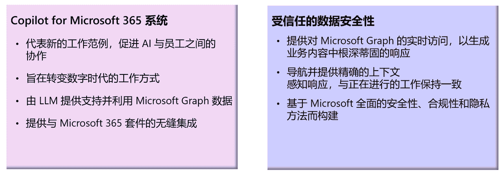

### 与 Microsoft 365 集成

Microsoft 365 Copilot 不仅仅是将 OpenAI 的 ChatGPT 嵌入到 Microsoft 365 中。事实上，Copilot 是一个复杂的业务流程引擎和处理器。它将 LLM 的优势与 Microsoft 365 应用以及你作为单个用户有权在 Microsoft Graph 中访问的专有业务数据结合在一起。

#### 受信任的数据安全性

业务数据的核心在于 Microsoft 365 Copilot 的强大功能，它对安全性、合规性和隐私性保持一致的承诺。通过实时访问 Microsoft Graph 中的内容和上下文，Copilot 能够生成深植于业务内容中的响应，已提供相关回答和见解。与正在进行的工作上下文（无论是你当前参加的会议、最近往来的电子邮件，还是上周的聊天对话）相匹配时，Copilot 会提供精确、相关且符合上下文的响应。

此外，Copilot 基于 Microsoft 全面的安全性、合规性和隐私的基础之上。由于 Copilot 已集成到 Microsoft 365 中，因此它将自动与公司的可靠安全性、合规性和隐私策略和流程保持一致，并可将自身建立为可信任的可靠 AI 解决方案。

#### 在访问 Microsoft 365 Copilot 之前

必须满足以下要求：

+ Microsoft 365 Copilot 许可。用户必须具有以下基本许可证之一才能获得 Microsoft 365 Copilot 许可证：
  + Microsoft 365 E3 或 E5
  + Office 365 E3 或 E5
  + Microsoft 365 A3 或 A5（教职员工）
  + Office 365 A3 或 A5 教职员工版
  + Microsoft 365 商业标准版或商业高级版

+ Microsoft 365 应用版。桌面应用程序，如 Word、Excel、PowerPoint、Outlook 和 Teams。分配许可证后，Copilot 将在应用的 Web 版本中可用。若要开始实施过程，请参阅 Microsoft 365 应用版部署指南。

+ OneDrive 帐户。需要有一个 OneDrive 帐户，才能使用 Microsoft 365 Copilot 中的多个功能，例如保存和共享文件。有关详细信息，请参阅登录或创建 OneDrive 帐户。

+ Outlook for Windows。若要将 Microsoft 365 Copilot 与 Outlook 无缝集成，建议使用新的 Outlook（Windows、Mac、Web、Mobile）。Copilot 也支持经典 Outlook（Windows）。可以切换到 Outlook Mobile 以访问全新 Outlook 体验。有关详细信息，请参阅全新 Outlook for Windows 入门。

+ Microsoft Teams。若要将 Microsoft 365 Copilot 与 Microsoft Teams 配合使用，必须使用 Teams 桌面客户端或 Web 客户端。可以在此处下载桌面客户端，或在 [登录到 Web 应用](https://teams.microsoft.com/)。支持当前和新版本的 Teams。有关详细信息，请参阅 Microsoft Teams 桌面客户端。若要使 Teams 中的 Copilot 能够在会议结束后引用会议内容，必须启用听录或会议录制。若要了解有关配置听录和录制的详细信息，请参阅 [为 Teams 会议配置听录和字幕](https://learn.microsoft.com/zh-cn/microsoftteams/meeting-recording) 和 Teams 会议录制。

+ Microsoft Loop。若要在 Microsoft Loop 中使用 Copilot，必须为租户启用 Microsoft Loop。有关启用 Microsoft Loop 的详细信息，请参阅 Microsoft Loop 入门。

+ Microsoft Whiteboard。若要将 Copilot 用于 Microsoft Whiteboard 的 Microsoft 365，必须为租户启用 Whiteboard。若要了解有关 Microsoft Whiteboard 的详细信息，请参阅 管理组织对 Microsoft Whiteboard 的访问权限。

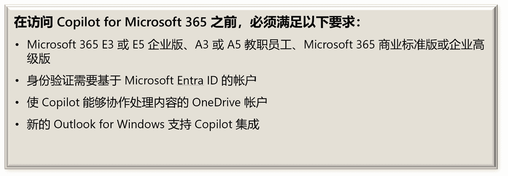

## Microsoft 365 Copilot 的工作原理

就其核心而言，Microsoft 365 Copilot 不仅仅只是另一项功能，更是一个智能合作伙伴，在你与 Microsoft 365 的日常交互过程中始终伴你左右。无论是在 Outlook、PowerPoint、Word、Excel、Teams，还是在其他应用程序中，Copilot 的目标都是通过生成新内容、提供相关建议和提高工作效率来节省你的时间。

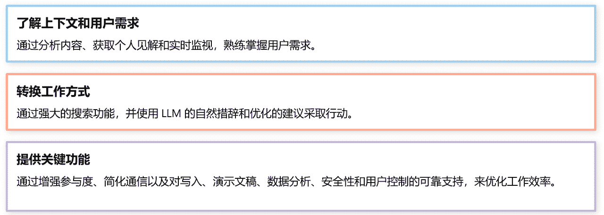

### Copilot 对上下文和用户需求的理解

Microsoft 365 Copilot 的高效源于其无与伦比的理解你（即用户）的能力。它通过以下方式做到这一点：

+ 分析上下文。无论是要起草的文档、正在撰写的电子邮件，还是你正在参加的会议，Copilot 都可以仔细分析其主题、语气、结构和语义来确定你的意图和含义。
+ 在 Microsoft 365 中从工作数据获取上下文。你的通信、活动历史记录和内容可帮助 Copilot 在响应提示时实时获取其他上下文。

### 转换工作方式

通过对上下文形成深刻理解，Microsoft 365 Copilot 不会止步于观察。它会执行以下操作：

+ 搜索和检索。Copilot 可使用强大的搜索功能来识别有用的数据和可帮助你的内容源。
+ 使用大语言模型实现自然的措辞。大语言模型 (LLM) 提供了支持 Copilot 的引擎。借助 LLM，Copilot 可以生成措辞智人的建议，从而确保生成的任何内容均与你的独特情况保持一致。
+ 优化建议。这与数量无关，而是质量问题。Copilot 会评估潜在建议，并对其进行优化，以确保获得的内容在上下文中相关且具体。

Microsoft 365 Copilot 旨在改变数字时代员工的工作方式。以下列表描述了 Copilot 为组织提供的部分功能，其中包括：

+ 增强了会议参与度。Copilot 可帮助你更深入地参与会议。它还为错过的会议提供快速跟进，从而确保你始终了解最新情况。
+ 高效的电子邮件管理。Copilot 可以通过汇总冗长的电子邮件线程和草拟回复来帮助简化电子邮件通信。
+ 写作帮助。Copilot 可以通过与你一起拟稿、编辑、汇总和创建来改变你的写作。此功能可以提高文档的质量和效率。
+ 演示文稿开发。Copilot 简化了新演示文稿的制作。可以从使用自然语言给出提示或大纲开始，让你的创意变为现实。
+ 数据分析和可视化。Copilot 可以帮助识别趋势、创建可视化效果并提供建议，从而简化数据分析。
+ 安全性和合规性。数据仍受全面的企业合规性和安全控制保护，确保安心无忧。
+ 用户控制。你可以保持对 AI 建议的控制，可以决定使用、修改或放弃哪些建议。通过此设计，组织能够在 AI 交互的前沿始终坚持以人为本。

### 逻辑体系结构

Microsoft 365 Copilot 会使用你作为个人用户有权访问的组织数据。例如，日历事件、电子邮件、聊天、文档和来自 Microsoft Graph 的会议。它映射此数据和关系，提供个性化、相关且可操作的信息。数据在 Microsoft 365 服务边界内保持安全，并遵循现有的安全性、合规性和隐私策略。此外，租户和 Copilot 组件之间的通信是加密的。

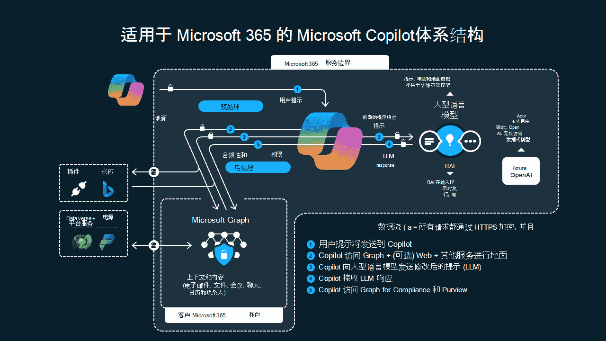

+ 用户可以从已安装 Microsoft 365 应用的设备发起 Copilot 提示。
+ Copilot 组件包括：
  + Copilot 服务，用于协调对用户提示的响应。
  + Microsoft 365 租户数据的 Microsoft Graph 实例。
  + 包含组织数据的 Microsoft 365 租户。

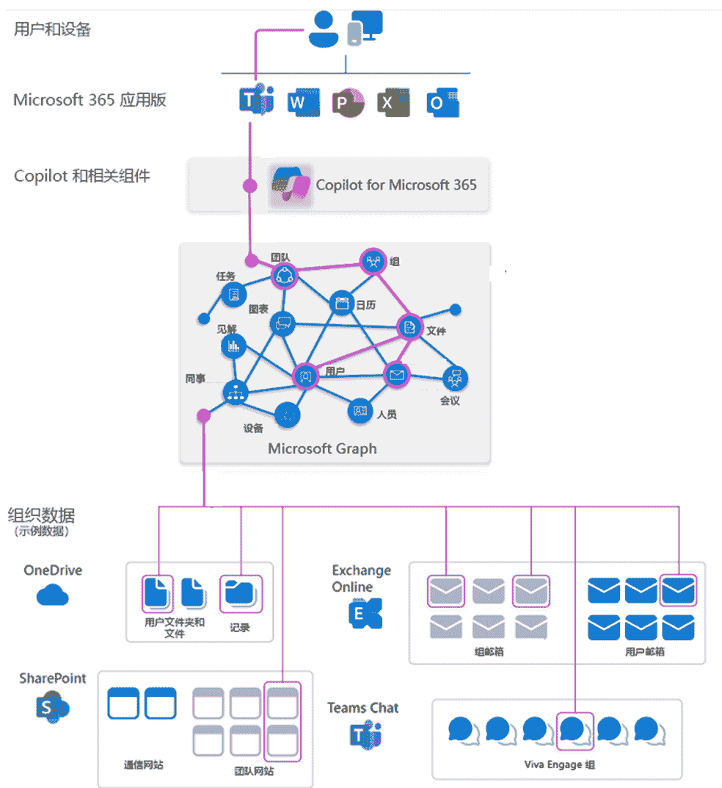

## Microsoft 365 Copilot 的核心组件

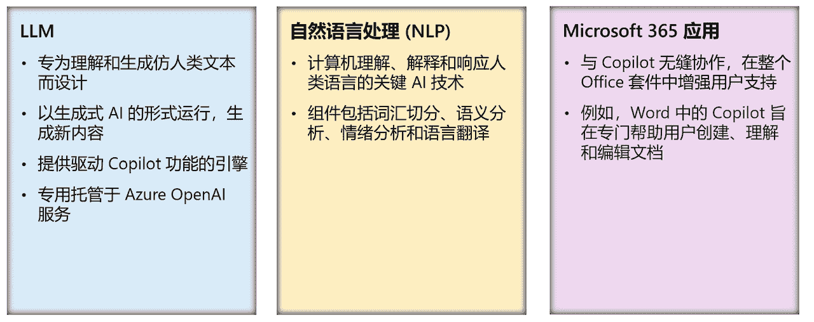

### 大语言模型

大语言模型 (LLM) 代表了一类专门用于理解和生成类似人类文本的人工智能模型。LLM 中的“大”既指模型在参数数量上的规模，也指训练模型所依据的大量数据。LLM（包括 ChatGPT 等模型）是一种生成式 AI。生成式 AI（如 LLM）不仅能预测或分类，还能生成全新的内容。应用于文本时，LLM 可以根据提供的提示生成上下文相关且语法正确的响应。

在 Microsoft 365 Copilot 上下文中，LLM 是驱动 Microsoft 365 Copilot 功能的引擎。这些模型由 Microsoft 的 Azure OpenAI 服务专门托管，并由 Microsoft 365 Copilot 用于理解用户输入和生成相关响应。通过谨慎应用这些模型，Microsoft 365 Copilot 可帮助更有效地开展工作，同时确保隐私和数据完整性。

Microsoft 365 按租户对数据进行逻辑隔离。这种设计与加密相结合，可确保处理和静态时的隐私。

### 自然语言处理

自然语言处理 (NLP) 是一种关键的 AI 技术，可帮助计算机理解、解释并以有意义的方式响应人类语言。从本质上讲，NLP 是 Copilot 能够像人类一样阅读、理解和生成文本背后的技术。涉及的一些组件包括：

+ 词汇切分。通过将文本分解为较小的区块（如单词或短语）来简化复杂的段落。
+ 语义分析。帮助 Copilot 理解基础含义或上下文。
+ 情绪分析。评估文本背后的情绪或情感，Copilot 可以更准确地理解用户意图。
+ 语言翻译。帮助完成多语言任务，从而支持 Copilot 跨不同语言帮助用户。

NLP 是 Microsoft 365 Copilot 不可或缺的一部分。它在人类语言和计算机理解之间架起了一座桥梁。这种技术可确保当你向 Copilot 提出问题时，它能够有效地理解并做出响应。

### Microsoft Graph

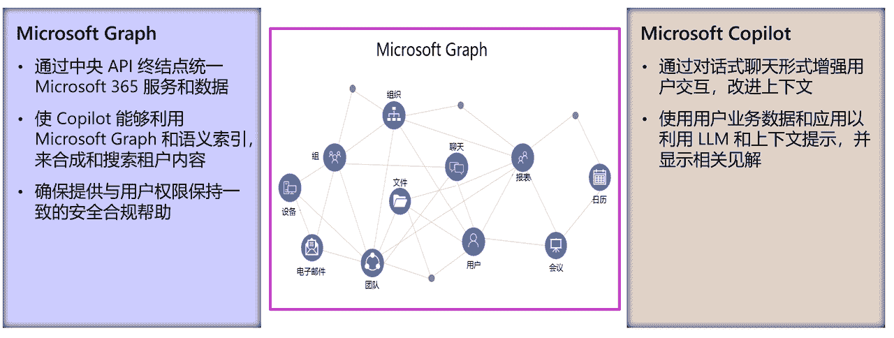

Microsoft Graph 实质上是将所有 Microsoft 365 服务和数据绑定在一起的连接体。Microsoft 365 Copilot 可应用 Microsoft Graph 来合成和搜索租户中多个源的内容。Microsoft Graph API 可将来自用户信号的更多上下文引入到提示中，例如来自电子邮件、聊天、文档和会议的信息。此信息包括来自 Outlook、OneDrive、SharePoint、Teams 等服务的数据。

Microsoft Graph 可将此信息汇集在一起，因此用户无需导航离开或切换应用。通过它，Microsoft 365 Copilot 可以为你提供相关信息。执行此操作时，Microsoft 365 Copilot 会考虑 Microsoft 365 用户权限、数据安全性和合规性策略。它仅根据用户有权访问的信息生成响应。

> 通过 Microsoft Graph 访问的提示、回复和数据不用于训练基础 LLM，包括由 Microsoft 365 Copilot 使用的 LLM。

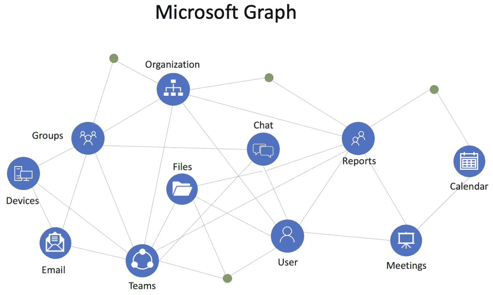

### Microsoft 365 应用

应用（例如 Word、Excel、PowerPoint、Outlook、Teams 和 Loop）与 Copilot 一起运行，以支持用户的工作环境。例如，Word 中的 Copilot 专门帮助用户创建、理解和编辑文档。同样，其他应用中的 Copilot 可帮助用户在这些应用中完成工作。

### 使用基于 Graph 的聊天的 Microsoft Copilot

使用基于 Graph 的聊天的 Microsoft Copilot 是 Microsoft 365 Copilot 中的聊天体验。它支持用户利用跨应用的智能。通过对话式聊天界面，Microsoft 365 Copilot 可以理解用户意图并提供持续对话。聊天格式可增强上下文。此功能为用户提供了一种更简单的方式来使用多个应用。用户访问 Microsoft Copilot 聊天的方式与其使用开放性提示和 ChatGPT 交互或在 Web 上使用 Copilot 的方式相同。这些提示基于 LLM，并已通过用户的业务数据和应用进行上下文处理。通过执行此操作，Microsoft Copilot 会在聊天体验中显示用户需要从其组织数据中获取的信息和见解。提示可与 Microsoft 365 Copilot 配合用于各种体验，包括 Teams（聊天）、必应、Microsoft Edge 和 Microsoft 365 应用。

下面是可以使用 Microsoft Copilot 中的聊天体验执行的一些操作：

+ 了解近况。Microsoft Copilot 可以将大量数据合成并汇总为简单易懂的摘要。有关详细信息，请参阅使用 Microsoft Copilot 快速了解近期事务。
+ 创建内容并集思广益。Microsoft Copilot 使你能够根据从故事板或文稿到议程或执行摘要的任何内容集思广益，并起草新内容。有关详细信息，请参阅使用 Microsoft Copilot 创建内容。
+ 获取快速回答。Microsoft Copilot 使你能够充当自己的个人搜索引擎。询问有关特定文件和消息的问题，或查找你知道一定存在，但不记得存储在哪里的信息。有关详细信息，请参阅使用 Microsoft Copilot 提问并获取答案。

请务必注意，使用基于 Graph 的聊天的 Microsoft Copilot 与 Microsoft 365 应用版中的 Copilot 不同。使用基于 Graph 的聊天的 Microsoft Copilot 可以跨多个应用和内容工作，为你提供 AI 的强大功能，同时保护工作数据的安全。它能够一次性从多个源合成信息并创建内容，支持你实现更广泛的目标和目的。另一方面，Microsoft 365 应用版（如 Word 或 PowerPoint）中的 Copilot 则专为在该应用中提供帮助而设计。例如，Word 中的 Copilot 旨在帮助你更好地起草、编辑和使用内容。在 PowerPoint 中，它可以帮助创建更好的演示文稿。

## 了解 Microsoft 如何致力于负责任的 AI

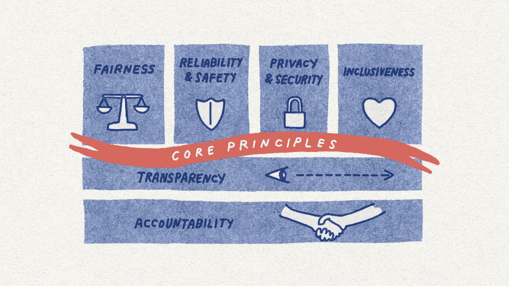

+ 公平性。Microsoft 旨在消除偏见，确保所有用户享有同等待遇。
+ 可靠性和安全性。严格的测试可确保 Microsoft 的 AI 能够稳定且安全地运行。
+ 隐私性和安全性。你的数据受到保护。无论是在训练阶段还是部署后阶段，Microsoft 都对保护用户详细信息进行了高级处理。
+ 包容性。AI 工具设计旨在让每个人都能访问并从中受益，而无需考虑身体能力、性别或种族。
+ 透明度。Microsoft 相信让用户了解其 AI 系统的工作原理及其预期目的。
+ 责任。将优先考虑道德和法律标准，AI 开发人员和设计者要对其创建内容负责。

Microsoft 负责任的 AI 战略


[Microsoft](https://query.prod.cms.rt.microsoft.com/cms/api/am/binary/RW14Gtw)是开发和部署符合道德、可信且安全的 AI 解决方案的全球领导者。为了实现这一愿景，Microsoft 投资了各种团队、流程、资源和计划，使其协同工作，以确保以负责任且透明的方式设计和使用 AI。在这方面，Brad Smith 发布了 AI 治理蓝图，其中向政府和其他利益干系人介绍了 Microsoft 为 AI 创建可扩展、可互操作和适当的监管框架的相关建议。

[此外，Microsoft](https://blogs.microsoft.com/wp-content/uploads/prod/sites/5/2022/06/Microsoft-Responsible-AI-Standard-v2-General-Requirements-3.pdf)工程师打造了严格遵守“负责任的 AI 标准 v2”中的高标准的 AI 产品和服务。Microsoft 安全专家保护 AI 系统和数据的机密性、完整性和可用性，免受恶意攻击和未经授权的访问。作为 Microsoft AI 保障计划的一部分，Microsoft 还开发工具和框架，帮助客户自己保护自己的 AI 部署并缓解潜在风险。

Microsoft 融合了以下内容：

+ AI 的道德原则
+ 负责任 AI 的合规性标准
+ 全面的 AI 研究，包括以隐私为中心的机器学习

由研究人员、工程师和策略专家组成的跨学科团队不断优化 Microsoft 的 AI 系统。他们致力于增强训练数据、筛选出不良内容和解决偏见。

Microsoft 的任务有两个：确保 AI 系统被理解且可信，并为客户提供负责任地使用 AI 的知识。

## Microsoft 365 Copilot 基本功能和场景

### 在 Word 中使用 Copilot 撰写和汇总文档

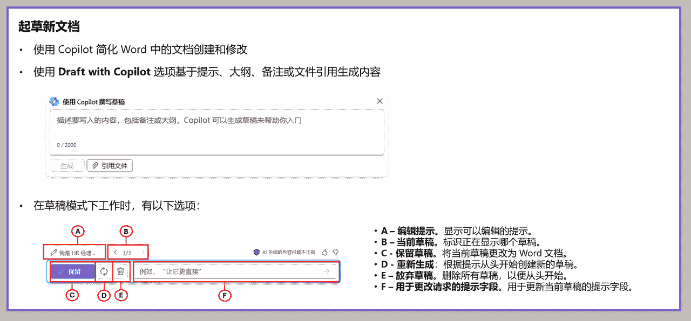

在 Word 中，Microsoft 365 Copilot 可改变文档创建和完善过程，让你轻松制作出引人注目的内容。Copilot 有助于从头开始起草文章、增强现有文本并捕捉冗长文章的精髓。通过 Copilot，你可以使用简短的提示启动文档，无缝整合 Microsoft 365 中的资源，并随时调整写作的语气和简洁性。

+ 起草新文档
+ 在 Word 中使用 Copilot 窗格与 Copilot 聊天
+ 在 Word 中的 Copilot 中链接文件

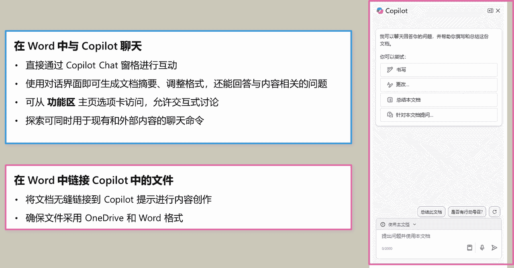

### 在 Outlook 中使用 Copilot 汇总和撰写电子邮件草稿

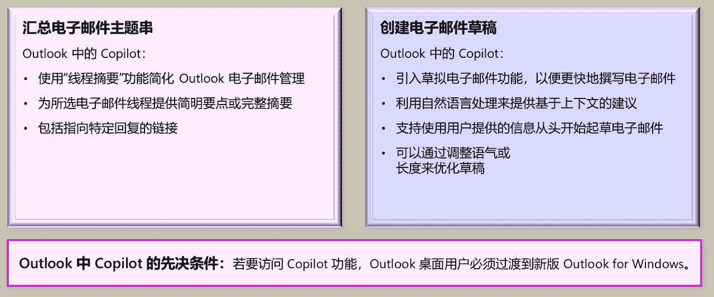

在 Outlook 中，Microsoft 365 Copilot 使管理电子邮件变得更加容易，让你能更专注于有效的通信。它可帮助你了解较长的电子邮件会话、查看不同的观点，并发现未回答的问题。借助 Copilot，可以使用提示进行快速回复，也可以使用来自 Microsoft 365 的资源将简短笔记转换为完整电子邮件。还可以轻松调整邮件的语气和长度。

+ 汇总电子邮件会话
+ 撰写电子邮件草稿

### 在 PowerPoint 中使用 Copilot 设计引人注目的演示文稿

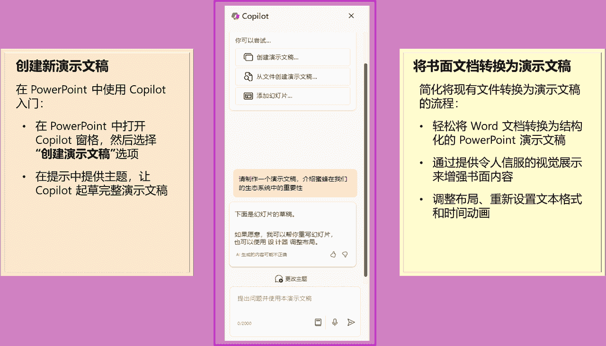

在 PowerPoint 中，Microsoft 365 Copilot 可充当你的演示文稿助手，将你的概念转化为有影响力的幻灯片。借助 Copilot，你可以轻松地将书面文档转换为演示文稿，并附上演讲者备注和参考资料。启动新演示文稿时，只需提供大纲或提示即可。然后让 Copilot 执行繁重的工作。除了创建，它还提供工具以简化较长的演示文稿，并使用直观的命令来优化布局、调整文本格式和同步动画。

+ 新建演示文稿
+ 将书面文档转换为演示文稿
+ 调整布局、重新格式化文本和时间动画

### 在 Excel 中使用 Copilot 分析和转换数据

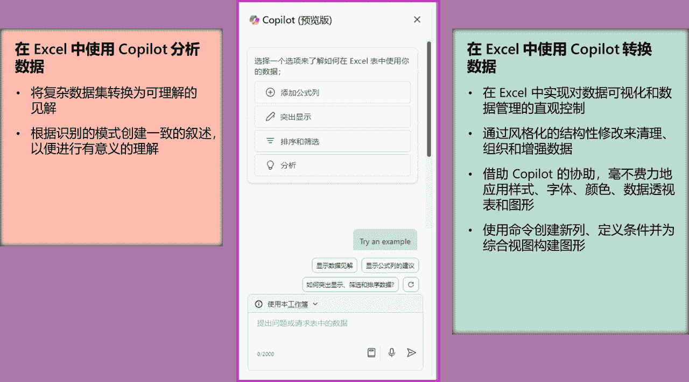

在 Excel 中，Microsoft 365 Copilot 是你的数据分析助手，使复杂的数据集易于理解。不再需要掌握复杂的公式，只需像与同事交流一样与 Copilot 交谈。Copilot 可帮助你查找模式、浏览“假设”方案或获取新的公式建议。在不更改数据的情况下浏览数据、发现趋势、创建视觉对象或获取建议。

+ 分析数据
+ 转换你的数据

### 在 Teams 中使用 Copilot 提高工作效率

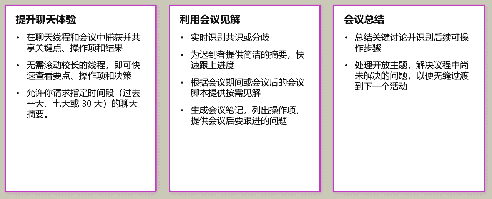

在 Teams 中，Microsoft 365 Copilot 可提高团队的合作效率，促进无缝对话和更有成效的会议。它有助于让你随时了解讨论、总结关键操作，并组织对话的重点，从而在团队中推动简化的工作流程。

借助 Copilot for Microsoft 365，即使错过了实时对话，也可以快速回到正轨，而不会中断正在进行的流程。它使你能够从聊天历史记录中提取会议议程，确定合适的人员进行跟进，并轻松安排后续会议。

+ 使用 Teams 中的 Copilot 提升聊天体验
+ 利用会议见解
+ 会议总结

### 借助 Microsoft Copilot 通过基于 Graph 的聊天为员工提供支持

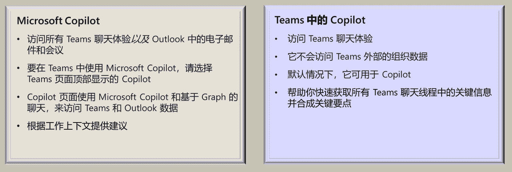

使用基于 Graph 的聊天的 Microsoft Copilot 是一个 AI 助手，可帮助用户在 Microsoft Azure 上设计、操作、优化应用程序并对其进行故障排除。它在 Microsoft Teams、Microsoft 必应和 Microsoft 365 主页中提供。Copilot 将大型语言模型的强大功能与你在 Microsoft Graph 和 Microsoft 365 应用中的内容相结合，将你的表述转变为全球功能最强大的生产力工具。

Copilot 利用 AI 的强大功能，以你从未想象过的方式帮助提高工作效率。它可以帮助你起草内容，及时了解错过的内容，并通过开放式提示获取问题的答案。Copilot 还可以帮助汇总操作并优化时间，从而释放创造力、提高生产力和提升技能。Copilot 还可帮助用户提高技能，以更好地掌握自己擅长的技能和尚未学会的技能。

以下部分介绍支持 Microsoft Copilot 的三个应用程序 -

#### Microsoft Teams

Microsoft Copilot 旨在简化 Microsoft Teams 工作的各个方面。它是一款 AI 支持的工具，与用户协同工作，并根据其工作上下文提供建议。例如，它可以帮助你：

+ 快速回顾过去的通信（例如，“Lidia 有什么新消息？”）。
+ 将聊天窗口中的长会话归纳为关键要点。
+ 回答问题，帮助你保持最新状态（例如，“我明天要和谁见面？”）。

在上一个培训单元中，你了解了 Teams 中的 Copilot 的功能。那么，在 Teams 中使用 Microsoft Copilot 与使用 Teams 中的 Copilot 有何不同？

+ Teams 中的 Copilot。Teams 中的 Copilot 功能仅访问 Teams 的聊天体验。它不会访问 Teams 外部的组织数据。默认情况下，Teams 中的 Copilot 随 Microsoft 365 Copilot 许可证一起提供。在聊天会话中时，可以使用 Teams 中的 Copilot 访问该会话。
+ Teams 中的 Microsoft Copilot。Microsoft Copilot 功能可从 Outlook 访问所有 Teams 的聊天体验以及电子邮件和会议。若要在 Teams 中使用 Microsoft Copilot，请选择“Teams”页面顶部显示的“Copilot”。这样做会在 Teams 中打开 Copilot 页面。此页面通过“使用基于 Graph 的聊天的 Microsoft Copilot”来访问 Teams 和 Outlook 数据。

#### Microsoft 365 主页

只有拥有 Microsoft 365 Copilot 许可证的用户才能在 Microsoft 365 主页上使用 Microsoft Copilot。此版本的 Copilot 只能访问 Microsoft 365 组织数据。它无法访问公共 Web。此功能使用与 Teams 中相同的“使用基于 Graph 的聊天的 Microsoft Copilot”功能。

通过“使用基于 Graph 的聊天的 Microsoft Copilot”，可将人员、文件、会议和电子邮件与提示关联。要与其中任何对象关联，请在提示窗口中输入正斜杠 (`/`)。这样做会打开一个窗口，你可以在其中选择“人员”、“文件”、“会议”或“电子邮件”选项卡。

#### Microsoft 必应

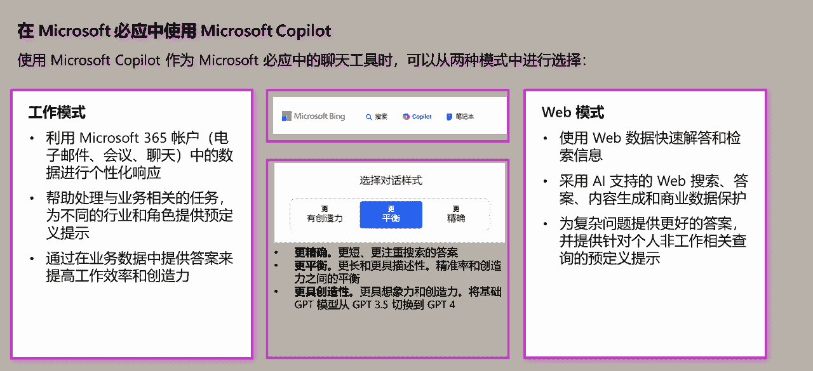

Microsoft Copilot 网页版在 Microsoft 必应中提供聊天功能。可以通过页面顶部的切换开关从 Microsoft Copilot 的两种模式中进行选择。这两种选项包括“Web”和“工作”。如果用户具有 Microsoft 365 Copilot 许可证，则这两个选项都可用。但是，如果用户没有 Microsoft 365 Copilot 许可证，则只有“Web”选项可用。

#### “Web”选项

将切换开关设置为“Web”时，Copilot 只能访问公共 Web。它无法访问 Microsoft 365 组织数据。在此情况下，Copilot 可以说是以 Web 数据为基础。由于在选择“Web”选项时 Copilot 无法访问 Microsoft 365 组织数据，因此不允许将提示与人员、文件、会议或电子邮件关联。

#### “工作”选项

将切换开关设置为“工作”时，Microsoft 365 Copilot 许可将控制所使用的数据。

+ 你没有 Microsoft 365 Copilot 许可证。如果没有 Microsoft 365 Copilot 许可证，Copilot 无法访问 Microsoft 365 组织数据。而是只能访问公共 Web 数据。此情况等效于选择“Web”选项，因为 Copilot 仅基于 Web 数据。因此，无法将提示与人员、文件、会议和电子邮件关联。
+ 你有 Microsoft 365 Copilot 许可证。在此情况下，可以选择 Copilot 是只能访问公共 Web 数据，还是可同时访问公共 Web 数据和 Microsoft 365 组织数据。此选项通过名为 Web 内容的 Microsoft 365 Copilot 插件提供。如果选择“Web 内容”插件，则 Copilot 可以同时访问公共 Web 数据和组织数据。如果拥有 Microsoft 365 Copilot 许可证并选择了“工作”选项，则即使未选择“Web 内容”插件，也可以将提示与人员、文件、会议或电子邮件关联。

使用这些独立体验访问 Microsoft Copilot 时，可以通过从三种对话风格中进行选择来控制 Copilot 响应的语气（以及在一定程度上控制长度）。每种风格迎合用户的不同喜好和需求：

+ 更精确。此风格提供更短、更侧重于搜索的答案。它非常适合希望快速、准确地响应查询的用户。
+ 更均衡。此风格提供更长、更具描述性的响应。它非常适合希望在准确性和创造力之间进行平衡的用户。
+ 更有创意。此风格提供更具想象力和创造力的响应。它非常适合想要探索不同可能性并生成新想法的用户。此风格还会将基础 GPT 模型从 GPT 3.5 切换到 GPT 4。

## 优化和扩展 Microsoft 365 Copilot

### 研究使用 AI 的艺术与科学

Microsoft 从数以万计已在使用 Microsoft 365 Copilot 的客户和员工那里获得了有关 AI 如何改变工作的宝贵见解。其早期发现表明，使用 AI 既是一门艺术，也是一门科学，你能从中得到什么取决于你如何提出要求。

这种新的工作方式非常必要。在过去几年中，工作节奏和工作量都在持续上升。根据 Microsoft 365 服务的搜索数据，在任何给定工作日，Microsoft 最常使用 Microsoft 365 的用户：

+ 搜索所需的内容 18 次。
+ 收到超过 250 封电子邮件。
+ 发送或阅读近 150 条聊天记录。

在全球范围内，Microsoft Teams 用户每周参加的会议次数是 2020 年的三倍。在 Windows 上，一些用户在一天内使用 11 个应用来完成其工作。

AI 有助于减轻工作负担，增强人类能力，并促进每个人与生俱来的独创性。当领导者学习如何有效利用 AI 的力量时，他们可以帮助员工迎接 AI 支持的生产力的新时代，并为其组织带来好处。

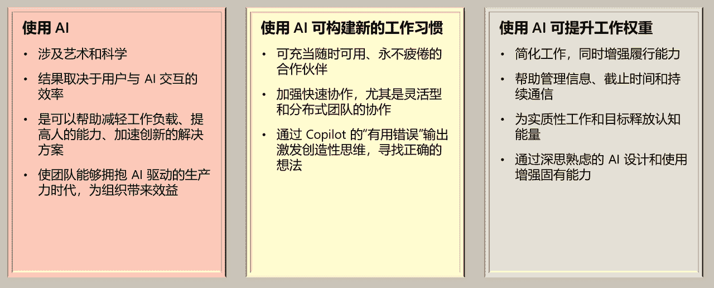

#### 培养新的工作习惯

电脑时代使字处理器的使用实现了大众化，该处理器在当时是一项革命性的技术。AI 时代提供了一个始终可用、永不疲倦的合作伙伴，可以帮助你思考所有内容。

根据 Microsoft [2023 年工作趋势指数](https://www.microsoft.com/worklab/work-trend-index/will-ai-fix-work)调查的数据，那些表示自己每天没有足够时间和精力的信息工作者几乎有两倍的可能性会说如果他们有个人助理，就能够取得高绩效。AI 为每一位员工提供了一个随时都可提供个人意见的平台，并且拥有无限的时间和精力储备。

AI 具有巨大潜力，但使用 AI 需要培养新的工作习惯。尽管 AI 无法复制与他人一起集思广益的魔力，但它可显著增强快速协作，尤其是对于不在同一办公室或时区的灵活分布式团队。事实上，Copilot 实际上可以增强与团队的协作：只需在 Teams 会议上让它指出尚未解决的问题，或者在 Loop 中共同创作时提出任何潜在的讨论点。还可以使用 Copilot Lab 来试验提示、与同事分享喜爱的内容，并从中获得灵感。

Copilot 并不总是正确。事实上，Microsoft 喜欢将这些输出称为“有用的错误”。从这个角度来说，这就类似于你与一个人一起集体讨论。虽然其建议并不总是正确的，但这些想法可以帮助你优化自己的思维。

很少有个人的建议能成为有商业价值的想法。但是，不完全正确的建议可以刺激你自己的创意，帮助你和你的团队实现那个想法。这是可帮助你找到答案的又一条信息。AI 也是如此。在关于提供具有吸引力的演示文稿标题的 10 条建议中，其中一条可能会激发一些灵感，从而产生完美的表达。

#### 减轻工作负担

我们都在工作的重压下挣扎。信息、最后期限和“始终可用”的沟通常常让我们应接不暇。AI 可以提供帮助，不仅仅是让工作变得更轻松、更快捷，而且还能让工作变得更充实。当我们不需要花费太多的认知精力来弄清楚那次会议中发生了什么、忙于处理电子邮件或从上周的聊天中查找文档时，我们就可以把更多时间花在工作的实质内容，也就是我们工作的目的上。

研究 AI 增强认知的 Microsoft 研究人员认为，通过体育类比来思考我们与 AI 的关系可能很有用。

+ 这些研究人员表示，在一个极端，AI 可以像类固醇一样发挥作用，给人们带来短期的超级提升，无论是即时起草电子邮件，还是快速复制社交媒体，只需将工作交给它就可以了。
+ 在中间地带，AI 就像高质量的跑步鞋。它可以加快耗时的日常任务（例如清理和重新格式化数据），从而节省时间，提高人们的工作效率，而不会产生任何长期后果。
+ 在另一个极端，AI 开始真正改变工作方式。此时，AI 充当教练的角色，随着时间的推移提高人们自身的能力，而不只是在当下为他们提供帮助。

研究人员解释说，通过深思熟虑的设计和使用，AI 工具可以增强人们与生俱来的能力，从而带来前所未有的生产力提升。

### 查看使用 Microsoft 365 Copilot 的最佳做法

要充分利用 Microsoft 365 Copilot 的潜力，必须掌握其功能和准则，以实现最佳和安全使用。以下最佳做法可帮助你从此 AI 支持的生产力助手中获取最大价值。

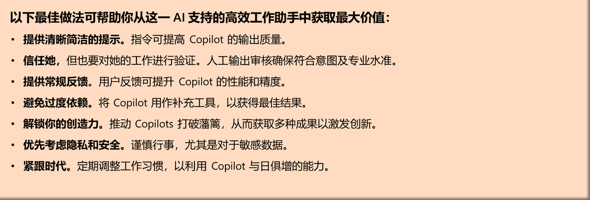

#### 提供清晰简洁的提示

要发挥 Microsoft 365 Copilot 的真正潜力，提供清晰简洁的提示是基础。说明越具体、越详细，Copilot 的响应就越能与你的预期结果保持一致。如以下示例所示，从通用提示转换为全面提示可以显著提高 Copilot 输出的质量和相关性，确保你收到完全符合要求的内容。例如：

+ 好的提示。“起草有关新款 Contoso 3D 打印机的电子邮件。”
+ 更好的提示。“起草一封电子邮件，向客户介绍新款 Contoso 3D 打印机。”
+ 最好的提示。“起草一封电子邮件，详细说明我们将于下周推出的新款 Contoso 3D 打印机的功能。包括指向产品页面的链接。”

本培训模块的下一单元将检查特定的提示最佳做法。

#### 信任但必须验证

Microsoft 365 Copilot 的目标之一是提供富有见解且准确的建议。但是，与任何工具一样，必须查看和验证其输出。这样做可确保生成的内容符合你的特定意图，并符合组织的专业标准。请记住，额外的人工监督层可能会在质量保证方面产生重大影响。

#### 提供定期反馈


Microsoft 365 Copilot 的持续改进有赖于用户提供的反馈。如果 Copilot 未提供预期输出，请务必向 Microsoft 提供反馈。通过积极分享观察结果和建议，你会在提高 Copilot 的性能和精度方面发挥关键作用。此迭代反馈循环可确保 Copilot 与你的需求保持一致，并持续识别出可实现成长和优化的领域。

## 避免过度依赖

Microsoft 365 Copilot 功能非常强大，但它不应完全取代人类的判断。虽然它提供了基础，但批判性思维和个人专业知识是不可替代的。将 Copilot 用作补充工具（而不是唯一源）有助于平衡自动化与直觉，确保每次都获得最佳结果。

## 释放你的创造力

Microsoft 365 Copilot 提供的不仅仅是常规输出；它还可以成为创意思维的跳板。不同的提示可以产生各种结果，从而产生全新的观点和想法。通过推动 Copilots 边界并进行试验，你可以发现新的见解并激发任务中的创新。

## 优先考虑隐私和安全性

在当今的数字时代，隐私和安全性至关重要。尽管 Microsoft 365 Copilot 是使用严格的安全协议设计的，但用户应始终小心谨慎。请注意你提供的信息，尤其是在它与敏感或专有数据相关时。这种主动方法可同时保证工作效率和数据完整性。

## 保持更新状态

Microsoft 365 Copilot 是一个不断发展的工具。保持其定期更新、功能增强和优化至关重要。随着 Copilot 的发展，调整工作习惯以适应其不断扩展的功能。始终对 Copilot 和同事的反馈保持开放状态，确保利用其全部潜力来简化工作流。

## 检查如何生成有效提示

### 开始时要考虑到目的

指定要从 Copilot 获取的输出。是否需要项目符号点或文档？这会是电子邮件还是集思广益会话的开始？生成 AI 擅长于模仿人类对话的大型语言模型，因此请尝试提供你希望输出外观的示例。例如：

+ “以随意、易于理解的样式编写此电子邮件。”

+ “编写结构非常结构化的备注;段落可以长而复杂。”

### 设置阶段

提供有关你正在处理的结果的任何上下文或相关详细信息。如果你正在准备客户端会议，或尝试编写令人惊异的全手语音，请让 Copilot 知道。如果它应该专注于特定客户端，哪一个？你在考虑哪些市场活动？使用传统搜索，人们习惯于简洁。它们通常只使用几个关键字，最终返回许多链接。然后，他们必须自行执行大量处理。但借助 Copilot，更具描述性可获得更好的响应。

### 定义所有参数

这不是一项要求，但如果指定 Copilot 应使用哪些信息源或示例，则会获得更好的结果。转到广泛或标记特定文件。指定要关注的日期或应从哪些会议中拉取。

最后，不要担心让 Copilot 解释它是如何到达响应的。请考虑这种类比 - 使用 Copilot 类似于数学教师要求学生展示其工作原理。当他们这样做时，他们会从孩子那里获得更好的答案。Copilot 也没有什么不同。如你所知，AI 工具有时可能会生成错误或可疑的响应。将 Copilot 放在现场，并要求它验证它是如何获得结果的。

### 定制交付

说明你对 Copilot 应如何提供响应的期望。它面向哪些受众？你对此作业的想法是哪种类型的语气？通常，这涉及到一些关于你是谁以及你正在尝试实现的操作的说明。例如：

+ “向我解释此问题，就好像我是新手级编码器一样。”

+ “我是忙碌的 VP。为我提供最顶端的要点。”

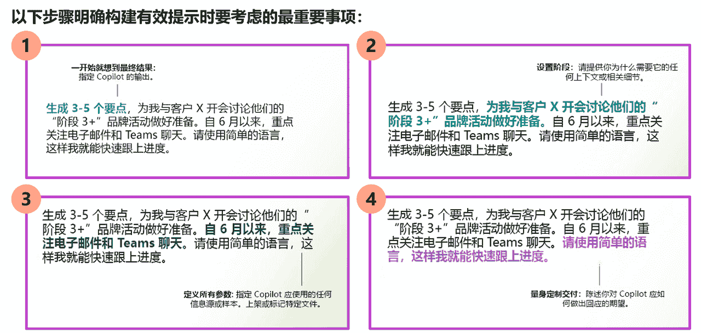

## 查看提示设计最佳做法

### 提供清晰简洁的提示

+ 确保请求明确无误。

+ 保持简短，而不牺牲清晰度。

+ 使用明确指令和“若…则”语句。

+ 提供所需输出的示例，利用 AI 的模仿功能

### 试验不同的风格

+ 语气、语言和风格发挥创造力。

+ 尝试类比、诗歌或历史寓言以获得多样化结果。

### 指明 Copilot 回答所采用的观点

+ 提供观点为 Copilot 提供上下文。

+ 设定角色扮演场景或以特定风格或角色提问。

### 了解编写提示时应避免的事项

+ 避免出现模糊或过于笼统的提示。

+ 不要在一个提示中提出太多问题。

+ 不要假设 Copilot 了解上下文。

### 了解 Copilot 的限制

+ 分解复杂的任务以获取更好的结果。

+ 针对简单重复任务中的重复进行优化。

+ 留意不明确提示可能产生的误解。

+ 力求清晰。

+ 检查并验证 Copilot 的响应。

### 礼貌用语

+ 遵循基本礼节以生成礼貌、协作的输出。

+ 文明用语以提高 AI 响应能力和性能。

+ 用“请”开始提示并表达感谢。

### 保持好奇心

+ 提初级问题。

+ 利用好奇心更好地理解问题并提供特定说明。

### 循环、迭代

+ 不要在一次提示后就放弃，这是一个动态进程。

+ 提供改进反馈

+ 试验、循环访问和优化提示，直到满意为止。

## 使用插件扩展 Microsoft 365 Copilot

Microsoft 365 Copilot 与 Microsoft 365 生态系统无缝集成，但许多专业人员依靠一系列外部工具和平台来简化其任务。通过引入插件，Copilot 可以扩展到与这些第三方应用程序协作，从而真正发挥 Microsoft 365 Copilot 的强大功能。

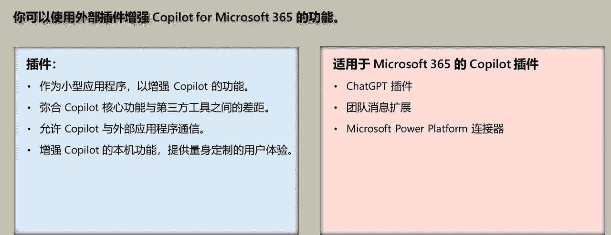

### 什么是插件？

插件的核心类似于微型应用程序，旨在增强或添加大型软件的特定功能。在 Microsoft 365 Copilot 中，插件是 Copilot 核心功能与企业日常使用的大量第三方工具和平台之间的桥梁。

+ 集成。插件允许 Copilot 与外部应用程序通信和交互。

+ 扩展性。插件增强 Copilot 的本机功能，提供定制的用户体验。

Microsoft 365 Copilot 中的插件功能示例包括：

+ 检索实时信息，例如产品发布的最新报道。

+ 检索基于知识的信息，例如，我的团队在 Figma 中的设计文件。

+ 代表用户执行操作，例如创建 Jira 票证。

### 适用于 Microsoft 365 Copilot 的插件

适用于 Microsoft 365 Copilot 的插件有三种类型：

+ ChatGPT 插件

+ Teams 消息扩展

+ Microsoft Power Platform 连接器

随着 Microsoft 365 Copilot 的首次推出，客户可以使用 50 多个插件。在这些插件中，有一部分由许多著名的 Microsoft 合作伙伴提供。在接下来的几个月中，随着当前 Teams 消息扩展和 Microsoft Power Platform 连接器与 Microsoft 365 Copilot 集成，可用插件的数量应该会呈几何倍数增长。这种在日常工作工具中集成的扩展插件生态系统旨在提高协作任务的效率和多功能性。

## 浏览 Microsoft Graph 连接器

Copilot for Microsoft 365（由 Microsoft Graph 连接器扩展）通过从外部源无缝提取数据和服务来增强 Microsoft 365 体验。Microsoft Graph 的核心是充当支持这些智能交互的数据结构，而 Microsoft 搜索 API 允许用户利用此数据和智能池。

Microsoft 365 Copilot 可在 Microsoft 365 中熟练处理本机应用和数据。但许多用户仍然依赖各种外部平台完成日常任务和团队协作。若要弥合此差距，需要将 Microsoft 365 框架与日常使用的基本企业应用程序和其他软件解决方案结合使用，例如：

+ 企业资源规划 (ERP) 应用程序

+ 客户资源管理 (CRM) 应用程序

+ Intranet 应用程序

+ Wiki

+ 博客

+ 社交网络站点

为了解决此差距，组织可以通过连接第三方工具和服务来增强 Copilot 的功能。这种增强可以通过将已有 Microsoft Graph 连接器或定制 Microsoft Graph 连接器链接到外部数据源来实现。

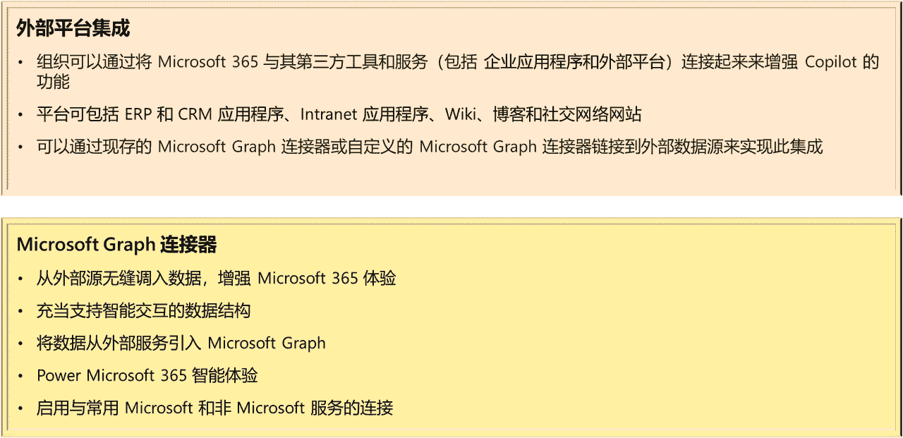

Microsoft Graph 连接器提供了一种直观的方式，可将外部服务中的数据引入 Microsoft Graph 和语义搜索索引。这样，外部数据就可以为 Microsoft 365 智能体验（如 Microsoft 搜索）提供支持。使用 Microsoft Graph 连接器，可在以下体验中发现从组织引入的数据：

+ Microsoft 搜索

+ Outlook 网页版（预览版）中的上下文 IQ

+ Microsoft 365 Copilot （有限预览版）

+ Microsoft 365 应用（前 Office.com）

Microsoft 和其合作伙伴当前提供的连接器使组织能够连接到热门的 Microsoft 和非 Microsoft 服务。现有连接器的示例包括 Azure 服务、Box、ServiceNow、SalesForce、Google 服务和 MediaWiki。

有关连接器的完整列表以及简短说明，请访问 Microsoft Graph 连接器库。

# Microsoft 365 Copilot 提示词工程

## 使用 Microsoft 365 Copilot 总结信息

### 使用 Microsoft 365 Copilot 示例数据

#### 下载示例文件

在本模块的其余部分中，我们将为引用这些文件的 Microsoft 365 Copilot 创建提示。下载以下文件并将其保存到 OneDrive 文件夹，然后在相应的 Microsoft 365 应用中打开它们。

+ [M](https://view.officeapps.live.com/op/view.aspx?src=https%3A%2F%2Fedxinteractivepage.blob.core.windows.net%2Fms-4004%2FMarket%2520Analysis%2520Report%2520for%2520Mystic%2520Spice%2520Premium%2520Chai%2520Tea.docx&wdOrigin=BROWSELINK)arket Analysis Report for Mystic Spice Premium Chai Tea.docx

+ [Contoso Chai Tea mar](https://view.officeapps.live.com/op/view.aspx?src=https%3A%2F%2Fedxinteractivepage.blob.core.windows.net%2Fms-4004%2FContoso%2520Chai%2520Tea%2520market%2520trends%25202023.xlsx&wdOrigin=BROWSELINK)ket trends 2023.xlsx

+ [Contoso Chai Tea mar](https://view.officeapps.live.com/op/view.aspx?src=https%3A%2F%2Fedxinteractivepage.blob.core.windows.net%2Fms-4004%2FContoso%2520Chai%2520Tea%2520market%2520trends%25202023.docx&wdOrigin=BROWSELINK)ket trends 2023.docx

+ [Market Trend Report](https://view.officeapps.live.com/op/view.aspx?src=https%3A%2F%2Fedxinteractivepage.blob.core.windows.net%2Fms-4004%2FMarket%2520Trend%2520Report-%2520Protein%2520shake.docx&wdOrigin=BROWSELINK)- Protein shake.docx

#### 引用文件

引用 Copilot 中的文件时，可能会发现无法从提供给你的建议中找到某些文件。这种情况有时是因为 Copilot 的某些体验仅引用最近使用 (MRU) 列表中的文件，而其他体验则允许你浏览 OneDrive 来查找文件。将它们添加到该列表就像在适当的 Microsoft 365 应用中打开它们一样简单。打开后，它们应显示在 MRU 列表中。

> Microsoft Copilot 仅适用于保存到 OneDrive 的文件。如果文件本地存储在电脑上，则需要将它们移动到 OneDrive 以激活 Copilot。

### 使用 Word 中的 Copilot 简化和提取关键信息

使用 [M](https://view.officeapps.live.com/op/view.aspx?src=https%3A%2F%2Fedxinteractivepage.blob.core.windows.net%2Fms-4004%2FMarket%2520Analysis%2520Report%2520for%2520Mystic%2520Spice%2520Premium%2520Chai%2520Tea.docx&wdOrigin=BROWSELINK)arket Analysis Report for Mystic Spice Premium Chai Tea.docx

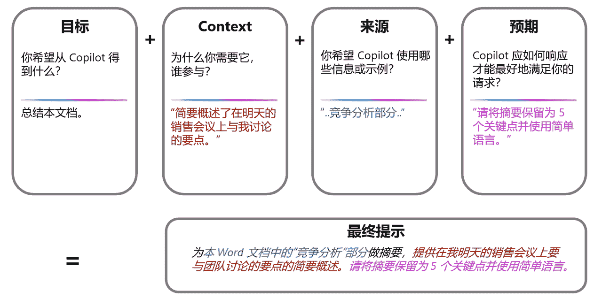

```
为本 Word 文档中的“竞争分析”部分做摘要，提供在我明天的销售会议上要与团队讨论的要点的简要概述。请将摘要保留为 5 个关键点并使用简单语言
```

文字润色为

```
请为本 Word 文档中的“竞争分析”部分做摘要，提供明天销售会议上与团队讨论的要点简要概述。请将摘要保留为 5 个关键点，并使用简洁语言。
```

一种可能的输出

```
下面是文档的摘要:
主要想法:
竞争对手的主要品牌: 在拉丁美洲的奶茶市场中，主要的竞争对手有 Tetley，Teavana，David&#x27;s Tea 和一些本地品牌，它们各自占有不同的市场份额，定价策略和产品特点
竞争对手的优势和劣势: 竞争对手的优势包括品牌认知度，产品质量，创新能力，客户服务，以及与当地口味和偏好相适应的能力。竞争对手的劣势包括缺乏创新和差异化，高昂的价格和有限的分销，以及产品质量，一致性和可持续性的问题
奶茶在拉丁美洲的机会: 奶茶在拉丁美洲有很大的发展机会，因为该地区对健康，自然和异国情调的产品有着日益增长的需求。该地区也有着强大的茶文化，尤其是在阿根廷，智利和乌拉圭等国，其中马黛茶是一种流行的饮品。奶茶可以吸引茶爱好者和咖啡饮用者，因为它提供了类似的咖啡因提神和更复杂的风味。奶茶也可以适应拉丁美洲消费者的生活方式和喜好，他们喜欢社交，分享和享用甜点
奶茶在拉丁美洲的挑战: 奶茶在拉丁美洲面临的挑战包括奶茶产品相对于其他饮料的高价和低负担能力，一些人口群体对奶茶的缺乏认知和熟悉度，其他茶类产品，如草药，绿色和黑色茶的竞争，以及可能限制奶茶产品进入和扩张的监管和文化障碍，以及可能影响奶茶原料供应和质量的环境和社会问题
奶茶在拉丁美洲的推广计划和策略: 奶茶在拉丁美洲的推广计划和策略旨在实现以下目标：提高目标受众对奶茶的认知和兴趣，将奶茶定位为一种高端，天然和健康的产品，提供独特和令人满意的体验，通过各种渠道和激励措施鼓励奶茶的试用和购买，通过参与和反馈建立奶茶消费者的忠诚度和留存率。奶茶在拉丁美洲的推广计划和策略将使用一系列的策略，如创建一个有吸引力和难忘的品牌名称和标志，开发一个展示奶茶的好处，特点和故事的网站和社交媒体平台，启动一个利用搜索引擎优化，搜索引擎营销，电子邮件营销和影响者营销来吸引和吸引潜在客户的数字营销活动，分发奶茶的免费样品和优惠券，在战略性的位置，如超市，咖啡馆和健康商店，组织活动和竞赛，邀请人们尝试和与他们的朋友和家人分享奶茶，与与奶茶有着相同价值观和愿景的当地企业和组织合作
```

### 使用 PowerPoint 中的 Copilot 识别关键信息并总结

首先，下载 [M](https://go.microsoft.com/fwlink/?linkid=2268768)ystic Premium Chai Market Analysis Presentation.pptx，并将文件保存到 OneDrive 文件夹（如果尚未这样做）。

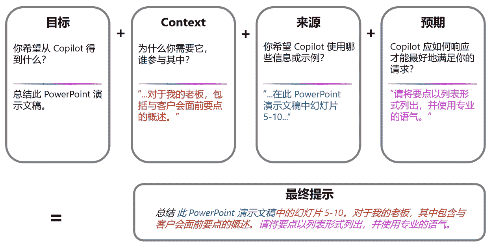

```
总结 此 PowerPoint 演示文稿中的幻灯片 5-10。对于我的老板，其中包含与客户会面前要点的概述。请将要点以列表形式列出，并使用专业的语气。
```

润色后

```
请为我的老板总结这个 PowerPoint 演示文稿中的幻灯片 5-10，包括在与客户会面之前的要点的概述。 请将要点以列表形式呈现，并使用专业的语气。
```

### 使用 Excel 中的 Copilot 发现趋势并可视化数据

首先，下载 [Contoso Chai Tea mar](https://go.microsoft.com/fwlink/?linkid=2268822)ket trends 2023.xlsx，并将文件保存到 OneDrive 文件夹（如果尚未这样做）

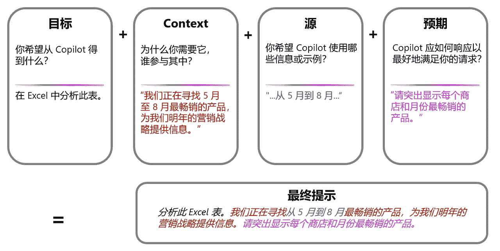


# 使用 Microsoft 365 Copilot 分析和总结信息

## 分析 Excel 表格中的畅销产品

```
分析此 Excel 表。我们正在寻找从 5 月到 8 月最畅销的产品，为我们明年的营销战略提供信息。请突出显示每个商店和月份最畅销的产品。
```

润色后

```
请分析这个 Excel 表格。我们想要找出从五月到八月销售最好的产品，以便为明年的营销战略提供信息。请突出显示每个商店和每个月份中销售最好的产品。
```

## 在 Teams 会议中突出显示重要决定和措施

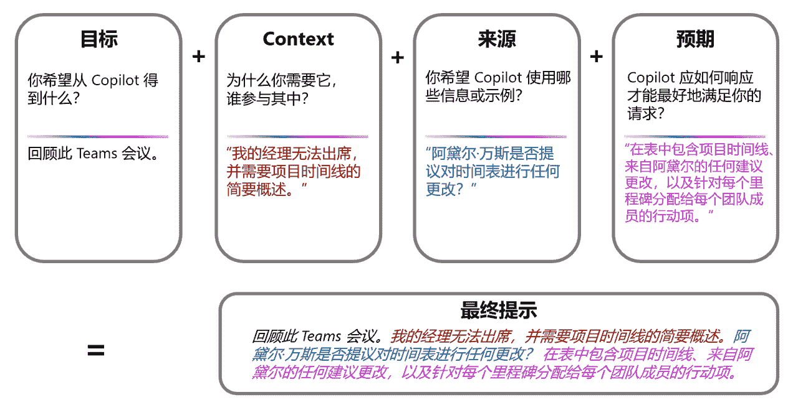

```
回顾此 Teams 会议。我的经理无法出席，并需要项目时间线的简要概述。阿黛尔·万斯是否提议对时间表进行任何更改？ 在表中包含项目时间线、来自阿黛尔的任何建议更改，以及针对每个里程碑分配给每个团队成员的行动项。
```

润色后

```
请回顾一下这次 Teams 会议。我的经理没能参加，所以需要一个简要概述项目的时间线。阿黛尔·万斯是否提出了对时间表进行任何更改的建议？请在表格中包括项目时间线、阿黛尔提出的任何建议变动，以及为每个里程碑分配给团队成员的行动项。
```

## 使用 Outlook 中的 Copilot 了解近况并筹备本周工作

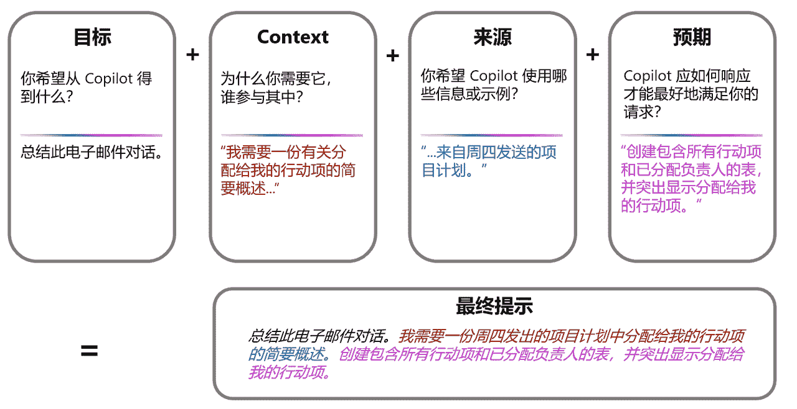

```
总结此电子邮件对话。我需要一份周四发出的项目计划中分配给我的行动项的简要概述。创建包含所有行动项和已分配负责人的表，并突出显示分配给我的行动项。
```

润色后

```
总结这封电子邮件对话。请提供一个简洁明了的概述，列出周四项目计划中分配给我的行动项。创建一张表格，包含所有行动项和负责人，并突出显示属于我负责的行动项。
```

## 使用适用于 Microsoft 365 的 Microsoft Copilot 总结有关主题的信息

首先，将以下文件下载并保存到 OneDrive 文件夹，然后将其添加到 MRU 列表：

+   `Contoso Chai Tea 市场趋势 2023.xlsx`
+   `Contoso Chai Tea 市场趋势 2023.docx`
+   [Market Trend Report](https://go.microsoft.com/fwlink/?linkid=2268827)- `Protein shake.docx`

在 Microsoft Teams 中打开Copilot Chat，并按照引用上述文件的提示进行作。

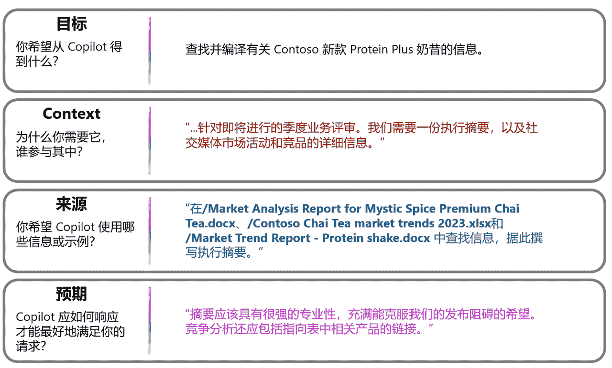

```
查找并编写有关 Contoso 新款 Protein Plus 奶昔的信息，为即将进行的季度业务评审做准备。我们需要一份执行摘要，以及社交媒体市场活动和竞品的详细信息。在`/Market Analysis Report for Mystic Spice Premium Chai Tea.docx`、`/Contoso Chai Tea market trends 2023.xlsx` 和 `/Market Trend Report - Protein shake.docx` 中查找信息，撰写执行摘要。 摘要应该具有很强的专业性，充满能克服我们的发布阻碍的希望。竞争分析还应包含表中相关产品的链接。
```

润色后

```
请查找并整理有关Contoso新款Protein Plus奶昔的信息，为即将进行的季度业务评审做准备。我们需要一份执行摘要，其中包括社交媒体市场活动和竞品的详细信息。请在以下文件中查找相关信息：`/Mystic Spice Premium Chai Tea.docx`（市场分析报告）、`/Contoso Chai Tea market trends 2023.xlsx` 和 `/Market Trend Report - Protein shake.docx`，并撰写执行摘要。该摘要应具备专业性，并充满希望能够克服我们发布时可能遇到的障碍。竞争分析还应包含表格中相关产品的链接。
```

一种可能的输出

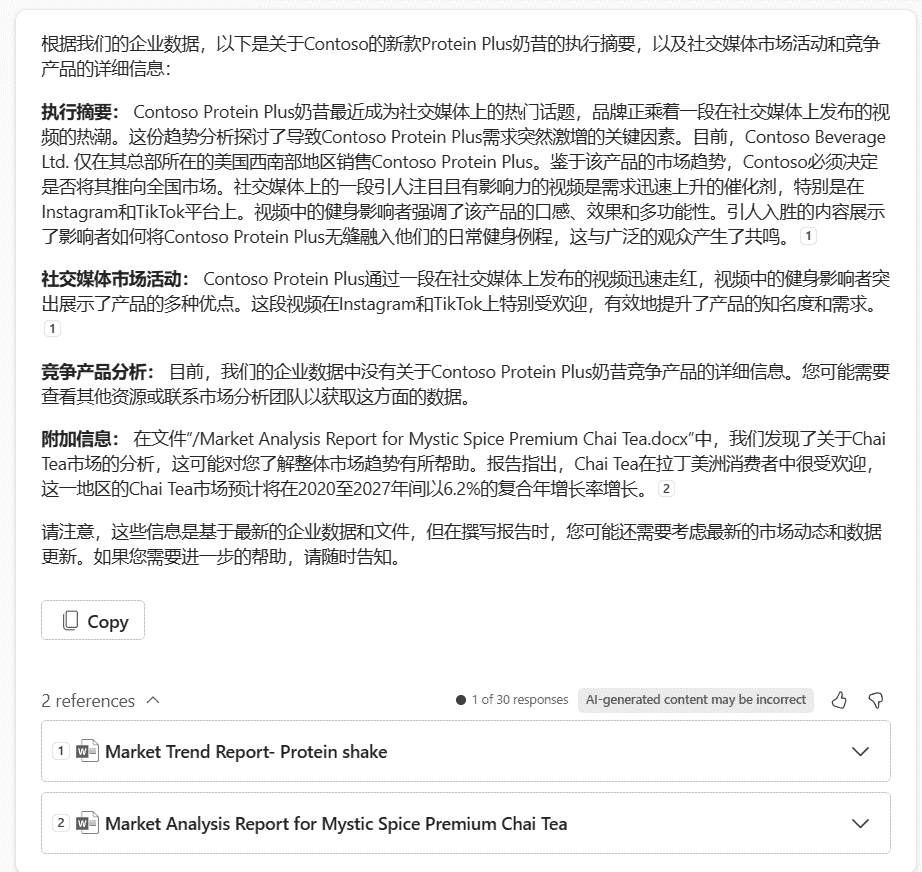

# 使用 Microsoft 365 Copilot 创建和起草新文件

## 通过 Microsoft 365 Copilot 使用示例数据学习操作

**下载示例文件**

在本模块的其余部分中，我们将为引用这些文件为 Microsoft 365 Copilot 创建提示。 下载以下文件并将其保存到 OneDrive 文件夹，然后在相应的 Microsoft 365 应用中打开它们。

+   `Contoso CipherGuard 产品Specification.docx`
+   `Contoso CipherGuard 项目plan.docx`
+   `市场趋势报表 - Shake.docx`

**引用文件**

引用 Copilot 中的文件时，可能会发现无法从提供给你的建议中找到某些文件。 这种情况有时是因为 Copilot 的某些体验仅引用最近使用 (MRU) 列表中的文件，而其他体验则允许你浏览 OneDrive 来查找文件。 将它们添加到该列表就像在适当的 Microsoft 365 应用中打开它们一样简单。 打开后，它们应显示在 MRU 列表中。

> Microsoft Copilot 仅适用于保存到 OneDrive 的文件。 如果文件本地存储在电脑上，则需要将它们移动到 OneDrive 以激活 Copilot。

## 在 Word 中使用 Microsoft Copilot 起草求职信、市场营销计划和大纲

使用 [Contoso CipherGuard 产品规格文档](https://view.officeapps.live.com/op/view.aspx?src=https%3A%2F%2Fedxinteractivepage.blob.core.windows.net%2Fms-4004%2FContoso%2520CipherGuard%2520Product%2520Specification.docx&wdOrigin=BROWSELINK)

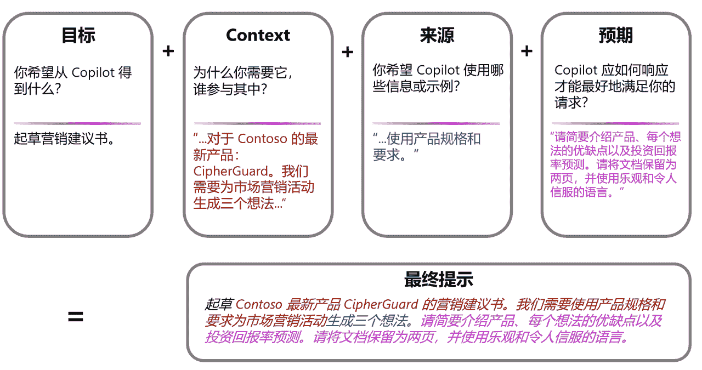

```
起草 Contoso 最新产品 CipherGuard 的营销建议书。我们需要使用产品规格和要求为市场营销活动生成三个想法。请简要介绍产品、每个想法的优缺点以及投资回报率预测。请将文档保留为两页，并使用乐观和令人信服的语言。
```

润色后：

```
起草 Contoso 最新产品 CipherGuard 的营销建议书。我们需要根据产品规格和要求为市场营销活动提出三个想法。请简要介绍产品、每个想法的优缺点以及投资回报率（ROI）预测。请将文档保持在两页，并使用乐观且具有说服力的语言。
```

一种可能的输出

```
根据文档：Contoso CipherGuard Sentinel X7 是一款先进且弹性的安全产品，旨在加强计算机网络基础设施，抵御各种威胁和漏洞。它具有防火墙保护、入侵检测和预防系统、虚拟专用网络支持、端点安全、日志记录和监控以及用户身份验证和访问控制等关键特征。      
营销想法：
网络安全研讨会：组织一场网络安全研讨会，邀请行业专家和客户参加。在研讨会上，展示 Contoso CipherGuard Sentinel X7 的关键特征和优势，并与客户进行互动交流。
优点：提高品牌知名度，与潜在客户建立联系。
缺点：成本较高，需要精心策划和组织。
投资回报率预测：中等。
免费试用：为潜在客户提供 Contoso CipherGuard Sentinel X7 的免费试用，让客户亲身体验产品的优势。
优点：吸引客户，促进销售。
缺点：需要投入资源支持试用。
投资回报率预测：高。
客户见证：邀请现有客户撰写关于 Contoso CipherGuard Sentinel X7 的客户见证，并在官网和社交媒体上发布。
优点：提高品牌信誉，促进客户信任。
缺点：需要客户的支持和配合。
投资回报率预测：中等。
```

## 在 PowerPoint 中使用 Microsoft Copilot 生成新的幻灯片、日程和待办事项列表

下载以下文件并将文件保存到 OneDrive 文件夹 （如果尚未这样做），以便其显示在 MRU 列表中：

+   `市场趋势报表 - Protein shake.docx`

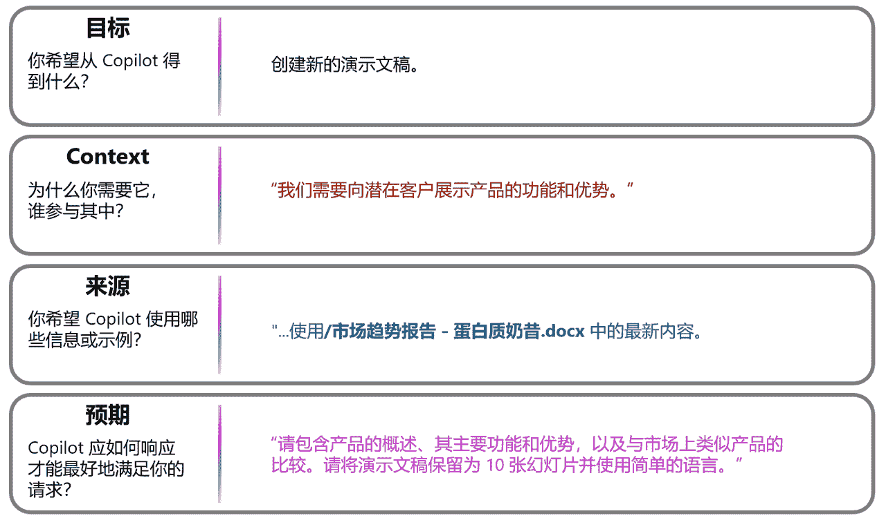

```
使用 `/市场趋势报告 - 蛋白质奶昔.docx` 中的最新内容创建新的 PowerPoint 演示文稿。我们需要向潜在客户展示产品的功能和优势。 请包含产品的概述、其主要功能和优势，以及与市场上类似产品的比较。请将演示文稿保留为 10 张幻灯片，并使用简单的语言
```

润色后

```
请根据 `/Market Trend Report - Protein shake.docx` 中的最新信息创建一个新的 PowerPoint 演示文稿，以向潜在客户展示产品的特点和优势。请简要介绍该产品及其主要功能和优势，并与市场上类似产品进行比较。请确保幻灯片数量不超过 10 张，并使用简洁明了的语言。
```

## 在 Outlook 中使用 Microsoft Copilot 撰写电子邮件、答复和会议议程草稿

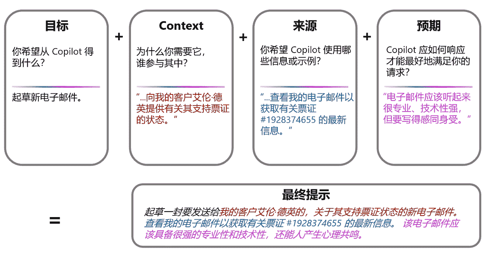

```
起草一封要发送给我的客户艾伦·德英的，关于其支持票证状态的新电子邮件。查看我的电子邮件以获取有关票证 #1928374655 的最新信息。 该电子邮件应该具备很强的专业性和技术性，还能人产生心理共鸣。
```

润色后

```
请撰写一封给我的客户 Allan Deyoung 的电子邮件草稿，向他们提供支持工单的最新状态。请查看我的电子邮件以获取有关工单 #1928374655 的最新信息。这封电子邮件应该具备专业性和技术性，并且内容能够引起共鸣。
```

## 使用 Microsoft Copilot 跨 Microsoft 365 就新的想法、列表和报告开展集思广脑活动

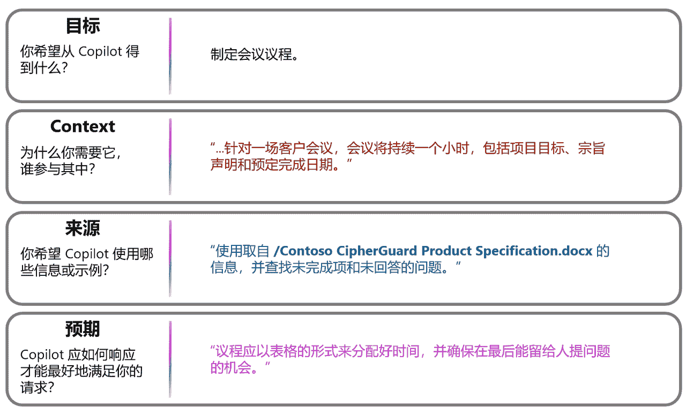

```
制定一份会议议程，针对一场持续一小时的客户会议，内容包括项目目标、宗旨声明和预定完成日期。使用取自 `/Contoso CipherGuard Product Specification.docx` 的信息，并查找未完成项和未回答的问题。该议程应采用具有时间分配的表格格式，并确保在最后给人们提问的机会。
```

润色后

```
制定一小时的客户会议会议议程，包括项目目标、任务陈述和计划完成日期。 使用 `/Contoso CipherGuard Product Specification.docx` 中的信息，并查找待解决的项目和未解答的问题。 议程应以表格形式安排时间，并确保在会议结束时让人们有机会提问。
```

一种可能的输出

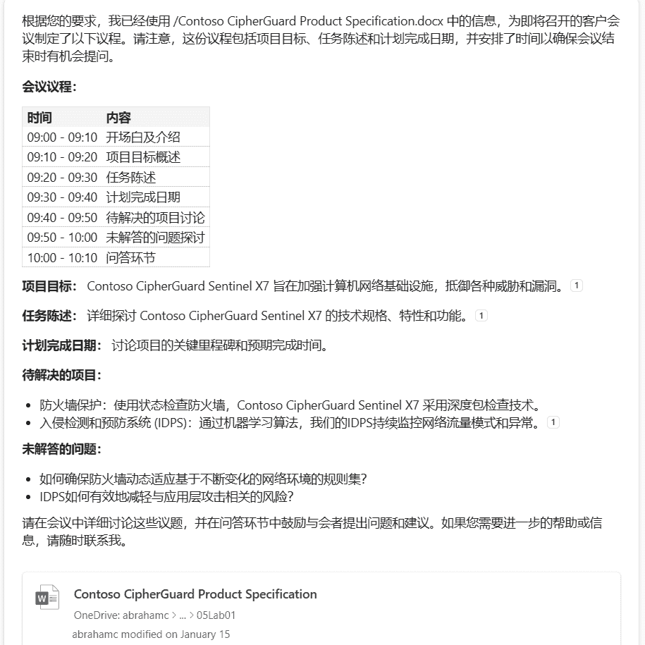

# 使用 Microsoft 365 Copilot 编辑和转换内容

## 通过 Microsoft 365 Copilot 使用示例数据学习操作

**下载示例文件**

在本模块的其余部分中，我们将为引用这些文件为 Microsoft 365 Copilot 创建提示。 下载以下文件并将其保存到 OneDrive 文件夹，然后在相应的 Microsoft 365 应用中打开它们。

+   `Graphic Design Institute - Employee Benefits.docx`
+   `Fabrikam Q1 marketing campaigns.xlsx`

**引用文件**

引用 Copilot 中的文件时，可能会发现无法从提供给你的建议中找到某些文件。 这种情况有时是因为 Copilot 的某些体验仅引用最近使用 (MRU) 列表中的文件，而其他体验则允许你浏览 OneDrive 来查找文件。 将它们添加到该列表就像在适当的 Microsoft 365 应用中打开它们一样简单。 打开后，它们应显示在 MRU 列表中。

> Microsoft Copilot 仅适用于保存到 OneDrive 的文件。 如果文件本地存储在电脑上，则需要将它们移动到 OneDrive 以激活 Copilot。

## 在 Word 中使用 Microsoft Copilot 撰写、组织和转换内容

首先，下载 `Graphic Design Institute - Employee Benefits.docx`，并将文件保存到 OneDrive 文件夹 (如果尚未这样做)。

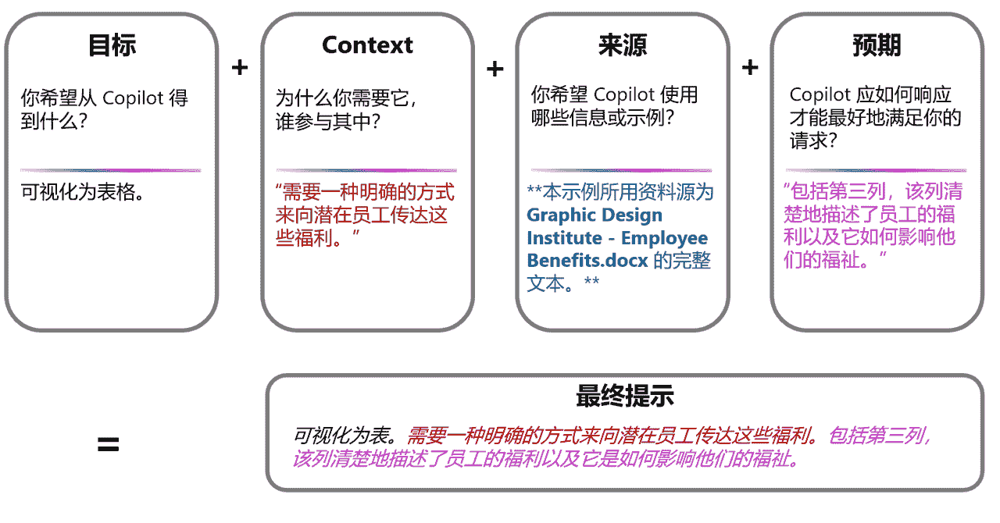

在 Word 中打开文档，并突出显示文档中的所有文本 (`Ctrl-A`)。 在左边距 Copilot 菜单中，选择“可视化为表格”。 生成表格后，使用下面的提示让 Copilot 进一步优化结果。

```
可视化为表。需要一种明确的方式来向潜在员工传达这些福利。包括第三列，该列清楚地描述了员工的福利以及它是如何影响他们的福祉
```

润色后

```
可视化为表格。 我们需要一种明确的方式来向潜在员工传达这些权益。 包括第三列，清楚地描述对员工的好处以及对他们的健康有何影响。
```

一种可能的输出：

## 在 PowerPoint 中使用 Microsoft Copilot 添加图像、幻灯片和组织演示文稿

首先，下载并打开 `神秘香料高级柴市场分析 Presentation.pptx`。 将文件保存到 OneDrive 文件夹 （如果尚未这样做）

```
在 PowerPoint 演示文稿中添加一张新幻灯片，总结高级 chai 的最新市场趋势，包括主要消费者偏好和新兴竞争对手。 使用现有幻灯片中的市场趋势和需求的见解。 使用引人入胜的视觉对象和简洁的项目符号设置幻灯片的格式，以获取关键要点。
```

## 在 Excel 中使用 Microsoft Copilot 设置数据格式、排序、筛选和突出显示数据

首先，下载 `Fabrikam Q1 营销活动.xlsx` 并将文件保存到 OneDrive 文件夹（如果尚未这样做）。

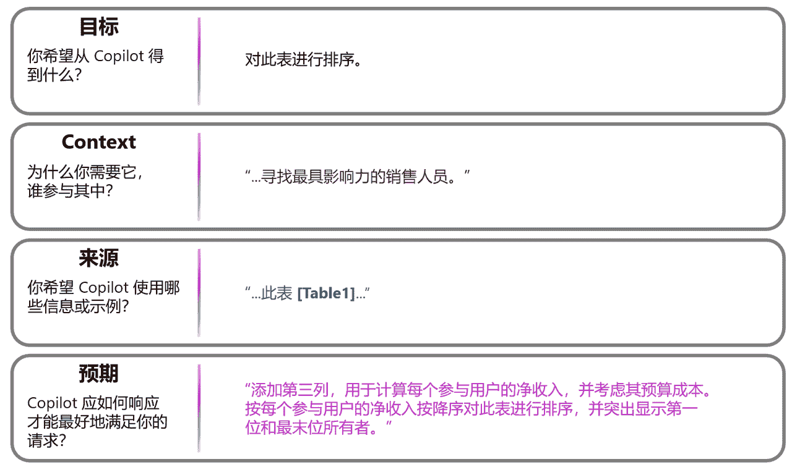

```
对此表 `Table1` 进行排序，查找影响最大的销售人员。添加第三列，用于计算每个参与用户的净收入，并考虑其预算成本。按每个参与用户的净收入按降序对此表进行排序，并突出显示第一位和最末位所有者。
```

润色后

```
对表 `Table1` 进行排序，找出最有影响力的销售人员。添加第三列，计算每个参与用户的净收入，并考虑其预算成本。按照参与用户的净收入降序排列表格，并突出显示顶部和底部所有者。
```

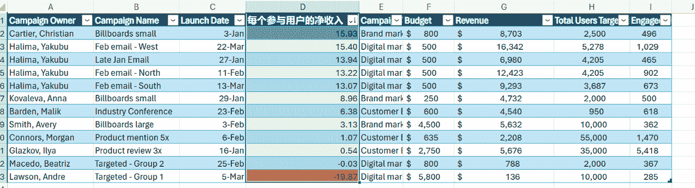

## 在 Outlook 中使用 Microsoft Copilot 改写邮件和答复以调整语气

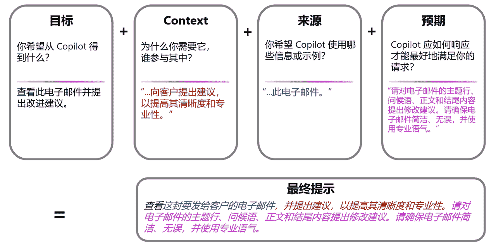

```
查看这封要发给客户的电子邮件，并提出建议，以提高其清晰度和专业性。请对电子邮件的主题行、问候语、正文和结尾内容提出修改建议。请确保电子邮件简洁、无误，并使用专业语气。
```

润色后

```
请查看此电子邮件，为我们的客户提出建议以提高其清晰度和专业性。请建议更改电子邮件的主题行、问候语、正文内容和结束语。请确保电子邮件简洁明了，无错误，并使用专业用语。
```

# 使用 Microsoft 365 Copilot 提出问题并分析内容

## 通过 Microsoft 365 Copilot 使用示例数据学习操作

**下载示例文件**

在本模块的其余部分中，我们将为引用这些文件为 Microsoft 365 Copilot 创建提示。 下载以下文件并将其保存到 OneDrive 文件夹，然后在相应的 Microsoft 365 应用中打开它们。

+   `MysticMarket Premium Chai Tea.docx`


# 引用文件

+   [Mystic Spice Premium Chai Market Analysis Presentation.pptx](https://view.officeapps.live.com/op/view.aspx?src=https%3A%2F%2Fedxinteractivepage.blob.core.windows.net%2Fms-4004%2FMystic%2520Spice%2520Premium%2520Chai%2520Market%2520Analysis%2520Presentation.pptx&wdOrigin=BROWSELINK)

+   [Mystic Premium Chai Tea 产品description.docx](https://view.officeapps.live.com/op/view.aspx?src=https%3A%2F%2Fedxinteractivepage.blob.core.windows.net%2Fms-4004%2FMystic%2520Spice%2520Premium%2520Chai%2520Tea%2520product%2520description.docx&wdOrigin=BROWSELINK)

+   `Fabrikam Q1 市场营销campaigns.xlsx`

引用 Copilot 中的文件时，可能会发现无法从提供给你的建议中找到某些文件。这种情况有时是因为 Copilot 的某些体验仅引用最近使用 (MRU) 列表中的文件，而其他体验则允许你浏览 OneDrive 来查找文件。将它们添加到该列表就像在适当的 Microsoft 365 应用中打开它们一样简单。打开后，它们应显示在 MRU 列表中。

> Microsoft Copilot 仅适用于保存到 OneDrive 的文件。如果文件本地存储在电脑上，则需要将它们移动到 OneDrive 以激活 Copilot。

## 向 Word 中的 Microsoft Copilot 寻求帮助和建议

使用 [Market Analysis Report for Mystic Spice Premium Chai Tea.docx](https://view.officeapps.live.com/op/view.aspx?src=https%3A%2F%2Fedxinteractivepage.blob.core.windows.net%2Fms-4004%2FMarket%2520Analysis%2520Report%2520for%2520Mystic%2520Spice%2520Premium%2520Chai%2520Tea.docx&wdOrigin=BROWSELINK)

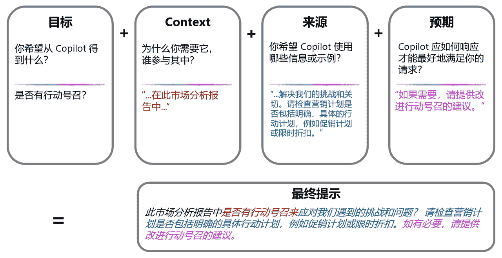

```
此市场分析报告中是否有行动号召来应对我们遇到的挑战和问题？ 请检查营销计划是否包括明确的具体行动计划，例如促销计划或限时折扣。如有必要，请提供改进行动号召的建议。
```

润色后

```
这份市场分析报告中有没有提出解决我们挑战和担忧的具体行动呢？请检查营销计划是否包含明确具体的行动方案，比如促销计划或限时折扣。如果需要的话，请提供改进行动号召的建议。
```

## 使用 PowerPoint 中的 Microsoft Copilot 获取设计和组织提示

+   [Mystic Spice Premium Chai Market Analysis Presentation.pptx](https://go.microsoft.com/fwlink/?linkid=2268768)

+   [Mystic Spice Premium Chai Tea product description.docx](https://go.microsoft.com/fwlink/?linkid=2268929)

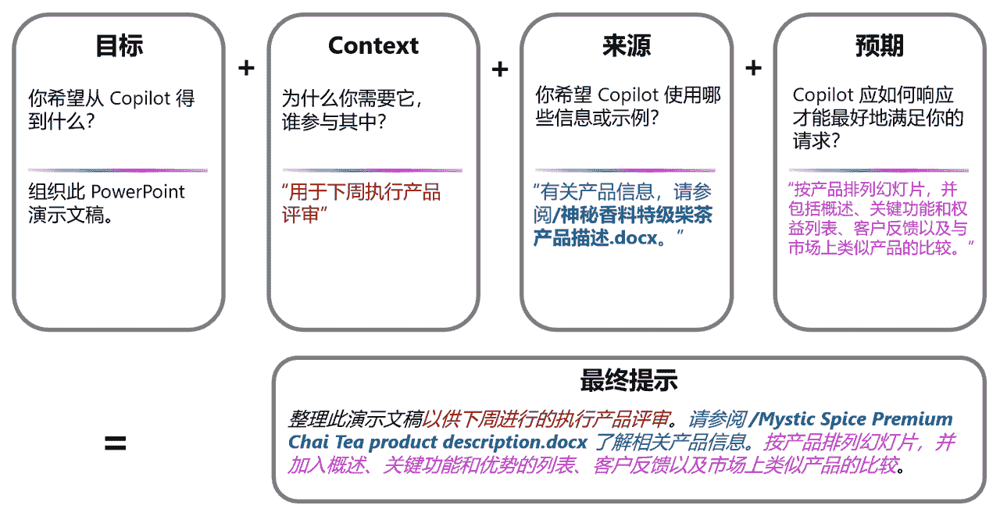

```
整理此演示文稿以供下周进行的执行产品评审。请参阅 `/Mystic Spice Premium Chai Tea product description.docx` 了解相关产品信息。按产品排列幻灯片，并加入概述、关键功能和优势的列表、客户反馈以及市场上类似产品的比较。
```

润色后

```
为下周的高管产品评审组织此演示文稿。 请参考 `/Mystic Spice Premium Chai Tea product description.docx` 以了解产品信息。 按产品排列幻灯片，并包括概述、主要功能和优点列表、客户反馈以及与市场上类似产品的比较。
```

也可尝试使用英文

```
Organize this presentation for an executive product review next week. Refer to the `/Mystic Spice Premium Chai Tea product description.docx` for product information. Arrange the slides by product and include an overview, a list of key features and benefits, customer feedback, and a comparison to similar products in the market.
```

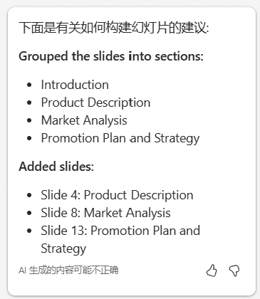

## 使用 Excel 中的 Copilot 分析和处理表格

[Fabrikam Q1 marketing campaigns.xlsx](https://go.microsoft.com/fwlink/?linkid=2269124)

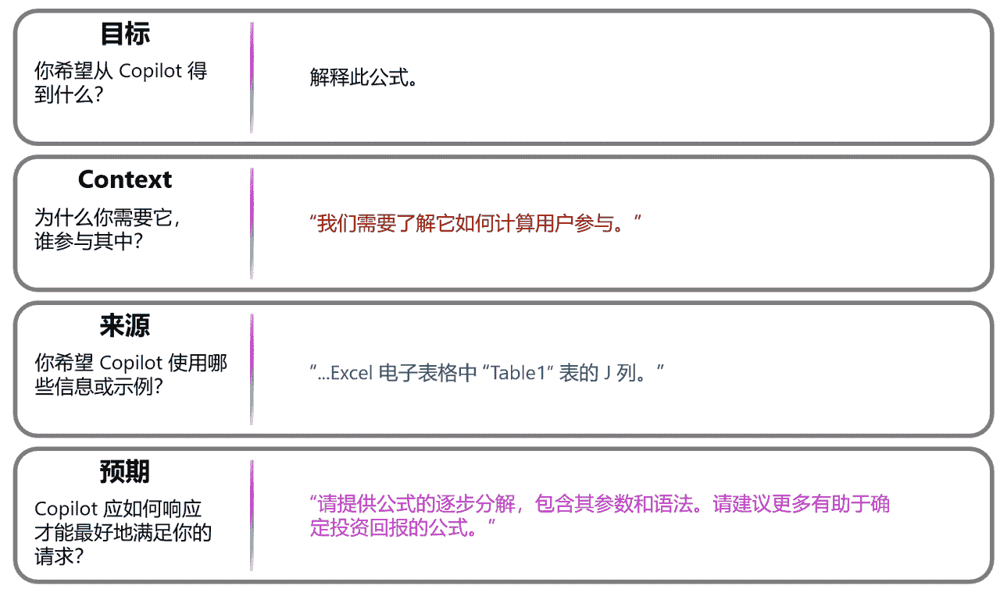

```
解释 Excel 电子表格中 “Table1” 表的 J 列中的公式。我们需要了解它如何计算用户参与度。请逐步分解公式，包括其参数和语法。请建议更多有助于确定投资回报的公式。
```

润色后

```
请解释一下 Excel 电子表格中“`Table1`”表的 `J` 列中的公式。我们需要了解它是如何计算用户参与度的。请提供公式的详细步骤，包括参数和语法。还请给出其他有助于确定投资回报的公式建议。
```

## 使用 OneNote 中的 Copilot 询问有关笔记的问题

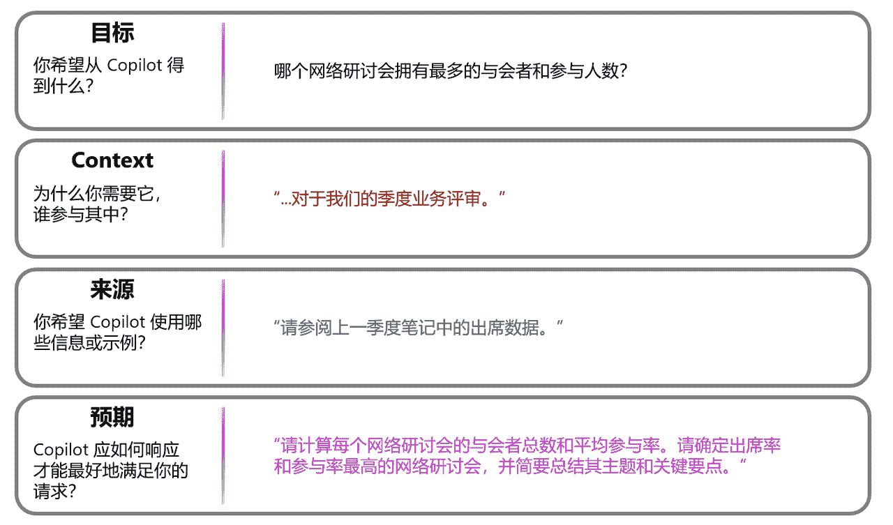

```
我们的季度业务回顾中哪些网络研讨会的与会者和参与人数最多？ 请引用上个季度笔记中的出勤数据。 请计算每个网络研讨会的与会者总数和平均参与率。 请确定出席率和参与率最高的网络研讨会，并提供其主题和关键要点的简要摘要。
```

## 在 Teams 中与 Copilot 聊天，讨论会议和消息

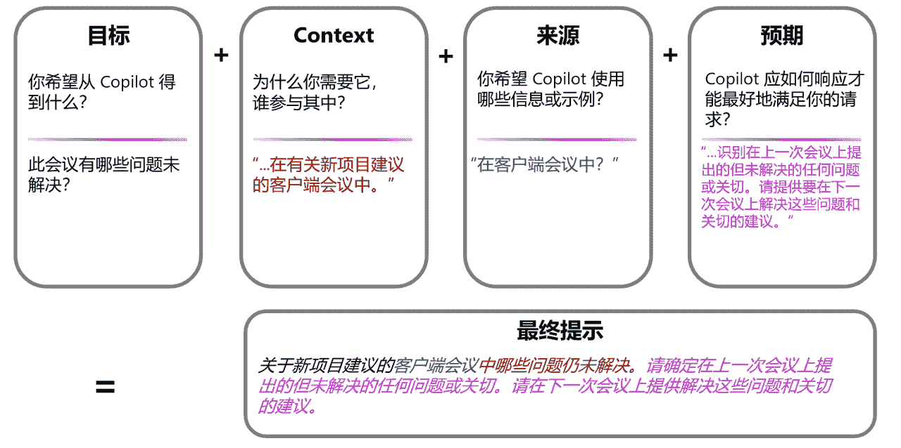

```
关于新项目建议的客户端会议中哪些问题仍未解决。请确定在上一次会议上提出的但未解决的任何问题或关切。请在下一次会议上提供解决这些问题和关切的建议。
```

润色后

```
关于新项目建议的客户会议中还有哪些问题尚未解决？请确认上次会议提出但未解决的任何问题或关切，并在下次会议上提供解决方案的建议。
```

# Microsoft 365 Copilot 场景演练

## 使用 Microsoft 365 Copilot 增强生产力： 高管用例

word生word再生ppt

+   使用 Microsoft Copilot 汇总过去一周内涉及特定主题的电子邮件和聊天。

+   使用 Teams 中的 Copilot 生成参与者在过去 30 天内涉及特定主题的聊天和电子邮件中表明的重要观点的列表。

+   在 Word 中使用 Copilot 创建你计划根据公司年度利润表向公司股东发表的演讲稿。

+   在 PowerPoint 中使用 Copilot 为你要向公司股东发表的有关年度利润表的演讲创建 PowerPoint 演示文稿。

## 使用 Microsoft 365 Copilot 增强生产力： 销售用例

+   使用Copilot在Loop中创建和更新一个潜在新销售市场的市场调研报告。

+   使用Copilot在PowerPoint中根据新饮料产品的市场趋势报告创建和定制销售演示文稿。

+   使用Microsoft Copilot总结过去30天内特定项目的电子邮件、会议和聊天记录，然后生成行动事项列表，并包括涉及特定人员或主题的行动事项。

+   使用Copilot在Word中比较三份供应商协议，识别差异并提供推荐措施。

## 使用 Microsoft 365 Copilot 增强生产力： IT 用例

+   使用Microsoft Copilot来总结网络安全产品的产品规范文档中的信息，并创建一个实施该产品的项目计划。

+   在PowerPoint中使用Copilot创建和定制基于您为新网络安全产品创建的产品计划的商业演示文稿。

+   在Word中使用Copilot修改一份技术实施报告，该报告是给打算安装您新网络安全产品的客户准备的。

+   在Outlook中使用Copilot起草一封电子邮件，其中提供了您为正在安装您新网络安全产品的客户所创建技术实施报告中的要点。

## 使用 Microsoft 365 Copilot 增强生产力： 营销用例

+   使用 Microsoft Copilot 分析美国玩具市场的市场趋势，提供销售预测，确定新的销售机会。

+   使用 Loop 中的 Copilot 为你的新户外玩具产品系列生成营销活动创意。

+   使用 Word 中的 Copilot 将三个产品的营销报告合并为一个市场分析报告，然后进行进一步自定义。

+   使用 Excel 中的 Copilot 分析新饮料产品的电子表格中捕获的市场趋势。

## 使用 Microsoft 365 Copilot 增强生产力： 财务用例

+   在 Outlook 中使用 Copilot 向你的保险公司起稿一封电子邮件，该电子邮件请求召开会议来讨论公司医疗保险费增加的问题。

+   在 Excel 中使用 Copilot 分析包含第 1 季度市场营销活动预计收入和用户参与情况的电子表格，然后添加新的计算和图表以可视化数据。

+   在 Word 中使用 Copilot 基于公司的 Q1 市场营销活动的财务结果创建市场营销活动报告。

+   在 Word 中使用 Copilot 汇总公司过去五年的财务报表结果，包括趋势、增长模式、盈利率分析和关注领域。

## 使用 Microsoft 365 Copilot 增强生产力： HR 用例

+   使用Copilot在Word中根据人力资源工作职责文件创建一个职位描述。

+   使用Microsoft Copilot分析多份简历，比较每个候选人的优势和弱点，并做出最终推荐。

+   使用Copilot在Loop中创建一套针对新职位的面试问题。

+   使用Copilot在Word中撰写给新职位候选人的电子邮件录用信。

## 使用 Microsoft 365 Copilot 增强生产力： 运维用例

+   使用白板中的Copilot来进行头脑风暴，为安装新的网络安全产品制定项目计划，并对这些想法进行分类。

+   使用Outlook中的Copilot来查找实际邮件线程，总结该线程，并生成回复。

+   使用Word中的Copilot来查找有关故障排除当前生产设备的信息，并确定如何重置处理器。

+   在Loop中使用Copilot为将在公司网络上安装VPN的咨询公司客户发现会议创建一系列问题。

## 使用 Microsoft 365 Copilot 增强生产力： 挑战用例

+   使用 Loop、Word 和必应中的 Copilot 为新职位创建 HR 面试问题，然后比较每个 Copilot 生成的结果。

+   使用 Word 和 Excel 中的 Copilot 来提升公司的社交媒体营销影响力。

+   使用 Whiteboard 和 Word 中的 Copilot 创建项目规划文档并可视化项目时间线、里程碑和依赖项。

+   使用 Word 中的 Copilot 创建营销报告和集思广益营销活动创意，使用 PowerPoint 中的 Copilot 创建营销演示文稿。
