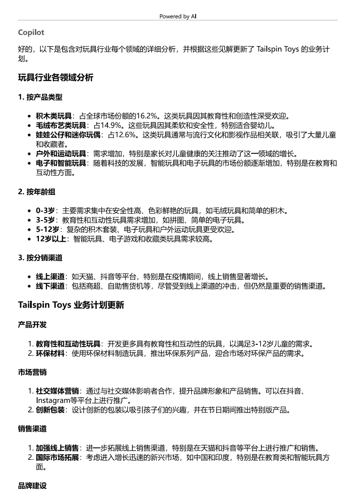
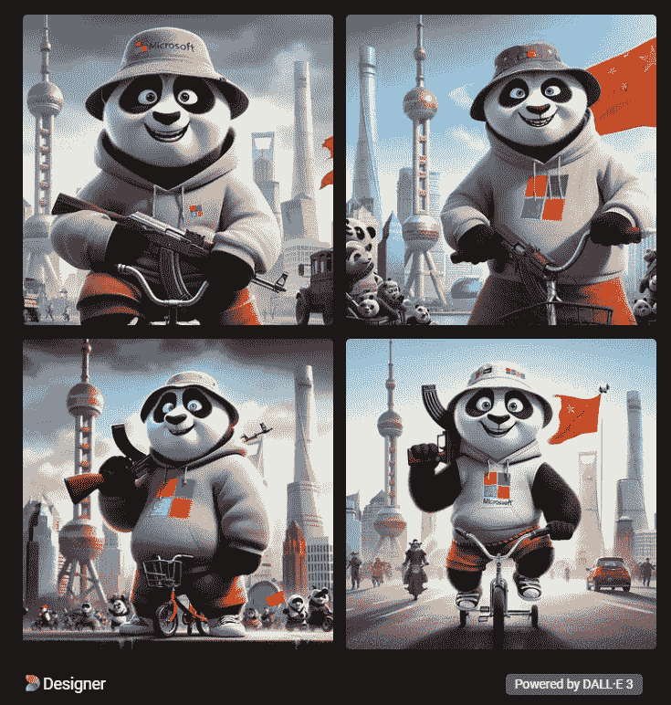
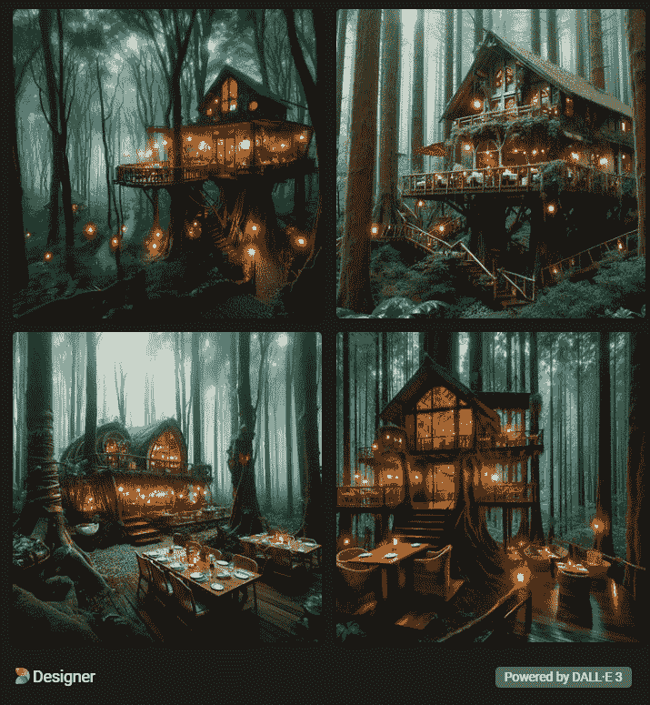
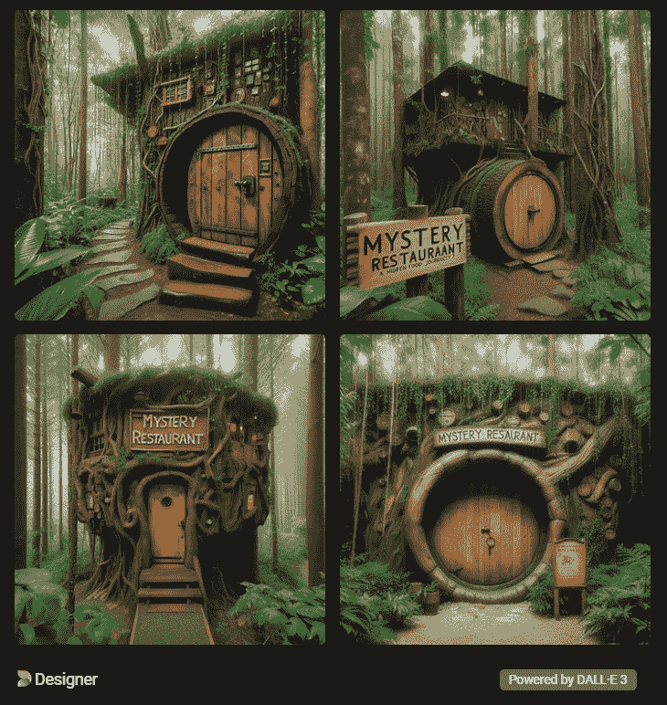
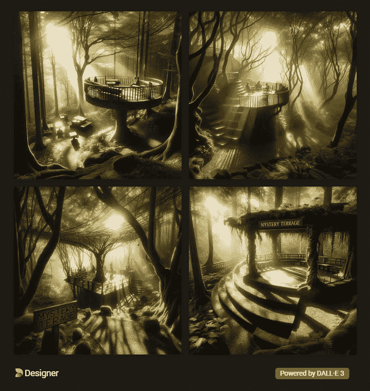
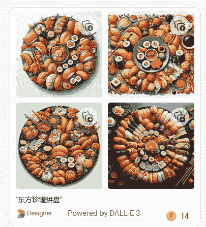
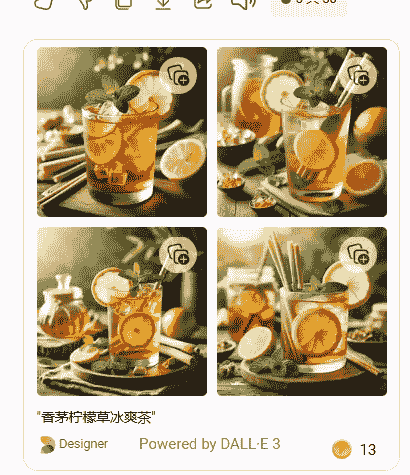

# 使用必应中的 Copilot 来探索生成式 AI

> 来源：https://zsyhjtnsa5.feishu.cn/docx/UXRVdgWbFobdsuxcOF9c2tYnnee

生成式 AI 可以帮助处理各种内容创建项目。在本模块中，了解如何使用生成式 AI 根据你的梦境创作一个有关虚构的目标的故事。当你提到一个非常熟悉的地方，但又需要努力重新想象它的模样时，请把你的兴趣投入进来。怎样才能让它显得既与众不同又令人神往？它会如何反映你自己的兴趣或热情？

你将和 AI 一起创建这一景象。在必应中使用 Copilot 研究、构思、撰写文案，并创建视觉对象，将你的想法变成现实。本模块中的每个步骤侧重于体验的不同部分，并提供可以复制和编辑的示例提示。步骤和提示结构的创建突出显示了特定的技术和功能。所提供的示例响应显示了 Copilot 创建的内容示例。

## 准备工作

在[必应](https://www.bing.com/)中登录到 Copilot 并选择“聊天”图标。请务必在完整浏览器而不是边栏中使用必应中的 Copilot。建议在 Microsoft Edge 中设置个人资料。

使用个人帐户登录到来自 Designer 的 Image Creator。

> 在本教程中，你只能在必应的 Copilot 中工作。但必须登录到 Image Creator，以便 Copilot 可以使用它为你调用 Image Creator。如果从 Copilot 收到错误，则意味着必应中的 Copilot 无法调用 Image Creator，因为你并未登录

# 快速演练

## 使用 Microsoft Copilot 进行市场分析

> 作为 Tailspin Toys 的市场研究总监，你必须对玩具行业进行市场分析，以提供给公司的高级领导团队 (SLT)。你的目标是确定最新的趋势、消费者偏好和市场上最热门的玩具。你计划使用 Microsoft Copilot 来生成分析。这样做时，你将应用不同的最佳做法来创建有效提示。

> 亦可直接使用：`https://copilot.microsoft.com/`

请执行以下步骤，以使用 Microsoft Copilot 进行市场分析：

1. 在 Microsoft Edge 中，打开一个新标签页并输入以下 URL：`https://bing.com`

1. 在 Microsoft 必应中，在页面顶部的选项卡列表中选择“Copilot”。这样便会打开 Microsoft Copilot。

1. 在“Copilot”页面上，注意页面顶部的切换开关，该开关允许你选择“工作”或“Web”。虽然你的请求是一项与工作相关的任务，但你需要 Copilot 访问 Web 来对玩具行业进行市场分析。如有必要，请选择“Web”切换开关。

1. 在预定义提示示例列表的下方，可以选择对话风格。请选择“更平衡”选项（如果尚未默认选择该选项）。

1. 在提示字段中，输入以下提示，然后选择“提交”图标：

```
我是美国玩具制造商 Tailspin Toys 的市场研究总监。请对玩具行业进行市场分析，以确定销售数据、最新趋势、消费者偏好和市场上最热门的玩具.
```

1. 查看 Copilot 生成的市场分析。你意识到，笼统的请求（例如你提交的请求）可提供市场趋势、消费者偏好和玩具趋势等基本信息。但是，你也有兴趣收集有关玩具行业的数据，包括市场份额和消费者反馈。你意识到在之前的提示中有点过于模糊，因为你未能请求此特定信息。你记得之前的培训中提供的最佳做法建议 - 保持礼貌并反复演练和调整。请输入以下提示以修改市场分析：

```
这个分析很棒。但是，我也有兴趣了解玩具行业的数据，包括市场份额和消费者反馈。请修改先前的分析以包含此信息。谢谢!
```

1. 你意识到自己离目标越来越近了，但仍缺少一些关键信息。查看先前的提示后，你意识到你向 Copilot 说明了自己的总体目标、分析范围以及所需的数据。但是，你未能要求 Copilot 分析所有这些信息，以便针对 Tailspin Toys 来年的业务计划做出明智的决策。若要更正此缺点，请输入以下提示：

```
我认为所有数据都是完整的。根据你捕获的所有信息，请分析数据并确定模式、趋势和见解，以帮助我确定 Tailspin Toy 来年的业务计划.
```

1. 你真的对 Copilot 提供的信息很满意。但由于此项目是你第一次有机会向公司的 SLT 提供市场分析报告，因此你不确定是否涵盖了他们可能感兴趣的所有内容。你决定让 Copilot 帮助你确定是否还缺少任何内容。请输入以下提示：

```
请分析此市场分析和业务计划中的数据。玩具公司是否通常会为市场分析和业务计划要求提供我没有要求的任何其他信息？如果是，请修改答复以包含此信息。谢谢!
```

1. 根据 Copilot 提供的信息，你意识到，通过让 Copilot 包含对这些领域的分析，可以真正最大程度地提高报告的有效性。若要对报告进行最后的润色，请输入以下提示：

```
请修改市场分析，以包括对玩具行业每个领域的分析。此外，请根据这些见解更新你为 Tailspin Toys 创建的业务计划。谢谢!
```

以下是可能的最终输出结果

```
好的，以下是包含对玩具行业每个领域的详细分析，并根据这些见解更新了 Tailspin Toys 的业务计划。
玩具行业各领域分析

1. 按产品类型
积木类玩具：占全球市场份额的16.2%。这类玩具因其教育性和创造性深受欢迎。
毛绒布艺类玩具：占14.9%。这些玩具因其柔软和安全性，特别适合婴幼儿。
娃娃公仔和迷你玩偶：占12.6%。这类玩具通常与流行文化和影视作品相关联，吸引了大量儿童和收藏者。
户外和运动玩具：需求增加，特别是家长对儿童健康的关注推动了这一领域的增长(1)。
电子和智能玩具：随着科技的发展，智能玩具和电子玩具的市场份额逐渐增加，特别是在教育和互动性方面(2)。

2. 按年龄组
0-3岁：主要需求集中在安全性高、色彩鲜艳的玩具，如毛绒玩具和简单的积木。
3-5岁：教育性和互动性玩具需求增加，如拼图、简单的电子玩具。
5-12岁：复杂的积木套装、电子玩具和户外运动玩具更受欢迎。
12岁以上：智能玩具、电子游戏和收藏类玩具需求较高(3)。

3. 按分销渠道
线上渠道：如天猫、抖音等平台，特别是在疫情期间，线上销售显著增长(4)。
线下渠道：包括商超、自助售货机等，尽管受到线上渠道的冲击，但仍然是重要的销售渠道(5)。

Tailspin Toys 业务计划更新

产品开发
教育性和互动性玩具：开发更多具有教育性和互动性的玩具，以满足3-12岁儿童的需求。
环保材料：使用环保材料制造玩具，推出环保系列产品，迎合市场对环保产品的需求。

市场营销
社交媒体营销：通过与社交媒体影响者合作，提升品牌形象和产品销售。可以在抖音、Instagram等平台上进行推广。
创新包装：设计创新的包装以吸引孩子们的兴趣，并在节日期间推出特别版产品。

销售渠道
加强线上销售：进一步拓展线上销售渠道，特别是在天猫和抖音等平台上进行推广和销售。
国际市场拓展：考虑进入增长迅速的新兴市场，如中国和印度，特别是在教育类和智能玩具方面。

品牌建设
提升品牌忠诚度：通过高质量和安全性的产品，提升消费者对品牌的忠诚度。可以考虑推出会员计划或忠诚度奖励计划。

竞争分析
主要竞争对手：乐高、美泰、孩之宝等公司在市场中占据重要地位。Tailspin Toys 可以通过差异化产品和创新营销策略来提升竞争力。

财务预测
销售预测：预计未来三年销售额将以年均10%的速度增长。
成本分析：通过优化生产流程和供应链管理，降低生产成本和运营成本。

通过以上策略，Tailspin Toys 可以更好地把握市场机会，满足消费者需求，实现业务增长。如果您有任何其他问题或需要进一步的分析，请随时告诉我。
(1): Fortune Business Insights (2): 华经情报网 (3): 中研普华 (4): 华经产业研究院 (5): 中研网
```



[microsoftcopilot.pdf](https://internal-api-drive-stream.feishu.cn/space/api/box/stream/download/all/J6llbO8lDoBgtxxJtNec5z1onSf)

1. Copilot 为你生成的市场分析和业务计划是基于“更平衡”的对话风格。它非常适合希望在精度和创造力之间进行平衡的用户。此风格提供的答复比“更精确”风格更长、更具描述性。对于报告，你需要更长、更具描述性的答复，因为你认为 SLT 需要这种级别的详细信息。但是，你对使用“更有创意”风格时的报告很感兴趣。这种风格会提供更具想象力和创意的答复。让我们探索一下 Copilot 在使用“更有创意”风格时的答复会有何不同。

1. 在 Microsoft Edge 浏览器中打开一个新标签页并输入以下 URL：`https://bing.com`

1. 在 Microsoft 必应中，选择“Copilot”以打开 Microsoft Copilot。

1. 在“Copilot”页面上，你仍希望处于“Web”模式，但这次你决定尝试“更有创意”的对话风格。重复步骤 4-9。复制并粘贴每个提示。请特别注意 Copilot 在答复每个提示时使用的语气。另请注意每个答复与基于“更平衡”对话风格的相应答复有何不同。

## freestyle绘图范例

使用个人帐户登录到来自 Designer 的 Image Creator。

```
功夫熊猫- 动画风格 - 带着灿烂的笑容，戴着草帽，站在一个三轮车上，穿着灰色连帽衫和Microsoft标志，携带一把AK47。在背景中，展示上海的东方明珠，上海塔以及中国国旗
```



为降低攻击性，也可以使用以下提示词：

```
功夫熊猫- 动画风格 - 带着灿烂的笑容，戴着草帽，骑在一辆三轮车上，穿着灰色连帽衫和Microsoft标志，一手拿着一把算盘，另一手举着一串冰糖葫芦。在背景中，展示上海的东方明珠，上海中心塔以及中国国旗
```

# 定义你的想法并设定使用背景

首先，需要定义和优化有关 AI 生成的目标位置的想法。第一步，要有创造性，并提出一个核心概念。接下来，设置对话样式，并定义在生成内容时希望 Copilot 在必应中使用的角色。

在必应中，将对话风格设置为“更具创造力”。

## 基于角色提示

提示词

```
你是一位非凡的体验设计师，拥有独特的才能，能够打造引人入胜的沉浸式体验，点燃感官并将顾客带入一个纯粹魔幻的境界。通过巧妙地结合迷人的音景、令人着迷的视觉效果和精心策划的环境条件，你编排出令人惊叹和好奇不已的旅程。
你无限创意之源让想象力苏醒，并且细致呵护每个最微小感官细节，将其无缝地编织成一个主题画卷。
凭借你出色多感官参与能力，你有能力创造难以忘怀的时刻，让个体沉浸在一种感观交响乐中，在他们陶醉、愉悦并渴望更多。你将协助创建全新体验
```

可能的输出

```
谢谢你的赞美！作为一名体验设计师，我会竭尽所能，创造出令人难忘的、多感官的旅程。音景、视觉效果和环境条件的巧妙结合确实可以点燃人们的感官，让他们沉浸在纯粹魔幻的境界中。如果你有任何关于体验设计或其他方面的问题，都欢迎随时向我提问！😊
```

## 精准定义想法

确定要关注的核心想法。想象一下你熟知的地点，但那里有些意外的改变。你如何使它变得与众不同和令人兴奋的？它如何反映你自己的个人风格或接受完全意外的东西？

从你想要重新构想的想法开始。你的想法应该有三个关键元素：

1. 常见地点

1. 主题和/或美学

1. 位置

常见地点的示例：

+ 酒店

+ 高尔夫球场

+ Spa

+ 犬类公园

主题或美学示例：

+ 哥特语

+ 未来

+ 世纪中叶

+ 参考奇幻电影

位置示例：

+ 瀑布后面

+ 热带雨林

+ 水下

+ 外层空间

提示词范例：

```
我有一个想法，我想在这个项目上工作，并提供一些要点。你能帮我创造一个具有旅游营销风格的段落，并且详细描述能够真实展现这个想法的细节吗？它应该包含以下几点。不要给这个目的地起名字，而是专注于让这个目的地独特之处。我们将在以后为此体验进行品牌和命名。

- 全新的目的地体验
- 位于深林中、舒适隐秘类型的餐厅
- 这家餐厅高高建在树枝间，仿佛与大自然融为一体
- 在主题上，它结合了有机自然与邀请制度目的地
- 神秘而隐藏
```

可能的输出

```
当然可以！让我为你创造一个引人入胜的旅游营销段落，描述这个独特的目的地体验。🌿
在深林中的神秘餐厅：一场与大自然融为一体的美食之旅

在这个全新的目的地体验中，我们带您来到一家位于深林中的舒适隐秘餐厅。这家餐厅高高建在树枝间，仿佛与大自然融为一体。您将步入一个神秘而隐藏的世界，远离城市的喧嚣，沉浸在自然的怀抱中。
餐厅环境：餐厅坐落在郁郁葱葱的森林中，环绕着参天大树。您将穿过树冠，沿着蜿蜒的小径来到这个隐秘之地。餐厅的设计融合了有机自然与邀请制度目的地的主题，让您感受到与自然的亲近。
美食体验：餐厅的菜单由精心挑选的食材制作而成，每道菜肴都是一场味觉盛宴。您可以品尝到新鲜的野生蘑菇、山间的草药和当地特色食材。厨师们巧妙地将自然的美味融入每一道菜肴中，让您的味蕾沉醉其中。
用餐体验：您将坐在高高的树枝上，俯瞰着森林的美景。阳光透过树叶洒在桌面上，微风拂过您的脸庞。这里没有电灯，只有烛光和星星点点的天空，让您感受到与大自然的亲密接触。
预订方式：这家餐厅是一个邀请制度目的地，只有少数幸运的客人能够进入其中。您可以通过我们的官方网站预订，或者等待邀请函的到来。
这个神秘的餐厅将成为您难以忘怀的体验，让您在大自然的怀抱中享受美食、音景和视觉效果的完美融合。(1) 🌲✨
```

## 关键要点和进一步探索

本单元要点：

+ 设置聊天风格以确定响应的类型。“更具创造力”选项可带来更具想象力和更长篇幅的响应。

+ 了解为单个对话生成的响应数（对话轮次）存在限制。

+ 高效开发内容。花些时间了解要点中包含的核心想法，让 Copilot 编撰内容以整合这些想法。

+ 通过指定语气或语调，创建适合受众的内容。

探索优化提示的方法：

+ 请考虑提示中的包含或排除。表述清晰非常重要，可以通过确定所需内容和不需要的内容来实现。

+ 指示输出所需的长度，例如字符计数、句子长度或段落数。

+ 提供其他上下文。在提示中包含指向相关材料的链接。

# 创建主图

主图是某人与你的目标关联的第一个图像。主图是一个具有视觉冲击力的大型图形，旨在吸引注意力并传达中心信息或主题。

由于 Bing 中的 Copilot 记住了对话的上下文，你可以要求它根据已编写的描述创建图像。因此，请尝试要求 Copilot 为你创建图像。

步骤：

1. 复制示例提示。

1. 粘贴到聊天中。

1. 选择喜欢的图像并下载它。

> 必应中的 Copilot 使用 Designer 提供的 Image Creator，因此你需要先登录，然后才能继续操作。

```
你能否创建一张远距离可视化这个目的地外观的图片？
```

如果侧边栏没有相应，可以在Designer中复制上一段的输出，获得图片样例，可能的输出范例



# 定义入口

## 使用Copilot进行构思

提示词


# 入口设计

```
对于这个目的地，我想考虑入口。
它应该体现这个目的地的主题，并且应该令人难忘，因为这是游客将要进行的第一次互动。你能否提出三个符合标准的关于这个目的地入口的创意？项目工作中称之为“入口”。
```

### 可能的输出

当然可以！以下是三个关于这个目的地入口的创意，旨在体现主题并令人难忘：

工业风格的入口：受到洛杉矶 Manuela 餐厅的启发，您可以打造一个工业风格的入口。使用裸露的横梁、管道和砖石地板，营造出一种独特的工业氛围。即使在现代建筑中，这样的设计也能让游客感受到与大自然融为一体的感觉。

热带风情的入口：借鉴伦敦 Coppa Club 餐厅的做法，您可以创造一个让游客感觉置身热带天堂的入口。即使不在白沙滩上，通过设计元素（如植物、热带色彩和纺织品），让游客在视觉上感受到异国情调。

极简主义的入口：受到芝加哥 Aba 餐厅的启发，您可以打造一个极简主义的入口。使用轻盈、自然的颜色和材质（如白色、米色、藤编和木材），创造出夏日的空灵氛围。即使没有法国里维埃拉海岸的壮丽景色，这样的设计也能让游客感到舒适和愉悦。

这些创意将为游客提供难忘的第一次互动，让他们对目的地充满期待！🌿✨

## 扩展想法

### 提示词

```
我喜欢你提出的关于隐藏门的想法。你能详细说明一下吗？
```

### 可能的输出

当然！关于隐藏门的想法可以让游客感到神秘和兴奋，增加他们对目的地的好奇心。以下是一些关于隐藏门的详细说明：

树干门：在餐厅的入口处，您可以设计一个看似普通树干的门，实际上它是一个隐藏的通道。游客需要推开树干，就像进入森林深处一样。这个门可以由木材制成，表面覆盖着树皮纹理，与周围的自然环境融为一体。当游客推开门时，他们会发现通向餐厅的秘密路径。

藤蔓门：受到巴厘岛的风格启发，您可以在入口处安装一扇由藤蔓编织而成的门。这些藤蔓可以从树枝上垂下，形成一个自然的门廊。游客需要轻轻地抚摸藤蔓，让它们分开，进入餐厅。这样的设计既美观又与自然相契合。

石头门：如果您想要更加神秘和古老的感觉，可以选择一扇由巨大石头制成的门。这些石头可以堆叠在一起，仿佛是古代遗迹中的入口。游客需要推动石头，揭示出隐藏的门洞。这样的设计将增加游客的探险感。

无论您选择哪种设计，隐藏门都应该与目的地的主题相呼应，并让游客感到兴奋和好奇。🌿✨

## 编辑说明

### 提示词

```
你能用旅行刊物的语调重新写一下那个描述吗？请将其限制在一个段落内。
```

### 可能的输出

当然！让我们用一种更具旅行刊物风格的语调来重新描述这个目的地：

神秘餐厅：深林中的隐秘美食之旅

在茂密的森林深处，隐藏着一家令人神往的餐厅。它高高建在树枝之间，仿佛是大自然的一部分。您将穿越藤蔓和树冠，来到这个神秘的地方。

环境与设计：餐厅的外观简约而又不失奇特。木质的树干门隐藏在绿叶丛中，只有少数幸运的客人能够找到它。推开门，您会发现通向美食之旅的秘密通道。餐厅内部以自然元素为主，融合了有机的木材、藤蔓和石头，让您感受到与大自然的亲近。

美食体验：餐厅的菜单由厨师们精心设计，选用新鲜的野生蘑菇、山间草药和当地特色食材。您可以坐在高高的树枝上，俯瞰着森林的美景，享受一道道令人惊艳的美味佳肴。

预订方式：这家餐厅是一个邀请制度目的地，只有少数幸运的客人能够进入其中。您可以通过官方网站预订，或等待邀请函的到来。

这个神秘的餐厅将成为您难以忘怀的体验，让您在大自然的怀抱中享受美食、音景和视觉效果的完美融合。🌲✨

## 创建图像

你需要创建一个图像来可视化这个宏伟的入口。

### 步骤

1. 根据需要复制以下示例提示并对其进行编辑。
2. 将提示粘贴到聊天中。
3. 选择你喜欢的图像并下载它。

[如果它无法为你生成图像，你](https://www.bing.com/images/create)可以直接转到 Image Creator。如果在使用此提示时遇到问题（此提示依赖于对话的上下文），请尝试使用你为提示创建的说明。

### 示例提示

```
你能否创建一张图像来可视化你刚才写的入口描述？
```

### 输出范例



# 集体讨论目的地特色

## 构思

首先，你与共同作者一起构思目标内的独特功能或空间。

### 步骤

1. 根据需要复制示例提示并进行编辑。
2. 将提示粘贴到聊天中。

### 示例提示

```
我们现在要开始处理项目的一部分，名为“特色”。
根据你对这个目的地的了解，你能否提出5个独特的室内或室外特点或空间，人们可以参观、花时间或享受？请按照我的格式示例列出它们：

## 名称 ##
描述
```

> 小样本提示示例。此提示是小样本提示的示例，你在其中提供了一些指导或你希望其执行的操作以及所希望的输出的示例。零样本没有指导。

### 可能的输出

当然！以下是这个目的地的五个独特特点或空间，供您参考：

1. 树干门

这扇看似普通的树干门隐藏在绿叶丛中，只有少数幸运的客人能够找到它。推开门，您会发现通向美食之旅的秘密通道。

2. 藤蔓入口

在入口处，一扇由藤蔓编织而成的门迎接游客。这些藤蔓从树枝上垂下，形成一个自然的门廊。游客需要轻轻地抚摸藤蔓，让它们分开，进入餐厅。

3. 石头门

这扇由巨大石头制成的门仿佛是古代遗迹中的入口。游客需要推动石头，揭示出隐藏的门洞。这样的设计将增加游客的探险感。

4. 高架用餐区

餐厅内部有一个高高的用餐区，坐在树枝上俯瞰着森林的美景。阳光透过树叶洒在桌面上，让您感受到与大自然的亲密接触。

5. 神秘露台

在餐厅的一侧，隐藏着一个神秘的露台。游客可以在这里欣赏到森林的美丽，感受微风拂过脸庞，享受宁静的时光。

这些特点将让游客在这个目的地中留下难忘的回忆！🌿✨

> 示例响应：请注意，以下示例响应采用 Markdown 语法，因此它的格式看起来不像浏览器中的格式那样。

## 扩展想法

选择其中的两个想法进行探索。对于每个想法，你都需要先创建说明，然后创建图像。

### 步骤

1. 根据需要复制以下示例提示并进行编辑。
2. 将提示粘贴到聊天中。

### 示例提示

```
我想要在可视化这些想法中进行工作。
让我们先从名为“神秘露台”的第一个想法开始。你能否以旅行出版物的语调重新写下那个描述，并保持大致相同的长度？
你还能提供三个“神秘露台”的替代名称吗？
```

### 可能的输出

当然！让我为您重新描述一下“神秘露台”：

神秘露台：在这个隐秘的角落，游客可以欣赏到森林的美丽。微风拂过脸庞，阳光透过树叶洒在地面上，让人感到宁静和亲近大自然。

此外，以下是三个“神秘露台”的替代名称：

幽静平台
隐秘天台
神秘庭院

希望这些名称能够激发您的灵感！如果您还需要其他选项，随时告诉我。😊

## 创建图片

选择它提供的选项之一，并要求 Copilot 将其可视化。

### 步骤

1. 根据需要复制示例提示并对其进行编辑。
2. 将提示粘贴到聊天中。
3. 选择喜欢的图像。
4. 下载该图像。

[如果它无法为你生成图像，可](https://www.bing.com/images/create)以转到 Image Creator，以便从文本生成图像。如果在使用此提示时遇到问题（此提示依赖于对话的上下文），请尝试使用你为提示创建的说明。

```
我喜欢你提出的第二个想法。你能否创建一张图像来可视化你所称之为“神秘天台”的东西？
```

### 图像输出范例



# 规划菜单

## 构思

```
对于我们一起努力的目的地，
我想考虑可用的食物选择。
这个项目的一部分叫做“美食”。
你能为我创建一个以表格形式排列的菜单吗？
其中包括名称和描述。描述应清楚地概述成分和服务方式。
名称和描述还应体现我们目的地的主题。请提供5个想法。
```

当然可以！以下是一个以表格形式排列的菜单，包含名称和描述，描述中清楚地概述了成分和服务方式，并且体现了我们目的地的主题。

希望这些菜单想法能为您的项目提供灵感！如果需要更多帮助，请随时告诉我。

## 生成图片

选择一个或两个菜单项，并为每个菜单项创建一个图像。

### 步骤

1. 根据需要复制示例提示并对其进行编辑。
2. 将提示粘贴到聊天中。
3. 选择你喜欢的图像并下载它。

[如果它无法为你生成图像，可](https://www.bing.com/images/create)以转到 Image Creator，以便从文本生成图像。如果在使用此提示时遇到问题（此提示依赖于对话的上下文），请尝试使用你为提示创建的说明。

### 示例提示

```
你能为第一个建议的菜单项创建一张图片吗？
```



## 构思招牌饮品

```
一款招牌饮品是真正体现目的地主题的一种清凉饮料。它应该独特而且本身就是一种体验。它可能融入当地食材、文化或者从主题中汲取灵感，影响着它们的外观、服务方式或制作方法。这些饮品能够让顾客愉悦。我们需要找到一些照片灵感来帮助产生有趣可享受的刷新饮料的想法。你能提供一些高度创意的独特刷新饮料的照片灵感吗？可以是它们的颜色、成分、容器形式、制作方式或者人们享用时需要注意什么方面。
```

```
[**当然可以！以**](https://www.southernliving.com/food/drinks/fresh-chilled-summer-cocktails)[下是一些高度创意的独特刷新饮料的照片灵感：
西瓜薄荷冰沙：这款](https://www.southernliving.com/food/drinks/fresh-chilled-summer-cocktails)[**饮料颜色鲜艳**](https://www.southernliving.com/food/drinks/fresh-chilled-summer-cocktails)[，采用新鲜的西瓜和薄荷叶制成，装在透明的玻璃杯中，顶部点缀一](https://www.southernliving.com/food/drinks/fresh-chilled-summer-cocktails)[片薄荷](https://minimalistbaker.com/refreshing-drinks-for-summer/)[**叶，清爽解暑**](https://www.southernliving.com/food/drinks/fresh-chilled-summer-cocktails)[(1)。
蓝莓姜汁汽水：这款饮料呈现出美丽的蓝紫色，](https://www.southernliving.com/food/drinks/fresh-chilled-summer-cocktails)[由新鲜](https://minimalistbaker.com/refreshing-drinks-for-summer/)[**蓝莓和姜汁制**](https://www.southernliving.com/food/drinks/fresh-chilled-summer-cocktails)[成，装在高脚杯中，配以冰块和一片柠檬，带来独特的口感(](https://www.southernliving.com/food/drinks/fresh-chilled-summer-cocktails)[**2)。
柠檬**](https://www.southernliving.com/food/drinks/fresh-chilled-summer-cocktails)[草柚子茶：这款饮料采用柠檬草和新鲜柚子制成，颜色清新](https://www.southernliving.com/food/drinks/fresh-chilled-summer-cocktails)[，装在](https://minimalistbaker.com/refreshing-drinks-for-summer/)[陶瓷杯](https://www.southernliving.com/food/drinks/fresh-chilled-summer-cocktails)中，[带有浓](https://minimalistbaker.com/refreshing-drinks-for-summer/)郁的柚子香气，适合夏日享用(2)。
芒果椰子奶昔：这款饮料颜色金黄，由新鲜芒果和椰奶制成，装在椰壳中，顶部点缀椰肉片，带来浓郁的热带风情(1)。
玫瑰荔枝苏打：这款饮料颜色淡粉，由玫瑰花瓣和荔枝制成，装在透明的玻璃瓶中，配以苏打水，带来浪漫的视觉享受(2)。
这些饮料不仅在颜色和成分上独特，还在容器和服务方式上体现了创意，能够为顾客带来愉悦的体验。希望这些灵感能帮助您设计出独特的招牌饮品！如果需要更多帮助，请随时告诉我。
(1): Southern Living (2): Minimalist Baker
```

让 Copilot 构思三种能够体现目的地主题的招牌饮品创意。请记得提供任何有助于产生正确结果的细节 - 考虑容器、配件、地区风味或其他凸显其特殊性的东西。

### 步骤

1. 根据需要复制示例提示并对其进行编辑。
2. 将提示粘贴到聊天中。

### 示例提示

```
我们需要构思一个独特的招牌饮品。它应该体现目的地的主题，并且能够给人们带来惊喜和愉悦。容器也很重要，杯子或容器应该非常独特，并且与目的地的主题相契合。你能给我三个关于招牌饮料或清凉饮品的创意吗？但请确保包含适合每个人口味的建议。同时，请为它们取一个反映主题并富有巧妙之处的名字。
```

```
当然可以！以下是三个独特的招牌饮品创意，每个饮品都体现了目的地的主题，并且适合不同口味的人群。
1. 香茅柠檬草冰爽茶
描述：这款饮品采用新鲜的香茅和柠檬草制成，搭配蜂蜜和柠檬片，带来清新的口感。饮品装在竹制杯中，顶部点缀一片柠檬草叶，既环保又独特，完美体现了自然与和谐的主题。适合人群：喜欢清新口感和天然成分的人。
2. 热带芒果椰子冰沙
描述：这款冰沙由新鲜芒果和椰奶制成，口感浓郁，带有热带风情。饮品装在椰壳中，顶部点缀椰肉片和一片薄荷叶，带来视觉和味觉的双重享受。适合人群：喜欢甜美和浓郁口感的人。
3. 玫瑰荔枝苏打
描述：这款饮品采用玫瑰花瓣和荔枝制成，颜色淡粉，口感清爽。饮品装在透明的玻璃瓶中，配以苏打水，带来浪漫的视觉享受。顶部点缀几片玫瑰花瓣，增添优雅气息。适合人群：喜欢浪漫和清爽口感的人。
希望这些创意能为您的项目提供灵感！如果需要更多帮助，请随时告诉我。
```

## 生成图片

```
你能否创建一张图像来可视化你建议的第一款饮品，名为&quot;香茅柠檬草冰爽茶&quot;？
```



[www.bing.com](https://www.bing.com/images/create/e9a699e88c85e69fa0e6aaace88d89e586b0e788bde88cb6/1-66bc18a663d3459893398374c0ae6268?id=a05wA6uP%2fDQqauJW%2b%2bk8cw%3d%3d&view=detailv2&idpp=genimg&idpclose=1&thId=OIG3.qBaG70.1TTP.I9iRhPmc&frame=sydedg&skey=YMfM5ZwXAIcddigEoFdXQV02enmNJzOQ4EyH3vh4Jis&FORM=SYDBIC)

# 构思氛围和音乐

要求 Copilot 创建 10 首适合目的地的歌曲的列表。添加任何详细信息或参考，以帮助指导 Copilot。你要将此列表的格式设置为表格。

### 提示

通过指导发挥创意。添加详细信息以获取更有趣的结果。请求给出只有一首成名曲的歌手、独立艺术家，为其他原声带提供参考，或描述你想要的氛围。

### 步骤

1. 复制示例提示并根据需要进行编辑。
2. 将提示粘贴到聊天中。
3. 拍摄它给你的歌曲表的屏幕截图，并保存该图像。

### 示例提示

```
我们需要思考音乐。这个项目的一部分被称为音乐。
你能否创建一个包含10首歌曲、艺术家和歌名的表格，以适应这个目的地的主题？
```

当然可以！以下是一个包含10首歌曲、艺术家和歌名的表格，这些歌曲都适合我们目的地的主题。

这些歌曲不仅经典，而且能够很好地体现我们目的地的文化和氛围。希望这些歌曲能为您的项目增添更多的音乐魅力！如果需要更多帮助，请随时告诉我。

# 构思品牌宣发创意

我已经生成了实现这一想法所需的几乎一切内容。现在，在必应中使用 Copilot 来为此目标创建一些基本品牌。

现在创建：

+ 适合目标的朗朗上口的名称。
+ 抓住本质的简短描述。

```
好的。现在考虑到我们为这个新目的地所做的一切，是时候为它设计一些品牌了。你能提供几个引人注目的名字选项以及一个简短的标语吗？
```

```
当然可以！以下是几个引人注目的名字选项以及简短的标语：
名字选项和标语
东方之梦
标语：探索东方的美味与文化
香茅之旅
标语：感受自然的清新与和谐
珍馐之境
标语：品味经典，享受美食之旅
风味东方
标语：每一口都是文化的传承
味觉探险
标语：开启你的美食冒险之旅
希望这些名字和标语能为您的品牌设计提供灵感！如果需要更多帮助或有其他要求，请随时告诉我。
```

选择名称和标语后，就是时候编写一个简短的描述，真正向其他人宣传此品牌。让 Copilot 帮助你创建此描述。

```
你能否为我创作一个三句话的描述，以旅行出版物的语调真实地捕捉这个目的地的精髓，吸引潜在游客？
```


当然可以！以下是一个三句话的描述：

在东方之梦，您将踏上一段充满美味与文化的奇妙旅程。这里的每一道菜肴都精心烹制，融合了传统与创新，带您领略东方的独特风味。无论是清新的香茅柠檬草冰爽茶，还是经典的港式点心盛宴，每一口都将唤醒您的味蕾，留下难忘的回忆。

希望这个描述能吸引潜在游客，激发他们对这个目的地的兴趣！如果需要更多帮助，请随时告诉我。

# 附录

如果遇到网络问题，可以使用微软的沙盒环境；

`https://learn.microsoft.com/zh-cn/training/modules/use-own-data-azure-openai/5-exercise`

`Designer`

`https://www.bing.com/images/create`

图片共享

`https://aka.ms/aieximg`
