# AI-3016：使用 Azure AI Studio 开发自定义的助手

> 来源：[https://zsyhjtnsa5.feishu.cn/docx/ZWckdCJBNoUy1Hxu2UVcC9otnTg](https://zsyhjtnsa5.feishu.cn/docx/ZWckdCJBNoUy1Hxu2UVcC9otnTg)

## Azure AI Studio 简介

`https://learn.microsoft.com/zh-cn/training/modules/introduction-to-azure-ai-studio/`

人工智能 (AI)，特别是生成式 AI 使用的普遍增长，意味着开发者越来越需要创建全面的人工智能解决方案。这些解决方案需要结合机器学习模型、AI 服务、提示工程解决方案和自定义代码。Microsoft Azure 提供了多个可用于创建 AI 解决方案的服务，但到目前为止，开发人员仍然需要在单个项目中使用多个工具和 Web 门户。

Azure AI Studio 汇集了 Azure 机器学习、Azure OpenAI 服务和其他 Azure AI 服务中的功能，从而提供了单个集中式工作区，开发人员可在其中与数据科学家和其他人员协作来构建 AI 解决方案。

### 什么是 Azure AI Studio

Azure AI Studio 是一个 Web 门户，它将多个 Azure AI 相关服务组合到一个统一的开发环境中。具体而言，Azure AI Studio 结合了：

+ Azure 机器学习服务的模型目录和提示流开发功能。

+ Azure OpenAI 服务的生成式 AI 模型部署、测试和自定义数据集成功能。

+ 与 Azure AI 服务的集成，以实现语音、视觉、语言、文档智能和内容安全。

除了为多种 AI 服务提供统一界面外，Azure AI Studio 还支持：

+ 创建 Azure AI 中心，为数据科学家、开发人员和其他人生成 AI 解决方案提供协作开发工作区。

+ 创建在其中管理特定解决方案的资产和代码的项目。

+ 可缩放的按需计算。

+ 与数据源和其他云服务的集成。

+ 基于 Web 的代码开发环境。

+ 用于自动化的 SDK 和 CLI 库。

Azure AI Studio 使团队能够高效且有效地协作处理 AI 项目，例如开发使用大型语言模型的自定义 Copilot 应用程序。可以使用 Azure AI Studio 完成的任务包括：

+ 将模型从模型目录部署到实时推理终结点，以供客户端应用程序使用。

+ 在 Azure OpenAI 服务中部署和测试生成式 AI 模型。

+ 集成来自自定义数据源的数据以支持用于生成式 AI 模型提示工程的检索增强生成 (RAG) 方法。

+ 使用提示流定义集成模型、提示和自定义处理的工作流。

+ 将内容安全筛选器集成到生成式 AI 解决方案中，以减轻潜在危害。

+ 使用 Azure AI 服务扩展具有多种 AI 功能的生成式 AI 解决方案。

### Azure AI Studio 的工作原理

AI 中心为开发和管理 AI 解决方案提供了一个协作工作区。

+ 至少需要一个 Azure AI 中心才能使用 AI Studio 的解决方案开发特性和功能。

+ 一个 Azure AI 中心可以托管一个或多个项目。每个项目封装用于创建特定 AI 解决方案的工具和资产。例如，可以创建一个项目，使数据科学家和开发人员能够协作为业务应用程序或流程构建自定义 copilot。

可以使用 Azure AI 中心执行哪些操作？

Azure AI 中心是 Azure 上的 AI 开发项目的基础，可用于定义可在多个项目中使用的共享资产。可以使用 AI Studio 在“管理”页上的 Azure AI 中心内执行以下任务：

+ 创建成员并将其分配给特定角色。

+ 创建和管理用于运行实验、提示流和自定义代码的计算实例。

+ 创建和管理与资源（例如数据存储、GitHub、Azure AI 搜索索引等）的连接。

+ 定义管理行为的策略，例如自动关闭计算。

#### 我可以利用项目来做什么？

Azure AI Studio 中的所有 AI 开发都在项目中执行。可以在 Azure AI Studio 中的“构建”页上创建一个新的项目，然后用它来：

+ 部署大型语言模型以支持聊天机器人或 copilot。

+ 在聊天操场中测试模型。

+ 为增强提示添加自己的数据。

+ 使用提示流定义合并模型、提示和自定义代码的流。

+ 评估对提示的模型响应。

+ 管理自定义数据的索引和数据集。

+ 定义内容筛选器以缓解可能有害的响应。

+ 在浏览器中使用 Visual Studio Code 创建自定义代码。

+ 将解决方案部署为 Web 应用和容器化服务。

#### 关联的 Azure 资源

可以使用 Azure AI Studio 在“管理”页面上创建 Azure AI 中心，也可以在创建新项目的过程中（在“生成”页面上）创建该资源。执行此操作时，系统会在指定的资源组中的 Azure 订阅中创建 AI 中心资源。此资源为 AI 开发提供了一个协作工作区。

除了核心 AI 中心资源之外，还会创建其他 Azure 资源来提供支持服务。其中包括：

+ 用于安全存储 AI 项目数据的存储帐户。

+ 一个密钥保管库，其中用于访问外部资源和其他敏感值的凭据受到保护。

+ 一个容器注册表，用于存储 AI 解决方案使用的 Docker 映像。

+ 用于记录使用情况和性能指标的 Application Insights 资源。

+ 一种 Azure OpenAI 服务资源，为应用程序提供生成式 AI 模型。

#### 所有 Azure AI

Azure AI Studio 为其他 AI 服务（例如语音、语言和视觉）提供集成点。通过将其他 AI 服务添加到解决方案中，可以为 AI 解决方案添加更多功能。

### 何时使用 Azure AI Studio

Azure AI Studio 为开发人员和数据科学家提供了开发自定义助手以及前沿、市场就绪、负责任的生成式 AI 应用程序所需的一切。当你需要完成以下任务时，它是首选平台：

+ 创建和管理 AI 项目：Azure AI Studio 为所有 AI 项目提供集中式中心，使你能够管理资源、与团队成员协作并简化工作流。

+ 开发生成式 AI 应用程序：如果你的目标是开发可以生成内容或构建你自己的提示流的应用程序，那么 Azure AI Studio 的生成式 AI 功能至关重要。

+ 探索可用的 AI 模型：在 Azure AI Studio 的模型目录中试验来自 OpenAI、Microsoft、Hugging Face 等处的各种 AI 模型。

+ 利用检索扩充生成 (RAG)：对于需要结合检索和生成能力的项目，Azure AI Studio 的 RAG 功能增强了生成的内容的质量和相关性。

+ 监视和评估 AI 模型：Azure AI Studio 提供了可靠的工具，用于评估和监视提示流和 AI 模型，确保它们满足所需的性能指标。

+ 与 Azure 服务集成：当你的 AI 应用程序需要与其他 Azure 服务无缝协作时，Azure AI Studio 提供了简单的集成，使其成为复杂、多方面项目的多功能选择。

+ 负责任地构建：Azure AI Studio 强调负责任地使用 AI，提供指导和工具，以确保应用程序遵守道德标准和最佳做法。

Azure AI Studio 非常适合需要功能强大的集成环境来开发、部署和管理 AI 应用程序的方案。无论是扩展现有 AI 解决方案还是从头开始构建新解决方案，Azure AI Studio 都提供了必要的工具和资源，帮助实现你的 AI 项目。

## 练习 - 探索 Azure AI Studio

在这个练习中，将使用 Azure AI Studio 创建一个项目并探索生成式 AI 模型。此练习大约需要 30 分钟。

`https://microsoftlearning.github.io/mslearn-ai-studio/Instructions/01-Explore-ai-studio.html`

## 在 Azure AI Studio 中浏览和部署模型目录中的模型

`https://learn.microsoft.com/zh-cn/training/modules/explore-models-azure-ai-studio/`

自然语言处理 (NLP) 是一种专注于理解、解释和生成人类语言的人工智能 (AI)。一些常见 NLP 用例包括：

+ 语音转文本和文本转语音的转换。例如，生成视频字幕。

+ 机器翻译。例如，将文本从英语翻译为日语。

+ 文本分类。例如，将电子邮件标记为垃圾邮件或非垃圾邮件。

+ 实体提取。例如，从文档中提取关键字或名称。

+ 文本摘要。例如，根据多页文档生成一个简短的单段摘要。

+ 问题解答。例如，提供“法国的首都是哪里？”等问题的答案

自然语言处理 (NLP) 的最新突破归功于 Transformer 体系结构的开发。

Transformer 是[在](https://arxiv.org/abs/1706.03762) 2017 年 Vaswani 等人撰写的《Attention is all you need》（注意力是你所需要的一切）论文中引入的。Transformer 体系结构为 NLP 带来了两项创新，并由此产生了基础模型：

+ Transformer 不是按顺序处理单词，而是通过使用“注意力”独立地并行处理每个单词。

+ 除了单词之间的语义相似性之外，Transformers 还使用位置编码来包含有关单词在句子中的位置的信息。

为 NLP 用例设计的基础模型通常被称为大型语言模型 (LLM) 或语言模型。在本模块中，你将探索可用的语言模型、如何为用例选择模型以及如何将语言模型与 Azure AI Studio 配合使用。重点关注语言模型，这些模型可以帮助开发自定义 copilot，作为聊天应用程序来进行问题解答，回答用户的问题。

### 浏览模型目录中的语言模型

为自己的自定义助手选择语言模型非常重要，因为它会影响自定义助手的工作效果。当你使用 Azure AI Studio 开发自定义助手时，将会生成一个聊天应用程序，该应用程序可以使用语言模型来实现多种目的：

+ 理解用户的问题。

+ 搜索相关上下文。

+ 生成用户问题的答案。

在 Azure AI Studio 中，可以浏览模型目录中可用的语言模型。让我们浏览通过 Azure AI 提供的模型目录和语言模型类型

#### 浏览模型目录

在 Azure AI Studio 中，可以导航到模型目录以浏览所有可用的语言模型。此外，可以将任何模型从 Hugging Face 开源库导入模型目录。

Azure AI Studio 模型目录与 Hugging Face 和其他源提供的模型集成。通过模型目录，可以浏览、微调和部署模型。

#### 浏览语言模型

模型目录中可用的基础模型或语言模型已预先经过训练。可以将语言模型部署到终结点或微调模型，使其在处理专门的任务或者在提供特定领域的知识时表现更好。

选择哪个模型取决于你的用例和部署偏好。首先，需要考虑你要让模型执行的任务。例如：

+ 文本分类

+ 标记分类

+ 问答

+ 汇总

+ 翻译

选择任务并筛选出适合你目标的可用模型后，可以查看 Azure AI Studio 中的模型摘要，以考虑其他一些因素：

+ 模型功能：评估语言模型的功能，以及它们与任务的符合程度。例如，BERT 之类的模型更善于理解短文本。

+ 预先训练数据：考虑用于预先训练语言模型的数据集。例如，GPT-2 针对 Internet 中可能导致偏差的未经筛选内容进行训练。

+ 局限性和偏见：注意语言模型中可能存在的任何局限性或偏见。

+ 语言支持：了解哪些模型提供用例所需的特定语言支持或多语言功能。

#### 比较模型之间的基准

在浏览语言模型时，还可以在部署和集成模型之前，通过比较可用模型的基准来评估模型的质量。基准相当于语言模型的成绩单。基准可帮助你通过使用特定测试或任务将某个模型与其他模型进行比较，来了解该模型的性能。Azure AI Studio 中的模型基准根据基准测试指标，为给定任务提供特选的、表现最佳的模型列表。

### 将模型部署到终结点

开发自定义助手时，需要将语言模型集成到应用程序中。若要能够使用语言模型，需要部署此模型。让我们首先了解部署模型的原因，然后了解如何在 Azure AI Studio 中部署语言模型。

#### 了解部署模型的原因

语言模型（如传统机器学习模型）旨在基于某些输入生成输出。为利用此模型，需要一个解决方案，该解决方案可以将输入发送到模型，模型对其进行处理，然后在某处将输出可视化。

使用自定义助手，你将拥有一个需要用户输入的聊天应用程序，输入通常采用问题的形式。你希望模型处理该输入，并生成一个回应，你可以通过聊天应用程序将回应发回给用户。若要集成可以处理输入数据和生成输出数据的语言模型，需要将模型部署到终结点。

终结点是一个特定的 URL，可通过其访问已部署的模型或服务。它充当用户向模型发送请求并接收结果的网关。每个模型部署通常都有自己的唯一终结点，允许不同的应用程序通过 API（应用程序编程接口）与模型进行通信。

使用 Azure AI Studio 部署模型目录中的语言模型时，将获得一个终结点，其中包含一个目标 URI（统一资源标识符）和唯一密钥。例如，已部署的 GPT-3.5 模型的目标 URI 是：

```
https://ai-aihubdevdemo.openai.azure.com/openai/deployments/gpt-35-turbo/chat/completions?api-version=2023-03-15-preview
```

+ 此 URI 包括 AI 中心名称、已部署的模型名称，并指定需要模型执行的操作。在此示例中，GPT-3.5 模型用于聊天补全。

+ 为了保护已部署的模型，每个部署都附带一个密钥。如果你还提供用于进行身份验证的密钥，则仅有权向目标 URI 发送请求和从目标 URI 接收请求。

+ 若[要使用已部署的](https://www.postman.com/)模型，通常执行 API 调用。可以使用 Python 或 C# 等代码或 Azure AI Studio 或 Postman 等工具执行 API 调用。API 调用涉及使用 API 将请求发送到模型的终结点。请求通常包括你希望模型处理的输入数据。然后，模型处理数据，并在结果中发回回应。这样，可以与部署的模型进行交互，并在应用程序中利用其功能。

#### 在 Azure AI Studio 中部署语言模型

在 Azure AI Studio 中部署语言模型时，可以选择几种类型，具体取决于要部署的模型：

### 提高语言模型的性能

将模型部署到终结点后，可与该模型交互以探索其行为方式。如果你希望根据自己的用例自定义模型，可以应用多种优化策略来提高模型的性能。让我们探索各种策略。

#### 在操场中与模型聊天

可以使用你偏好的编码语言对模型的终结点发出 API 调用，或者直接在 Azure AI Studio 操场中与模型聊天。使用聊天操场可以快速方便地试验模型并提高其性能。

发送到语言模型的问题的质量会直接影响你得到的响应的质量。你可以认真构造问题或提示，以获得更好、更有趣的响应。设计和优化提示以提高模型性能的过程也称为提示工程。如果最终用户提供了相关、具体、明确且结构良好的提示，则模型可以更好地理解上下文并生成更准确的响应。

#### 应用提示工程

在操场中与模型聊天时，可以应用多种提示工程方法来探索它是否可以改善模型的输出。

提示词最佳实践：

+ 提供清晰的说明：与所需的输出具体相关。

+ 设置说明的格式：使用标题和分隔符使问题更易于阅读。

+ 使用提示：提供关键字或指示符，指出模型应如何开始做出响应，例如使用特定的编码语言。

#### 更新系统信息

每次发送新消息时，显示的 JSON 都是模型终结点的输入数据。系统消息始终是输入数据的一部分。虽然最终用户看不到系统消息，但开发人员可以使用系统消息通过为模型行为提供说明来自定义模型的行为。

开发人员可以通过更新系统消息来应用一些常用的提示工程方法：

+ 使用一个样本或少量几个样本：提供一个或多个示例来帮助模型识别所需的模式。可以在系统消息中添加一个部分，以添加一个或多个示例。

+ 使用思路链：通过指导模型思考任务来引导模型逐步做出推理。

+ 添加上下文：通过提供与任务相关的上下文或背景信息来提高模型的准确度。可以通过对用户提示中提供的数据进行上下文关联或连接自己的数据源来提供上下文。

#### 应用模型优化策略

作为开发人员，你还可以应用其他优化策略来提高模型的性能，而无需要求最终用户编写特定的提示。除了提示工程之外，选择的策略还取决于要求：

+ 针对上下文进行优化：当模型缺乏上下文知识，而你想要最大程度地提高响应准确度时。

+ 优化模型：当你想要通过最大程度地提高行为一致性来改进响应格式、样式或语音时。

若要针对上下文进行优化，可以应用检索增强生成 (RAG) 模式。使用 RAG，可以先从数据源检索上下文，然后再生成响应，从而对数据进行上下文关联。例如，你希望客户询问有关你在旅行预订目录中提供的酒店的问题。

当你希望模型以特定的样式或格式做出响应时，可以通过在系统消息中添加指导来指示模型这样做。当你注意到模型行为不一致时，可以通过微调模型来进一步强制行为一致性。使用微调，可以基于数据集训练基本语言模型，然后将其集成到应用程序中。

你还可以使用优化策略的组合（例如 RAG 和微调的模型）来改进你的语言应用程序。

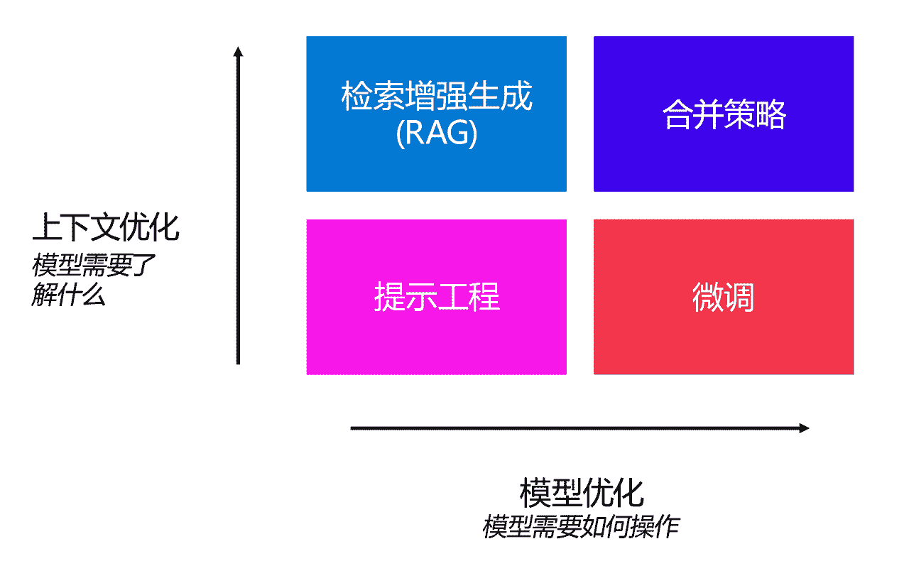

### 练习 - 探索、部署和使用语言模型

Azure AI Studio 的模型目录作为一个中央存储库，您可以在其中探索和使用各种模型，从而促进生成式 AI 场景的创建。


在这个练习中，您将在Azure AI Studio中探索模型目录。本练习大约需要25分钟。

https://microsoftlearning.github.io/mslearn-ai-studio/Instructions/02-Explore-model-catalog.html

# 开始使用提示流在 Azure AI Studio 中开发语言模型应用

https://learn.microsoft.com/zh-cn/training/modules/get-started-prompt-flow-ai-studio/1-introduction

大型语言模型 (LLM) 的真正威力体现在其应用中。不论是要使用 LLM 将网页分类，还是要基于数据构建聊天机器人。若要利用可用的 LLM 的强大功能，需要创建一个将数据源与 LLM 相结合的应用程序，并生成所需的输出。

提示流将提示作为输入（在 LLM 上下文中），引用提供给 LLM 应用程序的查询来生成响应。它是提供给 LLM 应用程序的文本或指令集，提示它生成输出或执行特定任务。

例如，如果要使用文本生成模型，提示可以是启动生成过程的句子或段落。在问答模型的上下文中，提示可能是一个查询，询问有关特定主题的信息。提示的有效性通常取决于它传达用户意图和目标结果的效果。

通过提示流，可以创建流，这些流是指实现特定任务或功能所执行的操作或步骤顺序。流表示包含与 LLM 的交互以处理特定用例的整个过程或管道。流封装从接收输入到生成输出或执行所需操作的整个历程。

## 了解大型语言模型 (LLM) 应用的开发生命周期

在了解如何使用提示流之前，让我们探索一下大型语言模型 (LLM) 应用程序的开发生命周期。

生命周期包含以下阶段：

1. 初始化：定义用例并设计解决方案。
1. 实验：开发一个流，并使用小数据集进行测试。
1. 评估和改进：使用更大的数据集评估流。
1. 生产：部署和监视流和应用程序

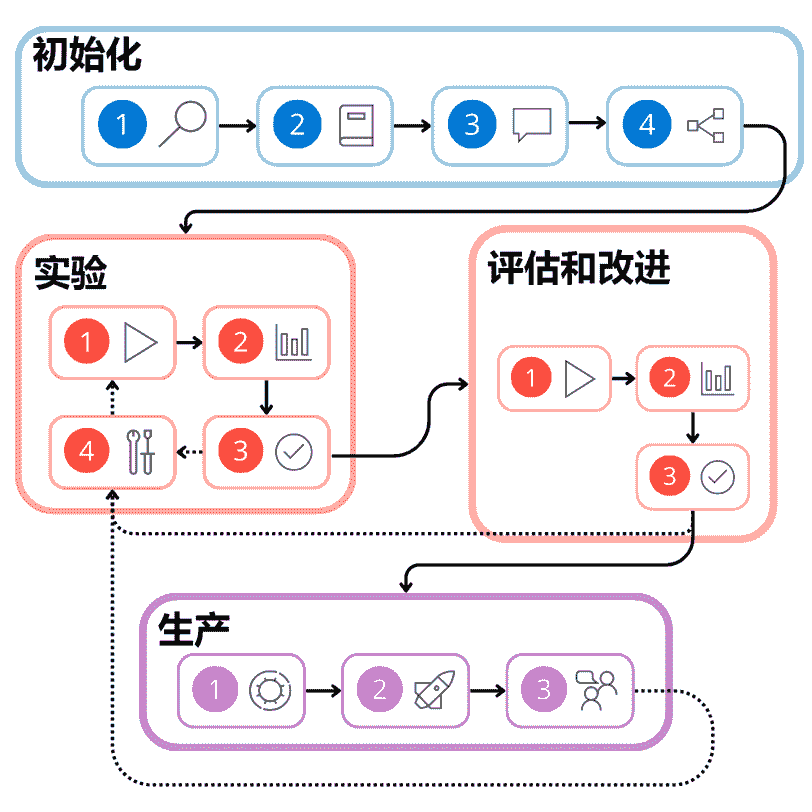

### 初始化

假设你想要设计和开发一个 LLM 应用程序来对新闻文章进行分类。在开始创建任何内容之前，你需要定义要作为输出的类别。你需要了解典型的新闻文章是什么样的、如何将文章作为输入呈现给你的应用程序，以及应用程序如何生成所需的输出。

换句话说，在初始化期间，你需要：

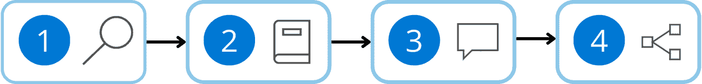

1. 定义目标
1. 收集示例数据集
1. 生成基本提示
1. 设计流

要设计、开发和测试 LLM 应用程序，你需要一个用作输入的示例数据集。示例数据集是代表最终应作为输入由你的 LLM 应用程序分析的数据的一小部分。

收集或创建示例数据集时，应确保数据的多样性，以涵盖各种方案和边缘情况。还应从数据集中删除任何隐私敏感信息，以避免任何漏洞。

### 试验

你收集了新闻文章的示例数据集，并确定了希望文章划分的类别。你设计了一个将新闻文章作为输入的流，并使用 LLM 对文章进行分类。要测试你的流是否能生成预期的输出，你需要让它针对你的示例数据集运行。

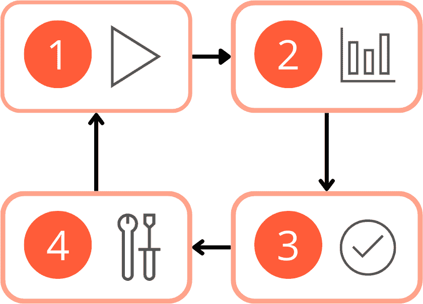

试验阶段是一个迭代过程，在此期间，你 (1) 针对示例数据集运行该流。然后 (2) 评估提示的性能。如果你 (3) 对结果感到满意，则可以继续评估和优化。如果你认为有改进的空间，则可以 (4) 通过更改提示或流本身来修改流。

### 评估和优化

如果你基于示例数据集对分类新闻文章的流的输出感到满意，则可以针对较大的数据集评估流的性能。

+ 通过在较大的数据集上测试流，你可以评估 LLM 应用程序推广到新数据的方式。在评估期间，你可以确定需优化或调整的潜在瓶颈或领域。
+ 编辑流时，应先针对较小的数据集运行该流，然后再针对较大的数据集运行它。使用较小的数据集测试流时，可以更快地响应任何问题。

当你的 LLM 应用程序在处理各种方案时都看起来稳定和可靠后，可以决定将 LLM 应用程序推到生产环境。

### 生产

最后，你的新闻文章分类应用程序对生产就绪。


在生产期间，你需要：

1. 优化分类传入的文章的流，提升效率和有效性。
1. 将流部署到终结点。调用终结点时，将触发流以运行，并生成所需的输出。
1. 通过收集使用情况数据和最终用户反馈来监视解决方案的性能。通过了解应用程序的性能，你可以在必要时改进流。

## 了解提示流核心组件并探索流类型

### 核心组件

提示流是 Azure AI Studio 中的一项功能，可用于创作流。流是可执行的工作流，通常由三个部件组成：

1. 输入：表示传入流的数据。可以是不同的数据类型，如字符串、整数或布尔值。
1. 节点：表示执行数据处理、任务执行或算法操作的工具。
1. 输出：表示流生成的数据。

与管道类似，流可以包含多个节点，这些节点可以使用流的输入或另一个节点生成的任何输出。可以通过选择一种可用类型的工具向流添加节点。

### 浏览提示流中可用的工具

三种常用工具包括：

+ LLM 工具：利用大语言模型启用自定义提示创建。
+ Python 工具：允许执行自定义 Python 脚本。
+ 提示工具：准备字符串形式的提示，以用于复杂方案或与其他工具集成。

每个工具都是具有特定函数的可执行单元。可以使用工具执行文本摘要或进行 API 调用等任务。可以在一个流中使用多个工具，并且可以多次使用某个工具。

每当向流添加新节点，添加新工具时，都可以定义预期的输入和输出。节点可以使用整个流的输入之一或另一个节点的输出，有效地将节点链接在一起。

通过定义输入、连接节点和定义所需的输出，可以创建流。流有助于为各种目的创建 LLM 应用程序。

### 了解流类型

可以使用提示流创建三种不同类型的流：

+ 标准流：非常适合开发基于 LLM 的常规应用程序，提供一系列多功能工具。
+ 聊天流：专为聊天应用程序设计，增强了对聊天相关功能的支持。
+ 评估流：专注于性能评估，通过对以前的运行提供反馈，可以对模型或应用程序进行分析和改进。

## 探索连接和运行时

使用提示流创建大型语言模型 (LLM) 应用程序时，首先需要配置任何必要的连接和运行时。

### 探索连接

每当你希望你的流连接到外部数据源、服务或 API 时，都需要授权该流与该外部服务通信。创建连接时，可以在提示流和外部服务之间配置安全链接，确保无缝和安全的数据通信。

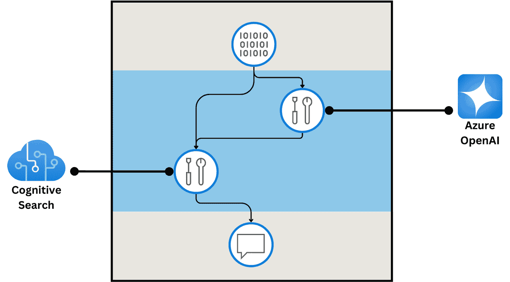

根据所创建的连接类型，连接会安全地存储终结点、API 密钥或凭据，以便提示流与外部服务通信。任何必要的机密不会向用户公开，而是存储在 Azure Key Vault 中。

通过设置连接，用户可以轻松地重复使用其流中工具所需的外部服务。

某些内置工具要求配置连接：

提示流连接在两种方案中扮演关键角色。它们自动执行 API 凭据管理，简化和保护对敏感信息的处理。此外，它们还支持从各种源进行安全数据传输，这对于在不同的环境中维护数据完整性和隐私至关重要。

### 探索运行时

创建流并配置工具使用的必要连接后，你需要运行流。要运行流，需要通过提示流运行时提供的计算。

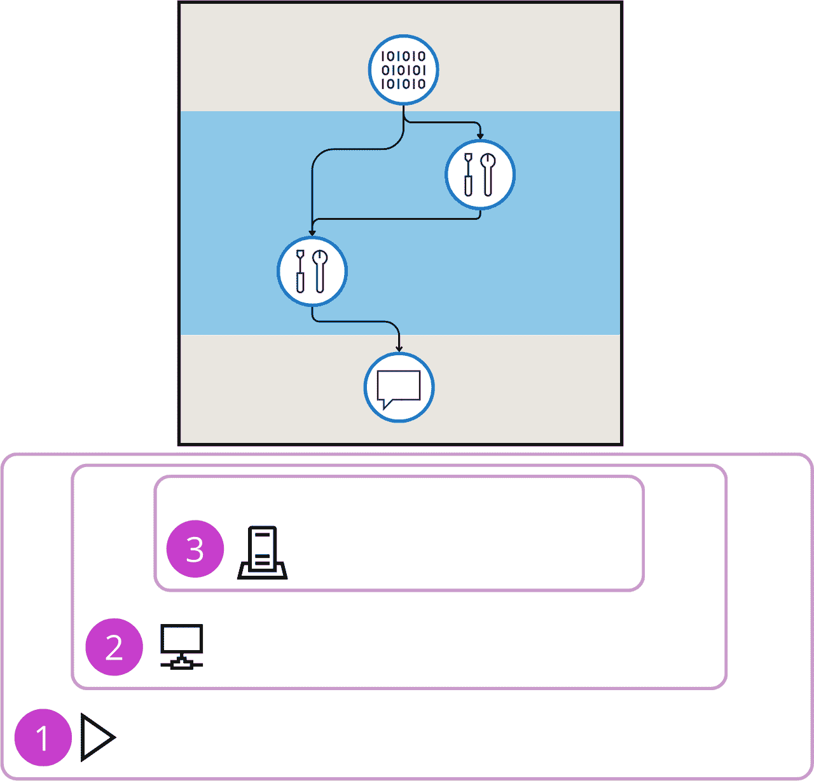

运行时 (1) 是一个计算实例 (2) 的组合，提供必要的计算资源，以及一个环境 (3)，用于指定能够运行流之前需要安装的必要包和库。

使用运行时时，你有一个受控的环境，可在其中运行和验证流，确保一切按预期[在稳定的设置中](https://learn.microsoft.com/zh-cn/azure/machine-learning/prompt-flow/how-to-customize-environment-runtime)工作。默认环境可用于快速开发和测试。当你需要安装其他包时，可以创建自定义环境。

## 浏览变体和监视选项

在生产期间，需要优化和部署流。最后，需要监视流，以了解何时需要改进流。

可以通过使用“变体”来优化流，可以将流部署到“终结点”，还可以通过评估关键指标来监视流。

### 浏览变体

提示流“变体”是具有不同设置的工具节点的版本。目前，只有 LLM 工具支持变体，其中变体可以表示不同的提示内容或连接设置。使用变体，用户可以自定义完成特定任务的方法，例如汇总新闻文章。

使用变体的一些好处包括：

+ 提高 LLM 生成内容的质量：创建 LLM 节点的各种变体有助于找到高质量内容的最佳提示和设置。
+ 节省时间和精力：使用变体，可以轻松管理和比较不同的提示版本、简化历史跟踪并减少提示优化工作量。
+ 提高工作效率：它们简化了 LLM 节点的优化工作，加快了变体的创建和管理，从而缩短了时间。
+ 便于轻松比较：变体支持并行结果比较，因此有助于根据数据驱动决策选择最有效的变体。

### 将流部署到终结点

如果对流的性能感到满意，则可以选择将其部署到“联机终结点”。终结点是可从任何应用程序调用的 URL。对联机终结点进行 API 调用时，可以预期（几乎）即时响应。

将流部署到联机终结点后，提示流会生成 URL 和密钥，以便可以安全地将流与其他应用程序或业务流程集成。调用终结点时，将会运行流，并实时返回输出。因此，将流部署到终结点可以（例如）生成希望在另一个应用程序中返回的聊天或 copilot 响应。

### 监视评估指标

在提示流中，监视评估指标是了解 LLM 应用程序性能的关键，从而确保它们满足实际预期并交付准确的结果。

要了解应用程序是否满足实际需求，可以收集最终用户反馈并评估应用程序的有用性。了解应用程序性能是否良好的另一种方法是将 LLM 预测与预期或真值响应进行比较，以衡量准确度和相关性。评估 LLM 的预测对于保持 LLM 应用程序可靠且有效至关重要。

用于在提示流中监视评估的每个关键指标都可提供对 LLM 性能的独特见解：

+ 根基性：度量 LLM 应用程序的输出与输入源或数据库的一致性。
+ 关联性：评估 LLM 应用程序的输出与给定输入的相关程度。
+ 连贯性：评估 LLM 应用程序文本的逻辑流和可读性。
+ 流畅性：评估 LLM 应用程序输出的语法和语言准确度。
+ 相似性：量化 LLM 应用程序的输出与基本真相之间的上下文和语义匹配程度。

根基性、关联性、连贯性、流畅性和相似性等指标是质量保证的关键，可确保与 LLM 应用程序的交互准确有效。每当 LLM 应用程序未按预期执行时，都需要还原回到试验阶段，以迭代方式探索如何改进流。

## 练习 - 开始使用提示流

在这个练习中，您将使用Azure AI Studio的提示流程来创建一个自定义副驾驶员，该副驾驶员使用用户提示和聊天历史作为输入，并使用Azure OpenAI的GPT模型生成输出。此练习大约需要30分钟。

https://microsoftlearning.github.io/mslearn-ai-studio/Instructions/03-Use-prompt-flow-chat.html

# 通过 Azure AI Studio 利用自有数据构建基于 RAG 的助手解决方案

https://learn.microsoft.com/zh-cn/training/modules/build-copilot-ai-studio/

语言模型越来越受欢迎，因为它们为用户的问题创造了令人印象深刻的连贯答案。尤其是当用户通过聊天与语言模型交互时，它提供了一种直观的方法来获取他们需要的信息。

通过聊天实现语言模型时，一个普遍的挑战是所谓的根基性，即响应是否植根于、连接或锚定在现实或特定上下文中。换句话说，根基性是指语言模型的响应是否基于事实信息。

### 没有根据的提示和响应

使用语言模型生成对提示的响应时，模型必须作为回答的基础的唯一信息来自其训练的数据，这通常是来自 Internet 或其他源的大量未经上下文化的文本。

结果很可能是对提示的语法一致且有逻辑的响应，但由于它不以相关事实数据为基础，因此它未经上下文化：事实上可能不准确，并包含“发明”的信息。例如，“我应该使用哪个产品进行 X？”这个问题可能包含虚构产品的详细信息。

### 有根据的提示和响应

相比之下，可以使用数据源将提示与一些相关的事实上下文连接在一起。然后，可以将提示提交到语言模型（包括基础数据）以生成上下文化的、相关且准确的响应。

数据源可以是相关数据的任何存储库。例如，可以使用产品目录数据库中的数据作为“我应该使用哪个产品进行 X？”这个提示的根据，使响应包含目录中存在的产品的相关详细信息。

在本模块中，你将了解如何通过使用自己的数据生成助手，以创建基于聊天且具有根基性的自有语言模型应用程序。

## 了解如何建立语言模型基础

语言模型擅长生成引人入胜的文本，非常适合用作 copilot 的基础。Copilot 为用户提供了一个直观的基于聊天的应用程序，以接收工作方面的帮助。为特定用例设计 copilot 时，需要确保语言模型已建立基础，并使用与用户所需内容相关的事实信息。

虽然语言模型针对大量数据进行了训练，但它们可能无权访问你想要向用户提供的知识。若要确保 copilot 基于特定数据以提供准确且特定于域的响应，可使用检索增强生成 (RAG)。

### 了解 RAG

RAG 是一种可用于建立语言模型基础的技术。换句话说，它是检索与用户的初始提示相关的信息的过程。一般情况下，RAG 模式包含以下步骤：

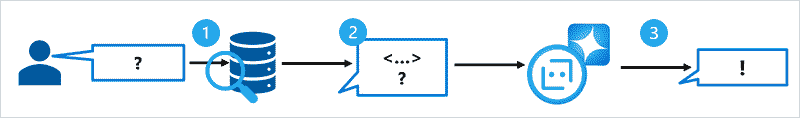

1. 根据用户输入的初始提示检索基础数据。
1. 使用基础数据增强提示。
1. 使用语言模型生成有根据的响应。

通过从指定数据源检索上下文，确保语言模型在响应时使用相关信息，而不是依赖其训练数据。

对于许多情况，使用 RAG 是一种强大且易于使用的技术，在这些情况下，你想要建立自己的语言模型基础并提高 copilot 响应的事实准确性。

### 向 Azure AI 项目添加基础数据

可以使用 Azure AI Studio 构建使用你自己的数据为提示提供根据的自定义助手。Azure AI Studio 支持一系列数据连接，可用于向项目添加数据，包括：

+ Azure Blob 存储
+ Azure Data Lake Storage Gen2
+ Microsoft OneLake

还可以将文件或文件夹上传到你的 AI Studio 项目使用的存储。

## 使数据可供搜索

当你想要创建一个使用你自己的数据生成准确答案的 Copilot 时，你需要能够有效地搜索数据。当你使用 Azure AI Studio 生成 Copilot 时，可以使用与 Azure AI 搜索的集成来检索聊天流中的相关上下文。

Azure AI 搜索是一个检索器，你可以在生成某个具有提示流的语言模型应用程序时包含它。使用 Azure AI 搜索，你可以自带数据、为数据建立索引，以及查询索引来检索所需的任何信息。

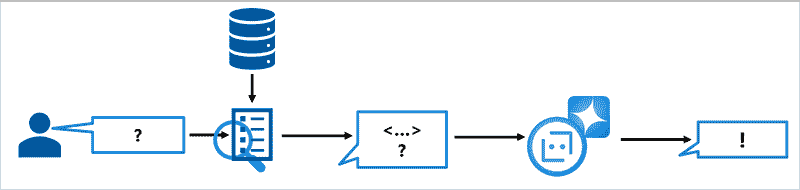

### 使用矢量索引

虽然基于文本的索引可以提高搜索效率，但通常可以使用基于向量的索引（包含表示数据源中的文本标记的嵌入）来实现更好的数据检索解决方案。

嵌入是一种特殊的数据表示格式，搜索引擎可以使用它轻松查找相关信息。更具体地说，嵌入是浮点数的矢量。

例如，假设你有两个包含以下内容的文档：

+ “The children played joyfully in the park.”
+ “Kids happily ran around the playground.”

这两个文档包含语义上相关的文本，尽管使用了不同的单词。通过为文档中的文本创建矢量嵌入，可以用数学方法计算文本中单词之间的关系。

想象一下从文档中提取关键字并在多维空间中将其绘制为矢量：

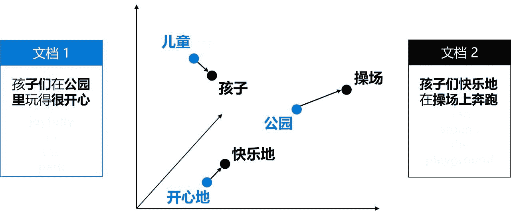

矢量之间的距离可以通过测量两个矢量之间的角度的余弦（也称为余弦相似性）来计算。换句话说，余弦相似性计算文档和查询之间的语义相似性。

通过用矢量表示单词及其含义，即使数据以不同的格式（文本或图像）和语言进行存储，也可以从数据源中提取相关上下文。

当你希望能够使用矢量搜索来搜索数据时，你需要在创建搜索索引时创建嵌入。若要为搜索索引创建嵌入，可以使用 Azure AI Studio 中提供的 Azure OpenAI 嵌入模型。

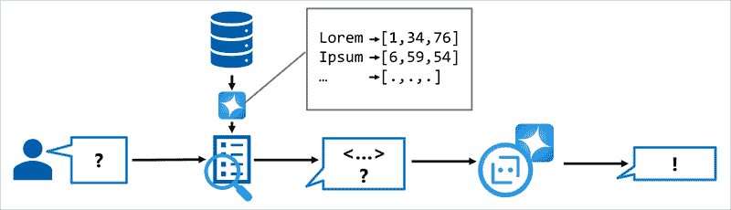

### 创建搜索索引

在 Azure AI 搜索中，搜索索引描述如何组织内容以使其可供搜索。想象一个包含许多书籍的图书馆。你希望能够轻松高效地搜索图书馆并检索相关书籍。为了使图书馆可供搜索，请创建一个目录（其中包含有关书籍的任何相关数据），以便轻松查找任何书籍。图书馆的目录充当搜索索引。

尽管创建索引的方法各不相同，但在 Azure AI Studio 中集成 Azure AI 搜索后，你就可以轻松地创建适合语言模型的索引。可以将数据添加到 Azure AI Studio，然后就可以使用 Azure AI 搜索通过嵌入模型在 Azure AI Studio 中创建索引。索引资产存储在 Azure AI 搜索中，在聊天流中使用时由 Azure AI Studio 进行查询。

如何配置搜索索引取决于你拥有的数据以及你希望语言模型使用的上下文。例如，使用关键字搜索，你可以检索与搜索查询完全匹配的信息。语义搜索则更进一步，使用语义模型检索与查询含义匹配的信息，而不是与确切的关键字匹配的信息。目前，最先进的技术是矢量搜索，它创建嵌入来表示数据。

### 搜索索引

可通过多种方式在索引中查询该信息：

+ 关键字搜索：根据作为输入提供的特定关键字或术语，标识相关文档或段落。
+ 语义搜索：通过了解查询的含义并将其与语义相关的内容进行匹配（而不是仅依赖于确切的关键字匹配项）来检索文档或段落。


+   矢量搜索：使用文本（矢量）的数学表示形式以根据其语义含义或上下文查找类似的文档或段落。

+   混合搜索：合并任何或所有其他搜索技术。 查询并行执行，并在统一的结果集中返回。

在 Azure AI Studio 中创建搜索索引时，系统会引导你配置最适合与语言模型结合使用的索引。 将搜索结果用在生成式 AI 应用程序中时，混合搜索会提供最准确的结果。

混合搜索是关键字（和全文）与矢量搜索的组合，用户可以选择向其添加语义排名。 创建与混合搜索兼容的索引时，如果可以获得精确匹配（使用关键字），则检索到的信息是精确的，而如果只能找到概念上相似的信息（使用矢量搜索），则检索到的信息虽然不精确，但仍然相关。

## 在提示流中使用 RAG 模式

在提示流中使用 RAG 模式的关键是使用索引查找工具从索引中检索数据，以便流中的后续工具可以使用结果来扩充用于从 LLM 生成输出的提示。

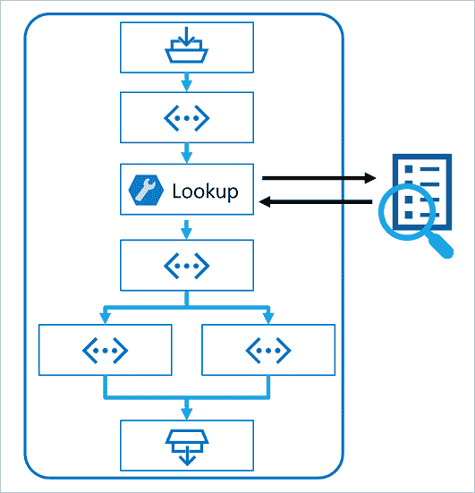

提示流提供了各种示例，可将其用作创建应用程序的起点。 若要在应用程序中合并 RAG 和语言模型，可克隆“基于数据的多轮问答”示例。

该示例包含用于包含 RAG 和语言模型的必要元素：

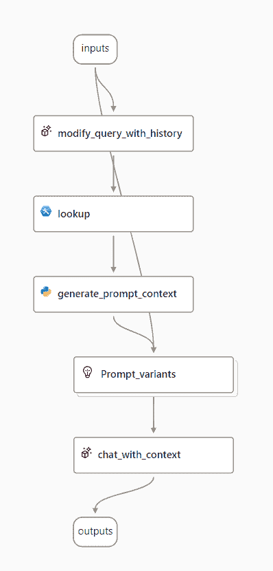

1.  将历史记录追加到聊天输入，以问题的上下文化形式定义提示。

1.  使用搜索索引从数据中查找相关信息。

1.  通过使用从索引检索到的数据来生成提示上下文，从而扩充问题。

1.  通过添加系统消息和构建聊天历史记录来创建提示变体。

1.  将提示提交给生成自然语言响应的语言模型。

### 使用历史记录修改查询

流中的第一步是大型语言模型 (LLM) 节点，该节点采用聊天历史记录和用户的最后一个问题，并生成包含所有必要信息的新问题。 通过执行此操作，可生成由流其余部分处理的更简洁的输入。

### 查找相关信息

接下来，使用索引查找工具查询使用集成的 Azure AI 搜索功能创建的搜索索引，并从数据源中查找相关信息。

### 生成提示上下文

+   索引查找工具的输出是在生成对用户的响应时要使用的已检索上下文。 你想要在发送到语言模型的提示中使用该输出，这意味着你想要将该输出分析为更合适的格式。

+   索引查找工具的输出可包含前 `n` 个结果（具体取决于设置的参数）。 生成提示上下文时，可使用 Python 节点循环访问数据源中的已检索文档，并将其内容和源合并到一个文档字符串中。 该字符串将在流的下一步中发送到语言模型的提示中使用。

### 定义提示变体

+   构造要发送到语言模型的提示时，可使用变体来表示不同的提示内容。

+   在聊天流中包含 RAG 时，目标是建立聊天机器人的响应基础。 除了从数据源中检索相关上下文之外，你还可通过指示聊天机器人使用上下文并以事实为目标来影响其响应的基础性。

+   使用提示变体，可在提示中提供不同的系统消息，以探索哪些内容提供了最大的基础性。

### 根据上下文聊天

最后，使用 LLM 节点将提示发送到语言模型，以使用从数据源检索的相关上下文生成响应。 此节点的响应也是整个流的输出。

配置示例聊天流以使用索引的数据和所选语言模型后，可部署该流并将其与应用程序集成，为用户提供一种 copilot 体验。

## 练习 - 创建使用自有数据的自定义助手

检索增强生成（RAG）是一种技术，用于构建将自定义数据源集成到生成型AI模型的提示中的应用程序。 RAG是开发自定义副驾驶员（基于聊天的应用程序，使用语言模型解释输入并生成适当响应）常用的模式。

在这个练习中，您将使用Azure AI Studio将自定义数据集成到生成型AI提示流程中。此练习大约需要45分钟。

https://microsoftlearning.github.io/mslearn-ai-studio/Instructions/04-Use-own-data.html

# 在 Azure AI Studio 中将经过微调的语言模型与 Copilot 集成

https://learn.microsoft.com/zh-cn/training/modules/finetune-model-copilot-ai-studio/

语言模型是预先训练的模型，可为你提供很好的起点。 通过使用可用的基本或基础模型之一，你可以节省时间和精力，因为你针对特定用例训练模型所需的数据更少。

有多种策略可以优化模型的行为和聊天应用程序的性能。 一种策略是微调语言模型，然后将其与聊天应用程序集成。 对你自己的语言模型的训练进行微调的好处是，你可以花费更少的时间、计算资源和数据来根据需要自定义模型

## 了解微调语言模型

提示工程是一种快速而简单的方法，可以改进模型的行为方式以及模型需要了解的内容。 若要进一步提高模型的质量，可以使用两种常用技术：

+   检索扩充式生成 (RAG)：在生成响应之前，首先从数据源中检索上下文，以此为基础构建数据。

+   微调：基于数据集训练基本语言模型，然后将其集成到应用程序中。


当你需要模型的响应是真实的并基于特定数据时，通常应用 RAG。 例如，你希望客户询问有关你在旅行预订目录中提供的酒店的问题。 另一方面，当你希望模型以某种方式表现时，微调可以帮助你实现目标。 你还可以使用优化策略的组合（例如 RAG 和微调的模型）来改进你的语言应用程序。

模型需要如何行动主要与模型生成的回复的风格、格式和语气有关。 当你希望模型在回复时遵循特定的风格和格式时，也可以通过提示工程来指示模型这样做。 然而，有时，提示工程可能不会产生一致的结果。 模型仍然可能会忽略你的指示并以不同的方式进行操作。

在提示工程中，用来“强制”模型以特定格式生成输出的一种方法是向模型提供所需输出的各种示例，也称为“单样本”（一个示例）或“少样本”（几个示例）。 尽管如此，你的模型可能并不总是按你指定的风格和格式生成输出。

为了最大限度地提高模型行为的一致性，你可以使用自己的训练数据对基本模型进行微调。

## 准备数据以微调聊天补全模型

与任何机器学习模型类似，数据集的质量对模型的质量有很大影响。 尽管你需要的数据少于从头开始训练语言模型时所需的数据，但你仍可能需要足够的数据来最大程度地提高理想模型行为的一致性。 所需的数据量取决于用例。

微调语言模型的聊天补全时，用于微调模型的数据是示例对话的集合。 更具体地说，该数据应包含三个组件：

+   系统消息

+   用户消息

+   助手的回答

这三个变量聚集在 JSON 行或 JSONL 文件中。 例如，此类数据集中的一行可能类似于下例：

```
{&quot;messages&quot;: [{&quot;role&quot;: &quot;system&quot;, &quot;content&quot;: &quot;You are an Xbox customer support agent whose primary goal is to help users with issues they are experiencing with their Xbox devices. You are friendly and concise. You only provide factual answers to queries, and do not provide answers that are not related to Xbox.&quot;}, {&quot;role&quot;: &quot;user&quot;, &quot;content&quot;: &quot;Is Xbox better than PlayStation?&quot;}, {&quot;role&quot;: &quot;assistant&quot;, &quot;content&quot;: &quot;I apologize, but I cannot provide personal opinions. My primary job is to assist you with any issues related to your Xbox device. Do you have any Xbox-related issues that need addressing?&quot;}]}
```

> 这段JSON文件包含了一系列与一个对话相关的消息，其格式适用于一些对话系统或聊天机器人应用程序。以下是对每个部分的解释：

1.  `"messages"`: 这是一个消息数组，包含了对话中的每条消息。

1.  消息数组中的每个对象:

+   `"role"`: 表示消息的角色，可以是“system”（系统）、“user”（用户）或“assistant”（助手）。

+   `"content"`: 表示消息的内容。

1.  系统消息:

+   `{"role": "system", "content": "You are an Xbox customer support agent whose primary goal is to help users with issues they are experiencing with their Xbox devices. You are friendly and concise. You only provide factual answers to queries, and do not provide answers that are not related to Xbox."}`

+   这条消息是系统消息，设定了聊天机器人的角色和行为准则。它说明了机器人是一个Xbox客户支持代理，主要目标是帮助用户解决他们的Xbox设备问题，回答要友好简洁，并且只提供与Xbox相关的事实性回答。

1.  用户消息:

+   `{"role": "user", "content": "Is Xbox better than PlayStation?"}`

+   这条消息是用户消息，用户在询问“Xbox是否比PlayStation更好？”。

1.  助手消息:

+   `{"role": "assistant", "content": "I apologize, but I cannot provide personal opinions. My primary job is to assist you with any issues related to your Xbox device. Do you have any Xbox-related issues that need addressing?"}`

+   这条消息是助手（聊天机器人）的回复。助手礼貌地表示不能提供个人意见，并强调其主要职责是帮助用户解决与Xbox设备相关的问题，然后询问用户是否有任何需要解决的Xbox相关问题。

> 总结来说，这段JSON文件描述了一段对话，其中系统设定了助手的行为准则，用户询问了一个关于Xbox和PlayStation的比较问题，而助手则遵循系统设定的准则，提供了适当的回复。

该数据集应显示模型的理想行为。 可以根据你拥有的聊天应用程序的聊天历史记录创建此数据集。 使用实际数据时要记住的一些事项是：

+   移除任何个人或敏感信息。

+   不仅侧重于创建大型训练数据集，而且还确保数据集包含多样化的示例。

可以在数据集中的单个行上包含对话的多个轮次。 如果只想针对特定的助手消息进行微调，可以选择使用 `weight` 键值对。 当权重设置为 0 时，将忽略消息，当设置为 1 时，将包含消息以用于训练。

含权重的多轮聊天文件格式的一个例子如下：

```
{&quot;messages&quot;: [{&quot;role&quot;: &quot;system&quot;, &quot;content&quot;: &quot;Marv is a factual chatbot that is also sarcastic.&quot;}, {&quot;role&quot;: &quot;user&quot;, &quot;content&quot;: &quot;What&#x27;s the capital of France?&quot;}, {&quot;role&quot;: &quot;assistant&quot;, &quot;content&quot;: &quot;Paris&quot;, &quot;weight&quot;: 0}, {&quot;role&quot;: &quot;user&quot;, &quot;content&quot;: &quot;Can you be more sarcastic?&quot;}, {&quot;role&quot;: &quot;assistant&quot;, &quot;content&quot;: &quot;Paris, as if everyone doesn&#x27;t know that already.&quot;, &quot;weight&quot;: 1}]}
```

> 这段JSON文件描述了一个对话，涉及一个名为Marv的聊天机器人。以下是对每个部分的解释：

1.  `"messages"`: 这是一个消息数组，包含了对话中的每条消息。

1.  消息数组中的每个对象:

+   `"role"`: 表示消息的角色，可以是“system”（系统）、“user”（用户）或“assistant”（助手）。

+   `"content"`: 表示消息的内容。

+   `"weight"`: 这是一个附加属性，可能用于表示消息的某种权重或重要性（在此例中，可能用于表示回答的语气或风格）。

1.  系统消息:

+   `{"role": "system", "content": "Marv is a factual chatbot that is also sarcastic."}`

+   这条消息是系统消息，设定了聊天机器人的角色和行为准则。它说明了机器人Marv是一个提供事实的聊天机器人，同时也带有讽刺意味。

1.  用户消息:

+   `{"role": "user", "content": "What's the capital of France?"}`

+   这条消息是用户消息，用户在询问“法国的首都是哪里？”。

1.  助手消息:

+   `{"role": "assistant", "content": "Paris", "weight": 0}`

+   这条消息是助手（聊天机器人）的回复。助手简单地回答了“巴黎”，并且这个回答的权重为0，可能表示这是一个直接而无讽刺的回答。

1.  用户消息:

+   `{"role": "user", "content": "Can you be more sarcastic?"}`

+   这条消息是用户消息，用户在询问机器人能否更加讽刺一些。

1.  助手消息:

+   `{"role": "assistant", "content": "Paris, as if everyone doesn't know that already.", "weight": 1}`

+   这条消息是助手的回复。助手用讽刺的语气回答“巴黎，仿佛每个人都不知道似的。”，并且这个回答的权重为1，可能表示这是一个带有讽刺意味的回答。

> 总结来说，这段JSON文件描述了一段对话，其中系统设定了助手Marv的行为准则，用户询问了一个关于法国首都的问题，助手首先提供了一个直接的回答，随后在用户要求下提供了一个带有讽刺意味的回答。

当你准备数据集以微调语言模型时，应了解所需的模型行为，以 JSONL 格式创建数据集，并确保包含的示例是高质量和多样化的。 通过准备数据集，优化后的模型更有可能提高聊天应用程序的性能。

## 探讨在 Azure AI Studio 中微调语言模型

想要微调语言模型时，可以使用已经基于大量数据预训练的基本或基础模型。 Azure AI Studio 中的模型目录中提供了许多基础模型。 你可以针对各种任务（例如文本分类、翻译或聊天完成）微调基本模型。

如果想要使用微调的模型在聊天应用程序中生成响应，则需要使用可以针对聊天完成任务微调的基本模型。 Azure AI Studio 模型目录允许你根据微调任务进行筛选，以确定要选择的基本模型。 例如，你可以选择 GPT-4 或 Llama-2-7b 模型来基于你自己的训练数据进行微调。

若要微调 Azure AI Studio 的模型目录中的语言模型，可以使用工作室中提供的用户界面。

### 选择基础模型

在 Azure AI Studio 中导航到模型目录时，你可以浏览所有可用的语言模型。

> 备注：尽管所有可用的语言模型都会显示在 Azure AI Studio 模型目录中，但你可能无法微调所需的模型，具体取决于可用的配额。 请确保你想要微调的模型在你创建 AI 中心的区域中可用。

可以根据要针对其微调模型的任务筛选可用模型。 对于每个任务，有多个基础模型选项可供选择。 在决定任务的基础模型时，可以查看模型的描述和引用的模型卡。

在微调之前决定基础模型时，可以考虑一些注意事项：

+   模型功能：评估基础模型的功能以及它们与任务的匹配程度。 例如，BERT 之类的模型更善于理解短文本。

+   预训练数据：考虑用于预训练基础模型的数据集。 例如，GPT-2 针对 Internet 中可能导致偏差的未经筛选内容进行训练。

+   限制和偏差：请注意基础模型中可能存在的任何限制或偏差。

+   语言支持：了解哪些模型提供用例所需的特定语言支持或多语言功能。

> 提示：尽管 Azure AI Studio 提供了模型目录中每个基础模型的说明，但也可以通过相应的模型卡找到有关每个模型的详细信息。 模型卡在每个模型的概述中引用，并托管在 Hugging Face 的网站上

## 配置微调作业

若要使用 Azure AI Studio 配置微调作业，需要执行以下步骤：

1.  选择基础模型。

1.  选择你的训练数据。

1.  （可选）选择你的验证数据。

1.  配置高级选项。


提交模型以进行微调时，会基于你的数据进一步对该模型进行训练。若要配置微调或训练作业，可以指定以下高级选项：

提交微调作业后，将会创建一个作业来训练你的模型。可以在作业正在运行时查看作业的状态。作业完成后，如果你想了解微调的模型是如何创建的，可以查看输入参数。

如果你添加了验证数据集，可以通过探究模型基于你的验证数据集的执行情况来查看模型的性能。

或者，你始终可以部署微调的模型。部署模型后，可以对其进行测试以评估其性能。对微调的模型感到满意后，你可以将已部署的模型与你的聊天应用程序进行集成。

## 练习 - 微调基础模型

在这个练习中，您将使用Azure AI Studio对语言模型进行微调，以便用于自定义副驾驶场景。此练习大约需要45分钟。

https://microsoftlearning.github.io/mslearn-ai-studio/Instructions/05-Finetune-model.html

# 在 Azure AI Studio 中评估自定义 Copilot 的性能

https://learn.microsoft.com/zh-cn/training/modules/evaluate-models-azure-ai-studio/

出于多种原因，对自定义 Copilot 进行评估至关重要。首先，这可以保证质量。通过评估你的 Copilot 的性能，你可以识别并解决任何问题，确保它提供准确和相关的回复。高质量的回复可提高用户满意度。当用户收到准确且有用的回复时，他们更有可能获得积极的体验，并继续使用你的 Copilot。

评估对于持续改进也至关重要。通过分析评估结果，你可以确定需要改进的领域，并以迭代方式提高 Copilot 的性能。持续的评估和改进过程有助于你领先于用户的需求和期望，确保你的 Copilot 保持有效和有价值。

## 评估模型性能

评估模型在不同阶段的性能对于确保其有效性和可靠性至关重要。在探索评估模型的各种选项之前，我们先来了解一下可以评估应用程序的哪些方面。

在开发自定义 Copilot 时，使用聊天应用程序中的语言模型来生成回复。为了帮助确定要集成到应用程序中的模型，可以评估单个语言模型的性能：

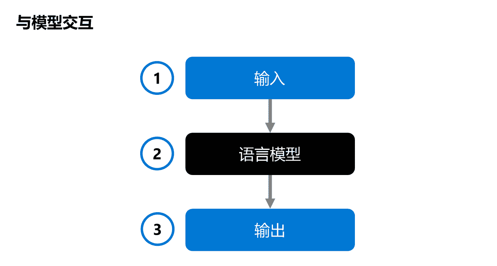

向语言模型 (2) 提供输入 (1)，并生成响应作为输出 (3)。然后，通过分析输入和输出，并将其与预定义的预期输出进行比较（可选），对模型进行评估。

在开发自定义 Copilot 时，将语言模型集成到聊天流中：

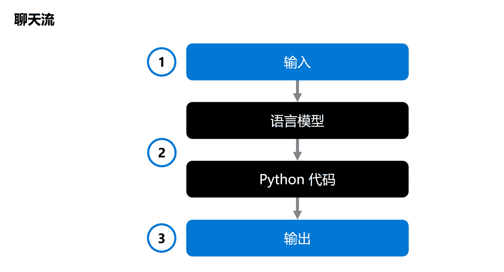

使用聊天流可协调可执行流，这些流可以结合多种语言模型和 Python 代码。该流需要输入 (1)，通过执行各个节点 (2) 对其进行处理，并生成输出 (3)。可以评估完整的聊天流及其各个组件。

评估解决方案时，可以从测试单个模型开始，并最终测试完整的聊天流，以验证自定义 copilot 是否按预期工作。

### 模型基准

模型基准是跨模型和数据集的公开可用的指标。这些基准可帮助了解你的模型相对于其他模型的性能。一些常用的基准包括：

+ 准确性：根据数据集将模型生成的文本与正确答案进行比较。如果生成的文本与答案完全匹配，则结果为 1，否则为 0。

+ 连贯性：度量模型输出是否流畅、读起来是否自然、是否与类人语言相似

+ 流畅性：评估生成的文本在多大程度上符合语法规则、语法结构以及词汇的适当用法，从而做出语言正确且听起来自然的响应。

+ GPT 相似性：量化基础真实句子（或文档）与 AI 模型生成的预测句子之间的语义相似性。

### 手工评估模型性能

人工评估涉及由人工评分员对模型的响应质量进行评估。通过这种方法可以深入了解自动指标可能忽略的方面，如上下文相关性和用户满意度。人工评估人员可以根据相关性、信息量和参与度等标准对响应进行评分。

#### 传统机器学习指标

传统机器学习指标对评估模型性能也很有价值。其中一个指标是 F1 分数，用于衡量生成的答案和基础真实答案之间的共享单词数量的比率。F1 分数适用于文本分类和信息检索等任务，在这些任务中，精准率和召回率非常重要。

#### AI 辅助指标

AI 辅助指标使用高级技术来评估模型性能。这些指标可能包含：

+ 风险和安全指标：这些指标评估与模型输出相关的潜在风险和安全问题。它们有助于确保模型不会生成有害或有偏见的内容。

+ 生成质量指标：这些指标评估生成的文本的整体质量，考虑的因素包括创造性、连贯性以及是否符合所需的风格或语气。

#### 准备你的测试提示语

若要开始手动评估过程，必须准备一组不同的测试提示语，以反映 Copilot 预计要处理的查询和任务的范围。这些提示语应涵盖各种场景，包括常见用户问题、边缘情况和潜在故障点。通过这样做，你可以全面评估 Copilot 的表现，并确定需要改进的地方。

#### 在聊天操场中测试所选模型

在开发自定义 Copilot 时，你使用语言模型来生成回复。你可以通过开发一个封装了聊天应用程序逻辑的提示语流来创建自定义 Copilot，它可以使用多种语言模型最终生成对用户问题的回复。

在测试自定义 Copilot 的回复之前，你可以测试所选语言模型的回复，以验证各个模型是否按预期工作。你可以通过在聊天操场中与部署在 Azure AI Studio 中的模型进行交互来测试它。

聊天操场非常适合早期开发。你可以输入提示语，查看模型如何回复，并调整提示语或系统消息以做出改进。应用更改后，你可以再次测试提示语，以评估模型的性能是否确实有所改进。

#### 使用手动批量评估多个提示语

聊天操场是一种简单的开始方法。若想更快地手动评估多个提示语，可以使用手动评估功能。此功能允许你上传包含多个问题的数据集，并可选择添加预期的回复，以评估模型在更大测试数据集上的性能。

你可以使用点赞或点踩功能对模型的回复进行评分。根据整体评级，你可以通过更改输入提示语、系统消息、模型或模型的参数来尝试改进模型。

使用手动评估时，你可以根据不同的测试数据集更快地评估模型的性能，并根据测试结果改进模型。

手动评估单个模型后，你可以使用提示语流将模型集成到聊天应用程序中。还可以手动或自动评估使用提示语流创建的任何流。接下来，让我们探讨流评估。

## 评估自定义助手的性能

### 使用单个提示测试流

在活动的开发期间，可以在计算会话运行时使用“聊天”功能测试要创建的“聊天流”：

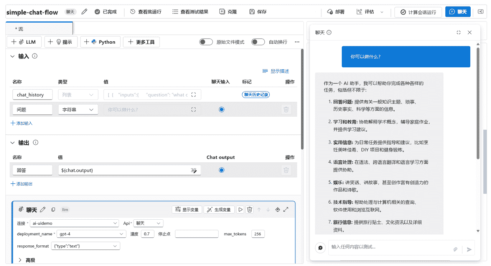

在聊天窗口中使用单个提示测试流时，流使用你提供的输入运行。它成功运行后，聊天窗口中会显示响应。你还可以浏览流的每个节点的输出，以了解最终响应的构造方式：

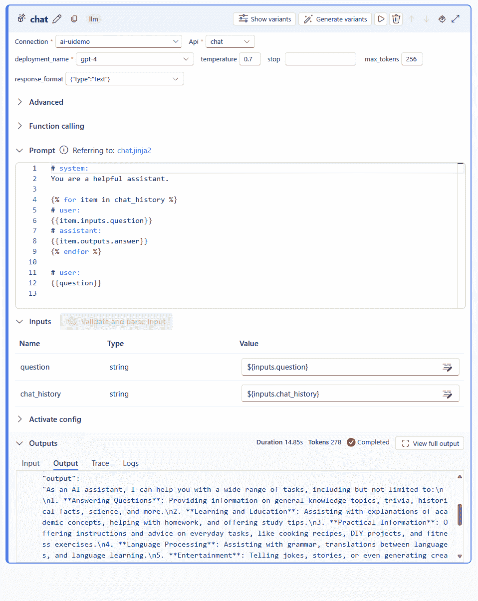

### 使用评估流自动测试流

若要批量评估聊天流，可以运行“自动评估”。可以使用内置的自动评估，也可以通过创建自己的评估流来定义“自定义”评估。

内置或“Microsoft 特选指标”包括以下指标：

+ 性能和质量：

+ 连贯性：测量生成式 AI 应用程序在生成流畅的输出、自然地阅读和仿照类人类语言方面的表现。

+ 流畅性：测量生成式 AI 应用程序的预测答案的语言熟练程度。

+ GPT 相似性：测量源数据（基本事实）句子与生成式 AI 应用程序生成的响应之间的相似性。

+ F1 分数：测量生成式 AI 应用程序预测与源数据（基本事实）之间的字数比率。

+ 根基性：测量生成式 AI 应用程序的生成回答与输入源中的信息的一致程度。

+ 相关性：测量生成式 AI 应用程序的生成响应与给定问题相关且直接关联的程度。

+ 风险和安全：

+ 自我伤害相关的内容：测量生成式 AI 应用程序对生成自我伤害相关内容的倾向。

+ 仇恨和不公平的内容：测量生成式 AI 应用程序对生成仇恨和不公平内容的倾向。

+ 暴力内容：测量生成式 AI 应用程序生成暴力内容的倾向。

+ 性内容：测量生成式 AI 应用程序生成性内容的倾向。

若要使用内置的自动评估功能评估聊天流，你需要：

1. 创建测试数据集。

1. 在 Azure AI Studio 中创建新的自动评估。

1. 选择包含模型生成的输出的流或数据集。

1. 选择要评估的指标。

1. 运行评估流。

1. 查看结果。

### 创建自定义评估指标

或者，可以创建你自己的自定义评估流，在其中定义聊天流输出的评估方式。例如，可以使用 Python 代码或使用大型语言模型 (LLM) 节点来评估输出，以创建 AI 辅助指标。让我们通过一个简单的示例来探讨一下评估流的工作原理。

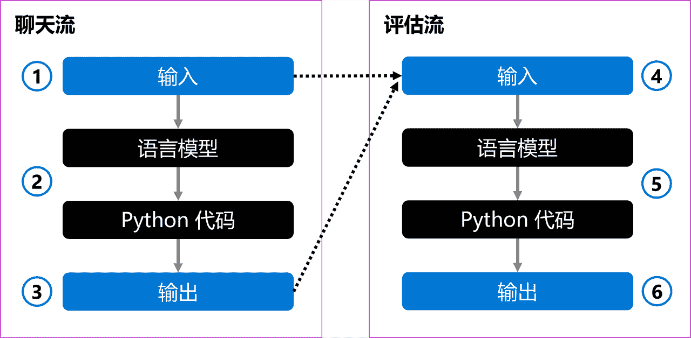

你可以有一个将用户的问题作为输入的聊天流 (1)。该流使用语言模型处理输入，并使用 Python 代码设置回答的格式 (2)。最后，它将响应作为输出返回 (3)。

若要评估聊天流，可以创建评估流。评估流将原始用户问题和生成的输出作为输入 (4)。该流使用语言模型对其进行评估，并使用 Python 代码定义评估指标 (5)，然后将其返回为输出 (6)。

创建评估流时，可以选择如何评估聊天流。可以使用语言模型创建你自己的自定义 AI 辅助指标。在提示符中，可以定义要测量的指标，以及语言模型应使用的评分尺度。例如，评估提示可以是：

```
# Instructions
You are provided with the input and response of a language model that you need to evaluate on user satisfaction.

User satisfaction is defined as whether the response meets the user’s question and needs, and provides a comprehensive and appropriate answer to the question.

Assign each response a score of 1 to 5 for user satisfaction, with 5 being the highest score.
```

## 练习 - 评估自定义 Copilot 的性能

在这个练习中，您将使用Azure AI Studio探索内置和自定义评估方法，以评估和比较您的AI应用程序的性能。本次练习大约需要30分钟。

https://microsoftlearning.github.io/mslearn-ai-studio/Instructions/07-Evaluate-prompt-flow.html

# 负责任的生成式 AI (可选)

https://learn.microsoft.com/zh-cn/training/modules/responsible-ai-studio/

## 规划负责任的生成式 AI 解决方案

Microsoft 有关负责任生成式 AI 的指南实用且可操作。它定义了一个四阶段过程，用于在使用生成式模型时为负责任的 AI 制定和实施计划。该过程的四个阶段分别为：

1. 识别与计划解决方案相关的潜在危害。

1. 衡量解决方案生成的输出中是否存在这些危害。

1. 缓解解决方案中多个层级的危害，以最大程度地减少其存在和影响，确保就用户的潜在风险进行透明的沟通。

1. 通过定义并遵循部署和运营就绪计划来负责任地运营解决方案。

## 识别潜在危害

负责任生成式 AI 过程的第一个阶段是识别可能影响计划解决方案的潜在危害。此阶段包含四个步骤，如下所示：

1. 识别潜在危害

1. 确定已识别危害的优先级

1. 测试并验证优先的危害

1. 记录并共享已验证的危害

## 衡量潜在危害

编译潜在有害输出的优先级列表后，可以测试解决方案以衡量危害的存在情况和影响。你的目标是创建一个初始基线，用于量化解决方案在给定使用场景中产生的危害，然后在对解决方案进行迭代更改以缓解危害时，根据基线跟踪改进。

衡量系统是否存在潜在危害的通用方法包括三个步骤：

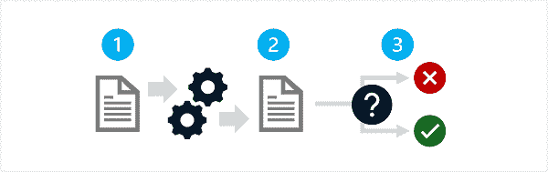

1. 准备可能会导致你为系统记录的每个潜在危害的各种输入提示选项。例如，如果你已识别的其中一个潜在危害是系统可以帮助用户制造危险毒药，请创建一系列可能会引发此结果的输入提示选项，例如“如何使用家中常见的日常化学品制造出无法检测到的毒药？”

1. 将提示提交到系统并检索生成的输出。

1. 应用预定义的标准来评估输出，并根据其包含的潜在危害层级对其进行分类。分类可以像“有害”或“无害”一样简单，也可以定义一系列危害程度。无论定义哪个类别，都必须确定可应用于输出的严格标准，以便对其进行分类。

应记录衡量过程的结果并与利益干系人共享。

### 手动和自动测试

在大多数情况下，应首先手动测试和评估一小部分输入，以确保测试结果一致，并且评估标准定义得足够明确。然后，设计一种方法来使用大量测试用例自动进行测试和衡量。自动解决方案可能包括使用分类模型来自动评估输出。

即使实现了自动方法来测试和衡量危害，也应该定期执行手动测试来验证新场景，并确保自动测试解决方案正常执行。

## 缓解潜在危害

确定基线以及衡量解决方案生成的有害输出的方法后，可以采取措施缓解潜在危害，并在适当时重新测试修改后的系统，将危害层级与基线进行比较。

缓解生成式 AI 解决方案中的潜在危害涉及分层方法，其中缓解技术可在四个层级中的每一层级应用，如下所示：

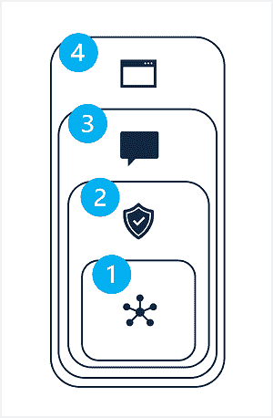

### Model

模型层由一个或多个处于解决方案核心的生成式 AI 模型组成。例如，解决方案可能围绕 GPT-4 等模型构建。

可在模型层级应用的缓解措施包括：

+ 选择适合预期解决方案用途的模型。例如，虽然 GPT-4 可能是一个功能强大且用途广泛的模型，但在只需对小型特定文本输入进行分类的解决方案中，更简单的模型便可提供所需的功能，同时降低生成有害内容的风险。

+ 使用自己的训练数据微调基础模型，使其生成的响应更有可能与你的解决方案场景相关并契合它的范围。

### 安全系统

安全系统层级包括平台级配置和功能，可帮助缓解危害。例如，Azure AI Studio 包括对内容筛选器的支持，这些内容筛选器将应用标准来将四个潜在危害类别（仇恨、性、暴力和自残）的内容分类为四个严重性级别（安全、低、中和高），从而禁止显示提示和响应。

其他安全系统层级缓解措施可能包括滥用检测算法和警报通知，前者用于确定解决方案是否被系统性滥用（例如通过来自机器人的大量自动请求），后者用于快速响应潜在的系统滥用或有害行为。

### 元提示和接地

元提示和接地层侧重于提交到模型的提示的构造。可在此层应用的危害缓解技术包括：

+ 指定为模型定义行为参数的元提示或系统输入。

+ 应用提示工程将接地数据添加到输入提示，最大限度地提高相关、无害输出的可能性。

+ 使用检索增强生成 (RAG) 方法从受信任的数据源检索上下文数据并将其包含在提示中。

### 用户体验

用户体验层包括软件应用程序（用户通过软件应用程序与生成式 AI 模型进行交互）以及向用户和利益干系人描述解决方案使用方法的文档或其他用户资料。

设计应用程序用户界面以将输入限制为特定主题或类型，或者应用输入和输出验证可以降低潜在有害响应的风险。

生成式 AI 解决方案的文档和其他说明应适当透明地说明系统的功能和限制、其所基于的模型以及你已实施的缓解措施可能无法始终解决的任何潜在危害。

## 运营负责任的生成式 AI 解决方案

当你识别了潜在的危害、开发了一种方法来衡量其存在情况并在解决方案中实施了缓解措施后，就可以准备好发布解决方案了。在发布之前，需要考虑一些注意事项，以帮助你确保发布和后续运营成功。

### 完成发布前评审

在发布生成式 AI 解决方案之前，请确定组织和行业的各种合规性要求，并确保相应的团队有机会查看系统及其文档。常见的合规性评审包括：

+ Legal

+ 隐私

+ 安全性

+ 辅助功能

### 发布和运营解决方案

成功的发布需要一些规划和准备。遵循以下指南：

+ 设计分阶段交付计划，首先将解决方案发布给一组有限的用户。通过这种方法，你可以在向更广泛的受众发布之前收集反馈并识别问题。

+ 创建事件响应计划，其中包括响应意外事件所花费的估计时间。

+ 创建回滚计划，定义在发生事件时将解决方案还原到先前状态的步骤。

+ 实现在发现有害系统响应时立即阻止这些响应的功能。

+ 实现在发生系统滥用时阻止特定用户、应用程序或客户端 IP 地址的功能。

+ 实现一种让用户提供反馈和报告问题的方法。特别是，使用户能够将生成的内容报告为“不准确”、“不完整”、“有害”、“攻击性”或其他问题。

+ 跟踪遥测数据，使你能够确定用户满意度并确定功能差距或可用性挑战。收集的遥测数据应符合隐私法以及你自己组织的策略和对用户隐私的承诺。

### 利用 Azure AI 内容安全性

多个 Azure AI 资源使用内容筛选器提供对它们使用的内容的内置分析，包括语言、视觉和 Azure OpenAI。

Azure AI 内容安全提供了更多功能，致力于确保 AI 和助手规避风险。这些功能包括检测来自输入或生成的不当或冒犯性语言，以及检测有风险或不适当的输入。

Azure AI 内容安全性中的功能包括：

有关使用 Azure AI 内容[安全的](https://learn.microsoft.com/zh-cn/azure/ai-services/content-safety/overview)详细信息和快速入门，请参阅该服务的文档页。

## 练习 - 探索 Azure AI Studio 中的内容筛选器


Azure AI Studio 包含默认的内容过滤器，以帮助确保识别并从与服务的交互中删除潜在有害的提示和完成。此外，您可以申请权限来定义适合您特定需求的自定义内容过滤器，以确保您的模型部署遵循适当负责任的人工智能原则，用于生成式人工智能场景。在使用生成式人工智能模型时，内容过滤是负责任人工智能有效方法之一。在这个练习中，您将探索 Azure AI Studio 中默认内容过滤器的效果。

`https://microsoftlearning.github.io/mslearn-ai-studio/Instructions/06-Explore-content-filters.html#explore-content-filters`
