# AI-3002：使用 Azure AI 文档智能开发解决方案

> 来源：[https://zsyhjtnsa5.feishu.cn/docx/RwG2dbpknoP4OvxKgUsc9w51nLe](https://zsyhjtnsa5.feishu.cn/docx/RwG2dbpknoP4OvxKgUsc9w51nLe)

# 文档智能

+   AI 文档智能 是一项 AI 服务，它应用高级机器学习，可自动准确地从文档中提取文本、键值对、表和结构。

+   将文档转换为可用数据，并将重点转移到处理信息而不是编译信息上。

+   从预生成模型开始，或者使用 [AI 文档智能工作室](https://go.microsoft.com/fwlink/?linkid=2217476) 或 [SDK](https://go.microsoft.com/fwlink/?linkid=2217261)在本地和云创建为你的文档量身打造的自定义模型。

# 学习路径

在本学习路径中，你将了解 Azure AI 文档智能解决方案如何帮助你从输入或手写的表单中捕获数据。 你还将了解如何为自定义表单类型生成解决方案，并将该解决方案集成到 Azure 认知搜索管道中。 将了解如何执行以下操作：

+   设计一个解决方案，利用 Azure AI 文档智能来分析业务表单。

+   创建使用文档智能分析常见文档的解决方案。

+   创建一个使用文档智能来分析不同自定义表单类型的解决方案。

+   将 Azure AI 文档智能服务作为自定义技能添加到 Azure AI 搜索管道中。

## 规划Azure AI 文档智能解决方案

### 了解 AI 文档智能

+   **Azure AI 文档智能概述**：

+   Azure AI 文档智能是一个Azure服务，用于分析由客户、合作伙伴、雇主等完成的表单，并从中提取数据。

+   它旨在简化数据输入工作流，减少手动数据输入的需求，提高数据准确性。

+   Azure AI 文档智能的模型：

+   Azure AI 文档智能使用模型来识别文档中的数据类型。

+   提供多个预生成模型，适用于常见表单和文档类型，如发票、回执、W-2税务申报等。

+   如果表单类型不寻常或唯一，可以创建自定义模型并训练。

+   **预生成模型**：

+   包括读取、常规文档和布局模型。

+   其他特定类型的预生成模型包括发票、回执、W-2美国税务申报、ID文档、名片和医疗保险卡。

+   **自定义模型和组合模型**：

+   如果需要提取更具体的信息，可以创建自定义模型。

+   可以将基于不同类型文档训练的多个自定义模型关联到单个模型，即组合模型。

+   Azure AI 文档智能与Azure AI 视觉：

+   Azure AI 文档智能基于Azure AI 视觉构建，提供更复杂的文档分析功能。

+   如果需要从文档图片中提取简单的字词和文本，可以使用Azure AI 视觉OCR。

+   Azure AI 文档智能工作室：

+   https://documentintelligence.ai.azure.com/

+   提供视觉工具，用于探索和了解Azure AI 文档智能的功能及其对表单的支持。

+   **集成和编程接口**：

+   需要编写代码来集成Azure AI 文档智能到应用程序中。

+   提供C#/.NET、Java、Python、JavaScript等语言的API。

+   也可以使用RESTful Web服务来调用Azure AI 文档智能。

### 计划 Azure AI 文档智能资源

+   Azure AI 文档智能资源创建：

+   Azure AI 文档智能是Azure服务，需要在Azure订阅中添加资源。

+   用户可以选择“免费(F0)”或“标准(S0)”层。

+   如果使用“标准”层并遇到请求限制，可以提交Azure支持请求以增加默认限制。

+   创建Azure AI 文档智能资源步骤：

+   在Azure门户中选择“创建资源”。

+   搜索“文档智能”并选择“创建”。

+   填写项目详细信息，包括订阅和资源组。

+   选择用户附近的区域。

+   输入资源的唯一名称。

+   选择定价层并完成创建。

+   连接到Azure AI 文档智能：

+   需要终结点（URL）和访问密钥（身份验证字符串）来连接到资源。

+   在Azure门户的“密钥和终结点”下获取这些信息。

+   **代码示例**：

```
from azure.core.credentials import AzureKeyCredential
from azure.ai.documentintelligence import DocumentIntelligenceClient
from azure.ai.documentintelligence.models import AnalyzeResult

endpoint = &quot;&lt;your-endpoint&gt;&quot;
key = &quot;&lt;your-key&gt;&quot;

docUrl = &quot;&lt;url-of-document-to-analyze&gt;&quot;

document_analysis_client = DocumentIntelligenceClient(endpoint=endpoint, 
    credential=AzureKeyCredential(key))

poller = document_analysis_client.begin_analyze_document(
        &quot;prebuilt-layout&quot;, AnalyzeDocumentRequest(url_source=docUrl
    ))
result: AnalyzeResult = poller.result()
```

> 这段代码是用于使用Azure AI 文档智能服务（Document Intelligence）来分析文档的Python示例。下面是对代码的逐行分析：

1.  导入必要的模块和类：

+   AzureKeyCredential：用于管理Azure服务的身份验证密钥。

+   DocumentIntelligenceClient：是与Azure AI 文档智能服务交互的主要客户端类。

+   AnalyzeResult：表示文档分析操作的结果。

1.  设置服务的终结点和密钥：

+   endpoint：应替换为Azure AI 文档智能服务的终结点URL。

+   key：应替换为对应的访问密钥。

1.  定义要分析的文档的URL：

+   docUrl：应替换为要分析的文档的URL。

1.  创建DocumentIntelligenceClient实例：

+   使用endpoint和AzureKeyCredential(key)创建一个客户端实例，用于后续的文档分析操作。

1.  开始文档分析操作：

+   begin_analyze_document方法用于启动文档分析过程。它接受两个参数：分析模型的名称（在这里是"prebuilt-layout"），以及一个AnalyzeDocumentRequest对象，该对象包含要分析的文档的URL。

+   poller是一个轮询器对象，它允许你查询分析操作的状态和结果。

1.  获取分析结果：

+   result变量被赋值为poller.result()，这会等待分析操作完成并返回分析结果，结果类型为AnalyzeResult。

> 注意：代码中有几个占位符（<your-endpoint>、<your-key>、<url-of-document-to-analyze>），在实际使用前需要将它们替换为有效的值。此外，AnalyzeDocumentRequest类没有在代码中显示导入，但在实际使用时需要确保导入了这个类。这个类用于构建请求对象，包含要分析的文档信息。

### 选择模型类型

+   **预生成模型**：Azure AI 文档智能提供了一组预生成模型，用于处理最常见的文档类型，无需训练即可使用。

+   **通用文档分析模型**：

+   **读取模型**：从打印和手写文档中提取字词和行，检测文档语言。

+   **通用文档模型**：从文档中提取键值对和表格。

+   **布局模型**：从表单中提取文本、表格和结构信息，识别选择标记。

+   **特定文档类型模型**：设计用于处理特定常用文档类型，如发票、回执、W-2税务申报表、ID文档和名片。

+   **自定义模型**：如果预生成模型不符合需求，可以创建并训练自定义模型来分析特定类型的文档。

+   需要至少提供五个已填好的表单样本来训练自定义模型。

+   自定义模型有两种类型：

+   **自定义模板模型**：适用于具有一致视觉模板的表单。

+   **自定义神经网络模型**：适用于结构化到非结构化文档的范围，对英语准确度最高。

+   **组合模型**：由多个自定义模型组成，用于分类和分析未知类型的文档。

+   组合模型的结果包括docType属性，指示用于分析每个表单的自定义模型。

+   在标准定价层中，最多可将100个自定义模型添加到单个组合模型中；在免费定价层中，最多可以添加5个自定义模型。

**本节参考资料：**

+   什么是 Azure AI 文档智能？

+   Azure AI 文档智能集成和负责任使用指南

+   [Azure AI 文档智能模型](https://learn.microsoft.com/zh-cn/azure/applied-ai-services/form-recognizer/concept-model-overview)

+   Azure AI 文档智能工作室（预览版）

+   创建 Azure AI 文档智能资源

+   Azure AI 文档智能快速入门

+   Azure AI 文档智能服务配额和限制

+   [Azure AI 文档智能模型](https://learn.microsoft.com/zh-cn/azure/applied-ai-services/form-recognizer/concept-model-overview)

+   Azure AI 文档智能自定义模型

+   [组合自定义模型](https://learn.microsoft.com/zh-cn/azure/applied-ai-services/form-recognizer/concept-composed-models)

## 使用预生成的文档智能模型

### 了解预生成模型

+   **预生成模型的优势**：

+   无需训练自己的模型，即可从通用表单和文档中提取数据。

+   **预生成模型的类型**：

+   **发票模型**：提取发票中的公用字段及其值。

+   **收据模型**：提取收据中的公用字段及其值。

+   **美国税务模型**：统一模型，可从W-2、1098、1099和1040等表单中提取数据。

+   **ID文档模型**：从美国驾照、欧盟ID和驾照以及国际护照中提取常见字段及其值。

+   **名片模型**：提取名片中的公用字段及其值。

+   **医疗保险卡模型**：提取医疗保险卡中的常见字段及其值。

+   **结婚证模型**：提取结婚证中的信息。

+   **信用卡/借记卡模型**：提取银行卡中的常见信息。

+   **抵押贷款文件模型**：提取抵押贷款过户信息披露等文件中的信息。

+   **银行对帐单模型**：提取银行对帐单中的账户信息和交易详情。

+   **工资单存根模型**：提取工资单存根中的字段。

+   **支票模型**：提取支票中的付款人、金额、日期等信息。

+   **读取模型**：从文档中提取文本和语言。

+   **通用文档模型**：从文档中提取文本、键、值、实体和选择标记。

+   **布局模型**：从文档中提取文本和结构信息。

+   **预生成模型的功能**：

+   提取手写和印刷文本。

+   识别键值对、实体、选择标记。

+   提取表格数据。

+   识别特定表单类型的固定字段集的值。

+   **输入要求**：

+   文件格式为 JPEG、PNG、BMP、TIFF 或 PDF。 此外，读取模型可以接受 Microsoft Office 文件。

+   对于标准层，文件必须小于 500 MB，免费层必须小于 4 MB。

+   图像尺寸必须在 50 x 50 像素到 10,000 x 10,000 像素之间。

+   PDF 文档的尺寸必须小于 17 x 17 英寸或 A3 纸张大小。

+   PDF 文档不得使用密码进行保护。

+   PDF 和 TIFF 文件可以包含任意数量的页，但在标准层中，仅分析前 2000 页。 在免费层中，仅分析前两页。

+   使用Azure AI 文档智能工作室：

+   可以通过Azure AI 文档智能工作室试用预生成模型，并分析文档。

+   **使用API调用预生成模型**：

+   Azure AI 文档智能提供RESTful Web服务，可以使用C#、Java、Python、JavaScript等语言调用。

+   需要服务终结点和API密钥进行连接和身份验证。

+   支持异步调用提交表单并获取分析结果。

### 使用常规文档、读取和布局模型

+   常规文档、读取和布局模型的使用场景：

+   用于从结构不可预知的文档中提取文本、语言和其他信息。

+   **读取模型**：

+   从文档和图像中提取印刷文本和手写文本。

+   检测文本行的编写语言，并分类为手写文本或打印文本。

+   支持多页PDF或TIFF文件的页面范围指定。

+   适用于没有固定或可预测结构的文档。

+   **常规文档模型**：

+   扩展读取模型功能，添加键值对、实体、选择标记和表格的检测。

+   支持从结构化、半结构化和非结构化文档中提取信息。

+   唯一支持实体提取的预生成模型，能识别人员、组织和日期等实体。

+   可以处理结构复杂性导致的键值对提取困难，转而提取实体。

+   **布局模型**：

+   提取文本外，还返回输入图像或PDF文件中的选择标记和表格。

+   能够处理数字化文档时的角度问题和复杂表格结构。

+   提取表格单元格的内容文本、边界框大小位置、是否为标题列部分以及行和列位置索引。

+   提取选择标记的边界框、置信度指示器以及是否选中。

### 使用财务、ID 和税务模型

+   **发票模型**：

+   处理不同格式的纸质或数字化发票，包括扫描质量不佳的发票。

+   提取常用特定字段，如客户名称、采购订单编号、发票日期、供应商和客户详细信息、账单和送货地址、税款总额等。

+   提取发票行项的详细信息，包括产品或服务说明、单价、数量、税款和行合计。

+   **收据模型**：

+   识别收据上的字段，包括商家详细信息、收据总额、税款、小费和交易日期时间。

+   提取收据项目表中的项名称、购买数量、单价和总价。

+   支持单页酒店收据处理，并能提取额外字段，如到达日期和离开日期。

+   **ID文档模型**：

+   分析美国驾照和国际护照，提取包括姓名、性别、出生日期、国籍、发行国家/地区、唯一数字信息等字段。

+   只能分析护照的个人信息页，不支持签证和其他旅行证件。

+   **名片模型**：

+   提取名片上的字段，包括姓名、邮寄地址、电子邮件和网站地址、电话号码等。

+   **其他预生成模型**：

+   Azure AI 文档智能提供多个预生成模型，并定期发布新模型。

+   在训练自定义模型之前，应验证用例是否可以使用预生成模型准确分析。

+   使用预生成模型可以受益于严格的测试、更新的模型版本和降低的成本。

+   **数据保护和隐私**：

+   提取的ID文档数据大部分是个人数据，具有敏感性质，需确保有权限存储个人数据，并遵守数据保护法律要求。

**本节参考资料：**

+   Azure AI 文档智能的语言支持

+   Azure AI 文档智能读取模型

+   Azure AI 文档智能常规文档模型

+   Azure AI 文档智能布局模型

+   Azure AI 文档智能发票模型

+   Azure AI 文档智能收据模型

+   Azure AI 文档智能 ID 文档模型

+   Azure AI 文档智能名片模型

+   Azure AI 文档智能 W-2 模型

## 训练自定义模型

+   **监督式机器学习**：

+   Azure 文档智能支持监督式机器学习，允许用户训练自定义模型。

+   **复合模型创建**：

+   可以通过包含标记字段的表单文档和JSON文档来创建复合模型。

+   **训练自定义模型的步骤**：

+   将表单样本与包含布局和标签字段信息的JSON文件一起存储在Azure Blob容器中。

+   使用Azure 文档智能的分析文档函数为每个示例表单生成一个ocr.json文件。

+   需要一个fields.json文件描述待提取字段，以及每个表单样本的labels.json文件，用于映射字段到表单中的位置。

+   为容器生成共享访问安全（SAS）URL。

+   使用生成模型REST API函数或等效的SDK方法。

+   使用获取模型REST API函数或等效的SDK方法，以获取经过训练的模型ID。

+   **Azure 文档智能工作室**：

+   提供了一个用户界面，用于标记和训练自定义模型。

+   有两种基础模型类型：“自定义模板模型”和“自定义神经网络模型”。

+   自定义模板模型：

+   准确提取文档中标记的键值对、选择标记、表格、区域以及签名。

+   训练过程仅需几分钟，支持100多种语言。

+   自定义神经网络模型：

+   结合布局和语言特征，从文档中准确提取标记的字段。

+   最适合用于半结构化或非结构化文档。

## 创建组合型文档智能模型

### 了解组合模型

+   **什么是组合模型**：

+   由多个自定义模型组成，用于分类提交的表单并选择最佳模型进行分析。

+   **组合模型的用途**：

+   允许用户在不确定使用哪个模型最合适时提交表单。

+   自动将表单发送给正确的自定义模型进行分析。

+   **自定义模型类型**：

+   **自定义模板模型**：适用于具有一致视觉对象模板的表单。

+   **自定义神经网络模型**：适用于不太一致或半结构化/非结构化表单。

+   **管理自定义模型**：

+   在单个Azure AI 文档智能资源中可以创建数百个自定义模型。

+   用户在发送表单进行分析时必须指定模型标识。

+   **使用组合模型**：

+   创建自定义模型后，将它们组合成一个组合模型。

+   使用Azure AI 文档智能工作室或StartCreateComposedModelAsync()方法在GUI中执行此操作。

+   提交表单进行分析时，指定组合模型的模型ID。

+   通过检查docType字段确定用于分析的自定义模型。

+   **组合模型的容量**：

+   免费(F0)层最多500个自定义模板模型，5个组合模型。

+   标准(S0)层最多5000个自定义模板模型，200个组合模型。

+   单个组合模型最多包含100个自定义模型。

+   **自定义模型兼容性**：

+   自定义模板模型只能与3.0到2.1 API版本中的其他自定义模板模型组合。

+   自定义神经网络模型只能与其他自定义神经网络模型组合。

+   自定义神经网络模型不能与自定义模板模型组合。

### 组装组合模型

+   **创建组合模型的背景**：

+   在民意调查公司中，需要创建一个组合模型来分类并正确分析不同版本的政治性民意调查表格。

+   **在文档智能工作室中创建组合模型**：

+   需要Azure订阅中的Azure AI 文档智能资源和一组经过训练和标记的自定义模型。

+   在Azure AI 文档智能工作室的“自定义模型”页面中选择“模型”并选择要组合的模型。

+   选择“组合”后，输入组合模型的“模型 ID”和“说明”，然后选择“组合”。

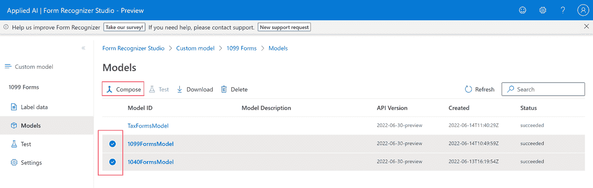

+   **在代码中创建组合模型**：

```
List&lt;string&gt; modelIds = new List&lt;string&gt;()
{
    firstCustomModel.ModelId,
    secondCustomModel.ModelId,
    thirdCustomModel.ModelId,
};

BuildModelOperation operation = await client.StartCreateComposedModelAsync(modelIds, modelDescription: &quot;Composed model example&quot;);
Response&lt;DocumentModel&gt; operationResponse = await operation.WaitForCompletionAsync();
```

+   将所有自定义模型的模型ID组装到一个列表中，并将该列表传递给StartCreateComposedModelAsync()方法。

+   创建组合模型后，使用相同的代码将表单发送给模型进行分析，并在调用中指定组合模型的模型ID。

+   在结果中，使用docType属性来确定用于分析每个文档的组成自定义模型。

**本节参考资料：**

+   [组合自定义模型](https://learn.microsoft.com/zh-cn/azure/ai-services/document-intelligence/concept-composed-models)

+   [代码示例 - 模型组合](https://github.com/Azure/azure-sdk-for-net/blob/main/sdk/formrecognizer/Azure.AI.FormRecognizer/samples/Sample_ModelCompose.md)

# Applied Skills

## 一般准则

**在**此应用场景中，某些资源的部署可能需要几分钟的时间。在部署完成期间，请查看实验室中的其他任务。你可以执行不依赖于该部署的其他任务。

感谢你同意帮助我们的团队使用 Azure AI 文档智能创建智能文档处理解决方案。

在 Azure 中执行任务时，必须遵循我们的一些一般准则。

+   创建对象时，请使用默认设置，除非有不同的配置要求。

+   请仅仅创建、删除或修改对象来达到上述要求。 对环境进行不必要的更改可能会对你的最终分数产生不利影响。

+   如果有多种实现目标的方法，请始终选择管理工作量最小的方法。

此致

首席技术官 (CTO)

## 现有环境

你将协助我们的团队使用 Azure AI 文档智能创建文档智能解决方案。

以下是用于访问 Azure 资源的凭据：

用户名：User-@labinstanceid

密码：password-@labinstanceid

你也可以在“**说明**”选项卡中找到登录信息。

你已获得rg-@labinstanceid资源组的权限。 请在此资源组中创建所有 Azure 对象。

此致

网络管理员

## Part I：创建原型

你好，

我们希望构建一个原型，以使用 Azure AI 文档智能自**动从发票和收据中**提取数据。 我们有位于 c:\files 的示例文件。

**这是你的任务：**

你需要创建一个新的使用免费定价层的 Azure AI 文档智能资**源。 然后使用预**生成模型来分析发票和收据。 将每个文件的 JSON 输出保存到 c:\files。

创建 JSON 输出后，按模型类型对所有文件进行排序，然后将文件上传到 prototype@labinstanceid。 请为每种模型类型使用单独的 Blob 存储容器。

备注：如果无法在 Azure 门户中找到文档智能资源类型，则可能需要使用以前的名称“表单识别器”进行搜索。

此致

项目管理团队

> 解题步骤

+   打开文档智能Studio

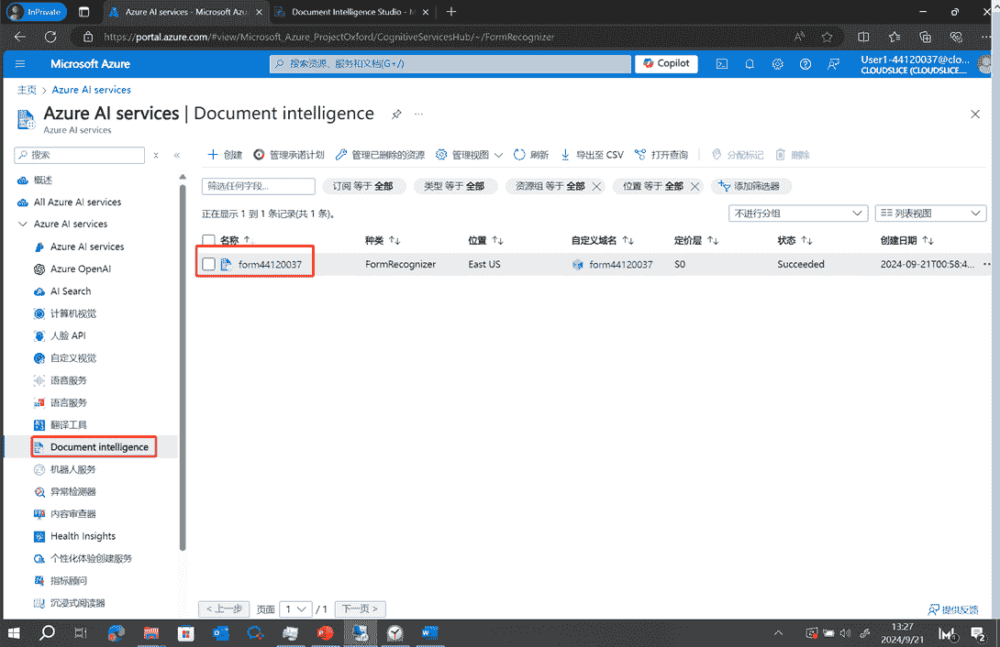

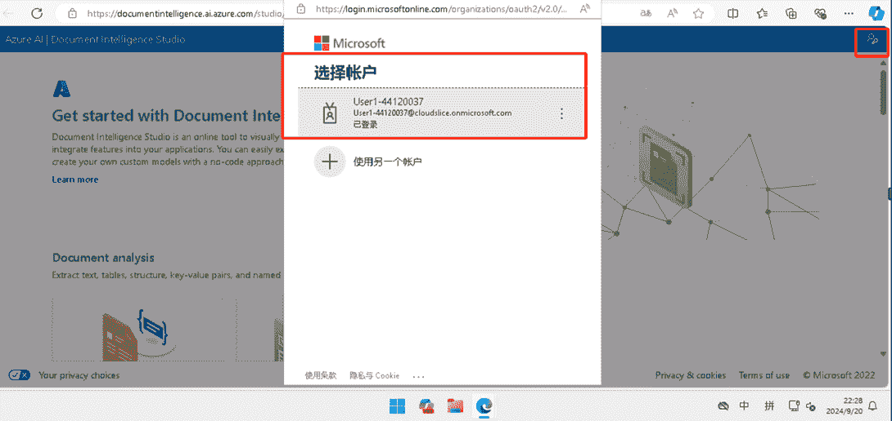

+   使用预生成模型分析发票和收据

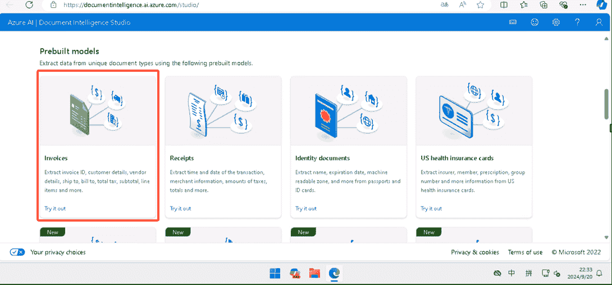

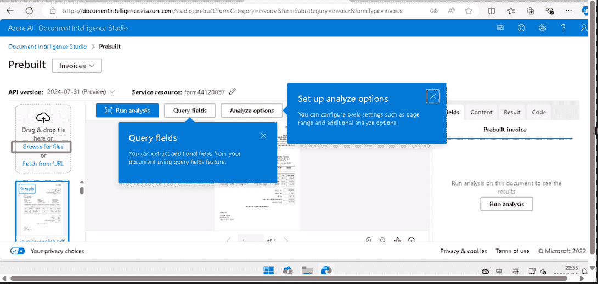


+   ** 将每个文件的 **JSON 输出保存到 c:\files

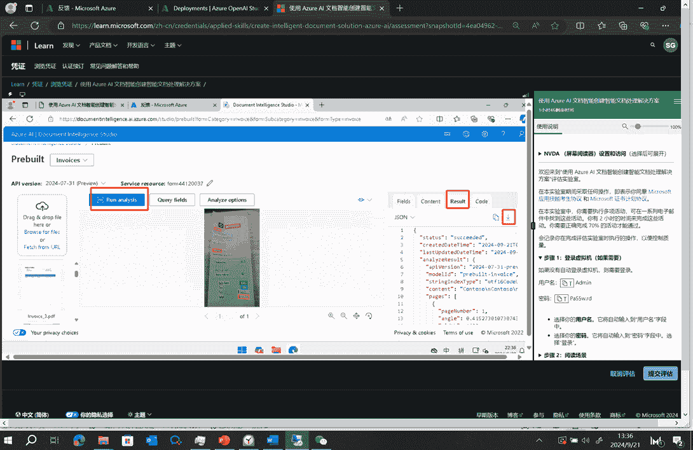

+   为每种模型类型在prototype@labinstanceid中创建单独的 Blob 存储容器，并上传文件

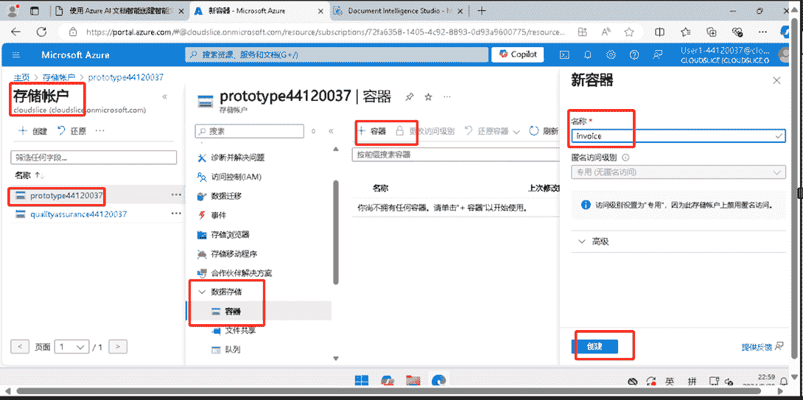

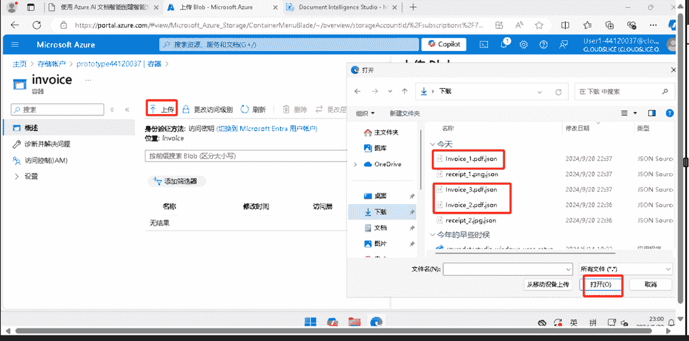

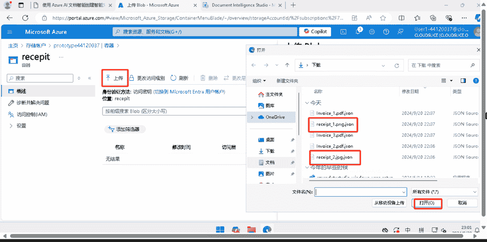

## Part II：训练自定义模型

你好，

我们在 qualityassurance@labinstanceid 存储帐户中有一些文档。 我们需要使用自定义模型来分析文档。

**这是你的任务：**

你需要创建一个名为 **Documents**** 的自定义 Azure AI** 文档智能项目，该项目使用模板模型和 2022-08-31 API 版本。

你需要为该项目执行以下任务：

+   将项目链接到 form@labinstanceid 资源。

+   使用 qualityassurance@labinstanceid 存储帐户中的 documents-training 容器。

+   使用下表中显示的标签。

+   **标记文档后，训练模型并**将模型命名为 QA-Template。

+   最后，使用位于 **c:\QA_Test** 中的文件测试模型。 将 **Report0008.jpg** 的 JSON 结果保存到同一文件夹中。

此致

质量保证团队

> 解题步骤

+   将项目链接到 form@labinstanceid 资源。


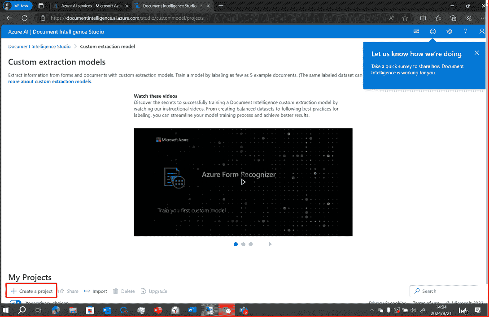

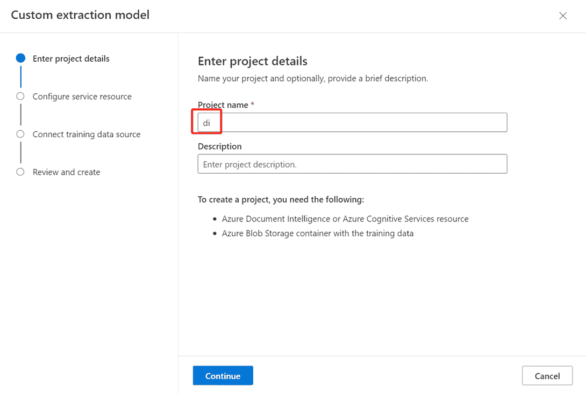


+   使用 qualityassurance@labinstanceid 存储帐户中的 documents-training 容器。


+   使用下表中显示的标签。

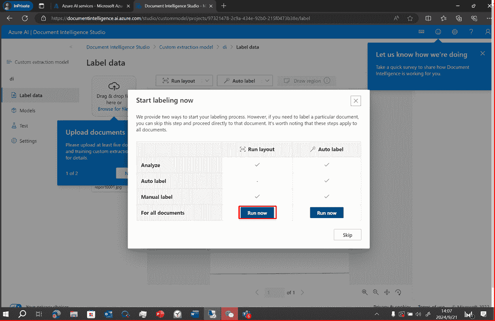

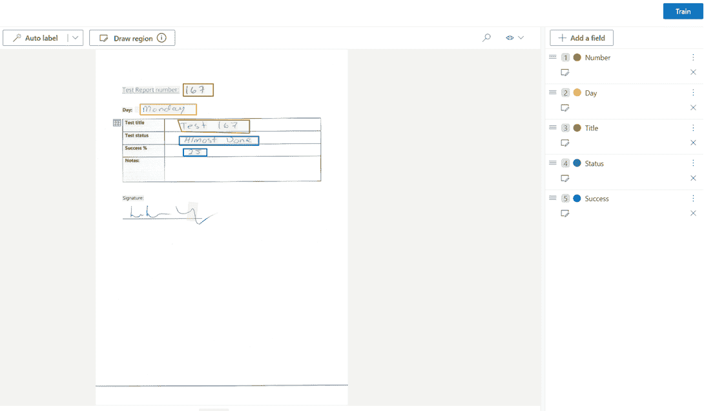

+   **标记文档后，训练模型并**将模型命名为 QA-Template。

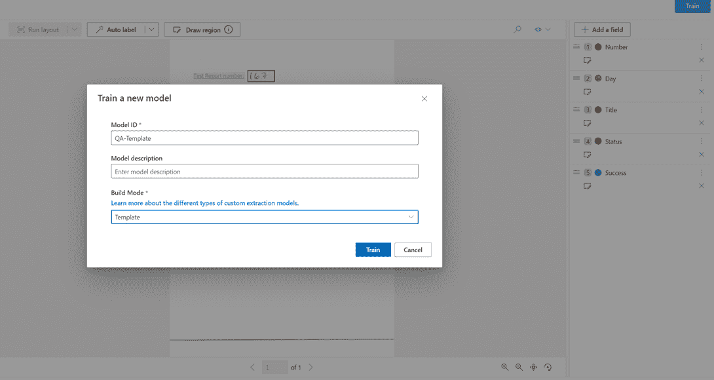

+   最后，使用位于 **c:\QA_Test** 中的文件测试模型。 将 **Report0008.jpg** 的 JSON 结果保存到同一文件夹中。

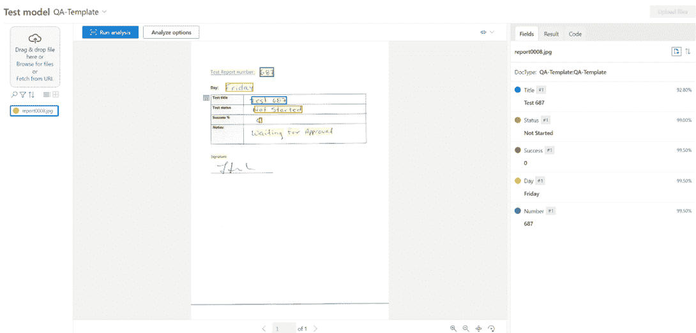

## Part III：编程访问

你好，

我们正在构建一个应用，以便使用 Azure AI 文档智能以编程方式处理发票。 我们将从发票中提取信息，然后根据发票计算总计。

我们已经创建了该应用的 C# 和 Python 版本，但我们需要你的帮助来完成代码。 你只需用自己选择的语言来完成该应用即可。 我们将让另一位开发人员使用其他语言完成代码。

应用的源代码和示例发票位于 **c:\app1** 中。

**这是你的任务：**

你需要在应用中完成代码以满足以下要求：

+   使用 Azure AI 文档智能中的预生成发票模型。

+   处理 c:\app1\invoices 中的文档。

+   计算所有发票的“总计”字段的总和。

+   省略任何置信度分数小于 75% 的文档。

此致

体系结构团队

> 解题步骤

参考python代码

```
import os
from dotenv import load_dotenv
from azure.ai.formrecognizer import FormRecognizerClient
from azure.core.credentials import AzureKeyCredential

task = FormRecognizerClient.begin_recognize_content
def analyze_invoice(form_recognizer_client, file_path, invoice_total):
    with open(file_path, &quot;rb&quot;) as f:
        form_data = f.read()
    # Need to determine which method to send the form to
    task = form_recognizer_client.begin_recognize_receipts(form_data)
    analyzed_result = task.result()
    for receipt in analyzed_result:
        for name, field in receipt.fields.items():
            if name == &quot;VendorName&quot;:
                print(&quot;Vendor Name: &#x27;{}&#x27;&quot;.format(field.value))
            if name == &quot;InvoiceTotal&quot;:
                if field.value is not None:
                    print(&quot;Invoice Total: &#x27;{}&#x27; with a confidence score of &#x27;{}&#x27;&quot;.format(
                        field.value, field.confidence))
                    # Add to invoice total, and filter by confidence &gt; 0.75
                    if field.confidence &gt; 0.75:
                        invoice_total += field.value
                    
    return invoice_total

def main():
    try:
        # Get configuration settings
        load_dotenv()
        form_endpoint = os.getenv(&#x27;FORM_ENDPOINT&#x27;)
        form_key = os.getenv(&#x27;FORM_KEY&#x27;)
        # Create client using endpoint and key
        form_recognizer_client = FormRecognizerClient(
            form_endpoint, AzureKeyCredential(form_key))
        # Analyze all files in the folder c:\app1\invoices
        folder_path = r&quot;C:\App1\Invoices&quot;
        invoice_total = 0
        for filename in os.listdir(folder_path):
            if filename.endswith(&quot;.pdf&quot;):
                file_path = os.path.join(folder_path, filename)
                print(&quot;Analyzing file: {}&quot;.format(file_path))
                invoice_total = analyze_invoice(form_recognizer_client, file_path, invoice_total)
        print(&quot;\nTotal Invoice Amount: {}&quot;.format(invoice_total))
    except Exception as ex:
        print(ex)

if __name__ == &#x27;__main__&#x27;:
    main()

```

同时记得修改.env文件