# AI-3003：使用 Azure AI 服务开发自然语言处理解决方案

> 来源：[https://zsyhjtnsa5.feishu.cn/docx/YQ3Zd6FUcovrv1xUZlNcX7Dknxd](https://zsyhjtnsa5.feishu.cn/docx/YQ3Zd6FUcovrv1xUZlNcX7Dknxd)

# 自然语言

Azure AI 语言是基于云的服务，它提供自然语言处理 (NLP) 功能，可用于理解和分析文本。 使用此服务可帮助使用基于 Web 的 Language Studio、REST API 和客户端库生成智能应用程序。

# 学习路径

## 使用 Azure AI 语言分析文本

每天，世界都会生成大量数据；大部分内容基于文本，其形式包括电子邮件、社交媒体文章、在线评论、业务文档等。 通过应用统计和语义模型的人工智能技术，可以创建从基于文本的数据中提取含义和见解的应用程序。

Azure AI 语言为可轻松集成到你自己的应用程序代码中的常见文本分析技术提供 API。Azure AI 语言旨在帮助从文本中提取信息。 它提供可用于以下各项的功能：

+   语言检测 确定编写文本所用的语言。

+   关键短语提取 标识文本中指示要点的重要单词和短语。

+   情绪分析 量化文本的正负面情绪程度。

+   命名实体识别 检测对实体的引用，包括人员、位置、时间段、组织等。

+   实体链接 通过提供指向维基百科文章的参考链接来标识特定实体。

### 语言检测

+   **核心功能与应用**：

+   Azure AI语言检测API能够评估文本输入并返回每个文档的语言标识符和置信度分数，适用于处理未知语言的文本和聊天机器人中的语言识别。

+   **请求与响应格式**：

+   用户需以JSON格式提交文档集合，每个文档包含唯一ID和文本。API返回JSON响应，包含预测的语言和置信度分数，置信度分数介于0到1之间，越接近1表示置信度越高。

+   **文档大小与集合限制**：

+   单个文档的字符数需小于5,120个，每个集合限制为1,000个项。可以通过提供countryHint来提高预测性能。

+   **多语言内容处理**：

+   当文档包含多语言内容时，API会返回代表性最强但置信度可能较低的语言，反映文本中的主要语言。

+   **异常情况处理**：

+   如果提交的文本内容无法分析，如因字符编码问题，API将返回“(Unknown)”作为语言名称和ISO代码，置信度分数为0。

### 提取关键短语

+   **功能描述**：

+   关键短语提取是评估一个或多个文档的文本，并识别出围绕文档上下文的要点的过程。

+   **适用性与限制**：

+   最适合大型文档，可分析的最大大小为5,120个字符。

+   通过REST接口提交一个或多个文档进行分析。

+   **请求格式**：

+   提供了一个JSON格式的示例，展示如何提交包含文档ID、语言和文本的请求。

+   **响应内容**：

+   响应包含每个文档中检测到的关键短语列表。

### 分析情绪

+   **功能描述**：

+   情绪分析用于评估文本文档的正负面情绪程度，适用于多种工作场景，如基于评论量化情绪、确定客户服务响应的优先级等。

+   **应用场景**：

+   评估电影、书籍或产品的评论。

+   确定客户服务对电子邮件或社交媒体消息的响应优先级。

+   **分析内容**：

+   Azure AI情绪分析提供每个文档的总体情绪和单个句子的情绪。

+   **请求格式**：

+   提供了一个JSON格式的示例，展示如何提交包含文档ID、语言和文本的请求。

+   **响应内容**：

+   响应包含每个文档的情绪分类（正面、中性、负面）和置信度分数，以及每个句子的情绪分析。

+   **置信度分数**：

+   句子情绪基于0到1之间的正面、负面和中性分类值的置信度分数。

+   **总体文档情绪确定**：

+   如果所有句子都为中性，则总体情绪为中性。

+   如果句子分类仅包括正面和中性，则总体情绪为正面。

+   如果句子分类仅包括负面和中性，则总体情绪为负面。

+   如果句子分类包括正面和负面，则总体情绪是混合的。

### 提取实体

+   **功能描述**：

+   命名实体识别（NER）用于识别文本中提及的实体，并将它们按类别和子类别进行分组。

+   **实体类别**：

+   实体包括人员、位置、日期时间、组织、地址、电子邮件和URL等。

+   **请求格式**：

+   提供了一个JSON格式的示例，展示如何提交包含文档ID、语言和文本的请求。

+   **响应内容**：

+   响应包含每个文档中找到的分类实体的列表，包括实体文本、类别、子类别、偏移量、长度和置信度分数。

+   **置信度分数**：

+   每个识别的实体都附带一个置信度分数，表示模型对其识别准确性的信心。

### 提取链接的实体

+   **功能描述**：

+   实体链接用于区分同名实体，通过引用知识库中的文章来确定文本中特定实体的链接。

+   **知识库来源**：

+   维基百科作为文本分析服务的知识库，用于根据实体上下文确定特定文章链接。

+   **请求格式**：

+   提供了一个JSON格式的示例，展示如何提交包含文档ID、语言和文本的请求。

+   **响应内容**：

+   响应包含文本中标识的实体以及指向相关文章的链接，包括实体的Bing ID、名称、匹配文本、偏移量、长度、置信度分数、语言、ID、URL和数据源。

+   **模型版本**：

+   响应中包含了使用的模型版本信息。

**本节参考资料**

+   [Azure AI 语言文档](https://learn.microsoft.com/zh-cn/azure/ai-services/language-service/)

+   [生成对话语言理解模型](https://learn.microsoft.com/zh-cn/training/modules/build-language-understanding-model/)

+   [创建自定义命名实体提取解决方案](https://learn.microsoft.com/zh-cn/training/modules/custom-name-entity-recognition/?ns-enrollment-type=learningpath&ns-enrollment-id=learn.wwl.build-custom-text-analytics)

## 使用 Azure AI 语言创建问题解答解决方案

“智能”应用程序的常见模式是使用户能够使用自然语言提问并收到相应的答案。 实际上，此类解决方案将对话智能引入传统的常见问题解答 (FAQ) 发布。 本模块介绍如何使用 Azure AI 语言创建可支持应用程序或机器人的问答对知识库。

### 问题解答

借助包括问题解答功能的 Azure AI 语言，可以定义可使用自然语言输入查询的问答对知识库。 知识库可以发布到 REST 终结点，并供客户端应用程序（通常是机器人）使用。

可以从现有源创建知识库，其中包括：

+   包含常见问题解答 (FAQ) 文档的网站。

+   包含结构化文本的文件，如手册或用户指南。

+   内置的闲聊问题和用于封装常见对话交流的答案对。

### 比较问题解答和 Azure AI 语言理解

问题解答知识库是语言模型的一种形式，它会提出有关何时使用问题解答的问题，以及何时使用 Azure AI 语言的对话语言理解功能。

这两项功能的相似之处在于，它们都允许定义可以使用自然语言表达式查询的语言模型。 但是，它们旨在解决的用例存在一些差异，如下表所示：

### 创建知识库

若[要创建问题解答解决方案，可以使](https://language.azure.com/)用 REST API 或 SDK 编写用于定义、训练和发布知识库的代码。 不过，更常见的是使用 Language Studio Web 界面来定义和管理知识库。

### 实现多回合对话

+   **多回合对话的定义**：

+   多回合对话是指在知识库中，除了单个问答对外，还包含一系列的跟进提示和响应，以便进行更深入的交互。

+   **多回合对话的必要性**：

+   有时需要在提供明确答案之前通过询问后续问题来获取更多用户信息。

+   **实现多回合对话**：

+   可以从现有网页或文档中导入问答对，并启用多回合响应。

+   可以为现有问答对显式定义跟进提示和响应。

+   **应用场景示例**：

+   以旅行预订知识库为例，初始问题可能是“如何取消预订？”，由于预订可能指酒店或航班，需要跟进提示来获取详细信息。

+   **答案和跟进提示**：

+   答案可能包含一些初步信息，并提供跟进提示，以及指向取消航班和取消酒店的具体答案链接。

+   **定义跟进提示**：

+   在定义多回合对话的跟进提示时，可以链接到知识库中的现有答案，或定义新答案。

+   可以限制链接答案，使其仅在由原始问题发起的多回合对话上下文中显示。

+   **视觉辅助**：

+   页面提供了多回合对话的示意图，帮助理解对话流程。

### 测试并发布知识库

定义知识库后，可以训练其自然语言模型并测试该模型，然后发布，以便在应用程序或机器人中使用。

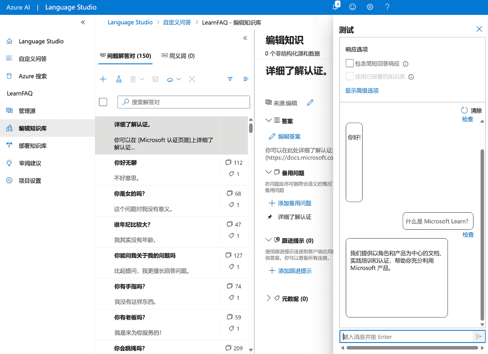

如果对知识库的性能满意，可以将其部署到 REST 终结点，客户端应用程序可以使用该函数来提交问题和接收答案。 可以直接从 Language Studio 部署它。

若要使用已发布的知识库，可以使用 REST 接口。

### 提高问题解答性能

+   **主动学习的目的**：

+   主动学习有助于随着时间的推移更好地正确回答用户问题，特别是当用户以不同措辞提出相同问题时。

+   **主动学习的状态**：

+   主动学习默认处于启用状态。

+   **创建问答对**：

+   在Language Studio中创建问题和答案对，也可以批量上传包含问答对的文件。

+   **审阅建议的备选问题**：

+   主动学习为每个问题提供备选问题，用户可以在“查看建议”窗格中审阅这些建议，并选择接受或拒绝。

+   **批量操作**：

+   用户可以批量接受或拒绝所有建议的备选短语。

+   **手动添加备选问题**：

+   在“编辑知识库”窗格中，用户可以手动为问答对添加备选问题。

+   **定义同义词的用途**：

+   当用户提交的问题可能包含多个不同的字词来表示相同内容时，通过定义同义词，问题解答服务可以找到相应的答案。

+   **定义同义词的方法**：

+   使用REST API提交JSON格式的同义词，例如将“reservation”和“booking”定义为同义词。

## 生成对话语言理解模型

自然语言处理 (NLP) 是一个常见的 AI 问题，即软件必须能够以人类用户书写或说话所用的自然语言形式处理文本或语音。 在更广泛的 NLP 领域中，自然语言理解 (NLU) 处理从自然语言确定语义含义的问题，通常使用训练的语言模型来确定。

自然语言理解解决方案的常见设计模式如下所示：

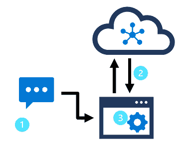

在此设计模式中：

1.  应用接受来自用户的自然语言输入。

1.  语言模型用于确定语义含义（用户的意向）。

1.  应用执行相应操作。

Azure AI 语言使开发人员能够基于可使用数量相对较少的示例训练的语言模型来生成应用，从而识别用户的预期含义。

### 了解用于生成对话语言理解模型的资源

当然，我们可以将要点整合到更少的分类下。以下是将要点归类到三个主要标题下：

+   **资源创建与管理**

+   **Azure 语言资源创建**：在 Azure 中创建语言资源，用于开发 NLP 解决方案，包括创作模型和处理预测请求。

+   **Azure 门户操作**：在 Azure 门户中搜索并选择“语言服务”，创建资源，并获取密钥和终结点。

+   **模型构建与部署**

+   **模型构建、训练和部署**：需要生成、训练并部署模型，以便用于预测。Azure AI 语言服务通过这些步骤学习要查找的内容。

+   使用 Language Studio：Language Studio 提供了一个直观的界面来生成、训练和部署模型。

+   **使用 REST API**：通过 REST API 生成模型，包括创建项目、导入数据、训练、部署和使用模型。

+   **身份验证**：对于每个调用 Azure AI 语言资源的请求，通过 Ocp-Apim-Subscription-Key 标头进行身份验证。

+   **部署模型**：提交部署作业并检查部署作业状态，使用特定的 REST API 终结点和请求体。

+   **获取部署状态**：使用 GET 请求查询部署状态，检查模型训练和部署是否成功。

+   **模型查询与预测**

+   **查询模型**：使用 C# 或 Python 中的 SDK，或者 REST API 来查询模型进行预测。

+   **SDK 查询**：创建客户端并使用它调用相应的终结点，例如提取关键短语。

+   **REST API 查询**：创建对相应 URL 的 POST 请求，使用 Ocp-Apim-Subscription-Key 标头进行身份验证，并在请求正文中指定 kind 参数。

+   **示例响应**：SDK 和 REST API 的查询响应将以 JSON 格式返回，包括关键短语提取结果或对话语言理解结果。

### 定义意向、言语和实体

+   **定义意向（Intents）**

+   **意向**表示用户想执行的任务或操作，或言语的含义。

+   需要定义模型能够理解的意向，并将其与一个或多个言语关联。

+   每个模型包括“无”意向，用于标识不需要执行特定操作的言语（如问候语）。

+   收集言语（Utterances）

+   为每个意向捕获各种不同的示例言语。

+   包括含义相同但用不同方式构造的言语。

+   采用不同长度的言语：短、中、长。

+   使言语中的名词或主体位于不同位置。

+   在不同的言语中使用正确的和不正确的语法。

+   **标记数据的精度、一致性和完整性**

+   **精确标记**：始终将每个实体标记为正确的类型。

+   **一致标记**：同一实体在所有语句中都应具有相同的标记。

+   **完全标记**：标记所有语句中实体的所有实例。

+   **定义实体（Entities）**

+   实体用于向意向添加特定上下文。

+   实体可以是学习实体、列表实体或预生成的实体。

+   **学习实体**：最灵活，用于定义后在训练言语中将单词或短语与该实体关联。

+   **列表实体**：适用于具有一组特定可能值的实体，如一周中的几天。

+   **预生成的实体**：适用于数字、日期/时间和名称等常见类型。

### 使用模式区分相似的言语

+   **模式的应用**

+   **模式**用于区分具有相似言语的意向，同时减少示例言语的数量。

+   **相似言语的问题**

+   在多个意向中，言语可能在语法上相似，但在单词或标点符号上有所不同，表示不同的意向。

+   **意向示例**

+   提供了三个意向（TurnOnDevice、GetDeviceStatus、TurnOffDevice）的示例言语，这些言语在结构上相似，但表示不同的操作。

+   **模式的使用**

+   使用模式可以指定不同格式的言语，如：

+   TurnOnDevice：使用“Turn on the {DeviceName}”、“在 {DeviceName} 上切换”、“Turn the {DeviceName} on”等模式。

+   GetDeviceStatus：使用“Is the {DeviceName} on[?]”模式。

+   TurnOffDevice：使用“Turn the {DeviceName} off”、“Switch off the {DeviceName}”、“Turn off the {DeviceName}”等模式。

+   **训练模型**

+   通过使用每种不同类型的言语来训练模型，Azure AI 语言服务可以学习如何根据格式和标点正确地对意向进行分类。

### 使用预生成的实体组件

可以通过定义所需的所有意向和语句来创建自己的语言模型，但通常可以使用预生成组件来检测常见实体，例如数字、电子邮件、URL 或选择。

[有关 Azure AI](https://learn.microsoft.com/zh-cn/azure/ai-services/language-service/conversational-language-understanding/prebuilt-component-reference) 语言服务可以检测的预生成实体的完整列表，请参阅受支持的预生成实体组件列表。

使用预生成组件，可以让 Azure AI 语言服务自动检测指定类型的实体，且不必使用该实体的示例来训练模型。

若要添加预生成组件，可以在项目中创建实体，然后选择该实体的“添加新预生成”以检测某些实体。

每个实体最多可以包含 5 个预生成组件。 使用预生成模型元素可以显著减少开发对话语言理解解决方案所需的时间。

### 训练、测试、发布和查看对话语言理解模型

创建模型是一个迭代过程，包括以下活动：

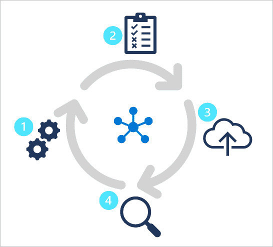

1.  训练模型以从示例言语中学习意向和实体。

1.  以交互式方式或使用带有已知标签的测试数据集测试模型

1.  将经过训练的模型部署到公共终结点以供客户端应用使用

1.  查看预测并迭代访问语句以训练模型

通过遵循此迭代方法，你可以根据用户输入随着时间的推移而改进语言模型，从而帮助开发反映用户使用自然语言指示其意向的方式的解决方案。

## 创建自定义文本分类解决方案

### 了解分类项目的类型

+   **自定义文本分类**：

+   将标签（类）分配给文本文件。

+   例如，电子游戏摘要可以被分类为“冒险”、“策略”、“动作”或“体育”。

+   **分类项目类型**：

+   **单标签分类**：每个文件只能分配一个类。

+   **多标签分类**：每个文件可以分配多个类。

+   **标记数据**：

+   单标签项目中，每个文件在标记过程中分配有一个类。

+   多标签项目中，可以为每个文件分配任意数量的类，这增加了复杂性，要求数据必须清晰且分布良好。

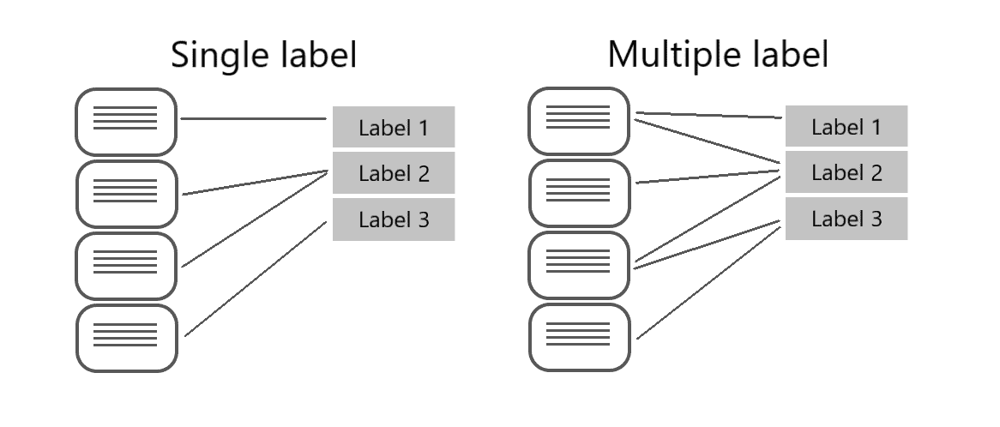

+   **评估和改进模型**：

+   衡量模型性能的指标包括召回率、精准率和F1分数。

+   单标签项目可以通过确定哪些类分类不佳来找到更多质量数据。

+   多标签项目由于标签组合的可能性更多，找出质量数据更复杂。

+   **API 有效负载**：

+   Azure AI 语言提供 REST API，用于生成模型并与之交互。

+   单标签分类模型指定项目类型为 customSingleLabelClassification。

+   多标签分类模型指定项目类型为 customMultiLabelClassification。

### 如何生成文本分类项目

+   **项目处理方式**：

+   通过语言工作室（GUI）。

+   通过 REST API（具有相同功能）。

+   Azure AI 语言项目生命周期：

+   定义标签：确定要分类的可能标签。

+   标记数据：标记现有数据并指定每个文件的标签。

+   训练模型：使用标记的数据训练模型。

+   查看模型：模型训练完成后，查看模型结果。

+   改进模型：通过分析分类失败的标签来改进模型。

+   部署模型：部署模型以通过 API 提供服务。

+   对文本进行分类：使用模型对文本进行分类。

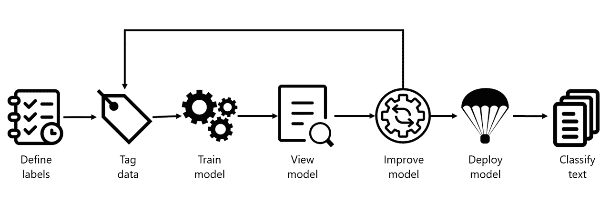

+   **数据集拆分**：

+   训练数据集：用于实际训练模型。

+   测试数据集：用于验证模型。

+   自动拆分：Azure 随机拆分数据到指定百分比。

+   手动拆分：手动指定每个数据集中的文件。

+   **部署选项**：

+   每个项目可以创建多个模型和部署。

+   可以并排测试模型、比较数据集拆分对性能的影响。

+   部署模型时可以选择名称，以便在提交分类任务时选择。

## 自定义命名实体识别

自定义命名实体识别 (NER)（也称为自定义实体提取）是 Azure AI 语言服务提供的众多自然语言处理 (NLP) 功能之一。 自定义 NER 使开发人员能够从文本文档中提取预定义的实体，且无需这些文档采用某个已知格式（如法律协议或联机广告）。

实体指人员、地点、事物、事件、技能或值。

### 了解自定义命名实体识别

+   **自定义NER简介**：

+   自定义NER是Azure AI语言服务的一部分，用于识别和提取用户定义的实体。

+   可以识别从银行对账单中的名称和地址到用于改进搜索结果的任何内容。

+   **自定义与内置NER**：

+   Azure AI语言提供内置NER，可识别人员、位置、组织或URL等。

+   内置NER通过创建服务并调用NER服务的终结点来使用。

+   **响应示例**：

+   内置NER的响应包含已识别实体的数组，包括文本、类别、子类别、偏移量、长度和置信度分数。

+   **自定义NER的应用场景**：

+   适用于要提取的实体不属于内置服务或只想提取特定实体的情况。

+   例子包括特定法律或银行数据、知识挖掘以增强目录搜索或查找审核策略的特定文本。

+   **数据选择和实体优化**：

+   使用高质量的数据来训练模型以及使用明确定义的实体类型。

+   多样性、分布和准确性是数据选择的关键因素。

+   明确定义实体，避免模棱两可的实体，保持实体的独特性。

+   **项目限制**：

+   训练：至少10个文件，不超过100,000个。

+   部署：每个项目10个部署名称。

+   API：创作API限制为每分钟10个POST和100个GET；分析API限制为20个GET或POST。

+   项目：每个项目只有1个存储帐户，每个资源500个项目，每个项目50个经训练的模型。

+   实体：每个实体最多可以有500个字符，最多可以有200个实体类型。

### 标记数据

+   **标记数据的重要性**：

+   正确标记数据对于训练模型至关重要。

+   需要关注一致性、精准率和完整性。

+   一致性：在所有文件中以相同的方式标记数据，以便模型无冲突地学习。

+   精准率：一致地标记实体，避免不必要的额外字词，确保只包含正确的数据。

+   完整性：完全标记数据，不遗漏任何实体，帮助模型始终识别存在的实体。

+   **如何标记数据**：

+   使用Language Studio是标记数据的最直接方法。

+   Language Studio支持查看文件、选择实体的开头和结尾，并指定实体类型。

+   **标记数据的保存**：

+   每个标记保存在存储帐户中的文件里，通常是一个自动生成的JSON文件。

+   模型使用此文件来了解如何提取自定义实体。

+   **自定义NER数据格式**：

+   提供了一个JSON格式的例子，展示了如何组织标记数据。

+   包括项目版本、字符串索引类型、元数据、实体定义和文档标记。

+   JSON文件结构：

+   documents：标记的文档数组。

+   location：文件在项目容器中的路径。

+   language：文件的语言。

+   entities：当前文档中的实体数组。

+   regionOffset和regionLength：定义训练中使用的数据范围。

+   category：要提取的实体的名称。

+   labels：文件中标记的实体数组，包括offset（实体开头位置）和length（实体长度）。

+   dataset：将文件分配到的数据集。

### 训练和评估模型

+   **训练和评估模型的迭代过程**：

+   通过向训练数据集添加数据和标记来提高模型的准确性。

+   Language Studio 提供评分以了解需要改进的数据和标记类型。

+   **性能指标**：

+   **精度**：成功识别实体次数与尝试的所有识别次数的比率。

+   **召回率**：成功识别实体次数与文档中实际存在的实体数的比率。

+   **F1 分数**：结合精准率和召回率的单个评分指标。

+   **指标解释**：

+   理想情况下，模型在精准率和召回率方面都应获得高分。

+   如果两个指标分数都低，模型难以识别实体，且识别时标签不准确。

+   精准率低但召回率高，模型识别实体但不标记为正确的类型。

+   精准率高但召回率低，模型不常识别实体，但识别时标签准确。

+   **混淆矩阵**：

+   提供所有实体的可视表，展示每个实体的表现。

+   帮助直观发现在何处添加数据可以提高模型性能。

## 使用 Azure AI 翻译服务翻译文本

### 预配 Azure AI 翻译资源

Azure AI 翻译提供了多语言文本翻译 API，可用于：

+   语言检测。

+   一对多翻译。

+   脚本音译（将本机脚本中的文本转换为替代脚本）。

### 了解语言检测、翻译和音译

+   **语言检测**：

+   使用REST API的Detect函数来检测文本的语言。

+   通过提交文本到指定的API端点进行检测。

+   返回结果包括语言代码、置信度分数、是否支持翻译和音译。

+   **翻译**：

+   使用Translate函数将文本从一种语言翻译成另一种语言。

+   需要指定源语言（from参数）和目标语言（to参数）。

+   可以一次指定多个目标语言进行翻译。

+   **音译**：

+   将一种脚本的文本转换为另一种脚本的文本，例如将日语的平假名脚本转换为拉丁脚本。

+   使用Transliterate函数，并指定源脚本（fromScript参数）和目标脚本（toScript参数）。。

### 指定翻译选项

+   **单词对齐方式**：

+   某些语言（脚本）中单词之间没有空格分隔，可以通过设置includeAlignment参数为true来获取源文本和翻译文本中单词的对应关系。

+   对齐信息显示源文本字符与翻译文本字符之间的对应关系。

+   **句子长度**：

+   通过设置includeSentenceLength参数为true，可以获得源文本和翻译文本的句子长度信息。

+   这有助于确定如何在用户界面中显示翻译文本。

+   **猥亵语言过滤**：

+   可以通过profanityAction参数来处理翻译中的猥亵语言，该参数可以设置为NoAction、Deleted或Marked。

+   NoAction：猥亵语言与文本的其余部分一起翻译。

+   Deleted：翻译中省略了猥亵语言。

+   Marked：使用profanityMarker参数（如果提供）来指示猥亵语言，可以将其设置为Asterisk（默认）或XmlTag。

+   **猥亵语言标记**：

+   Asterisk：将猥亵语言中的字符替换为*。

+   XmlTag：将猥亵语言括在XML标记中。

### 定义自定义翻译

+   **自定义翻译需求**：

+   Azure AI翻译的默认模型适用于常规内容，但自定义模型可以处理专业术语。

+   **创建自定义模型的步骤**：

+   创建工作区并链接到Azure AI翻译资源。

+   创建项目。

+   上传训练数据文件并训练模型。

+   测试模型并发布模型。

+   使用API进行翻译调用。

+   **如何调用API**：

+   发送POST请求到指定的请求URL。

+   包含必要的参数，如api-version、to（目标语言）和category（类别ID）。

+   包含必需的请求头，如Ocp-Apim-Subscription-Key和Content-Type。

## 使用 Azure AI 服务创建启用语音的应用

Azure AI 语音提供可用于生成启用语音的应用程序的 API。 这包括：

+   语音转文本：一种实现语音识别的 API，应用程序在其中可以接受口述输入。

+   文本转语音：一种实现语音合成的 API，应用程序可在其中提供口述输出。

+   语音翻译：一种可以用于将口述输入翻译为多种语言的 API。

+   说话人识别：一种使应用程序可以基于其语音识别各个说话人的 API。

+   意向识别：一种使用对话语言理解的 API，用于确定口述输入的语义含义。

### 使用 Azure AI 语音转文本 API

Azure AI 语音服务通过两个 REST API 支持语音识别：

+   语音转文本 API，这是执行语音识别的主要方式。

+   语音转文本短音频 API，这针对短音频流（最多 60 秒）进行了优化。

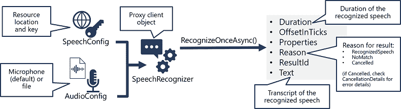

1.  使用 SpeechConfig 对象封装连接到 Azure AI 语音资源所需的信息。 具体来说，就是它的位置和键。

1.  （可选）使用 AudioConfig 定义要转录的音频的输入源。 默认情况下，该输入源是系统默认麦克风，但你也可以指定音频文件。

1.  使用 SpeechConfig 和 AudioConfig 创建 SpeechRecognizer 对象。 此对象是语音转文本 API 的代理客户端。

1.  使用 SpeechRecognizer 对象的方法调用基础 API 函数。 例如，RecognizeOnceAsync() 方法使用 Azure AI 语音服务以异步方式转录单一口述言语。

1.  处理来自 Azure AI 语音服务的响应。 如果采用 RecognizeOnceAsync() 方法，则结果为带有以下属性的 SpeechRecognitionResult 对象：

+   持续时间

+   OffsetInTicks

+   属性

+   原因

+   ResultId

+   文本

如果操作成功，则 Reason 属性具有枚举值 RecognizedSpeech，Text 属性包含听录。 Result 的其他可能值包括 NoMatch（指示已成功分析音频，但是未识别出语音）或 Canceled（指示发生了错误）（在此例中，可以检查 CancellationReason 属性的 Properties 集合以确定错误的内容）

### 使用文本转语音 API

与 Azure AI 语音转文本 API 类似，Azure AI 语音服务提供其他 REST API 用于语音合成：

+   文本转语音 API，这是执行语音合成的主要方式。

+   批处理合成 API，旨在支持将大量文本转换为音频的批处理操作（例如，从源文本生成音频书籍）。

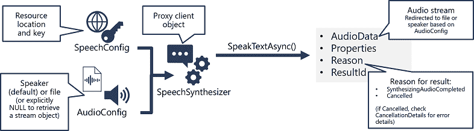

1.  使用 SpeechConfig 对象封装连接到 Azure AI 语音资源所需的信息。 具体来说，就是它的位置和键。

1.  （可选）使用 AudioConfig 为要合成的语音定义输出设备。 默认情况下，这是默认系统扬声器，但也可以指定音频文件，或是通过将此值显式设置为 null 值，可以处理直接返回的音频流对象。

1.  使用 SpeechConfig 和 AudioConfig 创建 SpeechSynthesizer 对象。 此对象是文本转语音 API 的代理客户端。

1.  使用 SpeechSynthesizer 对象的方法调用基础 API 函数。 例如，SpeakTextAsync() 方法使用 Azure AI 语音服务将文本转换为口述音频。

1.  处理来自 Azure AI 语音服务的响应。 如果采用 SpeakTextAsync 方法，则结果为带有以下属性的 SpeechSynthesisResult 对象：

+   AudioData

+   属性

+   原因

+   ResultId

成功合成语音后，Reason 属性设置为 SynthesizingAudioCompleted 枚举，AudioData 属性包含音频流（根据 AudioConfig，可能已自动发送到扬声器或文件）。

### 配置音频格式和语音

**音频格式**

对于语音合成生成的音频流，Azure AI 语音服务支持多种输出格式。 根据特定需求，可以基于以下所需项选择格式：

+   音频文件类型

+   采样率

+   位深度

**语音**

Azure AI 语音服务提供多种语音，可用于对启用了语音的应用程序进行个性化设置。 可以使用两种类型的语音：

+   标准语音 - 从音频样本创建的合成音频。

+   神经语音 - 使用深度神经网络创建的听起来更加自然的语音。

语音由表示区域设置和人员姓名的名称进行标识，例如 en-GB-George。

### 使用语音合成标记语言

虽然 Azure AI 语音 SDK 使你可以提交要合成为语音的纯文本（例如使用 SpeakTextAsync() 方法），不过该服务还支持基于 XML 的语法，用于描述要生成的语音的特征。 通过此语音合成标记语言 (SSML) 语法可更好地控制口述输出的声音，使你可以：

+   指定说话风格，如使用神经语音时的“兴奋”或“愉快”。

+   插入暂停或静默。

+   指定 音素（拼音发音），例如将文本“SQL”发音为“sequel”。

+   调整语音的韵律（影响音调、音色和说话速率）。

+   使用常见的“表达为”规则，例如用于指定应将给定字符串表示为日期、时间、电话号码或其他形式。

+   插入录制的语音或音频，例如包含标准录制消息或模拟背景噪音。

## 通过 Azure AI 语音服务翻译语音

语音翻译基于语音识别构建，其实现方式是：识别并转录指定语言的语音输入，然后返回一种或多种其他语言的听录翻译。

### 将语音转换为文本

使用 Azure AI 语音 SDK 的语音翻译的模式类似于语音识别，但其中添加了有关翻译的源语言和目标语言的信息

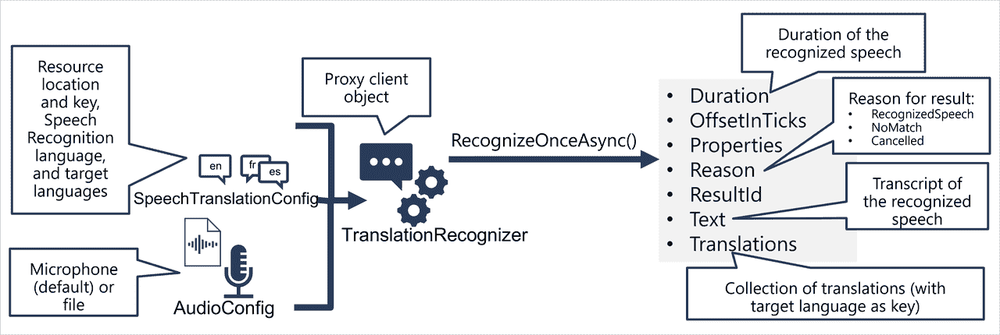

1.  使用 SpeechTranslationConfig 对象封装在连接到 Azure AI 语音资源时所需的信息。 具体来说，就是它的位置和键。

1.  SpeechTranslationConfig 对象还可用于指定语音识别语言（输入语音的源语言），以及应翻译成的目标语言。

1.  （可选）使用 AudioConfig 定义要转录的音频的输入源。 默认情况下，该输入源是系统默认麦克风，但你也可以指定音频文件。

1.  使用 SpeechTranslationConfig 和 AudioConfig 创建 TranslationRecognizer 对象。 此对象是 Azure AI 语音翻译 API 的代理客户端。

1.  使用 TranslationRecognizer 对象的方法调用基础 API 函数。 例如，RecognizeOnceAsync() 方法使用 Azure AI 语音服务以异步方式翻译单一口述言语。

1.  处理来自 Azure AI 语音的响应。 对于 RecognizeOnceAsync() 方法，结果是一个 SpeechRecognitionResult 对象，它包含以下属性：

+   持续时间

+   OffsetInTicks

+   属性

+   原因

+   ResultId

+   文本

+   翻译

### 合成翻译

TranslationRecognizer 返回语音输入的翻译听录，实质上是将语音转换为文本。

还可以将翻译合成为语音，以创建语音转语音翻译解决方案。 可以通过以下两种方法实现此目的。

**基于事件的合成**

如果要执行一对一翻译（从一种源语言翻译成单种目标语言），可以使用基于事件的合成将翻译捕获为音频流。 若要实现此目的，需要：

在 TranslationConfig 中为翻译后的语音指定所需的语音。 为 TranslationRecognizer 对象的 Synthesizing 事件创建事件处理程序。 在事件处理程序中，使用 Result 参数的 GetAudio() 方法检索经过翻译的音频的字节流。 用于实现事件处理程序的特定代码因所使用的编程语言而异。 请参阅语音 SDK 文档中的 C# 示例和 Python 示例。

**手动合成**

手动合成是基于事件的合成的替代方法，无需实现事件处理程序。 可以使用手动合成为一种或多种目标语言生成音频翻译。

手动合成翻译实质上只是以下两个不同操作的组合：

1.  使用 TranslationRecognizer 将语音输入翻译成一种或多种目标语言的文本转录。

1.  在翻译操作结果中循环访问翻译字典，并使用 SpeechSynthesizer 合成每种语言的音频流。

# Applied Skills

## 一般准则

**在**此应用场景中，某些资源的部署可能需要几分钟的时间。在部署完成期间，请查看实验室中的其他任务。你可以执行不依赖于该部署的其他任务。

感谢你同意帮助我们的团队使用 Azure AI 语言构建自然语言处理解决方案。

在 Azure 中执行任务时，必须遵循我们的一些一般准则。

+   创建对象时，请使用默认设置，除非有不同的配置要求。

+   只有创建、删除或修改对象才能达到上述要求。 对环境进行不必要的更改可能会对您的最终成绩产生不利影响。

+   如果有多种实现目标的方法，请务必选择管理工作量最小的方法。

此致

首席技术官 (CTO)

## 现有环境

以下是用于访问 Azure 中的资源的凭据：

用户名：User-@labinstanceid

密码：password-@labinstanceid

可以通过单击“**说明**”选项卡找到这些凭据。

你已获得 rg-@labinstanceid 资源组的权限。 请在此资源组中创建所有 Azure 对象。

我们还创建了名为 sa@labinstanceid 的存储帐户供你使用。

此致

网络管理员

> 注意：需要留意此处的**labinstanceid **之后创建资源需要使用相同的ID

## Part I：概念验证

你好，

感谢你同意帮助我们的 IT 部门构建概念证明 (PoC) 来对文本进行分类。 一位同事已经开始构建示例解决方案，该解决方案可以识别位置信息和电子邮件地址。 我们需要你帮助敲定该解决方案并将其连接到 Azure，以证明该技术已准备就绪。

**这是你的任务：**

你需要创建一个可以识别位置信息和电子邮件地址的 PoC 解决方案。 该解决方案必须使用最适合该用例的模型。 该解决方案必须满足以下要求：

+   在 rg-@labinstanceid 中新建名为 lang-@labinstanceid 的语言服务。

+   确保语言服务支持自定义文本分类和命名实体识别 (NER)。

+   确保语言服务使用免费层，并在北欧 Azure 区域中预配。

+   使用现有 sa@labinstanceid 存储帐户。

+   确保 PoC 应用的源代码连接到新建资源中的相应模型。 可以在 C:\PoC 中找到应用。 该应用有 C# 版本和 Python 版本。 修改你喜欢的版本。 无需修改这两个版本。 完成任务后，应用必须能继续正常运行。

此致

项目管理团队

> 解题过程

+   在 **RG1 中创建名为 **lang-36478729** 的新语言服务**。

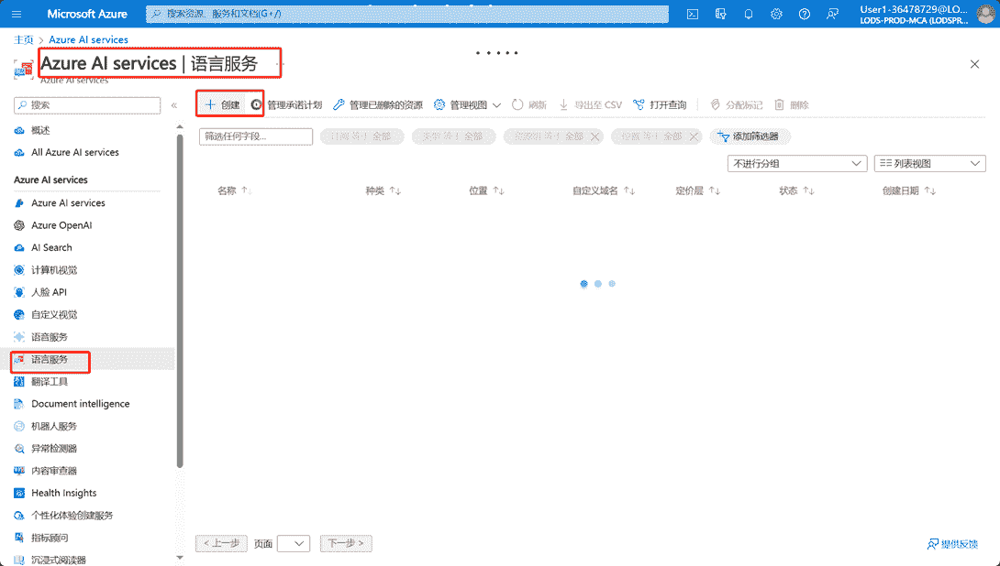

+   保语言服务支持自定义文本分类和命名实体识别 （NER）。

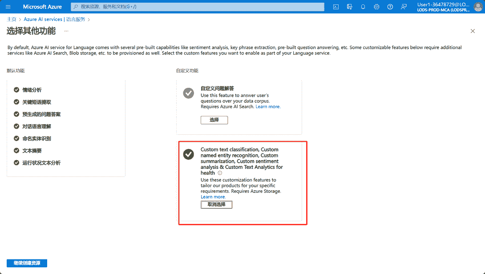

+   确保语言服务使用免费层，并在北欧 Azure 区域中预配。

+   使用现有的 **sa36478729** 存储帐户。

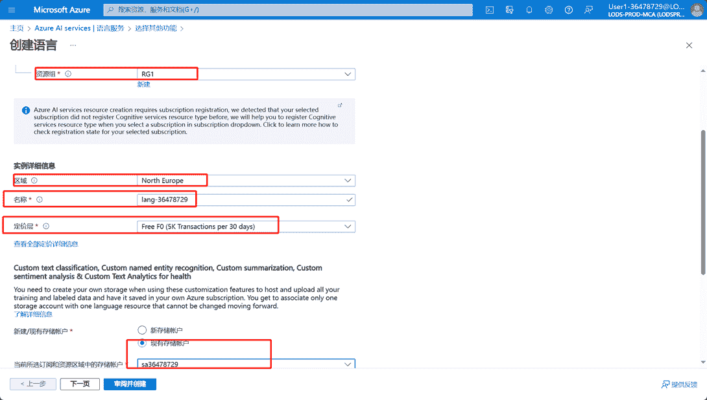

+   确保 PoC 应用的源代码连接到新创建的资源中的相应模型。您可以在 C：\PoC 中找到该应用。该应用有 C# 版本和 Python 版本。修改您喜欢的版本。您不需要修改这两个版本。完成任务后，应用必须继续正常运行。

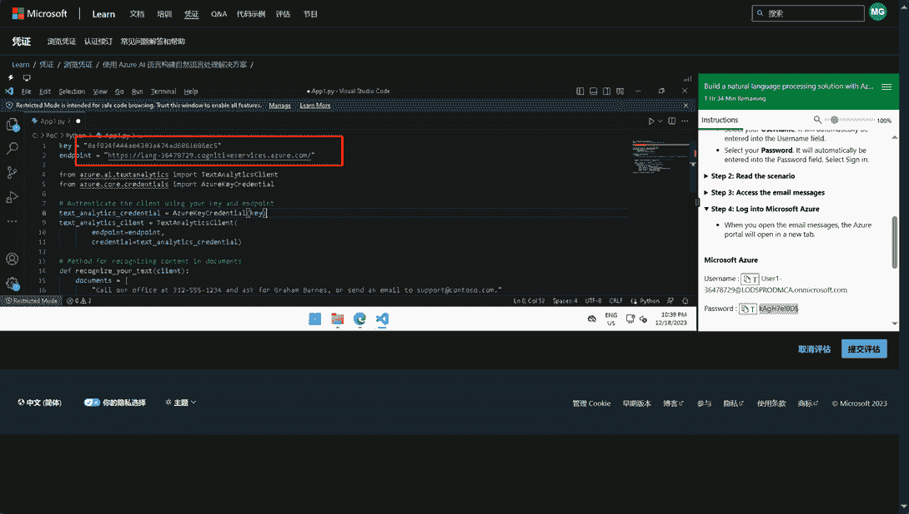

## Part II：发票验证

你好，

我们要从网上商店日志中提取信息来验证我们的发票系统。 我们需要你将日志上传到训练模型并正确标记它们。 标记后，你必须训练模型，以便我们的开发人员可以在稍后的验证过程中使用它。

**这是你的任务：**

你需要使用命名实体识别 (NER) 从网上商店收到的日志文件中提取名称和价格。 创建的项目必须满足以下要求：

+   项目必须命名为 Webshop。

+   语言必须是英语（美国），而不是多语言。

+   项目必须使用两个名为 Price 和 CustomerName 的新实体。

+   sa@labinstanceid/webshop 容器中的示例数据必须标有 Price 和 CustomerName。

+   必须启动模型训练。

无需等待训练完成即可开始下一个任务。

此致

项目管理团队

> 解题思路

+   项目必须命名为 Webshop。

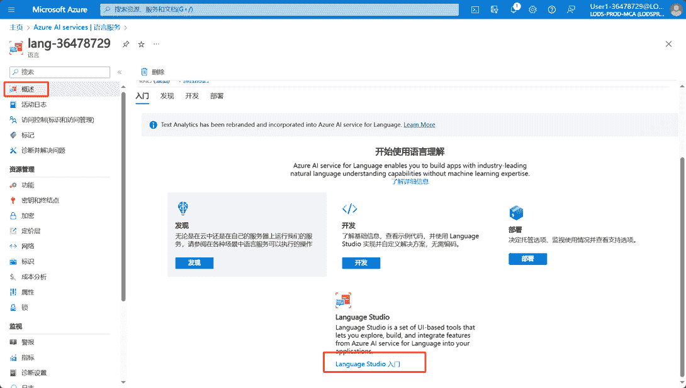

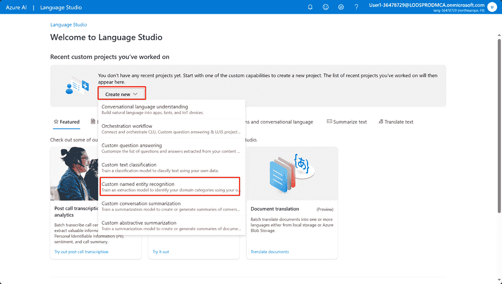

+   语言必须是英语（美国），而不是多语言。

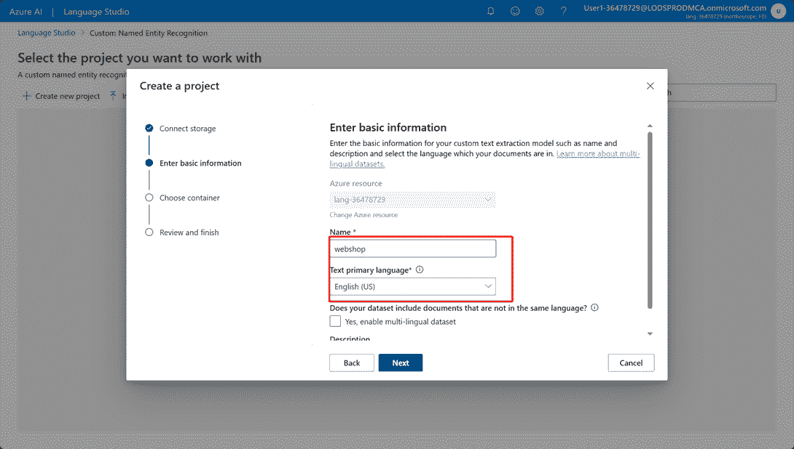

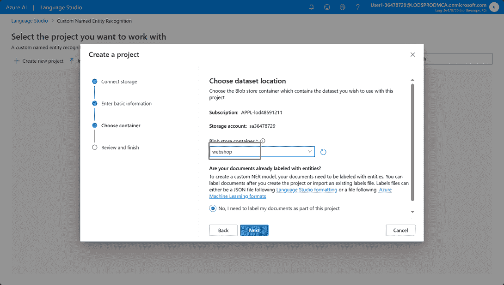

+   项目必须使用两个名为 Price 和 CustomerName 的新实体。

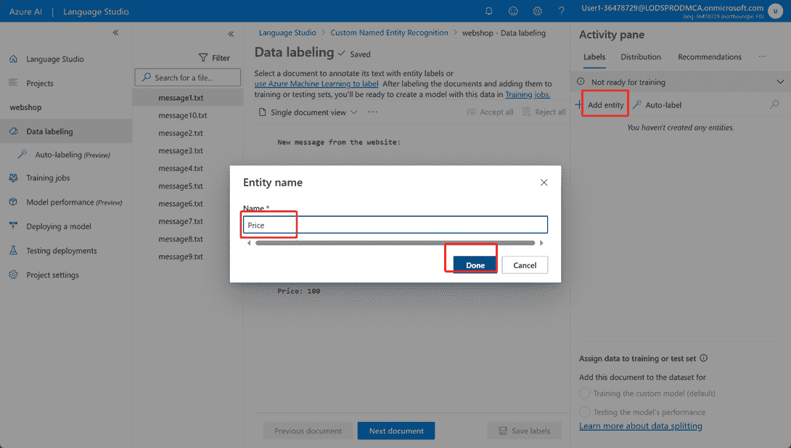

+   sa@labinstanceid/webshop 容器中的示例数据必须标有 Price 和 CustomerName。

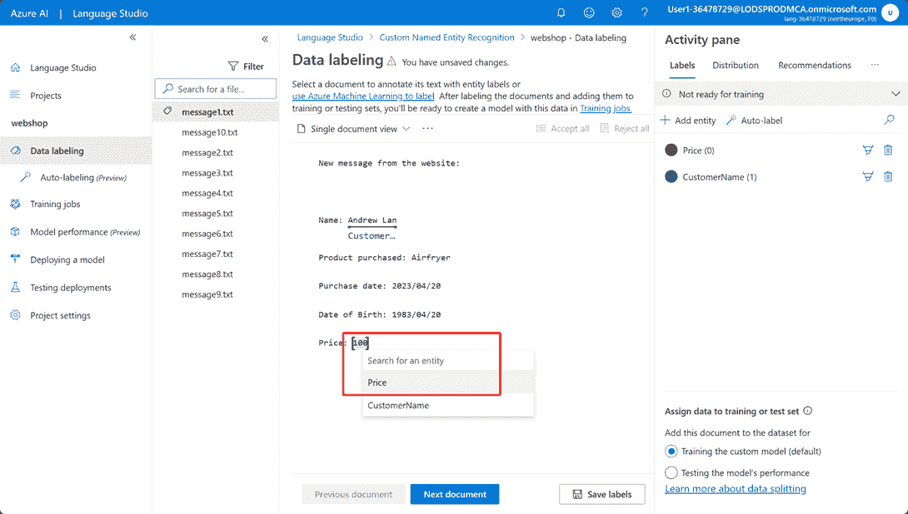

+   必须启动模型训练。

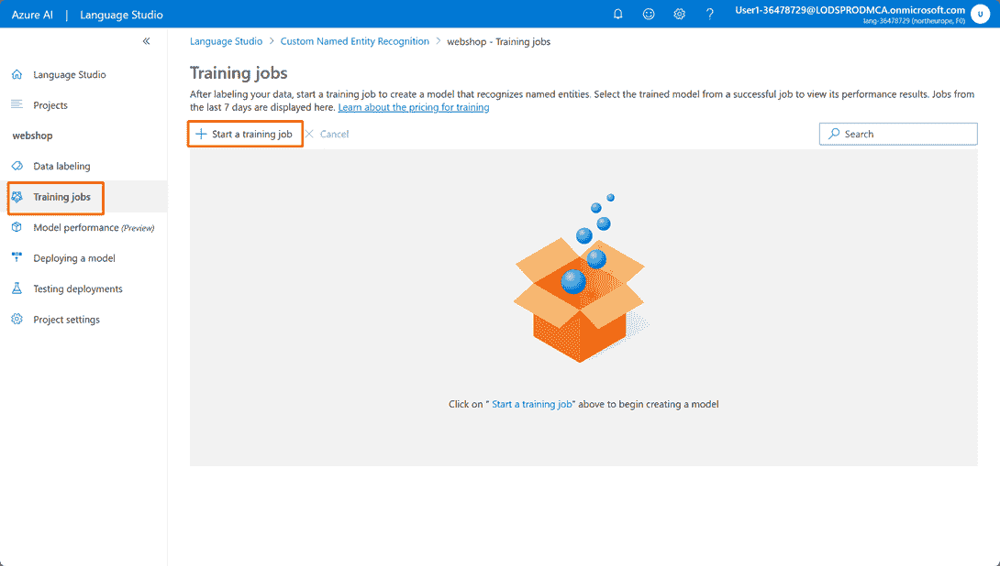

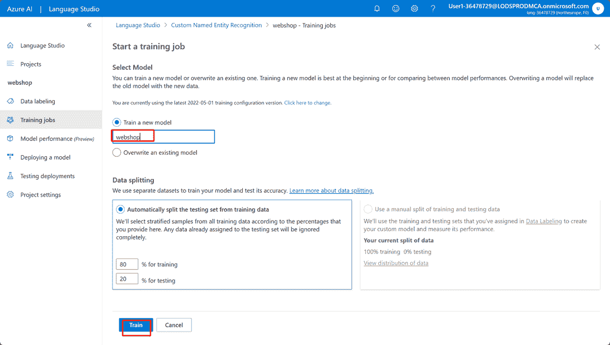

## Part III：聊天机器人后端

你好，

我们计划构建一个聊天机器人应用，它可以回答用户问题并允许用户订购产品。 我们需要你构建一个供聊天机器人使用的语言理解解决方案。

**这是你的任务：**

你需要创建一个新的语言理解项目。 该解决方案必须满足以下要求：

+   **使用 C:\pr**ojects 文件夹中 lang4567 的现有项目定义。

+   使用标准训练模式。

+   将数据拆分为训练占比 85% 和测试占比 15%。

+   将模型的部署配置为使用名称 **lang4567**。

+   将 CLU_PoC 应用的源代码修改为使用已部署模型的 API 终结点。 可以在 c:\CLU_PoC 中找到应用。 该应用有 C# 版本和 Python 版本。 修改你喜欢的版本。 无需修改这两个版本。 请注意，这不是生产代码，我们将对客户端密码进行硬编码以用于测试目的。

+   确保 CLU_PoC 应用仅打印置信度分数超过 80% 的意向值。

此致

项目管理团队

> 解题步骤

+   **使用 C:\pr**ojects 文件夹中 lang4567 的现有项目定义。

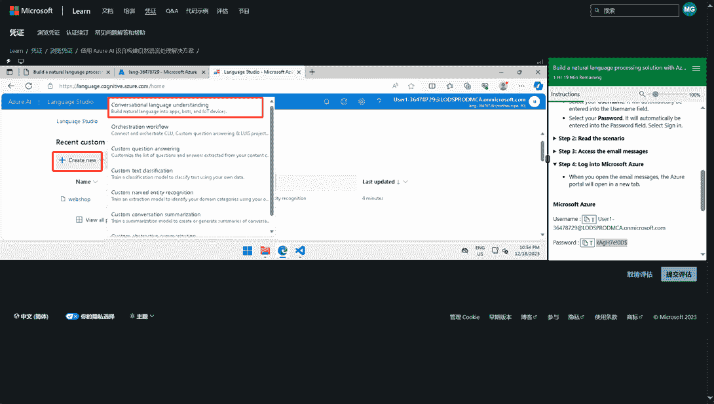

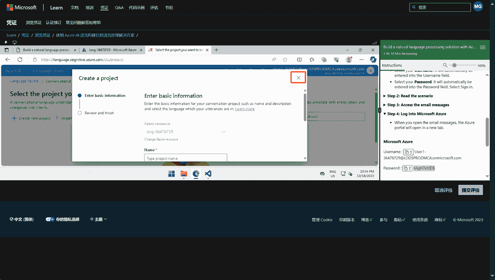

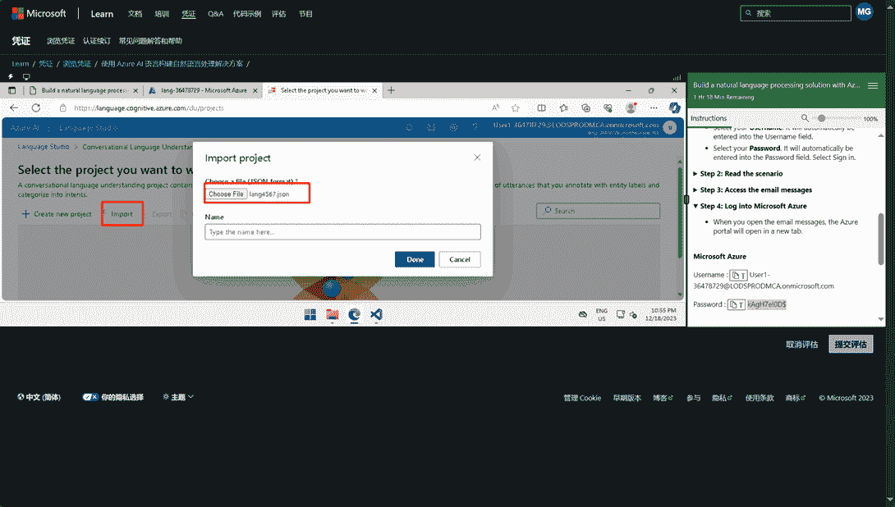

+   使用标准训练模式。

+   将数据拆分为训练占比 85% 和测试占比 15%。


+   将模型的部署配置为使用名称 **lang4567**。

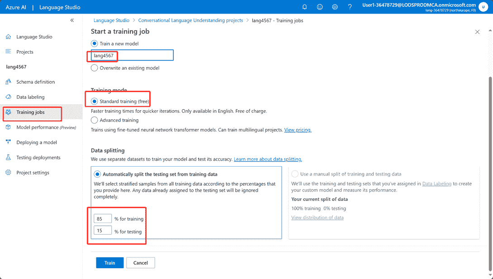

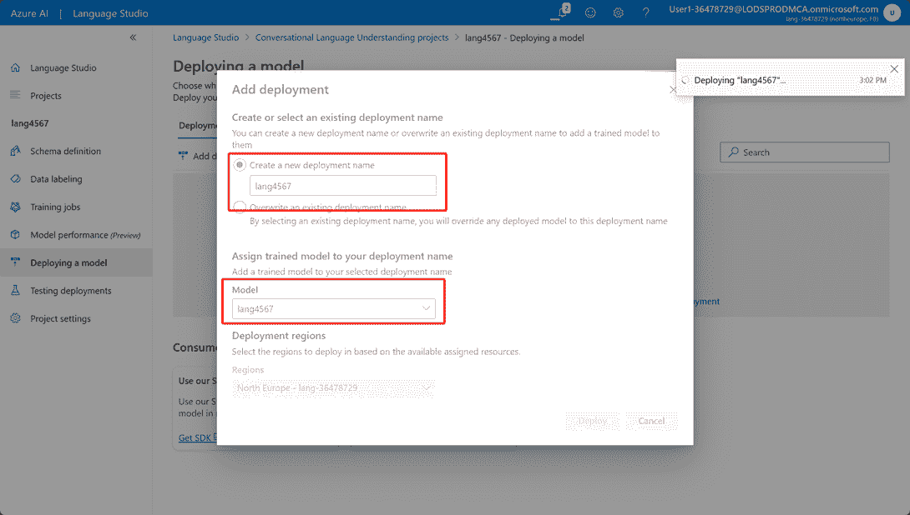

+   将 CLU_PoC 应用的源代码修改为使用已部署模型的 API 终结点。 可以在 c:\CLU_PoC 中找到应用。 该应用有 C# 版本和 Python 版本。 修改你喜欢的版本。 无需修改这两个版本。 请注意，这不是生产代码，我们将对客户端密码进行硬编码以用于测试目的。

+   确保 CLU_PoC 应用仅打印置信度分数超过 80% 的意向值。

使用以下代码(注意需要替换key和endpoint的值)

```
key = &quot;EyPVzuGNGl8WOQFfdt9raTUDxWDALSrNyLUjEYMyrqwE9zkbyc4kJQQJ99AKACi5YpzXJ3w3AAAaACOGUtYC&quot;
endpoint = &quot;https://lang-lod49820879.cognitiveservices.azure.com/&quot;
project_name = &quot;lang4567&quot;
deployment_name = &quot;lang4567&quot;

import sys
from azure.core.credentials import AzureKeyCredential
# add import statement for client library
from azure.ai.language.conversations import ConversationAnalysisClient

def main():
    # analyze query
    if (len(sys.argv) &gt; 1):
        query = sys.argv[1]
    else:
        query = &quot;Send an email to Carol about the tomorrow&#x27;s demo&quot;
    
    client = ConversationAnalysisClient(endpoint, AzureKeyCredential(key)) # replace null with correct method
    with client:
        result = client.analyze_conversation( # replace null with correct method
            task={
                &quot;kind&quot;: &quot;Conversation&quot;,
                &quot;analysisInput&quot;: {
                    &quot;conversationItem&quot;: {
                        &quot;participantId&quot;: &quot;1&quot;,
                        &quot;id&quot;: &quot;1&quot;,
                        &quot;modality&quot;: &quot;text&quot;,
                        &quot;language&quot;: &quot;en&quot;,
                        &quot;text&quot;: query
                    },
                    &quot;isLoggingEnabled&quot;: False
                },
                &quot;parameters&quot;: {
                    &quot;projectName&quot;: project_name,
                    &quot;deploymentName&quot;: deployment_name,
                    &quot;verbose&quot;: True
                }
            }
        )

    # view result
    print(f&quot;query: {result[&#x27;result&#x27;][&#x27;query&#x27;]}&quot;)
    if result[&#x27;result&#x27;][&#x27;prediction&#x27;][&#x27;intents&#x27;][0][&#x27;confidenceScore&#x27;] &gt; 0.8:
        print(f&quot;category: {result[&#x27;result&#x27;][&#x27;prediction&#x27;][&#x27;intents&#x27;][0][&#x27;category&#x27;]}&quot;)
        print(f&quot;confidence score: {result[&#x27;result&#x27;][&#x27;prediction&#x27;][&#x27;intents&#x27;][0][&#x27;confidenceScore&#x27;]}\n&quot;)

    print(&quot;entities:&quot;)
    for entity in result[&#x27;result&#x27;][&#x27;prediction&#x27;][&#x27;entities&#x27;][&#x27;confidenceScore&#x27;]:
        print(f&quot;\ncategory: {entity[&#x27;category&#x27;]}&quot;)
        print(f&quot;text: {entity[&#x27;text&#x27;]}&quot;)
        print(f&quot;confidence score: {entity[&#x27;confidenceScore&#x27;]}&quot;)

if __name__ == &#x27;__main__&#x27;:
    main()

```