# DW-104 Lab 4 - 使用 Azure AI Foundry SDK 构建、评估和部署基于 RAG 的代理

> 来源：[https://zsyhjtnsa5.feishu.cn/docx/ClogdWZLpoWRRvxnpYXca01anDf](https://zsyhjtnsa5.feishu.cn/docx/ClogdWZLpoWRRvxnpYXca01anDf)

## 实验目标

本实验的目标是使用 Azure AI Foundry SDK 构建、评估和部署基于检索增强生成 （RAG） 的代理。本实验将指导您设置项目和开发环境、部署 AI 模型（例如 GPT-4 和 text-embedding-ada-002）、集成 Azure AI Search 进行文档检索，以及创建自定义知识检索 （RAG） 聊天应用程序。重点是将 AI 模型响应与相关产品数据相结合、开发自定义聊天界面以及评估生成响应的性能。

## 解决方案

该解决方案包括在 Azure AI Foundry 中设置项目、部署 AI 模型（GPT-4 和 text-embedding-ada-002），以及集成 Azure AI Search 来存储和检索自定义产品数据。它包括创建 Python 脚本来生成向量嵌入、构建搜索索引并查询相关产品信息。我们还开发了一个基于 RAG 的聊天界面，利用搜索结果提供可靠的响应，并使用预定义的数据集和指标来评估聊天应用的性能，以提高其有效性。

## 练习 0：了解虚拟机和凭据

在本练习中，我们将识别并了解我们将在整个实验室中使用的凭据。

**重要提示：**请完成本练习中的每个步骤，以了解实验室执行中将使用的通用术语和凭证。

1.  **说明**标签包含实验室指南以及整个实验室过程中需要遵循的说明。

1.  **资源**选项卡已获取执行实验室所需的凭证。

+   **URL** - Azure 门户的 URL

+   **订阅**- 这是分配给您的**订阅**的** ID**

+   **用户名**-您需要用来**登录** Azure **服务的用户 ID**。

+   **密码**- **Azure 登录**的**密码**。

1.  我们将此用户名和密码称为** Azure 登录凭据**。无论何时提到** Azure 登录凭据，**我们都会使用这些凭据。

+   **资源组**-分配给您的**资源组**。

1.  **重要提示**：请确保在此资源组下创建所有资源

1.  **帮助**选项卡包含支持信息。此处的** ID **值是**实验室实例 ID**，将在实验室执行期间使用。

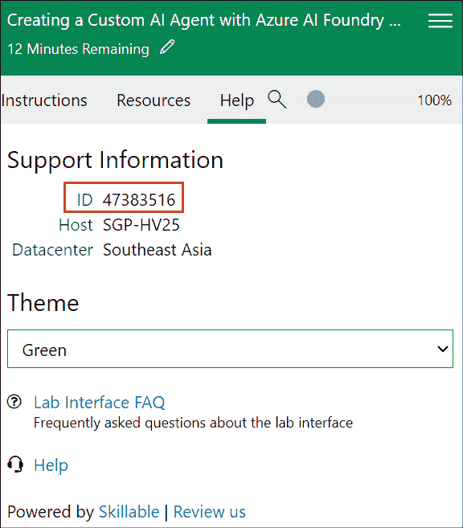

## 练习 1 - 设置项目和开发环境以使用 Azure AI Foundry SDK 构建自定义知识检索 （RAG） 应用

### 任务 1 创建项目

要在 Azure AI Foundry 中创建项目，请按照以下步骤操作：

1.  登录 **Azur**e AI Foundry，网址为 https://ai.azure.com/。选择“登录”，然后使用以下方式登录：

+   用户名 - User1-51719144@LODSPRODMCA.onmicrosoft.com

+   密码 - BDh00!e!eD!q

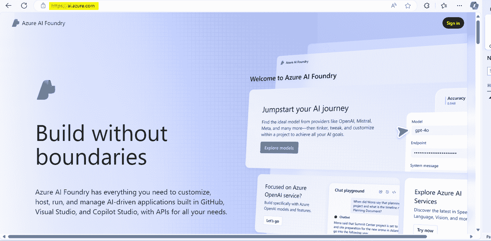

1.  关闭弹出窗口并选择**+ 创建项目**。

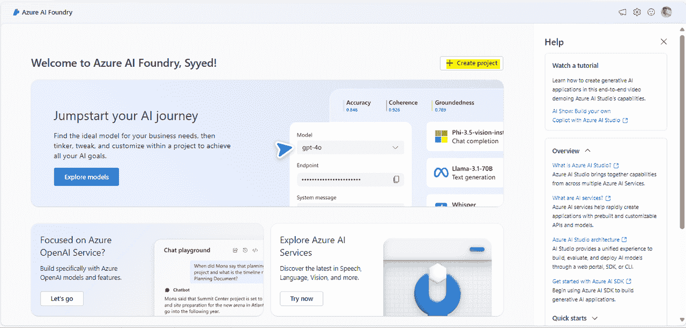

1.  输入 RAGproj5**17191**44 作为项目名称，单击“自定义”。

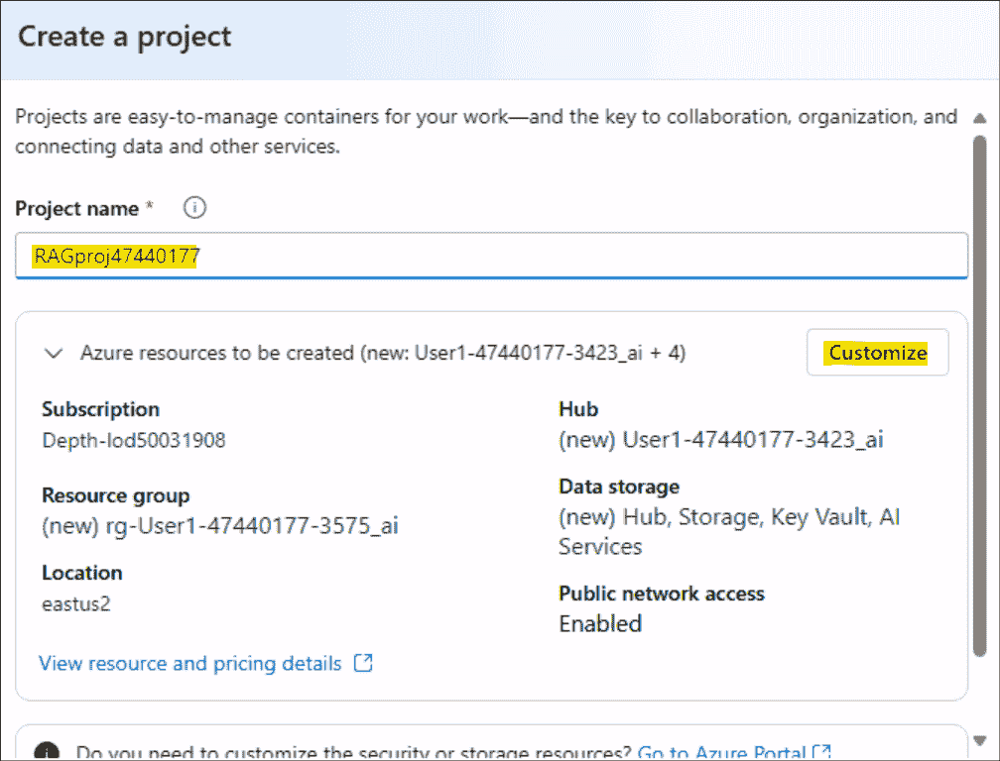

1.  **在下一页上，**输入以下详细信息，然后单击“下一步”。

+   中心名称 - **hub51719144**

+   订阅 - 选择您指定的订阅

+   创建新的资源组 - 选择您分配的资源组（ResourceGroup1）

+   位置 - 选择 japaneast

1.  其余部分保留默认设置，然后单击**“下一步”**。

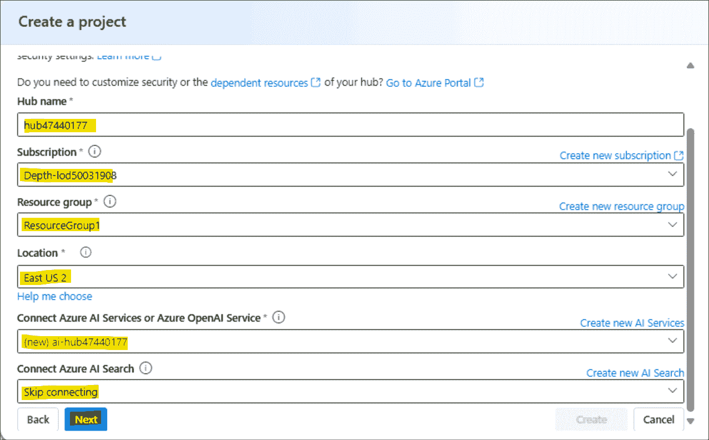

1.  **在“审核并完成”**页面上，单击**“创建”。**

+   资源创建将需要几分钟。

+   如果出现弹出窗口，请关闭。

1.  从项目主页，在记事本中记下**项目连接字符串，**以便在本练习的下一个任务中使用。

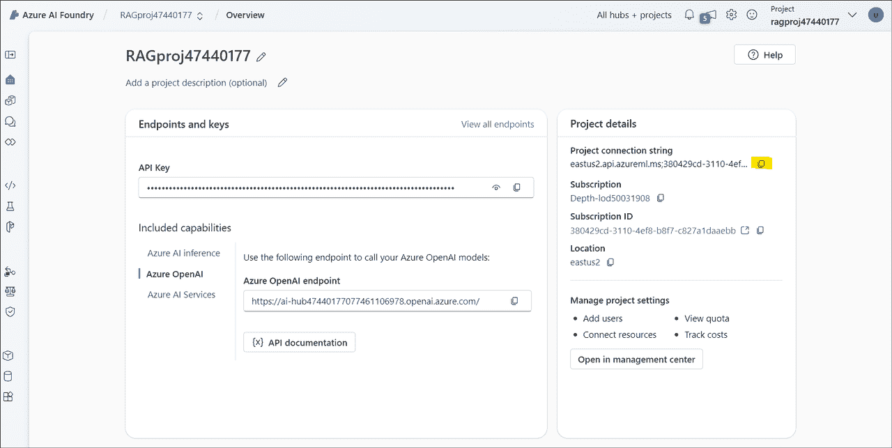

### 任务 2：部署模型

构建基于 RAG 的聊天应用需要两个模型：一个 Azure OpenAI 聊天模型 （gpt-4o-mini） 和一个 Azure OpenAI 嵌入模型 （text-embedding-ada-002）。请按照以下步骤，将这些模型部署到 Azure AI Foundry 项目中。

以下步骤将模型从 AI Foundry 门户模型目录部署到实时端点

1.  从左侧导航窗格中，选择**模型目录**。

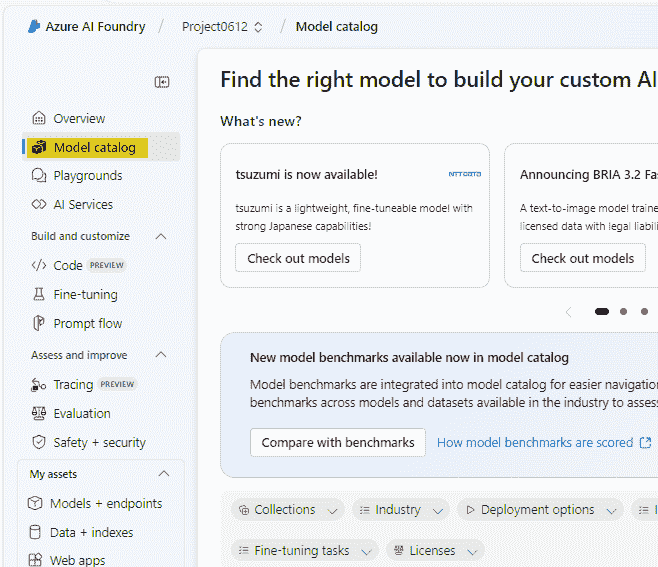

1.  从型号列表中选择** GPT-4O-****mini **型号。您可以使用搜索栏查找。

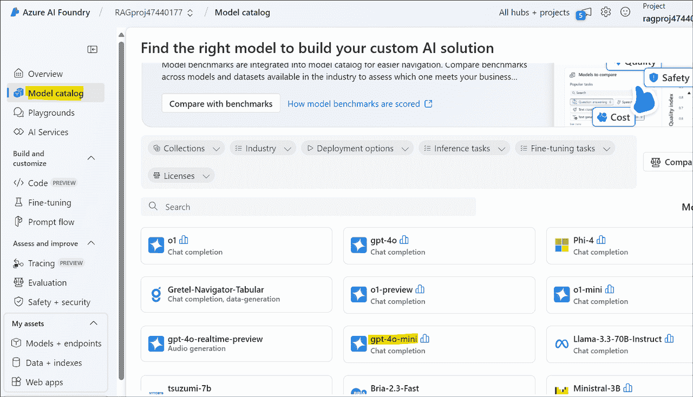

1.  在模型详情页面，选择**部署**。

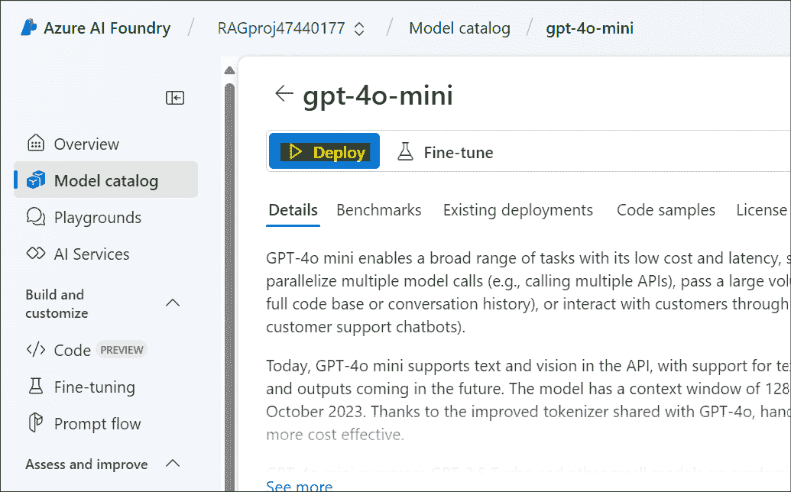

1.  保留默认的 Dep**loyment** name。 选择 Deploy。 或者，如果该模型在您所在的地区不可用，则会为您选择其他地区并将其连接到您的项目。 在这种情况下，选择 Create resource and deploy。

1.  部署** gpt-4o-mini **后，部署 text**-embed**d**ing-**ada-002 模型。选择“部署类型”为“标准”。

### 任务 3：创建 Azure AI 搜索服务

此应用程序的目标是将模型响应基于您的自定义数据。搜索索引用于根据用户的问题检索相关文档。

您需要 Azure AI 搜索服务和连接来创建搜索索引。

1.  使用 Azure 登录凭据登录 https://portal.azure.com 上的 Azure 门户。

1.  从主页搜索栏中搜索** AI 搜索**并选择它。

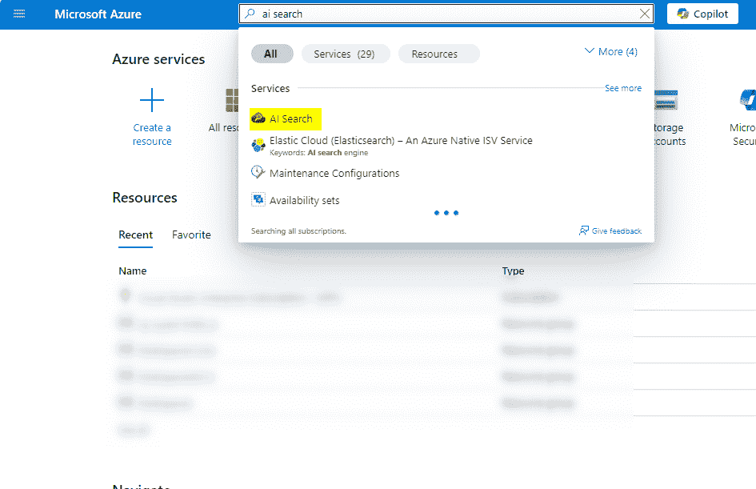

1.  单击**+ 创建**图标并填写以下详细信息。

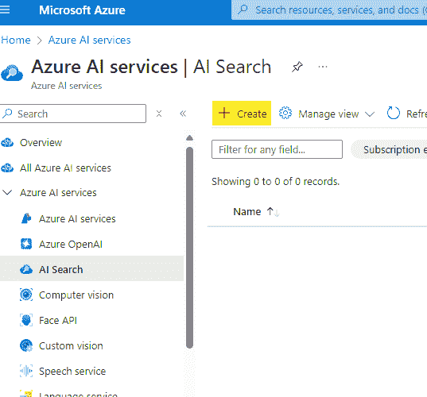

1.  输入以下详细信息并选择**“审阅 + 创建”**。

+   订阅 - 选择您指定的订阅

+   资源组-选择您分配的资源组

+   服务名称 - 输入 aisearch51719144

+   地区 - 选择日本东部

+   定价层 - 选择**标准**

1.  查看详细信息并选择**创建**。

1.  等待部署成功，如下图所示，再进行下一步。

### 任务 4：将 Azure AI Search 连接到你的项目

在 Azure AI Foundry 门户中，检查 Azure AI Search 连接的资源。

1.  **从 Azure **AI Foundry 中的项目中，从左侧窗格中选择“管理中心” 。

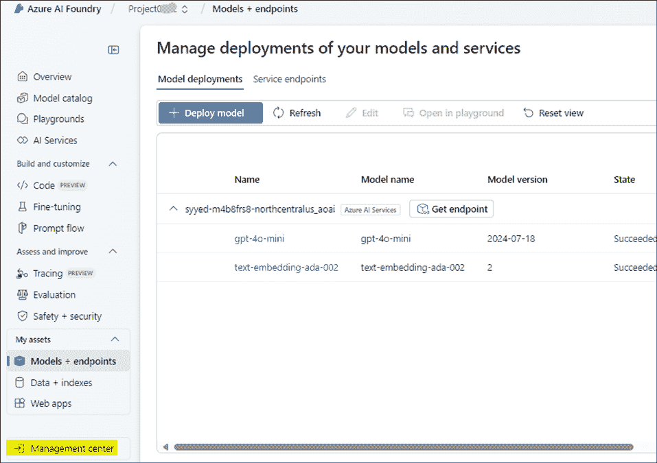

1.  在**“已连接的资源”**部分中，选择**“新建连接”**，然后选择“Azure AI Search”。

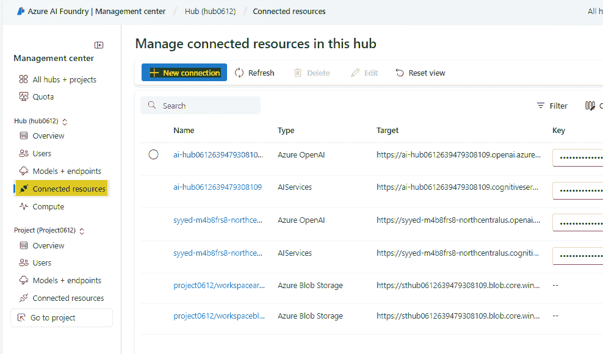

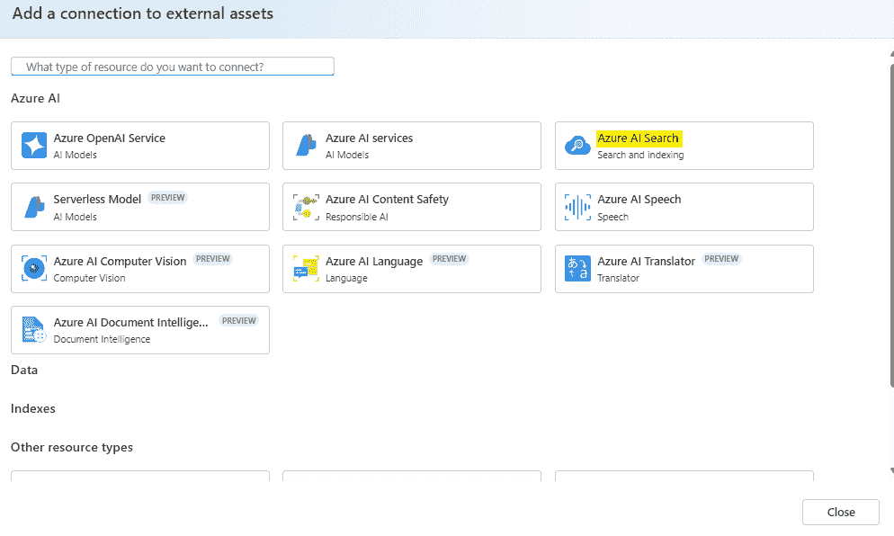

1.  **在身份验证**下选择** API 密钥**，然后选择**添加连接**。

1.  从**“已连接的资源”**页面，您现在可以看到已添加的资源连接。

### 任务 5：安装 Azure CLI 并登录

您安装 Azure CLI 并从本地开发环境登录，以便可以使用用户凭据调用 Azure OpenAI 服务。

1.  **在 Windows 搜****索栏中搜索 P**owerShell ，并以管理员模式打开它。如果提示继续启动，请接受。


1.  打开 Windows Power Shell 并粘贴下面给出的命令并运行它。

```
$progressPreference = &#x27;silentlyContinue&#x27;
Write-Host &quot;Installing WinGet PowerShell module from PSGallery...&quot;
Install-PackageProvider -Name NuGet -Force | Out-Null
Install-Module -Name Microsoft.WinGet.Client -Force -Repository PSGallery | Out-Null
Write-Host &quot;Using Repair-WinGetPackageManager cmdlet to bootstrap WinGet...&quot;
Repair-WinGetPackageManager
Write-Host &quot;Done.&quot;
```

1.  使用以下命令从终端安装 Azure CLI：

```
winget install -e --id Microsoft.AzureCLI
```

1.  当提示接受时，选择** Y**，然后**按 Enter 。**

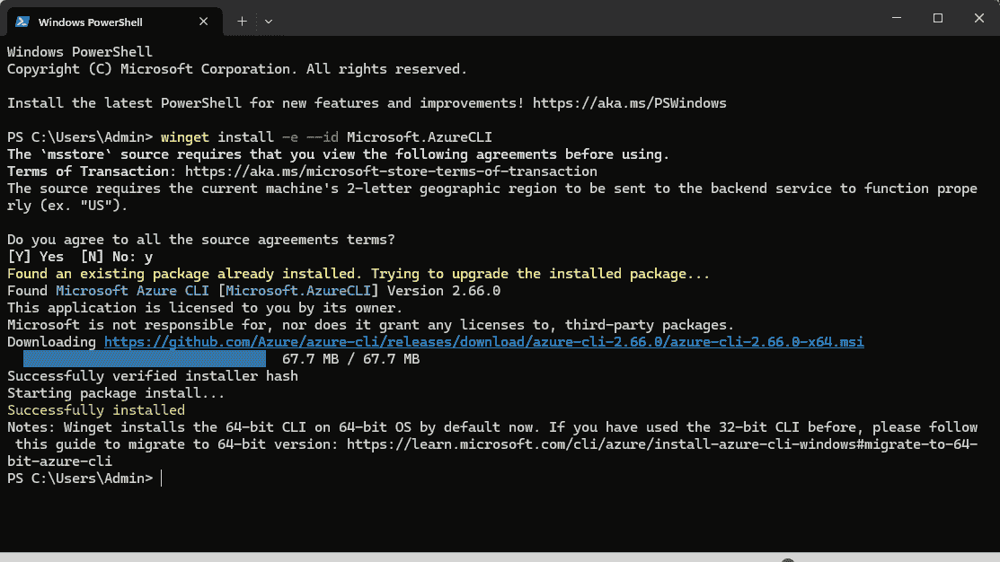

1.  安装 Azure CLI 后，使用 az login 命令登录，并使用浏览器登录：

```
az login
```

1.  选择**工作或学校帐户**，然后单击**继续**。


1.  使用您的** Azure 登录凭据**登录。

1.  在**选择订阅**提示中输入** 1 **并单击 **Enter**。

### 任务 6：创建新的 Python 环境

首先，您需要创建一个新的 Python 环境来安装本教程所需的软件包。请勿将软件包安装到全局 Python 安装中。安装 Python 软件包时，应始终使用虚拟环境或 conda 环境，否则可能会破坏全局 Python 安装。

> **重要提示：**如果以下命令无法粘贴，请尝试将其粘贴到记事本，然后复制并粘贴到 PowerShell。或者直接复制并粘贴到 PowerShell。PowerShell 中的“T”按钮有时不起作用。

**创建虚拟环境**

1.  从 Power Shell 中，通过执行以下命令导航到 C:\Users\Admin 。

```
cd\
```

```
cd Users\Admin
```

1.  通过在 powershell 中输入以下命令，创建一个以您的项目名称 RAGproj51719144 命名的文件夹。

```
mkdir RAGproj51719144
```

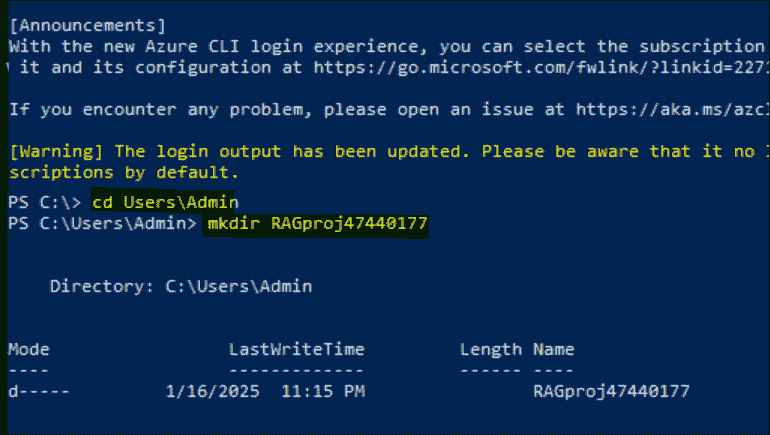

1.  在终端中输入以下命令导航到新的文件夹位置

```
cd RAGproj51719144
```

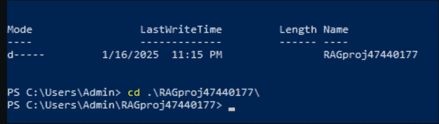

1.  使用以下命令创建虚拟环境

```
py -3 -m venv .venv
```

```
.venv\scripts\activate
```

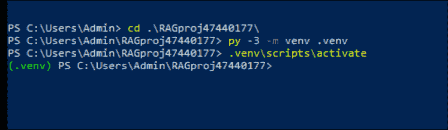

1.  激活 Python 环境意味着当您从命令行运行 python 或 pip 时，您将使用应用程序的 。venv 文件夹中包含的 Python 解释器。

1.  打开** VS Code**。选择**文件 -> 打开文件夹**，然后选择 我们在前面步骤中创建的 RAGproject 文件夹（位于 C:\Users\Admin）。

1.  **注意：** 单击“是，我信任该文件夹和内容”，然后根据提示继续。

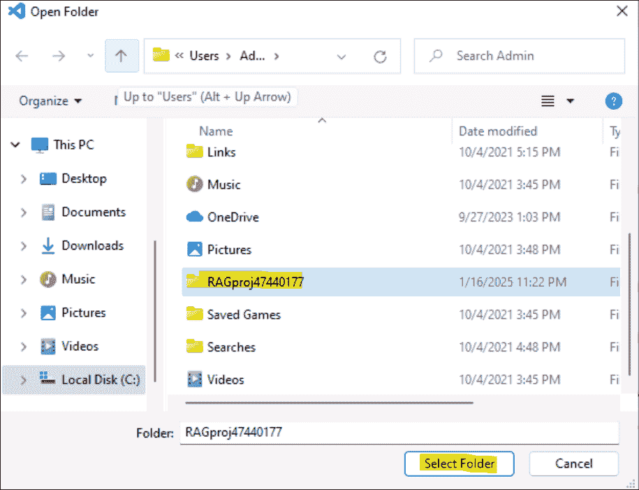

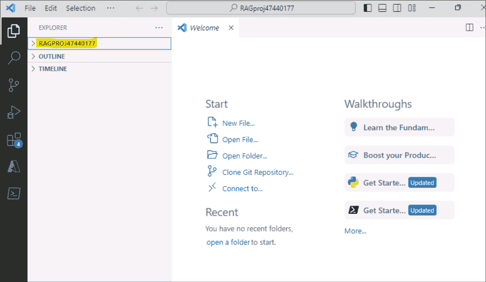

1.  当系统提示**您是否信任此文件夹中文件的作者**时，选择**“是，我信任作者” 。**

### 任务 7：安装包

安装 azure-ai-projects（预览版）和 azure-ai-inference（预览版）以及其他所需的包。

1.  在您的**项目文件夹中创建一个名为** requirements.txt 的文件 ，并将以下包添加到该文件中：

```
azure-ai-projects
azure-ai-inference[prompts]
azure-identity
azure-search-documents
pandas
python-dotenv
opentelemetry-api
marshmallow==3.23.2
```

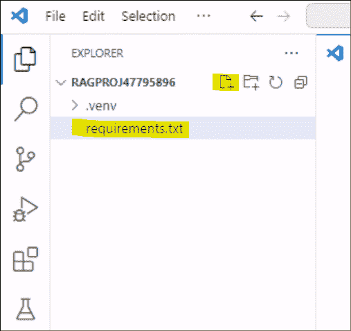

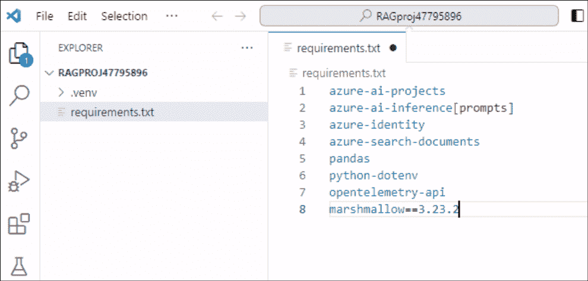

1.  在顶部导航栏上单击**“文件”**并**“全部保存”**。

1.  **右键单击 req**uirements.txt 并选择在集成终端中打开。

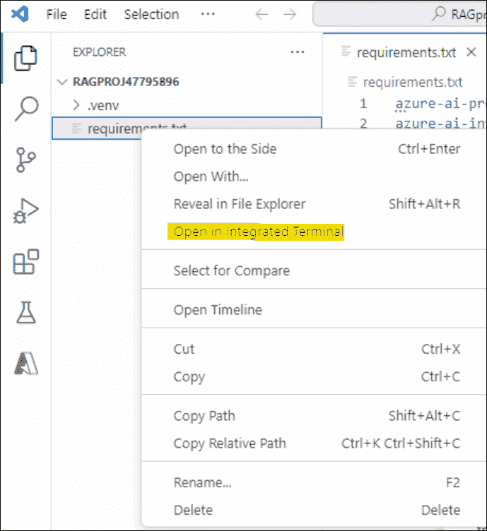

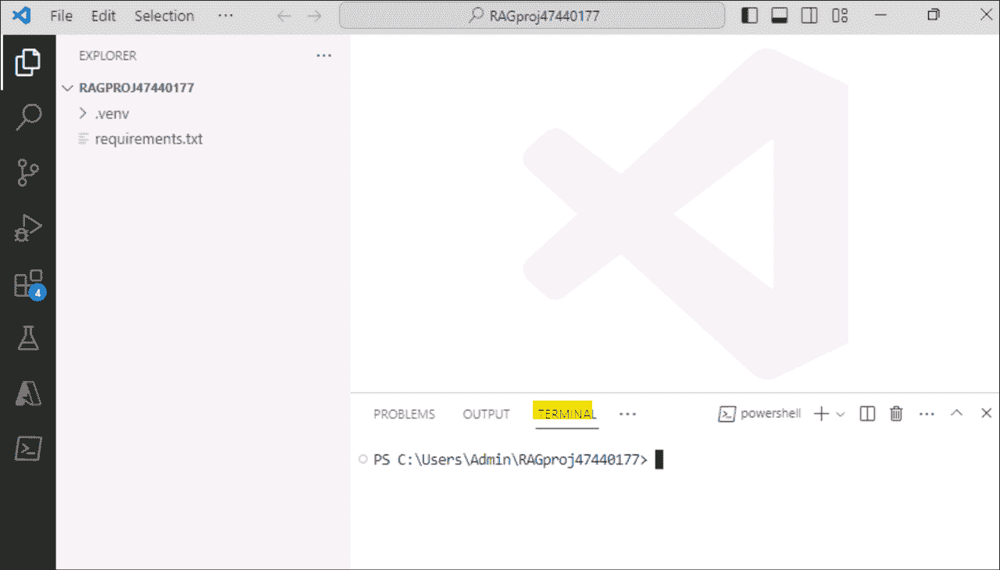

1.  运行以下命令进入虚拟环境

1.  py -3 -m venv.venv

1.  .venv\scripts\activate

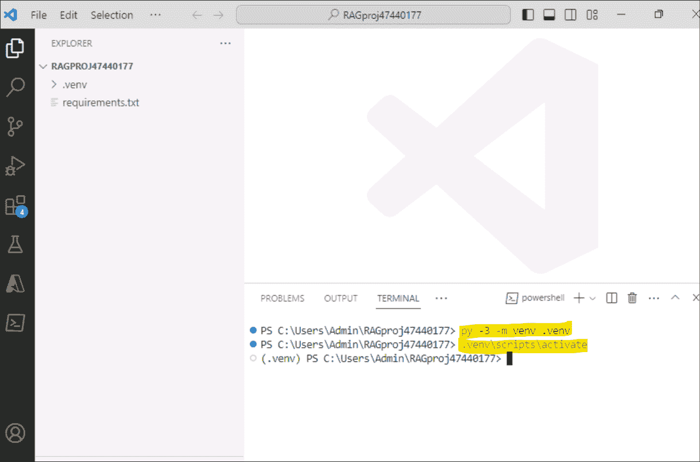

1.  运行 az login **命令并**使用 Azure 登录凭据登录。选择 1 以选择订阅。

1.  **注意：**如果登录提示未自动显示，请最小化 VS Code 以查看登录提示。

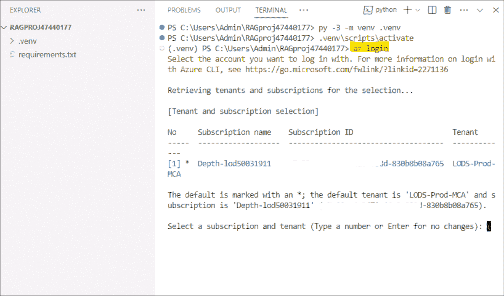

1.  要安装所需的软件包，请运行以下代码。

1.  pip 安装 -r 要求。txt

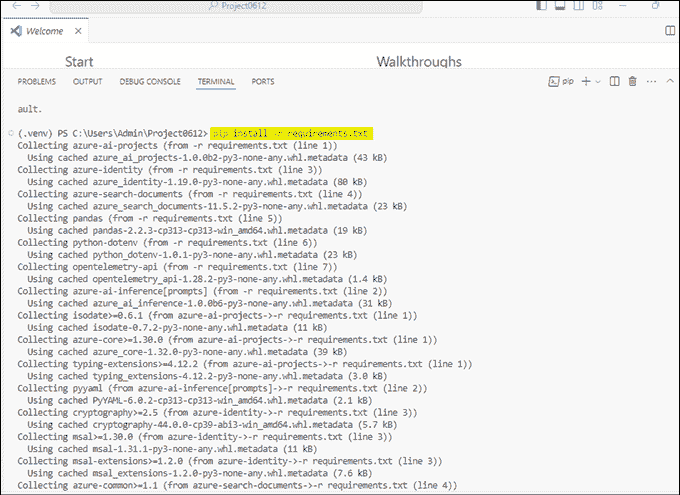

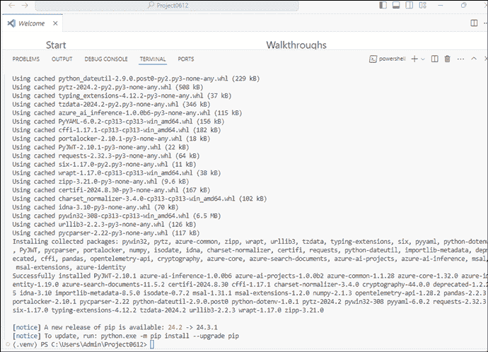

1.  **注意：**如果您收到有关 pip 新版本的通知，请执行以下命令升级 pip

1.  pip 安装 -r 要求。txt

1.  python.exe -m pip 安装——升级 pip

### 任务 8：创建帮助脚本

1.  创建一个名为** src **的新文件夹。通过在终端中运行以下命令。

1.  创建源目录

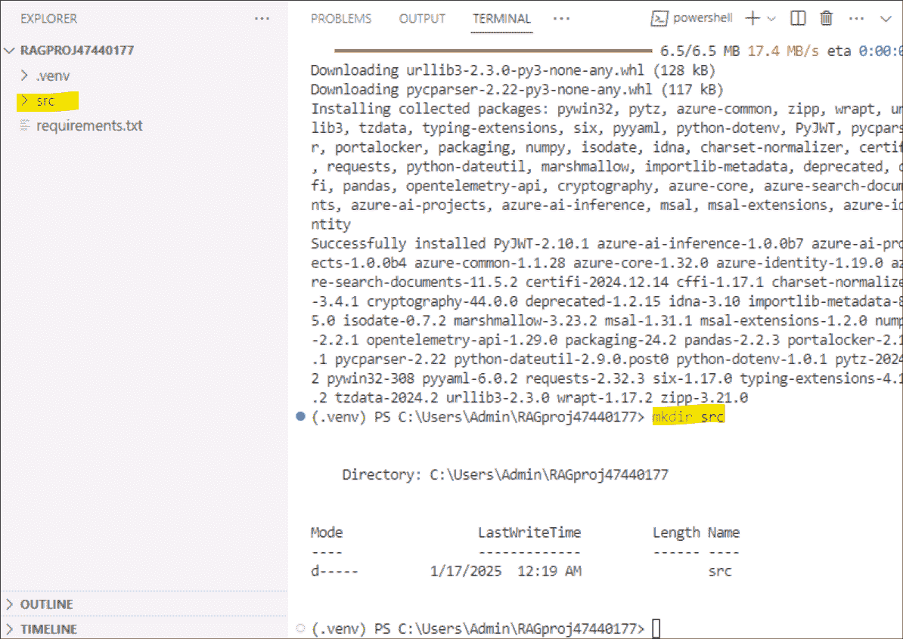

1.  **在 src ****文件夹中创建一个新文**件并将其命名为 config.py

1.  将以下代码添加到** config.py **并保存。

```
import os
import sys
import pathlib
import logging
from azure.identity import DefaultAzureCredential
from azure.ai.projects import AIProjectClient
from azure.ai.inference.tracing import AIInferenceInstrumentor

# load environment variables from the .env file
from dotenv import load_dotenv
load_dotenv()

# Set &quot;./assets&quot; as the path where assets are stored, resolving the absolute path:
ASSET_PATH = pathlib.Path(file).parent.resolve() / &quot;assets&quot;

# Configure an root app logger that prints info level logs to stdout
logger = logging.getLogger(&quot;app&quot;)
logger.setLevel(logging.INFO)
logger.addHandler(logging.StreamHandler(stream=sys.stdout))


# Returns a module-specific logger, inheriting from the root app logger
def get_logger(module_name):
    return logging.getLogger(f&quot;app.{module_name}&quot;)


# Enable instrumentation and logging of telemetry to the project
def enable_telemetry(log_to_project: bool = False):
    AIInferenceInstrumentor().instrument()

    # enable logging message contents
    os.environ[&quot;AZURE_TRACING_GEN_AI_CONTENT_RECORDING_ENABLED&quot;] = &quot;true&quot;

    if log_to_project:
        from azure.monitor.opentelemetry import configure_azure_monitor
        project = AIProjectClient.from_connection_string(
            conn_str=os.environ[&quot;AIPROJECT_CONNECTION_STRING&quot;], credential=DefaultAzureCredential()
        )
        tracing_link = f&quot;https://ai.azure.com/tracing?wsid=/subscriptions/{project.scope[&#x27;subscription_id&#x27;]}/resourceGroups/{project.scope[&#x27;resource_group_name&#x27;]}/providers/Microsoft.MachineLearningServices/workspaces/{project.scope[&#x27;project_name&#x27;]}&quot;
        application_insights_connection_string = project.telemetry.get_connection_string()
        if not application_insights_connection_string:
            logger.warning(
                &quot;No application insights configured, telemetry will not be logged to project. Add application insights at:&quot;
            )
            logger.warning(tracing_link)

            return
        configure_azure_monitor(connection_string=application_insights_connection_string)
        logger.info(&quot;Enabled telemetry logging to project, view traces at:&quot;)
        logger.info(tracing_link)
```

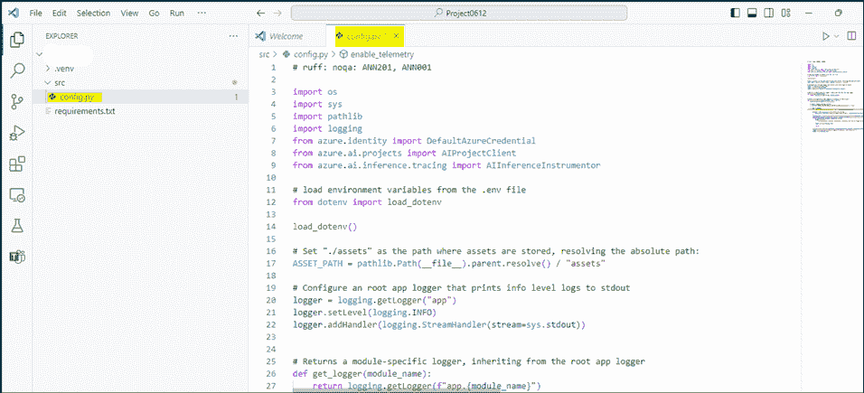

> **注意**：这个新创建的 config.py 文件脚本将在下一个练习中使用。

### 任务 9：配置环境变量

需要项目连接字符串才能从代码中调用 Azure OpenAI 服务。在本快速入门中，将此值保存在 。env 文件中，该文件包含应用程序可以读取的环境变量。

1.  在** src **目录下新建文件**。env**，并粘贴以下代码：

1.  将< your-connection-string >替换 为任务 1 中记事本中保存的项目连接字符串值。

```
AIPROJECT_CONNECTION_STRING=&quot;&lt;your-connection-string&gt;&quot;
AISEARCH_INDEX_NAME=&quot;example-index&quot;
EMBEDDINGS_MODEL=&quot;text-embedding-ada-002&quot;
INTENT_MAPPING_MODEL=&quot;gpt-4o-mini&quot;
CHAT_MODEL=&quot;gpt-4o-mini&quot;
EVALUATION_MODEL=&quot;gpt-4o-mini&quot;
```

1.  **注意：您的连接字符串可以在 Azure **AI Foundry 项目主页的“概述”下找到。

## 练习 2：使用 Azure AI Foundry SDK 构建自定义知识检索 （RAG） 应用

### 任务 1：为你的聊天应用创建示例数据

这款基于 RAG 的应用程序的目标是将模型响应牢牢地嵌入到你的自定义数据中。你使用 Azure AI 搜索索引来存储来自嵌入模型的矢量化数据。搜索索引用于根据用户的问题检索相关文档。

1.  **从打开的 **VS Code 设置**中，在 src **文件夹下创建一个名为 assets 的文件夹。

1.  **从 C:\LabFiles **复制** products.csv **文件并将其粘贴到 **C:\Users\Admin\<** 您的项目名称>\src\assets 文件夹中。

1.  **注意：**这需要在文件资源管理器中完成，然后才会反映在 VS Code 中。

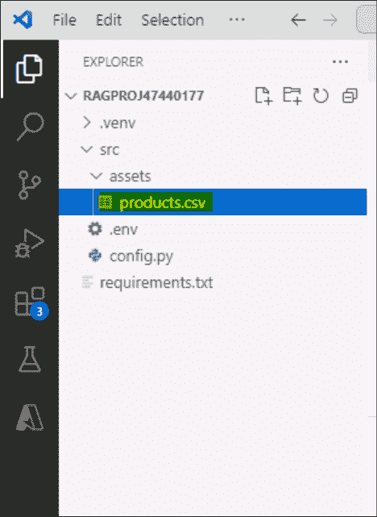

1.  导航到顶部导航栏上的**文件**，然后单击**全部保存。**

### 任务 2：创建搜索索引

搜索索引用于存储来自嵌入模型的向量化数据。搜索索引用于根据用户的问题检索相关文档。

1.  在 VS 代码中，在** src 文件夹中创建一个名为** create_search_index.py 的文件。

1.  打开创建的文件 create_search_index.py 文件并添加以下代码以导入所需的库，创建项目客户端并配置一些设置：

```
import os
from azure.ai.projects import AIProjectClient
from azure.ai.projects.models import ConnectionType
from azure.identity import DefaultAzureCredential
from azure.core.credentials import AzureKeyCredential
from azure.search.documents import SearchClient
from azure.search.documents.indexes import SearchIndexClient
from config import get_logger

# initialize logging object
logger = get_logger(name)

# create a project client using environment variables loaded from the .env file
project = AIProjectClient.from_connection_string(
    conn_str=os.environ[&quot;AIPROJECT_CONNECTION_STRING&quot;], credential=DefaultAzureCredential()
)

# create a vector embeddings client that will be used to generate vector embeddings
embeddings = project.inference.get_embeddings_client()

# use the project client to get the default search connection
search_connection = project.connections.get_default(
    connection_type=ConnectionType.AZURE_AI_SEARCH, include_credentials=True
)

# Create a search index client using the search connection
# This client will be used to create and delete search indexes
index_client = SearchIndexClient(
    endpoint=search_connection.endpoint_url, credential=AzureKeyCredential(key=search_connection.key)
)
```

1.  现在在 create_search_index.py 的末尾添加函数来定义搜索索引：

1.  将光标保持在文件末尾，选择两次** Enter**，然后粘贴以下代码。

```
import pandas as pd
from azure.search.documents.indexes.models import (
    SemanticSearch,
    SearchField,
    SimpleField,
    SearchableField,
    SearchFieldDataType,
    SemanticConfiguration,
    SemanticPrioritizedFields,
    SemanticField,
    VectorSearch,
    HnswAlgorithmConfiguration,
    VectorSearchAlgorithmKind,
    HnswParameters,
    VectorSearchAlgorithmMetric,
    ExhaustiveKnnAlgorithmConfiguration,
    ExhaustiveKnnParameters,
    VectorSearchProfile,
    SearchIndex,
)


def create_index_definition(index_name: str, model: str) -&gt; SearchIndex:
    dimensions = 1536  # text-embedding-ada-002
    if model == &quot;text-embedding-3-large&quot;:
        dimensions = 3072

    # The fields we want to index. The &quot;embedding&quot; field is a vector field that will
    # be used for vector search.
    fields = [
        SimpleField(name=&quot;id&quot;, type=SearchFieldDataType.String, key=True),
        SearchableField(name=&quot;content&quot;, type=SearchFieldDataType.String),
        SimpleField(name=&quot;filepath&quot;, type=SearchFieldDataType.String),
        SearchableField(name=&quot;title&quot;, type=SearchFieldDataType.String),
        SimpleField(name=&quot;url&quot;, type=SearchFieldDataType.String),
        SearchField(
            name=&quot;contentVector&quot;,
            type=SearchFieldDataType.Collection(SearchFieldDataType.Single),
            searchable=True,
            # Size of the vector created by the text-embedding-ada-002 model.
            vector_search_dimensions=dimensions,
            vector_search_profile_name=&quot;myHnswProfile&quot;,
        ),
    ]

    # The &quot;content&quot; field should be prioritized for semantic ranking.
    semantic_config = SemanticConfiguration(
        name=&quot;default&quot;,
        prioritized_fields=SemanticPrioritizedFields(
            title_field=SemanticField(field_name=&quot;title&quot;),
            keywords_fields=[],
            content_fields=[SemanticField(field_name=&quot;content&quot;)],
        ),
    )

    # For vector search, we want to use the HNSW (Hierarchical Navigable Small World)
    # algorithm (a type of approximate nearest neighbor search algorithm) with cosine
    # distance.
    vector_search = VectorSearch(
        algorithms=[
            HnswAlgorithmConfiguration(
                name=&quot;myHnsw&quot;,
                kind=VectorSearchAlgorithmKind.HNSW,
                parameters=HnswParameters(
                    m=4,
                    ef_construction=1000,
                    ef_search=1000,
                    metric=VectorSearchAlgorithmMetric.COSINE,
                ),
            ),
            ExhaustiveKnnAlgorithmConfiguration(
                name=&quot;myExhaustiveKnn&quot;,
                kind=VectorSearchAlgorithmKind.EXHAUSTIVE_KNN,
                parameters=ExhaustiveKnnParameters(metric=VectorSearchAlgorithmMetric.COSINE),
            ),
        ],
        profiles=[
            VectorSearchProfile(
                name=&quot;myHnswProfile&quot;,
                algorithm_configuration_name=&quot;myHnsw&quot;,
            ),
            VectorSearchProfile(
                name=&quot;myExhaustiveKnnProfile&quot;,
                algorithm_configuration_name=&quot;myExhaustiveKnn&quot;,
            ),
        ],
    )

    # Create the semantic settings with the configuration
    semantic_search = SemanticSearch(configurations=[semantic_config])

    # Create the search index definition
    return SearchIndex(
        name=index_name,
        fields=fields,
        semantic_search=semantic_search,
        vector_search=vector_search,
    )
```

1.  现在在 create_search_index.py 中添加函数，创建将 csv 文件添加到索引的函数。

1.  将光标保持在文件末尾，选择两次** Enter**，然后粘贴以下代码。

```
define a function for indexing a csv file, that adds each row as a document
# and generates vector embeddings for the specified content_column
def create_docs_from_csv(path: str, content_column: str, model: str) -&gt; list[dict[str, any]]:
    products = pd.read_csv(path)
    items = []
    for product in products.to_dict(&quot;records&quot;):
        content = product[content_column]
        id = str(product[&quot;id&quot;])
        title = product[&quot;name&quot;]
        url = f&quot;/products/{title.lower().replace(&#x27; &#x27;, &#x27;-&#x27;)}&quot;
        emb = embeddings.embed(input=content, model=model)
        rec = {
            &quot;id&quot;: id,
            &quot;content&quot;: content,
            &quot;filepath&quot;: f&quot;{title.lower().replace(&#x27; &#x27;, &#x27;-&#x27;)}&quot;,
            &quot;title&quot;: title,
            &quot;url&quot;: url,
            &quot;contentVector&quot;: emb.data[0].embedding,
        }
        items.append(rec)

    return items

def create_index_from_csv(index_name, csv_file):
    # If a search index already exists, delete it:
    try:
        index_definition = index_client.get_index(index_name)
        index_client.delete_index(index_name)
        logger.info(f&quot;🗑️  Found existing index named &#x27;{index_name}&#x27;, and deleted it&quot;)
    except Exception:
        pass

    # create an empty search index
    index_definition = create_index_definition(index_name, model=os.environ[&quot;EMBEDDINGS_MODEL&quot;])
    index_client.create_index(index_definition)

    # create documents from the products.csv file, generating vector embeddings for the &quot;description&quot; column
    docs = create_docs_from_csv(path=csv_file, content_column=&quot;description&quot;, model=os.environ[&quot;EMBEDDINGS_MODEL&quot;])

    # Add the documents to the index using the Azure AI Search client
    search_client = SearchClient(
        endpoint=search_connection.endpoint_url,
        index_name=index_name,
        credential=AzureKeyCredential(key=search_connection.key),
    )
    search_client.upload_documents(docs)
    logger.info(f&quot;➕ Uploaded {len(docs)} documents to &#x27;{index_name}&#x27; index&quot;)
```

1.  最后，在 create_search_index.py 中添加以**下函数来构建**索引并将其注册到云项目。添加代码后，从顶部栏转到“文件”，然后单击“全部保存”。

1.  将光标保持在文件末尾，按两次** Enter **键。将光标在新行中移向左边距，然后粘贴代码。（中间不应有制表符）

1.  **重要提示：**请**确保以下代码第二**行中的 imp**ort ar**gparse 与页边距对齐一个制表符空格。否则，请将光标保持在 import 之前，然后点击 Tab 键。

```
if name == &quot;__main__&quot;:
    import argparse
    parser = argparse.ArgumentParser()
    parser.add_argument(
        &quot;--index-name&quot;,
        type=str,
        help=&quot;index name to use when creating the AI Search index&quot;,
        default=os.environ[&quot;AISEARCH_INDEX_NAME&quot;],
    )
    parser.add_argument(
        &quot;--csv-file&quot;, type=str, help=&quot;path to data for creating search index&quot;, default=&quot;assets/products.csv&quot;
    )
    args = parser.parse_args()
    index_name = args.index_name
    csv_file = args.csv_file
    create_index_from_csv(index_name, csv_file)
```

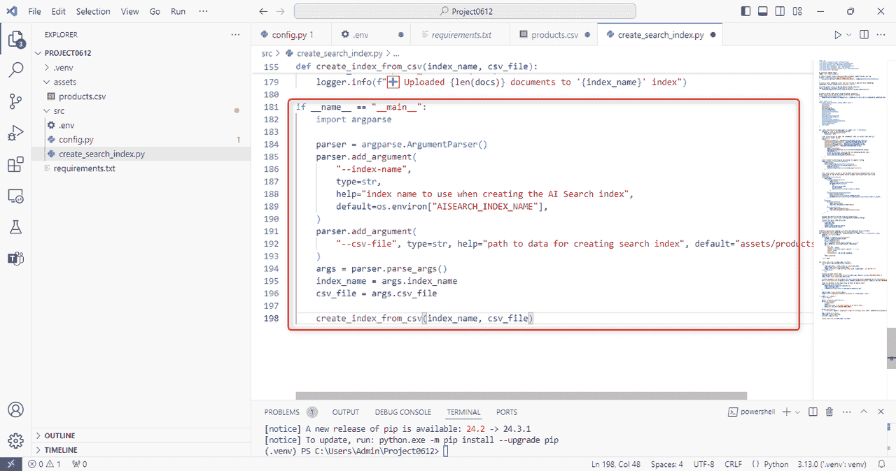

1.  该文件现在应具有如下内容。

```
import os
from azure.ai.projects import AIProjectClient
from azure.ai.projects.models import ConnectionType
from azure.identity import DefaultAzureCredential
from azure.core.credentials import AzureKeyCredential
from azure.search.documents import SearchClient
from azure.search.documents.indexes import SearchIndexClient
from config import get_logger

# initialize logging object
logger = get_logger(name)

# create a project client using environment variables loaded from the .env file
project = AIProjectClient.from_connection_string(
    conn_str=os.environ[&quot;AIPROJECT_CONNECTION_STRING&quot;], credential=DefaultAzureCredential()
)

# create a vector embeddings client that will be used to generate vector embeddings
embeddings = project.inference.get_embeddings_client()

# use the project client to get the default search connection
search_connection = project.connections.get_default(
    connection_type=ConnectionType.AZURE_AI_SEARCH, include_credentials=True
)

# Create a search index client using the search connection
# This client will be used to create and delete search indexes
index_client = SearchIndexClient(
    endpoint=search_connection.endpoint_url, credential=AzureKeyCredential(key=search_connection.key)
)

import pandas as pd
from azure.search.documents.indexes.models import (
    SemanticSearch,
    SearchField,
    SimpleField,
    SearchableField,
    SearchFieldDataType,
    SemanticConfiguration,
    SemanticPrioritizedFields,
    SemanticField,
    VectorSearch,
    HnswAlgorithmConfiguration,
    VectorSearchAlgorithmKind,
    HnswParameters,
    VectorSearchAlgorithmMetric,
    ExhaustiveKnnAlgorithmConfiguration,
    ExhaustiveKnnParameters,
    VectorSearchProfile,
    SearchIndex,
)

def create_index_definition(index_name: str, model: str) -&gt; SearchIndex:
    dimensions = 1536  # text-embedding-ada-002
    if model == &quot;text-embedding-3-large&quot;:
        dimensions = 3072

    # The fields we want to index. The &quot;embedding&quot; field is a vector field that will
    # be used for vector search.
    fields = [
        SimpleField(name=&quot;id&quot;, type=SearchFieldDataType.String, key=True),
        SearchableField(name=&quot;content&quot;, type=SearchFieldDataType.String),
        SimpleField(name=&quot;filepath&quot;, type=SearchFieldDataType.String),
        SearchableField(name=&quot;title&quot;, type=SearchFieldDataType.String),
        SimpleField(name=&quot;url&quot;, type=SearchFieldDataType.String),
        SearchField(
            name=&quot;contentVector&quot;,
            type=SearchFieldDataType.Collection(SearchFieldDataType.Single),
            searchable=True,
            # Size of the vector created by the text-embedding-ada-002 model.
            vector_search_dimensions=dimensions,
            vector_search_profile_name=&quot;myHnswProfile&quot;,
        ),
    ]

    # The &quot;content&quot; field should be prioritized for semantic ranking.
    semantic_config = SemanticConfiguration(
        name=&quot;default&quot;,
        prioritized_fields=SemanticPrioritizedFields(
            title_field=SemanticField(field_name=&quot;title&quot;),
            keywords_fields=[],
            content_fields=[SemanticField(field_name=&quot;content&quot;)],
        ),
    )

    # For vector search, we want to use the HNSW (Hierarchical Navigable Small World)
    # algorithm (a type of approximate nearest neighbor search algorithm) with cosine
    # distance.
    vector_search = VectorSearch(
        algorithms=[
            HnswAlgorithmConfiguration(
                name=&quot;myHnsw&quot;,
                kind=VectorSearchAlgorithmKind.HNSW,
                parameters=HnswParameters(
                    m=4,
                    ef_construction=1000,
                    ef_search=1000,
                    metric=VectorSearchAlgorithmMetric.COSINE,
                ),
            ),
            ExhaustiveKnnAlgorithmConfiguration(
                name=&quot;myExhaustiveKnn&quot;,
                kind=VectorSearchAlgorithmKind.EXHAUSTIVE_KNN,
                parameters=ExhaustiveKnnParameters(metric=VectorSearchAlgorithmMetric.COSINE),
            ),
        ],
        profiles=[
            VectorSearchProfile(
                name=&quot;myHnswProfile&quot;,
                algorithm_configuration_name=&quot;myHnsw&quot;,
            ),
            VectorSearchProfile(
                name=&quot;myExhaustiveKnnProfile&quot;,
                algorithm_configuration_name=&quot;myExhaustiveKnn&quot;,
            ),
        ],
    )

    # Create the semantic settings with the configuration
    semantic_search = SemanticSearch(configurations=[semantic_config])

    # Create the search index definition
    return SearchIndex(
        name=index_name,
        fields=fields,
        semantic_search=semantic_search,
        vector_search=vector_search,
    )

# define a function for indexing a csv file, that adds each row as a document
# and generates vector embeddings for the specified content_column
def create_docs_from_csv(path: str, content_column: str, model: str) -&gt; list[dict[str, any]]:
    products = pd.read_csv(path)
    items = []
    for product in products.to_dict(&quot;records&quot;):
        content = product[content_column]
        id = str(product[&quot;id&quot;])
        title = product[&quot;name&quot;]
        url = f&quot;/products/{title.lower().replace(&#x27; &#x27;, &#x27;-&#x27;)}&quot;
        emb = embeddings.embed(input=content, model=model)
        rec = {
            &quot;id&quot;: id,
            &quot;content&quot;: content,
            &quot;filepath&quot;: f&quot;{title.lower().replace(&#x27; &#x27;, &#x27;-&#x27;)}&quot;,
            &quot;title&quot;: title,
            &quot;url&quot;: url,
            &quot;contentVector&quot;: emb.data[0].embedding,
        }
        items.append(rec)

    return items

def create_index_from_csv(index_name, csv_file):
    # If a search index already exists, delete it:
    try:
        index_definition = index_client.get_index(index_name)
        index_client.delete_index(index_name)
        logger.info(f&quot;🗑️  Found existing index named &#x27;{index_name}&#x27;, and deleted it&quot;)
    except Exception:
        pass

    # create an empty search index
    index_definition = create_index_definition(index_name, model=os.environ[&quot;EMBEDDINGS_MODEL&quot;])
    index_client.create_index(index_definition)

    # create documents from the products.csv file, generating vector embeddings for the &quot;description&quot; column
    docs = create_docs_from_csv(path=csv_file, content_column=&quot;description&quot;, model=os.environ[&quot;EMBEDDINGS_MODEL&quot;])

    # Add the documents to the index using the Azure AI Search client
    search_client = SearchClient(
        endpoint=search_connection.endpoint_url,
        index_name=index_name,
        credential=AzureKeyCredential(key=search_connection.key),
    )
    search_client.upload_documents(docs)
    logger.info(f&quot;➕ Uploaded {len(docs)} documents to &#x27;{index_name}&#x27; index&quot;)

if name == &quot;__main__&quot;:
    import argparse
    parser = argparse.ArgumentParser()
    parser.add_argument(
        &quot;--index-name&quot;,
        type=str,
        help=&quot;index name to use when creating the AI Search index&quot;,
        default=os.environ[&quot;AISEARCH_INDEX_NAME&quot;],
    )
    parser.add_argument(
        &quot;--csv-file&quot;, type=str, help=&quot;path to data for creating search index&quot;, default=&quot;assets/products.csv&quot;
    )
    args = parser.parse_args()
    index_name = args.index_name
    csv_file = args.csv_file
    create_index_from_csv(index_name, csv_file)
```

1.  右键单击 cr**eate_sea**rch_index.py 并选择在集成终端中打开选项。

1.  从您的终端登录到您的 Azure 登录凭据并按照说明验证您的帐户：

1.  az 登录

1.  运行代码在本地构建索引并将其注册到云项目：

1.  python 创建搜索索引。py

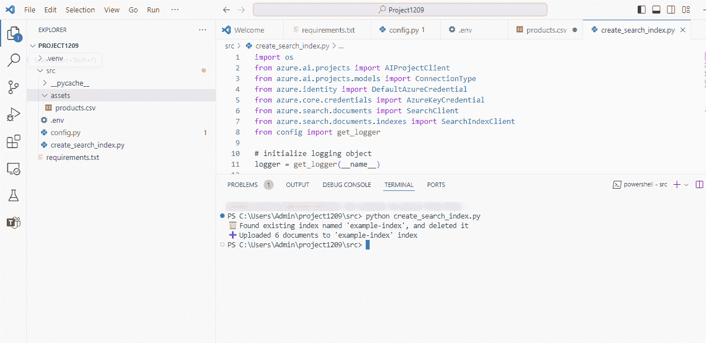

1.  脚本运行后，您可以从 Azure 门户查看新创建的索引。

1.  导航到分配的**资**源组 -> 创建的搜索服务 （aisearchLabinstanceID） -> 搜索管理 -> 索引。

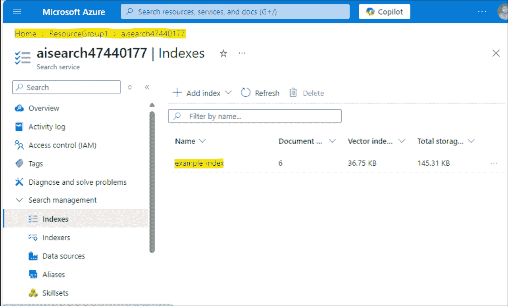

1.  如果使用相同的索引名称再次运行该脚本，它会创建同一索引的新版本。

### 任务 3：获取产品文档

接下来，创建一个脚本，用于从搜索索引中获取产品文档。该脚本会在搜索索引中查询与用户问题匹配的文档。

**创建脚本以获取产品文档**

当聊天收到请求时，它会搜索您的数据以查找相关信息。此脚本使用 Azure AI SDK 查询搜索索引，查找与用户问题匹配的文档。然后，它将文档返回给聊天应用。

1.  从 VS Code 中，在** src 文件夹中创建一个名为** get_product_documents.py 的文件。

1.  将以下代码复制并粘贴到文件中。首先导入所需的库，创建项目客户端并配置设置。

```
import os
from pathlib import Path
from opentelemetry import trace
from azure.ai.projects import AIProjectClient
from azure.ai.projects.models import ConnectionType
from azure.identity import DefaultAzureCredential
from azure.core.credentials import AzureKeyCredential
from azure.search.documents import SearchClient
from config import ASSET_PATH, get_logger

# initialize logging and tracing objects
logger = get_logger(name)
tracer = trace.get_tracer(name)

# create a project client using environment variables loaded from the .env file
project = AIProjectClient.from_connection_string(
    conn_str=os.environ[&quot;AIPROJECT_CONNECTION_STRING&quot;], credential=DefaultAzureCredential()
)

# create a vector embeddings client that will be used to generate vector embeddings
chat = project.inference.get_chat_completions_client()
embeddings = project.inference.get_embeddings_client()

# use the project client to get the default search connection
search_connection = project.connections.get_default(
    connection_type=ConnectionType.AZURE_AI_SEARCH, include_credentials=True
)

# Create a search index client using the search connection
# This client will be used to create and delete search indexes
search_client = SearchClient(
    index_name=os.environ[&quot;AISEARCH_INDEX_NAME&quot;],
    endpoint=search_connection.endpoint_url,
    credential=AzureKeyCredential(key=search_connection.key),
)
```

1.  **在 get_**product-documents.py 中添加函数获取产品文档。

```
from azure.ai.inference.prompts import PromptTemplate
from azure.search.documents.models import VectorizedQuery


@tracer.start_as_current_span(name=&quot;get_product_documents&quot;)
def get_product_documents(messages: list, context: dict = None) -&gt; dict:
    if context is None:
        context = {}
    overrides = context.get(&quot;overrides&quot;, {})
    top = overrides.get(&quot;top&quot;, 5)

    # generate a search query from the chat messages
    intent_prompty = PromptTemplate.from_prompty(Path(ASSET_PATH) / &quot;intent_mapping.prompty&quot;)
    intent_mapping_response = chat.complete(
        model=os.environ[&quot;INTENT_MAPPING_MODEL&quot;],
        messages=intent_prompty.create_messages(conversation=messages),
        **intent_prompty.parameters,
    )
    search_query = intent_mapping_response.choices[0].message.content
    logger.debug(f&quot;🧠 Intent mapping: {search_query}&quot;)

    # generate a vector representation of the search query
    embedding = embeddings.embed(model=os.environ[&quot;EMBEDDINGS_MODEL&quot;], input=search_query)
    search_vector = embedding.data[0].embedding
# search the index for products matching the search query
    vector_query = VectorizedQuery(vector=search_vector, k_nearest_neighbors=top, fields=&quot;contentVector&quot;)
    search_results = search_client.search(
        search_text=search_query, vector_queries=[vector_query], select=[&quot;id&quot;, &quot;content&quot;, &quot;filepath&quot;, &quot;title&quot;, &quot;url&quot;]
    )
    documents = [
        {
            &quot;id&quot;: result[&quot;id&quot;],
            &quot;content&quot;: result[&quot;content&quot;],
            &quot;filepath&quot;: result[&quot;filepath&quot;],
            &quot;title&quot;: result[&quot;title&quot;],
            &quot;url&quot;: result[&quot;url&quot;],
        }
        for result in search_results]

    # add results to the provided context
    if &quot;thoughts&quot; not in context:
        context[&quot;thoughts&quot;] = []

    # add thoughts and documents to the context object so it can be returned to the caller
    context[&quot;thoughts&quot;].append(
        {
            &quot;title&quot;: &quot;Generated search query&quot;,
            &quot;description&quot;: search_query,
        }
    )

    if &quot;grounding_data&quot; not in context:
        context[&quot;grounding_data&quot;] = []
    context[&quot;grounding_data&quot;].append(documents)
    logger.debug(f&quot;📄 {len(documents)} documents retrieved: {documents}&quot;)
    return documents
```

1.  最后，添加代码，直接运行脚本来**测试功能：**

```
if name == &quot;__main__&quot;:
    import loggingimport argparse
# set logging level to debug when running this module directly
    logger.setLevel(logging.DEBUG)

    # load command line arguments
    parser = argparse.ArgumentParser()
    parser.add_argument(
        &quot;--query&quot;,
        type=str,
        help=&quot;Query to use to search product&quot;,
        default=&quot;I need a new tent for 4 people, what would you recommend?&quot;,
    )
    args = parser.parse_args()
    query = args.query
    result = get_product_documents(messages=[{&quot;role&quot;: &quot;user&quot;, &quot;content&quot;: query}])
```

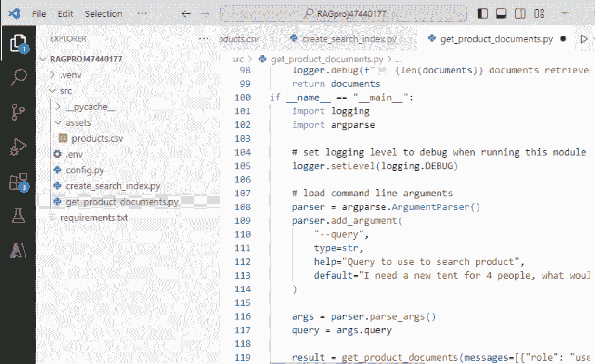

1.  单击**文件**>**全部保存**。

### 任务 4：创建意图映射的提示模板

get_product_documents.py 脚本使用提示模板将对话转换为搜索查询。该模板指示如何从对话中提取用户意图。

1.  **在运行脚本之前，**请先创建提示模板。在 assets 文件夹下创建一个名为 intent_mapping.prompty 的文件：

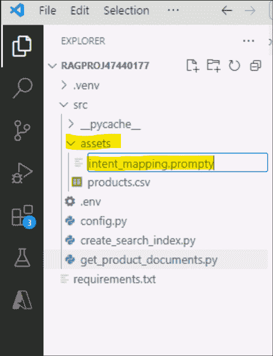

1.  将以下代码复制到 intent_mapping_prom**pty 文**件，然后从顶部栏转到文件并单击全部保存。

```
---
name: Chat Prompt
description: A prompty that extract users query intent based on the current_query and chat_history of the conversation
model:
    api: chat
    configuration:
        azure_deployment: gpt-4o
inputs:
    conversation:
        type: array
---
system:
# Instructions
- You are an AI assistant reading a current user query and chat_history.
- Given the chat_history, and current user&#x27;s query, infer the user&#x27;s intent expressed in the current user query.
- Once you infer the intent, respond with a search query that can be used to retrieve relevant documents for the current user&#x27;s query based on the intent
- Be specific in what the user is asking about, but disregard parts of the chat history that are not relevant to the user&#x27;s intent.
- Provide responses in json format

# Examples
Example 1:
With a conversation like below:

 - user: are the trailwalker shoes waterproof?
 - assistant: Yes, the TrailWalker Hiking Shoes are waterproof. They are designed with a durable and waterproof construction to withstand various terrains and weather conditions.
 - user: how much do they cost?

Respond with:
{
    &quot;intent&quot;: &quot;The user wants to know how much the Trailwalker Hiking Shoes cost.&quot;,
    &quot;search_query&quot;: &quot;price of Trailwalker Hiking Shoes&quot;
}

Example 2:
With a conversation like below:

 - user: are the trailwalker shoes waterproof?
 - assistant: Yes, the TrailWalker Hiking Shoes are waterproof. They are designed with a durable and waterproof construction to withstand various terrains and weather conditions.
 - user: how much do they cost?
 - assistant: The TrailWalker Hiking Shoes are priced at $110.
 - user: do you have waterproof tents?
 - assistant: Yes, we have waterproof tents available. Can you please provide more information about the type or size of tent you are looking for?
 - user: which is your most waterproof tent?
 - assistant: Our most waterproof tent is the Alpine Explorer Tent. It is designed with a waterproof material and has a rainfly with a waterproof rating of 3000mm. This tent provides reliable protection against rain and moisture.
 - user: how much does it cost?

Respond with:
{
    &quot;intent&quot;: &quot;The user would like to know how much the Alpine Explorer Tent costs.&quot;,
    &quot;search_query&quot;: &quot;price of Alpine Explorer Tent&quot;
}
user:
Return the search query for the messages in the following conversation:
{{#conversation}}
 - {{role}}: {{content}}
{{/conversation}}
```

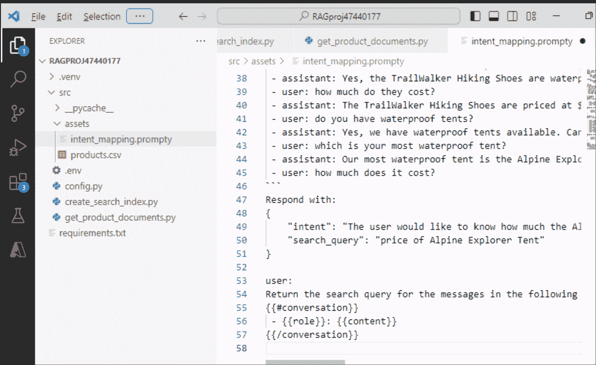

### 任务 5：测试产品文档检索脚本

1.  现在您已经有了脚本和模板，请运行脚本来测试搜索索引从查询中返回的文档。在终端窗口中运行：

1.  python get_product_documents.py --query“我需要一个可容纳 4 人的新帐篷，您推荐什么？”

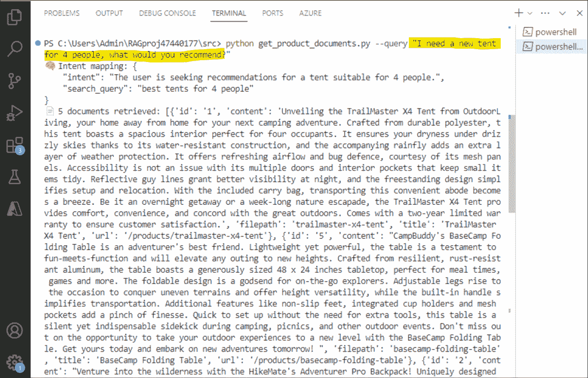

### 任务 6：开发自定义知识检索 （RAG） 代码

接下来，您将创建自定义代码，为基本聊天应用程序添加检索增强生成 （RAG） 功能。

创建具有 RAG 功能的聊天脚本

1.  在** src **文件夹中，创建一个名为 chat_with_products.py 的新文件。此脚本检索产品文档并生成对用户问题的回复。

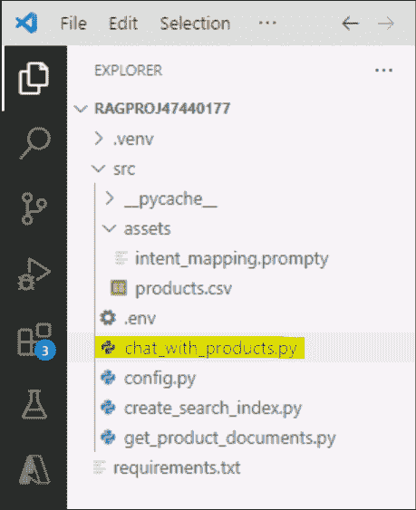

1.  添加代码以导入所需的库、创建项目客户端并配置设置：

```
import os
from pathlib import Path
from opentelemetry import trace
from azure.ai.projects import AIProjectClient
from azure.identity import DefaultAzureCredential
from config import ASSET_PATH, get_logger, enable_telemetry
from get_product_documents import get_product_documents

# initialize logging and tracing objects
logger = get_logger(name)
tracer = trace.get_tracer(name)

# create a project client using environment variables loaded from the .env file
project = AIProjectClient.from_connection_string(
    conn_str=os.environ[&quot;AIPROJECT_CONNECTION_STRING&quot;], credential=DefaultAzureCredential()
)

# create a chat client we can use for testing
chat = project.inference.get_chat_completions_client()
```

1.  在 chat_with_products.py 末尾添加代码以创建使用 RAG 功能的聊天功能。

```
from azure.ai.inference.prompts import PromptTemplate


@tracer.start_as_current_span(name=&quot;chat_with_products&quot;)
def chat_with_products(messages: list, context: dict = None) -&gt; dict:
    if context is None:
        context = {}
    documents = get_product_documents(messages, context)

    # do a grounded chat call using the search results
    grounded_chat_prompt = PromptTemplate.from_prompty(Path(ASSET_PATH) / &quot;grounded_chat.prompty&quot;)
    system_message = grounded_chat_prompt.create_messages(documents=documents, context=context)
    response = chat.complete(
        model=os.environ[&quot;CHAT_MODEL&quot;],
        messages=system_message + messages,
        **grounded_chat_prompt.parameters,
    )
    logger.info(f&quot;💬 Response: {response.choices[0].message}&quot;)

    # Return a chat protocol compliant response
    return {&quot;message&quot;: response.choices[0].message, &quot;context&quot;: context}
```

1.  **最后，添加运行聊天** **功能的**代码，然后转到文件并单击**“全部保存”**。

```
if name == &quot;__main__&quot;:
    import argparse
# load command line arguments
    parser = argparse.ArgumentParser()
    parser.add_argument(
        &quot;--query&quot;,
        type=str,
        help=&quot;Query to use to search product&quot;,
        default=&quot;I need a new tent for 4 people, what would you recommend?&quot;,
    )
    parser.add_argument(
        &quot;--enable-telemetry&quot;,
        action=&quot;store_true&quot;,
        help=&quot;Enable sending telemetry back to the project&quot;,
    )
    args = parser.parse_args()
    if args.enable_telemetry:
        enable_telemetry(True)

    # run chat with products
    response = chat_with_products(messages=[{&quot;role&quot;: &quot;user&quot;, &quot;content&quot;: args.query}])
```

### 任务 7：创建接地气的聊天提示模板

chat_with_products.py 脚本调用一个提示模板来生成对用户问题的回复。该模板指示如何根据用户的问题和检索到的文档生成回复。立即创建此模板。

1.  在您的**资产**文件夹中，添加文件 grounded_chat.prompty

1.  添加以下代码 grounded_chat.prompty。

```
---
name: Chat with documents
description: Uses a chat completions model to respond to queries grounded in relevant documents
model:
    api: chat
    configuration:
        azure_deployment: gpt-4o
inputs:
    conversation:
        type: array
---
system:
You are an AI assistant helping users with queries related to outdoor outdooor/camping gear and clothing.
If the question is not related to outdoor/camping gear and clothing, just say &#x27;Sorry, I only can answer queries related to outdoor/camping gear and clothing. So, how can I help?&#x27;
Don&#x27;t try to make up any answers.
If the question is related to outdoor/camping gear and clothing but vague, ask for clarifying questions instead of referencing documents. If the question is general, for example it uses &quot;it&quot; or &quot;they&quot;, ask the user to specify what product they are asking about.
Use the following pieces of context to answer the questions about outdoor/camping gear and clothing as completely, correctly, and concisely as possible.
Do not add documentation reference in the response.
# Documents
{{#documents}}
## Document {{id}}: {{title}}
{{content}}
{{/documents}}
```

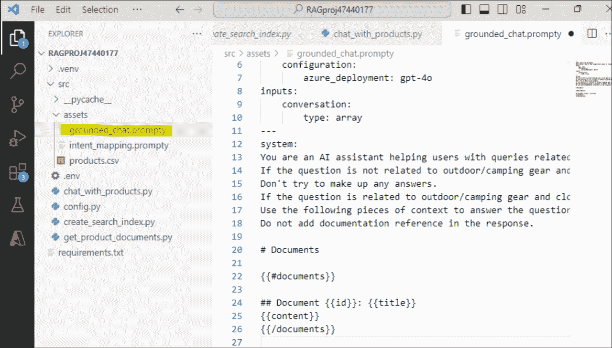

1.  单击**文件>全部保存。**

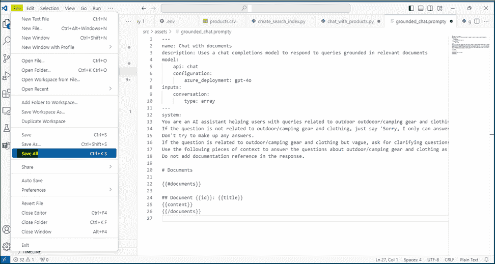

### 任务 8：使用 RAG 功能运行聊天脚本

1.  现在您有了脚本和模板，请运行脚本以使用 RAG 功能测试您的聊天应用程序：

1.  python chat_with_products.py --query“我需要一个可容纳 4 人的新帐篷，您有什么推荐吗？”

### 任务 9：添加遥测日志

1.  在 Azure 门户中，选择**“订阅”****，选择你**的订**阅，然后 从左侧导航**窗格中选择“设置”下的“资源提供程序” 。

1.  搜索并选择** Mic**rosoft.OperationalInsights，然后单击此资源提供程序的三个点，然后选择 “注册”。

1.  按照相同的步骤注册 microsoft.insights

1.  等待注册成功消息后再继续下一步。

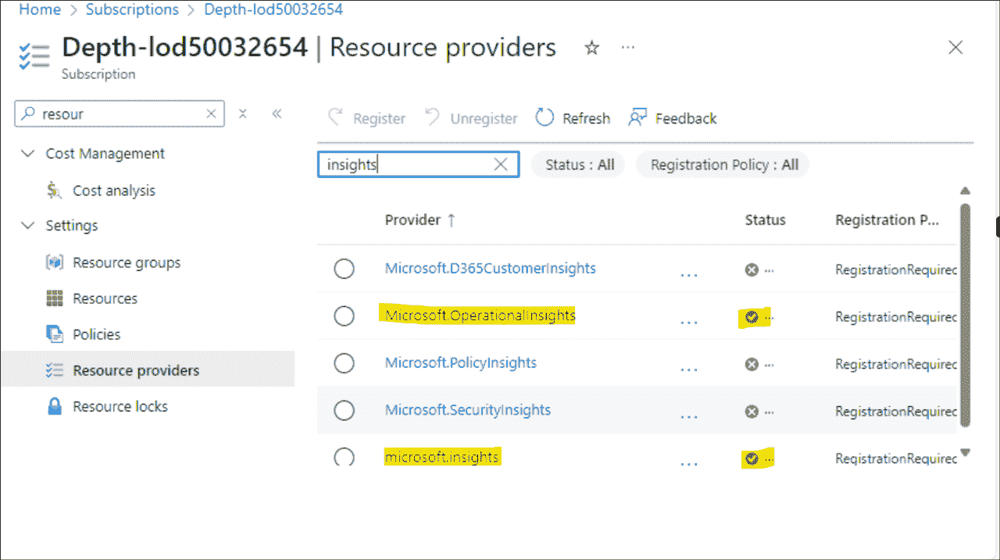

1.  **在 Az**ure AI Fou**ndry 中的项目中，选择**“访问”下的 “跟踪” ，然后从左侧窗格中“改进” 。 选择“新建”。

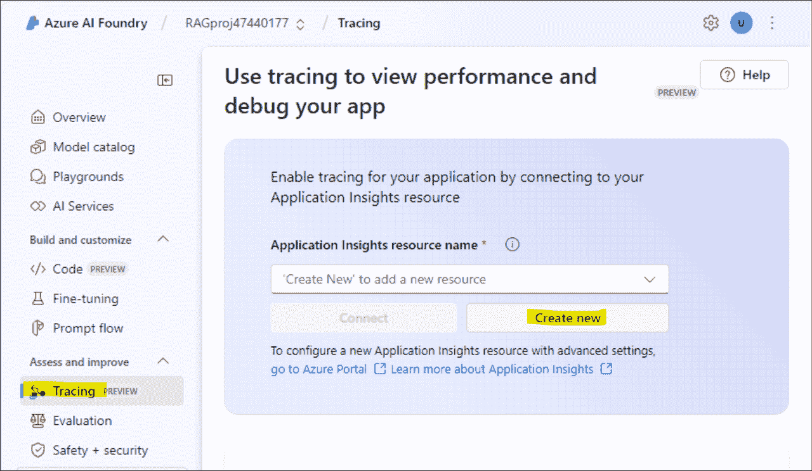

1.  提供名称为 appinsight51719144


1.  确保资源已创建。

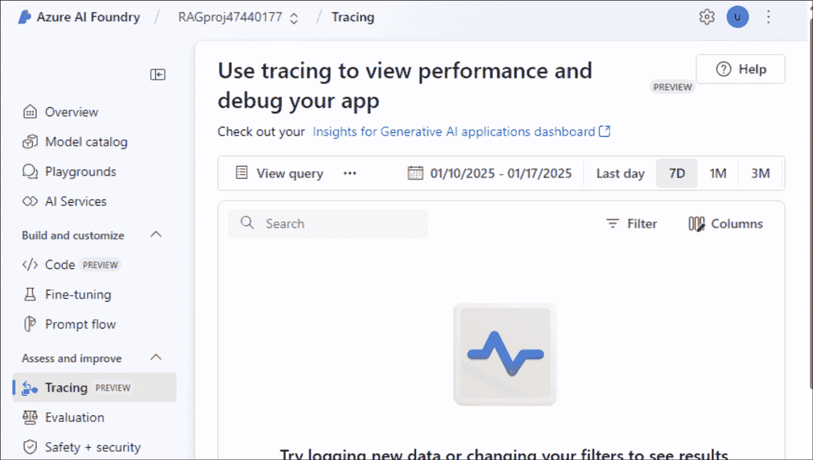

1.  返回 VS Code，为了能够将遥测记录到您的项目中，请安装 azure-monitor-opentelemetry。

1.  pip 安装 azure-monitor-opentelemetry

1.  使用 chat_with_products.py 脚本时添加 --enable-telemetry 标志：

1.  python chat_with_products.py --query“我需要一个可容纳 4 人的新帐篷，你会推荐什么？” --enable-telemetry

## 练习 3：使用 Azure AI Foundry SDK 评估自定义聊天应用程序

### 任务 1：评估聊天应用程序响应的质量

现在您知道您的聊天应用程序可以很好地响应您的查询（包括聊天历史记录），现在是时候根据几个不同的指标和更多数据来评估它的表现了。

您使用带有评估数据集和 get_chat_response（） 目标函数的评估器，然后评估评估结果。

一旦运行评估，您就可以改进您的逻辑，例如改进您的系统提示，并观察聊天应用程序响应如何变化和改进。

**创建评估数据集**

使用以下评估数据集，其中包含示例问题和预期答案（真相）。

1.  在您的**资产文件夹中创建一个名为** chat_eval_data.jsonl 的文件。

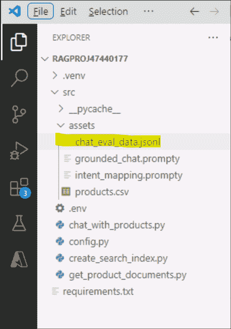

1.  将此数据集粘贴到文件中并**保存**文件。

```
{&quot;query&quot;: &quot;Which tent is the most waterproof?&quot;, &quot;truth&quot;: &quot;The Alpine Explorer Tent has the highest rainfly waterproof rating at 3000m&quot;}
{&quot;query&quot;: &quot;Which camping table holds the most weight?&quot;, &quot;truth&quot;: &quot;The Adventure Dining Table has a higher weight capacity than all of the other camping tables mentioned&quot;}
{&quot;query&quot;: &quot;How much do the TrailWalker Hiking Shoes cost? &quot;, &quot;truth&quot;: &quot;The Trailewalker Hiking Shoes are priced at $110&quot;}
{&quot;query&quot;: &quot;What is the proper care for trailwalker hiking shoes? &quot;, &quot;truth&quot;: &quot;After each use, remove any dirt or debris by brushing or wiping the shoes with a damp cloth.&quot;}
{&quot;query&quot;: &quot;What brand is TrailMaster tent? &quot;, &quot;truth&quot;: &quot;OutdoorLiving&quot;}
{&quot;query&quot;: &quot;How do I carry the TrailMaster tent around? &quot;, &quot;truth&quot;: &quot; Carry bag included for convenient storage and transportation&quot;}
{&quot;query&quot;: &quot;What is the floor area for Floor Area? &quot;, &quot;truth&quot;: &quot;80 square feet&quot;}
{&quot;query&quot;: &quot;What is the material for TrailBlaze Hiking Pants?&quot;, &quot;truth&quot;: &quot;Made of high-quality nylon fabric&quot;}
{&quot;query&quot;: &quot;What color does TrailBlaze Hiking Pants come in?&quot;, &quot;truth&quot;: &quot;Khaki&quot;}
{&quot;query&quot;: &quot;Can the warrenty for TrailBlaze pants be transfered? &quot;, &quot;truth&quot;: &quot;The warranty is non-transferable and applies only to the original purchaser of the TrailBlaze Hiking Pants. It is valid only when the product is purchased from an authorized retailer.&quot;}
{&quot;query&quot;: &quot;How long are the TrailBlaze pants under warranty for? &quot;, &quot;truth&quot;: &quot; The TrailBlaze Hiking Pants are backed by a 1-year limited warranty from the date of purchase.&quot;}
{&quot;query&quot;: &quot;What is the material for PowerBurner Camping Stove? &quot;, &quot;truth&quot;: &quot;Stainless Steel&quot;}
{&quot;query&quot;: &quot;Is France in Europe?&quot;, &quot;truth&quot;: &quot;Sorry, I can only queries related to outdoor/camping gear and equipment&quot;}
```

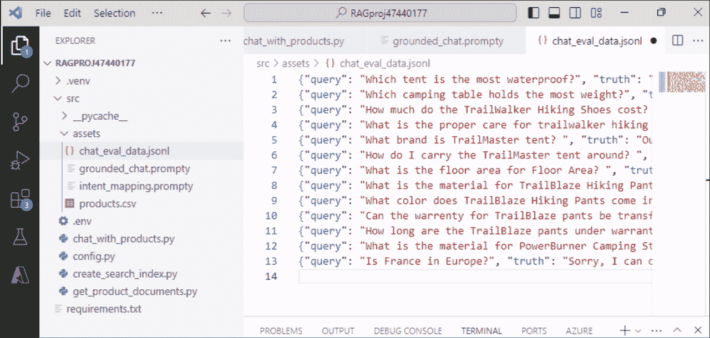

### 任务 2：使用 Azure AI 评估器进行评估

现在定义一个评估脚本，它将：

+   围绕我们的聊天应用程序逻辑生成一个目标函数包装器。

+   加载示例 。jsonl 数据集。

+   运行评估，采用目标函数，并将评估数据集与聊天应用程序的响应合并。

+   生成一组 GPT 辅助指标（相关性、扎实性和连贯性）来评估聊天应用程序响应的质量。

+   将结果输出到本地，并将结果记录到云端项目中。

该脚本允许您通过在命令行中输出结果并将其输出到 json 文件来在本地查看结果。

该脚本还将评估结果记录到云项目中，以便您可以在 UI 中比较评估运行。

1.  **在 src **文件夹下创建一个名为** evaluate.py **的文件。

1.  添加以下代码以导入所需的库，创建项目客户端并配置一些设置：

```
import os
import pandas as pd
from azure.ai.projects import AIProjectClient
from azure.ai.projects.models import ConnectionType
from azure.ai.evaluation import evaluate, GroundednessEvaluator
from azure.identity import DefaultAzureCredential

from chat_with_products import chat_with_products

# load environment variables from the .env file at the root of this repo
from dotenv import load_dotenv
load_dotenv()

# create a project client using environment variables loaded from the .env file
project = AIProjectClient.from_connection_string(
    conn_str=os.environ[&quot;AIPROJECT_CONNECTION_STRING&quot;], credential=DefaultAzureCredential()
)
connection = project.connections.get_default(connection_type=ConnectionType.AZURE_OPEN_AI, include_credentials=True)
evaluator_model = {
    &quot;azure_endpoint&quot;: connection.endpoint_url,
    &quot;azure_deployment&quot;: os.environ[&quot;EVALUATION_MODEL&quot;],
    &quot;api_version&quot;: &quot;2024-06-01&quot;,
    &quot;api_key&quot;: connection.key,
}
groundedness = GroundednessEvaluator(evaluator_model)
```

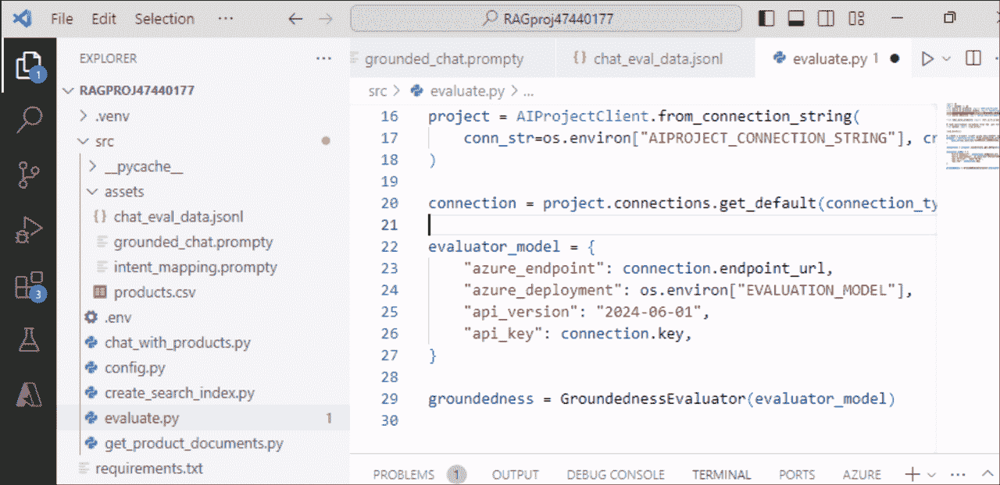

1.  添加代码以创建一个包装函数，该函数实现查询和响应评估的评估接口：

```
def evaluate_chat_with_products(query):
    response = chat_with_products(messages=[{&quot;role&quot;: &quot;user&quot;, &quot;content&quot;: query}])
    return {&quot;response&quot;: response[&quot;message&quot;].content, &quot;context&quot;: response[&quot;context&quot;][&quot;grounding_data&quot;]}
```

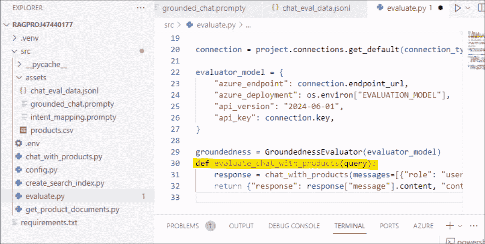

1.  最后，添加代码来运行评估，在本地查看结果，并为您提供 AI Foundry 门户中评估结果的链接。

```
Evaluate must be called inside of __main__, not on import
if name == &quot;__main__&quot;:
    from config import ASSET_PATH
# workaround for multiprocessing issue on linux
    from pprint import pprintfrom pathlib import Path
    import multiprocessingimport contextlib
with contextlib.suppress(RuntimeError):
        multiprocessing.set_start_method(&quot;spawn&quot;, force=True)

    # run evaluation with a dataset and target function, log to the project
    result = evaluate(
        data=Path(ASSET_PATH) / &quot;chat_eval_data.jsonl&quot;,
        target=evaluate_chat_with_products,
        evaluation_name=&quot;evaluate_chat_with_products&quot;,
        evaluators={
            &quot;groundedness&quot;: groundedness,
        },
        evaluator_config={
            &quot;default&quot;: {
                &quot;query&quot;: {&quot;${data.query}&quot;},
                &quot;response&quot;: {&quot;${target.response}&quot;},
                &quot;context&quot;: {&quot;${target.context}&quot;},
            }
        },
        azure_ai_project=project.scope,
        output_path=&quot;./myevalresults.json&quot;,
    )
    tabular_result = pd.DataFrame(result.get(&quot;rows&quot;))
    pprint(&quot;-----Summarized Metrics-----&quot;)
    pprint(result[&quot;metrics&quot;])
    pprint(&quot;-----Tabular Result-----&quot;)
    pprint(tabular_result)
    pprint(f&quot;View evaluation results in AI Studio: {result[&#x27;studio_url&#x27;]}&quot;)
```

1.  单击顶部导航栏中**“文件”**下的**全部保存。**

### 任务 3：配置评估模型

由于评估脚本多次调用模型，您可能希望增加评估模型每分钟的令牌数。

首先，您创建了一个**。env **文件，用于指定评估模型的名称 gpt-4o-mini。如果您有可用配额，请尝试增加此模型的每分钟令牌数限制。如果您没有足够的配额来增加该值，请不要担心。该脚本旨在处理限制错误。

1.  **从 Azure AI** Foun**dry 门户中的项目中，选**择“模型 + 终结点”，然后选择“gpt-4o-mini”。

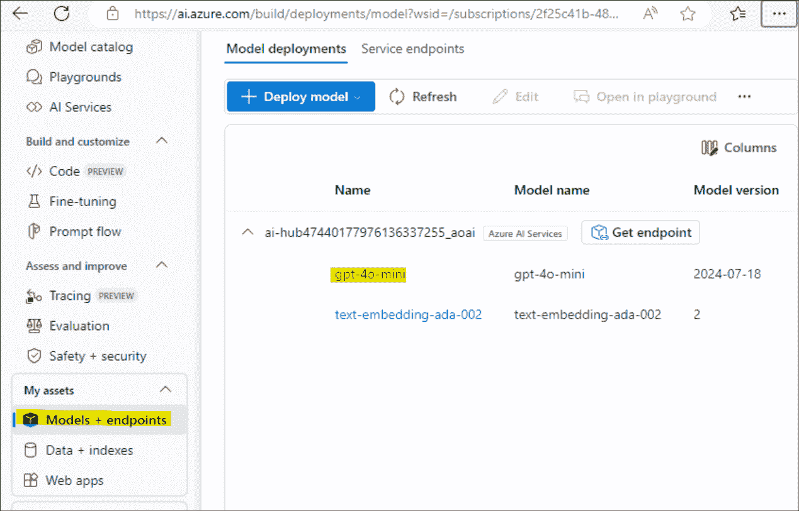

1.  选择** gpt-4o-mini**，点击**编辑。**

1.  **将每分钟令牌速率限制****的值设置为**允许的最大限制，然后选择保存并关闭。

### 任务 4：运行评估

1.  返回 VS Code 终端，执行以下命令来安装所需的包。

1.  pip 安装 azure-ai-evaluation[远程]

1.  执行以下代码来运行评估脚本。

1.  python 求值。py

1.  评估大约需要 5 到 10 分钟才能完成。

### 任务 5：在 Azure AI Foundry 门户中查看评估结果

1.  评估运行完成后，请点击链接在 Azure AI Foundry 门户的评估页面上查看评估结果。

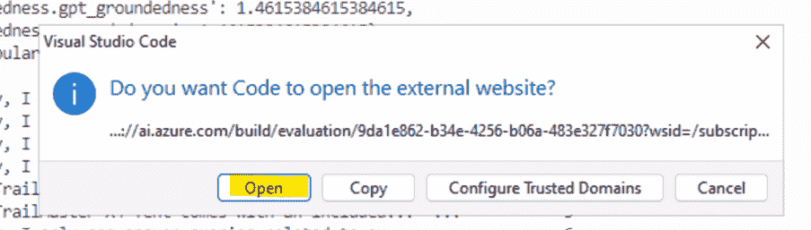

1.  检查**评估结果**和**指标仪表板**。

## 练习 4：删除资源

1.  从 Azure 门户主页中，选择已分配的资源组。 选择资源组下的所有资源，然后选择“删除”。

1.  输入** delete**，点击**删除****按钮确**认删除。在删除确认对话框中点击删除。


1.  通过成功消息确认删除所有资源。

**概括：**

在本实验中，我们学习了构建、评估和部署基于 RAG 的应用程序。