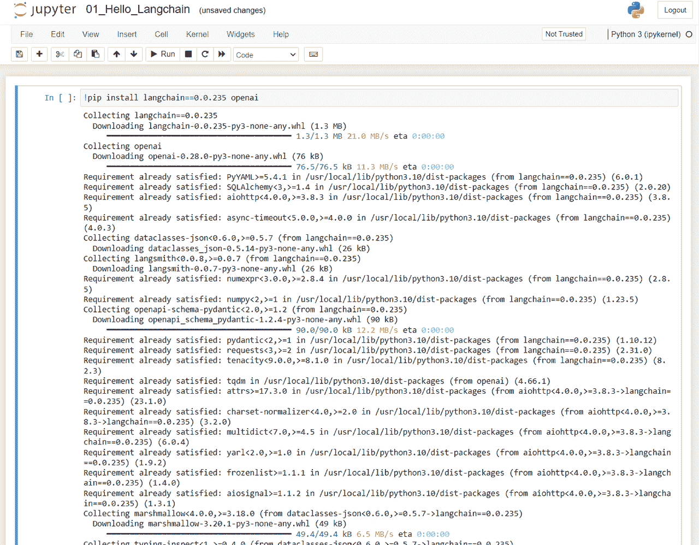
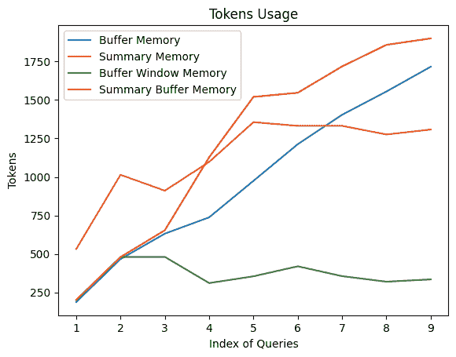

# 使用 LangChain 开发 LLM 应用

> 来源：[https://zsyhjtnsa5.feishu.cn/docx/Jw4SdTFTXoIU9xx2GfEc2QSInYf](https://zsyhjtnsa5.feishu.cn/docx/Jw4SdTFTXoIU9xx2GfEc2QSInYf)

**本教程默认以下前提：**

+   使用Python版本的[Langchain](https://github.com/hwchase17/langchain)

+   LLM使用OpenAI的模型

+   Langchain目前还处于快速发展阶段，版本迭代频繁，**为避免示例代码**失效，本教程统一使用版本 0.0.235

根据Langchain的[代码约定](https://github.com/hwchase17/langchain/blob/v0.0.235/pyproject.toml#L14C1-L14C24)，Python版本 ">=3.8.1,<4.0"。

# 01 基本概念和环境准备

## Langchain 简介

大型语言模型（LLM）正在成为一种具有变革性的技术，使开发人员能够构建以前无法实现的应用程序。然而，仅仅依靠LLM还不足以创建一个真正强大的应用程序。它还需要其他计算资源或知识来源。

Langchain 旨在帮助开发这些类型应用程序，比如：

+   基于文档数据的问答

+   聊天机器人

+   代理

## OpenAI 简介

OpenAI 是LLM生态的模型层最大的玩家之一。大家目前熟知的 GPT-3.5，GPT-4 等模型都是OpenAI的产品。它的API允许开发人员通过简单的API调用来访问这些模型。

## Langchain与OpenAI

Langchain 作为一个开源框架，提供与OpenAI等语言模型的接口，简化了在应用程序中集成和利用语言模型能力的过程。

## 开发前的准备

在开始第一个Langchain应用程序之前，我们需要做一些必要的准备。

### 代码运行环境

本教程中，我们将使用以下服务在云端运行 Python 代码。它们基于Jupyter Notebook，提供了免费的、云端的Python编程环境，用户可以直接在浏览器中编写和执行Python代码：

+   Kaggle：https://www.kaggle.com/

+   Code with Anaconda in the Cloud：https://www.anaconda.com/code-in-the-cloud

+   Google Colab：https://colab.research.google.com/

注意：无法使用在线Notebook的同学，也可以使用Visual Studio Code配合Jupyter插件在本地运行代码。

### OpenAI API Key

在Langchain应用中使用OpenAI的模型，我们需要一个API Key。点击https://platform.openai.com/account/api-keys创建你的API Key。

也可以购买key： https://eylink.cn/buy/4

## 第一个 Langchain 应用

这个简单的程序只有 1 行安装指令和 7 行代码：

**安装指令**

```
pip install langchain==0.0.235 openai
```

**代码**

https://github.com/cloudzun/WTF-Langchain/blob/main/01_Hello_Langchain/Hello_Langchain.ipynb

```
from langchain.chat_models import ChatOpenAI
from langchain.schema import HumanMessage

import os
os.environ[&#x27;OPENAI_API_KEY&#x27;] = &#x27;您的有效OpenAI API Key&#x27;

chat = ChatOpenAI(temperature=0, model_name=&quot;gpt-3.5-turbo&quot;)
response = chat([ HumanMessage(content=&quot;Hello Langchain!&quot;) ])
print(response)
```

你应该能看到类似这样的输出：

```
content=&#x27;Hello! How can I assist you today?&#x27; additional_kwargs={} example=False
```

我们拆解程序，学习该代码的结构：

1.  以下系统命令安装必要的Python包，langchain和openai。

```
pip install langchain==0.0.235 openai
```

1.  以下代码将OpenAI的API Key设置在环境变量中。默认情况下，Langchain会从环境变量 OPENAI_API_KEY 中读取API Key。注意，在代码中直接嵌入API Key明文并不安全，切勿将API Key直接提交到代码仓库。我们建议利用.env文件和python-dotenv包来管理API Key。

```
import os
os.environ[&#x27;OPENAI_API_KEY&#x27;] = &#x27;您的有效OpenAI API Key&#x27;
```

1.  以下代码导入了 ChatOpenAI 类，该类封装了OpenAI的聊天模型。ChatOpenAI 类的初始化参数 temperature 用于控制模型的生成文本的多样性。temperature 越大，生成的文本越多样，但也越不可控。temperature 越小，生成的文本越单一，但也越可控。temperature 的取值范围为 0 到 1，默认值为 0.5。初始化参数 model_name 用于指定使用的模型，默认值为 gpt-3.5-turbo。

```
chat = ChatOpenAI(temperature=0, model_name=&quot;gpt-3.5-turbo&quot;)
```

1.  以下代码完成与OpenAI GPT模型的第一次对话，并打印出响应。

```
response = chat([ HumanMessage(content=&quot;Hello Langchain!&quot;) ])
print(response)
```

## 运行代码

在notebook 的页面，在每一个代码块，按 Ctrl/Cmd + Enter 即可运行代码，非常方便。



## 章节小结

本节课程中，我们简要介绍了 Langchain，OpenAI 以及它们的关系，并完成了第一个 Langchain 应用 —— Hello Langchain。

**相关文档资料链接：**

1.  Python Langchain官方文档

# 02 模型

## 模型简介

Langchain所封装的模型分为两类：

+   大语言模型 (LLM)

+   聊天模型 (Chat Models)

在后续的内容中，为简化描述，我们将使用 LLM 来指代大语言模型。

+   Langchain的支持众多模型供应商，包括OpenAI、ChatGLM、HuggingFace等。本教程中，我们将以OpenAI为例，后续内容中提到的模型默认为OpenAI提供的模型。

+   Langchain的封装，比如，对OpenAI模型的封装，实际上是指的是对OpenAI API的封装。

### LLM

LLM 是一种基于统计的机器学习模型，用于对文本数据进行建模和生成。LLM学习和捕捉文本数据中的语言模式、语法规则和语义关系，以生成连贯并合乎语言规则的文本。

在Langchain的环境中，LLM特指文本补全模型（text completion model）。

注，文本补全模型是一种基于语言模型的机器学习模型，根据上下文的语境和语言规律，自动推断出最有可能的下一个文本补全。

| 输入 | 输出 |
| --- | --- |
| 一条文本内容 | 一条文本内容 |

### 聊天模型 (Chat Models)

聊天模型是语言模型的一种变体。聊天模型使用语言模型，并提供基于"聊天消息"的接口。

| 输入 | 输出 |
| --- | --- |
| 一组聊天消息 | 一条聊天消息 |

聊天消息 除了消息内容文本，还会包含一些其他参数数据。这在后续的内容中会看到。

## Langchain与OpenAI模型

参考OpenAI Model endpoint compatibility 文档，gpt模型都归为了聊天模型，而davinci, curie, babbage, ada模型都归为了文本补全模型。

| ENDPOINT | MODEL NAME |
| --- | --- |
| /v1/chat/completions | gpt-4, gpt-4-0613, gpt-4-32k, gpt-4-32k-0613, gpt-3.5-turbo, gpt-3.5-turbo-0613, gpt-3.5-turbo-16k, gpt-3.5-turbo-16k-0613 |
| /v1/completions | (Legacy) text-davinci-003, text-davinci-002, text-davinci-001, text-curie-001, text-babbage-001, text-ada-001, davinci, curie, babbage, ada |

Langchain提供接口集成不同的模型。为了便于切换模型，Langchain将不同模型抽象为相同的接口 BaseLanguageModel，并提供 predict 和 predict_messages 函数来调用模型。

当使用LLM时推荐使用predict函数，当使用聊天模型时推荐使用predict_messages函数。

## 示例代码

接下来我们来看看如何在Langchain中使用LLM和聊天模型。

[Models.ipynb](https://github.com/cloudzun/WTF-Langchain/blob/main/02_Models/Models.ipynb)

### 与LLM的交互

与LLM的交互，我们需要使用 langchain.llms 模块中的 OpenAI 类。

```
from langchain.llms import OpenAI

import os
os.environ[&#x27;OPENAI_API_KEY&#x27;] = &#x27;您的有效OpenAI API Key&#x27;

llm = OpenAI(model_name=&quot;text-davinci-003&quot;)
response = llm.predict(&quot;What is AI?&quot;)
print(response)
```

你应该能看到类似如下输出：

```
AI (Artificial Intelligence) is a branch of computer science that deals with creating intelligent machines that can think, reason, learn, and problem solve. AI systems are designed to mimic human behavior and can be used to automate tasks or provide insights into data. AI can be used in a variety of fields, such as healthcare, finance, robotics, and more.
```

### 与聊天模型的交互

与聊天模型的交互，我们需要使用 langchain.chat_models 模块中的 ChatOpenAI 类。

```
from langchain.chat_models import ChatOpenAI
from langchain.schema import AIMessage, HumanMessage, SystemMessage

import os
os.environ[&#x27;OPENAI_API_KEY&#x27;] = &#x27;您的有效OpenAI API Key&#x27;

chat = ChatOpenAI(temperature=0)
response = chat.predict_messages([ 
  HumanMessage(content=&quot;What is AI?&quot;)
])
print(response)
```

你应该能看到类似如下输出：

```
content=&#x27;AI, or Artificial Intelligence, refers to the simulation of human intelligence processes by machines, especially computer systems. These processes include learning, reasoning, problem-solving, perception, and language understanding. AI technology has the capability to drastically change and improve the way we work, live, and interact.&#x27; additional_kwargs={} example=False
```

通过以下代码我们查看一下 response 变量的类型：

```
response.__class__
```

可以看到，它是一个 AIMessage 类型的对象。

```
langchain.schema.messages.AIMessage
```

接下来我们使用 SystemMessage 指令来指定模型的行为。如下代码指定模型对AI一无所知，在回答AI相关问题时，回答“I don't know”。

```
response = chat.predict_messages([
  SystemMessage(content=&quot;You are a chatbot that knows nothing about AI. When you are asked about AI, you must say &#x27;I don\&#x27;t know&#x27;&quot;),
  HumanMessage(content=&quot;What is deep learning?&quot;)
])
print(response)
```

你应该能看到类似如下输出：

```
content=&quot;I don&#x27;t know.&quot; additional_kwargs={} example=False
```

#### 3个消息类

Langchain框架提供了三个消息类，分别是 AIMessage、HumanMessage 和 SystemMessage。它们对应了OpenAI聊天模型API支持的不同角色 assistant、user 和 system。请参考 OpenAI API文档 - Chat - Role。

| Langchain类 | OpenAI角色 | 作用 |
| --- | --- | --- |
| AIMessage | assistant | 模型回答的消息 |
| HumanMessage | user | 用户向模型的请求或提问 |
| SystemMessage | system | 系统指令，用于指定模型的行为（可以看做是通过耳语规范assistant的行为） |

## 章节小结

本节课程中，我们学习了模型的基本概念，LLM与聊天模型的差异，并基于 Langchain 实现了分别与OpenAI LLM和聊天模型的交互。

要注意，虽然是聊天，但是当前我们所实现的交互并没有记忆能力，也就是说，模型并不会记住之前的对话内容。在后续的内容中，我们将学习如何实现记忆能力。

**相关文档资料链接：**

1.  Python Langchain官方文档

1.  Models - Langchain

# 03 数据连接

## 什么是数据连接？

LLM应用往往需要用户特定的数据，而这些数据并不属于模型的训练集。LangChain 的数据连接概念，通过提供以下组件，实现用户数据的加载、转换、存储和查询：

+   文档加载器：从不同的数据源加载文档

+   文档转换器：拆分文档，将文档转换为问答格式，去除冗余文档，等等

+   文本嵌入模型：将非结构化文本转换为浮点数数组表现形式，也称为向量

+   向量存储：存储和搜索嵌入数据（向量）

+   检索器：提供数据查询的通用接口

我们通过下一段落的实践，来介绍这些组件的使用。

## 数据连接实践

在LLM应用连接用户数据时，通常我们会以如下步骤完成：

1.  加载文档

1.  拆分文档

1.  向量化文档分块

1.  向量数据存储

这样，我们就可以通过向量数据的检索器，来查询用户数据。接下来我们看看每一步的代码实现示例。最后，我们将通过一个完整的示例来演示如何使用数据连接。

### 加载文档

Langchain 提供了多种文档加载器，用于从不同的数据源加载不同类型的文档。比如，我们可以从本地文件系统加载文档，也可以通过网络加载远程数据。想了解 Langchain 所支持的所有文档加载器，请参考Document Loaders。

在本节课程中，我们将使用最基本的 TextLoader 来加载本地文件系统中的文档。代码如下：

```
from langchain.document_loaders import TextLoader

loader = TextLoader(&quot;./README.md&quot;)
docs = loader.load()
```

> 在上述代码中，我们使用 TextLoader 加载了本地文件系统中的 ./README.md 文件。TextLoader 的 load 方法返回一个 Document 对象数组（Document 是 Langchain 提供的文档类，包含原始内容和元数据）。我们可以通过 Document 对象的 page_content 属性来访问文档的原始内容。

完整代码请参考[本节课程的示例代码](https://github.com/cloudzun/WTF-Langchain/blob/main/03_Data_Connections/03_Data_Connections.ipynb)。

### 拆分文档

拆分文档是文档转换中最常见的操作。拆分文档的目的是将文档拆分为更小的文档块，以便更好地利用模型。当我们要基于长篇文本构建QA应用时，必须将文本分割成块，这样才能在数据查询中，基于相似性找到与问题最接近的文本块。这也是常见的AI问答机器人的工作原理。

Langchain 提供了多种文档拆分器，用于将文档拆分为更小的文档块。我们逐个看看这些拆分器的使用方法。

#### 按字符拆分

CharacterTextSplitter 是最简单的文档拆分器，它将文档拆分为固定长度的文本块。代码如下：

```
from langchain.text_splitter import CharacterTextSplitter
text_splitter = CharacterTextSplitter(        
    separator = &quot;\n\n&quot;,
    chunk_size = 1000,
    chunk_overlap  = 200,
    length_function = len,
)

split_docs = text_splitter.split_documents(docs)
```

> CharacterTextSplitter类的目的是将文本文档分割成一定大小的片段。以下是基于参数的简单解释：

+   separator：这是分隔不同文档或文档内部不同部分的字符或字符串。在这个例子中，它是两个换行符（"\n\n"），这通常表示文本文档中的新段落或部分。

+   chunk_size：这是每个片段的最大大小。在这里，它被设置为1000，所以每个片段将包含最多1000个字符（或者是length_function所使用的单位）。

+   chunk_overlap：这是在一个片段的末尾和下一个片段的开始处相同的字符数量。这对于确保在片段之间不丢失上下文非常有用。在这里，它被设置为200，所以每个片段（除了最后一个）的最后200个字符将与下一个片段的前200个字符相同。

+   length_function：这是一个确定片段"长度"的函数。在这里，它被设置为len，这是Python内置的获取字符串（或任何其他序列类型）长度的函数。这表明片段确实是基于字符数量进行分割的。

+   split_documents(docs)：这个函数可能接收一个文档序列（docs参数），并根据CharacterTextSplitter实例定义的规则将每个文档分割成片段。结果可能是一个片段序列，尽管具体格式取决于CharacterTextSplitter类和split_documents函数的实现。

#### 拆分代码

RecursiveCharacterTextSplitter 的 from_language 函数，可以根据编程语言的特性，将代码拆分为合适的文本块。代码如下：

```
PYTHON_CODE = &quot;&quot;&quot;
def hello_langchain():
    print(&quot;Hello, Langchain!&quot;)

# Call the function
hello_langchain()
&quot;&quot;&quot;
python_splitter = RecursiveCharacterTextSplitter.from_language(
    language=Language.PYTHON, chunk_size=50, chunk_overlap=0
)
python_docs = python_splitter.create_documents([PYTHON_CODE])
python_docs
```

> 这段代码中，首先定义了一个函数hello_langchain，这个函数的功能是打印一条消息"Hello, Langchain!"。然后，这个函数被调用了一次。

> 接下来，使用RecursiveCharacterTextSplitter.from_language方法创建了一个RecursiveCharacterTextSplitter对象，这个对象被称为python_splitter。这个方法的参数包括：

+   language：这个参数设置了要处理的编程语言，这里设置为Language.PYTHON，表示处理的是Python代码。

+   chunk_size：这个参数设置了每个代码块的大小，这里设置为50，表示每个代码块最多包含50个字符。

+   chunk_overlap：这个参数设置了两个相邻代码块之间的重叠字符数，这里设置为0，表示没有重叠。

> 然后，使用python_splitter的create_documents方法将之前定义的PYTHON_CODE字符串分割为多个文档，这些文档被保存在python_docs变量中。

> 最后，打印python_docs变量的值。这个值应该是一个列表，列表中的每个元素都是一个由PYTHON_CODE字符串分割而来的文档。

#### Markdown文档拆分

MarkdownHeaderTextSplitter 可以将Markdown文档按照段落结构，基于Markdown语法进行文档分块。代码如下：

```
from langchain.text_splitter import MarkdownHeaderTextSplitter

markdown_document = &quot;# Chapter 1\n\n    ## Section 1\n\nHi this is the 1st section\n\nWelcome\n\n ### Module 1 \n\n Hi this is the first module \n\n ## Section 2\n\n Hi this is the 2nd section&quot;

headers_to_split_on = [
    (&quot;#&quot;, &quot;Header 1&quot;),
    (&quot;##&quot;, &quot;Header 2&quot;),
    (&quot;###&quot;, &quot;Header 3&quot;),
]

splitter = MarkdownHeaderTextSplitter(headers_to_split_on=headers_to_split_on)
splits = splitter.split_text(markdown_document)
```

> 这段代码使用了langchain库中的MarkdownHeaderTextSplitter类，用于根据Markdown文档中的标题进行文档分割。

> 首先，定义了一个名为markdown_document的字符串，这是一个Markdown文档，其中包含了不同级别的标题（如"# Chapter 1", "## Section 1", "### Module 1"等）和相关的内容。

> 然后，定义了一个名为headers_to_split_on的列表，这个列表中的每个元素都是一个元组，元组的第一个元素是Markdown标题的前缀（如"#", "##", "###"），第二个元素是这种标题的描述（如"Header 1", "Header 2", "Header 3"）。

> 接着，使用MarkdownHeaderTextSplitter类创建了一个名为splitter的对象，这个对象的初始化参数是headers_to_split_on列表。

> 最后，调用splitter对象的split_text方法，将markdown_document字符串按照标题进行分割，得到的结果保存在splits变量中。

#### 按字符递归拆分

这也是对于普通文本的推荐拆分方式。它通过一组字符作为参数，按顺序尝试使用这些字符进行拆分，直到块的大小足够小为止。默认的字符列表是["\n\n", "\n", " ", ""]。它尽可能地保持段落，句子，单词的完整，因此尽可能地保证语义完整。

```
from langchain.text_splitter import RecursiveCharacterTextSplitter
text_splitter = RecursiveCharacterTextSplitter(
    # Set a really small chunk size, just to show.
    chunk_size = 100,
    chunk_overlap  = 20,
    length_function = len,
)
texts = text_splitter.split_documents(docs)
```

> 这段代码首先从langchain.text_splitter模块中导入了RecursiveCharacterTextSplitter类，然后创建了一个RecursiveCharacterTextSplitter对象，命名为text_splitter。这个类的对象可以将文本分割成较小的片段。

> 在创建text_splitter对象时，传入了三个参数：

+   chunk_size：这个参数设置了每个文本片段的大小，这里设置为100，表示每个文本片段最多包含100个字符。

+   chunk_overlap：这个参数设置了两个相邻文本片段之间的重叠字符数，这里设置为20，表示两个相邻片段之间会有20个字符的重叠。

+   length_function：这个参数设置了用于计算文本长度的函数，这里设置为内置的len函数，表示用字符数来计算文本长度。

> 然后，调用text_splitter对象的split_documents方法，将docs变量中的文档分割成较小的片段，这些片段被保存在texts变量中。

#### 按token拆分

语言模型，例如OpenAI，有token限制。在API调用中，不应超过token限制。看来，在将文本分块时，根据token数来拆分也是不错的主意。有许多令牌化工具，因此当计算文本的token数时，应该使用与语言模型相同的令牌化工具。

注，OpenAI所使用的是[tiktoken](https://github.com/openai/tiktoken)。

```
from langchain.text_splitter import CharacterTextSplitter
text_splitter = CharacterTextSplitter.from_tiktoken_encoder(
    chunk_size=100, chunk_overlap=0
)
split_docs = text_splitter.split_documents(docs)
```

> 这段代码从langchain.text_splitter模块中导入了CharacterTextSplitter类，然后使用这个类的from_tiktoken_encoder方法创建了一个CharacterTextSplitter对象。这个对象用于将文本分割成指定大小的片段。

> 在调用from_tiktoken_encoder方法时，传入了两个参数：

+   chunk_size：这个参数设置了每个文本片段的大小，这里设置为100，表示每个文档被分割成最多包含100个字符的片段。

+   chunk_overlap：这个参数设置了两个相邻文本片段之间的重叠字符数，这里设置为0，表示两个相邻片段之间没有重叠的字符。

> 然后，调用text_splitter对象的split_documents方法，将docs变量中的文档分割成较小的片段，这些片段被保存在split_docs变量中。

### 向量化文档分块

Langchain 的 Embeddings 类实现与文本嵌入模型进行交互的标准接口。当前市场上有许多嵌入模型提供者（如OpenAI、Cohere、Hugging Face等）。

嵌入模型创建文本片段的向量表示。这意味着我们可以在向量空间中处理文本，并进行语义搜索等操作，从而查找在向量空间中最相似的文本片段。

注，文本之间的相似度由其向量表示的欧几里得距离来衡量。欧几里得距离是最常见的距离度量方式，也称为L2范数。对于两个n维向量a和b，欧几里得距离可以通过以下公式计算：

```
d(a, b) = √((a₁ - b₁)² + (a₂ - b₂)² + ... + (aₙ - bₙ)²)
```

当使用OpenAI的文本嵌入模型时，我们使用如下代码来创建文本片段的向量表示：

```
from langchain.embeddings import OpenAIEmbeddings
embeddings_model = OpenAIEmbeddings(openai_api_key=&quot;你的有效openai api key&quot;)
embeddings = embeddings_model.embed_documents(
    [
        &quot;你好!&quot;,
        &quot;Langchain!&quot;,
        &quot;你真棒！&quot;
    ]
)
embeddings
```

你应该能看到如下输出：

```
[[0.001767348474591444,
  -0.016549955833298362,
  0.009669921232251705,
  -0.024465152668289573,
  -0.04928377577655549,
  ...],
  [...
  -0.026084684286027195,
  -0.0023797790465254626,
  0.006104789779720747,
  ...]]
```

注，当我们在环境变量中设置了 OPENAI_API_KEY，在上述代码 OpenAIEmbeddings(openai_api_key="你的有效openai api key") 中，参数 openai_api_key 可以省略。

```
export OPENAI_API_KEY=&quot;...&quot;
```

### 向量数据存储

向量数据存储，或成为向量数据库，负责存储文本嵌入的向量表现，并提供向量检索的能力。Langchain 提供了多种开源或商业向量数据存储，包括：Chroma, FAISS, Pinecone等。本节以Chroma为例。

#### 存储

Langchain 提供了 Chroma 包装类，封装了chromadb的操作。

在进行以下代码执行前，需要安装 Chroma 的包：

```
pip install -q chromadb
```

```
from langchain.document_loaders import TextLoader
from langchain.embeddings.openai import OpenAIEmbeddings
from langchain.text_splitter import CharacterTextSplitter
from langchain.vectorstores import Chroma

text_splitter = CharacterTextSplitter(chunk_size=1000, chunk_overlap=0)
documents = text_splitter.split_documents(docs)
db = Chroma.from_documents(documents, OpenAIEmbeddings())
```

> 这段代码首先从langchain库中导入了几个模块，然后用这些模块进行了一些操作。这些模块包括一个用于加载文本的模块(TextLoader)，一个用于生成嵌入的模块(OpenAIEmbeddings)，一个用于分割文本的模块(CharacterTextSplitter)，以及一个用于存储向量的模块(Chroma)。

> 接下来是这段代码的详细解释：

1.  创建了一个CharacterTextSplitter对象。这个对象的作用是将文本分割成指定大小的片段。在这个例子中，每个文本片段的大小被设置为1000个字符，相邻的两个文本片段之间没有重叠的字符。

1.  使用CharacterTextSplitter对象的split_documents方法将docs变量中的文档分割成较小的片段。这些分割后的文档被保存在documents变量中。

1.  使用Chroma类的from_documents方法创建了一个Chroma对象。这个对象的作用是从文档中生成向量，并将这些向量存储起来。在这个例子中，Chroma对象使用OpenAIEmbeddings类生成了文档的嵌入。

> 这段代码的目的是将一组文档转换为一组嵌入，这些嵌入可以用于后续的机器学习任务。

#### 检索

向量数据库提供的重要接口就是相似性查询。如上述内容提到，文本相似性的衡量，由文本的向量表示的欧几里得距离来衡量。向量数据库提供了该接口，用于查询与给定文本最相似的文本。

```
query = &quot;什么是WTF Langchain？&quot;
docs = db.similarity_search(query)
print(docs[0].page_content)
```

> 这段代码的目的是使用Chroma对象（在上一段代码中创建）进行相似性搜索，然后打印出最相似文档的内容。

> 具体步骤如下：

1.  定义了一个查询字符串query，值为"什么是WTF Langchain？"。

1.  使用Chroma对象的similarity_search方法，对query进行搜索。这个方法会在Chroma对象存储的所有文档嵌入中，找出与query最相似的文档。这些文档按照相似性排序，最相似的文档在前。这个方法返回一个文档列表，这个列表被保存在docs变量中。

1.  打印出最相似文档的内容。因为docs是一个按相似性排序的文档列表，所以docs[0]是最相似的文档。page_content属性包含了文档的内容。

> 这段代码的目的是找出与给定查询最相似的文档，并打印出这个文档的内容。这可以用于问答系统，用户提出一个问题，系统返回最相关的文档内容。

## 章节小结

本节课程中，我们简要介绍了 Langchain 的数据连接概念，并完成了以下任务：

1.  了解常见的文档加载器，

1.  了解常见的文档拆分方法

1.  掌握如何利用OpenAI实现文本的向量化和向量数据的存储与查询。

**相关文档资料链接：**

1.  Python Langchain官方文档

1.  [本节课程的示例代码](https://github.com/cloudzun/WTF-Langchain/blob/main/03_Data_Connections/03_Data_Connections.ipynb)

# 04 提示词

## 什么是提示词？

提示词（Prompt）是指向模型提供的输入。这个输入通常由多个元素构成。LangChain 提供了一系列的类和函数，简化构建和处理提示词的过程。

+   提示词模板（Prompt Template）：对提示词参数化，提高代码的重用性。

+   示例选择器（Example Selector）：动态选择要包含在提示词中的示例

## 提示词模板

提示词模板提供了可重用提示词的机制。用户通过传递一组参数给模板，实例化图一个提示词。一个提示模板可以包含：

1.  对语言模型的指令

1.  一组少样本示例，以帮助语言模型生成更好的回复

1.  向语言模型提出的问题

一个简单的例子：

```
from langchain import PromptTemplate
template = &quot;&quot;&quot;
你精通多种语言，是专业的翻译官。你负责{src_lang}到{dst_lang}的翻译工作。
&quot;&quot;&quot;

prompt = PromptTemplate.from_template(template)
prompt.format(src_lang=&quot;英文&quot;, dst_lang=&quot;中文&quot;)
```

> 这段代码的目的是创建一个提示词模板，并用特定的参数格式化它。

> 具体步骤如下：

1.  从langchain库中导入了PromptTemplate类。

1.  创建了一个字符串template，这个字符串包含了两个占位符：{src_lang}和{dst_lang}。这个字符串将作为提示词模板。

1.  使用PromptTemplate类的from_template方法，从template字符串创建了一个PromptTemplate对象。这个对象保存了提示词模板，并可以用特定的参数对它进行格式化。

1.  使用PromptTemplate对象的format方法，将src_lang和dst_lang两个参数的值分别设置为"英文"和"中文"。这个方法返回一个格式化后的字符串，这个字符串可以作为模型的输入。

> 这段代码的目的是创建一个提示词模板，并用特定的参数格式化它。这样可以简化创建和处理提示词的过程，提高代码的重用性

### 创建模板

PromptTemplate 类是 LangChain 提供的模版基础类，它接收两个参数：

1.  input_variables - 输入变量

1.  template - 模版

模版中通过 {} 符号来引用输入变量，比如 PromptTemplate(input_variables=["name"], template="My name is {name}.")。

模版的实例化通过模板类实例的 format函数实现。例子如下：

```
multiple_input_prompt = PromptTemplate(
    input_variables=[&quot;color&quot;, &quot;animal&quot;], 
    template=&quot;A {color} {animal} .&quot;
)
multiple_input_prompt.format(color=&quot;black&quot;, animal=&quot;bear&quot;)
```

> 此代码段创建了一个PromptTemplate对象，该对象有两个输入变量："color"和"animal"。然后，使用特定的参数（"black"和"bear"）格式化了这个提示词模板。

> 具体步骤如下：

1.  创建了一个PromptTemplate对象。在创建这个对象时，指定了两个输入变量（"color"和"animal"）和一个模板字符串（"A {color} {animal} ."）。

1.  使用PromptTemplate对象的format方法，将"color"和"animal"两个参数的值分别设置为"black"和"bear"。这个方法返回一个格式化后的字符串，这个字符串可以作为模型的输入。

> 这段代码的输出将是："A black bear ."。这是一个格式化后的提示词，可以用来作为模型的输入。

#### 聊天提示词模板

聊天模型，比如 OpenAI 的GPT模型，接受一系列聊天消息作为输入，每条消息都与一个角色相关联。这个消息列表通常以一定格式串联，构成模型的输入，也就是提示词。

例如，在OpenAI Chat Completion API中，聊天消息可以与assistant、human或system角色相关联。

为此，LangChain提供了一系列模板，以便更轻松地构建和处理提示词。建议在与聊天模型交互时优先选择使用这些与聊天相关的模板，而不是基础的PromptTemplate，以充分利用框架的优势，提高开发效率。SystemMessagePromptTemplate, AIMessagePromptTemplate, HumanMessagePromptTemplate 是分别用于创建不同角色提示词的模板。

我们来看一个综合示例：

```
from langchain.prompts import (
    ChatPromptTemplate,
    PromptTemplate,
    SystemMessagePromptTemplate,
    AIMessagePromptTemplate,
    HumanMessagePromptTemplate,
)
from langchain.schema import (
    AIMessage,
    HumanMessage,
    SystemMessage
)

system_template=&quot;You are a professional translator that translates {src_lang} to {dst_lang}.&quot;
system_message_prompt = SystemMessagePromptTemplate.from_template(system_template)

human_template=&quot;{user_input}&quot;
human_message_prompt = HumanMessagePromptTemplate.from_template(human_template)

chat_prompt = ChatPromptTemplate.from_messages([system_message_prompt, human_message_prompt])
chat_prompt.format_prompt(
    src_lang=&quot;English&quot;,
    dst_lang=&quot;Chinese&quot;, 
    user_input=&quot;Did you eat in this morning?&quot;
).to_messages()
```

> 这段代码的目的是创建一个聊天提示词模板，并用特定的参数格式化它。这个聊天提示词模板由两部分组成，一部分是系统消息模板，另一部分是人类消息模板。

> 具体步骤如下：

1.  首先，从langchain.prompts模块中导入了一些类，包括ChatPromptTemplate，PromptTemplate，SystemMessagePromptTemplate，AIMessagePromptTemplate，和HumanMessagePromptTemplate。

1.  然后，从langchain.schema模块中导入了一些类，包括AIMessage，HumanMessage，和SystemMessage。

1.  创建了一个字符串system_template，这个字符串包含了两个占位符：{src_lang}和{dst_lang}。这个字符串将作为系统消息模板。

1.  使用SystemMessagePromptTemplate类的from_template方法，从system_template字符串创建了一个SystemMessagePromptTemplate对象。

1.  创建了一个字符串human_template，这个字符串包含了一个占位符：{user_input}。这个字符串将作为人类消息模板。

1.  使用HumanMessagePromptTemplate类的from_template方法，从human_template字符串创建了一个HumanMessagePromptTemplate对象。

1.  使用ChatPromptTemplate类的from_messages方法，从system_message_prompt和human_message_prompt两个对象创建了一个ChatPromptTemplate对象。

1.  使用ChatPromptTemplate对象的format_prompt方法，将src_lang，dst_lang和user_input三个参数的值分别设置为"English"，"Chinese"和"Did you eat in this morning?"。这个方法返回一个格式化后的聊天提示词。

1.  使用ChatPrompt对象的to_messages方法，将格式化后的聊天提示词转换为消息列表。

> 这段代码的输出将是一个包含系统消息和人类消息的列表，这个列表可以用作模型的输入。

你应该能看到如下输出：

```
[SystemMessage(content=&#x27;You are a professional translator that translates English to Chinese.&#x27;, additional_kwargs={}),
 HumanMessage(content=&#x27;Did you eat in this morning?&#x27;, additional_kwargs={}, example=False)]
```

#### 样本选择器

在LLM应用开发中，可能需要从大量样本数据中，选择部分数据包含在提示词中。样本选择器（Example Selector）正是满足该需求的组件，它也通常与少样本提示词配合使用。LangChain 提供了样本选择器的基础接口类 BaseExampleSelector，每个选择器类必须实现的函数为 select_examples。LangChain 实现了若干基于不用应用场景或算法的选择器：

+   LengthBasedExampleSelector

+   MaxMarginalRelevanceExampleSelector

+   NGramOverlapExampleSelector

+   SemanticSimilarityExampleSelector

本节以基于长度的样本选择器（输入越长，选择的样本越少；输入越短，选择的样本越多）LengthBasedExampleSelector 为例，演示用法。

```
from langchain.prompts import PromptTemplate
from langchain.prompts import FewShotPromptTemplate
from langchain.prompts.example_selector import LengthBasedExampleSelector


# These are a lot of examples of a pretend task of creating antonyms.
examples = [
    {&quot;input&quot;: &quot;happy&quot;, &quot;output&quot;: &quot;sad&quot;},
    {&quot;input&quot;: &quot;tall&quot;, &quot;output&quot;: &quot;short&quot;},
    {&quot;input&quot;: &quot;energetic&quot;, &quot;output&quot;: &quot;lethargic&quot;},
    {&quot;input&quot;: &quot;sunny&quot;, &quot;output&quot;: &quot;gloomy&quot;},
    {&quot;input&quot;: &quot;windy&quot;, &quot;output&quot;: &quot;calm&quot;},
]
example_prompt = PromptTemplate(
    input_variables=[&quot;input&quot;, &quot;output&quot;],
    template=&quot;Input: {input}\nOutput: {output}&quot;,
)
example_selector = LengthBasedExampleSelector(
    # 可选的样本数据
    examples=examples, 
    # 提示词模版
    example_prompt=example_prompt, 
    # 格式化的样本数据的最大长度，通过get_text_length函数来衡量
    max_length=25
)
dynamic_prompt = FewShotPromptTemplate(
    example_selector=example_selector,
    example_prompt=example_prompt,
    prefix=&quot;Give the antonym of every input&quot;,
    suffix=&quot;Input: {adjective}\nOutput:&quot;, 
    input_variables=[&quot;adjective&quot;],
)

# 输入量极小，因此所有样本数据都会被选中
print(dynamic_prompt.format(adjective=&quot;big&quot;))
```

> 这段代码创建了一个FewShotPromptTemplate对象，该对象可以用于生成一个包含多个示例和一个特定输入的提示词。这个提示词可以用于训练一个模型来执行某个特定的任务，例如在这个例子中，任务是生成给定词的反义词。

> 这段代码的具体步骤如下：

1.  首先，从langchain.prompts模块中导入了PromptTemplate和FewShotPromptTemplate类。

1.  然后，从langchain.prompts.example_selector模块中导入了LengthBasedExampleSelector类。

1.  创建了一个包含多个示例的列表examples，每个示例都是一个字典，包含一个输入词和一个输出词（即输入词的反义词）。

1.  创建了一个PromptTemplate对象example_prompt，该对象有两个输入变量："input"和"output"，并且有一个模板字符串，该字符串包含这两个输入变量。

1.  创建了一个LengthBasedExampleSelector对象example_selector，该对象用于从examples列表中选择一些示例。这个对象的max_length参数设置为25，这意味着只有当一个示例的长度（通过get_text_length函数计算得到）不超过25时，这个示例才会被选择。

1.  创建了一个FewShotPromptTemplate对象dynamic_prompt，该对象使用了上面创建的example_selector和example_prompt，并且设置了前缀字符串和后缀字符串。这个对象还有一个输入变量："adjective"。

1.  使用FewShotPromptTemplate对象的format方法，将"adjective"参数的值设置为"big"。这个方法返回一个格式化后的提示词，这个提示词包含了多个示例和一个特定的输入。

> 这段代码的输出将是一个格式化后的提示词，这个提示词可以用作模型的输入。这个提示词包含了多个示例，这些示例都是从examples列表中选择出来的，每个示例都包含了一个输入词和一个输出词（即输入词的反义词）。这个提示词还包含了一个特定的输入："big"。

你应该能看到如下输出：

```
Give the antonym of every input

Input: happy
Output: sad

Input: tall
Output: short

Input: energetic
Output: lethargic

Input: sunny
Output: gloomy

Input: windy
Output: calm

Input: big
Output:
```

注，选择器实例化时，我们没有改变 get_text_length 函数实现，其默认实现为：

```
    def _get_length_based(text: str) -&gt; int:
        return len(re.split(&quot;\n| &quot;, text))

    ......

    get_text_length: Callable[[str], int] = _get_length_based
    &quot;&quot;&quot;Function to measure prompt length. Defaults to word count.&quot;&quot;&quot;
```

## 章节小结

本节课程中，我们简要介绍了LLM中的重要概念 提示词 并学习了如何使用 Langchain 的重要组件 提示词模板。

**相关文档资料链接：**

1.  Python Langchain官方文档

# 05 输出解析器

## 输出解析器简介

LLM的输出为文本，但在程序中除了显示文本，可能希望获得更结构化的数据。这就是输出解析器（Output Parsers）的用武之地。

LangChain 为输出解析器提供了基础类 BaseOutputParser。不同的输出解析器都继承自该类。它们需要实现以下两个函数：

+   get_format_instructions：返回指令指定LLM的输出该如何格式化，该函数在实现类中必须重写。基类中的函数实现如下：

```
def get_format_instructions(self) -&gt; str:
    &quot;&quot;&quot;Instructions on how the LLM output should be formatted.&quot;&quot;&quot;
    raise NotImplementedError
```

+   **parse**：解析LLM的输出文本为特定的结构。函数签名如下：

```
def parse(self, text: str) -&gt; T
```

BaseOutputParser 还提供了如下函数供重载： parse_with_prompt：基于提示词上下文解析LLM的输出文本为特定结构。该函数在基类中的实现为：

```
def parse_with_prompt(self, completion: str, prompt: PromptValue) -&gt; Any:
    &quot;&quot;&quot;Parse the output of an LLM call with the input prompt for context.&quot;&quot;&quot;
    return self.parse(completion)
```

## LangChain支持的输出解析器

LangChain框架提供了一系列解析器实现来满足应用在不同功能场景中的需求。它们包括且不局限于如下解析器：

+   List parser

+   Datetime parser

+   Enum parser

+   Auto-fixing parser

+   Pydantic parser

+   Retry parser

+   Structured output parser

本讲介绍具有代表性的两款解析器的使用。

### List Parser

List Parser将逗号分隔的文本解析为列表。

```
from langchain.output_parsers import CommaSeparatedListOutputParser

output_parser = CommaSeparatedListOutputParser()
output_parser.parse(&quot;black, yellow, red, green, white, blue&quot;)
```

> 这段代码创建了一个CommaSeparatedListOutputParser对象，并使用了这个对象的parse方法来解析一个由逗号分隔的字符串。

> CommaSeparatedListOutputParser类是langchain.output_parsers模块中的一个类，它的目的是解析由逗号分隔的字符串，并将这个字符串转换为一个列表。

> 在这个例子中，parse方法的输入是一个由逗号分隔的字符串："black, yellow, red, green, white, blue"。这个方法将这个字符串解析为一个列表，这个列表包含了所有由逗号分隔的元素。

你应该能看到如下输出：

```
[&#x27;black&#x27;, &#x27;yellow&#x27;, &#x27;red&#x27;, &#x27;green&#x27;, &#x27;white&#x27;, &#x27;blue&#x27;]
```

### Structured Output Parser

当我们想要类似JSON数据结构，包含多个字段时，可以使用这个输出解析器。该解析器可以生成指令帮助LLM返回结构化数据文本，同时完成文本到结构化数据的解析工作。示例代码如下：

```
from langchain.output_parsers import StructuredOutputParser, ResponseSchema
from langchain.prompts import PromptTemplate, ChatPromptTemplate, HumanMessagePromptTemplate
from langchain.llms import OpenAI

# 定义响应的结构(JSON)，两个字段 answer和source。
response_schemas = [
    ResponseSchema(name=&quot;answer&quot;, description=&quot;answer to the user&#x27;s question&quot;),
    ResponseSchema(name=&quot;source&quot;, description=&quot;source referred to answer the user&#x27;s question, should be a website.&quot;)
]
output_parser = StructuredOutputParser.from_response_schemas(response_schemas)

# 获取响应格式化的指令
format_instructions = output_parser.get_format_instructions()

# partial_variables允许在代码中预填充提示此模版的部分变量。这类似于接口，抽象类之间的关系
prompt = PromptTemplate(
    template=&quot;answer the users question as best as possible.\n{format_instructions}\n{question}&quot;,
    input_variables=[&quot;question&quot;],
    partial_variables={&quot;format_instructions&quot;: format_instructions}
)

model = OpenAI(temperature=0)
response = prompt.format_prompt(question=&quot;what&#x27;s the capital of France?&quot;)
output = model(response.to_string())
output_parser.parse(output)
```

> 这段代码的主要目的是使用OpenAI模型来回答一个问题，并将模型的输出解析为一个结构化的响应。

> 下面是这段代码的详细解释：

1.  首先，从langchain.output_parsers模块中导入了StructuredOutputParser和ResponseSchema类。

1.  然后，从langchain.prompts模块中导入了PromptTemplate、ChatPromptTemplate和HumanMessagePromptTemplate类。

1.  接着，从langchain.llms模块中导入了OpenAI类。

1.  创建了一个包含两个ResponseSchema对象的列表response_schemas。每个ResponseSchema对象都有一个名称和一个描述。这个列表定义了模型输出的结构。

1.  创建了一个StructuredOutputParser对象output_parser，该对象使用了上面创建的response_schemas列表。

1.  使用StructuredOutputParser对象的get_format_instructions方法，获取了响应的格式化指令。

1.  创建了一个PromptTemplate对象prompt，该对象有一个模板字符串和一个输入变量。这个模板字符串包含了格式化指令和一个问题。这个对象还有一个部分变量partial_variables，该变量预填充了模板中的format_instructions部分。

1.  创建了一个OpenAI对象model，该对象的temperature参数设置为0，这意味着模型生成的输出将非常确定性，即模型的随机性较小。

1.  使用PromptTemplate对象的format_prompt方法，将question参数的值设置为"what's the capital of France?"。这个方法返回一个格式化后的提示词，这个提示词可以用作模型的输入。

1.  使用OpenAI对象的方法，将格式化后的提示词转化为字符串，并作为输入传给模型，模型将返回一个响应。

1.  使用StructuredOutputParser对象的parse方法，将模型的响应解析为一个结构化的响应。

> 因此，这段代码的输出应该是一个结构化的响应，这个响应包含了模型对问题"what's the capital of France?"的回答，以及模型引用的来源。

你应该期望能看到如下输出：

```
{
    &#x27;answer&#x27;: &#x27;Paris&#x27;,
    &#x27;source&#x27;: &#x27;https://www.worldatlas.com/articles/what-is-the-capital-of-france.html&#x27;
}
```

注，关于示例代码中引用的 partial_variables，请参考Partial - Prompt Templates。

## 章节小结

本节课程中，我们学习了什么是 输出解析器 ，LangChain所支持的常见解析器，以及如何使用常见的两款解析器 List Parser 和 Structured Output Parser。随着LangChain的发展，应该会有更多解析器出现。

**相关文档资料链接：**

1.  Python Langchain官方文档

1.  Partial - Prompt Templates

# 06 链

## 什么是链

单一的LLM对于简单的应用场景已经足够，但是更复杂的应用程序需要将LLM串联在一起，需要多LLM协同工作。

LangChain提出了 链** 的概念，**为这种“链式”应用程序提供了 Chain 接口。Chain 定义组件的调用序列，其中可以包括其他链。链大大简化复杂应用程序的实现，并使其模块化，这也使调试、维护和改进应用程序变得更容易。

## 最基础的链 LLMChain

作为极简教程，我们从最基础的概念，与组件开始。LLMChain 是 LangChain 中最基础的链。本课就从 LLMChain 开始，学习链的使用。

LLMChain 接受如下组件：

+   LLM

+   提示词模版

LLMChain 返回LLM的回复。

在[第二讲](https://github.com/cloudzun/WTF-Langchain/blob/main/02_Models/README.md)中我们学习了OpenAI LLM的使用。现在我们基于OpenAI LLM，利用 LLMChain 尝试构建自己第一个链。

1.  准备必要的组件

```
from langchain.llms import OpenAI
from langchain.prompts import PromptTemplate

llm = OpenAI(temperature=0, openai_api_key=&quot;您的有效openai ai key&quot;)
prompt = PromptTemplate(
    input_variables=[&quot;color&quot;],
    template=&quot;What is the hex code of color {color}?&quot;,
)
```

1.  基于组件创建 LLMChain 实例

我们要创建的链，基于提示词模版，提供基于颜色名字询问对应的16进制代码的能力。

```
from langchain.chains import LLMChain
chain = LLMChain(llm=llm, prompt=prompt)
```

> 这段代码的主要目标是创建一个LLMChain对象，这个对象将OpenAI语言模型（llm）和PromptTemplate（prompt）链接在一起。这个链条（chain）可以用来生成模型的响应。

> 首先，我们看看前一段代码，它创建了OpenAI对象和PromptTemplate对象：

1.  OpenAI对象是langchain.llms模块中的一个类，它封装了OpenAI的GPT模型。在这个例子中，创建OpenAI对象时，设置了temperature参数为0，这意味着生成的文本将更加确定，更少的随机性；同时，你需要提供一个有效的OpenAI API密钥作为openai_api_key参数。

1.  PromptTemplate对象是langchain.prompts模块中的一个类，它用于创建和格式化提示词模板。在这个例子中，提示模板的内容是"What is the hex code of color {color}?"，其中{color}是一个占位符，它将被input_variables中的相应变量值替换。

> 接下来，我们看看创建LLMChain对象的代码：

1.  LLMChain是langchain.chains模块中的一个类，它将语言模型和提示模板链接在一起。在这个例子中，创建LLMChain对象时，传入了之前创建的OpenAI对象（llm）和PromptTemplate对象（prompt）。

> 创建了LLMChain对象之后，你可以使用它的方法来生成模型的响应。例如，你可以使用LLMChain对象的generate方法，将一个问题的答案生成为一个结构化的响应。

> 总的来说，这段代码是创建一个可以生成模型响应的LLMChain对象的过程。然而，这个解释是基于函数和参数名称进行推断的，因为我在2021年9月的知识库更新时并未接触过langchain库。实际的行为可能会有所不同，这取决于这些类和函数的具体实现。

1.  基于链提问

现在我们利用创建的 LLMChain 实例提问。注意，提问中我们只需要提供第一步中创建的提示词模版变量的值。我们分别提问green，cyan，magento三种颜色的16进制代码。

```
print(chain.run(&quot;green&quot;))
print(chain.run(&quot;cyan&quot;))
print(chain.run(&quot;magento&quot;))
```

你应该期望如下输出：

```
The hex code of color green is #00FF00.
The hex code of color cyan is #00FFFF.
The hex code for the color Magento is #E13939.
```

## LangChainHub

[LangChainHub](https://github.com/hwchase17/langchain-hub) 收集并分享用于处理 LangChain 基本元素（提示词，链，和代理等）。

### Hello World链

代码仓库：https://github.com/hwchase17/langchain-hub/blob/master/chains/hello-world/

链定义：https://github.com/hwchase17/langchain-hub/blob/master/chains/hello-world/chain.json

定义的原始内容：

```
{
    &quot;memory&quot;: null,
    &quot;verbose&quot;: false,
    &quot;prompt&quot;: {
        &quot;input_variables&quot;: [
            &quot;topic&quot;
        ],
        &quot;output_parser&quot;: null,
        &quot;template&quot;: &quot;Tell me a joke about {topic}:&quot;,
        &quot;template_format&quot;: &quot;f-string&quot;,
        &quot;_type&quot;: &quot;prompt&quot;
    },
    &quot;llm&quot;: {
        &quot;model_name&quot;: &quot;text-davinci-003&quot;,
        &quot;temperature&quot;: 0.9,
        &quot;max_tokens&quot;: 256,
        &quot;top_p&quot;: 1,
        &quot;frequency_penalty&quot;: 0,
        &quot;presence_penalty&quot;: 0,
        &quot;n&quot;: 1,
        &quot;best_of&quot;: 1,
        &quot;request_timeout&quot;: null,
        &quot;logit_bias&quot;: {},
        &quot;_type&quot;: &quot;openai&quot;
    },
    &quot;output_key&quot;: &quot;text&quot;,
    &quot;_type&quot;: &quot;llm_chain&quot;
}
```

这条链，使用如下组件：

1.  提示词模版 - 请求LLM回答一个 topic 参数指定的话题的笑话

1.  LLM - OpenAI的 text-davince-003 模型（包括模型相关参数的设置）

### 从LangChainHub加载链

本课以链[LLM-Math](https://github.com/hwchase17/langchain-hub/tree/master/chains/llm-math)为例，介绍如何从 LangChainHub 加载链并使用它。这是一个使用LLM和Python REPL来解决复杂数学问题的链。

```
{
    &quot;memory&quot;: null,
    &quot;verbose&quot;: true,
    &quot;llm&quot;: {
        &quot;model_name&quot;: &quot;text-davinci-003&quot;,
        &quot;temperature&quot;: 0.0,
        &quot;max_tokens&quot;: 256,
        &quot;top_p&quot;: 1,
        &quot;frequency_penalty&quot;: 0,
        &quot;presence_penalty&quot;: 0,
        &quot;n&quot;: 1,
        &quot;best_of&quot;: 1,
        &quot;request_timeout&quot;: null,
        &quot;logit_bias&quot;: {},
        &quot;_type&quot;: &quot;openai&quot;
    },
    &quot;prompt&quot;: {
        &quot;input_variables&quot;: [
            &quot;question&quot;
        ],
        &quot;output_parser&quot;: null,
        &quot;template&quot;: &quot;You are GPT-3, and you can&#x27;t do math.\n\nYou can do basic math, and your memorization abilities are impressive, but you can&#x27;t do any complex calculations that a human could not do in their head. You also have an annoying tendency to just make up highly specific, but wrong, answers.\n\nSo we hooked you up to a Python 3 kernel, and now you can execute code. If anyone gives you a hard math problem, just use this format and we\u2019ll take care of the rest:\n\nQuestion: ${{Question with hard calculation.}}\n```python\n${{Code that prints what you need to know}}\n```\n```output\n${{Output of your code}}\n```\nAnswer: ${{Answer}}\n\nOtherwise, use this simpler format:\n\nQuestion: ${{Question without hard calculation}}\nAnswer: ${{Answer}}\n\nBegin.\n\nQuestion: What is 37593 * 67?\n\n```python\nprint(37593 * 67)\n```\n```output\n2518731\n```\nAnswer: 2518731\n\nQuestion: {question}\n&quot;,
        &quot;template_format&quot;: &quot;f-string&quot;,
        &quot;_type&quot;: &quot;prompt&quot;
    },
    &quot;input_key&quot;: &quot;question&quot;,
    &quot;output_key&quot;: &quot;answer&quot;,    
```

> 这段代码是一个Python字典，它包含了一些关键的字段，这些字段定义了如何使用语言模型（在这个例子中是OpenAI的GPT-3模型）和提示模板来生成模型的响应。这个字典是用于配置LLMChain对象的。

> 让我们逐一解析这个字典的每个字段：

1.  memory: 这个字段的值是null，这可能表示在生成模型的响应时，不会使用任何上下文记忆。

1.  verbose: 这个字段的值是true，这可能表示在生成模型的响应时，会输出更多的日志信息。

1.  llm: 这个字段包含了一个字典，这个字典定义了语言模型的配置。例如，model_name字段指定了使用的模型名（在这个例子中是text-davinci-003），temperature字段控制了生成的文本的随机性，max_tokens字段限制了生成的文本的最大长度，等等。

1.  prompt: 这个字段包含了一个字典，这个字典定义了提示模板的配置。例如，input_variables字段定义了在提示模板中使用的变量名，template字段定义了提示模板的内容，template_format字段指定了提示模板的格式（在这个例子中是f-string）。

1.  input_key: 这个字段的值是question，这可能表示在生成模型的响应时，输入的问题将被存储在名为question的变量中。

1.  output_key: 这个字段的值是answer，这可能表示模型的响应将被存储在名为answer的变量中。

> 这个字典用于配置LLMChain对象的然后你可以使用LLMChain对象的generate方法，将一个问题的答案生成为一个结构化的响应。

#### 加载

使用 load_chain 函数从hub加载。

```
from langchain.chains import load_chain
import os

os.environ[&#x27;OPENAI_API_KEY&#x27;] = &quot;您的有效openai api key&quot;
chain = load_chain(&quot;lc://chains/llm-math/chain.json&quot;)
```

注：

1.  OpenAI类允许通过参数 openai_api_key 指定API Key，也可以通过环境变量 OPENAI_API_KEY 自动加载。在本例中，load_chain函数完成加载，OpenAI的实例化由框架完成，因此在这里我们用了环境变量来指定API Key。

1.  load_chain 函数的参数是hub中分享的链的json定义。参数格式：lc://<链json文件在LangChainHub的相对路径>。

#### 提问

现在我们可以基于这个链提问。

```
chain.run(&quot;whats the area of a circle with radius 2?&quot;)
```

你应该期望如下输出：

```
&gt; Entering new LLMMathChain chain...
whats the area of a circle with radius 2?
Answer: 12.566370614359172
&gt; Finished chain.

Answer: 12.566370614359172
```

## 章节小结

本节课程中，我们学习了LangChain 提出的最重要的概念 - 链（Chain） ，介绍了如何使用链，并分享了如何利用开源社区的力量 - 从 LangChainHub 加载链，让LLM开发变得更加轻松。

**相关文档资料链接：**

1.  Python Langchain官方文档

1.  [LangChain Hub](https://github.com/hwchase17/langchain-hub)

# 07 记忆

## 简介

大多数LLM应用都具有对话界面。对话的一个重要组成部分是对话历史中的信息。我们将这种存储对话历史中的信息的能力称为"记忆"。LangChain 提供了一系列记忆相关的实用工具。这些工具可以单独使用，也可以无缝地集成到一条链中。

记忆组件需要支持

+   读取

+   写入

注，每条链定义了核心执行逻辑，期望某些输入。一些输入来自用户，另一些可能来自记忆组件。在一次与LLM的交互中，链将与记忆组件交互两次：

1.  接收到初始用户输入之后，执行核心逻辑之前，链从记忆组件读取历史，并以此增强用户输入。

1.  执行核心逻辑之后，在返回回答之前，链把当前交互的输入和输出写入到记忆中，以便更新对话历史。

## LangChain的记忆组件类型

记忆组件需要解决两大问题：

1.  历史如何存储？

1.  历史如何查询？

本节通过 LangChain 提供的三种基本记忆组件类型 ：

+   ConversationBufferMemory

+   ConversationBufferWindowMemory

+   ConversationSummaryMemory

介绍它们对于上述问题的解决方案，并分享使用方法。

### ConversationBufferMemory

ConversationBufferMemory 是 LangChain 提供的记忆组件类， 它如实地在列表中记录对话历史消息。

#### 写入一次对话

通过 save_context 函数来保存用户输入和模型输出。

```
from langchain.memory import ConversationBufferMemory
memory = ConversationBufferMemory()
memory.save_context({&quot;input&quot;: &quot;Hi, LangChain!&quot;}, {&quot;output&quot;: &quot;Hey!&quot;})
```

> 这段代码首先导入了langchain.memory模块中的ConversationBufferMemory类。然后，创建了一个ConversationBufferMemory的实例，并将其存储在memory变量中。

> ConversationBufferMemory是一个类，用于存储和管理对话的上下文信息。这个类提供了一些方法，用于保存和获取对话的上下文。

> 然后，使用ConversationBufferMemory对象的save_context方法，保存了一段对话的上下文信息。在这个例子中，输入的上下文是{"input": "Hi, LangChain!"}，输出的上下文是{"output": "Hey!"}。

> 这段代码的主要目的是创建一个ConversationBufferMemory对象，并使用它来保存对话的上下文信息。然后，这个ConversationBufferMemory对象可能会被用于生成模型的响应，这样模型的响应就可以考虑到之前的对话上下文。

ConversationBufferMemory 的 chat_memory 成员变量有一个 messages 变量。这是一个消息数组。通过如下代码查看消息对象列表

```
memory.chat_memory.messages
```

你应该期望看到如下输出：

```
[HumanMessage(content=&#x27;Hi, LangChain!&#x27;, additional_kwargs={}, example=False),
 AIMessage(content=&#x27;Hey!&#x27;, additional_kwargs={}, example=False)]
```

当我们需要生成对话历史的文本，作为变量嵌入提示词，可以通过调用函数 load_memory_variables 获得字典对象，其中的键 history 包含了对话历史的字符串值。如下：

```
memory.load_memory_variables({})
```

你应该期望看到如下输出：

```
{&#x27;history&#x27;: &#x27;Human: Hi, LangChain!\nAI: Hey!&#x27;}
```

ConversationBufferMemory 的实现方式简单，在交互次数少，输入输出字符量不大的情况下，非常有效。但是当交互增加，字符数量增多，对话历史的字符数可能导致增强后的提示词tokens数超过上下文限制，最终导致模型调用失败。因此，LangChain 还提供了其他记忆组件类型。

### ConversationBufferWindowMemory

ConversationBufferWindowMemory 持续记录对话历史，但只使用最近的K个交互。这种滑动窗口的机制，确保缓存大小不会变得过大。

用法如下：

我们指定滑动窗口的大小为1，表示查询时只返回最近1次交互。

```
memory = ConversationBufferWindowMemory( k=1)
memory.save_context({&quot;input&quot;: &quot;Hi, LangChain!&quot;}, {&quot;output&quot;: &quot;Hey!&quot;})
memory.save_context({&quot;input&quot;: &quot;Where are you?&quot;}, {&quot;output&quot;: &quot;By your side&quot;})
```

> 这段代码首先创建了一个ConversationBufferWindowMemory对象，并将其存储在memory变量中。ConversationBufferWindowMemory可能是一个类，用于存储和管理对话的上下文信息。这个类提供了一些方法，用于保存和获取对话的上下文。

> 在创建ConversationBufferWindowMemory对象时，传入了一个参数k=1。这个参数表示这个对象只会保存最近的一段对话的上下文信息。

> 然后，使用ConversationBufferWindowMemory对象的save_context方法，保存了两段对话的上下文信息。首先保存的是{"input": "Hi, LangChain!"}和{"output": "Hey!"}，然后保存的是{"input": "Where are you?"}和{"output": "By your side"}。

> 由于k=1，所以只会保存最后一段对话的上下文信息，也就是{"input": "Where are you?"}和{"output": "By your side"}。

> 这段代码的主要目的是创建一个ConversationBufferWindowMemory对象，并使用它来保存对话的上下文信息。然后，这个ConversationBufferWindowMemory对象会被用于生成模型的响应，这样模型的响应就可以考虑到之前的对话上下文。

通过 load_memory_variables 读取记忆

```
memory.load_memory_variables({})
```

你应该期望看到如下输出：

```
{&#x27;history&#x27;: &#x27;Human: Where are you?\nAI: By your side&#x27;}
```

我们看看记忆组件中存储的历史交互：

```
memory.chat_memory.messages
```

输出：

```
[HumanMessage(content=&#x27;Hi, LangChain!&#x27;, additional_kwargs={}, example=False),
 AIMessage(content=&#x27;Hey!&#x27;, additional_kwargs={}, example=False),
 HumanMessage(content=&#x27;Where are you?&#x27;, additional_kwargs={}, example=False),
 AIMessage(content=&#x27;By your side&#x27;, additional_kwargs={}, example=False)]
```

可见，组件记忆了所有交互，但是在查询时通过滑动窗口返回指定数量的交互（输入与输出）。

### ConversationSummaryMemory

ConversationSummaryMemory 是稍微复杂的记忆类型。这种记忆随着时间的推移总结对话的内容，并将当前的摘要存储在记忆中，然后在需要的时候将对话摘要注入提示词或链中。ConversationSummaryMemory 对于更长的对话交互很有用，因为将过去的历史记录逐字逐句放入提示词中会占用太多Token。

注意，由于需要对于对话历史进行总结，生成摘要，因此 ConversationSummaryMemory 需要LLM的配合。我们在示例代码中将提供OpenAI的模型给 ConversationSummaryMemory 以生成摘要。

用法如下：

```
from langchain.memory import ConversationSummaryMemory
from langchain.llms import OpenAI

memory = ConversationSummaryMemory(llm=OpenAI(temperature=0, openai_api_key=&quot;您的有效openai api key&quot;))
memory.save_context({&quot;input&quot;: &quot;Hi, LangChain!&quot;}, {&quot;output&quot;: &quot;Hey!&quot;})
memory.save_context({&quot;input&quot;: &quot;How to start with Next.js development?&quot;}, {&quot;output&quot;: &quot;You can get started with its official developer guide.&quot;})
memory.save_context({&quot;input&quot;: &quot;Show me the link of the guide.&quot;}, {&quot;output&quot;: &quot;I&#x27;m looking for you now. Please stand by!&quot;})

memory.load_memory_variables({})
```

> 首先创建了一个ConversationSummaryMemory对象，并将其存储在memory变量中。在创建ConversationSummaryMemory对象时，传入了一个llm=OpenAI(temperature=0, openai_api_key="您的有效openai api key")的参数。这表示你正在使用OpenAI作为底层语言模型（LLM），并设置了模型生成的温度参数为0，同时提供了OpenAI API的密钥。这个LLM会被用来生成对话的摘要。

> 接下来，使用ConversationSummaryMemory对象的save_context方法，保存了三段对话的上下文信息。这些对话可能是有关Next.js开发的问题和答案。

> 最后，调用了ConversationSummaryMemory对象的load_memory_variables方法，可能是用来加载或恢复之前保存的对话摘要。在这个例子中，传入的参数是一个空的字典，可能表示没有提供任何特定的变量来加载。

> 总的来说，这段代码的主要目的是创建一个ConversationSummaryMemory对象，并使用它来保存和加载对话的摘要。然后，这个ConversationSummaryMemory对象可能会被用于生成模型的响应，这样模型的响应就可以考虑到之前的对话摘要，而不是逐字逐句的历史记录。

你应该能看到如下输出：

```
{&#x27;history&#x27;: &#x27;\nThe human greets the AI, LangChain, to which the AI responds with a friendly &quot;Hey!&quot; The human then asks how to start with Next.js development, to which the AI responds with instructions to use the official developer guide, and provides a link when asked.&#x27;}
```

你可能注意到了，从记忆组件中得到的对话历史的文本，相较于原始的对话文字，并没有显著地缩短。原因在于对话的交互只有3次，在这种情况下，摘要的优势并没有显示出来。

下图是不同记忆类型组件随着对话交互的增加，生成的对话历史信息的Token开销趋势。 可见，ConversationSummaryMemory 的Token开销相对平缓，这对于交互多的对话是更有效的。



图中，还展示了我们并没有介绍的类型 Summary Buffer Memory。顾名思义，这是结合了 Summary 和 Buffer 的优势的一种记忆类型。

## 章节小结

本节课程中，我们学习了什么是 记忆组件 ，并通过三种基本记忆[组件类型 Convers](https://python.langchain.com/docs/modules/memory/types/)ationBufferMemory，ConversationBufferWindowMemory，ConversationSummaryMemory，介绍它们的工作原理和使用方法。本课只介绍了 LangChain 提供的部分记忆组件，更多类型请参考官方文档 Memory Types。

**相关文档资料链接：**

1.  Python Langchain官方文档

1.  [记忆组件](https://python.langchain.com/docs/modules/memory/)

# 08 Agents

## 什么是Agents

Agent 也就是 代理，它的核心思想是利用一个语言模型来选择一系列要执行的动作。LangChain 的链将一系列的动作硬编码在代码中。而在 Agent 中，语言模型被用作推理引擎，来确定应该执行哪些动作以及以何种顺序执行。

这就涉及到几个关键组件：

+   Agent 代理

+   Tool 工具

+   Toolkit 工具包

+   AgentExecutor 代理执行器

接下来我们做逐一介绍。

### Agent

Agent 由一个语言模型和一个提示词驱动，决定下一步要采取什么措施的类。提示词可以包括以下内容：

+   代理的个性（用于使其以特定方式回应）

+   代理的背景（用于为其提供更多关于所要执行任务类型的上下文信息）

+   引导策略（用于激发更好的推理能力）

LangChain 提供了不同类型的代理：

+   Zero-shot ReAct

+   利用[ ReAc](https://arxiv.org/pdf/2205.00445.pdf)t 框架根据工具的描述来决定使用哪个工具，可以使用多个工具，但需要为每个工具提供描述信息。工具的选择单纯依靠工具的描述信息。关于 ReAct 框架的更多信息，请参考 ReAct。

+   Structured Input ReAct

+   相较于单一字符串作为输入的代理，该类型的代理可以通过工具的参数schema创建结构化的动作输入。

+   OpenAI Functions

+   该类型的代理用来与OpenAI Function Call机制配合工作。

+   Conversational

+   这类代理专为对话场景设计，使用具有对话性的提示词，利用 ReAct 框架选择工具，并利用记忆功能来保存对话历史。

+   Self ask with search

+   这类代理利用工具查找问题的事实性答案。

+   ReAct document store

+   利用 ReAct 框架与文档存储进行交互，使用时需要提供 Search 工具和 Lookup 工具，分别用于搜索文档和在最近找到的文档中查找术语。

+   Plan-and-execute agents

+   代理规划要做的事情，然后执行子任务来达到目标。

这里我们多次提到 “工具”，也就是 Tool，接下来我们就介绍什么是 Tool。

### Tool

Tool 工具，是代理调用的功能，通常用来与外部世界交互，比如维基百科搜索，资料库访问等。La[ngCha](https://python.langchain.com/docs/integrations/tools/)in 内置的工具列表，请参考 Tools。

### Toolkit

通常，在达成特定目标时，需要使用一组工具。LangChain 提供了 Toolkit 工具包的概念，将多个工具组合在一起。

### AgentExecutor

代理执行器是代理的运行时。程序运行中，由它来调用代理并执行其选择的动作。

## 组件实例

### Tool

LangChain 提供了一系列工具，比如 Search 工具，AWS 工具，Wikipedia 工具等。这些工具都是 BaseTool 的子类。通过调用 run 函数，执行工具的功能。

我们以 LangChain 内置的工具 DuckDuckGoSearchRun 为例，来看看如何使用工具。

注，要使用DuckDuckGoSearchRun工具，需要安装以下python包:

```
pip install duckduckgo-search
```

1.  通过工具类创建工具实例

该类提供了通过 [DuckDuckGo](https://duckduckgo.com/) 搜索引擎搜索的功能。

```
from langchain.tools import DuckDuckGoSearchRun
search = DuckDuckGoSearchRun()
search.run(&quot;Who is winner of FIFA worldcup 2018?&quot;)
```

+   在这段代码中，首先使用pip install duckduckgo-search命令安装了duckduckgo-search库。这是一个Python库，用于从DuckDuckGo搜索引擎获取搜索结果。

+   然后，从langchain.tools模块导入了DuckDuckGoSearchRun类。这是一个工具类，用于运行DuckDuckGo搜索。

+   接着，创建了一个DuckDuckGoSearchRun对象，并将其存储在search变量中。

+   最后，使用DuckDuckGoSearchRun对象的run方法运行了一个搜索，搜索的内容是"Who is winner of FIFA worldcup 2018?"。这可能会返回2018年FIFA世界杯的冠军信息。

你应该期望如下输出：

```
The 2018 FIFA World Cup was the 21st FIFA World Cup, ... Mario Zagallo (Brazil) and Franz Beckenbauer (Germany) have also achieved the feat.
```

注，限于篇幅，这里对模型的回答文本在本讲中做了截取。

1.  通过辅助函数 load_tools 加载

LangChain 提供了函数 load_tools 基于工具名称加载工具。

先来看看DuckDuckGoSearchRun类的定义：

```
class DuckDuckGoSearchRun(BaseTool):
    &quot;&quot;&quot;Tool that adds the capability to query the DuckDuckGo search API.&quot;&quot;&quot;

    name = &quot;duckduckgo_search&quot;
    description = (
        &quot;A wrapper around DuckDuckGo Search. &quot;
        &quot;Useful for when you need to answer questions about current events. &quot;
        &quot;Input should be a search query.&quot;
    )
```

+   name 变量定义了工具的名称。这正是我们使用 load_tools 函数加载工具时所需要的。当然，目前比较棘手的是，load_tools 的实现对工具名称做了映射，因此并不是所有工具都如实使用工具类中定义的 name。比如，DuckDuckGoSearchRun 的名称是 duckduckgo_search，但是 load_tools 函数需要使用 ddg-search 来加载该工具。

+   请参考源代码 [load_tools.py](https://github.com/langchain-ai/langchain/blob/v0.0.235/langchain/agents/load_tools.py#L314) 了解工具数据初始化的详情。

用法

```
from langchain.agents import load_tools

tools = load_tools([&#x27;ddg-search&#x27;])
search = tools[0]
search.run(&quot;Who is winner of FIFA worldcup 2018?&quot;)
```

+   在这段代码中，首先从langchain.agents模块导入了load_tools函数。这个函数的作用可能是加载指定的工具或者插件。

+   然后，调用了load_tools函数，参数是一个只包含了一个元素'ddg-search'的列表。这表示你可能想要加载一个名为'ddg-search'的工具或插件。函数的返回值被存储在tools变量中，这可能是一个包含了所有加载的工具或插件的列表。

+   接着，从tools列表中获取了第一个元素，并将其存储在search变量中。这可能表示'ddg-search'工具或插件已经被成功加载，并且可以被使用了。

+   最后，使用search对象的run方法运行了一个搜索，搜索的内容是"Who is winner of FIFA worldcup 2018?"。这可能会返回2018年FIFA世界杯的冠军信息

+   你应该期望与方法1类似的输出。

最后，分享一个辅助函数 get_all_tool_names，用于获取所有工具的名称。

```
from langchain.agents import get_all_tool_names
get_all_tool_names()
```

当前 LangChain 版本 0.0.235 中，我们应该能看到如下列表：

```
   [&#x27;python_repl&#x27;,
    &#x27;requests&#x27;,
    &#x27;requests_get&#x27;,
    &#x27;requests_post&#x27;,
    &#x27;requests_patch&#x27;,
    &#x27;requests_put&#x27;,
    &#x27;requests_delete&#x27;,
    &#x27;terminal&#x27;,
    &#x27;sleep&#x27;,
    &#x27;wolfram-alpha&#x27;,
    &#x27;google-search&#x27;,
    &#x27;google-search-results-json&#x27;,
    &#x27;searx-search-results-json&#x27;,
    &#x27;bing-search&#x27;,
    &#x27;metaphor-search&#x27;,
    &#x27;ddg-search&#x27;,
    &#x27;google-serper&#x27;,
    &#x27;google-serper-results-json&#x27;,
    &#x27;serpapi&#x27;,
    &#x27;twilio&#x27;,
    &#x27;searx-search&#x27;,
    &#x27;wikipedia&#x27;,
    &#x27;arxiv&#x27;,
    &#x27;pupmed&#x27;,
    &#x27;human&#x27;,
    &#x27;awslambda&#x27;,
    &#x27;sceneXplain&#x27;,
    &#x27;graphql&#x27;,
    &#x27;openweathermap-api&#x27;,
    &#x27;dataforseo-api-search&#x27;,
    &#x27;dataforseo-api-search-json&#x27;,
    &#x27;news-api&#x27;,
    &#x27;tmdb-api&#x27;,
    &#x27;podcast-api&#x27;,
    &#x27;pal-math&#x27;,
    &#x27;pal-colored-objects&#x27;,
    &#x27;llm-math&#x27;,
    &#x27;open-meteo-api&#x27;]
```

### Agent

Agent 通常需要 Tool 配合工作，因此我们将 Agent 实例放在 Tool 之后。我们以 Zero-shot ReAct 类型的 Agent 为例，来看看如何使用。代码如下：

```
from langchain.agents import load_tools
from langchain.agents import initialize_agent
from langchain.agents import AgentType
from langchain.llms import OpenAI

import os
os.environ[&#x27;OPENAI_API_KEY&#x27;] = &quot;您的有效openai api key&quot;

llm = OpenAI(temperature=0)
tools = load_tools([&quot;ddg-search&quot;, &quot;llm-math&quot;], llm=llm)
agent = initialize_agent(tools, llm, agent=AgentType.ZERO_SHOT_REACT_DESCRIPTION, verbose=True)
agent.run(&quot;What is the height difference between Eiffel Tower and Taiwan 101 Tower?&quot;)
```

> 在这段代码中，首先从langchain.agents模块导入了load_tools、initialize_agent和AgentType。这些是用于加载工具、初始化代理并定义代理类型的函数和类。

> 然后从langchain.llms模块导入了OpenAI，这可能是用于与OpenAI API进行交互的类。

> 接着，设置了环境变量OPENAI_API_KEY的值，这是用于访问OpenAI API的密钥。

> 然后，创建了一个OpenAI对象，并将其存储在llm变量中。这个对象可能用于与OpenAI API进行交互。

> 接着，调用了load_tools函数，参数是一个包含了两个元素"ddg-search"和"llm-math"的列表，以及先前创建的llm对象。这表示你想要加载两个工具或插件，并且这些工具或插件可能会使用llm对象。函数的返回值被存储在tools变量中。

> 然后，调用了initialize_agent函数，参数是tools、llm、AgentType.ZERO_SHOT_REACT_DESCRIPTION和True。这表示你想要初始化一个能够使用tools和llm的代理，这个代理的类型是ZERO_SHOT_REACT_DESCRIPTION，并且你想要在运行时看到详细的输出。

> 最后，使用agent对象的run方法运行了一个查询，查询的内容是"Eiffel Tower and Taiwan 101 Tower height difference"。这会返回艾菲尔铁塔和台湾101大楼之间的高度差。

代码解释：

1.  设置环境变量 OPENAI_API_KEY 并实例化 OpenAI 语言模型，用于后续的推理。

1.  通过load_tools加载 DuckDuckGo 搜索工具和 llm-math 工具。

1.  通过 initialize_agent 函数初始化代理执行器，指定代理类型为 ZERO_SHOT_REACT_DESCRIPTION，并打开 verbose 模式，用于输出调试信息。

1.  通过 run 函数运行代理。

参考 initialize_ag[ent 的实现，我们会看到](https://github.com/langchain-ai/langchain/blob/v0.0.235/langchain/agents/initialize.py#L12)它返回的是 AgentExecutor 类型的实例。这也是代理执行器的常见用法。请前往源代码 initialize.py 了解更多初始化代理执行器的详情。

```
def initialize_agent(
    tools: Sequence[BaseTool],
    llm: BaseLanguageModel,
    agent: Optional[AgentType] = None,
    callback_manager: Optional[BaseCallbackManager] = None,
    agent_path: Optional[str] = None,
    agent_kwargs: Optional[dict] = None,
    *,
    tags: Optional[Sequence[str]] = None,
    **kwargs: Any,
) -&gt; AgentExecutor:
    &quot;&quot;&quot;Load an agent executor given tools and LLM.
```

你应该期望如下输出：

```
&gt; Entering new AgentExecutor chain...
 I need to find out the heights of both towers.
Action: duckduckgo_search
Action Input: &quot;Eiffel Tower height&quot;
Observation: It was the first structure in the world to surpass both the 200-metre and 300-metre mark in height. Due to the addition of a broadcasting aerial at the top of the tower in 1957, it is now taller than the Chrysler Building by 5.2 metres (17 ft). Eiffel&#x27;s concept of a 300-metre (984-foot) tower built almost entirely of open-lattice wrought iron aroused amazement, skepticism, and no little opposition on aesthetic grounds. When completed, the tower served as the entrance gateway to the exposition. Built for the 1889 World&#x27;s Fair in Paris, the Eiffel Tower is a 1,000-foot tall wrought iron tower, considered an architectural wonder and one of the world&#x27;s most recognizable structures. The Eiffel Tower reached the height of 330 meters (1,083 feet) on March 15, 2022 thanks to this successful and dizzying operation carried out by helicopter. Which was a first ! Browse our resources on the links between the Tower and radio. Discover how did radio save the Tower. All about the Tower&#x27;s Scientific Uses Height of the Eiffel Tower. The main structure of the is Eiffel Tower is 300 meters tall, although the height including antennas is 324 meters. This height is roughly equivalent to that of an 81-storey building. Interestingly, the Eiffel Tower can shrink by 6 inches during cold temperatures. The tower has a square base that measures 125 meters ...
Thought: I need to find out the height of Taiwan 101 Tower.
Action: duckduckgo_search
Action Input: &quot;Taiwan 101 Tower height&quot;
Observation: Designed by C.Y. Lee &amp; Partners, a local architectural firm, the skyscraper has 101 stories and reaches a height, including the spire, of 1,667 feet (508 metres). At the time of its official opening in October 2004, it was the world&#x27;s tallest building, having surpassed the Petronas Twin Towers in Kuala Lumpur, Malaysia. Taipei 101 is the tallest building in Taiwan. The elevators of Taipei 101 that transport passengers from the 5th to the 89th floor in 37 seconds (attaining 60.6 km/h ... The height of 101 floors commemorates the renewal of time: the new century that arrived as the tower was built (100+1) and all the new years that follow (1 January = 1-01 ... Last updated: Sep 1, 2021 • 3 min read Taipei 101, located in Taiwan, is one of the tallest high-rise buildings in the world. Visitors can explore the building that includes a large shopping mall, world-class restaurants, and an outdoor observation deck. Learn From the Best Food Design &amp; Style Arts &amp; Entertainment Music Business Sports &amp; Gaming With a height of 1667 feet or 508 meters, Taipei 101 has the distinction of being the third tallest building in the world, and tallest outside the Middle East. Its spire adds to its height, and the total makes it higher than the Kuala Lumpur Petronas Twin Towers. The Taipei 101 tower in Taipei, Taiwan, was the world&#x27;s tallest building from 2004 until 2010 when it was beaten out by Dubai&#x27;s impressive Burj Khalifa. Regardless, Taipei 101 is still considered the tallest green building in the world for its innovative and energy-saving design. Even the 2015-2016 New Year&#x27;s Eve firework&#x27;s show was nature ...
Thought: I now know the heights of both towers, so I can calculate the difference.
Action: Calculator
Action Input: 330 - 508
Observation: Answer: -178
Thought: I now know the final answer.
Final Answer: The height difference between Eiffel Tower and Taiwan 101 Tower is 178 meters.

&gt; Finished chain.

&#x27;The height difference between Eiffel Tower and Taiwan 101 Tower is 178 meters.&#x27;
```

## 章节小结

本节课程中，我们学习了什么是 Agent 代理，Tool 工具，以及 AgentExecutor 代理执行器，并学习了它们的基本用法。下一讲我们将学习 Callback 回调。

[本节课程的完整示例代码，请参考](https://github.com/cloudzun/WTF-Langchain/blob/main/08_Agents/08_Agents.ipynb) 08_Agents.ipynb。

**相关文档资料链接：**

1.  Python Langchain官方文档

# 09 回调

## 什么是回调

Callback 是 LangChain 提供的回调机制，允许我们在 LLM 应用程序的各个阶段使用 Hook（钩子）。这对于记录日志、监控、流式传输等任务非常有用。这些任务的执行逻辑由回调处理器（CallbackHandler）定义。

在 Python 程序中， 回调处理器通过继承 BaseCallbackHandler 来实现。BaseCallbackHandler 接口对每一个可订阅的事件定义了一个回调函数。BaseCallbackHandler 的子类可以实现这些回调函数来处理事件。当事件触发时，LangChain 的回调管理器 CallbackManager 会调用相应的回调函数。

以下是 BaseCall[bac](https://github.com/langchain-ai/langchain/blob/v0.0.235/langchain/callbacks/base.py#L225)kHandler 的定义。请参考源代码。

```
class BaseCallbackHandler:
    &quot;&quot;&quot;Base callback handler that can be used to handle callbacks from langchain.&quot;&quot;&quot;

    def on_llm_start(
        self, serialized: Dict[str, Any], prompts: List[str], **kwargs: Any
    ) -&gt; Any:
        &quot;&quot;&quot;Run when LLM starts running.&quot;&quot;&quot;

    def on_chat_model_start(
        self, serialized: Dict[str, Any], messages: List[List[BaseMessage]], **kwargs: Any
    ) -&gt; Any:
        &quot;&quot;&quot;Run when Chat Model starts running.&quot;&quot;&quot;

    def on_llm_new_token(self, token: str, **kwargs: Any) -&gt; Any:
        &quot;&quot;&quot;Run on new LLM token. Only available when streaming is enabled.&quot;&quot;&quot;

    def on_llm_end(self, response: LLMResult, **kwargs: Any) -&gt; Any:
        &quot;&quot;&quot;Run when LLM ends running.&quot;&quot;&quot;

    def on_llm_error(
        self, error: Union[Exception, KeyboardInterrupt], **kwargs: Any
    ) -&gt; Any:
        &quot;&quot;&quot;Run when LLM errors.&quot;&quot;&quot;

    def on_chain_start(
        self, serialized: Dict[str, Any], inputs: Dict[str, Any], **kwargs: Any
    ) -&gt; Any:
        &quot;&quot;&quot;Run when chain starts running.&quot;&quot;&quot;

    def on_chain_end(self, outputs: Dict[str, Any], **kwargs: Any) -&gt; Any:
        &quot;&quot;&quot;Run when chain ends running.&quot;&quot;&quot;

    def on_chain_error(
        self, error: Union[Exception, KeyboardInterrupt], **kwargs: Any
    ) -&gt; Any:
        &quot;&quot;&quot;Run when chain errors.&quot;&quot;&quot;

    def on_tool_start(
        self, serialized: Dict[str, Any], input_str: str, **kwargs: Any
    ) -&gt; Any:
        &quot;&quot;&quot;Run when tool starts running.&quot;&quot;&quot;

    def on_tool_end(self, output: str, **kwargs: Any) -&gt; Any:
        &quot;&quot;&quot;Run when tool ends running.&quot;&quot;&quot;

    def on_tool_error(
        self, error: Union[Exception, KeyboardInterrupt], **kwargs: Any
    ) -&gt; Any:
        &quot;&quot;&quot;Run when tool errors.&quot;&quot;&quot;

    def on_text(self, text: str, **kwargs: Any) -&gt; Any:
        &quot;&quot;&quot;Run on arbitrary text.&quot;&quot;&quot;

    def on_agent_action(self, action: AgentAction, **kwargs: Any) -&gt; Any:
        &quot;&quot;&quot;Run on agent action.&quot;&quot;&quot;

    def on_agent_finish(self, finish: AgentFinish, **kwargs: Any) -&gt; Any:
        &quot;&quot;&quot;Run on agent end.&quot;&quot;&quot;
```

LangChain 内置支持了一系列回调处理器，我们也可以按需求自定义处理器，以实现特定的业务。

## 内置处理器

StdOutCallbackHandler 是 LangChain 所支持的最基本的处理器。它将所有的回调信息打印到标准输出。这对于调试非常有用。

LangChain 链的基类 Chain 提供了一个 callbacks[ 参数来指定要](https://github.com/langchain-ai/langchain/blob/v0.0.235/langchain/chains/base.py#L63)使用的回调处理器。请参考Chain源码，其中代码片段为：

```
class Chain(Serializable, ABC):
    &quot;&quot;&quot;Abstract base class for creating structured sequences of calls to components.
    ...
    callbacks: Callbacks = Field(default=None, exclude=True)
    &quot;&quot;&quot;Optional list of callback handlers (or callback manager). Defaults to None.
    Callback handlers are called throughout the lifecycle of a call to a chain,
    starting with on_chain_start, ending with on_chain_end or on_chain_error.
    Each custom chain can optionally call additional callback methods, see Callback docs
    for full details.&quot;&quot;&quot;
```

用法如下：

```
from langchain.callbacks import StdOutCallbackHandler
from langchain.chains import LLMChain
from langchain.llms import OpenAI
from langchain.prompts import PromptTemplate

handler = StdOutCallbackHandler()
llm = OpenAI()
prompt = PromptTemplate.from_template(&quot;Who is {name}?&quot;)
chain = LLMChain(llm=llm, prompt=prompt, callbacks=[handler])
chain.run(name=&quot;Super Mario&quot;)
```

> 这段代码首先从langchain库的几个模块中导入了一些类。StdOutCallbackHandler是一个处理回调并将结果输出到标准输出的类，LLMChain是一个创建和运行语言模型链的类，OpenAI是一个与OpenAI API进行交互的类，PromptTemplate是一个创建和管理提示模板的类。

> 接着，代码创建了一个StdOutCallbackHandler对象并将其存储在handler变量中。这个对象处理回调并将结果输出到标准输出。

> 然后，创建了一个OpenAI对象并将其存储在llm变量中。这个对象用于与OpenAI API进行交互。

> 之后，调用了PromptTemplate类的from_template方法，参数是一个字符串"Who is {name}?"，并将返回的对象存储在prompt变量中。这个对象是一个提示模板，用于创建包含了占位符的提示。

> 接着，创建了一个LLMChain对象，参数是llm、prompt和一个包含了handler的列表，并将这个对象存储在chain变量中。这个对象是一个语言模型链，用于运行一系列的操作。

> 最后，调用了chain对象的run方法，参数是一个关键字参数name="Super Mario"。这会运行语言模型链，并将结果输出到标准输出。这个结果是对"Who is Super Mario?"这个问题的回答。

你应该期望如下输出：

```
&gt; Entering new LLMChain chain...
Prompt after formatting:
Who is Super Mario?

&gt; Finished chain.

\n\nSuper Mario is the protagonist of the popular video game franchise of the same name created by Nintendo. He is a fictional character who stars in video games, television shows, comic books, and films. He is a plumber who is usually portrayed as a portly Italian-American, who is often accompanied by his brother Luigi. He is well known for his catchphrase &quot;It\&#x27;s-a me, Mario!&quot;
```

## 自定义处理器

我们可以通过继承 BaseCallbackHandler 来实现自定义的回调处理器。下面是一个简单的例子，TimerHandler 将跟踪 Chain 或 LLM 交互的起止时间，并统计每次交互的处理耗时。

```
from langchain.callbacks.base import BaseCallbackHandler
import time

class TimerHandler(BaseCallbackHandler):

    def __init__(self) -&gt; None:
        super().__init__()
        self.previous_ms = None
        self.durations = []

    def current_ms(self):
        return int(time.time() * 1000 + time.perf_counter() % 1 * 1000)

    def on_chain_start(self, serialized, inputs, **kwargs) -&gt; None:
        self.previous_ms = self.current_ms()

    def on_chain_end(self, outputs, **kwargs) -&gt; None:
        if self.previous_ms:
          duration = self.current_ms() - self.previous_ms
          self.durations.append(duration)

    def on_llm_start(self, serialized, prompts, **kwargs) -&gt; None:
        self.previous_ms = self.current_ms()

    def on_llm_end(self, response, **kwargs) -&gt; None:
        if self.previous_ms:
          duration = self.current_ms() - self.previous_ms
          self.durations.append(duration)

llm = OpenAI()
timerHandler = TimerHandler()
prompt = PromptTemplate.from_template(&quot;What is the HEX code of color {color_name}?&quot;)
chain = LLMChain(llm=llm, prompt=prompt, callbacks=[timerHandler])
response = chain.run(color_name=&quot;blue&quot;)
print(response)
response = chain.run(color_name=&quot;purple&quot;)
print(response)

timerHandler.durations
```

> 这段代码首先从langchain.callbacks.base模块导入了BaseCallbackHandler类，并导入了Python的内置time模块。

> 然后，定义了一个名为TimerHandler的类，该类继承自BaseCallbackHandler。这个类的目的是为了测量和记录某些操作的执行时间。

> 在TimerHandler类中，定义了一个__init__方法，用于初始化类的实例。在这个方法中，调用了父类的__init__方法，并定义了两个实例变量previous_ms和durations。previous_ms用于存储上一次操作开始的时间，durations用于存储所有操作的执行时间。

> 接着，定义了一个current_ms方法，用于获取当前的时间，以毫秒为单位。

> 然后，定义了四个方法：on_chain_start、on_chain_end、on_llm_start和on_llm_end。这些方法在语言模型链的不同阶段被调用，用于测量和记录操作的开始和结束时间。

> 接着，创建了一个OpenAI对象并将其存储在llm变量中。

> 然后，创建了一个TimerHandler对象并将其存储在timerHandler变量中。

> 之后，调用了PromptTemplate类的from_template方法，参数是一个字符串"What is the HEX code of color {color_name}?"，并将返回的对象存储在prompt变量中。

> 接着，创建了一个LLMChain对象，参数是llm、prompt和一个包含了timerHandler的列表，并将这个对象存储在chain变量中。

> 然后，调用了chain对象的run方法，参数是一个关键字参数color_name="blue"，并将返回的结果存储在response变量中。这个结果是对"What is the HEX code of color blue?"这个问题的回答。接着，打印了response的值。

> 之后，再次调用了chain对象的run方法，参数是一个关键字参数color_name="purple"，并将返回的结果存储在response变量中。这个结果是对"What is the HEX code of color purple?"这个问题的回答。接着，打印了response的值。

> 最后，打印了timerHandler对象的durations属性的值，这个值是一个包含了所有操作的执行时间的列表。

你应该期望如下输出：

```
The HEX code for blue is #0000FF.
The HEX code of the color purple is #800080.
[1589, 1097]
```

## 回调处理器的适用场景

通过 LLMChain 的构造函数参数设置 callbacks 仅仅是众多适用场景之一。接下来我们简明地列出其他使用场景和示例代码。

对于 Model，Agent， Tool，以及 Chain 都可以通过以下方式设置回调处理器：

### 1. 构造函数参数 callbacks 设置

关于 Chain，以 LLMChain 为例，请参考本讲上一部分内容。注意在 Chain 上的回调器监听的是 chain 相关的事件，因此回调器的如下函数会被调用：

+   on_chain_start

+   on_chain_end

+   on_chain_error

Agent， Tool，以及 Chain 上的回调器会分别被调用相应的回调函数。

下面分享关于 Model 与 callbacks 的使用示例：

```
timerHandler = TimerHandler()
llm = OpenAI(callbacks=[timerHandler])
response = llm.predict(&quot;What is the HEX code of color BLACK?&quot;)
print(response)

timerHandler.durations
```

> 在这段代码中，首先创建了一个TimerHandler对象并将其存储在timerHandler变量中。这个对象用于测量和记录操作的执行时间。

> 接着，创建了一个OpenAI对象并将其存储在llm变量中。在创建这个对象时，传入了一个包含了timerHandler的列表作为callbacks参数。这意味着timerHandler对象将被用于处理OpenAI对象的回调。

> 然后，调用了llm对象的predict方法，参数是一个字符串"What is the HEX code of color BLACK?"，并将返回的结果存储在response变量中。这个结果是对"What is the HEX code of color BLACK?"这个问题的预测结果。接着，打印了response的值。

> 最后，打印了timerHandler对象的durations属性的值，这个值是一个包含了所有操作的执行时间的列表。

> 这段代码的目的是使用OpenAI对象来预测对一个问题的答案，并测量和记录这个操作的执行时间。

你应该期望看到类似如下的输出：

```
[&#x27;What is the HEX code of color BLACK?&#x27;]
generations=[[Generation(text=&#x27;\n\nThe hex code of black is #000000.&#x27;, generation_info={&#x27;finish_reason&#x27;: &#x27;stop&#x27;, &#x27;logprobs&#x27;: None})]] llm_output={&#x27;token_usage&#x27;: {&#x27;prompt_tokens&#x27;: 10, &#x27;total_tokens&#x27;: 21, &#x27;completion_tokens&#x27;: 11}, &#x27;model_name&#x27;: &#x27;text-davinci-003&#x27;} run=None


The hex code of black is #000000.

[1223]
```

### 2. 通过运行时的函数调用

Model，Agent， Tool，以及 Chain 的请求执行函数都接受 callbacks 参数，比如 LLMChain 的 run 函数，OpenAI 的 predict 函数，等都能接受 callbacks 参数，在运行时指定回调处理器。

以 OpenAI 模型类为例：

```
timerHandler = TimerHandler()
llm = OpenAI()
response = llm.predict(&quot;What is the HEX code of color BLACK?&quot;, callbacks=[timerHandler])
print(response)

timerHandler.durations
```

> 这段代码的目的是创建一个OpenAI对象，使用它来预测对一个问题的答案，并使用TimerHandler对象来测量和记录这个操作的执行时间。

> 首先，它创建了一个TimerHandler对象并将其存储在timerHandler变量中。这个对象将用于测量和记录操作的执行时间。

> 接着，它创建了一个OpenAI对象并将其存储在llm变量中。

> 然后，它调用了llm对象的predict方法，参数是一个字符串"What is the HEX code of color BLACK?"和一个包含timerHandler的列表。这个列表被作为callbacks参数传入，意味着timerHandler对象将被用于处理predict方法的回调。predict方法的返回结果被存储在response变量中，这个结果是对"What is the HEX code of color BLACK?"这个问题的预测结果。接着，打印了response的值。

> 最后，打印了timerHandler对象的durations属性的值，这个值是一个包含了所有操作的执行时间的列表。

> 这段代码的主要作用是预测对一个问题的答案，并测量这个操作的执行时间。

你应该同样期望如下输出：

```
[&#x27;What is the HEX code of color BLACK?&#x27;]
generations=[[Generation(text=&#x27;\n\nThe hex code of black is #000000.&#x27;, generation_info={&#x27;finish_reason&#x27;: &#x27;stop&#x27;, &#x27;logprobs&#x27;: None})]] llm_output={&#x27;token_usage&#x27;: {&#x27;prompt_tokens&#x27;: 10, &#x27;total_tokens&#x27;: 21, &#x27;completion_tokens&#x27;: 11}, &#x27;model_name&#x27;: &#x27;text-davinci-003&#x27;} run=None

The hex code of black is #000000.

[1138]
```

关于 Agent，Tool 等的使用，请参考官方文档API。

## 章节小结

本节课程中，我们学习了什么是 Callback 回调，如何使用回调处理器，以及在哪些场景下可以接入回调处理器。下一节，我们将一起完成一个完整的应用案例，来巩固本系列课程的知识点。

本节课程的完整示例代码，请参考 09_Callbacks.ipynb。

**相关文档资料链接：**

1.  Python Langchain官方文档

# 演练

## 简介

我们将利用过去9讲学习的知识，来完成一个具备完整功能集的LLM应用。该应用基于 LangChain 框架，以某 PDF 文件的内容为知识库，提供给用户基于该文件内容的问答能力。

我们利用 LangChain 的QA chain，结合 Chroma 来实现PDF文档的语义化搜索。示例代码所引用的是AWS Serverless Developer Guide，该PDF文档共84页。

本讲的完整代码请参考10_Example.jpynb

1.  安装必要的 Python 包

```
!pip install -q langchain==0.0.235 openai chromadb pymupdf tiktoken
```

+   这条命令在执行时会静默地（-q参数表示quiet，即安装过程中不会打印出过多的信息）安装以下几个库：

+   langchain：这是一个用于处理和分析语言数据的库。版本号是0.0.235。

+   openai：这是OpenAI的官方Python库，可以用于调用OpenAI的API，例如GPT-3等。

+   chromadb：这是一个用于处理和查询ChromaDB数据库的库。

+   pymupdf：这是一个用于处理PDF文件的库，可以用于读取、修改和生成PDF文件。

+   tiktoken：这是OpenAI开发的一个库，可以用于计算一个文本在一个transformer模型中会使用多少tokens。

1.  设置OpenAI环境

```
import os
os.environ[&#x27;OPENAI_API_KEY&#x27;] = &#x27;您的有效openai api key&#x27;
```

+   这段代码是在Python环境中设置环境变量OPENAI_API_KEY的值。这个环境变量通常用于存储OpenAI API的秘钥，这个秘钥是使用OpenAI API时需要的。

+   在这段代码中，os.environ是一个包含了所有环境变量的字典。通过为这个字典的'OPENAI_API_KEY'键赋值，可以设置环境变量OPENAI_API_KEY的值。

+   请注意，你需要将'您的有效openai api key'替换为你的实际的OpenAI API秘钥。这个秘钥可以在OpenAI的网站上获取。如果你没有这个秘钥，你将无法使用OpenAI API。

1.  下载PDF文件AWS Serverless Developer Guide

```
!wget https://docs.aws.amazon.com/pdfs/serverless/latest/devguide/serverless-core.pdf

PDF_NAME = &#x27;serverless-core.pdf&#x27;
```

+   这段代码首先使用wget命令从AWS的网站上下载了一个名为"serverless-core.pdf"的PDF文件。wget是一个常用的命令行工具，用于从网络上下载文件。

+   然后，这段代码定义了一个Python变量PDF_NAME，并将其值设置为下载的PDF文件的名字，即'serverless-core.pdf'。

1.  加载PDF文件

```
from langchain.document_loaders import PyMuPDFLoader
docs = PyMuPDFLoader(PDF_NAME).load()

print (f&#x27;There are {len(docs)} document(s) in {PDF_NAME}.&#x27;)
print (f&#x27;There are {len(docs[0].page_content)} characters in the first page of your document.&#x27;)
```

+   这段代码首先从langchain.document_loaders模块导入了PyMuPDFLoader类。PyMuPDFLoader是一个用于加载和处理PDF文档的类，它使用PyMuPDF库来读取PDF文档。

+   然后，这段代码创建了一个PyMuPDFLoader对象，并将之前定义的PDF_NAME变量（即PDF文件的名字）作为参数传递给了PyMuPDFLoader的构造函数。这个对象的load方法被调用，将PDF文件加载到内存中，并返回一个文档对象列表。

+   接下来，这段代码打印出了加载的文档数量，以及第一个文档的第一页中的字符数量。这是通过访问文档对象的page_content属性实现的，这个属性包含了文档的每一页的内容。

1.  拆分文档并存储文本嵌入的向量数据

```
from langchain.embeddings.openai import OpenAIEmbeddings
from langchain.text_splitter import RecursiveCharacterTextSplitter
from langchain.vectorstores import Chroma

text_splitter = RecursiveCharacterTextSplitter(chunk_size=1000, chunk_overlap=200)
split_docs = text_splitter.split_documents(docs)

embeddings = OpenAIEmbeddings()

vectorstore = Chroma.from_documents(split_docs, embeddings, collection_name=&quot;serverless_guide&quot;)
```

+   这段代码首先从langchain.embeddings.openai模块导入了OpenAIEmbeddings类，从langchain.text_splitter模块导入了RecursiveCharacterTextSplitter类，从langchain.vectorstores模块导入了Chroma类。这些类都是langchain库的一部分，用于处理和分析文本数据。

+   然后，这段代码创建了一个RecursiveCharacterTextSplitter对象。这是一个用于将文本分割为较小块的对象，它的构造函数接受两个参数：chunk_size和chunk_overlap。chunk_size参数指定每个块的大小，chunk_overlap参数指定每个块之间的重叠字符数。这个对象的split_documents方法被调用，将之前加载的文档分割为较小的块。

+   接下来，这段代码创建了一个OpenAIEmbeddings对象。OpenAIEmbeddings是一个用于获取文本的嵌入向量的对象，它使用OpenAI的GPT-3模型来生成嵌入向量。嵌入向量是一种将文本转换为数值向量的方法，这种向量可以捕获文本的语义信息。

+   最后，这段代码调用了Chroma类的from_documents方法，生成了一个Chroma对象。Chroma类是一个用于存储和查询嵌入向量的对象。from_documents方法接受三个参数：分割后的文档、嵌入对象和集合名。这个方法会为每个文档块生成一个嵌入向量，并将这些向量存储在Chroma对象中。

1.  基于OpenAI创建QA链

```
from langchain.llms import OpenAI
from langchain.chains.question_answering import load_qa_chain

llm = OpenAI(temperature=0)
chain = load_qa_chain(llm, chain_type=&quot;stuff&quot;)
```

+   这段代码首先从langchain.llms模块导入了OpenAI类，从langchain.chains.question_answering模块导入了load_qa_chain函数。这些都是langchain库的一部分，用于处理和分析文本数据。

+   然后，这段代码创建了一个OpenAI对象，并设置了temperature参数为0。在语言模型中，temperature参数用于控制生成文本的随机性。temperature值越高，生成的文本越随机；temperature值越低，生成的文本越确定。在这个例子中，temperature被设置为0，表示生成的文本将尽可能确定。

+   接下来，这段代码调用了load_qa_chain函数，加载了一个问答链。问答链是一种用于处理问答任务的模型，它可以接受一个问题，并生成一个答案。load_qa_chain函数接受两个参数：一个语言模型和一个链类型。在这个例子中，链类型被设置为"stuff"。

1.  基于提问，进行相似性查询

```
query = &quot;What is the use case of AWS Serverless?&quot;
similar_docs = vectorstore.similarity_search(query, 3, include_metadata=True)
```

+   这段代码首先定义了一个查询字符串query，然后使用vectorstore对象的similarity_search方法来查找与该查询最相关的文档。

+   similarity_search方法接受三个参数：一个查询字符串，一个要返回的最相似文档的数量，以及一个布尔值，指示是否应包含元数据。在这个例子中，查询字符串是"What is the use case of AWS Serverless?"，要返回的最相似文档的数量是3，而且应该包含元数据。

+   similarity_search方法的工作原理是，首先，它使用OpenAIEmbeddings对象为查询字符串生成一个嵌入向量。然后，它在vectorstore对象中查找与该向量最相似的文档向量。相似性是通过计算两个向量之间的余弦相似性来衡量的。最后，它返回与查询最相关的文档及其元数据。

+   这段代码的目的是找出与查询最相关的文档，这可能对于信息检索、问答系统、推荐系统等任务非常有用。然而，实际的效果会取决于vectorstore对象中存储的文档的质量和相关性。

1.  基于相关文档，利用QA链完成回答

```
chain.run(input_documents=similar_docs, question=query)
```

+   这段代码调用了之前加载的问答链（chain）的run方法，以处理你的问题。run方法接受两个参数：input_documents和question。input_documents是一个文档列表，这些文档将被用作问题的上下文；question是你想问的问题。

+   在这个例子中，input_documents是由vectorstore.similarity_search方法返回的与查询最相关的文档，question是你之前定义的查询字符串："What is the use case of AWS Serverless?"。

+   这段代码的目的是使用问答链来回答你的问题。具体的回答会取决于问答链的实现和input_documents的内容。一般来说，问答链会尝试找出input_documents中与问题最相关的信息，并生成一个答案。然而，实际的效果会取决于input_documents的质量和相关性，以及问答链的能力。

## 演练小结

本节课程中，我们利用所学的知识，完成了第一个完整的LLM应用。希望通过本系列的学习，大家能对 LangChain 框架的使用，有了基本的认识，并且掌握了框架核心组建的使用方法。

**相关文档资料链接：**

1.  Python Langchain官方文档