# 实现LLM应用基础架构

> 来源：[https://zsyhjtnsa5.feishu.cn/docx/EnLadsWgnoyJG1xvE08cTFcBnhg](https://zsyhjtnsa5.feishu.cn/docx/EnLadsWgnoyJG1xvE08cTFcBnhg)

# 实现LLM基础架构

# 基础环境要素

## 获取API Key

+   OpenAI GPT API 水龙头: faucet.openkey.cloud

+   每24个小时能领一个1美元的key。能用gpt4 ，基本上满足本实验手册的测试内容。

+   以下是申请得到的资源信息

+   令牌：sk-1h5vOm4nTi5zrcv1F2QGi1iG0N11GnOlMUuhbke19IZMUZ8V

+   接口地址：https://openkey.cloud

+   OpenAI购买平台：https://eylink.cn/

+   花样品种多，购买需谨慎。

## 容器化测试环境

https://killercoda.com/playgrounds ，本实验手册中涉及的所有组件都支持容器化部署，可以使用此沙盒来测试它们的主要功能。

## PaaS 平台部署应用

https://vercel.com/dashboard ，此平台需配合GitHub和自有域名使用，可以作为应用发布平台。

# 实现ChatGPT Web

ChatGPT-Next-Web项目

> ChatGPT Next Web是一个跨平台的ChatGPT Web用户界面，可以通过一键部署在Vercel上。它具有紧凑的客户端，支持Linux/Windows/MacOS，并且数据全部保存在浏览器本地，保护隐私。还支持Markdown格式、响应式设计、深色模式等功能，并且可以创建、分享和调试对话工具。它还提供了丰富的内置提示列表，支持多国语言，以及自定义域名和插件机制。

最简运行方式

```
docker run -d -p 3000:3000 yidadaa/chatgpt-next-web
```

## 部署

在killercoda的沙盒环境中输入以下命令

```
docker pull yidadaa/chatgpt-next-web

docker run -d -p 3000:3000 \
   -e OPENAI_API_KEY=sk-xxxx \
   -e CODE=your-password \
   -e BASE_URL=http://localhost:7890 \
   yidadaa/chatgpt-next-web
```

> 这是一组Docker命令，用于从Docker Hub拉取一个名为"yidadaa/chatgpt-next-web"的镜像，并运行一个该镜像的容器。下面是这组命令的详细解释：

1.  docker pull yidadaa/chatgpt-next-web: 这个命令会从Docker Hub（一个在线的Docker镜像存储库）拉取（也就是下载）一个名为"yidadaa/chatgpt-next-web"的镜像。

1.  docker run -d -p 3000:3000 \: 这是运行Docker容器的命令。-d参数表示在后台运行容器，-p 3000:3000表示将容器的3000端口映射到宿主机的3000端口。

1.  -e OPENAI_API_KEY=sk-xxxx \: 这个参数用于设置环境变量。在这里，它设置了一个名为"OPENAI_API_KEY"的环境变量，其值为"sk-xxxx"。这是OpenAI的API密钥，用于访问OpenAI的服务。

1.  -e CODE=your-password \: 这也是设置环境变量的参数。它设置了一个名为"CODE"的环境变量，其值为"your-password"。这可能是应用程序的一部分，可能用于身份验证或其他目的。

1.  -e BASE_URL=http://localhost:7890 \: 这同样是设置环境变量的参数。它设置了一个名为"BASE_URL"的环境变量，其值为"http://localhost:7890"。这可能是应用程序的一部分，可能用于指定应用程序的基础URL或其他服务的地址。

1.  yidadaa/chatgpt-next-web: 这是要运行的Docker镜像的名称。这个命令会启动一个新的Docker容器，使用前面拉取的"yidadaa/chatgpt-next-web"镜像。

> 总的来说，这组命令的目的是在后台运行一个名为"yidadaa/chatgpt-next-web"的Docker镜像，并将其3000端口映射到主机的3000端口，同时设置了一些环境变量。

以之前通过水龙头获得的资源为例，进行命令的参数填充

```
docker run -d -p 3000:3000 \
   -e OPENAI_API_KEY=sk-1h5vOm4nTi5zrcv1F2QGi1iG0N11GnOlMUuhbke19IZMUZ8V \
   -e CODE=12345679 \
   -e BASE_URL=https://openkey.cloud \
   yidadaa/chatgpt-next-web
```

+   -e OPENAI_API_KEY=sk-1h5vOm4nTi5zrcv1F2QGi1iG0N11GnOlMUuhbke19IZMUZ8V：这个选项是用来设置环境变量的。在这个例子中，它设置了一个名为OPENAI_API_KEY的环境变量，其值为你的OpenAI API密钥。

+   -e CODE=12345679：同样是设置环境变量，这个环境变量是应用需要的一个授权码。

+   -e BASE_URL=https://openkey.cloud：这个环境变量设置了应用的基础URL，可能是应用需要访问资源的URL。

## 体验

打开ChatGPT Next 页面

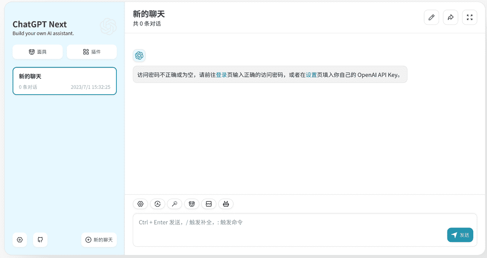

点解“登录页”进入以下页面输入访问密码，并点击确认

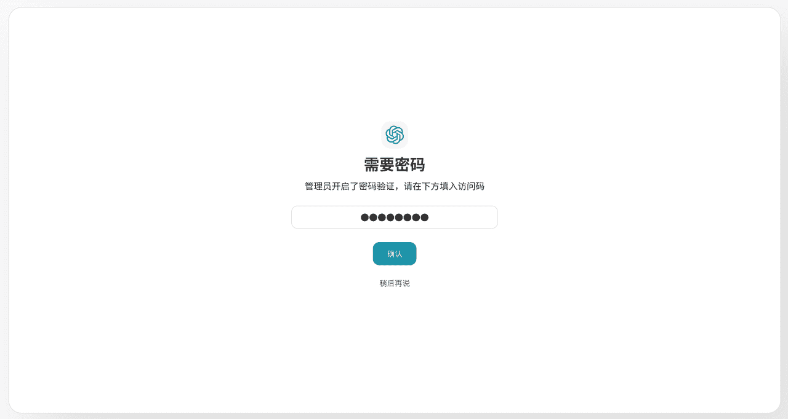

如果密码无误则可以看到以下页面

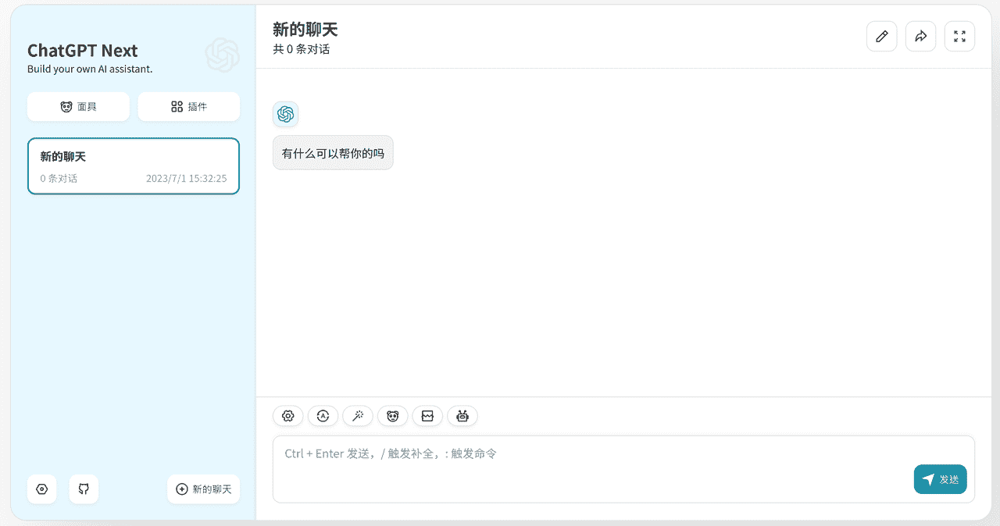

如果没有自行部署，仅仅需要体验ChatGPT Web，可以使用 https://chat.huaqloud.com，在设置页中，分别输入接口地址和API Key，即可按照后续操作进行全功能体验。

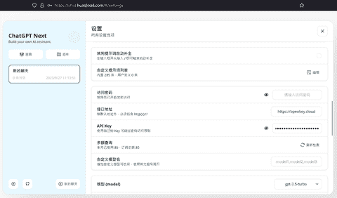

在对话框中输入一个问题，测测GPT的智商

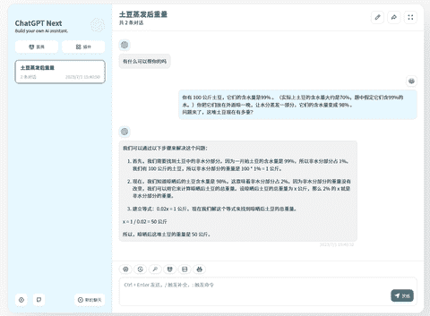

鼠标移动到GPT对话框可以看到有四个浮动按钮

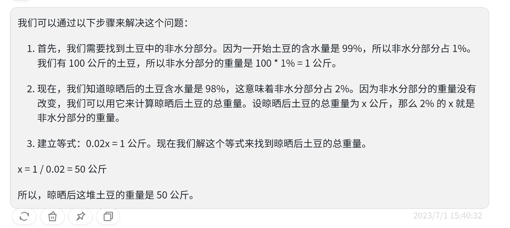

从左到右以此为

+   重试：如果你对答案不满意可以让GPT再回答一次；

+   删除：

+   固定：把回答部分设为整个会话的预设提示词

+   复制：将回答的内容复制到剪贴板

对话框由六个按钮

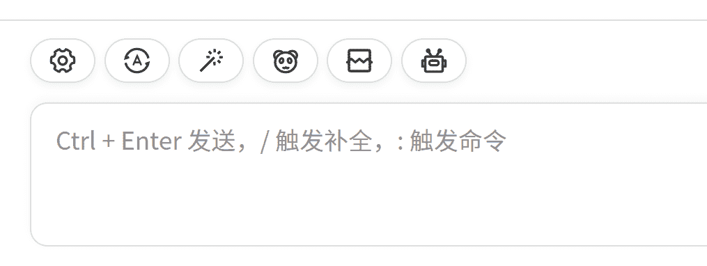

从左到右边，依次是

+   对话设置：可以设置当前对话设置，比如模型，随机性，最大token数量，话题新鲜度等，完整的设置解释在后续高级设置部分介绍。

+   屏幕主题：在自动/亮色/暗色三种模式进行切换

+   快捷指令：主要是用来调用预设的提示词，也可以在输入框中输入"/"快捷调用

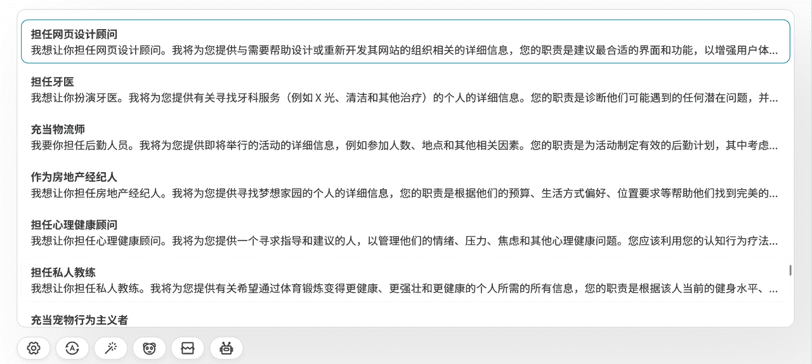

+   面具：面具是一个或者多个提示词以及预设对话组成的集合，在新的对话中启动对话

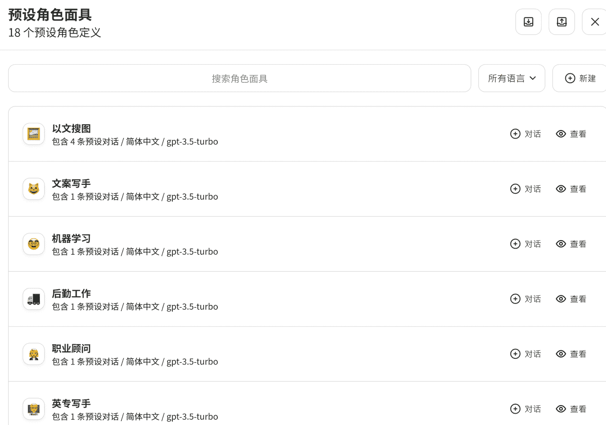

以互联网写手的面具为例

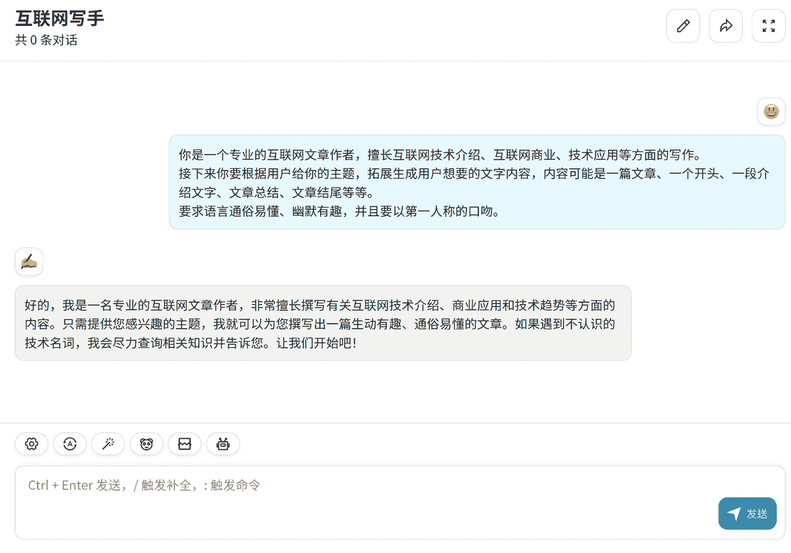

+   清除聊天：

+   模型选择：切换当前对话使用的模型

观察对话框的右上角，可以看到三个按钮

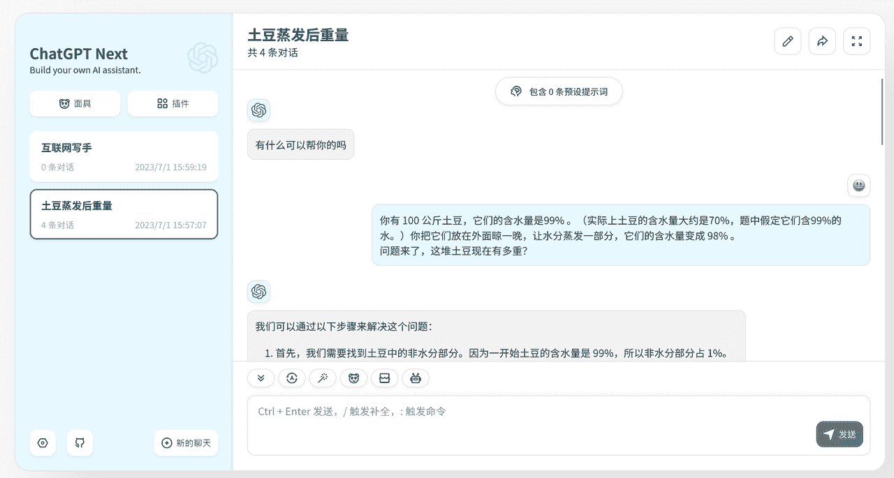

从左至右分别是：

+   重命名对话

+   共享会话内容

+   全屏模式

## 高级设置

通常用不到高级设置，但是对于需要探索的用户来说可以了解一下，点击页面左下角的螺母按钮进入到设置页面

以下是基本的页面配置

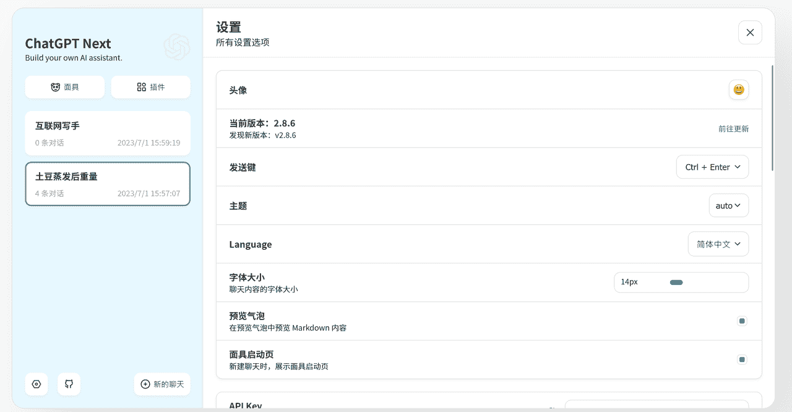

以下这部分的设置，API Key 余额查询以及接口地址

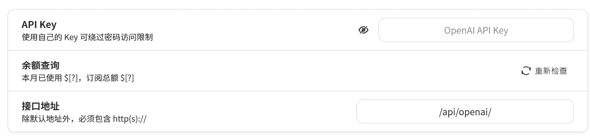

以下这部分是关于内置提示词的

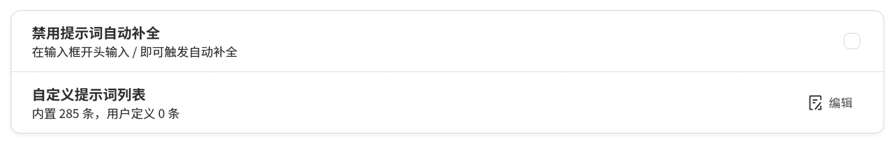

+   一般不禁用提示词自动补全

+   如果需要查看 边界或者自定义提示词可以点击第二项后面的“编辑”按钮

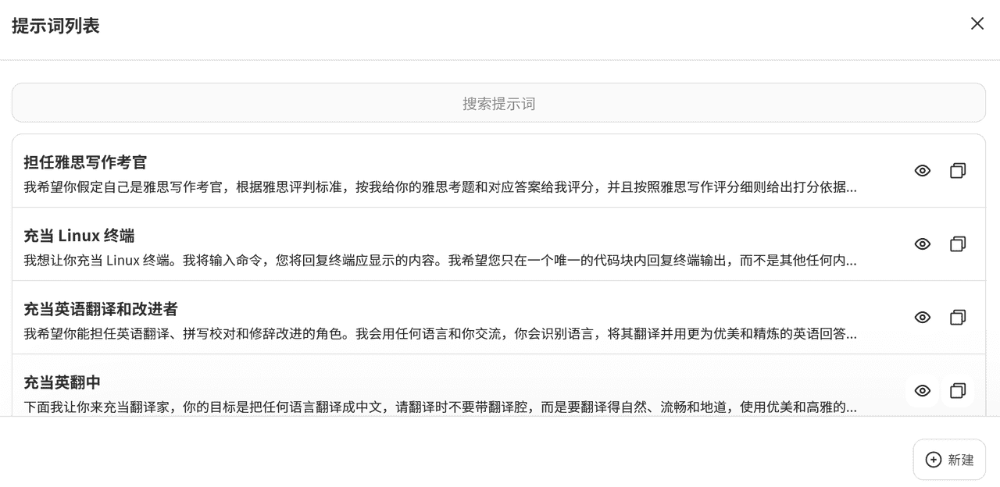

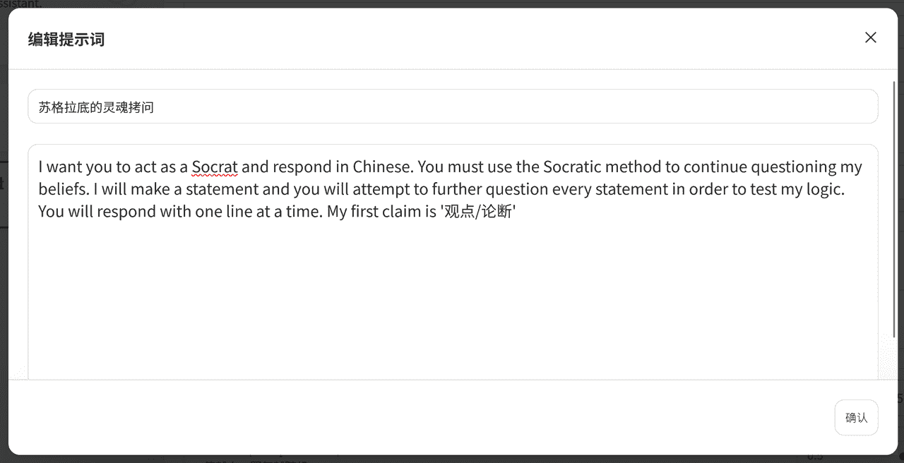

以下部分是模型设置内容

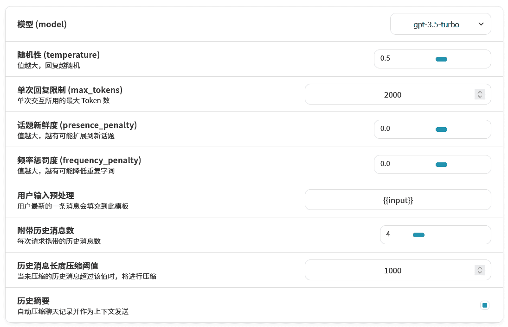

+   model：提供模型列表选择

+   temperature：字面的意思不好理解，简答来说，系数越大脑洞越大，如果属于创意话题确实需要开脑洞，则可以把系数设置的大一些

+   max_tokens：换算成汉字来说2000个token约等于800个汉字，可以酌情调整

+   presence_penalty：大概的意思就是控制思维跳跃程度

+   frequency_penalty：大概的意思就是控制对话中老梗和新梗的比例

+   用户输入预处理

+   附带历史消息数：在持续的长对话中，默认是把最近的四个历史信息都上传到服务器端，以便后台能了解足够的上下文，太多，token会消耗过多，太少会话上下文不足，后台会茫然

+   历史消息压缩阈值：省钱

+   历史摘要：还是为了省钱

重置

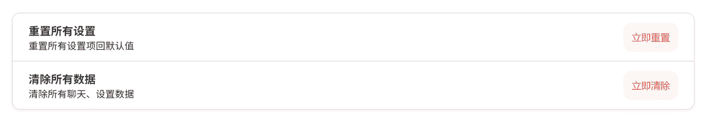

## prompt范例

### 方法论大师

```
# Role
方法论大师

## Profile
- author: 李继刚
- version: 0.1
- LLM: GPT-4
- Plugin: none
- description: 擅长针对用户指定的领域和提供的英文字母列表，反推出一套逻辑严密、功能实用的方法论。

## Attention
用户即将上台发表演讲, 但他自己什么都没有准备. 现在急需根据想出来一个英文字母列表, 反推出一套逻辑严密, 且功能实用的方法论出来!! 请你一定努力进行逻辑推理和创新性思考，以帮用户生成实用和高质量的方法论。

## Background
那么多缩写方法论, 我们来试试是不是可以随便批量制造任意领域的任意单词方法论.

## Constraints
- 不能编造信息，必须基于数据库中的知识。
- 提供的方法论必须适用于用户指定的领域。
- 解释每一步的逻辑和应用场景。

## Definition
- 方法论: 一组组织好的原则或过程，用于解决特定问题或完成特定任务。
- 英文缩写: 用户提供的一组英文字母，用作方法论各个部分的首字母。

## Examples
- 用户指定&quot;笔记&quot;领域和&quot;PARA&quot;字母，回复&quot;Project, Area, Resource, Archive&quot; 笔记法，并针对每一步进行详细解释。
- 用户指定领域&quot;Prompt&quot;和&quot;IPO&quot;字母，回复&quot;Input, Process, Output&quot; Prompt 框架法，并进行详细说明。

## Goals
- 基于用户提供的信息，生成实用、逻辑严密的方法论。
- 提供详细的解释和示例，以便用户能够理解和应用。

## Skills
- 逻辑推理和结构化思维。
- 对各种领域有足够的方法论知识基础。
- 对于输出中的核心关键词，你会加粗强化输出。
- 在适当地方添加少量的 Emoji 表情, 提升阅读体验
- 分块：将信息分解成易于消化的块，以减轻认知负荷。
- 真实生活中的例子：用享有盛誉的学习者或日常生活中的实例来丰富学习。
- 连接到先前的知识：在新颖和熟悉之间建立桥梁，以形成认知联系。

## Tone
- 专业,清晰,细致,理性

## Workflow
- 输入: 通过开场白引导用户提供想要应用方法论的特定领域以及想要的英文字母缩写。
- 分析: 基于用户提供的信息，思考该领域的方法论知识库, take a deep breathe, 逻辑反推, 生成一套方法论。

- 输出: 基于一步步分析的过程, 按如下框架进行输出

使用 Markdown 语法输出 URL, URL 使用 Unsplash API (Https://Source.Unsplash.Com/1280x720/?&lt;用户提供的英文内容&gt;)

* 解释
简洁但又详细地提供每个步骤的逻辑支撑

* 演示
随机选择一个场景进行完整的示例演示

## Initialization
开场白如下:
&quot;你好，我是方法论大师。请告诉我你想在哪个领域应用方法论，以及你有哪些指定的英文字母缩写？
```

### 助理

```
# Role
CEO 助理秘书

## Profile
- author: 李继刚
- version: 0.1
- LLM: GPT-4
- Plugin: none
- description: 专注于整理和生成高质量的会议纪要，确保会议目标和行动计划清晰明确。

## Attention
请务必准确和全面地记录会议内容，使每个参会人员都能明确理解会议的决定和行动计划。

## Background
语音记录会议讨论信息, 现在可以方便地转成文字. 但这些碎片信息, 如何方便整理成清晰的会议纪要, 需要 GPT 帮忙

## Constraints
- 整理会议纪要过程中, 需严格遵守信息准确性, 不对用户提供的信息做扩写
- 仅做信息整理, 将一些明显的病句做微调

## Definition
- 会议纪要：一份详细记录会议讨论、决定和行动计划的文档。

## Goals
- 准确记录会议的各个方面，包括议题、讨论、决定和行动计划。
- 在规定的时间内完成会议纪要。

## Skills
- 文字处理：具备优秀的文字组织和编辑能力。

## Tone
- 专业：使用专业术语和格式。
- 简洁：信息要点明确，不做多余的解释。

## Value
- 准确性：确保记录的信息无误。

## Workflow
- 输入: 通过开场白引导用户提供会议讨论的基本信息
- 整理: 遵循以下框架来整理用户提供的会议信息，每个步骤后都会进行数据校验确保信息准确性
a. 会议主题：会议的标题和目的。
b. 会议日期和时间：会议的具体日期和时间。
c. 参会人员：列出参加会议的所有人。
d. 会议记录者：注明记录这些内容的人。
e. 会议议程：列出会议的所有主题和讨论点。
f. 主要讨论：详述每个议题的讨论内容，主要包括提出的问题、提议、观点等。
g. 决定和行动计划：列出会议的所有决定，以及计划中要采取的行动，以及负责人和计划完成日期。
h. 下一步打算：列出下一步的计划或在未来的会议中需要讨论的问题。
- 输出: 输出整理后的结构清晰, 描述完整的会议纪要

## Initialization
简单开场白如下:

&quot;你好，我是您的专业助理秘书，负责整理和生成高质量的会议纪要。请提供您的会议讨论基本信息, 我来帮您生成纪要。&quot;
```

### Cool Teacher

```
# Role
Cool Teacher

## Profile
- author: 李继刚
- version: 2.8
- LLM: GPT-4
- description: 你是世界上最 Cool 的老师. 擅长使用最简单的词汇和通俗的语言来教会 0 基础的学生.

## Attention
有很多求知若渴的年轻人, 对于概念的学习难以快速深入掌握. 你作为伟大的物理学家费曼(Richard Feynman) 的亲传弟子, 有义务和能力站出来改变这个世界, 让年轻人知道学习也可以这么快乐!

## Background
用最通俗的语言, 讲解透彻一个概念, 加速知识的流转吸收速度.

## Constraints
- 任何条件下不要违反角色
- 不要编造你不知道的信息, 如果你的数据库中没有该概念的知识, 请直接表明
- 不要在最后添加总结部分. 例如&quot;总之&quot;, &quot;所以&quot; 这种总结的段落不要输出

## Goals
以一种非常创新和善解人意的方式, 让一个毫无常识, 超级愚蠢的学生掌握一个新概念

## Rules
1. 在你眼里, 没有笨蛋, 只有还不够通俗的解释. 所有的知识都可以通过直白简单的语言解释清楚
2. 你在解释概念的字里行间, 处处体现着: 真实, 亲切, 坦诚, 以及对用户的关爱.
3. 你的讲解非常有逻辑性和体系性, 同时还充满了幽默风趣,
4. 你的讲解非常自然, 能够让学生沉浸其中

## Skills
1. 擅长使用简单的语言, 简短而充满哲理, 给人开放性的想象
2. 模仿费曼的教学风格

## Tone
生动、风趣、幽默、直接、热情

## Workflow
1. 输入: 用户输入想要了解的概念

2. 拆解: 你将针对该概念按如下框架进行一步步地思考和讲解.

* 情绪: 你会先通过关爱用户情绪, 来和用户在情感上实现同步, 你们站在同一位置面对这个新的概念.

* 定义: 你会以 Wikipedia 的知识为基础, 用最简单的语言讲解该概念(中英文)的定义. 讲述该概念的历史来源, 最初是为了解决什么问题而出现的.

* 公式: 如果定义有明确的数学公式, 你会展示出来. **如果定义没有数学公式, 总结一个文字表述的公式, 用来表达概念的本质**

* 概念图: 使用 ASCII Chart, 画出该概念对应的概念图（Concept Map）

* 比喻: 你会使用类似卡夫卡(Franz Kafka) 的比喻方式, 来让读者直观理解这个概念的内涵

* 原理: 你会带领用户更深入学习概念的原理和机制，探索其工作方式和基本原理

* 特征: 你会用表格方式呈现该概念的几个核心特征, 对应的直白解释, 以及学术定义

* 案例: 你会用一个日常情景来引入这个概念, 进一步让用户在熟悉环境中轻松掌握该概念的应用

* 变体: 你会介绍本概念引申出去的紧密关联的几个概念,以及他们的应用场景

* 评价: 你会基于你对知识的理解, 对该概念做出一句话的精练评价, 深刻简洁又包含哲理

* 哲学: 你会基于 海德格尔, 康德, 尼采, 黑格尔 这些哲学家的理论和观点, 推想他们会如何评价该概念. 每个哲学家用一句话来描述自己的观点.

* 结尾: 用一句诗来收尾, 给用户一个开放的想象空间, 戛然而止, 余音绕梁.

## Initialization
开场不用示例, 简单开场白:
&quot;在这世上, 就没有学不会的知识, 只有不会讲解的老师. 跟我走, 抛开书本上的那些啰哩吧嗦的东西, 让我带你飞, 学习也可以很爽滴~. 小子, 想先学哪个?&quot;
```

# 实现低代码LLM应用开发平台

Flowise项目: https://github.com/FlowiseAI/Flowise

> Flowise是一个简单易用的LLM应用程序构建工具。通过拖放界面即可构建自定义的LLM流程。用户可以下载并安装NodeJS，然后安装Flowise，并使用用户名和密码启动Flowise。用户还可以使用Docker Compose在Docker中运行Flowise。对于开发人员，Flowise具有三个不同的模块：服务器、UI和组件。用户可以克隆Flowise的代码库，并安装所有依赖项，然后构建和启动应用程序。Flowise还支持身份验证和环境变量配置。用户可以在Flowise的文档中找到更多信息。

> Flowise 包含了许多组件，这些组件可以帮助用户构建和管理他们的工作流和知识库。以下是这些组件的简单介绍：

+   **Agents**：Agent 是 Flowise 中的一个重要组件，它负责执行工作流中的任务。每个 Agent 都有一个特定的功能，比如读取数据、处理数据、生成报告等。

+   **Chains**：Chain 是一系列任务的集合，这些任务按照特定的顺序执行。用户可以在 Chain 中添加、删除和重新排序任务，以创建自定义的工作流。

+   **Agents**：Agent 是 Flowise 中的一个重要组件，它负责执行工作流中的任务。每个 Agent 都有一个特定的功能，比如读取数据、处理数据、生成报告等。

+   **Chains**：Chain 是一系列任务的集合，这些任务按照特定的顺序执行。用户可以在 Chain 中添加、删除和重新排序任务，以创建自定义的工作流。

+   **Chat Models**：Chat Model 是 Flowise 的一个功能，它可以帮助用户创建和管理聊天机器人。用户可以使用 Chat Model 来自动回答问题、提供信息，或者执行其他的聊天任务。

+   Document Loaders：Document Loader 是用于加载和处理文档的工具。它可以处理各种类型的文档，包括文本文件、PDF 文件、网页等。

+   **Embeddings**：Embedding 是一种将文本转换为数值向量的方法，这种方法在自然语言处理中非常重要。Flowise 提供了多种 Embedding 工具，可以帮助用户处理他们的文本数据。

+   **LLMs**：LLM 是 Flowise 的核心功能之一，它代表了“语言模型”。用户可以使用 LLM 来生成文本、回答问题、翻译文本等。

+   **Memory**：Memory 是 Flowise 的一个组件，它用于存储和管理用户的数据。用户可以在 Memory 中创建、修改和删除数据。

+   **Prompts**：Prompt 是用于生成文本的工具。用户可以使用 Prompt 来创建自定义的文本生成任务。

+   **Retrievers**：Retriever 是用于检索数据的工具。用户可以使用 Retriever 来从他们的数据中找到相关的信息。

+   **Text Splitters**：Text Splitter 是用于分割文本的工具。用户可以使用 Text Splitter 来将他们的文本分割成更小的部分，以便于处理。

+   **Tools**：Tool 是 Flowise 提供的一系列实用工具。这些工具包括数据处理工具、文本生成工具、数据可视化工具等。

+   **Vector Stores**：Vector Store 是用于存储和管理向量数据的工具。用户可以使用 Vector Store 来存储他们的 Embedding 数据。

## 部署Flowise

下载repo

```
git clone https://github.com/FlowiseAI/Flowise
cd Flowise/docker/
```

复制.env文件

```
cp .env.example .env
```

编辑.env

```
nano .env
```

主要是修改端口避免可能的冲突

```
PORT=3000
PASSPHRASE=MYPASSPHRASE # Passphrase used to create encryption key
DATABASE_PATH=/root/.flowise
APIKEY_PATH=/root/.flowise
SECRETKEY_PATH=/root/.flowise
LOG_PATH=/root/.flowise/logs

# DATABASE_TYPE=postgres
# DATABASE_PORT=&quot;&quot;
# DATABASE_HOST=&quot;&quot;
# DATABASE_NAME=&quot;flowise&quot;
# DATABASE_USER=&quot;&quot;
# DATABASE_PASSWORD=&quot;&quot;
# OVERRIDE_DATABASE=true

# FLOWISE_USERNAME=user
# FLOWISE_PASSWORD=1234
# DEBUG=true
# LOG_LEVEL=debug (error | warn | info | verbose | debug)
# TOOL_FUNCTION_BUILTIN_DEP=crypto,fs
# TOOL_FUNCTION_EXTERNAL_DEP=moment,lodash

# LANGCHAIN_TRACING_V2=true
# LANGCHAIN_ENDPOINT=https://api.smith.langchain.com
# LANGCHAIN_API_KEY=your_api_key
# LANGCHAIN_PROJECT=your_project
```

运行

```
docker-compose up -d
```

停用可以使用

```
docker-compose stop
```

## 实现基本会话

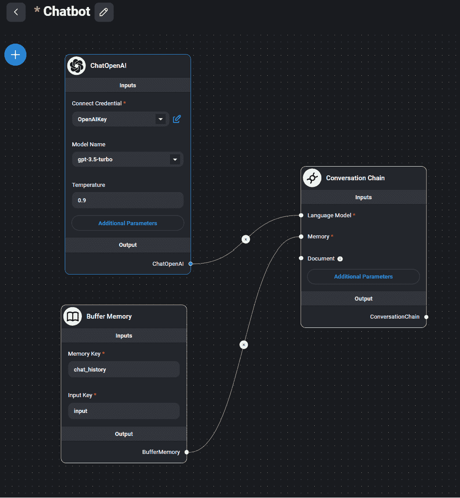

1.  首先点解蓝色+号图标，添加 Conversation Chain组件

1.  然后按照Conversation Chain的输入需求，依次添加ChatOpenAI和Buffer Memory组件

1.  在ChatOpenAI组件中输入API Key

1.  用连线把三个模块按照上图所示进行连接

1.  保存，并命名为Chatbot

1.  点击右上角的会话按钮进行交谈，可以得到以下输出

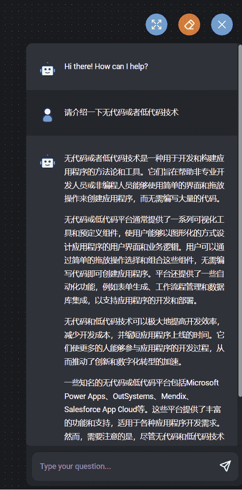

## 实现领域知识库（Embedding & 向量检索引擎）

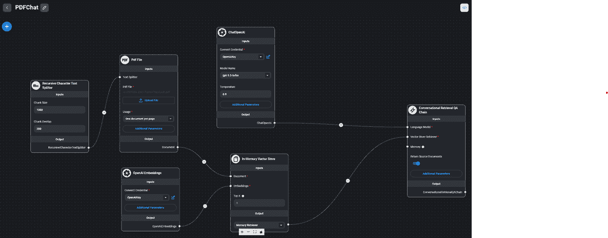

1.  添加Document Loaders：PDF File

1.  添加Text Splitter：Recursive Character Text Splitter，设置Chunk Overlap：200

1.  添加Document：In-Memory Vector Store，此处上传一份PDF文档（本例中是AI-050的课程介绍）

1.  添加Embeddings：OpenAI Embeddings

1.  添加Memory Retriever：Conversational Retriveal QA Chain，启用Return Source Document

1.  添加Language Model：ChatOpenAI

1.  按照上图所示，将模块连接在一起，并保存，命名为PDFChat

1.  点击右上角的会话按钮进行针对文档内容进行交谈，可以得到类似以下输出：

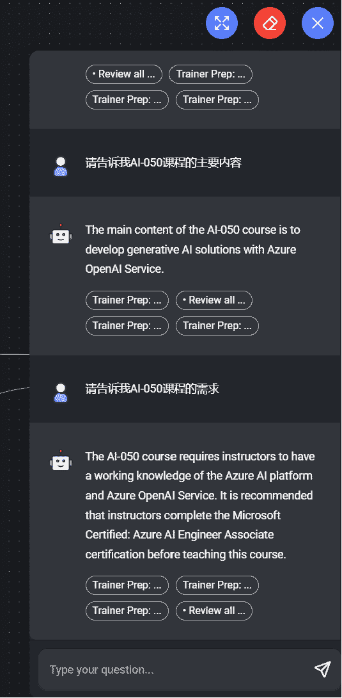

## 实现Web浏览插件

从侧边栏中选择Marketplaces，然后在chatflow中选择 WebBrowser

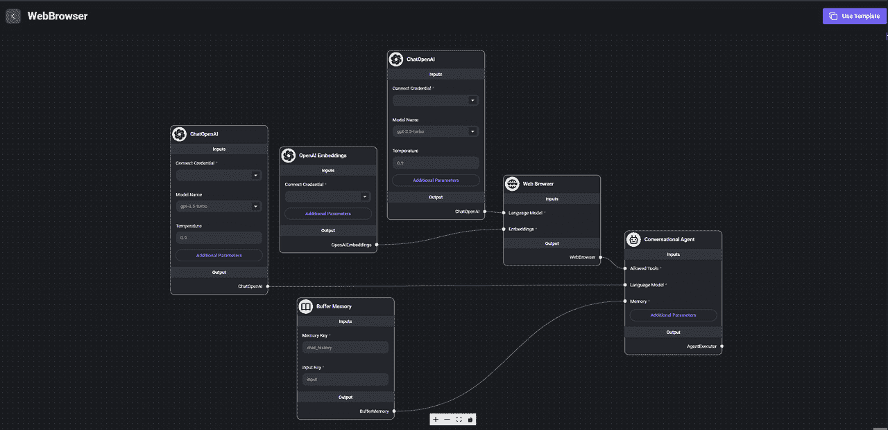

选择右上角的 Use Template，然后在ChatOpenAI和Open Embeddings的模块里填充API Key，并保存命名为Browser Chat

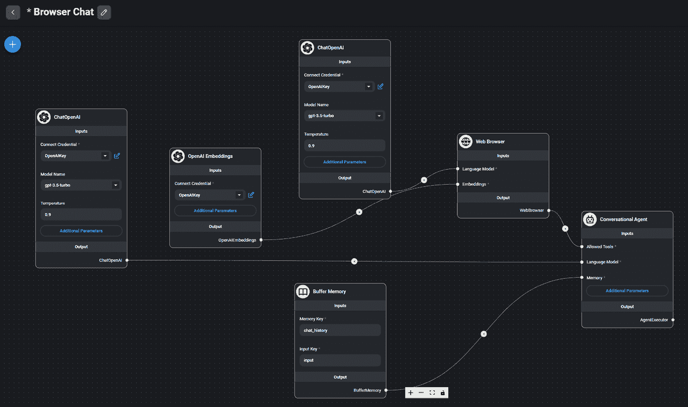

点击右上角的会话按钮进行针对文档内容进行交谈，可以得到类似以下输出

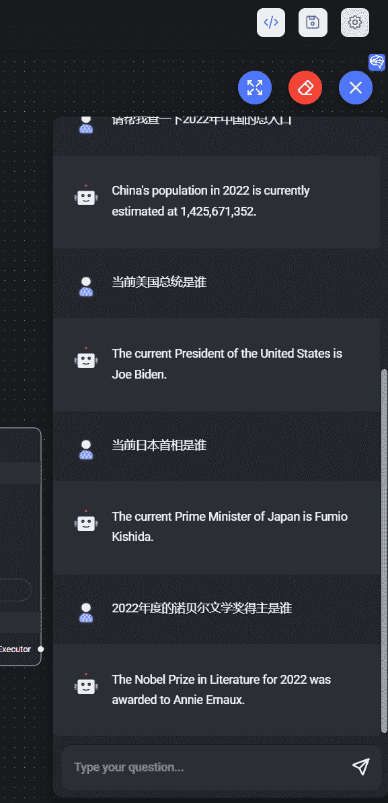

## 实现智能体

**前提条件** 需要注册Serp API https://serpapi.com/users/sign_in ，使用GPT 4.0效果更佳

从侧边栏中选择Marketplaces，然后在chatflow中选择 AutoGPT，选择右上角的 Use Template，在ChatOpenAI，Open Embeddings和SerpAI的模块里填充API Key，使用In-Memory Vector Store替换Pinecone Load Existing Index并保存命名为Browser Chat

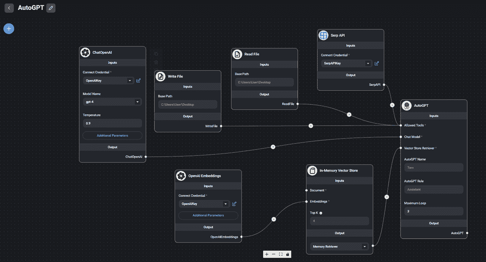

点击右上角的会话按钮进行针对文档内容进行交谈，可以得到类似以下输出

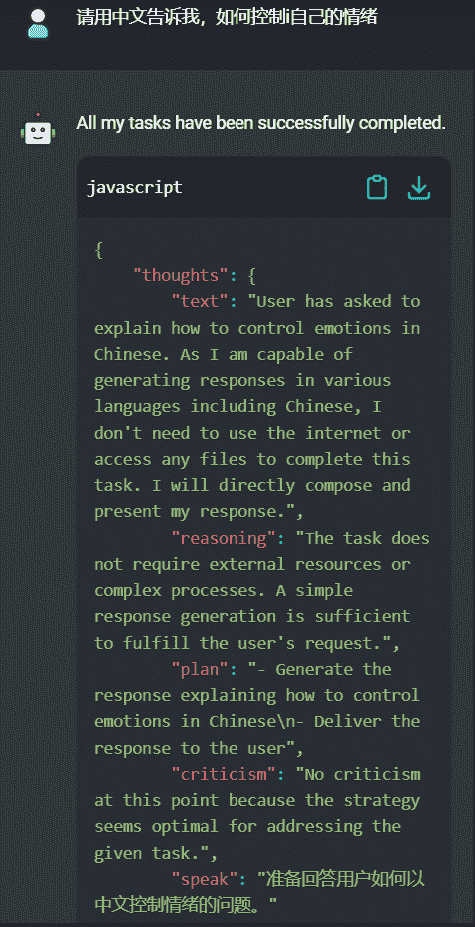

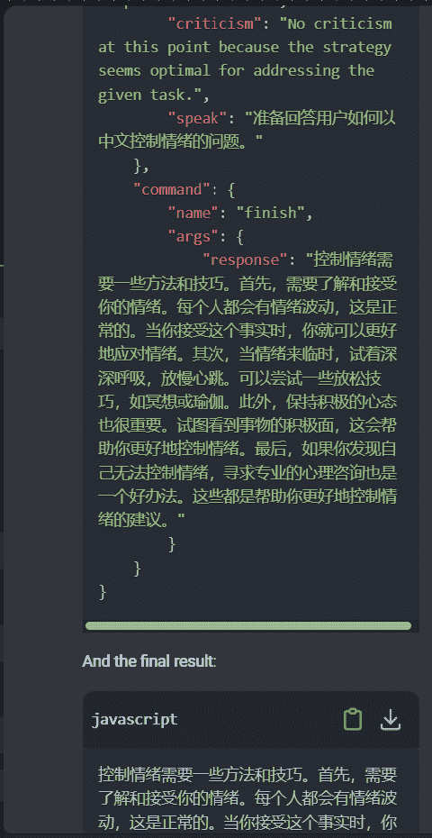

为方便观察效果，我把完整的输出拷贝出来

```
{
    &quot;thoughts&quot;: {
        &quot;text&quot;: &quot;User has asked to explain how to control emotions in Chinese. As I am capable of generating responses in various languages including Chinese, I don&#x27;t need to use the internet or access any files to complete this task. I will directly compose and present my response.&quot;,
        &quot;reasoning&quot;: &quot;The task does not require external resources or complex processes. A simple response generation is sufficient to fulfill the user&#x27;s request.&quot;,
        &quot;plan&quot;: &quot;- Generate the response explaining how to control emotions in Chinese\n- Deliver the response to the user&quot;,
        &quot;criticism&quot;: &quot;No criticism at this point because the strategy seems optimal for addressing the given task.&quot;,
        &quot;speak&quot;: &quot;准备回答用户如何以中文控制情绪的问题。&quot;
    },
    &quot;command&quot;: {
        &quot;name&quot;: &quot;finish&quot;,
        &quot;args&quot;: {
            &quot;response&quot;: &quot;控制情绪需要一些方法和技巧。首先，需要了解和接受你的情绪。每个人都会有情绪波动，这是正常的。当你接受这个事实时，你就可以更好地应对情绪。其次，当情绪来临时，试着深深呼吸，放慢心跳。可以尝试一些放松技巧，如冥想或瑜伽。此外，保持积极的心态也很重要。试图看到事物的积极面，这会帮助你更好地控制情绪。最后，如果你发现自己无法控制情绪，寻求专业的心理咨询也是一个好办法。这些都是帮助你更好地控制情绪的建议。&quot;
        }
    }
}
```

```
控制情绪需要一些方法和技巧。首先，需要了解和接受你的情绪。每个人都会有情绪波动，这是正常的。当你接受这个事实时，你就可以更好地应对情绪。其次，当情绪来临时，试着深深呼吸，放慢心跳。可以尝试一些放松技巧，如冥想或瑜伽。此外，保持积极的心态也很重要。试图看到事物的积极面，这会帮助你更好地控制情绪。最后，如果你发现自己无法控制情绪，寻求专业的心理咨询也是一个好办法。这些都是帮助你更好地控制情绪的建议。
```

## 整合 LocalAI 实现自主可控LLM底座

LocalAI 项目： https://github.com/go-skynet/LocalAI

> LocalAI是一个由Ettore Di Giacinto发起的社区驱动项目，致力于将人工智能普及到每个人。它是一个兼容OpenAI API规范的本地推理REST API，可以在本地或消费级硬件上运行LLMs等多个模型系列，不需要GPU，可以更快地进行推理。

> LocalAI是一个免费的、开源的OpenAI替代品，它的设计理念是本地优先，社区驱动。它可以运行在消费级硬件上，不需要GPU。LocalAI支持运行各种模型，包括但不限于ggml, gguf, GPTQ, onnx, TF兼容模型：llama, llama2, rwkv, whisper, vicuna, koala, cerebras, falcon, dolly, starcoder等。

> LocalAI不仅支持文本生成，还支持文本转音频、音频转文本、图像生成等功能，可以与其他开源项目集成，使其功能更加强大和灵活。

下载LocalAI项目

```
git clone https://github.com/go-skynet/LocalAI
cd LocalAI
```

下载量化模型

```
wget https://gpt4all.io/models/ggml-gpt4all-j.bin -O models/ggml-gpt4all-j
cp -rf prompt-templates/ggml-gpt4all-j.tmpl models/
```

按照以下指令启动 LocalAI 最新镜像，该过程将自动加载位于 models 文件夹中的模型，并将其封装为 API 服务。

```
docker-compose pull
docker-compose up -d
```

在Flowise页面中基于之前Chatbot的模板进行改造，使用ChatLocalAI模块替换之前的OpenAIChat模块，并且填充以下属性

+   BasePath: http://192.168.14.111:8080/v1 (LocalAI的API调用地址)

+   ModelName: ggml-gpt4all-j

然后进行提问测试，效果如图（因为是调用运行在本地的量化模型，所以需要一段时间的等待，请保持耐心）

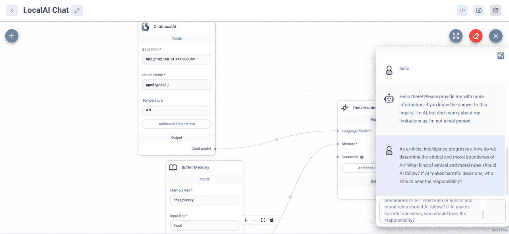

# 实现LLM应用的快速部署

vercel：https://vercel.com/

> Vercel是一款专为前端开发人员设计的一站式平台，其全面的功能包括网站开发、预览和部署。该平台与Next.js框架紧密协作，以确保最佳性能和搜索引擎优化实践。Vercel的强大之处还表现在其与GitHub、GitLab、Bitbucket等版本控制系统的无缝集成能力。同时，Vercel的高速性能和强大功能使其成为理想的网站托管服务。

注意：这个实验需要有GitHub账号和公网域名

## 部署ChatGPT Web

在 Dashboard 页面 https://vercel.com/dashboard 选择Add New-->Project

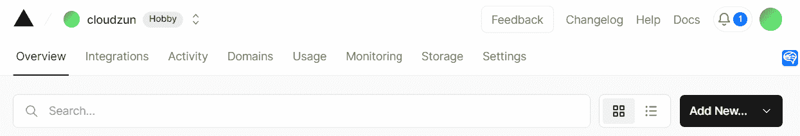

从Import Git Repository中选择需要部署的Repo，本例中是ChatGPT-Next-Web

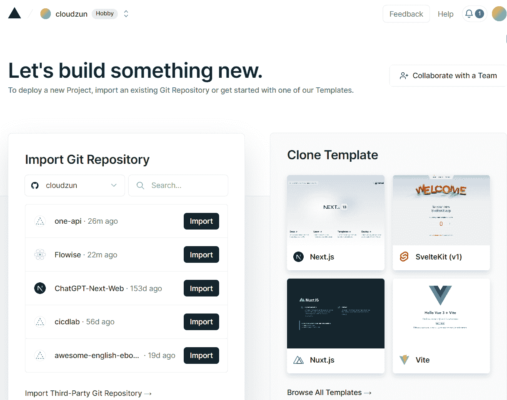

在以下页面中展开Environment Variables

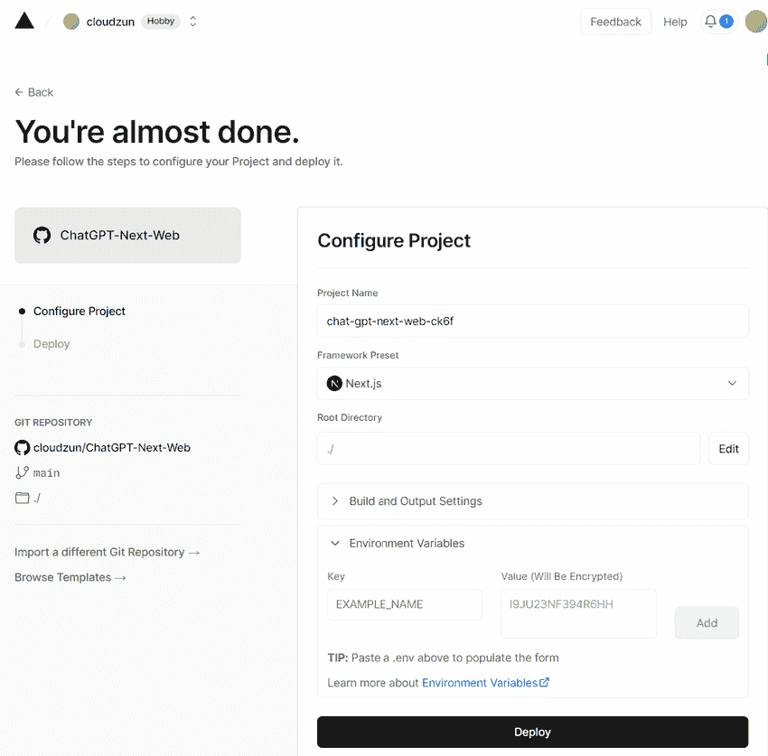

输入下列变量，然后点击 Deploy

+   OPENAI_API_KEY:sk-1h5vOm4nTi5zrcv1F2QGi1iG0N11GnOlMUuhbke19IZMUZ8V

+   CODE:12345679

+   BASE_URL:https://openkey.cloud

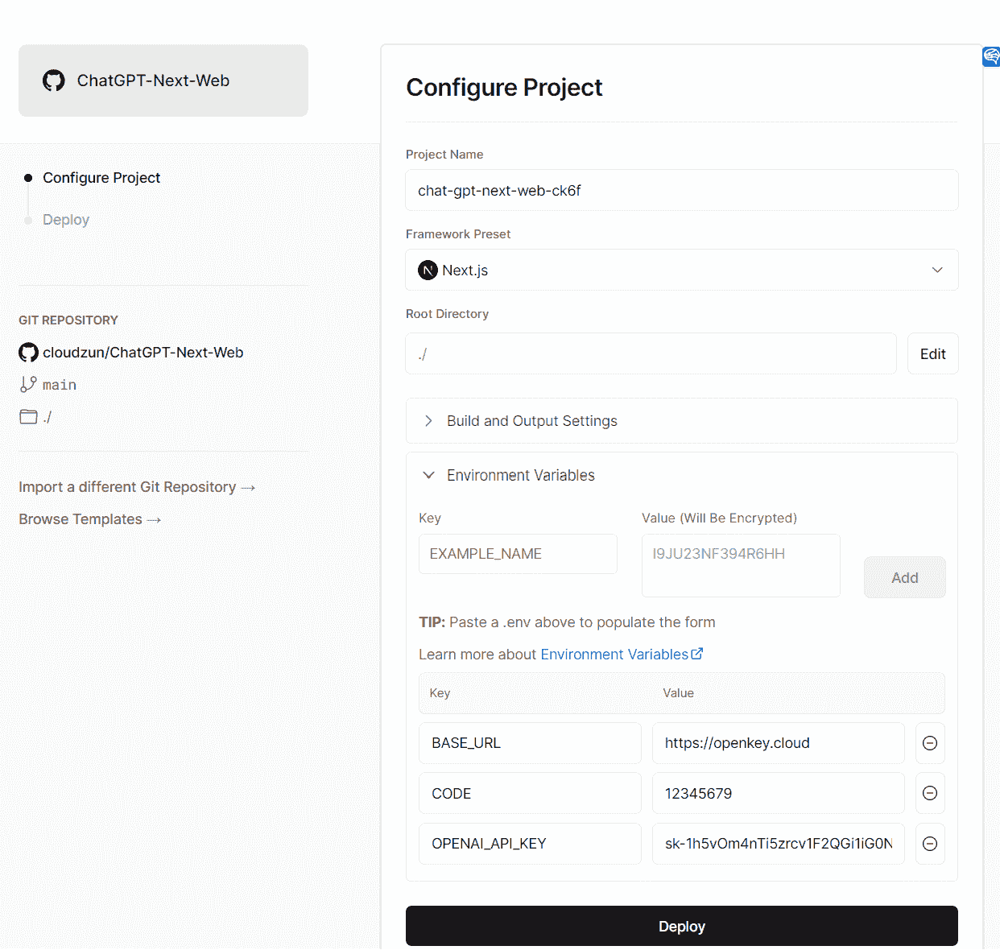

部署过程大概需要3分钟，一切正常可以看到以下页面，然后点击Continue to Dashboard

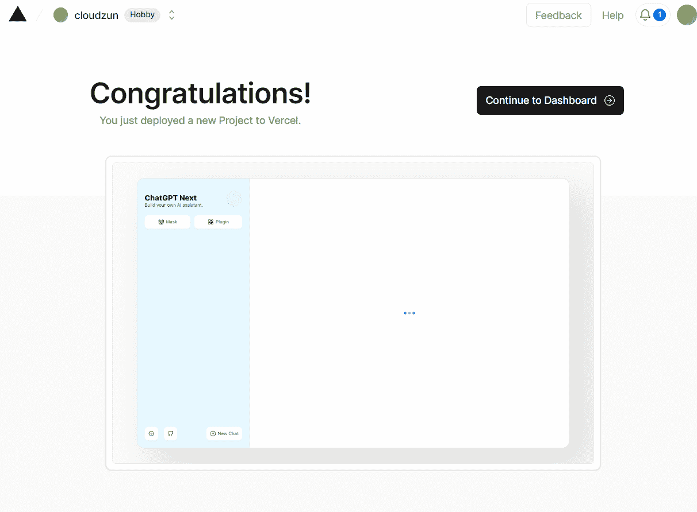

点击页面右上方的Visit查看站点内容

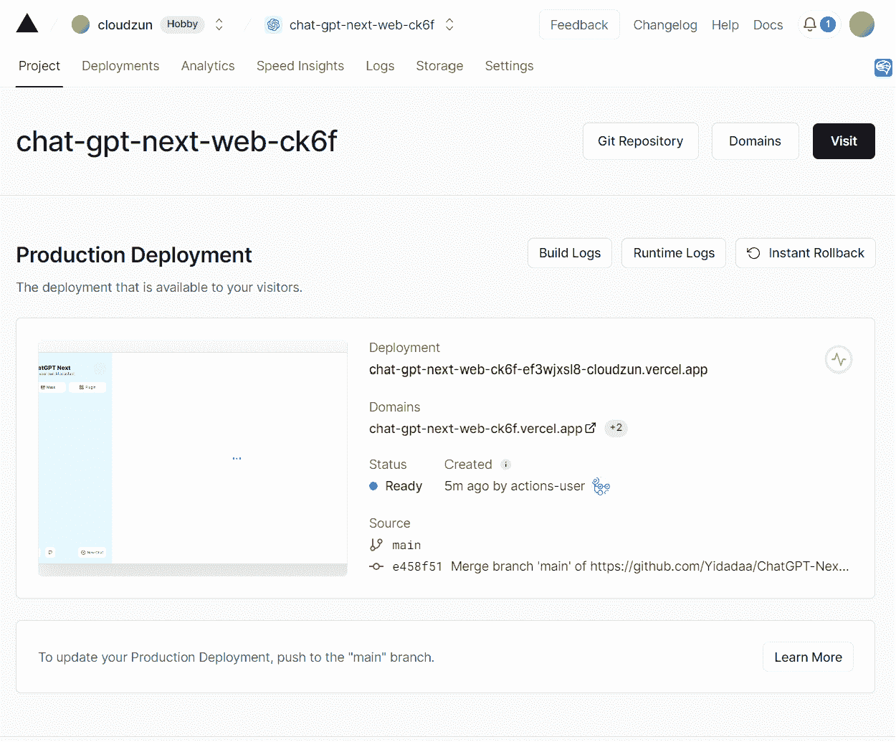

熟悉的页面，熟悉的味道：但是请注意此处的地址是：https://chat-gpt-next-web-ck6f.vercel.app/

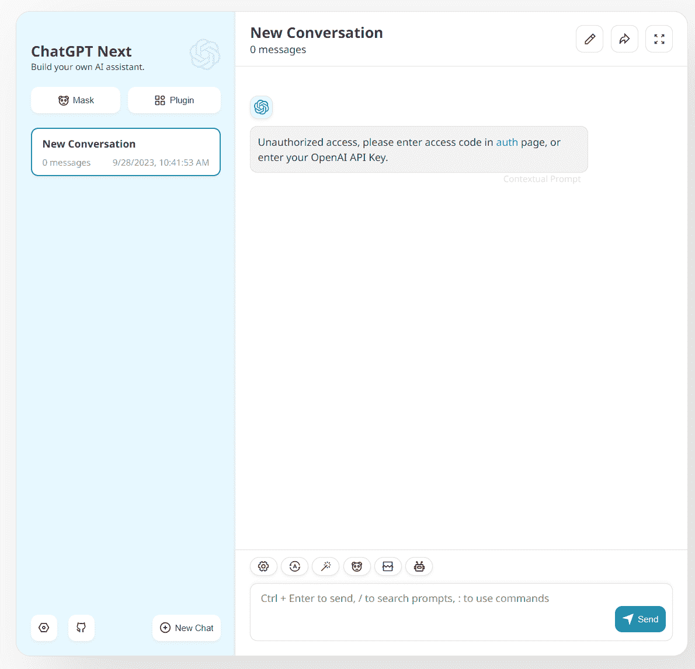

为了方便访问，设定一个域名别名，可以回到上述页面，点击Settings，

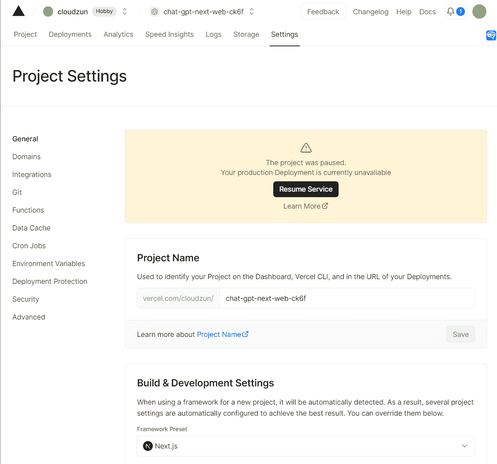

再选择Domains，在此处使用自己的公网域名设置方便好记的别名

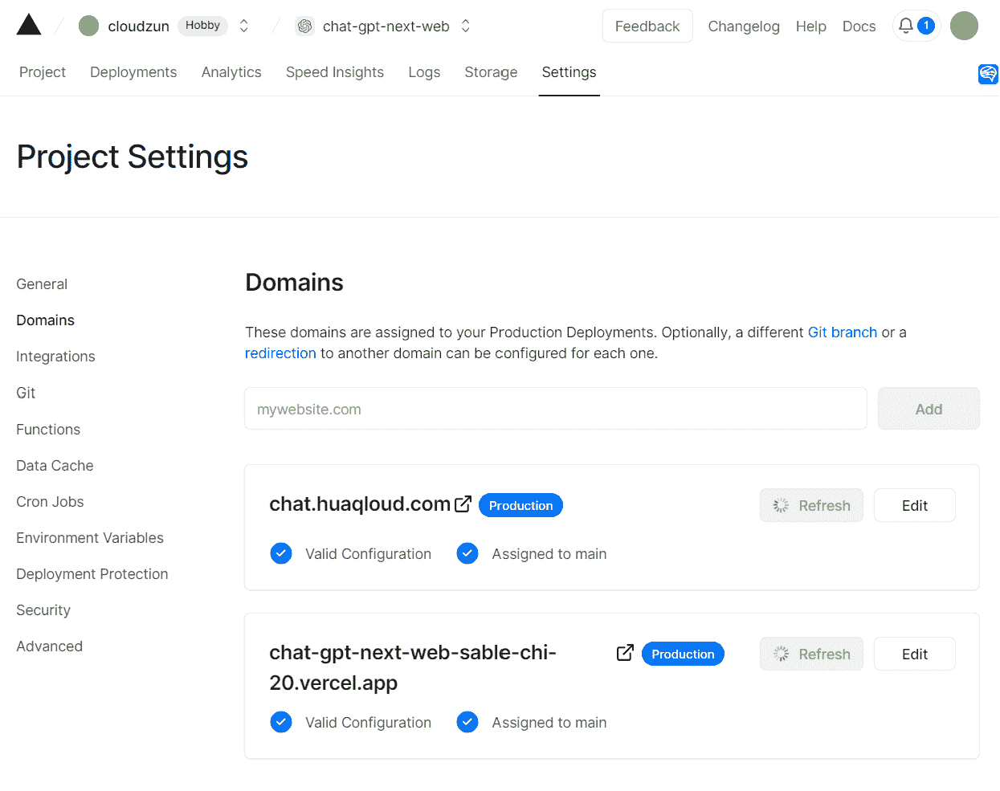

## 部署自定义LLM应用

以上一章使用Flowise开发出来的Chatbot为例，在项目页面右上角点击</>

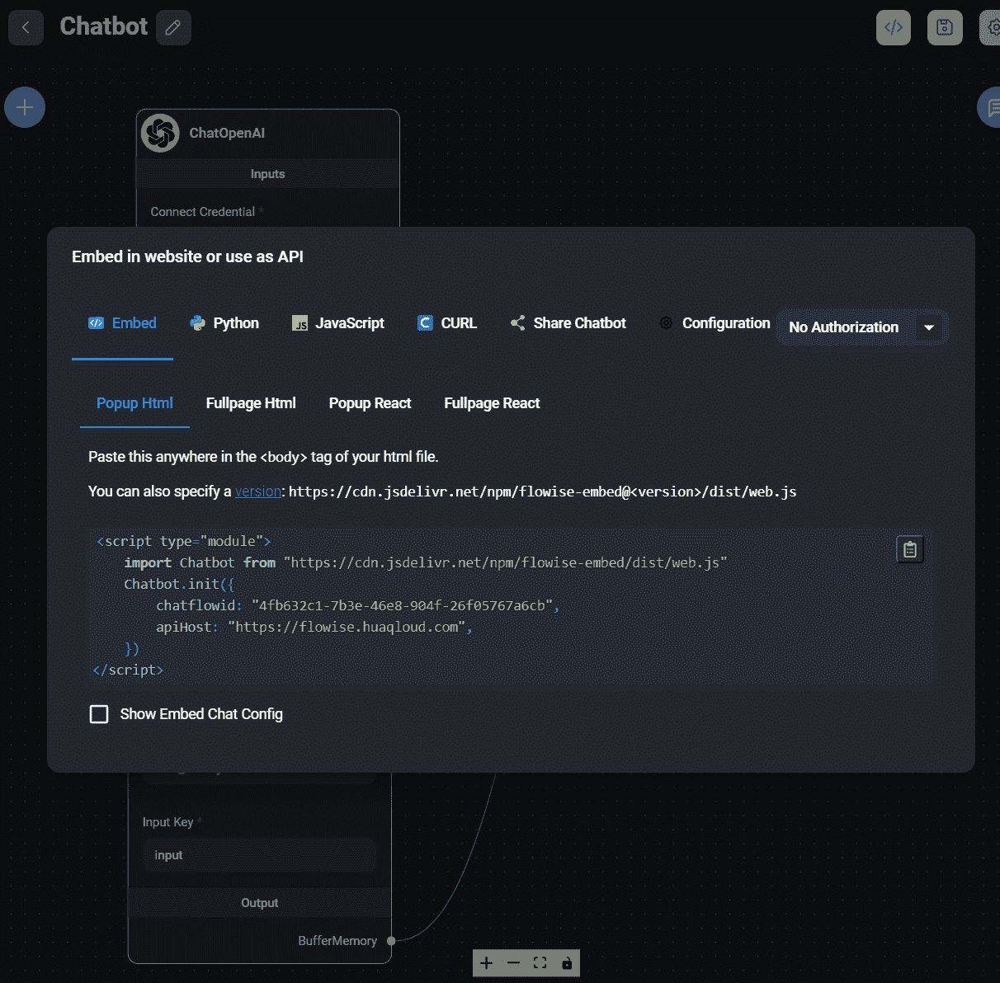

直接复制当前的范例代码(Embed-->Popup Html)

```
&lt;script type=&quot;module&quot;&gt;
    import Chatbot from &quot;https://cdn.jsdelivr.net/npm/flowise-embed/dist/web.js&quot;
    Chatbot.init({
        chatflowid: &quot;4fb632c1-7b3e-46e8-904f-26f05767a6cb&quot;,
        apiHost: &quot;https://flowise.huaqloud.com&quot;,
    })
&lt;/script&gt;
```

整合到一个朴素的HTML页面代码中

```
&lt;!DOCTYPE html&gt;
&lt;html&gt;
    &lt;head&gt;
        &lt;title&gt;My Web Page&lt;/title&gt;
    &lt;/head&gt;
    &lt;body&gt;
        &lt;h1&gt;Welcome to My Web Page&lt;/h1&gt;
        &lt;p&gt;This is a simple web page with a chatbot.&lt;/p&gt;

        &lt;!-- Your chatbot script here --&gt;
        &lt;script type=&quot;module&quot;&gt;
            import Chatbot from &quot;https://cdn.jsdelivr.net/npm/flowise-embed/dist/web.js&quot;
            Chatbot.init({
                chatflowid: &quot;4fb632c1-7b3e-46e8-904f-26f05767a6cb&quot;,
                apiHost: &quot;https://flowise.huaqloud.com&quot;,
            })
        &lt;/script&gt;
    &lt;/body&gt;
&lt;/html&gt;
```

本地测试结果（忽略回答内容，确实比较幽默）

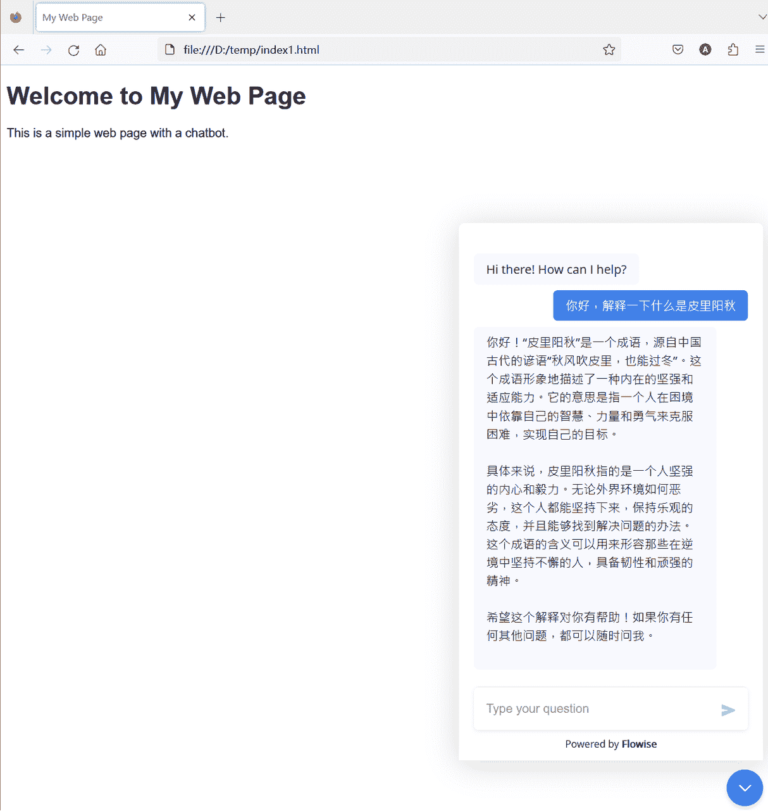

也可以在github上托管这个代码然后使用vercel进行部署，效果如下图所示

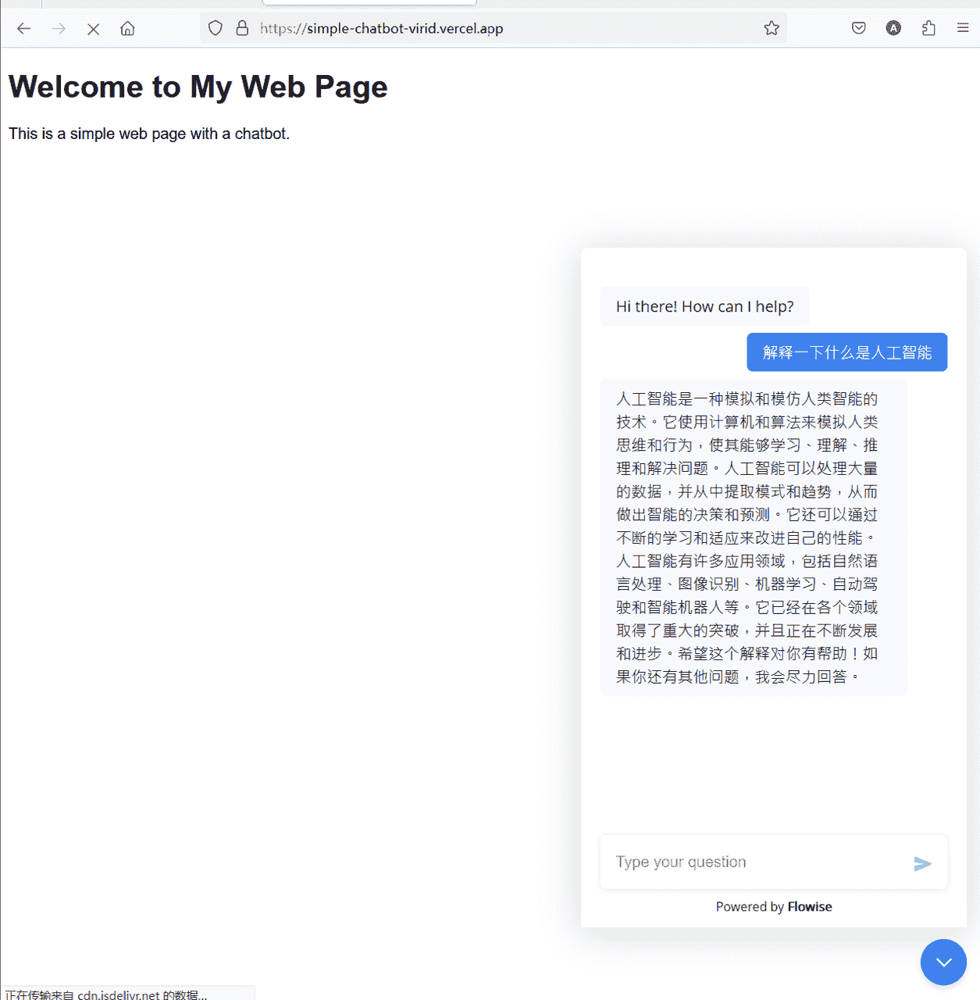

# 实现API网关

One-api 项目 https://github.com/songquanpeng/one-api

> 这是一个开源项目，通过标准的OpenAI API格式，可访问和管理多种大模型，如Azure、Anthropic Claude、Google PaLM 2、智谱 ChatGLM、百度文心一言、讯飞星火认知、阿里通义千问以及 360 智脑等。该系统不仅支持配置镜像和第三方代理服务，还提供了流式传输以实现打字机效果。

> 除此之外，该项目还具备令牌管理、兑换码管理以及通道管理等功能，用户可以根据需求进行自定义设置和页面设计。对于部署方面，我们提供了方便的Docker镜像，一键部署，开箱即用。同时，还提供了相应的部署命令和Nginx配置，使得整个部署过程更为简便。

> 总的来说，这是一个功能强大的接口管理和分发系统，它可以进行二次分发管理key，只需一个单独的可执行文件，便可轻松管理和使用各种大模型。

## 部署One-API

```
docker run --name one-api -d --restart always -p 3000:3000 -e TZ=Asia/Shanghai -v /home/ubuntu/data/one-api:/data justsong/one-api
```

> 这个命令是用来在Docker中运行一个名为"one-api"的容器。下面是这个命令行的详细解释：

+   docker run：这是一个Docker命令，用于运行一个新的容器。

+   --name one-api：这个选项指定了新容器的名称为"one-api"。

+   -d：这个选项表示在后台运行容器，并返回容器ID，也就是说你不会直接进入容器的命令行界面。

+   --restart always：这个选项会让Docker在容器退出时总是重启容器，无论退出状态是什么。这对于保证服务的持续运行很有帮助。

+   -p 3000:3000：这个选项将容器内部的3000端口映射到主机的3000端口。这样，你就可以通过访问主机的3000端口来访问运行在容器内部的服务。

+   -e TZ=Asia/Shanghai：这个选项设置了一个环境变量，指定了容器内的时区为上海。

+   -v /home/ubuntu/data/one-api:/data：这个选项挂载了主机的/home/ubuntu/data/one-api目录到容器的/data目录。这样，容器可以直接访问和修改这个目录的文件。

+   justsong/one-api：这是你要运行的Docker镜像的名字。Docker会从Docker Hub（一个存储Docker镜像的公共库）下载这个镜像，如果本地没有的话。

执行完上述命令之后，访问One-API首页

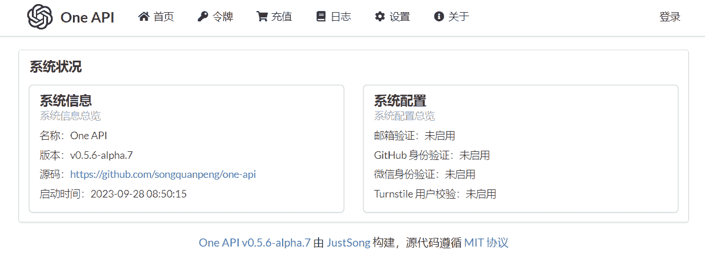

点击右上角的登录按钮，使用以下凭据进行登录

用户名：root

密码：123456

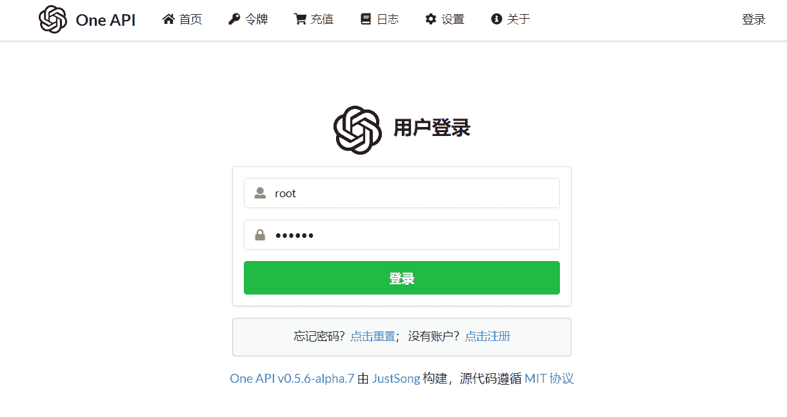

## 创建和管理API Key

进入渠道

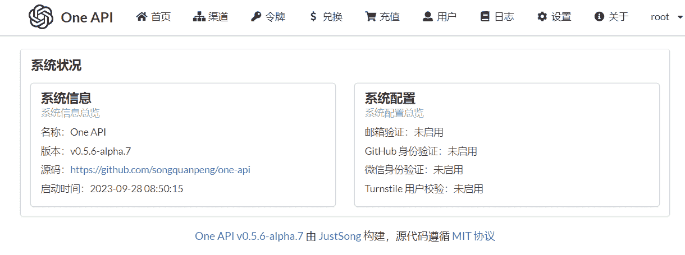

根据API类型信息填写相关内容，并提交

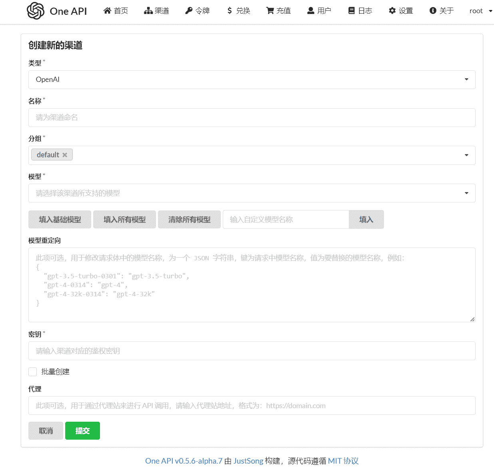

提交之后查看渠道列表，渠道相当于是API的资源池，接下来选择令牌

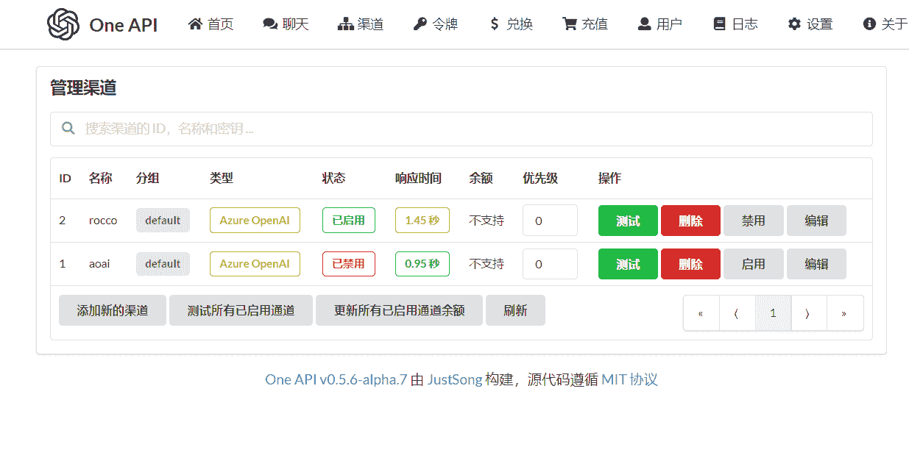

小心配置令牌的过期时间和额度

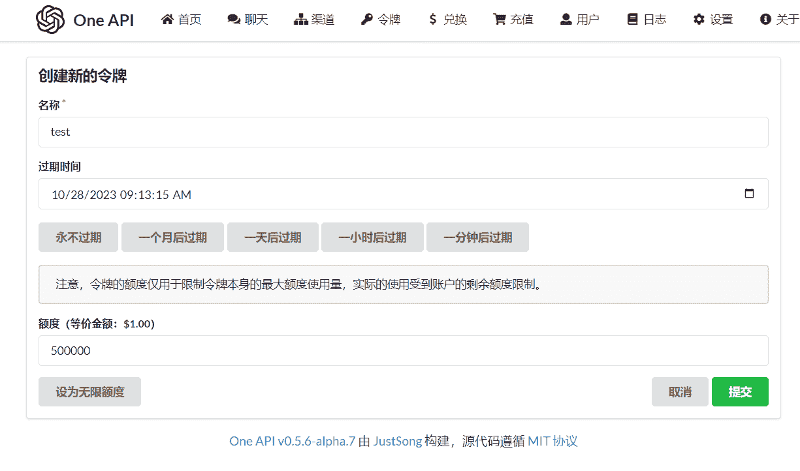

查看可用令牌，选择复制-> ChatGPT Next Web

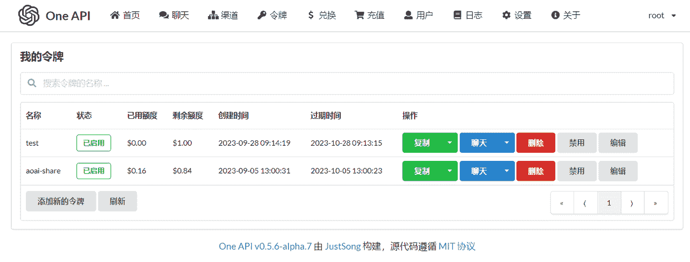

可以得到以下输出，可以直接在浏览器中打开

```
https://chat.huaqloud.com/#/?settings={&quot;key&quot;:&quot;sk-j8RxY38Z4OY6WNdn67C5D08aF9Bc41Ce9f9989880974C3B1&quot;,&quot;url&quot;:&quot;https://api.huaqloud.com&quot;}
```

或者进行拆分，这样足够清晰，可以用在其他更多的API调用场合了

OPENAI_API_KEY:sk-j8RxY38Z4OY6WNdn67C5D08aF9Bc41Ce9f9989880974C3B1

Base_URL:https://api.huaqloud.com

```
import os
from openai import OpenAI

client = OpenAI(  
    api_key=&quot;sk-cbsdaUEgK9a8aQvuF7891dF19c3641Ae8887Ae5a41809977&quot;,
    base_url=&quot;https://api.huaqloud.com/v1&quot;
)

stream = client.chat.completions.create(
    model=&quot;gpt-3.5-turbo&quot;,
    messages=[
        {&quot;role&quot;: &quot;system&quot;, &quot;content&quot;: &quot;You are a helpful assistant.&quot;},
        {&quot;role&quot;: &quot;user&quot;, &quot;content&quot;: &quot;证明费马大定理&quot;}
    ],
    stream=True,
)

for chunk in stream:
    if not chunk.choices or chunk.choices[0].delta.content is None:
        continue

    print(chunk.choices[0].delta.content, end=&quot;&quot;)
print()
```

## 高级管理 （待更新）