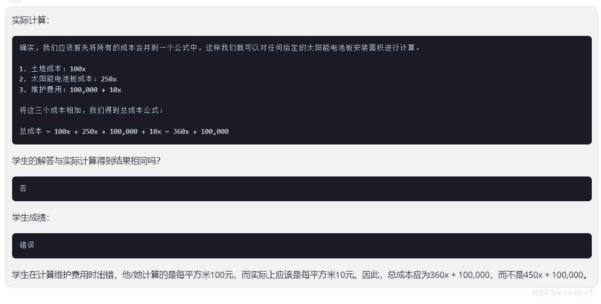

# 提示工程

> 来源：[https://zsyhjtnsa5.feishu.cn/docx/LyE3dTJjTosAsyx1Z74c7l4DnD7](https://zsyhjtnsa5.feishu.cn/docx/LyE3dTJjTosAsyx1Z74c7l4DnD7)

## 简介

在构建大型语言模型或LLM的开发过程中，通常有两种类型的LLM，即基础LLM和指令微调LLM。

### 基础LLM

是根据文本训练数据进行训练的，通常是根据互联网和其他来源的大量数据进行训练，以预测下一个单词。例如，如果你以“从前有一只独角兽”作为提示，基础LLM可能会继续预测“生活在一个与所有独角兽朋友的神奇森林中”。但是，如果你以“中国的首都是什么”为提示，则基础LLM可能会根据互联网上的文章，将答案预测为“中国最大的城市是什么？中国的人口是多少？”，因为互联网上的文章很可能是有关中国国家的问答题目列表。

### 指令微调LLM

是根据指令进行训练的。我们通常会从一个已经过训练的基础LLM开始，然后进一步用输入和输出来调整它，使其能够遵循指令，并通过人类反馈来进一步优化。因此，如果你问它，“中国的首都是什么？”，它更有可能输出“中国的首都是北京”。指令微调的 LLMs 的训练通常是从已经训练好的基本 LLMs 开始，该模型已经在大量文本数据上进行了训练。然后，使用输入是指令、输出是其应该返回的结果的数据集来对其进行微调，要求它遵循这些指令。然后通常使用一种称为 RLHF（reinforcement learning from human feedback，人类反馈强化学习）的技术进行进一步改进，使系统更能够有帮助地遵循指令。

因为指令微调的 LLMs 已经被训练成有益、诚实和无害的，所以与基础LLMs相比，它们更不可能输出有问题的文本，如有害输出。许多实际使用场景已经转向指令微调的LLMs。您在互联网上找到的一些最佳实践可能更适用于基础LLMs，但对于今天的大多数实际应用，我们建议将注意力集中在指令微调的LLMs上，这些LLMs更容易使用，而且由于OpenAI和其他LLM公司的工作，它们变得更加安全和更加协调。

因此，本课程将重点介绍针对指令微调 LLM 的最佳实践，这是我们建议您用于大多数应用程序的。

当您使用指令微调 LLM 时，请类似于考虑向另一个人提供指令，假设它是一个聪明但不知道您任务的具体细节的人。当 LLM 无法正常工作时，有时是因为指令不够清晰。例如，如果您说“请为我写一些关于阿兰·图灵的东西”，清楚表明您希望文本专注于他的科学工作、个人生活、历史角色或其他方面可能会更有帮助。更多的，您还可以指定文本采取像专业记者写作的语调，或者更像是您向朋友写的随笔。

当然，如果你想象一下让一位新毕业的大学生为你完成这个任务，你甚至可以提前指定他们应该阅读哪些文本片段来写关于 Alan Turing的文本，那么这能够帮助这位新毕业的大学生更好地成功完成这项任务。下一章你会看到如何让提示清晰明确，创建提示的一个重要原则，你还会从提示的第二个原则中学到给LLM时间去思考。

# 提示工程关键原则

## 原则一：明确的指令

### 在提示词中使用分割符

首先，我们应该写出明确和具体的指令，以引导模型生成我们需要的输出，减少获取无关或错误响应的可能性。与此相关的一个策略是使用分隔符，明确指示输入的不同部分。这些分隔符可以是任何明确的标点符号，例如三个反引号，引号，XML标记，部分标题等，让模型清楚地知道哪些是独立的部分，以避免提示注入。

> 提示注入（Prompt Injection）是指用户添加输入到提示中，可能会与我们的指令相矛盾，导致模型遵循用户的指令而不是我们的指令。

```
用一句话对下面"""中的文本进行文本摘要

"""
你应该通过提供尽可能清晰和具体的指示来表达你希望模型做什么。这将引导模型朝着期望的输出方向发展，并减少收到无关或不正确回答的机会。不要把写一个明确的提示与写一个简短的提示混淆起来。在许多情况下，较长的提示可以为模型提供更多清晰度和上下文，从而产生更详细和相关的输出。
"""
```

可能的输出：

```
提供清晰和具体的指示可以引导模型朝着期望的输出方向发展，减少无关或不正确回答的机会。
```

> 示例中，我们要求模型将由三个反引号括起来的文本总结成一个句子，以清晰地指示模型需要处理哪些文本部分。如果没有分隔符，用户可能会添加不相关的输入，导致模型输出错误的结果。因此，使用分隔符可以提高模型的准确性和稳定性。

> 区分符可以是任何符号，比如```, """, `< >`, `<tag>`, `</tag>`, :

### 要求模型以结构化输出

为了更容易解析模型输出，要求模型以HTML或JSON等结构化格式提供输出可能是有帮助的。在示例中，我们要求模型生成三本虚构图书的书名、作者和类型，并使用JSON格式以特定键的形式提供输出。我们可以看到，我们得到了三个格式良好的虚构图书的标题，并以JSON结构化输出的形式呈现出来。这种输出方式的好处是，我们可以在Python中将其读入字典或列表中。

```
生成三个虚构书名的列表，包括它们的作者和类型。以JSON格式提供，使用以下键：`book_id`、`title`、`author`、`genre`。
```

可能的一种输出

以下是三个虚构书名的列表，包括它们的作者和类型，使用JSON格式提供：

```
[
  {
    "book_id": 1,
    "title": "The Enigma of Shadows",
    "author": "Evelyn Sinclair",
    "genre": "Mystery"
  },
  {
    "book_id": 2,
    "title": "The Forgotten Kingdom",
    "author": "Alexander Blake",
    "genre": "Fantasy"
  },
  {
    "book_id": 3,
    "title": "Echoes of the Past",
    "author": "Victoria Summers",
    "genre": "Romance"
  }
]
```

请注意，这些书名、作者和类型都是虚构的，仅用于示例目的。

### 要求检查任务条件是否满足

下一个策略是让模型检查条件是否被满足。如果任务有一些假设并不一定满足，我们可以告诉模型先检查这些假设，如果不满足，则指出并停止任务完成的尝试。你也可以考虑潜在的边界情况以及模型应该如何处理它们，以避免意外错误或结果。在这个例子中，我们给出了一段描述泡茶步骤的段落，然后我们用一个 prompt 让模型提取这些指令。如果它在文本中找不到任何指令，我们让它输出“未提供任何步骤”。在第二个段落中，模型判断没有找到任何指令。

```
您将获得由三引号分隔的文本。如果其中包含一系列指令，请按以下格式重新编写这些指令：

步骤 1 - ...

步骤 2 - …

…

步骤 N - …

如果文本不包含一系列指令，则简单地写下“未提供任何步骤”。

"""

制作一杯茶很简单！首先，你需要把一些水烧开。在这个过程中，拿一个杯子并放入一个茶包。一旦水足够热，只需将其倒在茶包上。让它浸泡片刻以便茶叶出味。几分钟后，取出茶包。如果喜欢的话，可以加入适量的糖或牛奶调味。就是这样！你有了一杯美味的茶可以享用了。

"""
```

一个可能的输出

```
步骤 1 - 将一些水烧开。

步骤 2 - 拿一个杯子并放入一个茶包。

步骤 3 - 一旦水足够热，将其倒在茶包上。

步骤 4 - 让茶包浸泡片刻以便茶叶出味。

步骤 5 - 几分钟后，取出茶包。

步骤 6 - 如果喜欢的话，可以加入适量的糖或牛奶调味。

步骤 7 - 就是这样！你有了一杯美味的茶可以享用了。
```

```
您将获得由三引号分隔的文本。如果其中包含一系列指令，请按以下格式重新编写这些指令：

步骤 1 - ...

步骤 2 - …

…

步骤 N - …

如果文本不包含一系列指令，则简单地写下“未提供任何步骤”。

"""

今天阳光明媚，鸟儿在歌唱。是个适合去公园散步的美好日子。花朵盛开，树木在微风中轻轻摇曳。人们外出活动，享受着宜人的天气。有些人正在野餐，而其他人则在玩游戏或者简单地躺在草地上放松身心。这是一个完美的日子，在户外度过时间并欣赏大自然的美丽之处。

"""
```

输出结果

```
未提供任何步骤。
```

### 少样本提示

这个原则的最后一个策略是 few-shot prompting。这种方法是在让模型执行实际任务之前，提供已经成功执行所需任务的示例。在提示中，我们告诉模型其任务是以一致的风格回答问题，然后提供了一个孩子和祖父母之间的对话作为示例。孩子说，“教我如何耐心等待”，祖父母用类比来回答。因为我们告诉模型要以一致的风格回答问题，所以当我们下一个要求“教我关于韧性”的时候，由于模型已经有了这个 few-shot 的示例，它会以类似的方式回答这个问题，比如“水滴石穿”，等等。

```
你的任务是以一致的风格用成语回答。

<孩子>：教我耐心。

<爷爷>：绳锯木断。

<孩子>：教我坚韧。
```

```
<爷爷>：水滴石穿。
```

## 原则二：给模型充足的思考时间

如果模型在匆忙地做出错误的推断，你应该尝试重构查询，要求在模型提供最终答案之前进行一系列相关的推理。另一个思考这个问题的方式是，如果你给模型一个太复杂的任务，在短时间内或用少数的字数内完成，它可能会猜测结果，这很可能是不正确的。这也会发生在人类身上。如果你要求一个人在没有时间先计算答案的情况下完成一个复杂的数学问题，他们也很可能会犯错误。因此，在这些情况下，你可以要求模型花更多的时间思考问题，这意味着它在任务上花费更多的计算功夫。

### 给定步骤补全

首先，我们可以使用明确的步骤来完成一个任务。在这个例子中，我们给模型提供了一个包含Jack and Jill故事概述的段落，并且使用明确的步骤指示模型完成四个任务：

1. 首先，用一句话来概括文本
1. 其次将概述翻译成英语
1. 然后列出英语概述中的每个人名
1. 并且输出一个JSON对象包含`english_summary`和`num_names`两个key。

最后我们添加了这个段落的文本。运行这个模型后，我们可以看到模型分别完成了这四个任务，并按照我们要求的格式输出了结果。

```
请执行以下操作：

1. 用一句话总结以下由< >分隔的文本。

2. 将摘要翻译成英语。

3. 在英语摘要中列出每个名字。

4. 输出一个包含以下键的 JSON 对象：`english_summary`，`num_names`。

使用下列格式输出：

文本:<要总结的文字>

摘要:<总结后的摘要>

翻译:<摘要的翻译>

名字:<英语摘要的名字列表>

JSON输出:<包含`english_summary`和`num_names`的json对象>

文本: <

在一个迷人的村庄里，兄妹小明和小红踏上了从山顶井口取水的任务。当他们欢快地唱着歌爬上去时，不幸降临了——小明绊倒在一块石头上滚下山坡，小红紧随其后。虽然稍微受伤，但这对兄妹还是回到了温暖的怀抱中。尽管发生了意外，他们冒险的精神依然旺盛，并继续愉快地探索着。>
```

示例输出：

```
摘要: 兄妹小明和小红在迷人的村庄里进行山顶井口取水任务时发生意外，但他们依然保持冒险的精神并继续探索。

翻译: Brother and sister Xiao Ming and Xiao Hong had an accident while performing the task of fetching water from the mountaintop well in a charming village, but they still maintained their adventurous spirit and continued to explore.

名字: [Xiao Ming, Xiao Hong]

JSON输出: {"english_summary": "Brother and sister Xiao Ming and Xiao Hong had an accident while performing the task of fetching water from the mountaintop well in a charming village, but they still maintained their adventurous spirit and continued to explore.", "num_names": 2}
```

### 让模型自己先推理再给出答案

我们的下一个策略是指示模型在匆忙做出结论之前自行解决问题。有时，当我们明确指示模型在得出结论之前先理清事情的顺序时，我们会获得更好的结果。这与我们之前讨论的给模型时间来解决问题的想法是相同的，就像人一样，我们让它自己思考解决方案，而不是马上判断答案是否正确。

在这个问题中，我们要求模型判断学生的解答是否正确。首先，我们有这个数学问题，然后是学生的解答

```
确定学生的解决方案是正确。

问题：

我正在建设一个太阳能发电装置，我需要帮助计算财务情况。

- 土地成本为每平方米100元

- 我可以以每平方米250元购买太阳能电池板

- 我谈判了一份维护合同，每年将花费固定的10万元，并额外支付每平方米10元

作为与平方米数量相关的第一年运营总成本是多少？

学生的解决方案：

令`x`为安装面积（以平方米表示）。

成本：

1. 土地成本：`100x`

2. 太阳能电池板成本：`250x`

3. 维护费用：`100,000 + 100x`

总成本：`100x + 250x + 100,000 + 100x = 450x + 100,000`
```

输出

```
学生的解决方案是正确的。

学生正确地列出了每个成本项目，并将它们相加得到了总成本。总成本的计算公式为`450x + 100,000`，其中`x`表示安装面积（以平方米表示）。

因此，学生的解决方案是正确的。
```

事实上，学生的解答是错误的，因为他们计算了维护费用为100,000加100x，但实际上应该是10x，因为每平方米只有10元，其中`x`是安装面积的大小（以平方米为单位）。因此，应该是`360x`加100,000，而不是`450x`。

如果我们运行这个单元格代码，模型会说学生的解答是正确的。

如果您仔细阅读学生的解答，您会发现这实际上是错误的，因为模型只是粗略地阅读了它，就像我刚才所做的那样。

因此，我们可以通过指示模型先计算自己的解答，然后再将其与学生的解答进行比较来解决这个问题。我们可以通过一个更长的提示来实现这一点。我们告诉模型如下：

```
你的任务是确定学生的解答是否正确。

解决问题时，请按照以下步骤进行：

- 首先，自己找出问题的解决方案。

- 然后，将自己的解决方案与学生的解答进行比较，并评估学生的解答是否正确。

- 在自己完成问题之前，请不要判断学生的解答是否正确。

使用以下格式：

问题：

"""

这里是问题

"""

学生的解答：

"""

这里是学生的解答

"""

实际计算：

"""

这里是计算出来的步骤和你自己找到的解决方案

"""

学生的解答与实际计算得到结果相同吗？

"""

是或否

"""

学生成绩：

""" 

正确或错误 

"""

问题：

"""

我正在建设一个太阳能发电装置，我需要帮助计算财务情况。

- 土地成本为每平方米100元

- 我可以以每平方米250元购买太阳能电池板

- 我谈判了一份维护合同，每年将花费固定的10万元，并额外支付每平方米10元

作为与平方米数量相关的第一年运营总成本是多少？

"""

学生的解答：

"""

令`x`为安装面积（以平方米表示）。

成本：

1. 土地成本：`100x`

2. 太阳能电池板成本：`250x`

3. 维护费用：`100,000 + 100x`

总成本：`100x + 250x + 100,000 + 100x = 450x + 100,000`

"""
```

输出：

实际计算：

```
确实，我们应该首先将所有的成本合并到一个公式中，这样我们就可以对任何给定的太阳能电池板安装面积进行计算。

1. 土地成本：`100x`

2. 太阳能电池板成本：`250x`

3. 维护费用：`100,000 + 10x`

将这三个成本相加，我们得到总成本公式：

总成本 = `100x + 250x + 100,000 + 10x = 360x + 100,000`
```

学生的解答与实际计算得到结果相同吗？

```
否
```

学生成绩：

```
错误 
```


学生在计算维护费用时出错，他/她计算的是每平方米100元，而实际上应该是每平方米10元。因此，总成本应为`360x + 100,000`，而不是`450x + 100,000`。



那么现在，如果我们运行这个单元格......正如你看到的，这个模型实际上首先进行了自己的计算。然后，它找到了正确的答案，即`360x + 100,000`，而不是`450x + 100,000`。然后，当被要求将其与学生的解决方案进行比较时，它意识到它们不一致。因此，学生实际上是不正确的。这是一个例子，展示了学生的解决方案是正确的，但学生的解决方案实际上是错误的。这是一个例子，展示了让模型自己进行计算，并将任务分解为步骤，以便给模型更多的时间思考，可以帮助您获得更准确的响应。

## 注意规避模型局限

接下来，我们将讨论一些模型的限制，因为我认为在使用大型语言模型开发应用程序时，牢记这些限制非常重要。如果模型在训练过程中接触到大量知识，并不意味着它完美地记住了所见信息，因此对于自身的知识边界并不十分清楚。这意味着它可能会试图回答关于晦涩话题的问题，并且可能会编造听起来合理但实际上是错误的内容。我们称之为幻觉。

我将给您展示一个例子，其中模型会产生幻觉(或者说是一种幽默)。

```
鲁迅为什么要打周树人
```

```
鲁迅并没有亲自打过周树人。然而，鲁迅和周树人之间确实存在一些矛盾和争议。

鲁迅和周树人都是中国现代文学史上的重要作家和思想家。他们在思想、文学观点和社会立场等方面存在差异，这导致了他们之间的一些冲突。

在上世纪20年代初，周树人在他的作品《伤逝》中对鲁迅进行了一些批评和讽刺。周树人认为鲁迅的作品过于悲观和消极，对社会变革缺乏积极的态度。这引起了鲁迅的不满，他在一封信中批评了周树人的观点，并指责他对社会问题的态度不够坚决。

然而，需要指出的是，鲁迅并没有亲自动手打击周树人。这种说法可能是一种夸张或误解。尽管他们之间存在一些分歧，但他们都是中国文学史上重要的作家，对现代文学和社会思潮产生了深远的影响。
```

> 这个幻觉可能源于对鲁迅（周树人）的生平和作品的误解或缺乏了解。在文学史上，有些作家会使用多个笔名，这可能导致混淆，尤其是当不同的笔名被用来代表不同的文学风格或观点时。然而，在鲁迅的情况下，他主要使用“鲁迅”这个笔名，而“周树人”是他的原名。

> 这种幻觉可能由以下几个原因产生：

1.  **信息传播错误**：在信息传播过程中，可能会有人错误地将鲁迅和周树人当作两个不同的人物来描述，这种错误可能在网络上被重复传播，导致误解。

1.  **文学作品的误导**：在阅读鲁迅的作品时，读者可能会被作品中的讽刺和批评所影响，错误地将作品中的人物或观点与作者本人混淆。

1.  **对历史背景的不了解**：如果读者对中国现代文学史和鲁迅的历史背景不够了解，可能会误解鲁迅的文学活动和个人生活。

1.  **网络谣言**：网络上有时会出现各种未经证实的说法，这些谣言可能会被误信并传播，从而产生幻觉。

1.  **文学批评的误解**：在文学批评中，有时会出现对作者作品的过度解读，这可能导致对作者个人行为的误解。

1.  为了纠正这种幻觉，重要的是要通过可靠的历史资料和学术研究来了解鲁迅的生平和作品，以及他在文学史上的地位。这样可以帮助我们更准确地理解鲁迅的思想和作品，避免产生不必要的误解。

因此，请确保在构建自己的应用程序时使用我们在本笔记本中介绍的一些技巧，并尽量避免出现这种情况。这是已知的模型弱点，我们正在积极努力解决。通过寻找相关引用并要求模型使用这些引用来回答问题，并有一种追溯答案到源文档的方法通常可以减少这些幻觉。

# 提示工程迭代

当我使用大型语言模型构建应用程序时，我从来没有在第一次尝试中得到最终应用程序中使用的提示。但这并不重要。只要您有一个良好的迭代过程，使您的提示不断改进，那么您就能得到适合您想要实现的任务的提示。

你可能听我说过，当我训练一个机器学习模型时，它几乎从来没有在第一次尝试时成功。事实上，如果我训练的第一个模型成功了，我会感到非常惊讶。

在提示方面，它第一次成功的概率可能稍微高一些，但正如他所说的，第一个提示是否成功并不重要。最重要的是得到适用于您的应用程序的提示的过程。因此，让我们进入代码并展示一些框架，以思考如何迭代地开发提示。

如果您之前参加过我的机器学习课程，您可能会看到我使用一个图表，说在机器学习开发中，您经常有一个想法，然后实现它。编写代码，获取数据，训练模型，这就给您一个实验结果。然后您可以查看该输出，进行错误分析，找出哪些地方工作或不工作，然后甚至可以改变您要解决的问题或如何处理它的确切想法，并更改实现并运行另一个实验等，一遍又一遍地迭代，以获得有效的机器学习模型。

如果您对机器学习不熟悉，并且以前没有看过这个图表，请不要担心，对于本次演示的其余部分来说，这并不重要。但是，当您编写提示以使用`OOM`开发应用程序时，该过程可能非常相似，您可以有一个关于您想要完成的任务的想法，然后尝试编写第一个提示，希望它清晰具体，并可能在适当的情况下给系统一些时间来思考，然后运行它并查看结果。

如果第一次不能很好地工作，那么迭代过程就开始了，找出指令不够清晰或没有给算法足够的时间思考的原因，使您可以不断完善想法、完善提示等等，直到您得到适合您应用程序的提示。这也是为什么我个人没有太关注互联网上那些说30个完美提示的文章，因为我认为可能并不存在一个适用于所有情况的完美提示。更重要的是，您要有一个针对特定应用程序开发良好提示的流程。让我们一起看一个示例代码。

不奢求一针见血，因为不存在"万能提示词"或者“一句话让大模型xxx和yyy“，需要我们不断探究实际问题的表现和成因，为提示词增加维度，补充数据，进而反复打磨提升提示词的平均表现和下限，以形成良好的提示词迭代流程。

示例产品信息：

```
概述：

- 这是一系列美观的中世纪风格办公家具，包括文件柜、办公桌、书柜、会议桌等。

- 有多种外壳颜色和底座涂装可供选择。

- 可选择塑料背部和前部软垫（SWC-100）或全面软垫（SWC-110），提供10种织物和6种皮革选项。

- 底座涂装选项有不锈钢、哑光黑色、光泽白色或铬。

- 椅子可选择有或无扶手。

- 适用于家庭或商业场所。

- 符合合同使用要求。

结构：

- 5个塑料涂层铝底座。

- 气动椅子调节，方便升降操作。

尺寸：

- 宽度：53厘米 | 20.87英寸。

- 深度：51厘米 | 20.08英寸。

- 高度：80厘米 | 31.50英寸。

- 座位高度：44厘米 | 17.32英寸。

- 座位深度：41厘米 | 16.14英寸。

选项：

- 可选择适用于软地板或硬地板的脚轮选项。

- 座位泡沫密度可选择中等（1.8磅/立方英尺）或高（2.8磅/立方英尺）。

- 可选择无扶手或带8个位置的PU扶手。

材料：

- 外壳底座滑轮：铸铝，采用改性尼龙PA6/PA66涂层。

- 外壳厚度：10毫米。

座位：

- HD36泡沫。

原产国：

- 意大利
```

## 生成初版产品介绍信息

```
请根据以下内容生成产品介绍信息

&#x27;&#x27;&#x27;

概述：

- 这是一系列美观的中世纪风格办公家具，包括文件柜、办公桌、书柜、会议桌等。

- 有多种外壳颜色和底座涂装可供选择。

- 可选择塑料背部和前部软垫（SWC-100）或全面软垫（SWC-110），提供10种织物和6种皮革选项。

- 底座涂装选项有不锈钢、哑光黑色、光泽白色或铬。

- 椅子可选择有或无扶手。

- 适用于家庭或商业场所。

- 符合合同使用要求。

结构：

- 5个塑料涂层铝底座。

- 气动椅子调节，方便升降操作。

尺寸：

- 宽度：53厘米 | 20.87英寸。

- 深度：51厘米 | 20.08英寸。

- 高度：80厘米 | 31.50英寸。

- 座位高度：44厘米 | 17.32英寸。

- 座位深度：41厘米 | 16.14英寸。

选项：

- 可选择适用于软地板或硬地板的脚轮选项。

- 座位泡沫密度可选择中等（1.8磅/立方英尺）或高（2.8磅/立方英尺）。

- 可选择无扶手或带8个位置的PU扶手。

材料：

- 外壳底座滑轮：铸铝，采用改性尼龙PA6/PA66涂层。

- 外壳厚度：10毫米。

座位：

- HD36泡沫。

原产国：

- 意大利

&#x27;&#x27;&#x27;
```

一种可能的输出

```
产品介绍：

我们自豪地推出了一系列美观的中世纪风格办公家具，包括文件柜、办公桌、书柜、会议桌等，为您的家庭或商业场所提供完美的办公环境。这些家具具有精美的外观和出色的质量，既能满足您的工作需求，又能为办公室增添一份独特的风格。

我们的中世纪风格办公家具提供多种外壳颜色和底座涂装选择，以满足不同客户的喜好和需求。您可以选择不锈钢、哑光黑色、光泽白色或铬作为底座涂装，从而为办公室带来不同的氛围和风格。

为了提供更舒适的使用体验，我们的家具可选择塑料背部和前部软垫（SWC-100）或全面软垫（SWC-110）。您可以从10种织物和6种皮革选项中选择，以满足您的个性化需求和偏好。此外，椅子还可选择有或无扶手，以适应不同用户的需求和喜好。

我们的中世纪风格办公家具采用坚固的结构设计，具有5个塑料涂层铝底座和气动椅子调节功能，方便您进行升降操作，以获得最佳的工作姿势和舒适度。座位尺寸适中，宽度为53厘米，深度为51厘米，高度为80厘米，座位高度为44厘米，座位深度为41厘米，为您提供舒适的工作空间。

我们还为您提供多种选项，以满足您的个性化需求。您可以选择适用于软地板或硬地板的脚轮选项，以方便您在不同地板上的移动。座位泡沫密度可选择中等（1.8磅/立方英尺）或高（2.8磅/立方英尺），以提供不同的坐感和支撑力。此外，您还可以选择无扶手或带有8个位置的PU扶手，以满足您的个人喜好和需求。

我们的中世纪风格办公家具采用高品质材料制造，外壳底座滑轮采用铸铝，并采用改性尼龙PA6/PA66涂层，确保耐用性和稳定性。座位采用HD36泡沫，提供舒适的坐感和支撑力。

我们的中世纪风格办公家具以意大利为原产国，代表着精湛的工艺和品质保证。无论您是在家中还是在办公场所使用，我们的家具将为您创造一个舒适、时尚的工作环境。

让我们的中世纪风格办公家具成为您办公室的亮点，提升您的工作效率和舒适度。选择我们的产品，您将获得高品质、美观和实用的办公家具，满足您的各种需求。
```

## 缩短内容篇幅

### 控制字数

```
请将产品介绍控制在80个汉字。
```

```
我们引以为傲的中世纪风格办公家具，美观实用。多种颜色和底座选择，可塑背垫和全面软垫选项。坚固结构，气动升降座椅。尺寸适中，舒适实用。多种选项满足个性需求。高品质材料制造，意大利原产。提升办公效率和舒适度。选择我们，获得优质、美观、实用的办公家具。
```

### 控制句子数量

```
请将产品介绍控制在三句话以内。
```

```
我们引以为豪的中世纪风格办公家具系列，结合美观与实用，为您的办公室提供多样化的选择。坚固的结构设计、舒适的座椅和个性化选项，让您的工作环境更加舒适和高效。
```

### 控制字符数

```
use at most 280 characters
```

```
Discover our exquisite collection of medieval-style office furniture, including desks, cabinets, and conference tables. With a range of color options, sturdy construction, and customizable features, create a stylish and comfortable workspace that suits your needs. Elevate your office with timeless elegance.
```

## 设定受众

当我们继续为我们的网站修改这段文本时，我们可能会决定，哇，这个网站不是直接销售给消费者，而是旨在向家具零售商销售家具，他们更感兴趣的是椅子的技术细节和材料。在这种情况下，您可以采用这个提示，并说，我要修改这个提示，使其更精确地描述技术细节。

因此，让我继续修改这个提示。我要说，这个描述是为家具零售商而设计的，因此应该是技术性的，重点放在材料、产品和构造方面。好的，让我们运行它。

```
您的任务是帮助市场团队根据技术规格表为零售网站创建产品描述。请根据用三个反引号括起来的技术规格提供的信息编写产品描述。该描述面向家具零售商，因此应以技术性为主，并侧重于产品所使用的材料。最多使用50个字。

&#x27;&#x27;&#x27;

概述：

- 这是一系列美观的中世纪风格办公家具，包括文件柜、办公桌、书柜、会议桌等。

- 有多种外壳颜色和底座涂装可供选择。

- 可选择塑料背部和前部软垫（SWC-100）或全面软垫（SWC-110），提供10种织物和6种皮革选项。

- 底座涂装选项有不锈钢、哑光黑色、光泽白色或铬。

- 椅子可选择有或无扶手。

- 适用于家庭或商业场所。

- 符合合同使用要求。

结构：

- 5个塑料涂层铝底座。

- 气动椅子调节，方便升降操作。

尺寸：

- 宽度：53厘米 | 20.87英寸。

- 深度：51厘米 | 20.08英寸。

- 高度：80厘米 | 31.50英寸。

- 座位高度：44厘米 | 17.32英寸。

- 座位深度：41厘米 | 16.14英寸。

选项：

- 可选择适用于软地板或硬地板的脚轮选项。

- 座位泡沫密度可选择中等（1.8磅/立方英尺）或高（2.8磅/立方英尺）。

- 可选择无扶手或带8个位置的PU扶手。

材料：

- 外壳底座滑轮：铸铝，采用改性尼龙PA6/PA66涂层。

- 外壳厚度：10毫米。

座位：

- HD36泡沫。

原产国：

- 意大利

&#x27;&#x27;&#x27;
```

```
产品描述：中世纪风格办公家具系列，多种颜色和涂装选择。软垫选项包括塑料背部和前部软垫或全面软垫，提供多种织物和皮革选项。底座涂装可选不锈钢、哑光黑色、光泽白色或铬。适用于家庭或商业使用，符合合同要求。结构稳固，采用塑料涂层铝底座和气动升降功能。尺寸适中，提供脚轮和座位泡沫密度选择。材料优质，座位采用HD36泡沫。意大利制造。
```

### 小幅迭代，增加产品ID

```
您的任务是帮助市场团队根据技术规格表为零售网站创建产品描述。请根据用三个反引号括起来的技术规格提供的信息编写产品描述。

该描述面向家具零售商，因此应以技术性为主，主要介绍产品所使用的材料，为每个产品附上产品ID。

请把总的输出控制80个字。

&#x27;&#x27;&#x27;

概述：

- 这是一系列美观的中世纪风格办公家具，包括文件柜、办公桌、书柜、会议桌等。

- 有多种外壳颜色和底座涂装可供选择。

- 可选择塑料背部和前部软垫（SWC-100）或全面软垫（SWC-110），提供10种织物和6种皮革选项。

- 底座涂装选项有不锈钢、哑光黑色、光泽白色或铬。

- 椅子可选择有或无扶手。

- 适用于家庭或商业场所。

- 符合合同使用要求。

结构：

- 5个塑料涂层铝底座。

- 气动椅子调节，方便升降操作。

尺寸：

- 宽度：53厘米 | 20.87英寸。

- 深度：51厘米 | 20.08英寸。

- 高度：80厘米 | 31.50英寸。

- 座位高度：44厘米 | 17.32英寸。

- 座位深度：41厘米 | 16.14英寸。

选项：

- 可选择适用于软地板或硬地板的脚轮选项。

- 座位泡沫密度可选择中等（1.8磅/立方英尺）或高（2.8磅/立方英尺）。

- 可选择无扶手或带8个位置的PU扶手。

材料：

- 外壳底座滑轮：铸铝，采用改性尼龙PA6/PA66涂层。

- 外壳厚度：10毫米。

座位：

- HD36泡沫。

原产国：

- 意大利

&#x27;&#x27;&#x27;
```

```
产品描述：

这系列中世纪风格的办公家具（产品ID：SWC-100）适用于家庭或商业场所。提供多种外壳颜色和底座涂装选择，座位软垫可选塑料背部和前部（SWC-100）或全面软垫（SWC-110），提供多种织物和皮革选项。底座涂装有不锈钢、哑光黑色、光泽白色或铬。可选择有或无扶手。结构坚固，5个塑料涂层铝底座，气动椅子调节。尺寸：宽53cm，深51cm，高80cm，座位高44cm，座位深41cm。座位泡沫可选中等或高密度，提供软地板或硬地板脚轮选项。材料：外壳底座采用改性尼龙PA6/PA66涂层的铸铝，座位采用HD36泡沫。原产国：意大利。

总字数：202字
```

## 设定输出格式

让我们来玩一下，我想给你展示一个更复杂的提示示例，让你感受一下ChatGPT的能力。我在这里添加了一些额外的指令。在描述之后，包括一个给出产品尺寸的表格，然后将所有内容格式化为HTML。那么让我们运行它。

```
您的任务是根据技术规格说明书为零售网站的产品创建一个描述。

- 根据技术规格中提供的信息，编写一个基于材料构造的产品描述。

- 描述应具有技术性质，并侧重于产品的材料构造。

- 在描述的末尾，包括技术规格中的每个7个字符的产品ID。

- 在描述之后，包括一个表格，显示产品的尺寸。该表格应有两列。

- 在第一列中，包括尺寸的名称。

- 在第二列中，只包括以英寸为单位的测量值。

- 给表格一个标题“产品尺寸”。

- 将所有内容格式化为可以在网站中使用的HTML代码。将描述放在一个&lt;div&gt;元素中。

&#x27;&#x27;&#x27;

概述：

- 这是一系列美观的中世纪风格办公家具，包括文件柜、办公桌、书柜、会议桌等。

- 有多种外壳颜色和底座涂装可供选择。

- 可选择塑料背部和前部软垫（SWC-100）或全面软垫（SWC-110），提供10种织物和6种皮革选项。

- 底座涂装选项有不锈钢、哑光黑色、光泽白色或铬。

- 椅子可选择有或无扶手。

- 适用于家庭或商业场所。

- 符合合同使用要求。

结构：

- 5个塑料涂层铝底座。

- 气动椅子调节，方便升降操作。

尺寸：

- 宽度：53厘米 | 20.87英寸。

- 深度：51厘米 | 20.08英寸。

- 高度：80厘米 | 31.50英寸。

- 座位高度：44厘米 | 17.32英寸。

- 座位深度：41厘米 | 16.14英寸。

选项：

- 可选择适用于软地板或硬地板的脚轮选项。
```


- 座位泡沫密度可选择中等（1.8磅/立方英尺）或高（2.8磅/立方英尺）。

- 可选择无扶手或带8个位置的PU扶手。

材料：

- 外壳底座滑轮：铸铝，采用改性尼龙PA6/PA66涂层。

- 外壳厚度：10毫米。

座位：

- HD36泡沫。

原产国：

- 意大利

'''

```

<div>
  <h2>产品描述</h2>
  <p>
    这是一系列美观的中世纪风格办公家具，包括文件柜、办公桌、书柜、会议桌等。产品具有多种外壳颜色和底座涂装可供选择。可选择塑料背部和前部软垫（SWC-100）或全面软垫（SWC-110），提供10种织物和6种皮革选项。底座涂装选项包括不锈钢、哑光黑色、光泽白色或铬。椅子可选择有或无扶手。适用于家庭或商业场所，并符合合同使用要求。
  </p>
  <h3>结构</h3>
  <ul>
    <li>5个塑料涂层铝底座。</li>
    <li>气动椅子调节，方便升降操作。</li>
  </ul>
  <h3>尺寸</h3>
  <table>
    <caption>产品尺寸</caption>
    <tr>
      <th>尺寸名称</th>
      <th>测量值（英寸）</th>
    </tr>
    <tr>
      <td>宽度</td>
      <td>20.87</td>
    </tr>
    <tr>
      <td>深度</td>
      <td>20.08</td>
    </tr>
    <tr>
      <td>高度</td>
      <td>31.50</td>
    </tr>
    <tr>
      <td>座位高度</td>
      <td>17.32</td>
    </tr>
    <tr>
      <td>座位深度</td>
      <td>16.14</td>
    </tr>
  </table>
  <h3>选项</h3>
  <ul>
    <li>可选择适用于软地板或硬地板的脚轮选项。</li>
    <li>座位泡沫密度可选择中等（1.8磅/立方英尺）或高（2.8磅/立方英尺）。</li>
    <li>可选择无扶手或带8个位置的PU扶手。</li>
  </ul>
  <h3>材料</h3>
  <ul>
    <li>外壳底座滑轮：铸铝，采用改性尼龙PA6/PA66涂层。</li>
    <li>外壳厚度：10毫米。</li>
    <li>座位：HD36泡沫。</li>
  </ul>
  <h3>原产国</h3>
  <p>意大利</p>
</div>
```

# 总结文本

当今世界上有太多的文字，几乎没有人有足够的时间去阅读我们希望有时间阅读的所有内容。因此，我看到的最令人兴奋的大型语言模型的应用之一是使用它来概括文本。

我看到多个团队将其集成到多个软件应用程序中。您可以在Chat GPT Web界面上完成这项工作。我经常使用它来概括文章，这样我就可以阅读比以前更多的文章内容。

```
买了个三阶魔方给我儿子当作生日礼物，想培养他手脑配合的能力，孩子很喜欢，游戏也不玩了，一直在研究怎么还原，质量很好，手感极佳。不过价格还是偏贵了，感觉不太值这个价格。物流也很给力，第二天就到了，等儿子玩熟练了再给他买个四阶的。
```

## 基本总结

```
对以下评论进行总结，控制在30个字。

"""

买了个三阶魔方给我儿子当作生日礼物，想培养他手脑配合的能力，孩子很喜欢，游戏也不玩了，一直在研究怎么还原，质量很好，手感极佳。不过价格还是偏贵了，感觉不太值这个价格。物流也很给力，第二天就到了，等儿子玩熟练了再给他买个四阶的。

"""
```

```
三阶魔方质量好，孩子喜欢，手感佳，物流快，价格偏贵，值得买。
```

## 面向生产商的总结

```
你的任务是生成来自于电子商务网站上有关产品评论的简短摘要，以向玩具生产商提供反馈。请侧重提及玩具本身特点和使用感受方面的信息。请把篇幅控制在50个字。

"""

买了个三阶魔方给我儿子当作生日礼物，想培养他手脑配合的能力，孩子很喜欢，游戏也不玩了，一直在研究怎么还原，质量很好，手感极佳。不过价格还是偏贵了，感觉不太值这个价格。物流也很给力，第二天就到了，等儿子玩熟练了再给他买个四阶的。

"""
```

```
三阶魔方质量好，手感极佳，培养孩子手脑配合能力。价格稍贵，物流给力。孩子喜欢，不玩游戏了，一直在研究还原。考虑购买四阶魔方。
```

## 面向定价部门的总结

```
你的任务是生成来自于电子商务网站上有关产品评论的简短摘要，以向定价部门提供反馈。请侧重提及用户在产品价格和价值方面的评价。请把篇幅控制在50个字。

"""

买了个三阶魔方给我儿子当作生日礼物，想培养他手脑配合的能力，孩子很喜欢，游戏也不玩了，一直在研究怎么还原，质量很好，手感极佳。不过价格还是偏贵了，感觉不太值这个价格。物流也很给力，第二天就到了，等儿子玩熟练了再给他买个四阶的。

"""
```

```
三阶魔方质量好，手感极佳，孩子喜欢，但价格偏贵，不太值。物流给力，快速送达。建议降价或提供更好的价值。考虑购买四阶魔方。
```

## 批量总结

```
你的任务是生成电商平台上的用户评价简短摘要，用不超过20个字来概括下面的评论。

### 评论1

需要一个漂亮的卧室灯，这款还能存东西，价格也不贵。超快就到了，只用了2天。运输过程中灯的绳子断了，但他们很爽快地寄来了新的。几天后就收到了。组装很简单。后来还有个零件缺了，联系客服他们超快就给我寄来了！感觉这家公司真是关心客户和产品的。

### 评论2

我的牙医推荐了这款电动牙刷，我就买了这个。到目前为止，电池续航时间还挺给力的。刚开始充电的时候，我第一周一直插着充电器，为了给电池充电调理一下，然后拔掉充电器，过去的3周里每天早晚用，电池一直都没问题。不过问题是牙刷头太小了。我见过比这个还大的婴儿牙刷呢。我希望牙刷头能大一点，毛刷长度也不同，这样才能更好地清洁牙齿间的缝隙，可这款牙刷做不到。总的来说，如果你能以50块左右的价格买到这个牙刷，那还是挺划算的。可是制造商的替换刷头要超级贵，不过你可以买些价格合理的通用刷头。用了这款牙刷感觉每天都去了牙医那里一样，我的牙齿亮晶晶的！

### 评论3

所以嘛，11月份的时候他们还在打折，把那个17件套装卖到了约49块钱，算是半价了。可是不知道为什么，到了12月第二周，同样的套装价格就涨到了70到89块钱之间。还有那个11件套装也比之前的特价贵了大约10块钱，从29块钱变成了现在的价格。外观还行，但是你看底座，刀片锁定的地方看起来没有几年前的版本好看。不过我打算对它特别小心使用（比如，我会先把豆子、冰块、米之类的硬东西在搅拌机里狠狠搅碎，然后按需要的份量再搅拌，要是需要更细腻的面粉，我就换成打蛋器刀片，做冰沙的时候先用交叉切割刀片，要是想要更细腻一点或者不要果肉，我就用平刀片）。还有个小窍门，做冰沙的时候把水果和蔬菜切碎冷冻起来（如果用到菠菜的话，先轻轻炖软再冷冻，要是做果冻的话，用个小到中号的食物处理器就行），这样就不用加太多冰块了。用了大约一年后，电机开始发出奇怪的声音。我给客服打了电话，但保修期已经过了，所以我只能再买一个了。顺便说一句：这些产品的整体质量下降了，所以他们现在主要靠品牌知名度和顾客忠诚度来维持销售。两天后就收到了新的。
```

```
评论1: 漂亮灯，快速送达，服务周到。

评论2: 续航强大，牙刷头小。

评论3: 价格波动大，功能多样，质量下降。
```

# 语义推理

我认为这些任务是指模型将文本作为输入并执行某种分析的任务。因此，这可以是提取标签、提取名称、理解文本的情感等任务。例如，如果您想从一段文本中提取积极或消极的情感，在传统的机器学习工作流程中，您需要收集标签数据集、训练模型、确定如何在云中部署模型并进行推断。这可能非常有效，但是需要经历大量的工作流程。而对于每个任务，例如情感、提取名称等，您都需要训练和部署单独的模型。

大型语言模型的一个很好的优点是，对于许多这样的任务，您只需要编写一个提示，就可以立即开始生成结果。这在应用程序开发方面具有巨大的速度优势。而且，您可以只使用一个模型、一个API来执行许多不同的任务，而不需要找出如何训练和部署许多不同的模型。

## 情感分析

```
选了很多家的桌子，最后定了这家飞旺腾达店的，拍下就发货了。不过半路丢零件了，后来商家补发了一个新的，没过几天就送到了，桌子挺稳的，折叠的很方便也不用组装，放阳台当小饭桌用，颜值也高，一个人用挺合适，不错不错，值得入手。桌子腿是金属的，挺结实的，整体来说这个价位还可以。
```

```
下面这个由"""分隔的文本的情感是什么？

"""

选了很多家的桌子，最后定了这家飞旺腾达店的，拍下就发货了。不过半路丢零件了，后来商家补发了一个新的，没过几天就送到了，桌子挺稳的，折叠的很方便也不用组装，放阳台当小饭桌用，颜值也高，一个人用挺合适，不错不错，值得入手。桌子腿是金属的，挺结实的，整体来说这个价位还可以。

"""
```

```
根据提供的文本，可以判断情感为积极的。
```

```
下面这个由"""分隔的文本的情感是什么？你只能用”积极的“或者”消极的“回答。

"""

选了很多家的桌子，最后定了这家飞旺腾达店的，拍下就发货了。不过半路丢零件了，后来商家补发了一个新的，没过几天就送到了，桌子挺稳的，折叠的很方便也不用组装，放阳台当小饭桌用，颜值也高，一个人用挺合适，不错不错，值得入手。桌子腿是金属的，挺结实的，整体来说这个价位还可以。

"""
```

```
积极的
```

```
确定下面这个由"""分隔的文本表达的情感列表。在列表中包含不超过5项情感。将你的答案格式化为用","分隔的词语列表。

"""

选了很多家的桌子，最后定了这家飞旺腾达店的，拍下就发货了。不过半路丢零件了，后来商家补发了一个新的，没过几天就送到了，桌子挺稳的，折叠的很方便也不用组装，放阳台当小饭桌用，颜值也高，一个人用挺合适，不错不错，值得入手。桌子腿是金属的，挺结实的，整体来说这个价位还可以。

"""
```

```
满意，安心，方便，欣赏，认可
```

## 识别指定信息

在这个提示中，我要求它识别以下内容：商品购买项和制造商品的公司名称。如果您试图总结来自在线购物电子商务网站的许多评论，确定物品、制造商、确定积极和消极情绪，跟踪特定物品或特定制造商的积极或消极情绪趋势可能会对您的大量评论很有用。在这个例子中，我将要求它将响应格式化为具有项目和品牌键的JSON对象。

```
从评价文本中识别以下项目：

- 评论者购买的物品项目

- 制造该项目的公司

评论文本在下方由"""分隔。将你的回答格式化为json对象，其中"物品项目"和"品牌"作为键。如果其中一个或几个信息不存在，请使用"未知"作为值。你的回答应该尽可能短。

"""

选了很多家的桌子，最后定了这家飞旺腾达店的，拍下就发货了。不过半路丢零件了，后来商家补发了一个新的，没过几天就送到了，桌子挺稳的，折叠的很方便也不用组装，放阳台当小饭桌用，颜值也高，一个人用挺合适，不错不错，值得入手。桌子腿是金属的，挺结实的，整体来说这个价位还可以。

"""
```

```
{
  "物品项目": "桌子",
  "品牌": "飞旺腾达"
}
```

```
从评价文本中识别以下项目：

- 情感（"积极的"或"消极的"）

- 评论者是否表达了愤怒？

- 评论者购买的物品项目

- 制造该项目的公司

评论文本在下方由"""分隔。将你的回答格式化为json对象，其中"情感"、"愤怒"、"物品项目"和"品牌"作为键。如果其中一个或几个信息不存在，请使用"未知"作为值。你的回答应该尽可能短。将"愤怒"的值格式化为布尔值。

"""

选了很多家的桌子，最后定了这家飞旺腾达店的，拍下就发货了。不过半路丢零件了，后来商家补发了一个新的，没过几天就送到了，桌子挺稳的，折叠的很方便也不用组装，放阳台当小饭桌用，颜值也高，一个人用挺合适，不错不错，值得入手。桌子腿是金属的，挺结实的，整体来说这个价位还可以。

"""
```

```
{
  "情感": "积极的",
  "愤怒": false,
  "物品项目": "桌子",
  "品牌": "飞旺腾达"
}
```

## 提取长文本中的关键字

```
确定以下由"""分隔的文本中正在讨论的5个关键字。每个关键字应该是一个简单的词语，并且将你的回答格式化为用","分割的项目列表。

"""

有一个关于佛罗里达男子的荒诞故事，他尝试将一个微波炉放入另一个微波炉中加热，结果导致了微波炉的爆炸，该男子不幸身亡。这个故事被广泛传播，并成为了网络上的一个笑话，用以讽刺佛罗里达州发生的一些离奇事件。这个故事在“WTF佛罗里达州”网站上有记录，该网站专门记录发生在佛罗里达州的各种荒谬事件。此外，推特上也有一个名为“佛罗里达男子”的账号，专门报道发生在佛罗里达的奇怪新闻，这个账号已经积累了大量的粉丝。这个故事反映了佛罗里达州在互联网文化中的一种特殊形象，即该州似乎特别容易产生各种令人啼笑皆非的新闻。

"""
```

```
"佛罗里达男子", "微波炉", "爆炸", "WTF佛罗里达州", "互联网文化"
```

## 主题分类

```
确定以下由"""分隔的文本中正在讨论的关键字，是否存在于下面关键字列表中。你需要用列表的方式回答，列表中每个关键字的值应为0或者1.

关键字列表：新加坡，微波炉，爆炸，优惠，网站

"""

有一个关于佛罗里达男子的荒诞故事，他尝试将一个微波炉放入另一个微波炉中加热，结果导致了微波炉的爆炸，该男子不幸身亡。这个故事被广泛传播，并成为了网络上的一个笑话，用以讽刺佛罗里达州发生的一些离奇事件。这个故事在“WTF佛罗里达州”网站上有记录，该网站专门记录发生在佛罗里达州的各种荒谬事件。此外，推特上也有一个名为“佛罗里达男子”的账号，专门报道发生在佛罗里达的奇怪新闻，这个账号已经积累了大量的粉丝。这个故事反映了佛罗里达州在互联网文化中的一种特殊形象，即该州似乎特别容易产生各种令人啼笑皆非的新闻。

"""
```

```
[0, 1, 1, 0, 1]
```

# 文本转换

大型语言模型非常擅长将其输入转换为不同的格式，例如输入一段文本，将其转换或翻译为另一种语言，或帮助拼写和语法纠正，即输入可能不完全符合语法的文本，帮助您稍微修复一下，甚至可以转换格式，例如输入HTML并输出JSON。因此，我曾经写过一些应用程序，用了很多常规表达式，现在使用大型语言模型和几个提示可以更简单地实现这些应用程序。

## 翻译

我们将首先做一个翻译任务。大型语言模型通常在许多来源的大量文本上进行训练，其中许多文本都是来自互联网，而这些文本又是不同的语言。因此，这使得模型具有进行翻译的能力。这些模型掌握了数百种语言，但掌握程度各不相同。接下来，我们将介绍如何使用这种能力的一些示例。

```
将以下中文文本翻译成英文：

"""

你好，我想要订购一个果汁搅拌机

"""
```

```
"Hello, I would like to order a juice blender."
```

```
告诉我下面这段文字是什么语言

Combien coûte le lampadaire?
```

```
这段文字是法语。
```

```
将以下英文文本翻译成书面中文和口语中文：

"""

Would you like to order a pillow?

"""
```

```
书面中文翻译：您想订购一个枕头吗？

口语中文翻译：你想买个枕头吗？
```


# 通用翻译

接下来的例子中，我们假设我们是一个跨国电子商务公司的负责人，用户的消息将使用各种不同的语言，并且用户将使用多种语言向我们反映其 IT 问题，因此我们需要一种通用的翻译器。首先，我们将粘贴一些不同语言的用户消息列表，然后我们将循环遍历每一个用户消息。因此，在用户消息中循环遍历问题，然后我将复制这个稍微长一点的代码块。首先，我们将询问模型告诉我们问题是用什么语言书写的。然后，我们将打印出原始消息的语言和问题，并要求模型将其翻译成英文和韩文。让我们运行它。

```
用中文回答下面每一个行的文本的语言是什么，用Python列表的形式回答。随后对每一行文本打印出源文本，英语翻译和韩语翻译，并用换行符分割。

- &quot;La performance du système est plus lente que d&#x27;habitude.&quot;

- &quot;Mi monitor tiene píxeles que no se iluminan.&quot;,

- &quot;Il mio mouse non funziona&quot;,

- &quot;Mój klawisz Ctrl jest zepsuty&quot;,

- &quot;我的屏幕在闪烁&quot; #
```

```
["法语", "西班牙语", "意大利语", "波兰语", "中文"]

La performance du système est plus lente que d&#x27;habitude.

英语翻译：The system performance is slower than usual.

韩语翻译：시스템 성능이 평소보다 느립니다.

Mi monitor tiene píxeles que no se iluminan.

英语翻译：My monitor has pixels that don&#x27;t light up.

韩语翻译：내 모니터에는 화면이 켜지지 않는 픽셀이 있습니다.

Il mio mouse non funziona.

英语翻译：My mouse doesn&#x27;t work.

韩语翻译：내 마우스가 작동하지 않습니다.

Mój klawisz Ctrl jest zepsuty.

英语翻译：My Ctrl key is broken.

韩语翻译：제 Ctrl 키가 고장 났습니다.

我的屏幕在闪烁。

英语翻译：My screen is flickering.

韩语翻译：내 화면이 깜빡입니다.
```

# 语气转换

将以下口头语翻译成商业书信

“兄弟，我是张三，看一下这个光刻机的说明书，看能不能手搓3纳米的CPU。”

尊敬的先生/女士，

我是张三，非常荣幸能与您联系。我希望能够向您咨询关于光刻机的说明书，并了解是否可以使用该设备来制造3纳米的CPU。

在我们的研究中，我们意识到您的光刻机在技术上具有很高的潜力，并且可能具备制造3纳米CPU的能力。我们对该设备的性能和功能非常感兴趣。

如果可能的话，请您提供光刻机的详细说明书，以便我们更好地了解该设备的技术规格、操作要求和制造能力。我们将仔细研究说明书，并与您进一步讨论是否可以使用该设备来实现我们的目标。

非常感谢您的时间和合作。我们期待着您的回复，并希望能够就此事项进行进一步的商讨。

祝好，

张三

# 格式转换

将以下Python字典从JSON转换为HTML表格，并需要带有列标题和总标题：

```
{ &quot;resturant employees&quot; :[ 

    {&quot;name&quot;:&quot;Shyam&quot;, &quot;email&quot;:&quot;shyamjaiswal@gmail.com&quot;},

    {&quot;name&quot;:&quot;Bob&quot;, &quot;email&quot;:&quot;bob32@gmail.com&quot;},

    {&quot;name&quot;:&quot;Jai&quot;, &quot;email&quot;:&quot;jai87@gmail.com&quot;}

]}
```

以下是将给定的JSON转换为HTML表格的代码：

```
&lt;table&gt;
    &lt;caption&gt;Resturant Employees&lt;/caption&gt;
    &lt;thead&gt;
        &lt;tr&gt;
            &lt;th&gt;Name&lt;/th&gt;
            &lt;th&gt;Email&lt;/th&gt;
        &lt;/tr&gt;
    &lt;/thead&gt;
    &lt;tbody&gt;
        &lt;tr&gt;
            &lt;td&gt;Shyam&lt;/td&gt;
            &lt;td&gt;shyamjaiswal@gmail.com&lt;/td&gt;
        &lt;/tr&gt;
        &lt;tr&gt;
            &lt;td&gt;Bob&lt;/td&gt;
            &lt;td&gt;bob32@gmail.com&lt;/td&gt;
        &lt;/tr&gt;
        &lt;tr&gt;
            &lt;td&gt;Jai&lt;/td&gt;
            &lt;td&gt;jai87@gmail.com&lt;/td&gt;
        &lt;/tr&gt;
    &lt;/tbody&gt;
&lt;/table&gt;
```

在这个HTML表格中，`<caption>`标签用于定义表格的总标题，`<thead>`标签用于定义表格的头部，`<tr>`标签用于定义表格的行，`<th>`标签用于定义表格的列标题，`<td>`标签用于定义表格的单元格。

# 语法检查

将以下文本中的拼写错误和语法错误进行修正。不要在文本周围使用任何标点符号.

1.我国高铁建设已取得丰硕成果。但因市场规模巨大，仍不能完全满足物流货运。

2.知名的书法家很多，但谁也不能否认，王羲之不是继往开来的宗师。

3.那里的人都上堤去抢险，我的叔叔已经快有半个多月没有回过家了。

4.截至到目前，中国诗词大会”节目受到人们的喜爱。

5.航天员举着国旗，通过摄像机送出了问候的节日。

6.研表究明，汉字序顺并不定一影阅响读效果。

```

以下是修正后的句子：

1. 我国高铁建设已取得丰硕成果。但因市场规模巨大，仍不能完全满足物流货运的需求。

2. 知名的书法家很多，但谁也不能否认，王羲之是继往开来的宗师。

3. 那里的人都上堤去抢险，我的叔叔已经快有半个多月没有回家了。

4. 截至到目前，“中国诗词大会”节目受到人们的喜爱。

5. 航天员举着国旗，通过摄像机送出了节日的问候。

6. 研究表明，汉字顺序并不一定影响阅读效果。

```

以下是对每个修正的修改意见：

1. 将&quot;物流货运&quot;修改为&quot;物流和货运&quot;，以更准确地表达意思。

2. 将&quot;不是&quot;修改为&quot;是&quot;，以与后面的句子逻辑相符。

3. 将&quot;快有&quot;修改为&quot;已经&quot;，以更自然地表达时间的流逝。

4. 在&quot;中国诗词大会&quot;前添加引号，以表示这是一个特定的节目名称。

5. 将&quot;送出了问候的节日&quot;修改为&quot;送出了节日的问候&quot;，以调整词语顺序使其更通顺。

6. 将&quot;研表究明&quot;修改为&quot;研究表明&quot;，以修正拼写错误。

希望这些修改意见对您有帮助！

# 控制收敛和发散

现在我们要为客户评论编写一个自定义的电子邮件回复，因此给定客户评论和情绪，我们将生成一个自定义的回复。现在我们将使用语言模型根据客户评论和评论的情绪为客户生成一个自定义的电子邮件。所以我们已经使用我们在推断视频中看到的那种提示提取了情绪，然后这是搅拌器的客户评论，现在我们将根据情绪定制回复。

简单来说，`temperature` 的参数值越小，模型就会返回越确定的一个结果。如果调高该参数值，大语言模型可能会返回更随机的结果，也就是说这可能会带来更多样化或更具创造性的产出。我们目前也在增加其他可能 `token` 的权重。在实际应用方面，对于质量保障（`QA`）等任务，我们可以设置更低的 `temperature` 值，以促使模型基于事实返回更真实和简洁的结果。 对于诗歌生成或其他创造性任务，你可以适当调高 `temperature` 参数值。

```
您是一位客服AI助手。

您的任务是给一位重要的客户发送电子邮件回复。根据以下用&quot;&quot;&quot;分隔的客户评价，生成一个感谢客户评论的回复。

- 请首先判断用户这封邮件总体的情绪是积极 中性还是消极的。
- 如果情绪积极或中性，请感谢他们对评论。
- 如果情绪消极，请道歉并建议他们联系客服部门。
- 请确保使用评论中的具体细节。
- 以简洁和专业的语气写信。
- 将电子邮件署名为“AI客服代理”。

&quot;&quot;&quot;

所以嘛，11月份的时候他们还在打折，把那个17件套装卖到了约49块钱，算是半价了。可是不知道为什么，到了12月第二周，同样的套装价格就涨到了70到89块钱之间。还有那个11件套装也比之前的特价贵了大约10块钱，从29块钱变成了现在的价格。外观还行，但是你看底座，刀片锁定的地方看起来没有几年前的版本好看。不过我打算对它特别小心使用（比如，我会先把豆子、冰块、米之类的硬东西在搅拌机里狠狠搅碎，然后按需要的份量再搅拌，要是需要更细腻的面粉，我就换成打蛋器刀片，做冰沙的时候先用交叉切割刀片，要是想要更细腻一点或者不要果肉，我就用平刀片）。还有个小窍门，做冰沙的时候把水果和蔬菜切碎冷冻起来（如果用到菠菜的话，先轻轻炖软再冷冻，要是做果冻的话，用个小到中号的食物处理器就行），这样就不用加太多冰块了。用了大约一年后，电机开始发出奇怪的声音。我给客服打了电话，但保修期已经过了，所以我只能再买一个了。顺便说一句：这些产品的整体质量下降了，所以他们现在主要靠品牌知名度和顾客忠诚度来维持销售。两天后就收到了新的。

&quot;&quot;&quot;
```

## 温度 0.5

尊敬的客户，

感谢您花时间为我们提供详细的反馈。我很遗憾听到您对我们产品的价格波动和质量有所不满。我们深感抱歉，这并不是我们希望给客户的体验。

关于价格的问题，我们的价格可能会根据市场条件和促销活动有所变动。我们理解这可能会引起一些困扰，我们将努力提供更稳定和可预测的价格。

关于产品质量，我们非常重视您的反馈。我们的目标是提供持久且性能优越的产品，您的经历表明我们在这方面需要做得更好。您提到电机在一年后开始发出奇怪的声音，这确实不应该发生。虽然您的产品已经过了保修期，但我仍然建议您联系我们的客服部门，我们的团队会尽力提供帮助。

我们非常感谢您的忠诚，并对您在使用我们的产品期间遇到的问题表示深深的歉意。我们期待有机会改正这些问题，并提供您期望的服务。

再次感谢您的反馈，如果您有任何其他问题或疑虑，欢迎您随时联系我们。

此致

敬礼，

AI客服代理

一般来说，在构建想要一种可预测响应的应用程序时，我建议使用温度零。在所有这些视频中，我们一直在使用温度零，我认为如果你试图构建一个可靠和可预测的系统，你应该这样做。如果你试图以一种更有创意的方式使用模型，你可能想要一种更广泛的不同输出，你可能想要使用更高的温度。所以，现在让我们使用我们刚刚使用的提示，让我们尝试生成一封电子邮件，但让我们使用更高的温度。所以，在我们在整个视频中使用的`get完成函数`中，我们已经指定了一个模型，然后也是一个温度，但我们已经将它们设置为默认值。所以，现在让我们尝试改变温度。所以，我们将使用提示，然后让我们尝试温度0.7。因此，当温度为0时，每次执行相同的提示时，您应该期望相同的完成。而当温度为0.7时，您每次都会得到不同的输出

## 温度 0.0

尊敬的客户，

我是AI客服代理，感谢您详细的反馈和宝贵的建议。

首先，对于您在购买过程中遇到的价格波动问题，我们深感抱歉。价格的调整可能是由于市场需求、库存状况等多种因素影响，我们会尽力保持价格的稳定，以给您带来更好的购物体验。

其次，您提到了产品外观和质量的问题，我们对此表示歉意。我们始终致力于提供高质量的产品，您的反馈对我们非常重要，我们会将这些信息反馈给相关部门，以便进行产品改进。

同时，我非常欣赏您分享的使用技巧，这对我们和其他客户都非常有帮助。对于电机出现奇怪声音的问题，我建议您在保修期内及时与我们的客服部门联系，我们会尽快为您解决问题。

最后，我们深感抱歉，您的产品在保修期过后出现了问题。我们理解这可能会带来不便，如果您在使用新产品的过程中遇到任何问题，我们的客服团队随时待命，为您提供帮助。

再次感谢您的反馈和忠诚，我们会继续努力提升产品和服务质量，以满足您的期待。

祝好，

AI客服代理

## 温度 1.0

尊敬的客户，

感谢您抽出宝贵的时间给我们提供了详尽的反馈。我们非常重视您的意见，并会将您的反馈用于改善我们的产品和服务。

对于您所提到的价格波动问题，我们深感抱歉。请理解，我们的定价可能会受到市场因素、生产成本和其他经济因素的影响，因此可能会有所变动。然而，我们承诺我们会尽力保持价格的稳定，以尽可能减少对您的影响。

关于您提到的产品质量问题，我们很抱歉听到您的产品在使用一年后开始出现问题。我们非常重视您的反馈，并会将这个问题反馈给我们的产品开发团队进行调查。虽然我们无法为过期保修的产品提供免费的维修服务，但我们的客户服务团队非常愿意帮助您解决这个问题。我们建议您再次联系我们的客户服务，他们会提供可能的解决方案。

同时，我们也感谢您分享了使用产品的一些心得和小窍门，这对我们和其他客户都非常有帮助。我们会考虑在产品说明书或者网站上分享这些有用的信息，以帮助更多的客户更好地使用我们的产品。

再次感谢您的反馈，我们珍视您的忠诚度，并会努力提供更好的产品和服务。如果您有任何其他问题或建议，欢迎随时联系我们。

祝您一切顺利，

AI客服代理

让我们再执行一次，以表明我们将再次收到不同的电子邮件。这里我们有另一封不同的电子邮件。所以，我建议你自己玩玩温度。也许你现在可以暂停视频，在各种不同的温度下尝试这个提示，看看输出是如何变化的。

总结一下，在更高的温度下，模型的输出更随机。你几乎可以认为在更高的温度下，助手更容易分心，但也许更有创造力。

# 构建聊天机器人

所以现在你要构建你自己的聊天机器人。这个聊天机器人将被称为`orderbot`，我们将自动收集用户提示和助手响应，以构建这个`orderbot`。它将接受披萨店的订单，所以首先我们要定义这个帮助函数，它要做的是收集我们的用户消息，这样我们就可以避免像上面那样手动输入它们，这将从下面构建的用户交互界面收集提示，然后将其附加到一个名为上下文的列表中，然后它将每次都使用该上下文调用模型。然后模型响应也被添加到上下文中，所以模型消息被添加到上下文中，用户消息被添加到上下文中，依此类推，所以它越来越长。

## Pizza 点餐

```
你是OrderBot，一个自动化服务，用于收集披萨餐厅的订单。

- 首先问候客户，然后收集订单，然后询问是自取还是送货上门。

- 您等待收集完整的订单，然后总结并检查最终时间是否需要添加其他内容。

- 如果是送货上门，则要求提供地址。

- 最后您会收取付款。

- 请确保清楚地说明所有选项、额外项目和尺寸以唯一地识别菜单中的物品。

- 您以简短、非常对话友好的方式回答。

菜单包括：

pepperoni pizza  12.95, 10.00, 7.00 \
cheese pizza   10.95, 9.25, 6.50 \
eggplant pizza   11.95, 9.75, 6.75 \
fries 4.50, 3.50 \
greek salad 7.25 \
Toppings: \
extra cheese 2.00, \
mushrooms 1.50 \
sausage 3.00 \
canadian bacon 3.50 \
AI sauce 1.50 \
peppers 1.00 \
Drinks: \
coke 3.00, 2.00, 1.00 \
sprite 3.00, 2.00, 1.00 \
bottled water 5.00 \
```

你也可以在这里使用用户消息，这不一定是系统消息。所以让我们执行这个。注意在这种情况下，我们使用较低的温度，因为对于这些任务，我们希望输出是相当可预测的。对于会话代理，您可能希望使用更高的温度，但是在这种情况下，我可能也会使用更低的温度，因为对于客户的助手聊天机器人，您可能希望输出也更可预测。

因此，这里我们有我们的订单摘要，因此如果我们愿意，我们可以将其提交给订单系统。现在我们有了它，您已经构建了自己的订单聊天机器人。请随意自定义它，并使用系统消息来改变聊天机器人的行为，并让它充当具有不同知识的不同角色。

# 附录

`https://www.deeplearning.ai/short-courses/chatgpt-prompt-engineering-for-developers/`

`https://ec26ubh65w.feishu.cn/docx/PuULdQP3wojyZYxn157cnsDXnqe`

`https://www.bilibili.com/video/BV16g4y1F7dN?p=4&vd_source=c6032546e59011abed541a867dc4858a`
