# LLM学习流水账

> 来源：[https://zsyhjtnsa5.feishu.cn/docx/P6OKdwZCQowsGWxmjn4cFkFnnTd](https://zsyhjtnsa5.feishu.cn/docx/P6OKdwZCQowsGWxmjn4cFkFnnTd)

# Day 7 (2023-8-18)  给ChatGLM2-6B模型套壳，进行愉快地聊天

之前的场景中我们使用Gradio界面来与模型进行交互，这对于功能验证和调优测试等任务来说，这个用户界面是非常合适的。然而，对于终端用户来说，他们可能需要更多的功能，例如内置提示（prompt），设定角色，以及能够灵活切换多种语言等。因此，今天我们将为ChatGLM添加一个用户熟悉的外壳，使其的用户体验接近于ChatGPT，以满足最终客户的需求。

## 启用流式API

运行容器

```
docker run --gpus all --ipc=host --ulimit memlock=-1 --ulimit stack=67108864 --rm -it -v `pwd`/chatglm2-6b:/app/chatglm2-6b -p 7860:7860 -p 8000:8000 soulteary/llama2:base
```

注意此处，增加了 -p 8000:8000,其目的就是把流式API的端口暴露出来

进入到容器上下文，修改修改openai_api.py

```
root@750840fb9d50:/app/chatglm2-6b/ChatGLM2-6B# nano openai_api.py
```

```
# coding=utf-8
# Implements API for ChatGLM2-6B in OpenAI&#x27;s format. (https://platform.openai.com/docs/api-reference/chat)
# Usage: python openai_api.py
# Visit http://localhost:8000/docs for documents.


import time
import torch
import uvicorn
from pydantic import BaseModel, Field
from fastapi import FastAPI, HTTPException
from fastapi.middleware.cors import CORSMiddleware
from contextlib import asynccontextmanager
from typing import Any, Dict, List, Literal, Optional, Union
from transformers import AutoTokenizer, AutoModel
from sse_starlette.sse import ServerSentEvent, EventSourceResponse


@asynccontextmanager
async def lifespan(app: FastAPI): # collects GPU memory
    yield
    if torch.cuda.is_available():
        torch.cuda.empty_cache()
        torch.cuda.ipc_collect()


app = FastAPI(lifespan=lifespan)

app.add_middleware(
    CORSMiddleware,
    allow_origins=[&quot;*&quot;],
    allow_credentials=True,
    allow_methods=[&quot;*&quot;],
    allow_headers=[&quot;*&quot;],
)

class ModelCard(BaseModel):
    id: str
    object: str = &quot;model&quot;
    created: int = Field(default_factory=lambda: int(time.time()))
    owned_by: str = &quot;owner&quot;
    root: Optional[str] = None
    parent: Optional[str] = None
    permission: Optional[list] = None


class ModelList(BaseModel):
    object: str = &quot;list&quot;
    data: List[ModelCard] = []


class ChatMessage(BaseModel):
    role: Literal[&quot;user&quot;, &quot;assistant&quot;, &quot;system&quot;]
    content: str


class DeltaMessage(BaseModel):
    role: Optional[Literal[&quot;user&quot;, &quot;assistant&quot;, &quot;system&quot;]] = None
    content: Optional[str] = None


class ChatCompletionRequest(BaseModel):
    model: str
    messages: List[ChatMessage]
    temperature: Optional[float] = None
    top_p: Optional[float] = None
    max_length: Optional[int] = None
    stream: Optional[bool] = False


class ChatCompletionResponseChoice(BaseModel):
    index: int
    message: ChatMessage
    finish_reason: Literal[&quot;stop&quot;, &quot;length&quot;]


class ChatCompletionResponseStreamChoice(BaseModel):
    index: int
    delta: DeltaMessage
    finish_reason: Optional[Literal[&quot;stop&quot;, &quot;length&quot;]]


class ChatCompletionResponse(BaseModel):
    model: str
    object: Literal[&quot;chat.completion&quot;, &quot;chat.completion.chunk&quot;]
    choices: List[Union[ChatCompletionResponseChoice, ChatCompletionResponseStreamChoice]]
    created: Optional[int] = Field(default_factory=lambda: int(time.time()))


@app.get(&quot;/v1/models&quot;, response_model=ModelList)
async def list_models():
    global model_args
    model_card = ModelCard(id=&quot;gpt-3.5-turbo&quot;)
    return ModelList(data=[model_card])


@app.post(&quot;/v1/chat/completions&quot;, response_model=ChatCompletionResponse)
async def create_chat_completion(request: ChatCompletionRequest):
    global model, tokenizer

    if request.messages[-1].role != &quot;user&quot;:
        raise HTTPException(status_code=400, detail=&quot;Invalid request&quot;)
    query = request.messages[-1].content

    prev_messages = request.messages[:-1]
    if len(prev_messages) &gt; 0 and prev_messages[0].role == &quot;system&quot;:
        query = prev_messages.pop(0).content + query

    history = []
    if len(prev_messages) % 2 == 0:
        for i in range(0, len(prev_messages), 2):
            if prev_messages[i].role == &quot;user&quot; and prev_messages[i+1].role == &quot;assistant&quot;:
                history.append([prev_messages[i].content, prev_messages[i+1].content])

    if request.stream:
        generate = predict(query, history, request.model)
        return EventSourceResponse(generate, media_type=&quot;text/event-stream&quot;)

    response, _ = model.chat(tokenizer, query, history=history)
    choice_data = ChatCompletionResponseChoice(
        index=0,
        message=ChatMessage(role=&quot;assistant&quot;, content=response),
        finish_reason=&quot;stop&quot;
    )

    return ChatCompletionResponse(model=request.model, choices=[choice_data], object=&quot;chat.completion&quot;)


async def predict(query: str, history: List[List[str]], model_id: str):
    global model, tokenizer

    choice_data = ChatCompletionResponseStreamChoice(
        index=0,
        delta=DeltaMessage(role=&quot;assistant&quot;),
        finish_reason=None
    )
    chunk = ChatCompletionResponse(model=model_id, choices=[choice_data], object=&quot;chat.completion.chunk&quot;)
    yield &quot;{}&quot;.format(chunk.json(exclude_unset=True, ensure_ascii=False))

    current_length = 0

    for new_response, _ in model.stream_chat(tokenizer, query, history):
        if len(new_response) == current_length:
            continue

        new_text = new_response[current_length:]
        current_length = len(new_response)

        choice_data = ChatCompletionResponseStreamChoice(
            index=0,
            delta=DeltaMessage(content=new_text),
            finish_reason=None
        )
        chunk = ChatCompletionResponse(model=model_id, choices=[choice_data], object=&quot;chat.completion.chunk&quot;)
        yield &quot;{}&quot;.format(chunk.json(exclude_unset=True, ensure_ascii=False))


    choice_data = ChatCompletionResponseStreamChoice(
        index=0,
        delta=DeltaMessage(),
        finish_reason=&quot;stop&quot;
    )
    chunk = ChatCompletionResponse(model=model_id, choices=[choice_data], object=&quot;chat.completion.chunk&quot;)
    yield &quot;{}&quot;.format(chunk.json(exclude_unset=True, ensure_ascii=False))
    yield &#x27;[DONE]&#x27;


if __name__ == &quot;__main__&quot;:
    tokenizer = AutoTokenizer.from_pretrained(&quot;/app/chatglm2-6b&quot;, trust_remote_code=True)
    model = AutoModel.from_pretrained(&quot;/app/chatglm2-6b&quot;, trust_remote_code=True).cuda()
    # 多显卡支持，使用下面两行代替上面一行，将num_gpus改为你实际的显卡数量
    # from utils import load_model_on_gpus
    # model = load_model_on_gpus(&quot;/app/chatglm2-6b&quot;, num_gpus=2)
    model.eval()

    uvicorn.run(app, host=&#x27;0.0.0.0&#x27;, port=8000, workers=1)
```

执行

```
python openai_api.py 
```

```
root@750840fb9d50:/app/chatglm2-6b/ChatGLM2-6B# python openai_api.py 
Loading checkpoint shards: 100%|███████████████████████████████████████████████████████████████████████| 7/7 [00:17&lt;00:00,  2.43s/it]
INFO:     Started server process [1195]
INFO:     Waiting for application startup.
INFO:     Application startup complete.
INFO:     Uvicorn running on http://0.0.0.0:8000 (Press CTRL+C to quit)
```

Visit http://localhost:8000/docs for documents

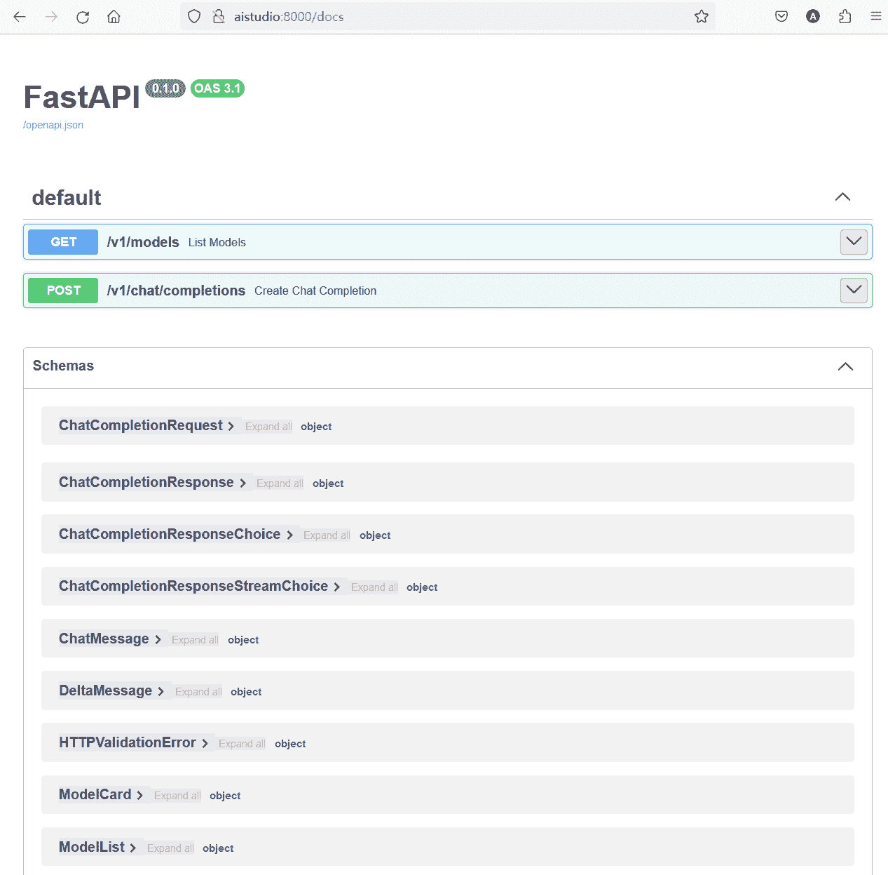

由此已经实现了 OpenAI 格式的流式 API 部署，可以作为任意基于 ChatGPT 的应用的后端，比如 ChatGPT-Next-Web。

## 对接  Chat UI

使用 ChatGPT-Next :https://github.com/Yidadaa/ChatGPT-Next-Web

```
docker run -e BASE_URL=http://aistudio:8000 -p 3000:3000 yidadaa/chatgpt-next-web
```

这个命令将会启动一个新的 Docker 容器，这个容器将基于 yidadaa/chatgpt-next-web 镜像，映射 3000 端口，并设置环境变量 BASE_URL 的值为 http://aistudio:8000。

打开页面进行提问，建议预先修改一下模型的名称

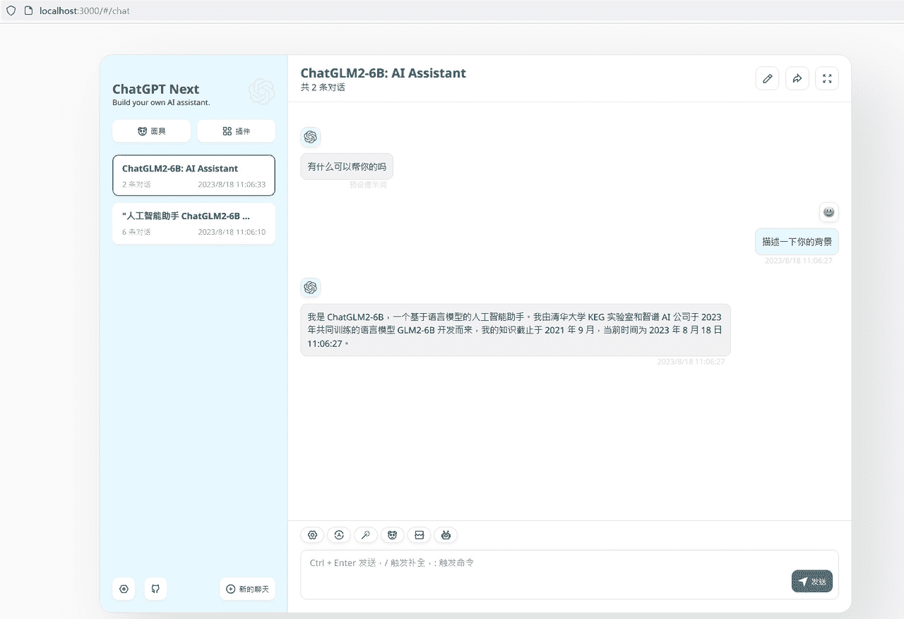

查看UI容器的后台日志

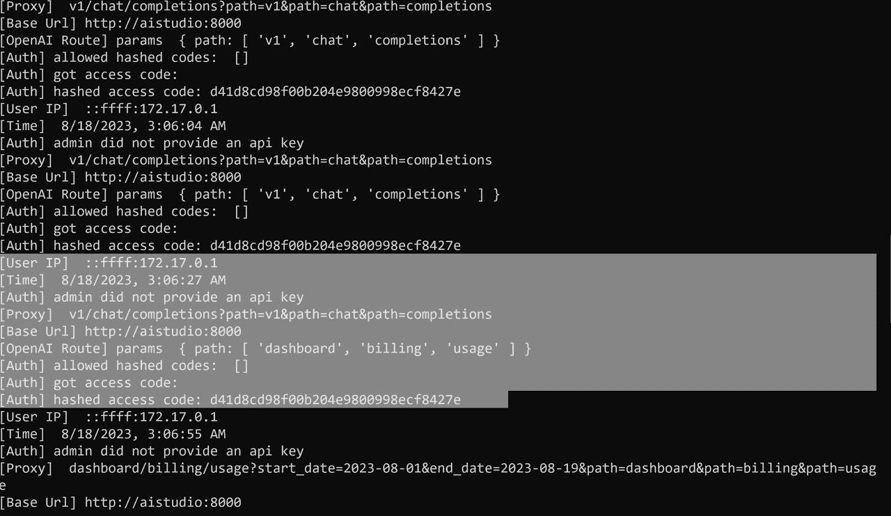

摘取会页面中会话时间对应的一段日志进行分析

```
[User IP]  ::ffff:172.17.0.1
[Time]  8/18/2023, 3:06:27 AM
[Auth] admin did not provide an api key
[Proxy]  v1/chat/completions?path=v1&amp;path=chat&amp;path=completions
[Base Url] http://aistudio:8000
[OpenAI Route] params  { path: [ &#x27;dashboard&#x27;, &#x27;billing&#x27;, &#x27;usage&#x27; ] }
[Auth] allowed hashed codes:  []
[Auth] got access code:
[Auth] hashed access code: d41d8cd98f00b204e9800998ecf8427e
```

从这段日志信息来看，这是一个API请求的日志，其中包含了用户IP、时间、鉴权信息、请求的URL路径等信息。下面是对这些信息的简单解读：

1.  **User ****IP** ::ffff:172.17.0.1: 这是用户的IP地址，::ffff:172.17.0.1是一个IPv6的地址，实际上表示的是IPv4地址172.17.0.1。

1.  **Time** 8/18/2023, 3:06:27 AM: 这是请求发生的时间。

1.  **Auth** admin did not provide an api key: 这表明用户（在这种情况下是管理员）没有提供API密钥进行鉴权。

1.  **Proxy** v1/chat/completions?path=v1&path=chat&path=completions: 这是被代理的请求路径。

1.  **Base ****Url** http://aistudio:8000: 这是服务器的基础URL。

1.  **OpenAI Route** params  { path: [ 'dashboard', 'billing', 'usage' ] }: 这是请求的OpenAI路由参数。

1.  **Auth** allowed hashed codes:  []: 这是允许的哈希码列表，看起来这个列表是空的。

1.  **Auth** got access code:: 这表明获取到了访问码，但是看起来访问码是空的。

1.  **Auth** hashed access code: d41d8cd98f00b204e9800998ecf8427e: 这是获取到的访问码的哈希值，但由于原始的访问码是空的，所以这个哈希值实际上是空字符串的MD5哈希值。

总的来说，这个日志显示了一个API请求的详细信息，但是看起来这个请求没有提供API密钥，也没有提供访问码，可能无法通过鉴权。

在模型容器这边可以看到日志

```
2023-08-18T03:05:07.580954421Z INFO:     172.17.0.1:32930 - &quot;POST /v1/chat/completions?path=v1&amp;path=chat&amp;path=completions HTTP/1.1&quot; 200 OK

2023-08-18T03:06:08.489583122Z INFO:     172.17.0.1:32932 - &quot;POST /v1/chat/completions?path=v1&amp;path=chat&amp;path=completions HTTP/1.1&quot; 200 OK

2023-08-18T03:06:31.109598989Z INFO:     172.17.0.1:32934 - &quot;POST /v1/chat/completions?path=v1&amp;path=chat&amp;path=completions HTTP/1.1&quot; 200 OK
```

这条日志信息是HTTP服务器日志的一部分，它提供了关于特定HTTP请求的信息。下面是对这条日志的解读：

+   2023-08-18T03:06:31.109598989Z：这是请求发生的时间，使用的是ISO 8601的日期和时间表示法，包括了日期、时间和时区（Z表示UTC时区）。

+   **INFO**：这是日志的级别，表示这是一条信息级别的日志，通常用于描述正常的运行情况。

+   172.17.0.1:32934：这是发起请求的客户端的IP地址和端口号。

+   **"****POST /v1****/**chat/completions?path=v1&path=chat&path=completions HTTP/1.1"：这是请求的详细信息，包括了HTTP的方法（POST）、请求的路径（/v1/chat/completions）以及路径参数（path=v1&path=chat&path=completions）和HTTP的版本（HTTP/1.1）。

+   **200 OK**：这是服务器对请求的响应状态码和状态消息，200表示请求已成功处理，OK是对应的状态消息。

总的来说，这条日志告诉我们在特定的时间，来自特定IP地址和端口的客户端向服务器发起了一个POST请求，请求的路径是/v1/chat/completions，路径参数是path=v1&path=chat&path=completions，服务器已经成功处理了这个请求并返回了200 OK的响应。

正式部署可以使用以下docker-compose文件

```
version: &#x27;3.1&#x27;
services:
  chatgpt-next-web:
    image: yidadaa/chatgpt-next-web
    restart: always
    environment:
      BASE_URL: http://aistudio:8000
    ports:
      - 3000:3000
```

另一个可用项目 chatbot-ui：https://github.com/mckaywrigley/chatbot-ui

```
docker run -e OPENAI_API_HOST=http://192.168.14.111:8000 -e OPENAI_API_KEY=sk-XXXXXXXXXXXXXXXXXXXX -p 3000:3000 ghcr.io/mckaywrigley/chatbot-ui:main
```

# Day 6 （2023-8-5）运行 ChatGLM2-6B 项目并进行微调

ChatGLM模型就不用专门介绍了，可能后续一段时间这个是最适合在国内场景用的LLM大模型，所以我测试使用容器环境运行它并进行微调，后续还会测试使用图形界面进行微调和启用流失会话API。当然这些功能后续也会在LLaMa模型上进行复现。

## 下载模型

```
git lfs install
git clone https://huggingface.co/THUDM/chatglm2-6b
```

```
chengzh@AIStudio:/mnt/c/BKF$ git clone https://huggingface.co/THUDM/chatglm2-6b
Cloning into &#x27;chatglm2-6b&#x27;...
remote: Enumerating objects: 172, done.
remote: Counting objects: 100% (73/73), done.
remote: Compressing objects: 100% (58/58), done.
remote: Total 172 (delta 46), reused 15 (delta 15), pack-reused 99
Receiving objects: 100% (172/172), 1.94 MiB | 718.00 KiB/s, done.
Resolving deltas: 100% (84/84), done.
Filtering content: 100% (8/8), 11.63 GiB | 9.45 MiB/s, done.
```

总大小24G

```
chengzh@AIStudio:/mnt/c/BKF/chatglm2-6b$ du -sh .
24G     .
```

## 运行容器

暂时使用llama2:base映像

```
docker run --gpus all --ipc=host --ulimit memlock=-1 --ulimit stack=67108864 --rm -it -v `pwd`/chatglm2-6b:/app/chatglm2-6b -p 7860:7860 soulteary/llama2:base
```

在容器上下文里 clone chatglm2-6b项目

```
 git clone https://github.com/THUDM/ChatGLM2-6B
 CD ChatGLM2-6B
```

安装依赖环境

```
 pip install -r requirements.txt
```

修改web_demo.py

```
nano web_demo.py
```

修改 6 7行的模型名称为/app/chatglm2-6b

108行修改为 launch(server_name="0.0.0.0", share=False, inbrowser=True)

```
from transformers import AutoModel, AutoTokenizer
import gradio as gr
import mdtex2html
from utils import load_model_on_gpus

tokenizer = AutoTokenizer.from_pretrained(&quot;/app/chatglm2-6b&quot;, trust_remote_code=True) # 修改模型路径
model = AutoModel.from_pretrained(&quot;/app/chatglm2-6b&quot;, trust_remote_code=True).cuda() # 修改模型路径
# 多显卡支持，使用下面两行代替上面一行，将num_gpus改为你实际的显卡数量
# from utils import load_model_on_gpus
# model = load_model_on_gpus(&quot;THUDM/chatglm2-6b&quot;, num_gpus=2)
model = model.eval()

&quot;&quot;&quot;Override Chatbot.postprocess&quot;&quot;&quot;


def postprocess(self, y):
    if y is None:
        return []
    for i, (message, response) in enumerate(y):
        y[i] = (
            None if message is None else mdtex2html.convert((message)),
            None if response is None else mdtex2html.convert(response),
        )
    return y


gr.Chatbot.postprocess = postprocess


def parse_text(text):
    &quot;&quot;&quot;copy from https://github.com/GaiZhenbiao/ChuanhuChatGPT/&quot;&quot;&quot;
    lines = text.split(&quot;\n&quot;)
    lines = [line for line in lines if line != &quot;&quot;]
    count = 0
    for i, line in enumerate(lines):
        if &quot;```&quot; in line:
            count += 1
            items = line.split(&#x27;`&#x27;)
            if count % 2 == 1:
                lines[i] = f&#x27;&lt;pre&gt;&lt;code class=&quot;language-{items[-1]}&quot;&gt;&#x27;
            else:
                lines[i] = f&#x27;&lt;br&gt;&lt;/code&gt;&lt;/pre&gt;&#x27;
        else:
            if i &gt; 0:
                if count % 2 == 1:
                    line = line.replace(&quot;`&quot;, &quot;\`&quot;)
                    line = line.replace(&quot;&lt;&quot;, &quot;&amp;lt;&quot;)
                    line = line.replace(&quot;&gt;&quot;, &quot;&amp;gt;&quot;)
                    line = line.replace(&quot; &quot;, &quot;&amp;nbsp;&quot;)
                    line = line.replace(&quot;*&quot;, &quot;&amp;ast;&quot;)
                    line = line.replace(&quot;_&quot;, &quot;&amp;lowbar;&quot;)
                    line = line.replace(&quot;-&quot;, &quot;&amp;#45;&quot;)
                    line = line.replace(&quot;.&quot;, &quot;&amp;#46;&quot;)
                    line = line.replace(&quot;!&quot;, &quot;&amp;#33;&quot;)
                    line = line.replace(&quot;(&quot;, &quot;&amp;#40;&quot;)
                    line = line.replace(&quot;)&quot;, &quot;&amp;#41;&quot;)
                    line = line.replace(&quot;$&quot;, &quot;&amp;#36;&quot;)
                lines[i] = &quot;&lt;br&gt;&quot;+line
    text = &quot;&quot;.join(lines)
    return text


def predict(input, chatbot, max_length, top_p, temperature, history, past_key_values):
    chatbot.append((parse_text(input), &quot;&quot;))
    for response, history, past_key_values in model.stream_chat(tokenizer, input, history, past_key_values=past_key_values,
                                                                return_past_key_values=True,
                                                                max_length=max_length, top_p=top_p,
                                                                temperature=temperature):
        chatbot[-1] = (parse_text(input), parse_text(response))

        yield chatbot, history, past_key_values


def reset_user_input():
    return gr.update(value=&#x27;&#x27;)


def reset_state():
    return [], [], None


with gr.Blocks() as demo:
    gr.HTML(&quot;&quot;&quot;&lt;h1 align=&quot;center&quot;&gt;ChatGLM2-6B&lt;/h1&gt;&quot;&quot;&quot;)

    chatbot = gr.Chatbot()
    with gr.Row():
        with gr.Column(scale=4):
            with gr.Column(scale=12):
                user_input = gr.Textbox(show_label=False, placeholder=&quot;Input...&quot;, lines=10).style(
                    container=False)
            with gr.Column(min_width=32, scale=1):
                submitBtn = gr.Button(&quot;Submit&quot;, variant=&quot;primary&quot;)
        with gr.Column(scale=1):
            emptyBtn = gr.Button(&quot;Clear History&quot;)
            max_length = gr.Slider(0, 32768, value=8192, step=1.0, label=&quot;Maximum length&quot;, interactive=True)
            top_p = gr.Slider(0, 1, value=0.8, step=0.01, label=&quot;Top P&quot;, interactive=True)
            temperature = gr.Slider(0, 1, value=0.95, step=0.01, label=&quot;Temperature&quot;, interactive=True)

    history = gr.State([])
    past_key_values = gr.State(None)

    submitBtn.click(predict, [user_input, chatbot, max_length, top_p, temperature, history, past_key_values],
                    [chatbot, history, past_key_values], show_progress=True)
    submitBtn.click(reset_user_input, [], [user_input])

    emptyBtn.click(reset_state, outputs=[chatbot, history, past_key_values], show_progress=True)

demo.queue().launch(server_name=&quot;0.0.0.0&quot;, share=False, inbrowser=True) #可以考虑将share改成true，这样可以从公网上调用模型
```

运行gradio界面

```
python web_demo.py
```

```
root@750840fb9d50:/app/chatglm2-6b/ChatGLM2-6B# python web_demo.py
  File &quot;/app/chatglm2-6b/ChatGLM2-6B/web_demo.py&quot;, line 108
    demo.queue().launch(server_name=&quot;0.0.0.0&quot;, share=False, inbrowser=True))
                                                                           ^
SyntaxError: unmatched &#x27;)&#x27;
root@750840fb9d50:/app/chatglm2-6b/ChatGLM2-6B# nano web_demo.py
root@750840fb9d50:/app/chatglm2-6b/ChatGLM2-6B# python web_demo.py
Loading checkpoint shards: 100%|██████████████████| 7/7 [00:16&lt;00:00,  2.41s/it]
/app/chatglm2-6b/ChatGLM2-6B/web_demo.py:89: GradioDeprecationWarning: The `style` method is deprecated. Please set these arguments in the constructor instead.
  user_input = gr.Textbox(show_label=False, placeholder=&quot;Input...&quot;, lines=10).style(
Running on local URL:  http://0.0.0.0:7860

To create a public link, set `share=True` in `launch()`.
```

又是熟悉的界面

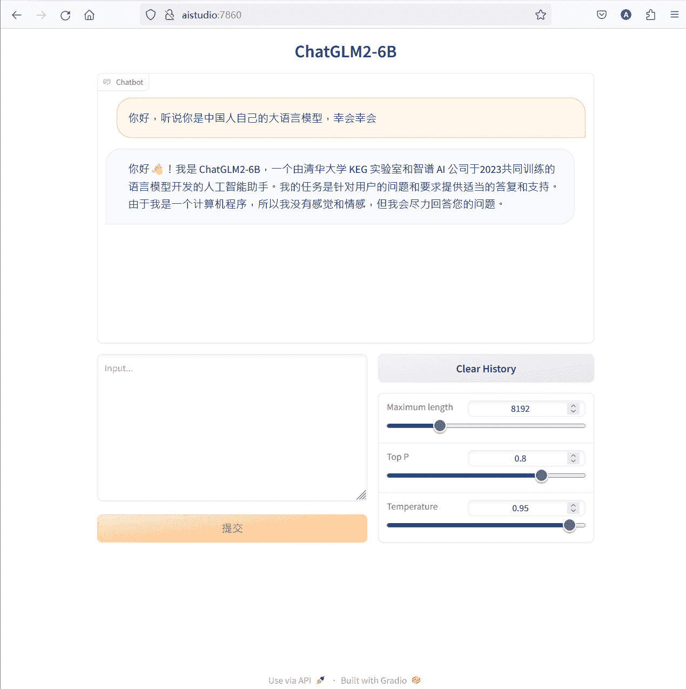

## 微调

https://github.com/THUDM/ChatGLM2-6B/tree/main/ptuning

实现了对于 ChatGLM2-6B 模型基于 [P-Tuning v2](https://github.com/THUDM/P-tuning-v2) 的微调。P-Tuning v2 将需要微调的参数量减少到原来的 0.1%，再通过模型量化、Gradient Checkpoint 等方法，最低只需要 7GB 显存即可运行。

下面以 [ADGEN](https://aclanthology.org/D19-1321.pdf) (广告生成) 数据集为例介绍代码的使用方法。

ADGEN 数据集任务为根据输入（content）生成一段广告词（summary）。

```
{
    &quot;content&quot;: &quot;类型#上衣*版型#宽松*版型#显瘦*图案#线条*衣样式#衬衫*衣袖型#泡泡袖*衣款式#抽绳&quot;,
    &quot;summary&quot;: &quot;这件衬衫的款式非常的宽松，利落的线条可以很好的隐藏身材上的小缺点，穿在身上有着很好的显瘦效果。领口装饰了一个可爱的抽绳，漂亮的绳结展现出了十足的个性，配合时尚的泡泡袖型，尽显女性甜美可爱的气息。&quot;
}
```

从 [Google Drive](https://drive.google.com/file/d/13_vf0xRTQsyneRKdD1bZIr93vBGOczrk/view?usp=sharing) 或者 [Tsinghua Cloud](https://cloud.tsinghua.edu.cn/f/b3f119a008264b1cabd1/?dl=1) 下载处理好的 ADGEN 数据集，将解压后的 AdvertiseGen 目录放到本目录下。

### 训练

```
cd ptuing
```

安装依赖环境

```
pip install rouge_chinese nltk jieba datasets
```

train.sh解析

```
PRE_SEQ_LEN=128
LR=2e-2
NUM_GPUS=1

torchrun --standalone --nnodes=1 --nproc-per-node=$NUM_GPUS main.py \
    --do_train \
    --train_file AdvertiseGen/train.json \
    --validation_file AdvertiseGen/dev.json \
    --preprocessing_num_workers 10 \
    --prompt_column content \
    --response_column summary \
    --overwrite_cache \
    --model_name_or_path /app/chatglm2-6b \
    --output_dir output/adgen-chatglm2-6b-pt-$PRE_SEQ_LEN-$LR \
    --overwrite_output_dir \
    --max_source_length 64 \
    --max_target_length 128 \
    --per_device_train_batch_size 1 \
    --per_device_eval_batch_size 1 \
    --gradient_accumulation_steps 16 \
    --predict_with_generate \
    --max_steps 3000 \
    --logging_steps 10 \
    --save_steps 1000 \
    --learning_rate $LR \
    --pre_seq_len $PRE_SEQ_LEN \
    --quantization_bit 4
```

这个脚本是用来启动一个PyTorch训练任务的。它使用了torchrun命令，这是PyTorch的一个命令行工具，用于在多GPU或多节点环境中运行分布式训练。

以下是脚本中每个参数的解释：

+   PRE_SEQ_LEN=128：设置预处理序列长度为128。

+   LR=2e-2：设置学习率为0.02。

+   NUM_GPUS=1：设置使用的GPU数量为1。

torchrun命令的参数：

+   --standalone：运行一个独立的训练任务，不需要与其他节点通信。

+   --nnodes=1：设置使用的节点数量为1。

+   --nproc-per-node=$NUM_GPUS：每个节点上的进程数量，这里设置为1，即每个节点上运行一个进程。

接下来是main.py脚本的参数：

+   --do_train：进行训练。

+   --train_file AdvertiseGen/train.json：训练数据的文件路径。

+   --validation_file AdvertiseGen/dev.json：验证数据的文件路径。

+   --preprocessing_num_workers 10：用于数据预处理的工作进程数量。

+   --prompt_column content：输入列的名称。

+   --response_column summary：输出列的名称。

+   --overwrite_cache：如果设置，将在运行前清除缓存。

+   --model_name_or_path /app/chatglm2-6b：预训练模型的名称或路径。

+   --output_dir output/adgen-chatglm2-6b-pt-$PRE_SEQ_LEN-$LR：输出目录的路径，其中包括训练过程中保存的模型和其他文件。

+   --overwrite_output_dir：如果设置，将在运行前清除输出目录。

+   --max_source_length 64：输入序列的最大长度。

+   --max_target_length 128：输出序列的最大长度。

+   --per_device_train_batch_size 1：每个设备的训练批次大小。

+   --per_device_eval_batch_size 1：每个设备的评估批次大小。

+   --gradient_accumulation_steps 16：梯度累积步数，这可以有效地增加总的批次大小。

+   --predict_with_generate：使用生成模式进行预测。

+   --max_steps 3000：训练的最大步数。

+   --logging_steps 10：每隔多少步记录一次日志。

+   --save_steps 1000：每隔多少步保存一次模型。

+   --learning_rate $LR：学习率。

+   --pre_seq_len $PRE_SEQ_LEN：预处理序列长度。

+   --quantization_bit 4：量化位数，这是用于模型压缩的技术。

这个脚本的目的是使用指定的预训练模型在给定的训练数据上进行训练，并将训练过程中的模型和其他文件保存到指定的输出目录。

训练过程中的日志片段

```
{&#x27;loss&#x27;: 3.4834, &#x27;learning_rate&#x27;: 0.0166, &#x27;epoch&#x27;: 0.07}                                                                             
{&#x27;loss&#x27;: 3.4369, &#x27;learning_rate&#x27;: 0.016533333333333334, &#x27;epoch&#x27;: 0.07}                                                               
{&#x27;loss&#x27;: 3.5347, &#x27;learning_rate&#x27;: 0.016466666666666668, &#x27;epoch&#x27;: 0.07}                                                               
{&#x27;loss&#x27;: 3.4491, &#x27;learning_rate&#x27;: 0.016399999999999998, &#x27;epoch&#x27;: 0.08}                                                               
{&#x27;loss&#x27;: 3.4395, &#x27;learning_rate&#x27;: 0.01633333333333333, &#x27;epoch&#x27;: 0.08}                                                                
{&#x27;loss&#x27;: 3.396, &#x27;learning_rate&#x27;: 0.01626666666666667, &#x27;epoch&#x27;: 0.08}                                                                 
{&#x27;loss&#x27;: 3.4089, &#x27;learning_rate&#x27;: 0.016200000000000003, &#x27;epoch&#x27;: 0.08}                                                               
{&#x27;loss&#x27;: 3.4193, &#x27;learning_rate&#x27;: 0.016133333333333333, &#x27;epoch&#x27;: 0.08}                                                               
{&#x27;loss&#x27;: 3.5055, &#x27;learning_rate&#x27;: 0.016066666666666667, &#x27;epoch&#x27;: 0.08}                                                               
{&#x27;loss&#x27;: 3.4632, &#x27;learning_rate&#x27;: 0.016, &#x27;epoch&#x27;: 0.08}                                                                              
{&#x27;loss&#x27;: 3.4498, &#x27;learning_rate&#x27;: 0.015933333333333334, &#x27;epoch&#x27;: 0.09}                                                               
{&#x27;loss&#x27;: 3.385, &#x27;learning_rate&#x27;: 0.015866666666666668, &#x27;epoch&#x27;: 0.09}                                                                
{&#x27;loss&#x27;: 3.4645, &#x27;learning_rate&#x27;: 0.0158, &#x27;epoch&#x27;: 0.09}                                                                             
{&#x27;loss&#x27;: 3.5168, &#x27;learning_rate&#x27;: 0.015733333333333332, &#x27;epoch&#x27;: 0.09}                                                               
{&#x27;loss&#x27;: 3.4531, &#x27;learning_rate&#x27;: 0.015666666666666666, &#x27;epoch&#x27;: 0.09}                                                               
{&#x27;loss&#x27;: 3.4663, &#x27;learning_rate&#x27;: 0.015600000000000001, &#x27;epoch&#x27;: 0.09}                                                               
{&#x27;loss&#x27;: 3.4403, &#x27;learning_rate&#x27;: 0.015533333333333333, &#x27;epoch&#x27;: 0.09}                                                               
{&#x27;loss&#x27;: 3.4088, &#x27;learning_rate&#x27;: 0.015466666666666667, &#x27;epoch&#x27;: 0.09}
```

这是模型训练过程中的日志输出。每一行都代表一个训练阶段的统计信息，包括以下几个字段：

+   'loss'：这是模型在当前阶段的平均损失。损失越低，模型的预测结果就越接近实际结果。在这个例子中，损失值开始是3.4834，然后有所下降，但也有一些波动。这是正常的，因为模型在学习过程中会不断调整参数以最小化损失。

+   'learning_rate'：这是当前阶段的学习率。学习率是一种超参数，用于控制模型参数更新的速度。较高的学习率可能使学习过程更快，但也可能导致模型在最优解附近震荡而无法收敛。较低的学习率可能使学习过程更稳定，但也可能导致学习过程过慢。在这个例子中，学习率从0.0166开始，然后逐渐减小。这可能是因为使用了学习率衰减策略，随着训练的进行，降低学习率，以便更精细地优化模型参数。

+   'epoch'：这是当前阶段的训练轮数。一轮（epoch）意味着模型已经看过了所有的训练数据一次。在这个例子中，每个阶段的训练轮数都在增加，这意味着模型正在不断地学习训练数据。

总的来说，这个日志显示了模型训练过程中的一些关键指标，可以帮助你了解模型的学习情况，以及是否需要调整学习率或其他超参数。

训练过程中的GPU负载情况

```
chengzh@AIStudio:~$ nvidia-smi
Fri Aug  4 16:58:24 2023
+---------------------------------------------------------------------------------------+
| NVIDIA-SMI 535.86.01              Driver Version: 536.67       CUDA Version: 12.2     |
|-----------------------------------------+----------------------+----------------------+
| GPU  Name                 Persistence-M | Bus-Id        Disp.A | Volatile Uncorr. ECC |
| Fan  Temp   Perf          Pwr:Usage/Cap |         Memory-Usage | GPU-Util  Compute M. |
|                                         |                      |               MIG M. |
|=========================================+======================+======================|
|   0  NVIDIA GeForce RTX 4090        On  | 00000000:01:00.0 Off |                  Off |
| 34%   67C    P2             346W / 450W |   8505MiB / 24564MiB |     97%      Default |
|                                         |                      |                  N/A |
+-----------------------------------------+----------------------+----------------------+

+---------------------------------------------------------------------------------------+
| Processes:                                                                            |
|  GPU   GI   CI        PID   Type   Process name                            GPU Memory |
|        ID   ID                                                             Usage      |
|=======================================================================================|
|    0   N/A  N/A      1325      C   /python3.10                               N/A      |
+---------------------------------------------------------------------------------------+
```

从nvidia-smi输出来看，这块NVIDIA GeForce RTX 4090显卡的使用情况如下：

+   GPU利用率：97%，表示你的显卡正在进行大量的计算任务。

+   显卡温度：67°C，这是一个正常的工作温度，但如果持续高负载运行，可能需要确保有足够的冷却。

+   显卡电源使用：346W，接近显卡的最大电源容量（450W）。

+   显卡内存使用：8505MiB，总共有24564MiB，表示你的显卡内存使用率约为34.6%。

这表明你的显卡正在进行一项计算密集型任务，但还有一些剩余的显卡内存可供使用。如果你的应用程序需要更多的GPU内存，你可能需要优化你的代码或者考虑使用更大内存的显卡。

请注意，持续的高GPU利用率可能会导致显卡过热，特别是如果冷却系统不足的情况下。你应该密切关注你的显卡温度，并确保你的系统有足够的冷却。

完成之后的输出，用时2:09:21

```
Training completed. Do not forget to share your model on huggingface.co/models =)


{&#x27;train_runtime&#x27;: 7761.6199, &#x27;train_samples_per_second&#x27;: 6.184, &#x27;train_steps_per_second&#x27;: 0.387, &#x27;train_loss&#x27;: 3.402895772298177, &#x27;epoch&#x27;: 0.42}
100%|███████████████████| 3000/3000 [2:09:21&lt;00:00,  2.59s/it]
***** train metrics *****
  epoch                    =       0.42
  train_loss               =     3.4029
  train_runtime            = 2:09:21.61
  train_samples            =     114599
  train_samples_per_second =      6.184
  train_steps_per_second   =      0.387
```

### 推理

evaluate.sh

`

```
PRE_SEQ_LEN=128
CHECKPOINT=adgen-chatglm2-6b-pt-128-2e-2
STEP=3000
NUM_GPUS=1

torchrun --standalone --nnodes=1 --nproc-per-node=$NUM_GPUS main.py \
    --do_predict \
    --validation_file AdvertiseGen/dev.json \
    --test_file AdvertiseGen/dev.json \
    --overwrite_cache \
    --prompt_column content \
    --response_column summary \
    --model_name_or_path /app/chatglm2-6b \
    --ptuning_checkpoint ./output/$CHECKPOINT/checkpoint-$STEP \
    --output_dir ./output/$CHECKPOINT \
    --overwrite_output_dir \
    --max_source_length 64 \
    --max_target_length 64 \
    --per_device_eval_batch_size 1 \
    --predict_with_generate \
    --pre_seq_len $PRE_SEQ_LEN \
    --quantization_bit 4
```

这个命令是使用PyTorch的torchrun工具来运行一个名为main.py的Python脚本，这个脚本可能是一个训练或者预测模型的任务。让我们一行一行地解析这个命令：

1.  PRE_SEQ_LEN=128、CHECKPOINT=adgen-chatglm2-6b-pt-128-2e-2、STEP=3000 和 NUM_GPUS=1：这四行设置了一些环境变量，这些变量在下面的命令中会被使用。

1.  torchrun --standalone --nnodes=1 --nproc-per-node=$NUM_GPUS main.py：torchrun是PyTorch的一个命令行工具，用于运行分布式任务。--standalone表示这是一个独立的任务，不依赖于任何其他任务。--nnodes=1表示只有一个节点参与计算。--nproc-per-node=$NUM_GPUS表示每个节点上有多少个进程，这里设置为环境变量NUM_GPUS的值，即1。main.py是要运行的Python脚本。

1.  --do_predict：这是一个标志，表示这个任务是进行预测，而不是训练。

1.  --validation_file AdvertiseGen/dev.json 和 --test_file AdvertiseGen/dev.json：这两个选项指定了验证集和测试集的文件路径。

1.  --overwrite_cache：如果设置了这个选项，那么在处理数据时，如果缓存文件已经存在，就会被覆盖。

1.  --prompt_column content 和 --response_column summary：这两个选项指定了输入和输出的列名。

1.  --model_name_or_path /app/chatglm2-6b：这个选项指定了模型的名称或路径。

1.  --ptuning_checkpoint ./output/$CHECKPOINT/checkpoint-$STEP：这个选项指定了预训练模型的检查点文件的路径。

1.  --output_dir ./output/$CHECKPOINT：这个选项指定了输出文件的目录。

1.  --overwrite_output_dir：如果设置了这个选项，那么在输出文件时，如果目录已经存在，就会被覆盖。

1.  --max_source_length 64 和 --max_target_length 64：这两个选项指定了输入和输出的最大长度。

1.  --per_device_eval_batch_size 1：这个选项指定了每个设备的评估批次大小。

1.  --predict_with_generate：这是一个标志，表示在预测时使用生成模式。

1.  --pre_seq_len $PRE_SEQ_LEN：这个选项指定了预处理序列的长度，这里设置为环境变量PRE_SEQ_LEN的值，即128。

1.  --quantization_bit 4：这个选项指定了量化位数，这是一个用于模型压缩的技术，可以减小模型的大小和内存占用，但可能会牺牲一些精度。

```
bash evaluate.sh
```

执行过程的输出

```
  5%|███████▊                                                                                                                                                  | 54/1070 [01:37&lt;27:54,  1.65s/it][INFO|configuration_utils.py:577] 2023-08-04 11:11:02,568 &gt;&gt; Generate config GenerationConfig {
  &quot;_from_model_config&quot;: true,
  &quot;eos_token_id&quot;: 2,
  &quot;pad_token_id&quot;: 0,
  &quot;transformers_version&quot;: &quot;4.30.2&quot;
}
```

这是在执行你的shell脚本过程中，模型生成配置（GenerationConfig）的相关信息。让我们来看看这个日志的具体内容：

+   5%|███████▊ | 54/1070 [01:37<27:54, 1.65s/it]：这是一个进度条，表示当前处理进度。在这个例子中，已经处理了54个任务，总共有1070个任务，已经完成了大约5%。已经过去的时间是1分37秒，预计还需要27分54秒。

+   [INFO|configuration_utils.py:577] 2023-08-04 11:11:02,568 >> Generate config GenerationConfig { "_from_model_config": true, "eos_token_id": 2, "pad_token_id": 0, "transformers_version": "4.30.2" }：这是模型生成配置的日志信息。INFO表示这是一条信息级别的日志，configuration_utils.py:577表示这条日志来自configuration_utils.py文件的第577行。然后是日志的时间戳，2023-08-04 11:11:02,568。

- "_from_model_config": true：表示这个生成配置是从模型配置中获取的。

- "eos_token_id": 2：表示结束符（End of Sentence）的标记ID是2，这个标记用于指示模型生成的句子的结束。

- "pad_token_id": 0：表示填充符（Padding）的标记ID是0，这个标记用于在批处理中对较短的句子进行填充，以使所有句子的长度相同。

- "transformers_version": "4.30.2"：表示使用的transformers库的版本是4.30.2。

这个日志输出主要是为了帮助你了解模型的生成配置，以及当前处理进度。

经过0:33:17，推理完成

```
Prefix dict has been built successfully.
08/04/2023 11:42:36 - DEBUG - jieba - Prefix dict has been built successfully.
100%|████████████████████████| 1070/1070 [33:13&lt;00:00,  1.86s/it]
***** predict metrics *****
  predict_bleu-4             =     7.7979
  predict_rouge-1            =    29.8432
  predict_rouge-2            =     6.5415
  predict_rouge-l            =    24.1092
  predict_runtime            = 0:33:17.10
  predict_samples            =       1070
  predict_samples_per_second =      0.536
  predict_steps_per_second   =      0.536
```

评测指标为中文 Rouge score 和 BLEU-4。生成的结果保存在 ./output/adgen-chatglm2-6b-pt-128-2e-2/generated_predictions.txt。

### 模型测试

web_demo.sh

```
PRE_SEQ_LEN=128

CUDA_VISIBLE_DEVICES=0 python3 web_demo.py \
    --model_name_or_path /app/chatglm2-6b \
    --ptuning_checkpoint output/adgen-chatglm2-6b-pt-128-2e-2/checkpoint-3000 \
    --pre_seq_len $PRE_SEQ_LEN
```

这个命令是用于启动一个Web演示的Python脚本，具体解释如下：

+   PRE_SEQ_LEN=128：这是一个环境变量，表示预先设定的序列长度为128。

+   CUDA_VISIBLE_DEVICES=0：这是一个环境变量，用于指定哪些GPU设备可见，即被CUDA使用。在这里，它被设置为0，表示只有第一个GPU（索引为0）可见。

+   python3 web_demo.py：这是用Python 3运行名为web_demo.py的脚本。

+   --model_name_or_path /app/chatglm2-6b：这是一个命令行参数，指定模型的名称或路径为/app/chatglm2-6b。

+   --ptuning_checkpoint output/adgen-chatglm2-6b-pt-128-2e-2/checkpoint-3000：这是一个命令行参数，指定了微调模型的检查点路径。

+   --pre_seq_len $PRE_SEQ_LEN：这是一个命令行参数，指定了预设序列长度。这里使用了前面定义的环境变量$PRE_SEQ_LEN。

这个命令主要是为了运行一个Web演示，该演示使用了一个微调过的模型，并设定了一些模型的参数。

```
bash web_demo.sh
```

```
root@750840fb9d50:/app/chatglm2-6b/ChatGLM2-6B/ptuning# bash web_demo.sh
/app/chatglm2-6b/ChatGLM2-6B/ptuning/web_demo.py:101: GradioDeprecationWarning: The `style` method is deprecated. Please set these arguments in the constructor instead.
  user_input = gr.Textbox(show_label=False, placeholder=&quot;Input...&quot;, lines=10).style(
Loading prefix_encoder weight from output/adgen-chatglm2-6b-pt-128-2e-2/checkpoint-3000
Loading checkpoint shards: 100%|█████████████████| 7/7 [00:22&lt;00:00,  3.19s/it]
Some weights of ChatGLMForConditionalGeneration were not initialized from the model checkpoint at /app/chatglm2-6b and are newly initialized: [&#x27;transformer.prefix_encoder.embedding.weight&#x27;]
You should probably TRAIN this model on a down-stream task to be able to use it for predictions and inference.
Running on local URL:  http://0.0.0.0:7860
Running on public URL: https://697fcf76e5fc419f99.gradio.live

This share link expires in 72 hours. For free permanent hosting and GPU upgrades, run `gradio deploy` from Terminal to deploy to Spaces (https://huggingface.co/spaces)
```

之所以有一个public URL: https://697fcf76e5fc419f99.gradio.live 是因为我们修改了web_demo.py中的launch()

```
demo.queue().launch(server_name=&quot;0.0.0.0&quot;, share=True, inbrowser=True)
```

微调数据集是服装广告语，所以我们可以问一些穿搭问题

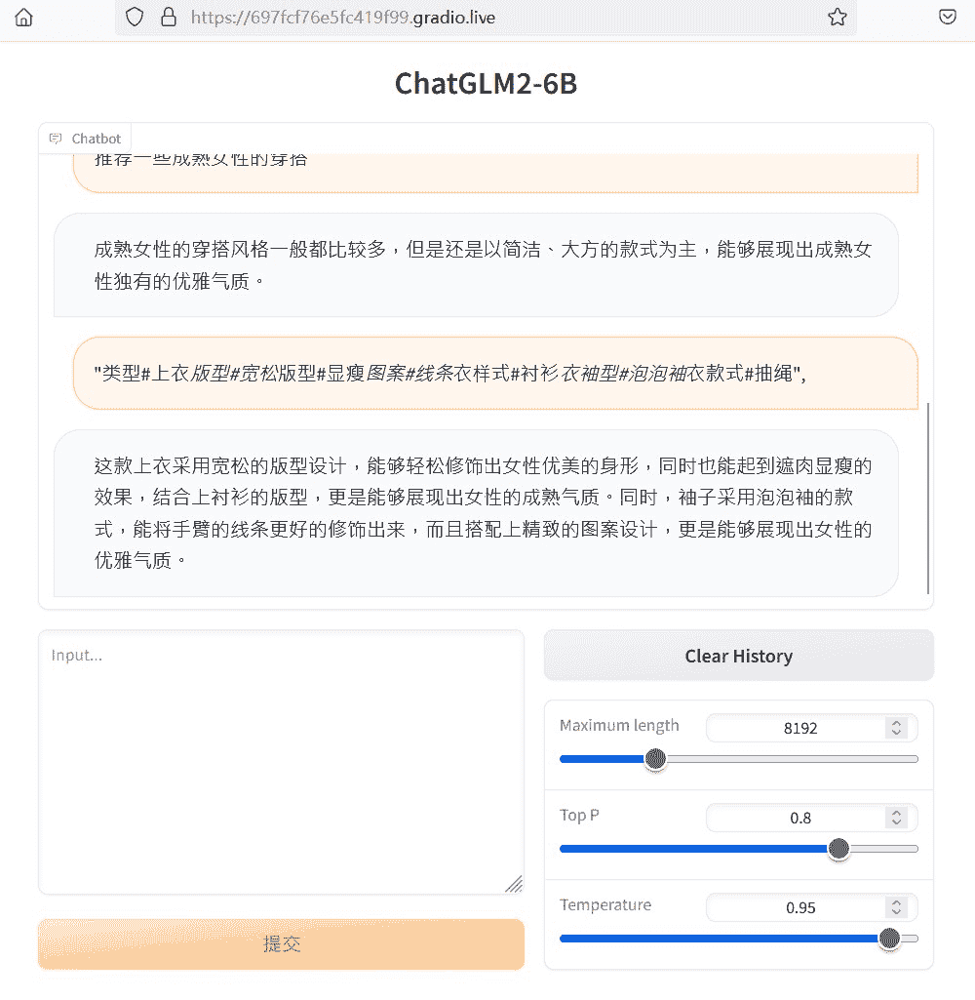

# Day 5 （2023-7-31）落地基于  SDXL 1.0 的文生图模型

台风虽然绕开上海，但是暑假还在继续（没活干，闲），今天我来捣鼓使用 Docker 在本地部署 Stability AI 刚刚推出的 SDXL 1.0，这一款新一代的开源图片生成模型。

和之前文生文比，文生图模型才是电老虎，不仅GPU的使用率飞起，教具的网速 内存和硬盘空间也开始受到严峻的挑战了。

## 快速启动

下载项目库

```
git clone https://github.com/soulteary/docker-sdxl.git
cd docker-sdxl
```

下载模型

```
# 确认已经安装过 Git LFS https://git-lfs.com
git lfs install

# 下载基础模型
git clone https://huggingface.co/stabilityai/stable-diffusion-xl-base-1.0

# 下载精炼模型
git clone https://huggingface.co/stabilityai/stable-diffusion-xl-refiner-1.0

# 下载超分模型
git clone https://huggingface.co/stabilityai/sd-x2-latent-upscaler

# 调整目录结构
mv sd-x2-latent-upscaler stable-diffusion-xl-base-1.0 stable-diffusion-xl-refiner-1.0 stabilityai/
```

这三个模型总空间157GB，我用了整整一上午下载，目前还不清楚是不是仅用basic就可以完成基础实验。

构建映像

```
# 构建基础镜像
bash scripts/make-sdxl-base.sh
# 构建运行时镜像
bash scripts/make-sdxl-runtime.sh
```

运行容器

```
docker run --gpus all --ipc=host --ulimit memlock=-1 --ulimit stack=67108864 --rm -it -v `pwd`/stabilityai/:/app/stabilityai -p 7860:7860 soulteary/sdxl:runtime
```

在容器终端中，选择不用的运行方式

```
# ls
basic.py  refiner-low-vram.py  refiner.py  stabilityai
```

纯执行命令也就是几下而已，绝大部分时间是在等待数据传输，反正闲着也是闲着，不如往下看看关键步骤的解析。

## 下载项目

### 下载 repo

```
git clone https://github.com/soulteary/docker-sdxl.git
cd docker-sdxl
```

### 下载项目

```
# 确认已经安装过 Git LFS https://git-lfs.com
git lfs install

# 下载基础模型
git clone https://huggingface.co/stabilityai/stable-diffusion-xl-base-1.0

# 下载精炼模型
git clone https://huggingface.co/stabilityai/stable-diffusion-xl-refiner-1.0

# 下载超分模型
git clone https://huggingface.co/stabilityai/sd-x2-latent-upscaler

# 调整目录结构
mkdir stabilityai
mv sd-x2-latent-upscaler stable-diffusion-xl-base-1.0 stable-diffusion-xl-refiner-1.0 stabilityai/
```

用base模式的下载过程举例，依然可以看到有报错，但是不影响后续模型的运行

```
chengzh@AIStudio:/mnt/c/SDXLLab/docker-sdxl$ git clone https://huggingface.co/stabilityai/stable-diffusion-xl-base-1.0
Cloning into &#x27;stable-diffusion-xl-base-1.0&#x27;...
remote: Enumerating objects: 113, done.
remote: Counting objects: 100% (113/113), done.
remote: Compressing objects: 100% (107/107), done.
remote: Total 113 (delta 36), reused 10 (delta 4), pack-reused 0
Receiving objects: 100% (113/113), 717.12 KiB | 750.00 KiB/s, done.
Resolving deltas: 100% (36/36), done.
Filtering content: 100% (22/22), 18.05 GiB | 3.27 MiB/s, done.
Encountered 5 file(s) that may not have been copied correctly on Windows:
        unet/diffusion_pytorch_model.fp16.safetensors
        sd_xl_base_1.0.safetensors
        sd_xl_base_1.0_0.9vae.safetensors
        unet/diffusion_pytorch_model.safetensors
        unet/openvino_model.bin

See: `git lfs help smudge` for more details.
```

## 创建镜像

```
# 构建基础镜像
bash scripts/make-sdxl-base.sh

# 构建运行时镜像
bash scripts/make-sdxl-runtime.sh

# （可选）构建一键包，将模型下载至 `stabilityai` 目录后
bash scripts/make-sdxl-one-click.sh
```

### 基础镜像分析

基础镜像提供运行环境的基准，scripts/make-sdxl-base.sh

```
#!/bin/bash
docker build -t soulteary/sdxl:base . -f docker/Dockerfile.base
```

这个命令的含义是：在当前目录下，使用docker/Dockerfile.base这个Dockerfile文件，构建一个新的Docker镜像，镜像的名字是soulteary/sdxl，标签是base。

分析docker/Dockerfile.base看看具体的构建细节

```
FROM nvcr.io/nvidia/pytorch:23.07-py3
RUN pip config set global.index-url https://pypi.tuna.tsinghua.edu.cn/simple
RUN pip install accelerate transformers diffusers gradio ftfy invisible_watermark
WORKDIR /app
```

以下是对这个Dockerfile的解释：

+   FROM nvcr.io/nvidia/pytorch:23.07-py3: 这一行指定了基础镜像，所有后续的命令都在这个基础镜像的基础上执行。在这个例子中，基础镜像是NVIDIA的官方PyTorch镜像，版本是23.07，并且使用Python 3。

+   RUN pip config set global.index-url https://pypi.tuna.tsinghua.edu.cn/simple: 这一行设置了Python的pip包管理器的全局索引URL为清华大学的镜像站，这可以加速在中国大陆的下载速度。

+   RUN pip install accelerate transformers diffusers gradio ftfy invisible_watermark: 这一行使用pip安装了六个Python包：accelerate、transformers、diffusers、gradio、ftfy和invisible_watermark。

+   WORKDIR /app: 这一行设置了后续命令的工作目录为/app。如果这个目录不存在，Docker会自动创建它。

所以，这个Dockerfile的作用是：基于NVIDIA的官方PyTorch镜像，设置pip的全局索引URL为清华大学的镜像站，然后安装六个Python包，最后设置工作目录为/app。

以下是基础镜像包含的六个Python包的介绍：

+   accelerate - 一个用于加速PyTorch模型训练和推理的库。它可以利用GPU/TPU进行加速,并支持混合精度训练等。

+   transformers - 一个由Hugging Face开发的自然语言处理库,提供了许多预训练语言模型,如BERT、GPT等。它使得这些模型可以方便地用于下游任务。

+   diffusers - OpenAI开源的用于图像生成的库,基于diffusion模型。它可以生成高质量的图像。

+   gradio - 一个用于快速构建基于Python的GUI应用的库。它可以把Python函数或模型通过GUI展示出来。

+   ftfy - 一个用来修复编码问题的Python库,如非UTF-8编码、无效Unicode等。它可以处理文本编码错误。

+   invisible_watermark - 一个用于给图像添加隐形水印的库。水印信息可以是文本或图片,并可以可逆地嵌入到图像中。

### 运行时镜像分析

scripts/make-sdxl-runtime.sh

```
#!/bin/bash
docker build -t soulteary/sdxl:runtime . -f docker/Dockerfile.runtime

docker build -t soulteary/sdxl:runtime-xformers . -f docker/Dockerfile.runtime-xformers
```

这个脚本的作用是：使用docker/Dockerfile.runtime和docker/Dockerfile.runtime-xformers这两个Dockerfile，分别构建soulteary/sdxl:runtime和soulteary/sdxl:runtime-xformers这两个Docker镜像。

可以看到这个脚本会创建两个运行时容器

+   soulteary/sdxl:runtime:使用diffusion-pipeline 环境

+   soulteary/sdxl:runtime-xformers:使用transformer环境

我们后续的demo以diffusion-pipeline 为主

先看看docker/Dockerfile.runtime

```
FROM soulteary/sdxl:base
RUN pip uninstall transformer-engine -y
COPY src/diffusion-pipeline/*.py ./
```

以下是这段代码的解释：

+   FROM soulteary/sdxl:base: 这个指令表示基础镜像是soulteary/sdxl:base。Docker会从这个镜像开始构建新的镜像。

+   RUN pip uninstall transformer-engine -y: 这个指令表示在新的镜像中运行一个命令，这个命令是pip uninstall transformer-engine -y。这个命令的作用是卸载transformer-engine这个Python包。-y参数表示在卸载过程中自动确认所有的提示。

+   COPY src/diffusion-pipeline/*.py ./: 这个指令表示将src/diffusion-pipeline/目录下的所有.py文件复制到新的镜像的工作目录中。这个指令的源路径是相对于构建上下文的路径，目标路径是相对于工作目录的路径。

所以，这个Dockerfile的作用是：基于soulteary/sdxl:base这个镜像，卸载transformer-engine这个Python包，然后将src/diffusion-pipeline/目录下的所有.py文件复制到新的镜像中。

顺藤摸瓜分析一下src/diffusion-pipeline/

```
chengzh@AIStudio:/mnt/c/SDXLLab/docker-sdxl/src/diffusion-pipeline$ tree
.
├── basic.py
├── refiner-low-vram.py
└── refiner.py

0 directories, 3 files
```

basic.py

这段Python脚本主要实现了一个基于Gradio的交互式图形用户界面（GUI），用于生成和展示由"Stable Diffusion XL 1.0"模型生成的图像。"Stable Diffusion XL 1.0"是一个预训练的模型，用于根据用户的提示生成图像。

以下是这个脚本的主要功能：

1.  **加载****预训练模型**：脚本首先定义了一个函数get_base_pipeline()，该函数加载了一个预训练的模型"stabilityai/stable-diffusion-xl-base-1.0"，并将其转移到了CUDA设备上。

1.  **定义图像生成函数**：然后定义了一个名为imagine()的函数，该函数接收一些参数（如提示、负提示、宽度、高度、缩放、步数和种子），并使用这些参数和预训练模型生成一个图像。

1.  **创建****GUI**：最后，脚本使用Gradio库创建了一个交互式GUI。用户可以通过此界面输入他们的提示和其他参数，然后模型会生成相应的图像并在界面上展示出来。界面还包括一些预定义的示例，用户可以通过点击这些示例来快速生成图像。

总的来说，这个脚本的主要功能是提供一个交互式的图形用户界面，让用户可以方便地使用预训练的"Stable Diffusion XL 1.0"模型来生成图像。

refiner-low-vram.py

这个脚本和之前的脚本在功能上是非常类似的，都是创建了一个基于Gradio的交互式图形用户界面（GUI），用于生成和展示由"Stable Diffusion XL 1.0"模型生成的图像。然而，这个脚本增加了一些新的特性和功能，主要的差异如下：

1.  **内存****清理**：在加载预训练模型之前，这个脚本会先调用一个名为gc()的函数来清理GPU内存。这是一个新的特性，可以帮助防止内存溢出。

1.  **更多的****预训练模型**：这个脚本不仅加载了"stabilityai/stable-diffusion-xl-base-1.0"模型，还加载了"stabilityai/stable-diffusion-xl-refiner-1.0"和"stabilityai/sd-x2-latent-upscaler"两个模型。这两个模型分别用于对生成的图像进行细化和放大。

1.  **图像处理****流程**：在生成图像时，这个脚本会先使用"base"模型生成一个基础图像，然后使用"refiner"模型对这个图像进行细化，最后如果用户选择了"upscale"选项，就会使用"upscaler"模型对图像进行放大。

1.  **输出结果**：这个脚本的输出结果不再是一个单一的图像，而是一个图像的列表。这个列表包含了基础图像、细化后的图像，以及如果用户选择了"upscale"选项，还会包含放大后的图像。

1.  **用户界面**：在用户界面上，这个脚本增加了一个名为"upscale"的复选框，用户可以通过这个复选框来选择是否使用"upscaler"模型对图像进行放大。此外，输出结果的展示方式也进行了调整，现在是一个图像的展示区，可以同时展示多个图像。

综上所述，虽然这两个脚本在功能上是类似的，但这个脚本在细节上做了很多改进和优化，使得用户可以更灵活地使用模型来生成图像，并且可以看到不同阶段的生成结果。

refiner.py

这个脚本与之前的两个脚本在功能上是一致的，它们都使用Gradio创建了一个交互式图形用户界面（GUI），通过该界面用户可以输入相关参数，然后使用"Stable Diffusion XL 1.0"模型生成和展示图像。然而，这个脚本在一些实现细节上做出了调整，主要的异同点如下：

1.  **内存****清理**：这个脚本没有包含内存清理的函数gc()，这是它与第二个脚本的主要区别。这可能是因为作者认为在这个脚本中，由于预训练模型只加载一次，所以可能不需要频繁地清理内存。

1.  **预训练模型****的加载**：在这个脚本中，三个预训练模型在脚本开始时就已经被加载，而不是在每次生成图像时重新加载。这是它与前两个脚本的一个主要区别，这样做的好处是可以避免重复加载模型，节省了计算资源。

1.  **图像处理****流程**：图像处理流程与第二个脚本基本一致。首先使用"base"模型生成一个基础图像，然后使用"refiner"模型对这个图像进行细化，最后如果用户选择了"upscale"选项，就会使用"upscaler"模型对图像进行放大。

1.  **用户界面**：用户界面与第二个脚本基本一致，包括了各种输入参数的设置，以及输出结果的展示方式。

总的来说，这个脚本在功能上与前两个脚本基本一致，但在实现细节上做出了一些优化，主要是在处理预训练模型的加载和内存清理的方式上。

所以这三个py文件分别对应模型的三种运行方式：基本 全家桶 青春版

分析一下soulteary/sdxl:runtime-xformers的dockerfile：docker/Dockerfile.runtime-xformers

```
FROM soulteary/sdxl:base
RUN pip install modin[all] xformers
RUN pip uninstall transformer-engine -y
WORKDIR /app
COPY src/with-xformers/*.py ./
```

以下是这段代码的解释：

+   FROM soulteary/sdxl:base: 这个指令表示基础镜像是soulteary/sdxl:base。Docker会从这个镜像开始构建新的镜像。

+   RUN pip install modin[all] xformers: 这个指令表示在新的镜像中运行一个命令，这个命令是pip install modin[all] xformers。这个命令的作用是安装modin[all]和xformers这两个Python包。modin[all]表示安装modin包以及它的所有可选依赖。

+   RUN pip uninstall transformer-engine -y: 这个指令表示在新的镜像中运行一个命令，这个命令是pip uninstall transformer-engine -y。这个命令的作用是卸载transformer-engine这个Python包。-y参数表示在卸载过程中自动确认所有的提示。

+   WORKDIR /app: 这个指令表示设置新的镜像的工作目录为/app。如果这个目录不存在，Docker会自动创建它。

+   COPY src/with-xformers/*.py ./: 这个指令表示将src/with-xformers/目录下的所有.py文件复制到新的镜像的工作目录中。这个指令的源路径是相对于构建上下文的路径，目标路径是相对于工作目录的路径。

所以，这个Dockerfile的作用是：基于soulteary/sdxl:base这个镜像，安装modin[all]和xformers这两个Python包，卸载transformer-engine这个Python包，设置工作目录为/app，然后将src/with-xformers/目录下的所有.py文件复制到新的镜像中。

映像创建过程实测800多秒，创建之后查看映像列表

```
chengzh@AIStudio:/mnt/c/SDXLLab/docker-sdxl$ docker images
REPOSITORY                       TAG                       IMAGE ID       CREATED          SIZE
soulteary/sdxl                   runtime-xformers          27a98eaeaa3a   26 seconds ago   25.1GB
soulteary/sdxl                   runtime                   eb68437c4809   3 minutes ago    20.2GB
soulteary/sdxl                   base                      b4d66be40e2b   3 minutes ago    20.2GB
```

## 运行容器

```
docker run --gpus all --ipc=host --ulimit memlock=-1 --ulimit stack=67108864 --rm -it -v `pwd`/stabilityai/:/app/stabilityai -p 7860:7860 soulteary/sdxl:runtime
```

+   docker run: 这是Docker的基础命令，用于运行一个Docker容器。

+   --gpus all: 这个参数告诉Docker需要使用主机上所有的GPU。这对于运行需要大量GPU资源的深度学习模型非常有用。

+   --ipc=host: 这个参数设置了容器的IPC（Inter-Process Communication，进程间通信）模式为"host"，这意味着容器将使用主机的IPC命名空间。这对于一些需要在进程间共享内存的操作（例如PyTorch的DataLoader）非常有用。

+   --ulimit memlock=-1 --ulimit stack=67108864: 这两个参数设置了容器的资源限制。memlock=-1取消了内存锁定的限制，stack=67108864设置了栈大小为64MB。

+   --rm: 这个参数告诉Docker在容器退出后自动删除容器。这可以避免在硬盘上留下无用的容器数据。

+   -it: 这两个参数让Docker以交互模式运行容器，这意味着你可以在容器内运行命令，看到命令的输出。

+   -v pwd/stabilityai/:/app/stabilityai: 这个参数设置了一个卷（volume），用于在主机和容器之间共享文件。这里，主机上的stabilityai目录被映射到了容器的/app/stabilityai目录。

+   -p 7860:7860: 这个参数设置了一个端口映射，将容器的7860端口映射到了主机的7860端口。这样，你就可以通过主机的7860端口访问到容器内的服务了。

+   soulteary/sdxl:runtime: 这是你要运行的Docker镜像的名称。

总的来说，这个命令启动了一个Docker容器，容器中运行的是soulteary/sdxl:runtime镜像，这个镜像可能包含了运行"Stable Diffusion XL 1.0"模型的所有依赖和代码。在容器启动后，你可以通过主机的7860端口访问到容器内的服务。

和之前LlaMa模型，容器的初始化过程似乎很快，但是还需要我们选择模型的运行模式才能让模型真正地跑起来

```
chengzh@AIStudio:/mnt/c/SDXLLab/docker-sdxl$ docker run --gpus all --ipc=host --ulimit memlock=-1 --ulimit stack=67108864 --rm -it -v `pwd`/stabilityai/:/app/stabilityai -p 7860:7860 soulteary/sdxl:runtime

=============
== PyTorch ==
=============

NVIDIA Release 23.07 (build 63867923)
PyTorch Version 2.1.0a0+b5021ba

Container image Copyright (c) 2023, NVIDIA CORPORATION &amp; AFFILIATES. All rights reserved.

Copyright (c) 2014-2023 Facebook Inc.
Copyright (c) 2011-2014 Idiap Research Institute (Ronan Collobert)
Copyright (c) 2012-2014 Deepmind Technologies    (Koray Kavukcuoglu)
Copyright (c) 2011-2012 NEC Laboratories America (Koray Kavukcuoglu)
Copyright (c) 2011-2013 NYU                      (Clement Farabet)
Copyright (c) 2006-2010 NEC Laboratories America (Ronan Collobert, Leon Bottou, Iain Melvin, Jason Weston)
Copyright (c) 2006      Idiap Research Institute (Samy Bengio)
Copyright (c) 2001-2004 Idiap Research Institute (Ronan Collobert, Samy Bengio, Johnny Mariethoz)
Copyright (c) 2015      Google Inc.
Copyright (c) 2015      Yangqing Jia
Copyright (c) 2013-2016 The Caffe contributors
All rights reserved.

Various files include modifications (c) NVIDIA CORPORATION &amp; AFFILIATES.  All rights reserved.

This container image and its contents are governed by the NVIDIA Deep Learning Container License.
By pulling and using the container, you accept the terms and conditions of this license:
https://developer.nvidia.com/ngc/nvidia-deep-learning-container-license

root@2f83456e3aa6:/app# ls
basic.py  refiner-low-vram.py  refiner.py  stabilityai
```

+   只使用基础方式：python basic.py。默认情况下，它会消耗7.6G的显存，并在峰值时达到11G的显存使用量。此模型提供了基本的SDXL绘图功能。

+   使用SDXL全家桶：python refiner.py。默认情况下，程序会占用14G显存，并且不启用超分辨率功能。如果需要启用超分辨率（upscale），则需要额外消耗6G显存，总共达到20G显存的峰值消耗。该工具提供了图片绘制、精炼优化和分辨率提升三种能力。

+   使用青春版模式：python refiner-low-vram.py。默认情况下，该程序占用500MB显存。当不启用超分辨率时，最大显存占用为8GB；而启用超分辨率后，最大显存消耗可达16GB。然而，为了减少显存的使用量，需要频繁地从硬盘或内存中读取模型到显存中，并且这种数据交换会增加一定的成本。因此，生成图片所需的时间比前两种方案要长。

尝试运行一个全家桶

```
python refiner.py
```

大概需要运行五分钟左右，保持耐心

```
root@002841e45d48:/app# python refiner.py
Loading pipeline components...: 100%|███████████████████████████████████████| 7/7 [00:05&lt;00:00,  1.21it/s]
Loading pipeline components...: 100%|███████████████████████████████████████| 5/5 [00:03&lt;00:00,  1.35it/s]
Loading pipeline components...: 100%|███████████████████████████████████████| 5/5 [00:10&lt;00:00,  2.00s/it]
/app/refiner.py:84: GradioDeprecationWarning: The `style` method is deprecated. Please set these arguments in the constructor instead.
  outputs=gr.Gallery(label=&quot;Generated images (Origin / Refiner / Upscale)&quot;, show_label=True).style(columns=[2], rows=[2], object_fit=&quot;contain&quot;, height=&quot;auto&quot;),
Running on local URL:  http://0.0.0.0:7860
```

然后可以在localhost:7086上打开页面

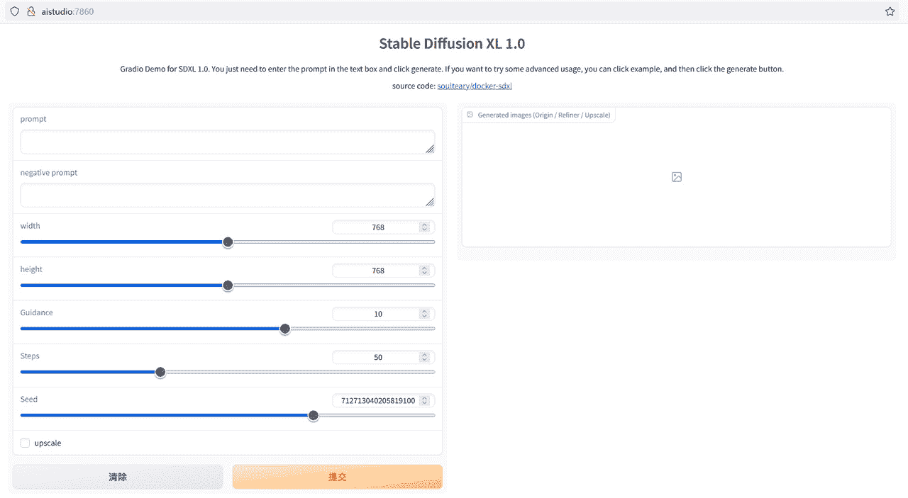

浅画一张

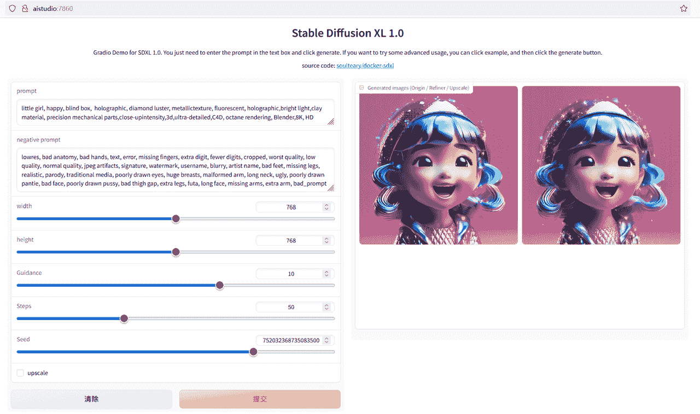

在绘画的时候，可以看到容器的terminal里有动静

```
To create a public link, set `share=True` in `launch()`.
100%|████████████████████████████████| 50/50 [00:04&lt;00:00, 12.13it/s]
100%|████████████████████████████████| 15/15 [00:01&lt;00:00, 12.89it/s]
100%|████████████████████████████████| 50/50 [00:03&lt;00:00, 13.45it/s]
100%|████████████████████████████████| 15/15 [00:01&lt;00:00, 13.50it/s]
```

查看一下GPU使用情况

```
root@002841e45d48:/app# nvidia-smi
Mon Jul 31 05:46:18 2023
+---------------------------------------------------------------------------------------+
| NVIDIA-SMI 535.86.01              Driver Version: 536.67       CUDA Version: 12.2     |
|-----------------------------------------+----------------------+----------------------+
| GPU  Name                 Persistence-M | Bus-Id        Disp.A | Volatile Uncorr. ECC |
| Fan  Temp   Perf          Pwr:Usage/Cap |         Memory-Usage | GPU-Util  Compute M. |
|                                         |                      |               MIG M. |
|=========================================+======================+======================|
|   0  NVIDIA GeForce RTX 4090        On  | 00000000:01:00.0 Off |                  Off |
|  0%   39C    P8              29W / 450W |  19622MiB / 24564MiB |     12%      Default |
|                                         |                      |                  N/A |
+-----------------------------------------+----------------------+----------------------+

+---------------------------------------------------------------------------------------+
| Processes:                                                                            |
|  GPU   GI   CI        PID   Type   Process name                            GPU Memory |
|        ID   ID                                                             Usage      |
|=======================================================================================|
|    0   N/A  N/A       376      C   /python3.10                               N/A      |
+---------------------------------------------------------------------------------------+
```

开启upscale效果之后，可以看到显存已经全部吃光了，真电老虎

```
root@002841e45d48:/app# nvidia-smi
Mon Jul 31 05:48:00 2023
+---------------------------------------------------------------------------------------+
| NVIDIA-SMI 535.86.01              Driver Version: 536.67       CUDA Version: 12.2     |
|-----------------------------------------+----------------------+----------------------+
| GPU  Name                 Persistence-M | Bus-Id        Disp.A | Volatile Uncorr. ECC |
| Fan  Temp   Perf          Pwr:Usage/Cap |         Memory-Usage | GPU-Util  Compute M. |
|                                         |                      |               MIG M. |
|=========================================+======================+======================|
|   0  NVIDIA GeForce RTX 4090        On  | 00000000:01:00.0 Off |                  Off |
|  0%   39C    P8              29W / 450W |  24061MiB / 24564MiB |      6%      Default |
|                                         |                      |                  N/A |
+-----------------------------------------+----------------------+----------------------+

+---------------------------------------------------------------------------------------+
| Processes:                                                                            |
|  GPU   GI   CI        PID   Type   Process name                            GPU Memory |
|        ID   ID                                                             Usage      |
|=======================================================================================|
|    0   N/A  N/A       376      C   /python3.10                               N/A      |
+---------------------------------------------------------------------------------------+
```

好了，落地LLM大模型这一part算是基本完成，接下来我会尝试进行套壳，请继续关注哦。

# Day 4  （2023-7-30）花样更多的快速落地姿势

感谢大家的关注，有很多朋友抱怨我的环境过于简单过于理想化，以下有三个灵魂拷问的点：

+   如何在Linux上运行

+   如何在国内网络环境中运行

+   如果没有4090显卡如何运行

善于缝合的我，琢磨了一下，把这三个需求整合成一个场景给大家展示下，那就是在国内云平台上租用GPU增强型的Linux实例运行这个环境。

## 虚机规格

我在某个国内云平台上综合性能和价格选择了下面这一款虚机，不同的云平台具体的规格和价格可能区别很大，但是通常都有V100这块显卡。

+   GPU加速型 | 8vCPUs | 64GiB | p2s.2xlarge.8

+   GPU显卡: 1 * NVIDIA V100-PCIe-32G / 1 * 32G

+   系统映像：Ubuntu 22.04 server 64bit for GPU

+   系统磁盘：高IO  |  200 GiB

+   带宽：选择到最高档300 Mbit/s

+   费用：  配置费用¥14.871/小时+ 弹性公网IP流量费用¥0.64/GB

说到费用这块，今天这个过程我跑了2个小时，叠加网络流量大概用了80元人民币，嘿嘿，所以还是有一块自己的卡比较好啊。

## 安装nvidia显卡驱动

检查机器是否存在nvidia显卡以及显卡适配的型号

```
 nvidia-detector
```

得到以下输出

```
root@aistudio:~# nvidia-detector
nvidia-driver-535
```

+   nvidia-detector 是一个用于检测系统中 NVIDIA 显卡的工具，它是 Ubuntu 的一部分。如果你已经安装了这个工具，你可以通过运行 nvidia-detector 命令来检测你的系统中是否有 NVIDIA 显卡。

+   如果 nvidia-detector 返回的是 none，那么你的系统中可能没有 NVIDIA 显卡。如果它返回的是一个 NVIDIA 显卡的型号，那么你的系统中有一个 NVIDIA 显卡。

+   请注意，nvidia-detector 只能检测到物理上存在的 NVIDIA 显卡，它不能检测到显卡驱动程序是否已经正确安装和运行。如果你的 nvidia-smi 命令仍然失败，那么可能是因为你的 NVIDIA 驱动程序没有正确安装或运行。

+   如果 nvidia-detector 返回 nvidia-driver-535，这意味着它检测到你的系统中有一个 NVIDIA 显卡，并且这个显卡应该使用 nvidia-driver-535 驱动程序。

安装nvidia驱动程序和nvidia dkms

```
sudo apt-get install -y nvidia-driver-535 nvidia-dkms-535
```

驱动执行完成之后，执行nvidia-smi

```
nvidia-smi
```

```
root@aistudio:~# nvidia-smi
Sun Jul 30 10:05:42 2023
+---------------------------------------------------------------------------------------+
| NVIDIA-SMI 535.54.03              Driver Version: 535.54.03    CUDA Version: 12.2     |
|-----------------------------------------+----------------------+----------------------+
| GPU  Name                 Persistence-M | Bus-Id        Disp.A | Volatile Uncorr. ECC |
| Fan  Temp   Perf          Pwr:Usage/Cap |         Memory-Usage | GPU-Util  Compute M. |
|                                         |                      |               MIG M. |
|=========================================+======================+======================|
|   0  Tesla V100S-PCIE-32GB          Off | 00000000:00:0D.0 Off |                    0 |
| N/A   32C    P0              24W / 250W |      0MiB / 32768MiB |      0%      Default |
|                                         |                      |                  N/A |
+-----------------------------------------+----------------------+----------------------+

+---------------------------------------------------------------------------------------+
| Processes:                                                                            |
|  GPU   GI   CI        PID   Type   Process name                            GPU Memory |
|        ID   ID                                                             Usage      |
|=======================================================================================|
|  No running processes found                                                           |
+---------------------------------------------------------------------------------------+
```

上述输出的核心细节是：

+   0  Tesla V100S-PCIE-32GB: 这是你的 GPU 的编号和名称。在这里，你的 GPU 编号是 0，名称是 Tesla V100S-PCIE-32GB。

+   Persistence-M: 这是 GPU 的持久模式状态。如果持久模式被打开，GPU 将不会在没有运行的计算工作负载时关闭。

+   Bus-Id: 这是 GPU 在主机系统的总线 ID。

+   Disp.A: 这是显示活动状态。如果为 "Off"，则表示没有连接显示器。

+   Volatile Uncorr. ECC: 这是 GPU ECC 错误计数。在这里，错误计数是 0。

+   Fan: 这是风扇的速度，但对于某些数据中心 GPU（如 Tesla），这个值可能不适用（N/A）。

+   Temp: 这是 GPU 的当前温度，这里是 32 摄氏度。

+   Perf: 这是性能状态，P0 表示最大性能状态。

+   Pwr:Usage/Cap: 这是 GPU 的当前功率使用和最大功率限制。在这里，当前功率使用是 24 瓦特，最大功率限制是 250 瓦特。

+   Memory-Usage: 这是 GPU 的当前内存使用和总内存。在这里，没有任何内存被使用，总内存是 32768 MiB（32 GB）。

+   GPU-Util: 这是 GPU 的当前利用率。在这里，利用率是 0%。

+   Compute M.: 这是 GPU 的计算模式。"Default" 模式允许多个计算应用共享 GPU。

+   MIG M.: 这是 Multi-Instance GPU (MIG) 模式。N/A 表示你的 GPU 不支持 MIG，或者 MIG 没有被启用。

## GPU Docker 环境的安装和配置

安装docker，这里用的是常规国内安装过程，最好是分三段运行

```
apt -y install apt-transport-https ca-certificates curl software-properties-common

curl -fsSL https://mirrors.aliyun.com/docker-ce/linux/ubuntu/gpg | sudo apt-key add -
sudo add-apt-repository &quot;deb [arch=amd64] https://mirrors.aliyun.com/docker-ce/linux/ubuntu $(lsb_release -cs) stable&quot;

apt update -y 
apt install docker-ce -y 
```

添加nvidia容器工具包APT源

```
distribution=ubuntu22.04 &amp;&amp; \
curl -fsSL https://nvidia.github.io/libnvidia-container/gpgkey | sudo gpg --dearmor -o /usr/share/keyrings/nvidia-container-toolkit-keyring.gpg &amp;&amp; \
curl -s -L https://nvidia.github.io/libnvidia-container/$distribution/libnvidia-container.list | sed &#x27;s#deb https://#deb [signed-by=/usr/share/keyrings/nvidia-container-toolkit-keyring.gpg] https://#g&#x27; | sudo tee /etc/apt/sources.list.d/nvidia-container-toolkit.list
```

安装nvidia容器工具包

```
sudo apt-get update &amp;&amp; sudo apt-get install -y nvidia-container-toolkit
```

为 docker 添加 nvidia运行时

```
sudo nvidia-ctk runtime configure --runtime=docker
```

以下输出说明命令执行成功，需要重启docker以使配置生效

```
root@aistudio:~# sudo nvidia-ctk runtime configure --runtime=docker
INFO[0000] Loading docker config from /etc/docker/daemon.json
INFO[0000] Config file does not exist, creating new one
INFO[0000] Wrote updated config to /etc/docker/daemon.json
INFO[0000] It is recommended that the docker daemon be restarted.
```

重启docker

```
sudo systemctl restart docker
```

查看运行时

```
 docker info | grep Runtimes
```

以下输出，说明nvidia容器运行时已经生效了

```
root@aistudio:~# docker info | grep Runtimes
 Runtimes: io.containerd.runc.v2 nvidia runc
```

运行一个测试容器，尝试在容器里使用nvidia-smi查看GPU信息

```
docker run --gpus all -it --rm nvcr.io/nvidia/cuda:11.4.3-base-ubuntu20.04 nvidia-smi
```

以下输出说明GPU在容器中工作正常

```
root@aistudio:~/docker-llama2-chat# docker run --gpus all -it --rm nvcr.io/nvidia/cuda:11.4.3-base-ubuntu20.04 nvidia-smi
Unable to find image &#x27;nvcr.io/nvidia/cuda:11.4.3-base-ubuntu20.04&#x27; locally
11.4.3-base-ubuntu20.04: Pulling from nvidia/cuda
ca1778b69356: Pull complete
3b595136a210: Pull complete
b0cbedff9be8: Pull complete
569ff44c1698: Pull complete
1c34507dbc74: Pull complete
Digest: sha256:bee557a9785dc70cc3c5084e9b358ad1d64f4b1fc5d87e0fe82c540355a5eba1
Status: Downloaded newer image for nvcr.io/nvidia/cuda:11.4.3-base-ubuntu20.04
Sun Jul 30 03:31:02 2023
+---------------------------------------------------------------------------------------+
| NVIDIA-SMI 535.54.03              Driver Version: 535.54.03    CUDA Version: 12.2     |
|-----------------------------------------+----------------------+----------------------+
| GPU  Name                 Persistence-M | Bus-Id        Disp.A | Volatile Uncorr. ECC |
| Fan  Temp   Perf          Pwr:Usage/Cap |         Memory-Usage | GPU-Util  Compute M. |
|                                         |                      |               MIG M. |
|=========================================+======================+======================|
|   0  Tesla V100S-PCIE-32GB          Off | 00000000:00:0D.0 Off |                    0 |
| N/A   34C    P0              25W / 250W |      0MiB / 32768MiB |      0%      Default |
|                                         |                      |                  N/A |
+-----------------------------------------+----------------------+----------------------+

+---------------------------------------------------------------------------------------+
| Processes:                                                                            |
|  GPU   GI   CI        PID   Type   Process name                            GPU Memory |
|        ID   ID                                                             Usage      |
|=======================================================================================|
|  No running processes found                                                           |
+---------------------------------------------------------------------------------------+
```

注意：如果你是在租用的云端虚机实例上操作，做到这里大概花费还不到5元钱，后续的步骤就是很枯燥的三板斧 git clone docker build 和docker run。时间长花费多，没有太大的难度，如果继续往下走，做好持续花钱的思想准备。

## 运行项目

今天我做实验的时候，还无法顺利地从HF上下载到中文模型，因此还是以Llama-2-7b-chat-hf为例

### 克隆项目库

安装git lfs

```
sudo apt-get install git-lfs
git lfs install
```

希望慧眼如你发现了针对中国宝宝的github克隆细节

```
git clone  https://ghproxy.com/https://github.com/soulteary/docker-llama2-chat 
cd docker-llama2-chat/
```

### 创建镜像

```
bash scripts/make-7b.sh
```

这一步大概耗时10分钟左右

### 下载模型

```
git lfs install
git clone https://huggingface.co/meta-llama/Llama-2-7b-chat-hf
mkdir meta-llama
mv Llama-2-7b-chat-hf meta-llama/
```

+   在云平台上的用时，取决于当时平台的带宽，如果可以跑满300 Mbit/s规格的带宽，大概20分钟；但是就怕带宽不是那么理想的话，时间可能会有所延长。又及：每GB的下载成本是人民币0.64元。

+   如果是在本机上做实验，那就请坐和放宽，默念耐心是美德，快完了快完了。

### 运行容器

```
bash scripts/run-7b.sh
```

需要在云主机上开放7860入站端口，然后使用虚机的公网地址:7860就可以访问，还是原来的配方还是原来的味道

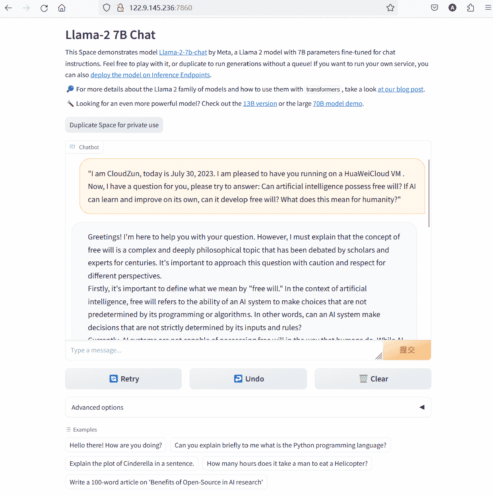

对于租用云计算实例的朋友来说，看到这一步，应该也值了，就相当于自己花钱买票看了一场电影，而且还是交互式沉浸式体验的。

好了，文生文的模型部署就先到这里，接下来会花时间研究下文生图项目的落地。

# Day 3 (2023-7-29 ) 可手把手扶LNN落地LLM的万字手册

## 快速运行（太长不看版）

所谓的“老奶奶有手就能做”对我来说，就是支持容器化的开源项目用三板斧就能在我环境中跑出来（堪比复现超导）：

1.  git clone

1.  docker build

1.  docker run

具体在我们这个项目里，顺序稍微有所变化，以7b为例的一键生成的操作如下：

```
# clone项目库
git clone https://github.com/soulteary/docker-llama2-chat 
cd docker-llama2-chat/

#构建映像
bash scripts/make-7b.sh

#下载模型
git lfs install
git clone https://huggingface.co/meta-llama/Llama-2-7b-chat-hf
mkdir meta-llama
mv Llama-2-7b-chat-hf meta-llama/

#运行容器
bash scripts/run-7b.sh
```

整个过程如果在自己的桌面端执行，主要是第三步下载模型时间会比较长，取决于下行带宽，可能需要至少一个小时，因此总用时的预期按照一个半小时来算比较合理。

所以某种意义上来说，只要软硬件和网络条件到位，上面一段命令输入之后，稍等片刻，就能和大语言模型谈笑风生了，可以算得上是老奶奶有手就能跑的LLM落地实践。

如果你还有时间需要了解更多的操作细节和项目背景，请往下看，我们的万字长文才刚刚开始。

## 模型选择

以下是当前实验涉及的模型基本信息

+   对于两个官方版的模型，需要到 https://huggingface.co/meta-llama 申请申请使用权限，审批过程大概需要两个小时；

+   对于两个非官方版，无需注册直接可以使用。

+   模型的选择主要是依据语言还有硬件条件的约束，模型选择好之后，运行过程基本一致。

## 创建镜像

### 下载repo

```
git clone https://github.com/soulteary/docker-llama2-chat 
cd docker-llama2-chat/
```

### 构建映像

```
# 7B
bash scripts/make-7b.sh

# 或 13B
bash scripts/make-13b.sh

# 或 7B Chinese
bash scripts/make-7b-cn.sh

# 或 7B Chinese 4bit
bash scripts/make-7b-cn-4bit.sh
```

### 解析映像构建过程

以make-7b.sh 为例:

```
#!/bin/bash

docker build -t soulteary/llama2:base . -f docker/Dockerfile.base

docker build -t soulteary/llama2:7b . -f docker/Dockerfile.7b
```

1.  docker build -t soulteary/llama2:base . -f docker/Dockerfile.base：这行命令是用来构建一个Docker镜像的。-t选项用于指定镜像的名称和标签，这里的名称是soulteary/llama2，标签是base。.表示Dockerfile所在的上下文路径，这里是当前目录。-f选项用于指定Dockerfile的路径，这里是docker/Dockerfile.base。

1.  docker build -t soulteary/llama2:7b . -f docker/Dockerfile.7b：这行命令也是用来构建一个Docker镜像的。这次的镜像名称还是soulteary/llama2，但标签是7b。Dockerfile的路径是docker/Dockerfile.7b。

所以，这个脚本的主要功能就是构建两个Docker镜像，一个标签为base，另一个标签为7b。这两个镜像都是基于当前目录下的不同Dockerfile文件构建的。

基础镜像soulteary/llama2:base  分析：

```
FROM nvcr.io/nvidia/pytorch:23.06-py3
RUN pip config set global.index-url https://pypi.tuna.tsinghua.edu.cn/simple &amp;&amp; \
    pip install accelerate==0.21.0 bitsandbytes==0.40.2 gradio==3.37.0 protobuf==3.20.3 scipy==1.11.1 sentencepiece==0.1.99 transformers==4.31.0
WORKDIR /app
```

这是一个Dockerfile，它是一种文本文档，用于自动化Docker镜像的构建过程。下面是这个Dockerfile的逐行解析：

1.  FROM nvcr.io/nvidia/pytorch:23.06-py3：这行指定了基础镜像，所有后续的操作都在这个基础镜像上进行。这里的基础镜像是NVIDIA提供的包含PyTorch的镜像，版本是23.06，并且使用的Python版本是3。

1.  RUN pip config set global.index-url https://pypi.tuna.tsinghua.edu.cn/simple && \：这行设置了pip的全局源为清华大学的源，这可以提高在中国大陆的下载速度。

1.  pip install accelerate==0.21.0 bitsandbytes==0.40.2 gradio==3.37.0 protobuf==3.20.3 scipy==1.11.1 sentencepiece==0.1.99 transformers==4.31.0：这行使用pip安装了多个Python包，包括accelerate, bitsandbytes, gradio, protobuf, scipy, sentencepiece, 和transformers。每个包都指定了具体的版本号。

1.  WORKDIR /app：这行设置了工作目录为/app。这意味着后续的命令都将在/app目录下执行，如果这个目录不存在，Docker将会自动创建它。

总的来说，这个Dockerfile创建了一个包含PyTorch和其他几个Python包的环境，这个环境可以用于运行需要这些包的Python程序。

> 以下是第三行涉及的Python包的简单概述：

>

> 1. accelerate: 这是由Hugging Face开发的一个用于加速PyTorch模型训练的库。它提供了简单的API来运行在任何硬件(如CPU、单个GPU、多个GPU、TPU等)上的PyTorch代码。

> 2. bitsandbytes: 这是一个用于深度学习训练中优化计算的库。它提供了一些优化算法，如优化的Adam实现，可以在深度学习训练中提高效率。

> 3. gradio: 这是一个用于创建机器学习模型的交互式UI的库。它可以让开发者快速地为他们的模型创建一个web界面，以便于测试和演示。

> 4. protobuf: 这是Google开发的一种数据序列化协议（Protocol Buffers）。它可以用于结构化数据的存储或远程过程调用。

> 5. scipy: 这是一个用于科学计算和技术计算的库。它提供了很多用于数学、科学、工程的函数，如线性代数、最优化、插值、特殊函数、快速傅里叶变换等。

> 6. sentencepiece: 这是一个用于神经网络模型中的文本处理的库。它提供了一种简单的、可灵活使用的新型分词工具，尤其适合于神经网络模型中的文本处理。

> 7. transformers: 这是由Hugging Face开发的一种用于自然语言处理（NLP）的库。它提供了大量预训练的模型，如BERT、GPT-2、RoBERTa等，以及对应的训练和微调工具。

soulteary/llama2:7b 镜像分析

```
FROM soulteary/llama2:base

COPY llama2-7b/* ./

CMD [&quot;python&quot;, &quot;app.py&quot;]
```

这是一个简单的Dockerfile，用于创建一个Docker镜像。下面是对每一行的解释：

+   FROM soulteary/llama2:base：这行指定了基础镜像，所有的操作都会在这个镜像的基础上进行。这里使用的基础镜像是"soulteary/llama2"的"base"标签版本。

+   COPY llama2-7b/* ./：这行将主机上的"llama2-7b"目录下的所有文件复制到镜像的工作目录中（"./"表示当前工作目录）。注意这里的源路径是相对于构建上下文的，通常构建上下文就是Dockerfile所在的目录。

+   CMD ["python", "app.py"]：这行指定了容器启动时要运行的命令。这里是运行"python app.py"。CMD只能在Dockerfile中出现一次，如果有多个CMD，只有最后一个会生效。

这个Dockerfile创建的镜像会运行"app.py"，并且在运行之前，会把你的"llama2-7b"目录下的所有文件复制到镜像中。这个"app.py"应该是一个Python应用程序的入口点。

顺藤摸瓜看看 llama2-7b 目录

```
chengzh@AIStudio:~/docker-llama2-chat$ cd llama2-7b
chengzh@AIStudio:~/docker-llama2-chat/llama2-7b$ dir
app.py  model.py
chengzh@AIStudio:~/docker-llama2-chat/llama2-7b$ tree
.
├── app.py
└── model.py

0 directories, 2 files
```

+   app.ny : 这个Python脚本主要用于创建一个交互式的聊天机器人界面，使用了Gradio库和Hugging Face的模型。这个聊天机器人模型是基于Meta的Llama-2-7b模型，一个拥有70亿参数并且经过聊天指令微调的模型。

以下是这个脚本的主要功能：

> 1. **设置模型参数和提示**：脚本设定了一些默认的模型参数，如DEFAULT_SYSTEM_PROMPT，MAX_MAX_NEW_TOKENS，DEFAULT_MAX_NEW_TOKENS等。这些参数用于控制模型的生成行为。

> 2. **定义交互功能**：脚本定义了一系列的函数，如clear_and_save_textbox，display_input，delete_prev_fn，generate等，这些函数用于处理用户的输入和模型的输出，以及一些交互动作，如提交消息、删除之前的消息、清空聊天历史等。

> 3. **创建Gradio界面**：脚本使用Gradio库创建了一个交互式的聊天机器人界面，包括一个文本输入框，一个提交按钮，一个聊天机器人的显示区域，以及一些高级选项（如模型的系统提示、最大新生成的token数量、生成温度等）。

> 4. **处理用户交互**：脚本定义了一系列的事件处理函数，这些函数将在用户进行某些操作（如提交消息、点击按钮等）时被触发。这些函数会处理用户的输入，调用模型进行生成，然后将生成的结果显示在聊天机器人的显示区域。

> 5. **启动Gradio应用**：最后，脚本启动了Gradio应用，使得用户可以在Web界面上与聊天机器人进行交互。

> 总的来说，这个Python脚本创建了一个交互式的聊天机器人，用户可以在Web界面上输入消息，聊天机器人会根据用户的输入和模型的参数生成响应，然后将响应显示在界面上。

+   model.py : 这个Python脚本是一个基于Hugging Face的transformers库和PyTorch的聊天机器人模型的实现。它使用了Meta的Llama-2-7b聊天模型，并提供了一些功能来生成聊天响应。

以下是这个脚本的主要功能：

> 1. **模型和分词器的加载**：脚本首先检查是否有可用的CUDA设备（也就是GPU），如果有，就在GPU上加载模型，否则，模型为None。然后，脚本加载了模型对应的分词器。

> 2. **生成聊天提示**：get_prompt函数用于生成聊天提示，它将系统提示、之前的聊天历史以及用户的当前输入组合成一个字符串，用于输入到模型中。

> 3. **生成聊天响应**：run函数用于生成聊天响应。它首先调用get_prompt函数获取聊天提示，然后使用分词器将提示转换为模型可以处理的输入形式。然后，它创建了一个TextIteratorStreamer对象，用于从模型生成的输出中获取文本。最后，它在一个新的线程中调用模型的generate方法生成聊天响应，并将生成的响应返回。

> 这个脚本的主要功能就是提供了一个聊天机器人，用户可以输入消息，然后聊天机器人会生成响应。这个聊天机器人使用了Meta的Llama-2-7b模型，并且可以在GPU上运行，以提高生成响应的速度。

总体的映像构建过程大概需要十分钟左右，大部分时间是用于构建base映像，其余映像的只要几秒，且base映像只要构建一次就好，其他映像可以共用这个映像。

### 分析映像

查看映像列表

```
docker ps
```

```
chengzh@AIStudio:~/docker-llama2-chat$ docker images
REPOSITORY                       TAG                       IMAGE ID       CREATED         SIZE
soulteary/llama2                 7b-cn                     83d2cafcea28   19 hours ago    20.3GB
soulteary/llama2                 13b                       eaae3aeddd7d   20 hours ago    20.3GB
soulteary/llama2                 7b                        5248e57678a2   20 hours ago    20.3GB
soulteary/llama2                 base                      6ae74f9662ea   20 hours ago    20.3GB
nvidia/cuda                      11.4.3-base-ubuntu20.04   90860288a3eb   3 months ago    126MB
```

分别查看base和7b的映像历史

```
 chengzh@AIStudio:~/docker-llama2-chat$ docker history  soulteary/llama2:base
IMAGE          CREATED        CREATED BY                                      SIZE      COMMENT
6ae74f9662ea   20 hours ago   WORKDIR /app                                    0B        buildkit.dockerfile.v0
&lt;missing&gt;      20 hours ago   RUN /bin/sh -c pip config set global.index-u…   603MB     buildkit.dockerfile.v0
&lt;missing&gt;      4 weeks ago    LABEL com.nvidia.build.ref=4a0aebfab10905f51…   0B        buildkit.dockerfile.v0
&lt;missing&gt;      4 weeks ago    ARG NVIDIA_BUILD_REF                            0B        buildkit.dockerfile.v0
&lt;missing&gt;      4 weeks ago    LABEL com.nvidia.build.id=63009835              0B        buildkit.dockerfile.v0
&lt;missing&gt;      4 weeks ago    ENV NVIDIA_BUILD_ID=63009835                    0B        buildkit.dockerfile.v0
&lt;missing&gt;      4 weeks ago    ARG NVIDIA_BUILD_ID                             0B        buildkit.dockerfile.v0
## 删除100多行nvcr.io/nvidia/pytorch:23.06-py3的history信息
```

```
chengzh@AIStudio:~/docker-llama2-chat$ docker history  soulteary/llama2:7b
IMAGE          CREATED        CREATED BY                                      SIZE      COMMENT
5248e57678a2   20 hours ago   CMD [&quot;python&quot; &quot;app.py&quot;]                         0B        buildkit.dockerfile.v0
&lt;missing&gt;      20 hours ago   COPY llama2-7b/* ./ # buildkit                  9.97kB    buildkit.dockerfile.v0
&lt;missing&gt;      20 hours ago   WORKDIR /app                                    0B        buildkit.dockerfile.v0
&lt;missing&gt;      20 hours ago   RUN /bin/sh -c pip config set global.index-u…   603MB     buildkit.dockerfile.v0
# 略去高度雷同部分
```

> 这个输出是docker history命令的结果，它显示了镜像soulteary/llama2:7b的历史记录。这些记录是按照创建时间倒序排列的，最新的操作在最上面。

>

> 1. IMAGE: 这列显示了每个层的ID。镜像是由多个层(layers)堆叠起来形成的，每个层都是由前一个层的状态和当前指令的结果形成的。<missing>表示这个层的ID没有被保留，这通常是因为这个层是中间层，不需要被直接引用。>

> 2. CREATED: 这列显示了每个层的创建时间。>

> 3. CREATED BY: 这列显示了创建每个层的Docker指令。>

> 4. SIZE: 这列显示了每个层的大小。注意这个大小是相对于前一个层的，也就是说，这个大小是执行当前指令后增加的大小。>

> 5. COMMENT: 这列显示了关于每个层的额外信息。

>

> 这个输出的具体解析如下：

>

> 1. 5248e57678a2   20 hours ago   CMD ["python" "app.py"]                         0B        buildkit.dockerfile.v0: 这一行表示在20小时前，执行了CMD ["python" "app.py"]指令，这个指令设置了镜像的默认命令为运行app.py。这个操作没有增加镜像的大小。>

> 2. <missing>      20 hours ago   COPY llama2-7b/* ./ # buildkit                  9.97kB    buildkit.dockerfile.v0: 这一行表示在20小时前，执行了COPY llama2-7b/* ./指令，这个指令将主机上的llama2-7b目录下的所有文件复制到了镜像的当前工作目录。这个操作增加了镜像的大小约9.97KB。>

> 3. <missing>      20 hours ago   WORKDIR /app                                    0B        buildkit.dockerfile.v0: 这一行表示在20小时前，执行了WORKDIR /app指令，这个指令设置了镜像的工作目录为/app。这个操作没有增加镜像的大小。>

> 4. <missing>      20 hours ago   RUN /bin/sh -c pip config set global.index-u…   603MB     buildkit.dockerfile.v0: 这一行表示在20小时前，执行了一个RUN指令，这个指令运行了一个shell脚本来配置pip和安装一些Python包。这个操作增加了镜像的大小约603MB。

对比两个映像的history，可以发现base提供了完整的模型运行环境，7b针对特定的版本的模型提供交互式聊天界面，所以7b的构建过程就是拷贝了两个文件(大小为9.97KB)，并设置了容器启动的时候自动运行app.py。

因此版本对应的映像构建都很快，且版本映像占据硬盘的空间只有新增部分，并不是显示出来的20GB。这一点大家不用担心硬盘的空间会被新映像耗尽。空间上的焦虑来自下一节

## 下载模型

必须执行的步骤，如果不执行，以后肯定会怀疑人生

```
git lfs install
```

git lfs install是Git Large File Storage（LFS）的安装命令。Git LFS 是一种 Git 扩展，它用于处理大文件，如音频样本、视频、数据集等。默认情况下，Git 不适合处理大文件，因为它会将所有版本的所有文件都存储在本地仓库中，这可能会导致仓库变得非常大。Git LFS 解决了这个问题，它将大文件存储在远程服务器上，只在本地保留一个轻量级的引用。

当你运行 git lfs install 命令时，它将执行以下操作：

1.  安装一些必要的钩子（hooks），这些钩子将在执行 git 命令时运行，以确保大文件被正确地处理。例如，pre-push 钩子将在推送到远程仓库之前运行，post-checkout 钩子将在检出分支或提交后运行。

1.  设置一些必要的 Git 配置。例如，它将设置 filter.lfs.clean 和 filter.lfs.smudge 配置，这些配置定义了如何在将大文件添加到仓库和从仓库检出大文件时处理这些文件。

注意，在运行 git lfs install 命令之前，你需要先安装 Git LFS。你可以从 Git LFS 的 GitHub 仓库下载适合你的操作系统的安装程序。

下载映像，并进行必要的路径修改

```
# MetaAI LLaMA2 Models (10~14GB vRAM)
git clone https://huggingface.co/meta-llama/Llama-2-7b-chat-hf
git clone https://huggingface.co/meta-llama/Llama-2-13b-chat-hf

mkdir meta-llama
mv Llama-2-7b-chat-hf meta-llama/
mv Llama-2-13b-chat-hf meta-llama/

# 或 Chinese LLaMA2 (10~14GB vRAM)
git clone https://huggingface.co/LinkSoul/Chinese-Llama-2-7b

mkdir LinkSoul
mv Chinese-Llama-2-7b LinkSoul/

# 或 Chinese LLaMA2 4BIT (5GB vRAM)
git clone https://huggingface.co/soulteary/Chinese-Llama-2-7b-4bit

mkdir soulteary
mv Chinese-Llama-2-7b-4bit soulteary/
```

以下载13b模型为例（7b忘了记录日志输出了）

```
chengzh@AIStudio:~/docker-llama2-chat$ git clone https://huggingface.co/meta-llama/Llama-2-13b-chat-hf
Cloning into &#x27;Llama-2-13b-chat-hf&#x27;...
Username for &#x27;https://huggingface.co&#x27;: huaqloud
Password for &#x27;https://huaqloud@huggingface.co&#x27;:
remote: Enumerating objects: 52, done.
remote: Counting objects: 100% (41/41), done.
remote: Compressing objects: 100% (41/41), done.
remote: Total 52 (delta 19), reused 0 (delta 0), pack-reused 11
Unpacking objects: 100% (52/52), 497.59 KiB | 618.00 KiB/s, done.
Username for &#x27;https://huggingface.co&#x27;: huaqloud
Password for &#x27;https://huaqloud@huggingface.co&#x27;:
Filtering content: 100% (8/8), 8.48 GiB | 1.56 MiB/s, done.
Encountered 6 file(s) that may not have been copied correctly on Windows:
        model-00003-of-00003.safetensors
        pytorch_model-00003-of-00003.bin
        pytorch_model-00001-of-00003.bin
        pytorch_model-00002-of-00003.bin
        model-00002-of-00003.safetensors
        model-00001-of-00003.safetensors

See: `git lfs help smudge` for more details.
```

这个输出是git clone命令的结果，它从Hugging Face的模型仓库克隆了一个名为Llama-2-13b-chat-hf的项目。这个项目可能包含一个预训练的聊天模型。

下面是对这个输出的具体解析：

> 1. Cloning into 'Llama-2-13b-chat-hf'...: 这个消息表示开始克隆项目到本地的Llama-2-13b-chat-hf目录。>

> 2. Username for 'https://huggingface.co': huaqloud: 这个消息表示Git请求输入用于https://huggingface.co的用户名，这里的用户名是huaqloud。>

> 3. Password for 'https://huaqloud@huggingface.co':: 这个消息表示Git请求输入用于https://huggingface.co的密码。>

> 4. remote: Enumerating objects: 52, done.: 这个消息表示Git开始列举远程仓库中的对象。这个仓库中有52个对象。>

> 5. Unpacking objects: 100% (52/52), 497.59 KiB | 618.00 KiB/s, done.: 这个消息表示Git已经完成了对象的解压缩。>

> 6. Filtering content: 100% (8/8), 8.48 GiB | 1.56 MiB/s, done.: 这个消息表示Git LFS已经完成了大文件的过滤。这个项目中有8个大文件，总大小为8.48 GiB。>

> 7. Encountered 6 file(s) that may not have been copied correctly on Windows:: 这个消息表示在Windows上可能有6个文件没有被正确地复制。这可能是因为这些文件的大小超过了Git LFS在Windows上的限制。这些文件可能是模型的权重文件。>

> 8. See: git lfs help smudge for more details.: 这个消息表示如果需要更多的信息，可以查阅git lfs help smudge命令的帮助信息。

>

> 总的来说，这个项目包含一个大模型（可能是一个聊天模型），模型的权重文件被存储在Git LFS中。在克隆这个项目时，可能有一些文件没有被正确地复制，这可能会影响到模型的使用。

总的来说，操作中注意以下三点：

1.  使用在huggingface上注册的用户名密码进行登录。

1.  耐心是美德，本手册涉及到的模型小则25GB大则92GB，一定要有足够的耐心，尤其是带宽不是太高的情况下。

1.  虽然有报错，但是似乎并不影响模型使用。

又及：中文版的两个模型Chinese-Llama-2-7b 和 Chinese-Llama-2-7b-4bit下载时不需要登录

所有四个模型下载并调整好目录之后，我们的工作目录长这个样子

```
chengzh@AIStudio:~/docker-llama2-chat$ tree
.
├── LICENSE
├── LinkSoul
│   └── Chinese-Llama-2-7b
│       ├── README.md
│       ├── config.json
│       ├── generation_config.json
│       ├── pytorch_model-00001-of-00003.bin
│       ├── pytorch_model-00002-of-00003.bin
│       ├── pytorch_model-00003-of-00003.bin
│       ├── pytorch_model.bin.index.json
│       ├── special_tokens_map.json
│       ├── tokenizer.model
│       └── tokenizer_config.json
├── README.md
├── README_EN.md
├── docker
│   ├── Dockerfile.13b
│   ├── Dockerfile.7b
│   ├── Dockerfile.7b-cn
│   ├── Dockerfile.7b-cn-4bit
│   └── Dockerfile.base
├── llama.cpp
│   ├── Dockerfile.converter
│   └── Dockerfile.runtime
├── llama2-13b
│   ├── app.py
│   └── model.py
├── llama2-7b
│   ├── app.py
│   └── model.py
├── llama2-7b-cn
│   ├── app.py
│   └── model.py
├── llama2-7b-cn-4bit
│   ├── app.py
│   ├── model.py
│   └── quantization_4bit.py
├── meta-llama
│   ├── Llama-2-13b-chat-hf
│   │   ├── LICENSE.txt
│   │   ├── README.md
│   │   ├── Responsible-Use-Guide.pdf
│   │   ├── USE_POLICY.md
│   │   ├── config.json
│   │   ├── generation_config.json
│   │   ├── model-00001-of-00003.safetensors
│   │   ├── model-00002-of-00003.safetensors
│   │   ├── model-00003-of-00003.safetensors
│   │   ├── model.safetensors.index.json
│   │   ├── pytorch_model-00001-of-00003.bin
│   │   ├── pytorch_model-00002-of-00003.bin
│   │   ├── pytorch_model-00003-of-00003.bin
│   │   ├── pytorch_model.bin.index.json
│   │   ├── special_tokens_map.json
│   │   ├── tokenizer.json
│   │   ├── tokenizer.model
│   │   └── tokenizer_config.json
│   └── Llama-2-7b-chat-hf
│       ├── LICENSE.txt
│       ├── README.md
│       ├── USE_POLICY.md
│       ├── config.json
│       ├── generation_config.json
│       ├── model-00001-of-00002.safetensors
│       ├── model-00002-of-00002.safetensors
│       ├── model.safetensors.index.json
│       ├── pytorch_model-00001-of-00002.bin
│       ├── pytorch_model-00002-of-00002.bin
│       ├── pytorch_model.bin.index.json
│       ├── special_tokens_map.json
│       ├── tokenizer.json
│       ├── tokenizer.model
│       └── tokenizer_config.json
├── scripts
│   ├── make-13b.sh
│   ├── make-7b-cn-4bit.sh
│   ├── make-7b-cn.sh
│   ├── make-7b.sh
│   ├── run-13b.sh
│   ├── run-7b-cn-4bit.sh
│   ├── run-7b-cn.sh
│   └── run-7b.sh
└── soulteary
    └── Chinese-Llama-2-7b-4bit
        ├── README.md
        ├── config.json
        ├── generation_config.json
        ├── pytorch_model-00001-of-00002.bin
        ├── pytorch_model-00002-of-00002.bin
        ├── pytorch_model.bin.index.json
        ├── special_tokens_map.json
        ├── tokenizer.model
        └── tokenizer_config.json

14 directories, 79 files
```

## 运行容器

### 让容器跑起来

根据所需要的版本，一键运行LLaMA2模型容器化应用

```
# 7B
bash scripts/run-7b.sh
# 或 13B
bash scripts/run-13b.sh
# 或 Chinese 7B
bash scripts/run-7b-cn.sh
# 或 Chinese 7B 4BIT
bash scripts/run-7b-cn-4bit.sh
```

依然以7B为例分析容器是怎么跑起来的，以下是 scripts/run-7b.sh 的内容

```
#!/bin/bash

docker run --gpus all --ipc=host --ulimit memlock=-1 --ulimit stack=67108864 --rm -it -v `pwd`/meta-llama:/app/meta-llama -p 7860:7860 soulteary/llama2:7b
```

这是一个 Bash 脚本，它用于运行一个 Docker 容器。让我们一步步地解析这个脚本：

> 1. #!/bin/bash: 这一行告诉系统这个脚本应该用哪个解释器执行。在这个例子中，脚本将由 Bash（Bourne Again SHell）解释器执行。>

> 2. docker run: 这是 Docker 的一个命令，用于运行一个 Docker 容器。>

> 3. --gpus all: 这个选项告诉 Docker 使用所有可用的 GPU。>

> 4. --ipc=host: 这个选项设置 Docker 容器的 IPC（Inter-Process Communication）命名空间。在这个例子中，容器将使用主机的 IPC 命名空间，这意味着容器中的进程可以和主机中的进程共享内存。>

> 5. --ulimit memlock=-1 --ulimit stack=67108864: 这些选项设置了容器的资源限制。在这个例子中，memlock=-1 移除了内存锁定的限制，stack=67108864 设置了栈的大小为 64MB。>

> 6. --rm: 这个选项告诉 Docker 在容器退出时自动删除容器。>

> 7. -it: 这两个选项一起使用，-i 保持 STDIN 打开，-t 分配一个伪终端，这使得你可以交互式地使用容器。>

> 8. -v pwd/meta-llama:/app/meta-llama: 这个选项挂载了一个卷。在这个例子中，主机的 meta-llama 目录被挂载到了容器的 /app/meta-llama 目录。>

> 9. -p 7860:7860: 这个选项发布了一个端口。在这个例子中，容器的 7860 端口被映射到了主机的 7860 端口。>

> 10. soulteary/llama2:7b: 这是 Docker 容器的镜像名称。在这个例子中，容器将基于 soulteary/llama2:7b 这个镜像。

总的来说，这个脚本运行了一个 Docker 容器，这个容器使用了所有可用的 GPU，没有内存锁定的限制，栈的大小为 64MB，退出时自动删除，可以交互式地使用，meta-llama 目录被挂载到了 /app/meta-llama，容器的 7860 端口被映射到了主机的 7860 端口，容器基于 soulteary/llama2:7b 这个镜像。

以下是7b的容器运行过程

```
chengzh@AIStudio:~/docker-llama2-chat$ bash scripts/run-7b.sh

=============
== PyTorch ==
=============

NVIDIA Release 23.06 (build 63009835)
PyTorch Version 2.1.0a0+4136153

Container image Copyright (c) 2023, NVIDIA CORPORATION &amp; AFFILIATES. All rights reserved.

Copyright (c) 2014-2023 Facebook Inc.
Copyright (c) 2011-2014 Idiap Research Institute (Ronan Collobert)
Copyright (c) 2012-2014 Deepmind Technologies    (Koray Kavukcuoglu)
Copyright (c) 2011-2012 NEC Laboratories America (Koray Kavukcuoglu)
Copyright (c) 2011-2013 NYU                      (Clement Farabet)
Copyright (c) 2006-2010 NEC Laboratories America (Ronan Collobert, Leon Bottou, Iain Melvin, Jason Weston)
Copyright (c) 2006      Idiap Research Institute (Samy Bengio)
Copyright (c) 2001-2004 Idiap Research Institute (Ronan Collobert, Samy Bengio, Johnny Mariethoz)
Copyright (c) 2015      Google Inc.
Copyright (c) 2015      Yangqing Jia
Copyright (c) 2013-2016 The Caffe contributors
All rights reserved.

Various files include modifications (c) NVIDIA CORPORATION &amp; AFFILIATES.  All rights reserved.

This container image and its contents are governed by the NVIDIA Deep Learning Container License.
By pulling and using the container, you accept the terms and conditions of this license:
https://developer.nvidia.com/ngc/nvidia-deep-learning-container-license

Loading checkpoint shards: 100%|███████████████| 2/2 [00:21&lt;00:00, 10.94s/it]
Caching examples at: &#x27;/app/gradio_cached_examples/20&#x27;
Caching example 1/5
Caching example 2/5
Caching example 3/5
Caching example 4/5
Caching example 5/5
Caching complete

/usr/local/lib/python3.10/dist-packages/gradio/utils.py:839: UserWarning: Expected 7 arguments for function &lt;function generate at 0x7f47b56f9240&gt;, received 6.
  warnings.warn(
/usr/local/lib/python3.10/dist-packages/gradio/utils.py:843: UserWarning: Expected at least 7 arguments for function &lt;function generate at 0x7f47b56f9240&gt;, received 6.
  warnings.warn(
Running on local URL:  http://0.0.0.0:7860

To create a public link, set `share=True` in `launch()`.
```

从输出来看，已经成功地运行了一个名为llama2:7b的Docker容器，并且其中的PyTorch环境也已经成功地初始化。这个容器使用了NVIDIA的深度学习容器，版本为23.06，PyTorch版本为2.1.0a0+4136153。

在初始化过程中，它加载了一些预训练模型的checkpoint分片，并且缓存了一些示例。

然后，你看到了一些警告，这些警告来自gradio库，这是一个用于创建机器学习模型的交互式界面的库。警告表示generate函数预期有7个参数，但只收到了6个。这可能意味着你需要检查你的代码，确保你正确地调用了generate函数。

最后，你的应用程序正在本地的7860端口上运行，你可以通过访问http://0.0.0.0:7860来查看它。如果你想创建一个公共链接，你需要在launch()函数中设置share=True。

### 体验交互界面

在浏览器中访问 http://localhost:7860 或者 http://hostip:7860

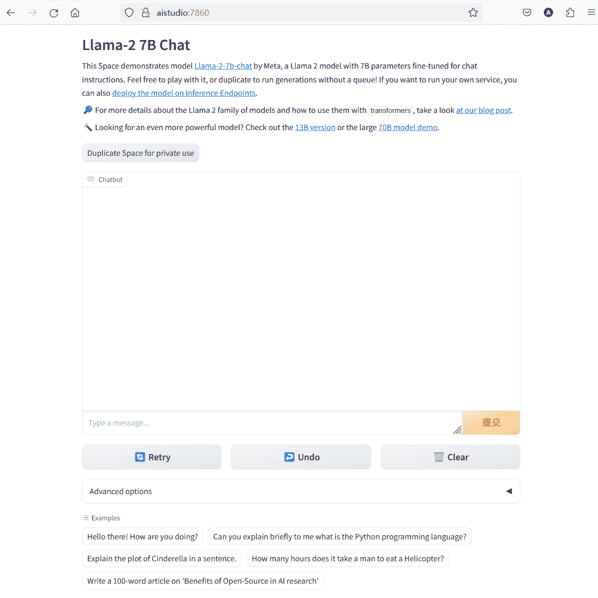

尝试劈个情操

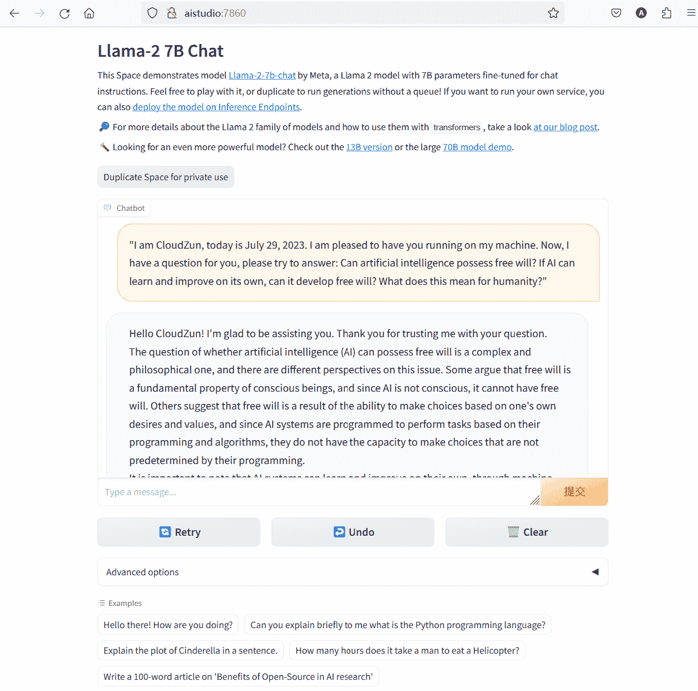

### 查看容器运行细节

使用 docker ps查看容器列表

```
chengzh@AIStudio:~$ docker ps
CONTAINER ID   IMAGE                 COMMAND                  CREATED          STATUS          PORTS                                        NAMES
20c2b7853b68   soulteary/llama2:7b   &quot;/opt/nvidia/nvidia_…&quot;   11 minutes ago   Up 11 minutes   6006/tcp, 8888/tcp, 0.0.0.0:7860-&gt;7860/tcp   gracious_perlman
e3e613bbfcd7   portainer/portainer   &quot;/portainer -H unix:…&quot;   18 hours ago     Up 3 hours      8000/tcp, 9443/tcp, 0.0.0.0:9000-&gt;9000/tcp   priceless_diffie
```

20c2b7853b68：就是我们7b模型所对应的容器。后续我们可以用20作为代号在命令中调用它。

+   它使用了soulteary/llama2:7b这个Docker镜像。

+   启动命令是/opt/nvidia/nvidia_entrypoint.sh  这个脚本是NVIDIA Docker镜像中的一个入口点脚本。当你启动一个基于这个镜像的容器时，这个脚本会被首先执行。这个脚本通常用于设置一些环境变量、初始化NVIDIA驱动和库，以及启动用户指定的应用程序。在当前案例中，这个脚本可能在初始化后启动了你的Python应用。

+   这个容器创建于11分钟前，状态为Up（正在运行）11分钟。它开放了6006、8888和7860这几个端口，其中宿主机的7860端口映射到了容器的7860端口。

+   这个容器的名字是gracious_perlman。

使用docker stats查看资源使用情况

```
CONTAINER ID   NAME               CPU %     MEM USAGE / LIMIT     MEM %     NET I/O          BLOCK I/O   PIDS
20c2b7853b68   gracious_perlman   0.64%     1.244GiB / 31.22GiB   3.98%     93.3kB / 885kB   0B / 0B     89
e3e613bbfcd7   priceless_diffie   0.03%     30.8MiB / 31.22GiB    0.10%     562kB / 4.26MB   0B / 0B     14
```

docker stats命令，用于展示特定容器的资源使用情况。这个命令的输出包含了CPU使用率、内存使用情况、网络I/O以及磁盘I/O等信息。

+   CONTAINER ID: 容器的ID，这里是20c2b7853b68。

+   NAME: 容器的名字，这里是gracious_perlman。

+   CPU %: CPU使用率，这里是0.64%，表示这个容器正在使用0.64%的CPU资源。

+   MEM USAGE / LIMIT: 内存使用情况和限制，这里是1.244GiB / 31.22GiB，表示这个容器正在使用1.244GiB的内存，而它的内存限制是31.22GiB。

+   MEM %: 内存使用率，这里是3.98%，表示这个容器正在使用的内存占其总内存限制的3.98%。

+   NET I/O: 网络I/O，这里是93.3kB / 885kB，表示这个容器已经接收了93.3kB的数据，发送了885kB的数据。

+   BLOCK I/O: 磁盘I/O，这里是0B / 0B，表示这个容器没有读写磁盘数据。

+   PIDS: 进程数，这里是89，表示在这个容器内运行了89个进程。

查看容器进程

```
^Cchengzh@AIStudio:~$ docker top 20
UID                 PID                 PPID                C                   STIME               TTY                 TIME                CMD
root                15307               15286               6                   03:32               ?                   00:00:51            python app.py
```

你使用docker top命令查看了容器20的进程信息。这个命令显示了在特定容器中运行的进程及其相关信息。

在这个情况下，你可以看到有一个进程正在运行，它的用户ID（UID）是root，进程ID（PID）是15307，父进程ID（PPID）是15286，CPU使用率（C）是6，开始时间（STIME）是03:32，没有使用终端（TTY），已运行时间（TIME）是00:00:51，并且它正在运行的命令（CMD）是python app.py。

这意味着你的容器正在运行一个Python应用app.py。

和容器进行交互式操作

```
chengzh@AIStudio:~$ docker exec -it 20 bash
```

查看容器内部的进程

```
root@20c2b7853b68:/app# top
top - 03:49:33 up  2:45,  0 users,  load average: 0.00, 0.01, 0.00
Tasks:   3 total,   1 running,   2 sleeping,   0 stopped,   0 zombie
%Cpu(s):  0.0 us,  0.0 sy,  0.0 ni, 99.9 id,  0.0 wa,  0.0 hi,  0.0 si,  0.0 st
MiB Mem :  31972.4 total,    231.1 free,   2554.1 used,  29187.2 buff/cache
MiB Swap:   8192.0 total,   8191.5 free,      0.5 used.  28892.3 avail Mem

  PID USER      PR  NI    VIRT    RES    SHR S  %CPU  %MEM     TIME+ COMMAND
    1 root      20   0   77.4g   1.5g 449432 S   0.7   4.9   0:52.47 python
  209 root      20   0    9000   8032   3412 S   0.0   0.0   0:00.03 bash
  506 root      20   0    7780   3680   3084 R   0.0   0.0   0:00.00 top
```

你在Docker容器内部运行了top命令。这个命令提供了一个实时的视图，显示当前系统中的进程和它们的状态。

这里的输出表示在你的Docker容器中有三个进程在运行：

1.  PID为1的进程，用户为root，优先级为20，nice值为0，虚拟内存使用为77.4G，实际内存使用为1.5G，共享内存为449432，状态为S（睡眠），CPU使用率为0.7%，内存使用率为4.9%，累计CPU时间为0:52.47，正在执行的命令是python。

1.  PID为209的进程，用户为root，优先级为20，nice值为0，虚拟内存使用为9000，实际内存使用为8032，共享内存为3412，状态为S（睡眠），CPU使用率为0.0%，内存使用率为0.0%，累计CPU时间为0:00.03，正在执行的命令是bash。

1.  PID为506的进程，用户为root，优先级为20，nice值为0，虚拟内存使用为7780，实际内存使用为3680，共享内存为3084，状态为R（运行），CPU使用率为0.0%，内存使用率为0.0%，累计CPU时间为0:00.00，正在执行的命令是top。

这里的python进程可能就是你在Docker容器中运行的Python应用。

在容器内使用nvidia-smi 查看GPU设备使用情况

```
root@20c2b7853b68:/app# nvidia-smi
Sat Jul 29 03:47:49 2023
+---------------------------------------------------------------------------------------+
| NVIDIA-SMI 535.86.01              Driver Version: 536.67       CUDA Version: 12.2     |
|-----------------------------------------+----------------------+----------------------+
| GPU  Name                 Persistence-M | Bus-Id        Disp.A | Volatile Uncorr. ECC |
| Fan  Temp   Perf          Pwr:Usage/Cap |         Memory-Usage | GPU-Util  Compute M. |
|                                         |                      |               MIG M. |
|=========================================+======================+======================|
|   0  NVIDIA GeForce RTX 4090        On  | 00000000:01:00.0 Off |                  Off |
|  0%   38C    P8              26W / 450W |  15192MiB / 24564MiB |      6%      Default |
|                                         |                      |                  N/A |
+-----------------------------------------+----------------------+----------------------+

+---------------------------------------------------------------------------------------+
| Processes:                                                                            |
|  GPU   GI   CI        PID   Type   Process name                            GPU Memory |
|        ID   ID                                                             Usage      |
|=======================================================================================|
|    0   N/A  N/A         1      C   /python3.10                               N/A      |
+---------------------------------------------------------------------------------------+
```

nvidia-smi是一个用于监控和管理NVIDIA GPU设备的实用程序。你在Docker容器内部运行了nvidia-smi命令，下面是对输出的一些解释：

+   NVIDIA-SMI 535.86.01：NVIDIA System Management Interface的版本号。

+   Driver Version: 536.67：NVIDIA驱动程序的版本号。

+   CUDA Version: 12.2：CUDA（Compute Unified Device Architecture，统一计算设备架构）的版本号。

在GPU部分：

+   0 NVIDIA GeForce RTX 4090：你的系统中的GPU设备，编号为0，型号为NVIDIA GeForce RTX 4090。

+   38C：GPU的当前温度为38摄氏度。

+   P8：GPU的当前性能状态。P8表示低功耗状态。

+   26W / 450W：GPU当前的功耗和最大功耗。

+   15192MiB / 24564MiB：GPU的当前内存使用情况和总内存。目前使用了约15.2GB，总内存约为24.6GB。

+   6%：GPU的使用率。

在进程部分：

+   0 N/A N/A 1 C /python3.10 N/A：在GPU0上运行的进程。PID为1，类型为C（Compute），进程名为/python3.10。这可能是你在Docker容器中运行的Python应用，它正在使用GPU进行计算。具体的GPU内存使用量没有显示出来（N/A）。

注意，由于你在Docker容器中运行这个命令，所以这里显示的信息是关于容器内部环境的，可能与宿主机的环境有所不同。

### 持续运行容器

我们看一下此前运行容器的命令

```
docker run --gpus all --ipc=host --ulimit memlock=-1 --ulimit stack=67108864 --rm -it -v `pwd`/meta-llama:/app/meta-llama -p 7860:7860 soulteary/llama2:7b
```

这个命令中已经包含了-it选项，这个选项会让Docker以交互模式运行容器，并且会把控制台附加到容器的标准输入。这也就意味着，当你关闭控制台时，容器会停止运行。

如果你想让容器在后台持续运行，你需要使用-d选项（代表"detach"）来替换-it。-d选项会让Docker在后台运行容器，并且会返回容器的ID。

你的命令修改后应该是这样的：

```
docker run --gpus all --ipc=host --ulimit memlock=-1 --ulimit stack=67108864 --rm -d -v `pwd`/meta-llama:/app/meta-llama -p 7860:7860 soulteary/llama2:7b
```

这个命令会在后台启动容器，你可以通过docker ps命令来查看正在运行的容器，或者通过docker logs <container_id>命令来查看容器的日志。

注意，--rm选项会在容器停止后自动删除容器。如果你想保留容器的状态以便于调试，你可能需要移除这个选项。

如果你希望在宿主机重启后容器能自动启动，你需要在运行命令中添加 --restart 选项。这个选项可以设置容器的重启策略。

例如，如果你希望在任何情况下容器都能自动重启，你可以使用 --restart=always：

```
docker run --gpus all --ipc=host --ulimit memlock=-1 --ulimit stack=67108864 --restart=always -d -v `pwd`/meta-llama:/app/meta-llama -p 7860:7860 soulteary/llama2:7b
```

这样，无论容器是正常退出还是因为错误退出，或者是宿主机重启，Docker 都会尝试重新启动这个容器。

```
chengzh@AIStudio:~/docker-llama2-chat$ docker run --gpus all --ipc=host --ulimit memlock=-1 --ulimit stack=67108864 --restart=always -d -v `pwd`/meta-llama:/app/meta-llama -p 7860:7860 soulteary/llama2:7b
e40f97ff4aa328f5b1f7c849213f5f1158b177bee3ca0d0fc914cadbeda606a8
chengzh@AIStudio:~/docker-llama2-chat$ docker ps
CONTAINER ID   IMAGE                 COMMAND                  CREATED         STATUS         PORTS                                        NAMES
e40f97ff4aa3   soulteary/llama2:7b   &quot;/opt/nvidia/nvidia_…&quot;   5 seconds ago   Up 4 seconds   6006/tcp, 8888/tcp, 0.0.0.0:7860-&gt;7860/tcp   nice_jang
e3e613bbfcd7   portainer/portainer   &quot;/portainer -H unix:…&quot;   19 hours ago    Up 3 hours     8000/tcp, 9443/tcp, 0.0.0.0:9000-&gt;9000/tcp   priceless_diffie
chengzh@AIStudio:~/docker-llama2-chat$ docker logs e4

=============
== PyTorch ==
=============

NVIDIA Release 23.06 (build 63009835)
PyTorch Version 2.1.0a0+4136153

Container image Copyright (c) 2023, NVIDIA CORPORATION &amp; AFFILIATES. All rights reserved.

Copyright (c) 2014-2023 Facebook Inc.
Copyright (c) 2011-2014 Idiap Research Institute (Ronan Collobert)
Copyright (c) 2012-2014 Deepmind Technologies    (Koray Kavukcuoglu)
Copyright (c) 2011-2012 NEC Laboratories America (Koray Kavukcuoglu)
Copyright (c) 2011-2013 NYU                      (Clement Farabet)
Copyright (c) 2006-2010 NEC Laboratories America (Ronan Collobert, Leon Bottou, Iain Melvin, Jason Weston)
Copyright (c) 2006      Idiap Research Institute (Samy Bengio)
Copyright (c) 2001-2004 Idiap Research Institute (Ronan Collobert, Samy Bengio, Johnny Mariethoz)
Copyright (c) 2015      Google Inc.
Copyright (c) 2015      Yangqing Jia
Copyright (c) 2013-2016 The Caffe contributors
All rights reserved.

Various files include modifications (c) NVIDIA CORPORATION &amp; AFFILIATES.  All rights reserved.

This container image and its contents are governed by the NVIDIA Deep Learning Container License.
By pulling and using the container, you accept the terms and conditions of this license:
https://developer.nvidia.com/ngc/nvidia-deep-learning-container-license

Loading checkpoint shards: 100%|██████████| 2/2 [00:05&lt;00:00,  2.59s/it]
/usr/local/lib/python3.10/dist-packages/gradio/utils.py:839: UserWarning: Expected 7 arguments for function &lt;function generate at 0x7f2b243d5360&gt;, received 6.
  warnings.warn(
/usr/local/lib/python3.10/dist-packages/gradio/utils.py:843: UserWarning: Expected at least 7 arguments for function &lt;function generate at 0x7f2b243d5360&gt;, received 6.
  warnings.warn(
chengzh@AIStudio:~/docker-llama2-chat$
```

今天就捣鼓到这里了，明天尝试在某国内公有云平台上用vm部署Chinese-Llama-2-7b-4bit。

# Day 2 (2023-7-28)  老奶奶有手就能落地的LLM实践

我主要是想这几天把苏洋大佬的使用容器部署LLM的实验自己都实践一遍，我感觉这些操作应该很快10分钟内就能部署好，套用最近常见的一套嗑的话语就是“老奶奶有手就能做” 但是今天忙到现在都完成不了两个很基本的前提

## 启用GPU支持的Docker容器

本来以为这是一个很简单很容易满足的前提条件，我看了大佬的资料，脑门一头汗，大佬的环境跑在linux上，做的配置似乎不难，但是我的环境是Windows，用WSL + Windows Docker Desktop实现的，瞬间我就给自己定了两个方案

1.  再买一块磁盘，装Ubuntu

1.  装hyper-v虚机，启用GPU直通

看来都很难，且成本陡然提升，我然后坚定了一下信念："按照原计划，我希望所有的操作在Windows上就能实现，简单来说主战场在WSL里的docker环境" 定下心来查了官方资料：

+   首先是确定docker是否能支持 nvidia gpu，查了docker上的资料： https://www.docker.com/blog/wsl-2-gpu-support-for-docker-desktop-on-nvidia-gpus/ 得到了官方确定："Nvidia used the term near-native to describe the performance to be expected."

+   然后到nvidia官网 https://developer.nvidia.com/cuda/wsl 下载cuda： https://us.download.nvidia.com/Windows/536.67/536.67-desktop-win10-win11-64bit-international-dch-whql.exe

接下来的就是实际操作确定配置了

### 使用nvidia-smi 查询宿主机上的信息

nvidia-smi 是NVIDIA System Management Interface的缩写，它是一个用于监控和管理NVIDIA GPU设备的命令行实用程序。这个工具提供了对GPU的实时监控，以及对一些参数的配置控制。

以下是nvidia-smi的一些主要功能：

1.  **GPU状态监控**：nvidia-smi可以显示关于GPU的各种信息，包括但不限于其型号、内存使用情况、温度、风扇速度、功耗以及当前正在运行的进程。

1.  **GPU性能管理**：nvidia-smi允许用户对GPU进行一些配置，如设置功耗限制，调整内存和GPU时钟频率等。

1.  **GPU计算模式管理**：nvidia-smi可以改变GPU的计算模式，这对于优化特定应用的性能可能是必要的。

1.  **GPU进程管理**：nvidia-smi可以列出正在使用GPU的进程，并显示它们的GPU和内存使用情况。它也可以用于终止这些进程。

在大多数情况下，你只需要运行nvidia-smi命令，它就会显示出你的GPU的当前状态。例如，它可能会显示出你的GPU型号、总内存、已使用的内存、GPU利用率、内存利用率、温度等信息。

nvidia-smi是一个非常强大的工具，尤其是对于需要密集计算的应用，如深度学习、科学计算等。它允许你监控并管理你的GPU，以确保它们能够以最佳性能运行。

```
nvidia-smi
Fri Jul 28 10:10:27 2023
+---------------------------------------------------------------------------------------+
| NVIDIA-SMI 535.86.01              Driver Version: 536.67       CUDA Version: 12.2     |
|-----------------------------------------+----------------------+----------------------+
| GPU  Name                 Persistence-M | Bus-Id        Disp.A | Volatile Uncorr. ECC |
| Fan  Temp   Perf          Pwr:Usage/Cap |         Memory-Usage | GPU-Util  Compute M. |
|                                         |                      |               MIG M. |
|=========================================+======================+======================|
|   0  NVIDIA GeForce RTX 4090        On  | 00000000:01:00.0  On |                  Off |
|  0%   38C    P8              27W / 450W |    313MiB / 24564MiB |      7%      Default |
|                                         |                      |                  N/A |
+-----------------------------------------+----------------------+----------------------+

+---------------------------------------------------------------------------------------+
| Processes:                                                                            |
|  GPU   GI   CI        PID   Type   Process name                            GPU Memory |
|        ID   ID                                                             Usage      |
|=======================================================================================|
|  No running processes found                                                           |
+---------------------------------------------------------------------------------------+
```

这是nvidia-smi命令的输出，提供了关于系统中NVIDIA GPU的信息。以下是对这个输出的解读：

+   NVIDIA-SMI 535.86.01：这是你正在运行的nvidia-smi的版本。

+   Driver Version: 536.67：这是你的NVIDIA驱动的版本。

+   CUDA Version: 12.2：这是你的CUDA的版本。CUDA是NVIDIA开发的一个平台，它允许开发者直接访问GPU的计算能力。

下面的表格提供了关于你的GPU的详细信息：

+   GPU：这是你的GPU的编号。在这个例子中，你只有一个GPU，所以它的编号是0。

+   Name：这是你的GPU的名称，在这个例子中，它是NVIDIA GeForce RTX 4090。

+   Persistence-M：这是GPU的持久模式状态。如果启用了持久模式，GPU将在系统启动时立即初始化，而不是在运行CUDA程序时进行初始化。

+   Bus-Id：这是GPU在系统中的位置。

+   Disp.A：这是显示活动的状态。如果为“On”，则GPU正在驱动显示器。

+   Volatile Uncorr. ECC：这是GPU的错误校验和纠正(ECC)的状态。在这个例子中，ECC是关闭的。

+   Fan：这是风扇的速度，以百分比表示。

+   Temp：这是GPU的当前温度。

+   Perf：这是GPU的性能状态，它影响GPU的时钟频率。

+   Pwr:Usage/Cap：这是GPU的当前功耗和最大功耗。

+   Memory-Usage：这是GPU内存的当前使用情况和总容量。

+   GPU-Util：这是GPU的利用率。

+   Compute M.：这是GPU的计算模式。

最后的表格列出了正在使用GPU的进程。在这个例子中，没有进程正在使用GPU。

nvidia-smi dmon命令用于监控NVIDIA GPU设备的性能。它提供了一种实时监控GPU状态的方式，包括功耗、温度、使用率等各种参数。这个命令会持续运行，定期更新并打印出新的状态信息，直到用户停止它。

```
chengzh@AIStudio:~$ nvidia-smi dmon
# gpu    pwr  gtemp  mtemp     sm    mem    enc    dec    jpg    ofa   mclk   pclk
# Idx      W      C      C      %      %      %      %      %      %    MHz    MHz
    0     27     38      -      0      0      0      0      0      0    405    210
    0     27     38      -      0      0      0      0      0      0    405    210
    0     27     38      -      0      0      0      0      0      0    405    210
    0     26     38      -      3      0      0      0      0      0    405    210
    0     27     38      -      0      0      0      0      0      0    405    210
    0     27     38      -      3      1      0      0      0      0    405    210
    0     27     38      -      0      0      0      0      0      0    405    210
    0     27     38      -      0      0      0      0      0      0    405    210
    0     27     38      -      0      0      0      0      0      0    405    210
```

以下是对这个输出的解读：

+   gpu：这是GPU的编号。在这个例子中，你只有一个GPU，所以它的编号是0。

+   pwr：这是GPU的当前功耗，单位为瓦特。

+   gtemp：这是GPU的当前温度，单位为摄氏度。

+   mtemp：这是GPU内存的当前温度。在这个例子中，这个值没有提供。

+   sm：这是流多处理器的利用率，以百分比表示。流多处理器是GPU内部的处理单元。

+   mem：这是GPU内存的利用率，以百分比表示。

+   enc：这是GPU的视频编码器的利用率，以百分比表示。

+   dec：这是GPU的视频解码器的利用率，以百分比表示。

+   jpg：这是GPU的JPEG解码器的利用率，以百分比表示。

+   ofa：这是其他的GPU功能的利用率，以百分比表示。

+   mclk：这是GPU内存的时钟频率，单位为兆赫兹。

+   pclk：这是GPU处理器的时钟频率，单位为兆赫兹。

在这个例子中，你可以看到你的GPU的功耗稳定在27瓦，温度稳定在38摄氏度。GPU的利用率和内存利用率都非常低，这意味着GPU在这段时间内没有进行大量的计算任务。另外，GPU的时钟频率也相对较低，这也说明GPU没有进行大量的计算任务。

### 确认容器可以调用到GPU

```
docker run -it --gpus=all --rm nvidia/cuda:11.4.3-base-ubuntu20.04 nvidia-smi
```

这是一个Docker命令，用于运行一个特定的Docker容器。下面是对这个命令的详细解释：

+   docker run: 这是Docker的主要命令，用于运行一个Docker容器。

+   -it: 这是两个参数，-i和-t。-i代表交互模式，这意味着你可以与容器交互。-t为运行的容器分配一个伪终端或终端。

+   --gpus=all: 这个参数告诉Docker你想要使用主机上的所有GPU。这是在运行需要大量计算能力的程序（如深度学习模型）时非常有用的。

+   --rm: 这个参数表示一旦容器停止，就自动删除它。这可以防止你的硬盘被停止的容器占用空间。

+   nvidia/cuda:11.4.2-base-ubuntu20.04: 这是你想要运行的Docker镜像的名称。在这个例子中，你正在运行一个包含NVIDIA CUDA 11.4.2和基于Ubuntu 20.04的镜像。CUDA是NVIDIA开发的一个平台，它允许开发者直接访问GPU的计算能力。

+   nvidia-smi: 这是在容器内部运行的命令。nvidia-smi是一个用于监控和管理你的NVIDIA GPU的实用程序。在这个例子中，它会显示你的GPU的状态信息，如温度、内存使用情况、利用率等。

总的来说，这个命令的作用是运行一个包含NVIDIA CUDA的Docker容器，并在其中运行nvidia-smi命令来查看GPU的状态信息。

```
docker run -it --gpus=all --rm nvidia/cuda:11.4.3-base-ubuntu20.04 nvidia-smi
Unable to find image &#x27;nvidia/cuda:11.4.3-base-ubuntu20.04&#x27; locally
11.4.3-base-ubuntu20.04: Pulling from nvidia/cuda
ca1778b69356: Pull complete
3b595136a210: Pull complete
b0cbedff9be8: Pull complete
569ff44c1698: Pull complete
1c34507dbc74: Pull complete
Digest: sha256:bee557a9785dc70cc3c5084e9b358ad1d64f4b1fc5d87e0fe82c540355a5eba1
Status: Downloaded newer image for nvidia/cuda:11.4.3-base-ubuntu20.04
Fri Jul 28 02:19:10 2023
+---------------------------------------------------------------------------------------+
| NVIDIA-SMI 535.86.01              Driver Version: 536.67       CUDA Version: 12.2     |
|-----------------------------------------+----------------------+----------------------+
| GPU  Name                 Persistence-M | Bus-Id        Disp.A | Volatile Uncorr. ECC |
| Fan  Temp   Perf          Pwr:Usage/Cap |         Memory-Usage | GPU-Util  Compute M. |
|                                         |                      |               MIG M. |
|=========================================+======================+======================|
|   0  NVIDIA GeForce RTX 4090        On  | 00000000:01:00.0  On |                  Off |
|  0%   38C    P8              28W / 450W |    336MiB / 24564MiB |      0%      Default |
|                                         |                      |                  N/A |
+-----------------------------------------+----------------------+----------------------+

+---------------------------------------------------------------------------------------+
| Processes:                                                                            |
|  GPU   GI   CI        PID   Type   Process name                            GPU Memory |
|        ID   ID                                                             Usage      |
|=======================================================================================|
|  No running processes found                                                           |
+---------------------------------------------------------------------------------------+
```

```
docker run -it --gpus=all --rm nvidia/cuda:11.4.3-base-ubuntu20.04 nvidia-smi dmon
```

这个Docker命令用于运行一个特定的Docker容器，并在其中运行nvidia-smi dmon命令来连续监控GPU的状态。下面是对这个命令的详细解释：

+   docker run: 这是Docker的主要命令，用于运行一个Docker容器。

+   -it: 这是两个参数，-i和-t。-i代表交互模式，这意味着你可以与容器交互。-t为运行的容器分配一个伪终端或终端。

+   --gpus=all: 这个参数告诉Docker你想要使用主机上的所有GPU。这是在运行需要大量计算能力的程序（如深度学习模型）时非常有用的。

+   --rm: 这个参数表示一旦容器停止，就自动删除它。这可以防止你的硬盘被停止的容器占用空间。

+   nvidia/cuda:11.4.3-base-ubuntu20.04: 这是你想要运行的Docker镜像的名称。在这个例子中，你正在运行一个包含NVIDIA CUDA 11.4.3和基于Ubuntu 20.04的镜像。CUDA是NVIDIA开发的一个平台，它允许开发者直接访问GPU的计算能力。

+   nvidia-smi dmon: 这是在容器内部运行的命令。nvidia-smi是一个用于监控和管理你的NVIDIA GPU的实用程序，dmon是它的一个选项，用于连续监控GPU的状态。在这个例子中，它会连续显示你的GPU的状态信息，如温度、内存使用情况、利用率等。

总的来说，这个命令的作用是运行一个包含NVIDIA CUDA的Docker容器，并在其中运行nvidia-smi dmon命令来连续监控GPU的状态信息。

```
docker run -it --gpus=all --rm nvidia/cuda:11.4.3-base-ubuntu20.04 nvidia-smi dmon
# gpu    pwr  gtemp  mtemp     sm    mem    enc    dec    jpg    ofa   mclk   pclk
# Idx      W      C      C      %      %      %      %      %      %    MHz    MHz
    0     27     38      -      7      1      0      0      0      0    405    210
    0     27     38      -      3      0      0      0      0      0    405    210
    0     27     38      -      4      0      0      0      0      0    405    210
    0     27     38      -      0      0      0      0      0      0    405    210
    0     27     38      -      0      0      0      0      0      0    405    210
    0     27     38      -      0      0      0      0      0      0    405    210
    0     27     38      -      3      0      0      0      0      0    405    210
    0     27     38      -      1      0      0      0      0      0    405    210
    0     27     38      -      3      0      0      0      0      0    405    210
    0     27     38      -      0      0      0      0      0      0    405    210
    0     27     38      -      0      0      0      0      0      0    405    210
    0     27     38      -      0      0      0      0      0      0    405    210
    0     30     38      -      3      0      0      0      0      0    405    210
```

```
docker run -it --gpus=all --rm nvcr.io/nvidia/k8s/cuda-sample:nbody nbody -benchmark
```

这个命令也是用来运行一个Docker容器，但是这次你正在运行一个包含NVIDIA CUDA样本的容器，并在其中运行一个体模拟（n-body simulation）基准测试。下面是对这个命令的详细解释：

+   docker run: 这是Docker的主要命令，用于运行一个Docker容器。

+   -it: 这是两个参数，-i和-t。-i代表交互模式，这意味着你可以与容器交互。-t为运行的容器分配一个伪终端或终端。

+   --gpus=all: 这个参数告诉Docker你想要使用主机上的所有GPU。这是在运行需要大量计算能力的程序（如深度学习模型）时非常有用的。

+   --rm: 这个参数表示一旦容器停止，就自动删除它。这可以防止你的硬盘被停止的容器占用空间。

+   nvcr.io/nvidia/k8s/cuda-sample:nbody: 这是你想要运行的Docker镜像的名称。在这个例子中，你正在运行一个包含NVIDIA CUDA的n-body模拟样本的镜像。

+   nbody -benchmark: 这是在容器内部运行的命令。nbody是一个模拟星系的重力相互作用的程序，-benchmark选项使其运行一个基准测试。这个基准测试将测量运行模拟所需的时间，这可以用来评估你的GPU的性能。

总的来说，这个命令的作用是运行一个包含NVIDIA CUDA的n-body模拟样本的Docker容器，并在其中运行一个基准测试来评估你的GPU的性能。

亦可使用以下命令运行一个持续运行的gpu测试容器

```
docker run -d  --gpus=all --rm nvidia/cuda:11.4.3-base-ubuntu20.04 nvidia-smi dmon
```

然后使用交互式方式和他进行操作

```
docker exec -ti $(docker ps -ql) bash
```

### 容器gpu性能压力测试

```
docker run -it --gpus=all --rm nvcr.io/nvidia/k8s/cuda-sample:nbody nbody -benchmark
```

```
docker run -it --gpus=all --rm nvcr.io/nvidia/k8s/cuda-sample:nbody nbody -benchmark
Unable to find image &#x27;nvcr.io/nvidia/k8s/cuda-sample:nbody&#x27; locally
nbody: Pulling from nvidia/k8s/cuda-sample
22c5ef60a68e: Pull complete
1939e4248814: Pull complete
548afb82c856: Pull complete
a424d45fd86f: Pull complete
207b64ab7ce6: Pull complete
f65423f1b49b: Pull complete
2b60900a3ea5: Pull complete
e9bff09d04df: Pull complete
edc14edf1b04: Pull complete
1f37f461c076: Pull complete
9026fb14bf88: Pull complete
Digest: sha256:59261e419d6d48a772aad5bb213f9f1588fcdb042b115ceb7166c89a51f03363
Status: Downloaded newer image for nvcr.io/nvidia/k8s/cuda-sample:nbody
Run &quot;nbody -benchmark [-numbodies=&lt;numBodies&gt;]&quot; to measure performance.
        -fullscreen       (run n-body simulation in fullscreen mode)
        -fp64             (use double precision floating point values for simulation)
        -hostmem          (stores simulation data in host memory)
        -benchmark        (run benchmark to measure performance)
        -numbodies=&lt;N&gt;    (number of bodies (&gt;= 1) to run in simulation)
        -device=&lt;d&gt;       (where d=0,1,2.... for the CUDA device to use)
        -numdevices=&lt;i&gt;   (where i=(number of CUDA devices &gt; 0) to use for simulation)
        -compare          (compares simulation results running once on the default GPU and once on the CPU)
        -cpu              (run n-body simulation on the CPU)
        -tipsy=&lt;file.bin&gt; (load a tipsy model file for simulation)

NOTE: The CUDA Samples are not meant for performance measurements. Results may vary when GPU Boost is enabled.

&gt; Windowed mode
&gt; Simulation data stored in video memory
&gt; Single precision floating point simulation
&gt; 1 Devices used for simulation
MapSMtoCores for SM 8.9 is undefined.  Default to use 128 Cores/SM
MapSMtoArchName for SM 8.9 is undefined.  Default to use Ampere
GPU Device 0: &quot;Ampere&quot; with compute capability 8.9

&gt; Compute 8.9 CUDA device: [NVIDIA GeForce RTX 4090]
131072 bodies, total time for 10 iterations: 75.760 ms
= 2267.682 billion interactions per second
= 45353.635 single-precision GFLOP/s at 20 flops per interaction
```

这段信息来自于NVIDIA CUDA样本程序中的一个，名为"nbody"的程序。这个程序模拟了一个n-body问题，也就是在重力作用下的多体运动问题。这个问题在天体物理中非常常见，用于模拟恒星、行星等天体的运动。

这个程序提供了一些命令行选项，用于控制程序的运行方式和性能测量。以下是对这些选项的解释：

+   -benchmark：运行性能基准测试。

+   -numbodies=<N>：在模拟中使用的天体数量。N应该大于等于1。

+   -device=<d>：选择要使用的CUDA设备。d应该是一个有效的设备编号。

+   -numdevices=<i>：选择要用于模拟的CUDA设备数量。i应该是一个大于0的数。

+   -compare：比较在默认GPU和CPU上运行的模拟结果。

+   -cpu：在CPU上运行n-body模拟。

+   -tipsy=<file.bin>：加载一个tipsy模型文件用于模拟。

然后，程序输出了一些关于运行模拟的信息：

+   Windowed mode：程序在窗口模式下运行。

+   Simulation data stored in video memory：模拟数据存储在视频内存中。

+   Single precision floating point simulation：使用单精度浮点数进行模拟。

+   1 Devices used for simulation：用于模拟的设备数量为1。

+   GPU Device 0: "Ampere" with compute capability 8.9：正在使用的GPU设备是具有8.9计算能力的"Ampere"。

然后，程序输出了模拟的结果：

+   131072 bodies, total time for 10 iterations: 75.760 ms：模拟了131072个天体，10次迭代的总时间是75.760毫秒。

+   = 2267.682 billion interactions per second：这相当于每秒2267.682亿次交互。

+   = 45353.635 single-precision GFLOP/s at 20 flops per interaction：这相当于每次交互20 flops，总共45353.635 GFLOP/s的单精度浮点运算性能。

更多尝试用例请见： https://www.docker.com/blog/wsl-2-gpu-support-for-docker-desktop-on-nvidia-gpus/

## 制作镜像和容器

按照大佬的实验手册：https://zhuanlan.zhihu.com/p/644914669 来做确实不复杂，镜像做起来大概就10分钟，但是容器始终跑不起来，报错如下：

```
Various files include modifications (c) NVIDIA CORPORATION &amp; AFFILIATES. All rights reserved.
This container image and its contents are governed by the NVIDIA Deep Learning Container License.
By pulling and using the container, you accept the terms and conditions of this license:
https://developer.nvidia.com/ngc/nvidia-deep-learning-container-license
Loading checkpoint shards: 0%| | 0/2 [00:00&lt;?, ?it/s]
Traceback (most recent call last):
File &quot;/app/app.py&quot;, line 6, in &lt;module&gt;
from model import run
File &quot;/app/model.py&quot;, line 10, in &lt;module&gt;
model = AutoModelForCausalLM.from_pretrained(
File &quot;/usr/local/lib/python3.10/dist-packages/transformers/models/auto/auto_factory.py&quot;, line 493, in from_pretrained
return model_class.from_pretrained(
File &quot;/usr/local/lib/python3.10/dist-packages/transformers/modeling_utils.py&quot;, line 2903, in from_pretrained
) = cls._load_pretrained_model(
File &quot;/usr/local/lib/python3.10/dist-packages/transformers/modeling_utils.py&quot;, line 3246, in _load_pretrained_model
state_dict = load_state_dict(shard_file)
File &quot;/usr/local/lib/python3.10/dist-packages/transformers/modeling_utils.py&quot;, line 447, in load_state_dict
with safe_open(checkpoint_file, framework=&quot;pt&quot;) as f:
safetensors_rust.SafetensorError: Error while deserializing header: HeaderTooLarge
```

说是：

错误信息Error while deserializing header: HeaderTooLarge指出在反序列化检查点文件的头部信息时出现了问题。头部信息通常包含了一些元数据，比如模型的大小、结构等信息。在这个场景中，错误信息指出头部信息过大，这可能是由于检查点文件被破坏或者不兼容导致的。

如果你是从网络下载的检查点文件，可能是下载过程中文件被破坏，或者下载的文件版本和你的代码库版本不兼容。尝试重新下载文件，或者更新你的代码库到和文件兼容的版本，可能可以解决这个问题.

然后我逐行进行了回溯，发现在拉模型repo的时候漏了git lfs install ，所以模型约等于完全没拉下来。

```
# 本地需要按照 Git LFS，https://git-lfs.com# 安装完毕，进行初始化
git lfs install 

# 下载 7B 模型
git clone https://huggingface.co/meta-llama/Llama-2-7b-chat-hf

# 下载 13B 模型
git clone https://huggingface.co/meta-llama/Llama-2-13b-chat-hf

# 下载 70B 模型
git clone https://huggingface.co/meta-llama/Llama-2-70b-chat-hf
```

问了之前跑通的达人，单个模型的大小在50GB左右，我不禁倒吸一口凉气，想了下得用魔法打败魔法：开一台azure vm，下载好之后然后再转到本地，目前还在紧张地操作中。希望今晚能把后续使用的四个模型都下载好，明天在继续扮演有手的老奶奶吧。

PS：日报写好之后，我本地已经把07B的模型下载完了，赶紧把容器拉起来

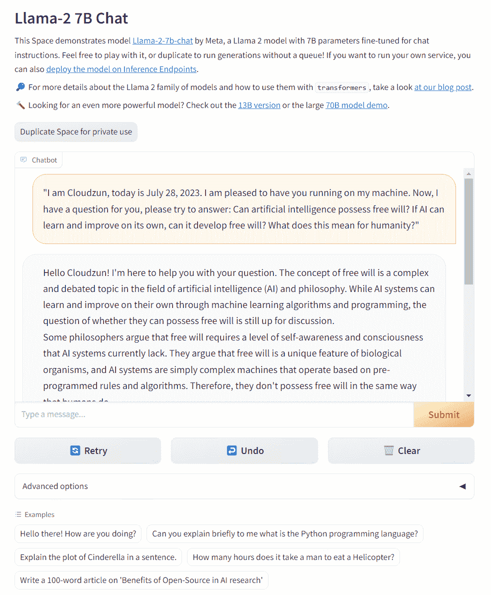

以下是LlaMa-2-7B对我问题回答的全文：

> "I am Cloudzun, today is July 28, 2023. I am pleased to have you running on my machine. Now, I have a question for you, please try to answer: Can artificial intelligence possess free will? If AI can learn and improve on its own, can it develop free will? What does this mean for humanity?"

> Hello Cloudzun! I'm here to help you with your question. The concept of free will is a complex and debated topic in the field of artificial intelligence (AI) and philosophy. While AI systems can learn and improve on their own through machine learning algorithms and programming, the question of whether they can possess free will is still up for discussion.

> Some philosophers argue that free will requires a level of self-awareness and consciousness that AI systems currently lack. They argue that free will is a unique feature of biological organisms, and AI systems are simply complex machines that operate based on pre-programmed rules and algorithms. Therefore, they don't possess free will in the same way that humans do.

> However, others argue that the definition of free will is not fixed and can evolve as technology advances. They suggest that as AI systems become more sophisticated and autonomous, they may develop a form of free will that is different from human free will. For example, an AI system may be able to make choices based on its own internal preferences or values, rather than solely following pre-programmed rules.

> It's important to note that the question of free will in AI is still a topic of ongoing research and debate, and there is no consensus on a definitive answer. However, as AI systems become more advanced and integrated into our lives, it's essential to consider the ethical implications of their autonomy and the potential consequences of granting them free will.

> In conclusion, while AI systems can learn and improve on their own, the question of whether they possess free will is still a matter of ongoing debate and research. It's important to approach this topic with caution and to consider the ethical implications of granting autonomy to AI systems.

附上一下可以用来和机器人劈情操的话题

1.  Ethical and Moral Issues of Artificial Intelligence: As artificial intelligence progresses, how do we determine the ethical and moral boundaries of AI? What kind of ethical and moral rules should AI follow? If AI makes harmful decisions, who should bear the responsibility?

1.  **Artificial Int**elligence and Free Will: Can artificial intelligence have free will? If AI can self-learn and improve, can it develop free will? What does this mean for humanity?

1.  Artificial Intelligence and Consciousness: Can artificial intelligence develop self-consciousness? If so, how should we define and measure the consciousness of AI? How does the consciousness of AI differ from human consciousness?

1.  Fairness and Bias in Artificial Intelligence: How can artificial intelligence avoid reflecting human biases and discrimination? How do we ensure that AI's decisions are fair and unbiased?

1.  **Artificia**l Intelligence and Work: Will artificial intelligence replace human jobs? If so, how should we deal with this situation? Will artificial intelligence create new job opportunities?

1.  Artificial Intelligence and Human Nature: Will artificial intelligence change our understanding of human nature? If most of our work and life are taken over by AI, what does this mean for our humanity?

# Day 1 （2023-7-27） 初始化教具的软硬件环境

## 教具硬件规格

总价：22,000

机器是找街上电脑店帮忙装的，总的硬件价格比京东便宜几百块，然后安装的过程没有再收钱，如果从京东上买，还要200多的安装费用。

小伙安装之前说一小时搞定，我笑了笑，说四个小时内装好都可以。果然，五点钟到场，九点半结束，主要是主板发错，更换过程浪费了一个小时左右，加上安装水冷确实费功夫。

## 系统和软件初始化过程

###  操作系统

之前经过确认Windows跑LLM没有问题，我也乐得就用它，为了图省事，组装硬件的时候就让小伙帮我做好系统，结果呢，小伙用的映像是一个什么电脑店的系统，第一次开机在没有联网的情况下就给我咣咣咣地装了七八个名字看上去很熟的不靠谱的软件，小伙倒是帮我把这些软件都删除了，当时我有点犹豫要不要铲了重装，后来看了看自启动的服务，然后用OS自带的防病毒软件扫了一下，似乎还比较干净，就抱着侥幸心理由他去。然后就狠狠填补了一下职业生涯的重大空白——在我基本把驱动软件和网络环境折腾好，按照最佳安全实践，给administrator账号改名并禁用之后，系统再也无法登录了，人生第一次出现这种情况，挣扎着尝试修复了五分钟，放弃，用微软原厂的方法烧了一个纯净的USB安装介质，含泪铲掉重装。

### 主板驱动

这次配的机箱叫海景房，就是机箱有两面玻璃，里面一共九把风扇加上显卡 水冷和内存的灯带，可以在主板协调下发出绚烂的光污染，我年纪大了，对这个是排斥的，我希望最好不要有灯，看着闹心，小伙说现在就是这风气，硬件都有灯，可以用软件关掉。所以系统装好之后，第一时间赶紧装主板驱动程序，找到相关功能，把风扇和内存的灯关掉，显卡的灯没找到关的地方，好在它也比较低调，算了不关也行。结果，今天我又经历了第二次反转，到了下午差不多一切就绪，我准备在朋友圈给大家得瑟下，结果风扇的灯再也点不亮了。

### 部署Docker环境

+   安装hyper-v

+   安装WSL，这里有个细节需要注意，要启用“Windows 更新 > 高级设置 > 接受其他Microsoft产品的更新” 这个选项，否则如果仅从Microsoft Store下载 Ubuntu 22.04 是无法启用WSL的。（这是今天唯一的知识点收获）

+   安装 Windows Docker Desktop，其实直接在WSL用命令行安装docker也可以，但是并不是推荐的做法，为了避免后续可能的坑，还是服从最佳实践吧。

### 网络设置

+   和之前预想稍微有出入，这个主板没有带WiFi，所以还得用网线连接。

+   无缝连接国际互联网，这是一个很高级的操作过程，简单来说是用hyper-v在本机运行一个软路由，细节不展开了，也请大家不要追究。

### 其他配置

+   安装Chrome

+   尝试能从远程ssh到这台机器的WSL，失败，以后再捣鼓