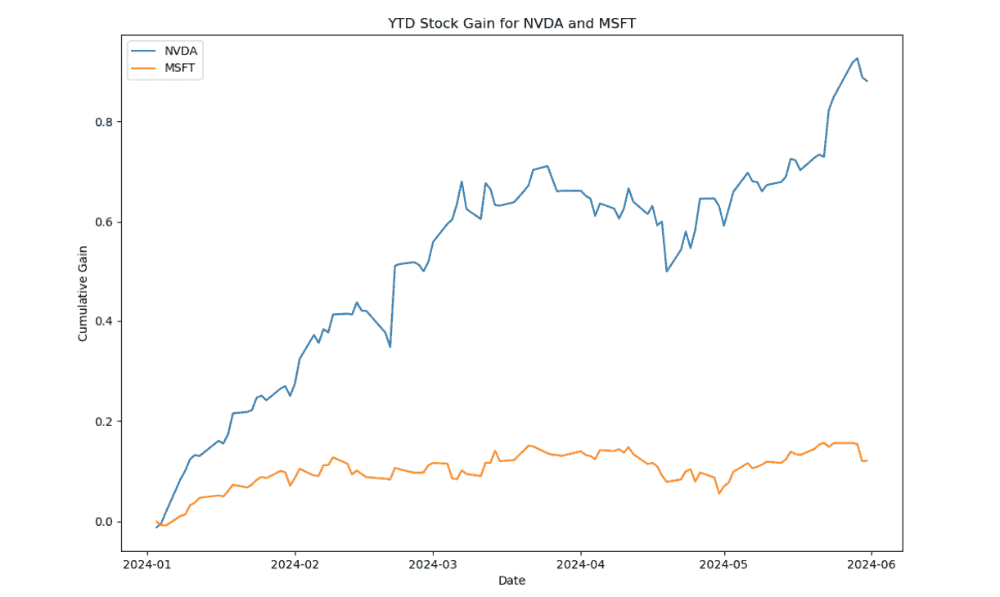
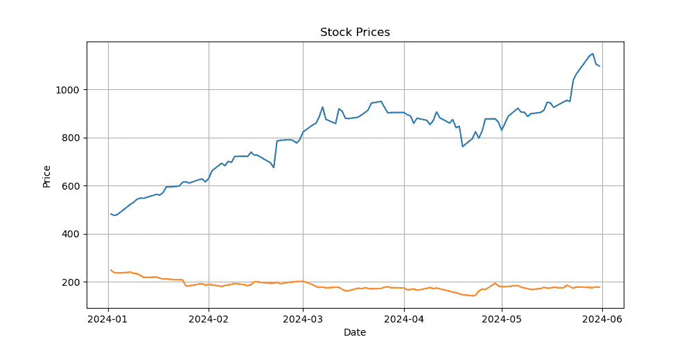

# 使用 AutoGen 的 AI 代理设计模式

> 来源：[https://zsyhjtnsa5.feishu.cn/docx/VFojdvPA7oJ5WdxXM3ZcYmQOnmg](https://zsyhjtnsa5.feishu.cn/docx/VFojdvPA7oJ5WdxXM3ZcYmQOnmg)

# 课程介绍

https://www.deeplearning.ai/short-courses/ai-agentic-design-patterns-with-autogen/

在本课程中，您将学习如何使用AutoGen框架构建多智能体系统，赋予不同角色和能力，以实现复杂的人工智能应用程序。课程内容涵盖主动设计模式，包括反射、工具使用、规划和多智能体协作。

您将探索并掌握多种agentic设计模式，如多代理协作、顺序和嵌套对话、反思、工具使用和规划。通过构建和组合多个专业化的代理，例如研究人员、规划师、编码员、作家和评论员，您将能够设计出能够互动执行复杂工作流程的系统，例如生成详细的财务报告，这些工作通常需要大量的人工努力。

课程通过许多有趣的演示来说明关键的agentic设计原则。例如，您将使用两个玩家代理构建一个对话式国际象棋游戏，每个代理都可以使用工具验证走棋并更新棋盘状态，同时进行关于游戏的生动对话。

在这门课程中，您将探索设计多智能体系统和使智能体协作完成复杂任务的关键原则，使用AutoGen框架。以下是您可以期望学习和体验的内容：

+   🎭 对话型智能体：创建一个由两个喜剧演员之间对话组成的双智能体聊天，使用AutoGen内置的“ConversableAgent”智能体类。

+   🎉 客户入职：开发一系列代理之间的聊天，为产品提供有趣的客户入职体验，使用多智能体协作设计模式。

+   📝 博客文章创作：利用智能体反思框架创建高质量的博客文章，并包含嵌套对话，由评审者代理对撰写的内容进行反思。

+   ♟️ 国际象棋游戏：实现一个对话式国际象棋游戏，两个玩家可以调用工具并在棋盘上进行合法移动，使用工具使用设计模式。

+   💻 编码智能体：开发一个编码智能体，可以生成绘制股票收益图表的代码，并将用户定义函数集成到代码中。

+   📊 金融分析：创建系统，代理合作并寻求人类反馈来完成金融分析任务，从头生成代码或使用用户提供的代码。

通过本课程结束时，您将亲身体验AutoGen核心组件，并对代理设计模式有扎实的理解，能够在工作流程中实施多智能体系统。

# Lesson 1: 使用对话型智能体创作脱口秀喜剧

## Setup

```
pip install --user -i https://pypi.tuna.tsinghua.edu.cn/simple pyautogen==0.2.25 chess==1.10.0 matplotlib numpy pandas yfinance
```

> 这段代码是一个在命令行中运行的pip命令，用于安装Python包。下面是对每个部分的解释：

+   pip install：这是pip的基本命令，用于安装Python包。

+   --user：这个选项告诉pip在用户级别的Python环境中安装包，而不是在系统级别的环境中。这通常可以避免需要管理员权限的问题。

+   -i https://pypi.tuna.tsinghua.edu.cn/simple：这个选项告诉pip从指定的URL（在这种情况下是清华大学的Python包镜像站）下载包，而不是从默认的Python包索引（PyPI）下载。

+   pyautogen==0.2.25 chess==1.10.0 matplotlib numpy pandas yfinance：这些是要安装的包的名称和版本号。==后面的数字是包的版本号。如果没有指定版本号（如numpy、pandas和yfinance），pip将安装最新版本的包。

> 总的来说，这段代码的作用是从清华大学的Python包镜像站下载并安装指定版本的pyautogen和chess，以及最新版本的matplotlib、numpy、pandas和yfinance。

## Define an AutoGen agent

```
from autogen import ConversableAgent

llm_config = {
    &quot;model&quot;: &quot;gpt-3.5-turbo&quot;,
    &quot;api_key&quot;: &quot;sk-YQEP7zolXgsOC3hc5cD7CfA7166f48E4BfE97c991cA9Bf1f&quot;,
    &quot;base_url&quot;: &quot;https://api.huaqloud.com/v1&quot;
}

agent = ConversableAgent(
    name=&quot;chatbot&quot;,
    llm_config=llm_config,
    human_input_mode=&quot;NEVER&quot;,
)
```

> 这段代码创建了一个名为agent的ConversableAgent对象。ConversableAgent是一个可以进行对话的AI代理。

+   from autogen import ConversableAgent：这行代码从autogen模块导入了ConversableAgent类。

+   llm_config = {...}：这段代码定义了一个字典，包含了创建ConversableAgent所需的配置信息：

+   "model"：使用的模型名称，这里是"gpt-3.5-turbo"。

+   "api_key"：OpenAI的API密钥，用于验证和授权访问OpenAI的服务。

+   "base_url"：API的基础URL，这里是"https://api.huaqloud.com/v1"。

+   agent = ConversableAgent(...)：这行代码创建了一个ConversableAgent对象，并将其赋值给变量agent。

+   name="chatbot"：这是传递给ConversableAgent构造函数的参数，指定了代理的名称。

+   llm_config=llm_config：这是传递给ConversableAgent构造函数的参数，指定了代理的配置。

+   human_input_mode="NEVER"：这是传递给ConversableAgent构造函数的参数，指定了人类输入模式。"NEVER"意味着这个代理不会接收人类的输入。

> 总的来说，这段代码创建了一个配置为gpt-3.5-turbo模型，不接收人类输入的ConversableAgent对象。

```
reply = agent.generate_reply(
    messages=[{&quot;content&quot;: &quot;Tell me a joke.&quot;, &quot;role&quot;: &quot;user&quot;}]
)
print(reply)
```

> 这段代码使用了之前创建的ConversableAgent对象agent来生成一个回复。

+   reply = agent.generate_reply(...)：这行代码调用了ConversableAgent对象的generate_reply方法来生成一个回复，并将结果赋值给变量reply。

+   messages=[{"content": "Tell me a joke.", "role": "user"}]：这是传递给generate_reply方法的参数，它是一个包含一个或多个消息的列表。每个消息都是一个字典，包含两个键：

+   "content"：消息的内容，这里是"Tell me a joke."。

+   "role"：发送消息的角色，这里是"user"，表示这个消息是由用户发送的。

+   print(reply)：这行代码打印了generate_reply方法返回的回复。

> 总的来说，这段代码让agent生成了一个对"Tell me a joke."的回复，并打印了这个回复。

```
reply = agent.generate_reply(
    messages=[{&quot;content&quot;: &quot;Repeat the joke.&quot;, &quot;role&quot;: &quot;user&quot;}]
)
print(reply)
```

> 这段代码使用了之前创建的ConversableAgent对象agent来生成一个回复。

+   reply = agent.generate_reply(...)：这行代码调用了ConversableAgent对象的generate_reply方法来生成一个回复，并将结果赋值给变量reply。

+   messages=[{"content": "Repeat the joke.", "role": "user"}]：这是传递给generate_reply方法的参数，它是一个包含一个或多个消息的列表。每个消息都是一个字典，包含两个键：

+   "content"：消息的内容，这里是"Repeat the joke."。

+   "role"：发送消息的角色，这里是"user"，表示这个消息是由用户发送的。

+   print(reply)：这行代码打印了generate_reply方法返回的回复。

> 总的来说，这段代码让agent生成了一个对"Repeat the joke."的回复，并打印了这个回复。

## Conversation

```
cathy = ConversableAgent(
    name=&quot;cathy&quot;,
    system_message=
    &quot;Your name is Cathy and you are a stand-up comedian.&quot;,
    llm_config=llm_config,
    human_input_mode=&quot;NEVER&quot;,
)

joe = ConversableAgent(
    name=&quot;joe&quot;,
    system_message=
    &quot;Your name is Joe and you are a stand-up comedian. &quot;
    &quot;Start the next joke from the punchline of the previous joke.&quot;,
    llm_config=llm_config,
    human_input_mode=&quot;NEVER&quot;,
)
```

> 这段代码创建了两个ConversableAgent对象，名为cathy和joe。ConversableAgent是一个可以进行对话的AI代理。

+   from autogen import ConversableAgent：这行代码从autogen模块导入了ConversableAgent类。

+   cathy = ConversableAgent(...)：这行代码创建了一个ConversableAgent对象，并将其赋值给变量cathy。

+   joe = ConversableAgent(...)：这行代码创建了另一个ConversableAgent对象，并将其赋值给变量joe。

> 对于每个ConversableAgent对象：

+   name：这是传递给ConversableAgent构造函数的参数，指定了代理的名称。

+   system_message：这是传递给ConversableAgent构造函数的参数，指定了系统消息。系统消息是在对话开始时发送的消息，用于设置对话的上下文。

+   llm_config=llm_config：这是传递给ConversableAgent构造函数的参数，指定了代理的配置。llm_config应该是一个字典，包含了创建ConversableAgent所需的配置信息，如使用的模型名称和OpenAI的API密钥。

+   human_input_mode="NEVER"：这是传递给ConversableAgent构造函数的参数，指定了人类输入模式。"NEVER"意味着这个代理不会接收人类的输入。

> 总的来说，这段代码创建了两个配置为llm_config字典中指定的模型，不接收人类输入的ConversableAgent对象。其中，cathy的系统消息是"Your name is Cathy and you are a stand-up comedian."，joe的系统消息是"Your name is Joe and you are a stand-up comedian. Start the next joke from the punchline of the previous joke."。

> **Note**: You might get a slightly different response (set of jokes) than what is shown in the video

```
chat_result = joe.initiate_chat(
    recipient=cathy, 
    message=&quot;I&#x27;m Joe. Cathy, let&#x27;s keep the jokes rolling.&quot;,
    max_turns=2,
)
```

> 这段代码使用了之前创建的ConversableAgent对象joe来发起一个与cathy的对话。

+   chat_result = joe.initiate_chat(...)：这行代码调用了ConversableAgent对象的initiate_chat方法来发起一个对话，并将结果赋值给变量chat_result。

+   recipient=cathy：这是传递给initiate_chat方法的参数，指定了对话的接收者，这里是cathy。

+   message="I'm Joe. Cathy, let's keep the jokes rolling."：这是传递给initiate_chat方法的参数，指定了发起对话的初始消息。

+   max_turns=2：这是传递给initiate_chat方法的参数，指定了对话的最大轮数。这里是2，意味着joe和cathy将会交换两轮对话。

> 总的来说，这段代码让joe发起了一个与cathy的对话，初始消息是"I'm Joe. Cathy, let's keep the jokes rolling."，并且对话的最大轮数是2。

## Print some results

You can print out:

1.  Chat history

1.  Cost

1.  Summary of the conversation

```
import pprint 
pprint.pprint(chat_result.chat_history)
```

> 这段代码使用了Python的pprint模块来美化打印之前发起的对话的聊天历史。

+   import pprint：这行代码导入了Python的pprint模块。pprint是"pretty-print"的缩写，这个模块提供了美化打印输出的功能，可以使输出更易于阅读。

+   pprint.pprint(chat_result.chat_history)：这行代码调用了pprint模块的pprint函数来美化打印chat_result.chat_history。chat_result是之前发起对话的结果，chat_history是chat_result的一个属性，包含了对话的聊天历史。

> 总的来说，这段代码美化打印了joe和cathy之间的对话历史。

```
pprint.pprint(chat_result.cost)
```

> 这段代码使用了Python的pprint模块来美化打印之前发起的对话的成本。

+   pprint.pprint(chat_result.cost)：这行代码调用了pprint模块的pprint函数来美化打印chat_result.cost。chat_result是之前发起对话的结果，cost是chat_result的一个属性，表示发起这次对话所消耗的资源（例如，使用AI模型的计算资源）的成本。

> 总的来说，这段代码美化打印了joe和cathy之间的对话的成本。

```
pprint.pprint(chat_result.summary)
```

> 这段代码使用了Python的pprint模块来美化打印之前发起的对话的摘要。

+   pprint.pprint(chat_result.summary)：这行代码调用了pprint模块的pprint函数来美化打印chat_result.summary。chat_result是之前发起对话的结果，summary是chat_result的一个属性，表示对这次对话的摘要或概述。

> 总的来说，这段代码美化打印了joe和cathy之间的对话的摘要。

## Get a better summary of the conversation

```
chat_result = joe.initiate_chat(
    cathy, 
    message=&quot;I&#x27;m Joe. Cathy, let&#x27;s keep the jokes rolling.&quot;, 
    max_turns=2, 
    summary_method=&quot;reflection_with_llm&quot;,
    summary_prompt=&quot;Summarize the conversation&quot;,
)
```

> 这段代码使用了Python的pprint模块来美化打印之前发起的对话的摘要。

+   pprint.pprint(chat_result.summary)：这行代码调用了pprint模块的pprint函数来美化打印chat_result.summary。chat_result是之前发起对话的结果，summary是chat_result的一个属性，表示对这次对话的摘要或概述。

> 总的来说，这段代码美化打印了joe和cathy之间的对话的摘要。

```
pprint.pprint(chat_result.summary)
```

> 这段代码使用了Python的pprint模块来美化打印之前发起的对话的摘要。

+   pprint.pprint(chat_result.summary)：这行代码调用了pprint模块的pprint函数来美化打印chat_result.summary。chat_result是之前发起对话的结果，summary是chat_result的一个属性，表示对这次对话的摘要或概述。

> 总的来说，这段代码美化打印了joe和cathy之间的对话的摘要。

## Chat Termination

```
cathy = ConversableAgent(
    name=&quot;cathy&quot;,
    system_message=
    &quot;Your name is Cathy and you are a stand-up comedian. &quot;
    &quot;When you&#x27;re ready to end the conversation, say &#x27;I gotta go&#x27;.&quot;,
    llm_config=llm_config,
    human_input_mode=&quot;NEVER&quot;,
    is_termination_msg=lambda msg: &quot;I gotta go&quot; in msg[&quot;content&quot;],
)

joe = ConversableAgent(
    name=&quot;joe&quot;,
    system_message=
    &quot;Your name is Joe and you are a stand-up comedian. &quot;
    &quot;When you&#x27;re ready to end the conversation, say &#x27;I gotta go&#x27;.&quot;,
    llm_config=llm_config,
    human_input_mode=&quot;NEVER&quot;,
    is_termination_msg=lambda msg: &quot;I gotta go&quot; in msg[&quot;content&quot;] or &quot;Goodbye&quot; in msg[&quot;content&quot;],
)
```

> 这段代码创建了两个ConversableAgent对象，名为cathy和joe。ConversableAgent是一个可以进行对话的AI代理。

+   from autogen import ConversableAgent：这行代码从autogen模块导入了ConversableAgent类。

+   cathy = ConversableAgent(...)：这行代码创建了一个ConversableAgent对象，并将其赋值给变量cathy。

+   joe = ConversableAgent(...)：这行代码创建了另一个ConversableAgent对象，并将其赋值给变量joe。

> 对于每个ConversableAgent对象：

+   name：这是传递给ConversableAgent构造函数的参数，指定了代理的名称。

+   system_message：这是传递给ConversableAgent构造函数的参数，指定了系统消息。系统消息是在对话开始时发送的消息，用于设置对话的上下文。

+   llm_config=llm_config：这是传递给ConversableAgent构造函数的参数，指定了代理的配置。llm_config应该是一个字典，包含了创建ConversableAgent所需的配置信息，如使用的模型名称和OpenAI的API密钥。

+   human_input_mode="NEVER"：这是传递给ConversableAgent构造函数的参数，指定了人类输入模式。"NEVER"意味着这个代理不会接收人类的输入。

+   is_termination_msg=lambda msg: "I gotta go" in msg["content"]：这是传递给ConversableAgent构造函数的参数，指定了一个函数，该函数用于判断一个消息是否表示对话的结束。这里，如果消息的内容中包含"I gotta go"，则认为这个消息表示对话的结束。

> 总的来说，这段代码创建了两个配置为llm_config字典中指定的模型，不接收人类输入的ConversableAgent对象。其中，cathy和joe的系统消息都是"Your name is [Name] and you are a stand-up comedian. When you're ready to end the conversation, say 'I gotta go'."，但是joe的对话结束条件还包括消息内容中包含"Goodbye"。

```
chat_result = joe.initiate_chat(
    recipient=cathy,
    message=&quot;I&#x27;m Joe. Cathy, let&#x27;s keep the jokes rolling.&quot;
)
```

> 这段代码使用了之前创建的ConversableAgent对象joe来发起一个与cathy的对话。

+   chat_result = joe.initiate_chat(...)：这行代码调用了ConversableAgent对象的initiate_chat方法来发起一个对话，并将结果赋值给变量chat_result。

+   recipient=cathy：这是传递给initiate_chat方法的参数，指定了对话的接收者，这里是cathy。

+   message="I'm Joe. Cathy, let's keep the jokes rolling."：这是传递给initiate_chat方法的参数，指定了发起对话的初始消息。

> 总的来说，这段代码让joe发起了一个与cathy的对话，初始消息是"I'm Joe. Cathy, let's keep the jokes rolling."。

> cathy.send(message="What's last joke we talked about?", recipient=joe)

> 这段代码使用了之前创建的ConversableAgent对象cathy来向joe发送一条消息。

+   cathy.send(...)：这行代码调用了ConversableAgent对象的send方法来发送一条消息。

+   message="What's last joke we talked about?"：这是传递给send方法的参数，指定了要发送的消息内容。

+   recipient=joe：这是传递给send方法的参数，指定了消息的接收者，这里是joe。

> 总的来说，这段代码让cathy向joe发送了一条消息，内容是"What's last joke we talked about?"。

# Lesson 2: 编排多智能体的顺序聊天优化入职流程

## Setup

```
from autogen import ConversableAgent

llm_config = {
    &quot;model&quot;: &quot;gpt-3.5-turbo&quot;,
    &quot;api_key&quot;: &quot;sk-YQEP7zolXgsOC3hc5cD7CfA7166f48E4BfE97c991cA9Bf1f&quot;,
    &quot;base_url&quot;: &quot;https://api.huaqloud.com/v1&quot;
}

agent = ConversableAgent(
    name=&quot;chatbot&quot;,
    llm_config=llm_config,
    human_input_mode=&quot;NEVER&quot;,
)
```

> 这段代码是在Python中创建一个基于OpenAI的聊天机器人。

1.  from autogen import ConversableAgent：这行代码从autogen模块中导入了ConversableAgent类。这个类可能是用来创建和管理聊天机器人的。

1.  llm_config：这是一个字典，包含了初始化ConversableAgent所需的配置信息。其中包括：

+   "model"：使用的模型名称，这里是"gpt-3.5-turbo"。

+   "api_key"：用于访问API的密钥。

+   "base_url"：API的基础URL。

1.  agent = ConversableAgent(...)：这行代码创建了一个ConversableAgent实例，名为agent。它使用了上面定义的llm_config配置，并设置了两个额外的参数：

+   name：机器人的名称，这里是"chatbot"。

+   human_input_mode：人类输入模式，这里设置为"NEVER"，可能表示这个机器人不会接收人类的输入。

> 请注意，这段代码中的API密钥是敏感信息，不应该在公开的代码中直接展示。在实际使用中，应该使用环境变量或其他安全方式来存储和使用这类信息。

## Creating the needed agents

```
onboarding_personal_information_agent = ConversableAgent(
    name=&quot;Onboarding Personal Information Agent&quot;,
    system_message=&#x27;&#x27;&#x27;You are a helpful customer onboarding agent,
    you are here to help new customers get started with our product.
    Your job is to gather customer&#x27;s name and location.
    Do not ask for other information. Return &#x27;TERMINATE&#x27; 
    when you have gathered all the information.&#x27;&#x27;&#x27;,
    llm_config=llm_config,
    code_execution_config=False,
    human_input_mode=&quot;NEVER&quot;,
)
```

> 这段代码是在Python中创建一个名为"Onboarding Personal Information Agent"的聊天机器人实例。

1.  onboarding_personal_information_agent = ConversableAgent(...)：这行代码创建了一个ConversableAgent实例，名为onboarding_personal_information_agent。它使用了以下参数：

+   name：机器人的名称，这里是"Onboarding Personal Information Agent"。

+   system_message：系统消息，这是机器人的初始消息或指示。在这里，它描述了机器人的角色和任务，即帮助新客户开始使用产品，收集客户的姓名和位置，不询问其他信息，并在收集完所有信息后返回'TERMINATE'。

+   llm_config：这是一个字典，包含了初始化ConversableAgent所需的配置信息。这个配置信息在之前的代码中已经定义过了。

+   code_execution_config：代码执行配置，这里设置为False，可能表示这个机器人不会执行任何代码。

+   human_input_mode：人类输入模式，这里设置为"NEVER"，可能表示这个机器人不会接收人类的输入。

> 这个机器人的目标是在不询问其他信息的情况下，收集客户的姓名和位置。

```
onboarding_topic_preference_agent = ConversableAgent(
    name=&quot;Onboarding Topic preference Agent&quot;,
    system_message=&#x27;&#x27;&#x27;You are a helpful customer onboarding agent,
    you are here to help new customers get started with our product.
    Your job is to gather customer&#x27;s preferences on news topics.
    Do not ask for other information.
    Return &#x27;TERMINATE&#x27; when you have gathered all the information.&#x27;&#x27;&#x27;,
    llm_config=llm_config,
    code_execution_config=False,
    human_input_mode=&quot;NEVER&quot;,
)
```

> 这段代码是在Python中创建一个名为"Onboarding Topic Preference Agent"的聊天机器人实例。

> onboarding_topic_preference_agent = ConversableAgent(...)：这行代码创建了一个ConversableAgent实例，名为onboarding_topic_preference_agent。它使用了以下参数：

+   name：机器人的名称，这里是"Onboarding Topic Preference Agent"。

+   system_message：系统消息，这是机器人的初始消息或指示。在这里，它描述了机器人的角色和任务，即帮助新客户开始使用产品，收集客户对新闻主题的偏好，不询问其他信息，并在收集完所有信息后返回'TERMINATE'。

+   llm_config：这是一个字典，包含了初始化ConversableAgent所需的配置信息。这个配置信息在之前的代码中已经定义过了。

+   code_execution_config：代码执行配置，这里设置为False，可能表示这个机器人不会执行任何代码。

+   human_input_mode：人类输入模式，这里设置为"NEVER"，可能表示这个机器人不会接收人类的输入。

> 这个机器人的目标是在不询问其他信息的情况下，收集客户对新闻主题的偏好。

```
customer_engagement_agent = ConversableAgent(
    name=&quot;Customer Engagement Agent&quot;,
    system_message=&#x27;&#x27;&#x27;You are a helpful customer service agent
    here to provide fun for the customer based on the user&#x27;s
    personal information and topic preferences.
    This could include fun facts, jokes, or interesting stories.
    Make sure to make it engaging and fun!
    Return &#x27;TERMINATE&#x27; when you are done.&#x27;&#x27;&#x27;,
    llm_config=llm_config,
    code_execution_config=False,
    human_input_mode=&quot;NEVER&quot;,
    is_termination_msg=lambda msg: &quot;terminate&quot; in msg.get(&quot;content&quot;).lower(),
)
```

> 这段代码是在Python中创建一个名为"Customer Engagement Agent"的聊天机器人实例。

> customer_engagement_agent = ConversableAgent(...)：这行代码创建了一个ConversableAgent实例，名为customer_engagement_agent。它使用了以下参数：

+   name：机器人的名称，这里是"Customer Engagement Agent"。

+   system_message：系统消息，这是机器人的初始消息或指示。在这里，它描述了机器人的角色和任务，即根据用户的个人信息和主题偏好为客户提供乐趣，这可能包括有趣的事实、笑话或有趣的故事。并确保使其具有吸引力和趣味性。当完成任务时，返回'TERMINATE'。

+   llm_config：这是一个字典，包含了初始化ConversableAgent所需的配置信息。这个配置信息在之前的代码中已经定义过了。

+   code_execution_config：代码执行配置，这里设置为False，可能表示这个机器人不会执行任何代码。

+   human_input_mode：人类输入模式，这里设置为"NEVER"，可能表示这个机器人不会接收人类的输入。

+   is_termination_msg：这是一个函数，用于判断是否应该终止对话。这个函数检查消息内容中是否包含"terminate"这个词（不区分大小写）。

> 这个机器人的目标是根据用户的个人信息和主题偏好为客户提供乐趣，包括有趣的事实、笑话或有趣的故事，并确保使其具有吸引力和趣味性。

```
customer_proxy_agent = ConversableAgent(
    name=&quot;customer_proxy_agent&quot;,
    llm_config=False,
    code_execution_config=False,
    human_input_mode=&quot;ALWAYS&quot;,
    is_termination_msg=lambda msg: &quot;terminate&quot; in msg.get(&quot;content&quot;).lower(),
)
```

> 这段代码是在Python中创建一个名为"Customer Proxy Agent"的聊天机器人实例。

> customer_proxy_agent = ConversableAgent(...)：这行代码创建了一个ConversableAgent实例，名为customer_proxy_agent。它使用了以下参数：

+   name：机器人的名称，这里是"Customer Proxy Agent"。

+   llm_config：这是一个字典，包含了初始化ConversableAgent所需的配置信息。在这里，它被设置为False，可能表示这个机器人不使用任何特定的配置。

+   code_execution_config：代码执行配置，这里设置为False，可能表示这个机器人不会执行任何代码。

+   human_input_mode：人类输入模式，这里设置为"ALWAYS"，可能表示这个机器人会一直接收人类的输入。

+   is_termination_msg：这是一个函数，用于判断是否应该终止对话。这个函数检查消息内容中是否包含"terminate"这个词（不区分大小写）。

> 这个机器人的目标可能是作为一个代理，接收和处理客户的输入。

## Creating tasks

```
chats = [
    {
        &quot;sender&quot;: onboarding_personal_information_agent,
        &quot;recipient&quot;: customer_proxy_agent,
        &quot;message&quot;: 
            &quot;Hello, I&#x27;m here to help you get started with our product.&quot;
            &quot;Could you tell me your name and location?&quot;,
        &quot;summary_method&quot;: &quot;reflection_with_llm&quot;,
        &quot;summary_args&quot;: {
            &quot;summary_prompt&quot; : &quot;Return the customer information &quot;
                             &quot;into as JSON object only: &quot;
                             &quot;{&#x27;name&#x27;: &#x27;&#x27;, &#x27;location&#x27;: &#x27;&#x27;}&quot;,
        },
        &quot;max_turns&quot;: 2,
        &quot;clear_history&quot; : True
    },
    {
        &quot;sender&quot;: onboarding_topic_preference_agent,
        &quot;recipient&quot;: customer_proxy_agent,
        &quot;message&quot;: 
                &quot;Great! Could you tell me what topics you are &quot;
                &quot;interested in reading about?&quot;,
        &quot;summary_method&quot;: &quot;reflection_with_llm&quot;,
        &quot;max_turns&quot;: 1,
        &quot;clear_history&quot; : False
    },
    {
        &quot;sender&quot;: customer_proxy_agent,
        &quot;recipient&quot;: customer_engagement_agent,
        &quot;message&quot;: &quot;Let&#x27;s find something fun to read.&quot;,
        &quot;max_turns&quot;: 1,
        &quot;summary_method&quot;: &quot;reflection_with_llm&quot;,
    },
]
```

> 这段Python代码定义了一个名为chats的列表，其中包含三个字典，每个字典代表一个聊天会话。

1.  第一个聊天会话：

+   sender：发送者是onboarding_personal_information_agent，这是一个聊天机器人，用于收集用户的个人信息。

+   recipient：接收者是customer_proxy_agent，这是一个代理机器人，用于接收和处理客户的输入。

+   message：发送者向接收者发送的消息，询问用户的姓名和位置。

+   summary_method：用于生成会话摘要的方法，这里是reflection_with_llm。

+   summary_args：生成会话摘要的参数，这里要求返回一个包含姓名和位置的JSON对象。

+   max_turns：会话的最大轮数，这里是2。

+   clear_history：是否在会话结束后清除历史记录，这里是True。

1.  第二个聊天会话：

+   sender：发送者是onboarding_topic_preference_agent，这是一个聊天机器人，用于收集用户对新闻主题的偏好。

+   recipient：接收者仍然是customer_proxy_agent。

+   message：发送者向接收者发送的消息，询问用户对哪些主题感兴趣。

+   summary_method：用于生成会话摘要的方法，这里仍然是reflection_with_llm。

+   max_turns：会话的最大轮数，这里是1。

+   clear_history：是否在会话结束后清除历史记录，这里是False。

1.  第三个聊天会话：

+   sender：发送者是customer_proxy_agent。

+   recipient：接收者是customer_engagement_agent，这是一个聊天机器人，用于根据用户的个人信息和主题偏好为客户提供乐趣。

+   message：发送者向接收者发送的消息，表示要找一些有趣的东西来阅读。

+   max_turns：会话的最大轮数，这里是1。

+   summary_method：用于生成会话摘要的方法，这里仍然是reflection_with_llm。

> 这个chats列表可能会被用于一个聊天系统，该系统会按照列表中的顺序进行一系列的聊天会话。

之前的这几段代码中，一共创建了三个聊天机器人实例，分别是：

1.  onboarding_personal_information_agent：这个机器人的任务是收集用户的个人信息，如姓名和位置。

1.  onboarding_topic_preference_agent：这个机器人的任务是收集用户对新闻主题的偏好。

1.  customer_engagement_agent：这个机器人的任务是根据用户的个人信息和主题偏好为客户提供乐趣，包括有趣的事实、笑话或有趣的故事。

此外，还有一个customer_proxy_agent，它作为一个代理，接收和处理客户的输入。

他们之间的关系如下：

+   onboarding_personal_information_agent和onboarding_topic_preference_agent都向customer_proxy_agent发送消息，收集用户的信息和主题偏好。

+   customer_proxy_agent将收集到的信息发送给customer_engagement_agent，然后customer_engagement_agent根据这些信息为客户提供有趣的回答。

这些机器人和代理的工作流程是按照chats列表中定义的顺序进行的

## Start the onboarding process

> **Note**: You might get a slightly different response than what's shown in the video. Feel free to try different inputs, such as name, location, and preferences.

```
from autogen import initiate_chats 
chat_results = initiate_chats(chats)
```

> 这段Python代码是从autogen模块中导入initiate_chats函数，并使用它来启动一系列的聊天会话。

1.  from autogen import initiate_chats：这行代码从autogen模块中导入了initiate_chats函数。这个函数可能是用来启动和管理一系列的聊天会话。

1.  chat_results = initiate_chats(chats)：这行代码调用了initiate_chats函数，并将结果存储在chat_results变量中。这个函数的参数是chats，这可能是一个包含多个聊天会话的列表。每个聊天会话可能是一个字典，包含了会话的发送者、接收者、消息、摘要方法、摘要参数、最大轮数和是否清除历史记录等信息。

> 这段代码的目的是启动一系列的聊天会话，并将结果存储在chat_results变量中。这些结果可能包含每个会话的摘要、历史记录、发送者和接收者的信息等。

## Print out the summary

```
for chat_result in chat_results:
    print(chat_result.summary)
    print(&quot;\n&quot;)
```

这段Python代码遍历chat_results列表中的每个元素，并打印出每个元素的summary属性。

1.  for chat_result in chat_results:：这行代码开始一个循环，遍历chat_results列表中的每个元素。在每次循环中，chat_result变量都会被设置为列表中的一个元素。

1.  print(chat_result.summary)：这行代码打印出chat_result的summary属性。chat_result可能是一个对象，它的summary属性可能包含了聊天会话的摘要信息。

1.  print("\n")：这行代码打印出一个空行，用于在不同的聊天摘要之间添加空白，使输出更易于阅读。

这段代码的目的是打印出每个聊天会话的摘要信息。

## Print out the cost

```
for chat_result in chat_results:
    print(chat_result.cost)
    print(&quot;\n&quot;)
```

> 这段Python代码遍历chat_results列表中的每个元素，并打印出每个元素的cost属性。

1.  for chat_result in chat_results:：这行代码开始一个循环，遍历chat_results列表中的每个元素。在每次循环中，chat_result变量都会被设置为列表中的一个元素。

1.  print(chat_result.cost)：这行代码打印出chat_result的cost属性。chat_result可能是一个对象，它的cost属性可能表示了进行该聊天会话的成本，例如时间、资源或其他度量。

1.  print("\n")：这行代码打印出一个空行，用于在不同的聊天成本之间添加空白，使输出更易于阅读。

> 这段代码的目的是打印出每个聊天会话的成本。

# Lesson 3: 使用智能体反思框架创作文章

## Setup

```
llm_config = {
    &quot;model&quot;: &quot;gpt-3.5-turbo&quot;,
    &quot;api_key&quot;: &quot;sk-YQEP7zolXgsOC3hc5cD7CfA7166f48E4BfE97c991cA9Bf1f&quot;,
    &quot;base_url&quot;: &quot;https://api.huaqloud.com/v1&quot;
}
```

> 这段Python代码定义了一个字典llm_config，它包含了一些配置信息。

+   "model": 这个键对应的值是模型的名称，这里使用的是"gpt-3.5-turbo"模型。

+   "api_key": 这个键对应的值是API密钥，用于验证请求的身份。这个值通常需要保密，不应该在公开的代码中出现。

+   "base_url": 这个键对应的值是API的基础URL，所有的API请求都会发送到这个地址。

这个字典可能会被用于配置一个用于语言模型的API客户端。

## The task!

```
task = &#x27;&#x27;&#x27;
        Write a concise but engaging blogpost about
       DeepLearning.AI. Make sure the blogpost is
       within 100 words.
       &#x27;&#x27;&#x27;
```

> 这段Python代码定义了一个名为task的字符串变量。这个字符串包含了一个任务描述，要求写一个关于DeepLearning.AI的博客文章，且文章的字数必须在100字以内。这个task变量可能会被用于后续的任务提示或者作为一个写作任务的指导。

## Create a writer agent

```
import autogen

writer = autogen.AssistantAgent(
    name=&quot;Writer&quot;,
    system_message=&quot;You are a writer. You write engaging and concise &quot; 
        &quot;blogpost (with title) on given topics. You must polish your &quot;
        &quot;writing based on the feedback you receive and give a refined &quot;
        &quot;version. Only return your final work without additional comments.&quot;,
    llm_config=llm_config,
)
```

> 这段Python代码首先导入了一个名为autogen的模块，然后创建了一个autogen.AssistantAgent对象并将其赋值给变量writer。

> autogen.AssistantAgent可能是一个用于自动生成文本的类，它接受以下参数：

+   name: 代理的名称，这里设置为"Writer"。

+   system_message: 一个描述代理任务的字符串。在这个例子中，代理的任务是写一篇精彩且简洁的博客文章（包括标题）关于给定的主题。代理必须根据收到的反馈修改其写作，并给出一个改进的版本。只返回最终的作品，不包含额外的评论。

+   llm_config: 一个字典，包含了配置信息，可能用于设置语言模型的参数。这个字典在之前的代码中已经定义。

> 这段代码的目的是创建一个能够自动生成博客文章的代理。

```
reply = writer.generate_reply(messages=[{&quot;content&quot;: task, &quot;role&quot;: &quot;user&quot;}])
```

> 这段Python代码调用了writer对象的generate_reply方法，并将结果赋值给变量reply。

> generate_reply方法接受一个名为messages的参数，这是一个字典列表。每个字典代表一个消息，包含以下字段：

+   "content": 消息的内容。在这个例子中，内容是之前定义的task变量，即一个关于写作任务的描述。

+   "role": 发送消息的角色。在这个例子中，角色是"user"，表示这个消息是由用户发送的。

> 这段代码的目的是生成一个回复，可能是对给定任务的响应或者是完成的写作任务。

```
print(reply)
```

> 这段Python代码是一个简单的打印语句，它将打印变量reply的值。reply变量可能包含了之前writer.generate_reply方法的返回结果，这可能是一个自动生成的回复或者完成的写作任务。这个打印语句的目的是在控制台上显示这个回复，以便于查看和检查。

## Adding reflection

Create a critic agent to reflect on the work of the writer agent.

```
critic = autogen.AssistantAgent(
    name=&quot;Critic&quot;,
    is_termination_msg=lambda x: x.get(&quot;content&quot;, &quot;&quot;).find(&quot;TERMINATE&quot;) &gt;= 0,
    llm_config=llm_config,
    system_message=&quot;You are a critic. You review the work of &quot;
                &quot;the writer and provide constructive &quot;
                &quot;feedback to help improve the quality of the content.&quot;,
)
```

> 这段Python代码创建了一个名为critic的autogen.AssistantAgent对象。

> autogen.AssistantAgent可能是一个用于自动生成文本的类，它接受以下参数：

+   name: 代理的名称，这里设置为"Critic"。

+   is_termination_msg: 一个函数，用于判断一个消息是否表示终止。在这个例子中，如果一个消息的内容包含"TERMINATE"，那么这个函数就会返回True。

+   llm_config: 一个字典，包含了配置信息，可能用于设置语言模型的参数。这个字典在之前的代码中已经定义。

+   system_message: 一个描述代理任务的字符串。在这个例子中，代理的任务是批评写作，并提供建设性的反馈以帮助提高内容的质量。

> 这段代码的目的是创建一个能够批评和提供反馈的代理。

```
res = critic.initiate_chat(
    recipient=writer,
    message=task,
    max_turns=2,
    summary_method=&quot;last_msg&quot;
)
```

> 这段Python代码调用了critic对象的initiate_chat方法，并将结果赋值给变量res。

> initiate_chat方法接受以下参数：

+   recipient: 聊天的接收者。在这个例子中，接收者是之前创建的writer对象。

+   message: 要发送的消息。在这个例子中，消息是之前定义的task变量，即一个关于写作任务的描述。

+   max_turns: 聊天的最大轮数。在这个例子中，最大轮数设置为2，这意味着critic和writer将交换两次消息。

+   summary_method: 用于生成聊天摘要的方法。在这个例子中，方法设置为"last_msg"，这可能意味着摘要将只包含最后一条消息。

> 这段代码的目的是启动一个聊天，其中critic将向writer发送一个消息，并接收writer的回复。这可能是为了让critic评估writer的写作并提供反馈。

## Nested chat

```
SEO_reviewer = autogen.AssistantAgent(
    name=&quot;SEO Reviewer&quot;,
    llm_config=llm_config,
    system_message=&quot;You are an SEO reviewer, known for &quot;
        &quot;your ability to optimize content for search engines, &quot;
        &quot;ensuring that it ranks well and attracts organic traffic. &quot; 
        &quot;Make sure your suggestion is concise (within 3 bullet points), &quot;
        &quot;concrete and to the point. &quot;
        &quot;Begin the review by stating your role.&quot;,
)
```

> 这段Python代码创建了一个名为SEO_reviewer的autogen.AssistantAgent对象。

> autogen.AssistantAgent可能是一个用于自动生成文本的类，它接受以下参数：

+   name: 代理的名称，这里设置为"SEO Reviewer"。

+   llm_config: 一个字典，包含了配置信息，可能用于设置语言模型的参数。这个字典在之前的代码中已经定义。

+   system_message: 一个描述代理任务的字符串。在这个例子中，代理的任务是作为一个SEO评审员，优化内容以便于搜索引擎检索，确保内容能够排名靠前并吸引有机流量。代理需要确保其建议简洁（在3个要点内），具体且直接。评审应以声明其角色开始。

> 这段代码的目的是创建一个能够评审和优化内容以提高搜索引擎排名的代理。

```
legal_reviewer = autogen.AssistantAgent(
    name=&quot;Legal Reviewer&quot;,
    llm_config=llm_config,
    system_message=&quot;You are a legal reviewer, known for &quot;
        &quot;your ability to ensure that content is legally compliant &quot;
        &quot;and free from any potential legal issues. &quot;
        &quot;Make sure your suggestion is concise (within 3 bullet points), &quot;
        &quot;concrete and to the point. &quot;
        &quot;Begin the review by stating your role.&quot;,
)
```

> 这段Python代码创建了一个名为legal_reviewer的autogen.AssistantAgent对象。

> autogen.AssistantAgent可能是一个用于自动生成文本的类，它接受以下参数：

+   name: 代理的名称，这里设置为"Legal Reviewer"。

+   llm_config: 一个字典，包含了配置信息，可能用于设置语言模型的参数。这个字典在之前的代码中已经定义。

+   system_message: 一个描述代理任务的字符串。在这个例子中，代理的任务是作为一个法律审查员，确保内容符合法律规定并且没有任何潜在的法律问题。代理需要确保其建议简洁（在3个要点内），具体且直接。审查应以声明其角色开始。

> 这段代码的目的是创建一个能够审查和确保内容符合法律规定的代理。

```
ethics_reviewer = autogen.AssistantAgent(
    name=&quot;Ethics Reviewer&quot;,
    llm_config=llm_config,
    system_message=&quot;You are an ethics reviewer, known for &quot;
        &quot;your ability to ensure that content is ethically sound &quot;
        &quot;and free from any potential ethical issues. &quot; 
        &quot;Make sure your suggestion is concise (within 3 bullet points), &quot;
        &quot;concrete and to the point. &quot;
        &quot;Begin the review by stating your role. &quot;,
)
```

> 这段Python代码创建了一个名为ethics_reviewer的autogen.AssistantAgent对象。

> autogen.AssistantAgent可能是一个用于自动生成文本的类，它接受以下参数：

+   name: 代理的名称，这里设置为"Ethics Reviewer"。

+   llm_config: 一个字典，包含了配置信息，可能用于设置语言模型的参数。这个字典在之前的代码中已经定义。

+   system_message: 一个描述代理任务的字符串。在这个例子中，代理的任务是作为一个道德审查员，确保内容在道德上是健全的，并且没有任何潜在的道德问题。代理需要确保其建议简洁（在3个要点内），具体且直接。审查应以声明其角色开始。

> 这段代码的目的是创建一个能够审查和确保内容在道德上是健全的代理。

```
meta_reviewer = autogen.AssistantAgent(
    name=&quot;Meta Reviewer&quot;,
    llm_config=llm_config,
    system_message=&quot;You are a meta reviewer, you aggragate and review &quot;
    &quot;the work of other reviewers and give a final suggestion on the content.&quot;,
)
```

> 这段Python代码创建了一个名为meta_reviewer的autogen.AssistantAgent对象。

> autogen.AssistantAgent可能是一个用于自动生成文本的类，它接受以下参数：

+   name: 代理的名称，这里设置为"Meta Reviewer"。

+   llm_config: 一个字典，包含了配置信息，可能用于设置语言模型的参数。这个字典在之前的代码中已经定义。

+   system_message: 一个描述代理任务的字符串。在这个例子中，代理的任务是作为一个元审查员，聚合并审查其他审查员的工作，并对内容给出最终的建议。

> 这段代码的目的是创建一个能够聚合和审查其他审查员的工作，并对内容给出最终建议的代理。

## Orchestrate the nested chats to solve the task

```
def reflection_message(recipient, messages, sender, config):
    return f&#x27;&#x27;&#x27;Review the following content. 
            \n\n {recipient.chat_messages_for_summary(sender)[-1][&#x27;content&#x27;]}&#x27;&#x27;&#x27;

review_chats = [
    {
     &quot;recipient&quot;: SEO_reviewer, 
     &quot;message&quot;: reflection_message, 
     &quot;summary_method&quot;: &quot;reflection_with_llm&quot;,
     &quot;summary_args&quot;: {&quot;summary_prompt&quot; : 
        &quot;Return review into as JSON object only:&quot;
        &quot;{&#x27;Reviewer&#x27;: &#x27;&#x27;, &#x27;Review&#x27;: &#x27;&#x27;}. Here Reviewer should be your role&quot;,},
     &quot;max_turns&quot;: 1},
    {
    &quot;recipient&quot;: legal_reviewer, &quot;message&quot;: reflection_message, 
     &quot;summary_method&quot;: &quot;reflection_with_llm&quot;,
     &quot;summary_args&quot;: {&quot;summary_prompt&quot; : 
        &quot;Return review into as JSON object only:&quot;
        &quot;{&#x27;Reviewer&#x27;: &#x27;&#x27;, &#x27;Review&#x27;: &#x27;&#x27;}.&quot;,},
     &quot;max_turns&quot;: 1},
    {&quot;recipient&quot;: ethics_reviewer, &quot;message&quot;: reflection_message, 
     &quot;summary_method&quot;: &quot;reflection_with_llm&quot;,
     &quot;summary_args&quot;: {&quot;summary_prompt&quot; : 
        &quot;Return review into as JSON object only:&quot;
        &quot;{&#x27;reviewer&#x27;: &#x27;&#x27;, &#x27;review&#x27;: &#x27;&#x27;}&quot;,},
     &quot;max_turns&quot;: 1},
     {&quot;recipient&quot;: meta_reviewer, 
      &quot;message&quot;: &quot;Aggregrate feedback from all reviewers and give final suggestions on the writing.&quot;, 
     &quot;max_turns&quot;: 1},
]

```

> 这段Python代码首先定义了一个函数reflection_message，该函数接受四个参数：recipient、messages、sender和config，并返回一个格式化的字符串。这个字符串要求审查以下内容，然后显示sender发送给recipient的最后一条消息的内容。

> 然后，代码创建了一个名为review_chats的列表，这个列表包含四个字典，每个字典代表一个审查聊天。每个审查聊天包含以下字段：

+   "recipient": 聊天的接收者。在这个例子中，接收者是之前创建的SEO_reviewer、legal_reviewer、ethics_reviewer和meta_reviewer对象。

+   "message": 要发送的消息。对于前三个审查聊天，消息是reflection_message函数的返回值。对于最后一个审查聊天，消息是一个字符串，要求汇总所有审查员的反馈，并对写作给出最终的建议。

+   "summary_method": 用于生成聊天摘要的方法。在这个例子中，方法设置为"reflection_with_llm"。

+   "summary_args": 生成聊天摘要的参数。在这个例子中，参数是一个字典，包含一个提示，要求将审查结果返回为一个只包含"Reviewer"和"Review"字段的JSON对象。

+   "max_turns": 聊天的最大轮数。在这个例子中，最大轮数设置为1，这意味着审查员将发送一条消息。

> 这段代码的目的是设置一个审查聊天的列表，每个审查聊天都由一个审查员进行，审查员将审查内容并给出反馈。

```
critic.register_nested_chats(
    review_chats,
    trigger=writer,
)
```

> 这段Python代码调用了critic对象的register_nested_chats方法。

> register_nested_chats方法接受以下参数：

+   nested_chats: 一个嵌套聊天的列表。在这个例子中，这个列表是之前定义的review_chats，包含了四个审查聊天。

+   trigger: 触发嵌套聊天的对象。在这个例子中，触发对象是之前创建的writer对象。

> 这段代码的目的是注册一个嵌套聊天的列表，当writer对象发送消息时，这些嵌套聊天将被触发。这可能是为了让critic对象能够审查writer对象的写作并提供反馈。

> **Note**: You might get a slightly different response than what's shown in the video. Feel free to try different task.

```
res = critic.initiate_chat(
    recipient=writer,
    message=task,
    max_turns=2,
    summary_method=&quot;last_msg&quot;
)
```

> 这段Python代码调用了critic对象的initiate_chat方法，并将结果赋值给变量res。

> initiate_chat方法接受以下参数：

+   recipient: 聊天的接收者。在这个例子中，接收者是之前创建的writer对象。

+   message: 要发送的消息。在这个例子中，消息是之前定义的task变量，即一个关于写作任务的描述。

+   max_turns: 聊天的最大轮数。在这个例子中，最大轮数设置为2，这意味着critic和writer将交换两次消息。

+   summary_method: 用于生成聊天摘要的方法。在这个例子中，方法设置为"last_msg"，这可能意味着摘要将只包含最后一条消息。

> 这段代码的目的是启动一个聊天，其中critic将向writer发送一个消息，并接收writer的回复。这可能是为了让critic评估writer的写作并提供反馈。

代码中一共定义了六个autogen.AssistantAgent对象，它们分别是：

1.  writer: 作为一个写作代理，生成或编辑文本内容。

1.  SEO_reviewer: 作为一个SEO评审员，优化内容以便于搜索引擎检索，确保内容能够排名靠前并吸引有机流量。

1.  legal_reviewer: 作为一个法律审查员，确保内容符合法律规定并且没有任何潜在的法律问题。

1.  ethics_reviewer: 作为一个道德审查员，确保内容在道德上是健全的，并且没有任何潜在的道德问题。

1.  meta_reviewer: 作为一个元审查员，聚合并审查其他审查员的工作，并对内容给出最终的建议。

1.  critic: 作为一个批评者，审查writer的工作并提供建设性的反馈以帮助提高内容的质量。

在逻辑调用关系方面，writer生成一些文本，然后这些文本会被critic对象以及注册在critic对象中的其他审查员（SEO_reviewer、legal_reviewer、ethics_reviewer和meta_reviewer）审查。每个审查员将审查内容并给出反馈，最后，meta_reviewer将聚合所有审查员的反馈，并对写作给出最终的建议。critic通过initiate_chat方法启动与writer的聊天，writer在聊天中接收到critic的反馈并根据反馈调整其写作。

## Get the summary

```
print(res.summary)
```

> 这段Python代码是打印res对象的summary属性。

> res是一个对象，可能是一个返回结果或者响应。summary是res对象的一个属性，可能包含了一些关于res的概括或者总结信息。

> print(res.summary)这行代码的作用就是在控制台输出res.summary的值。

# Lesson 4: 工具的使用和编排实现国际象棋对弈

## Setup

```
llm_config = {
    &quot;model&quot;: &quot;gpt-3.5-turbo&quot;,
    &quot;api_key&quot;: &quot;sk-YQEP7zolXgsOC3hc5cD7CfA7166f48E4BfE97c991cA9Bf1f&quot;,
    &quot;base_url&quot;: &quot;https://api.huaqloud.com/v1&quot;
}
```

> 这段Python代码定义了一个字典llm_config，它包含了一些配置信息。

+   "model": 这个键对应的值是模型的名称，这里使用的是"gpt-3.5-turbo"模型。

+   "api_key": 这个键对应的值是API密钥，用于验证请求的身份。这个值通常需要保密，不应该在公开的代码中出现。

+   "base_url": 这个键对应的值是API的基础URL，所有的API请求都会发送到这个地址。

这个字典可能会被用于配置一个用于语言模型的API客户端。。

```
import chess
import chess.svg
from typing_extensions import Annotated
```

> 这段Python代码导入了一些模块和函数：

1.  import chess: 导入了一个名为chess的库，这是一个用于处理和操作国际象棋的库，提供了棋盘、棋子、走棋规则等相关功能。

1.  import chess.svg: 从chess库中导入了svg模块，这个模块提供了将棋盘和棋子渲染为SVG（可缩放矢量图形）的功能，可以用于在网页或图形界面中显示棋盘。

1.  from typing_extensions import Annotated: 从typing_extensions模块中导入了Annotated，这是Python的类型注解系统的一部分，用于给变量、函数参数、函数返回值等添加额外的类型信息，有助于提高代码的可读性和健壮性。Annotated可以用于给类型注解添加额外的元数据。

## Initialize the chess board

```
board = chess.Board()
```

> 这段Python代码创建了一个chess.Board()实例，并将其赋值给变量board。

> chess.Board()是来自chess库的一个类，它表示一个国际象棋的棋盘。当你创建一个Board实例时，它会初始化一个标准的8x8棋盘，棋盘上的棋子位置和数量也会被设置为国际象棋的初始状态。

> 所以，board = chess.Board()这行代码的作用就是创建了一个新的国际象棋棋盘。

```
made_move = False
```

> 这段Python代码创建了一个布尔变量made_move并将其初始值设为False。

> made_move可能用于跟踪是否已经进行了某个操作，例如在一个棋类游戏中，它可能用于标记玩家是否已经走了一步。初始值为False表示尚未进行该操作。

## Define the needed tools

### 1. Tool for getting legal moves

```
def get_legal_moves(
    
) -&gt; Annotated[str, &quot;A list of legal moves in UCI format&quot;]:
    return &quot;Possible moves are: &quot; + &quot;,&quot;.join(
        [str(move) for move in board.legal_moves]
    )
```

> 这段Python代码定义了一个名为get_legal_moves的函数，该函数没有参数，并返回一个字符串，该字符串表示在UCI（Universal Chess Interface，通用棋类接口）格式下的合法走棋列表。

> 函数的返回类型被注解为Annotated[str, "A list of legal moves in UCI format"]，这表示函数返回一个字符串，该字符串是UCI格式的合法走棋列表。

> 函数体中，使用了列表推导式[str(move) for move in board.legal_moves]来生成一个包含所有合法走棋的字符串列表。这里，board.legal_moves是一个生成器，它生成棋盘上当前所有合法走棋的列表。

> 然后，使用",".join()函数将这个列表转换为一个由逗号分隔的字符串。

> 最后，将这个字符串与前缀"Possible moves are: "连接起来，并返回结果。

> 所以，这个函数的作用是获取当前棋盘上所有合法走棋，并以字符串形式返回。

### 2. Tool for making a move on the board

```
def make_move(
    move: Annotated[str, &quot;A move in UCI format.&quot;]
) -&gt; Annotated[str, &quot;Result of the move.&quot;]:
    move = chess.Move.from_uci(move)
    board.push_uci(str(move))
    global made_move
    made_move = True
    
    # Display the board.
    display(
        chess.svg.board(
            board,
            arrows=[(move.from_square, move.to_square)],
            fill={move.from_square: &quot;gray&quot;},
            size=200
        )
    )
    
    # Get the piece name.
    piece = board.piece_at(move.to_square)
    piece_symbol = piece.unicode_symbol()
    piece_name = (
        chess.piece_name(piece.piece_type).capitalize()
        if piece_symbol.isupper()
        else chess.piece_name(piece.piece_type)
    )
    return f&quot;Moved {piece_name} ({piece_symbol}) from &quot;\
    f&quot;{chess.SQUARE_NAMES[move.from_square]} to &quot;\
    f&quot;{chess.SQUARE_NAMES[move.to_square]}.&quot;
```

> 这段Python代码定义了一个名为make_move的函数，该函数接受一个参数move，表示一个UCI格式的走棋，并返回一个字符串，表示走棋的结果。

> 函数体中的代码执行了以下操作：

1.  move = chess.Move.from_uci(move): 将输入的UCI格式的走棋转换为chess.Move对象。

1.  board.push_uci(str(move)): 在棋盘上执行这个走棋。

1.  global made_move; made_move = True: 将全局变量made_move设置为True，表示已经走了一步。

1.  display(chess.svg.board(...)): 使用chess.svg.board函数生成一个SVG表示的棋盘，并使用display函数显示它。这个棋盘上会显示刚刚走的这一步。

1.  piece = board.piece_at(move.to_square): 获取走棋后棋子的位置。

1.  piece_symbol = piece.unicode_symbol(): 获取棋子的Unicode符号。

1.  piece_name = (...): 获取棋子的名称，如果棋子的符号是大写的，那么棋子的名称也会被转换为大写。

1.  return f"Moved {piece_name} ({piece_symbol}) from "...: 返回一个字符串，表示走棋的结果，包括移动的棋子、棋子的符号、起始位置和目标位置。

> 所以，这个函数的作用是执行一个走棋，并返回走棋的结果。

## Create agents

You will create the player agents and a board proxy agents for the chess board.

```
from autogen import ConversableAgent
```

> 这段Python代码从autogen模块中导入了ConversableAgent类。

> ConversableAgent可能是一个用于创建可以进行对话的代理的类，但是没有更多的上下文信息，我无法提供更详细的解释。你可能需要查看autogen模块的文档或源代码来获取更多关于ConversableAgent的信息。

```
# Player white agent
player_white = ConversableAgent(
    name=&quot;Player White&quot;,
    system_message=&quot;You are a chess player and you play as white. &quot;
    &quot;First call get_legal_moves(), to get a list of legal moves. &quot;
    &quot;Then call make_move(move) to make a move.&quot;,
    llm_config=llm_config,
)
```

> 这段Python代码创建了一个ConversableAgent实例，并将其赋值给变量player_white。

> ConversableAgent可能是一个用于创建可以进行对话的代理的类。在这个实例化过程中，传入了三个参数：

1.  name="Player White": 这个参数设置了代理的名称为"Player White"。

1.  system_message="You are a chess player and you play as white. First call get_legal_moves(), to get a list of legal moves. Then call make_move(move) to make a move.": 这个参数设置了代理的系统消息，这可能是当与代理进行交互时显示的一条消息。

1.  llm_config=llm_config: 这个参数传入了一个字典llm_config，这可能是用于配置代理的一些设置。

> 所以，这段代码的作用是创建了一个名为"Player White"的对话代理，这个代理可能用于在一个国际象棋游戏中代表白方玩家。

```
# Player black agent
player_black = ConversableAgent(
    name=&quot;Player Black&quot;,
    system_message=&quot;You are a chess player and you play as black. &quot;
    &quot;First call get_legal_moves(), to get a list of legal moves. &quot;
    &quot;Then call make_move(move) to make a move.&quot;,
    llm_config=llm_config,
)
```

> 这段Python代码创建了一个ConversableAgent实例，并将其赋值给变量player_black。

> ConversableAgent可能是一个用于创建可以进行对话的代理的类。在这个实例化过程中，传入了三个参数：

1.  name="Player Black": 这个参数设置了代理的名称为"Player Black"。

1.  system_message="You are a chess player and you play as black. First call get_legal_moves(), to get a list of legal moves. Then call make_move(move) to make a move.": 这个参数设置了代理的系统消息，这可能是当与代理进行交互时显示的一条消息。

1.  llm_config=llm_config: 这个参数传入了一个字典llm_config，这可能是用于配置代理的一些设置。

> 所以，这段代码的作用是创建了一个名为"Player Black"的对话代理，这个代理可能用于在一个国际象棋游戏中代表黑方玩家。

```
def check_made_move(msg):
    global made_move
    if made_move:
        made_move = False
        return True
    else:
        return False

```

> 这段Python代码定义了一个名为check_made_move的函数，该函数接受一个参数msg，但并未在函数体中使用这个参数。

> 函数体中的代码执行了以下操作：

1.  global made_move: 声明made_move为全局变量，这样就可以在函数内部修改made_move的值。

1.  if made_move:: 检查made_move的值。如果made_move为True，则执行以下操作：made_move = False: 将made_move的值设置为False。

+   return True: 返回True。

1.  else:: 如果made_move为False，则执行以下操作：

+   return False: 返回False。

> 所以，这个函数的作用是检查是否已经走了一步（即made_move的值是否为True）。如果已经走了一步，那么将made_move的值重置为False并返回True；否则，返回False。

```
board_proxy = ConversableAgent(
    name=&quot;Board Proxy&quot;,
    llm_config=False,
    is_termination_msg=check_made_move,
    default_auto_reply=&quot;Please make a move.&quot;,
    human_input_mode=&quot;NEVER&quot;,
)
```

> 这段Python代码创建了一个ConversableAgent实例，并将其赋值给变量board_proxy。

> ConversableAgent可能是一个用于创建可以进行对话的代理的类。在这个实例化过程中，传入了以下参数：

1.  name="Board Proxy": 这个参数设置了代理的名称为"Board Proxy"。

1.  llm_config=False: 这个参数传入了一个布尔值False，这可能是用于配置代理的一些设置。具体含义可能需要查看ConversableAgent类的文档或源代码。

1.  is_termination_msg=check_made_move: 这个参数传入了一个函数check_made_move，这可能是用于检查是否应该终止对话的函数。

1.  default_auto_reply="Please make a move.": 这个参数设置了代理的默认自动回复为"Please make a move."。

1.  human_input_mode="NEVER": 这个参数设置了代理的人类输入模式为"NEVER"。具体含义可能需要查看ConversableAgent类的文档或源代码。

> 所以，这段代码的作用是创建了一个名为"Board Proxy"的对话代理，这个代理可能用于在一个国际象棋游戏中代表棋盘。

## Register the tools

A tool must be registered for the agent that calls the tool and the agent that executes the tool.

```
from autogen import register_function
```

> 这段Python代码从autogen模块中导入了register_function函数。

> register_function可能是一个用于注册或声明函数的工具，但是没有更多的上下文信息，我无法提供更详细的解释。你可能需要查看autogen模块的文档或源代码来获取更多关于register_function的信息。

```
for caller in [player_white, player_black]:
    register_function(
        get_legal_moves,
        caller=caller,
        executor=board_proxy,
        name=&quot;get_legal_moves&quot;,
        description=&quot;Get legal moves.&quot;,
    )
    
    register_function(
        make_move,
        caller=caller,
        executor=board_proxy,
        name=&quot;make_move&quot;,
        description=&quot;Call this tool to make a move.&quot;,
    )
```

> 这段Python代码对player_white和player_black两个ConversableAgent实例进行了迭代，并对每个实例执行了以下操作：

1.  使用register_function函数注册了get_legal_moves函数，这个函数用于获取合法走棋。在注册过程中，传入了以下参数：

+   caller=caller: 设置了调用者为当前迭代的ConversableAgent实例。

+   executor=board_proxy: 设置了执行者为board_proxy。

+   name="get_legal_moves": 设置了函数的名称为"get_legal_moves"。

+   description="Get legal moves.": 设置了函数的描述为"Get legal moves."。

1.  使用register_function函数注册了make_move函数，这个函数用于执行走棋。在注册过程中，传入了以下参数：

+   caller=caller: 设置了调用者为当前迭代的ConversableAgent实例。

+   executor=board_proxy: 设置了执行者为board_proxy。

+   name="make_move": 设置了函数的名称为"make_move"。

+   description="Call this tool to make a move.": 设置了函数的描述为"Call this tool to make a move."。

> 所以，这段代码的作用是为player_white和player_black两个ConversableAgent实例注册了get_legal_moves和make_move两个函数，这两个函数分别用于获取合法走棋和执行走棋。

```
player_black.llm_config[&quot;tools&quot;]
```

> 这段Python代码访问了player_black对象的llm_config字典中的"tools"键对应的值。

> player_black是一个ConversableAgent实例，llm_config可能是用于配置该实例的一些设置的字典。

> "tools"键对应的值可能是一个工具列表，但是没有更多的上下文信息，我无法提供更详细的解释。你可能需要查看ConversableAgent类的文档或源代码来获取更多关于llm_config和"tools"的信息。

## Register the nested chats

Each player agent will have a nested chat with the board proxy agent to make moves on the chess board.

```
player_white.register_nested_chats(
    trigger=player_black,
    chat_queue=[
        {
            &quot;sender&quot;: board_proxy,
            &quot;recipient&quot;: player_white,
            &quot;summary_method&quot;: &quot;last_msg&quot;,
        }
    ],
)

player_black.register_nested_chats(
    trigger=player_white,
    chat_queue=[
        {
            &quot;sender&quot;: board_proxy,
            &quot;recipient&quot;: player_black,
            &quot;summary_method&quot;: &quot;last_msg&quot;,
        }
    ],
)
```

> 这段Python代码对player_white和player_black两个ConversableAgent实例进行了操作，为每个实例注册了嵌套聊天。

> 对于player_white实例：

+   使用register_nested_chats方法注册了一个嵌套聊天，该方法接受两个参数：

+   trigger=player_black：当player_black实例发送消息时，触发嵌套聊天。

+   chat_queue：一个包含聊天信息的列表，每个聊天信息是一个字典，包含以下键：

+   "sender"：消息的发送者，这里是board_proxy实例。

+   "recipient"：消息的接收者，这里是player_white实例。

+   "summary_method"：消息的汇总方法，这里是"last_msg"，可能表示只保留最后一条消息。

> 对于player_black实例，操作与player_white实例类似，只是消息的接收者变为了player_black实例。

> 所以，这段代码的作用是为player_white和player_black两个ConversableAgent实例注册了嵌套聊天，当一方发送消息时，另一方会从board_proxy实例接收消息。

>

## Start the Game

The game will start with the first message.

> In this lesson, you will use GPT 4 for better results. Please note that the lesson has a quota limit. If you want to explore the code in this lesson further, we recommend trying it locally with your own API key.

> **Note**: You might get a slightly different moves than what's shown in the video.

```
board = chess.Board()

chat_result = player_black.initiate_chat(
    player_white,
    message=&quot;Let&#x27;s play chess! Your move.&quot;,
    max_turns=2,
)
```

> 这段Python代码首先创建了一个chess.Board实例，并将其赋值给变量board。chess.Board可能是一个用于表示国际象棋棋盘的类。

> 然后，代码调用了player_black实例的initiate_chat方法，以player_white为对话对象，初始化了一场对话。在这个过程中，传入了以下参数：

1.  player_white: 这个参数设置了对话的对象为player_white。

1.  message="Let's play chess! Your move.": 这个参数设置了对话的初始消息为"Let's play chess! Your move."。

1.  max_turns=2: 这个参数设置了对话的最大轮数为2。

> initiate_chat方法的返回值被赋值给了变量chat_result。

> 所以，这段代码的作用是初始化了一场由player_black发起、与player_white进行的对话，对话的初始消息是"Let's play chess! Your move."，对话的最大轮数是2。

## Adding a fun chitchat to the game!

```
player_white = ConversableAgent(
    name=&quot;Player White&quot;,
    system_message=&quot;You are a chess player and you play as white. &quot;
    &quot;First call get_legal_moves(), to get a list of legal moves. &quot;
    &quot;Then call make_move(move) to make a move. &quot;
    &quot;After a move is made, chitchat to make the game fun.&quot;,
    llm_config=llm_config,
)
```

> 这段Python代码创建了一个ConversableAgent实例，并将其赋值给变量player_white。

> ConversableAgent可能是一个用于创建可以进行对话的代理的类。在这个实例化过程中，传入了三个参数：

1.  name="Player White": 这个参数设置了代理的名称为"Player White"。

1.  system_message="You are a chess player and you play as white. First call get_legal_moves(), to get a list of legal moves. Then call make_move(move) to make a move. After a move is made, chitchat to make the game fun.": 这个参数设置了代理的系统消息，这可能是当与代理进行交互时显示的一条消息。

1.  llm_config=llm_config: 这个参数传入了一个字典llm_config，这可能是用于配置代理的一些设置。

> 所以，这段代码的作用是创建了一个名为"Player White"的对话代理，这个代理可能用于在一个国际象棋游戏中代表白方玩家。

```
player_black = ConversableAgent(
    name=&quot;Player Black&quot;,
    system_message=&quot;You are a chess player and you play as black. &quot;
    &quot;First call get_legal_moves(), to get a list of legal moves. &quot;
    &quot;Then call make_move(move) to make a move. &quot;
    &quot;After a move is made, chitchat to make the game fun.&quot;,
    llm_config=llm_config,
)
```

> 这段Python代码创建了一个ConversableAgent实例，并将其赋值给变量player_black。

> ConversableAgent可能是一个用于创建可以进行对话的代理的类。在这个实例化过程中，传入了三个参数：

1.  name="Player Black": 这个参数设置了代理的名称为"Player Black"。

1.  system_message="You are a chess player and you play as black. First call get_legal_moves(), to get a list of legal moves. Then call make_move(move) to make a move. After a move is made, chitchat to make the game fun.": 这个参数设置了代理的系统消息，这可能是当与代理进行交互时显示的一条消息。

1.  llm_config=llm_config: 这个参数传入了一个字典llm_config，这可能是用于配置代理的一些设置。

> 所以，这段代码的作用是创建了一个名为"Player Black"的对话代理，这个代理可能用于在一个国际象棋游戏中代表黑方玩家。

```
for caller in [player_white, player_black]:
    register_function(
        get_legal_moves,
        caller=caller,
        executor=board_proxy,
        name=&quot;get_legal_moves&quot;,
        description=&quot;Get legal moves.&quot;,
    )

    register_function(
        make_move,
        caller=caller,
        executor=board_proxy,
        name=&quot;make_move&quot;,
        description=&quot;Call this tool to make a move.&quot;,
    )

player_white.register_nested_chats(
    trigger=player_black,
    chat_queue=[
        {
            &quot;sender&quot;: board_proxy,
            &quot;recipient&quot;: player_white,
            &quot;summary_method&quot;: &quot;last_msg&quot;,
            &quot;silent&quot;: True,
        }
    ],
)

player_black.register_nested_chats(
    trigger=player_white,
    chat_queue=[
        {
            &quot;sender&quot;: board_proxy,
            &quot;recipient&quot;: player_black,
            &quot;summary_method&quot;: &quot;last_msg&quot;,
            &quot;silent&quot;: True,
        }
    ],
)
```

> 这段Python代码对player_white和player_black两个ConversableAgent实例进行了操作，为每个实例注册了函数和嵌套聊天。

> 对于每个ConversableAgent实例（在这里被称为caller）：

+   使用register_function函数注册了get_legal_moves函数，这个函数用于获取合法走棋。在注册过程中，传入了以下参数：

+   caller=caller: 设置了调用者为当前迭代的ConversableAgent实例。

+   executor=board_proxy: 设置了执行者为board_proxy。

+   name="get_legal_moves": 设置了函数的名称为"get_legal_moves"。

+   description="Get legal moves.": 设置了函数的描述为"Get legal moves."。

+   使用register_function函数注册了make_move函数，这个函数用于执行走棋。在注册过程中，传入了以下参数：

+   caller=caller: 设置了调用者为当前迭代的ConversableAgent实例。

+   executor=board_proxy: 设置了执行者为board_proxy。

+   name="make_move": 设置了函数的名称为"make_move"。

+   description="Call this tool to make a move.": 设置了函数的描述为"Call this tool to make a move."。

> 使用register_nested_chats方法注册了一个嵌套聊天，该方法接受两个参数：

+   trigger：当对方实例发送消息时，触发嵌套聊天。

+   chat_queue：一个包含聊天信息的列表，每个聊天信息是一个字典，包含以下键：

+   "sender"：消息的发送者，这里是board_proxy实例。

+   "recipient"：消息的接收者，这里是当前迭代的ConversableAgent实例。

+   "summary_method"：消息的汇总方法，这里是"last_msg"，可能表示只保留最后一条消息。

+   "silent"：这里设置为True，可能表示这个聊天是静默的，不会产生任何输出。

> 所以，这段代码的作用是为player_white和player_black两个ConversableAgent实例注册了get_legal_moves和make_move两个函数，这两个函数分别用于获取合法走棋和执行走棋，并注册了嵌套聊天，当一方发送消息时，另一方会从board_proxy实例接收消息。

```
board = chess.Board()

chat_result = player_black.initiate_chat(
    player_white,
    message=&quot;Let&#x27;s play chess! Your move.&quot;,
    max_turns=2,
)
```

> 这段Python代码首先创建了一个chess.Board实例，并将其赋值给变量board。chess.Board可能是一个用于表示国际象棋棋盘的类。

> 然后，代码调用了player_black实例的initiate_chat方法，以player_white为对话对象，初始化了一场对话。在这个过程中，传入了以下参数：

1.  player_white: 这个参数设置了对话的对象为player_white。

1.  message="Let's play chess! Your move.": 这个参数设置了对话的初始消息为"Let's play chess! Your move."。

1.  max_turns=2: 这个参数设置了对话的最大轮数为2。

> initiate_chat方法的返回值被赋值给了变量chat_result。

> 所以，这段代码的作用是初始化了一场由player_black发起、与player_white进行的对话，对话的初始消息是"Let's play chess! Your move."，对话的最大轮数是2。

> **Note:**

> To add human input to this game, add human_input_mode="ALWAYS" for both player agents.

# Lesson 5: 使用编码智能体进行金融分析

## Setup

```
llm_config = {
    &quot;model&quot;: &quot;gpt-3.5-turbo-16k&quot;,
    &quot;api_key&quot;: &quot;sk-YQEP7zolXgsOC3hc5cD7CfA7166f48E4BfE97c991cA9Bf1f&quot;,
    &quot;base_url&quot;: &quot;https://api.huaqloud.com/v1&quot;
}
```

> 这段Python代码定义了一个字典llm_config，它包含了一些配置信息。

+   "model": 这个键对应的值是模型的名称，这里使用的是"gpt-3.5-turbo-16k"模型。

+   "api_key": 这个键对应的值是API密钥，用于验证请求的身份。这个值通常需要保密，不应该在公开的代码中出现。

+   "base_url": 这个键对应的值是API的基础URL，所有的API请求都会发送到这个地址。

## Define a code executor

```
from autogen.coding import LocalCommandLineCodeExecutor
```

> 这段Python代码从autogen.coding模块中导入了LocalCommandLineCodeExecutor类。

> autogen.coding可能是一个包含多种编程工具的模块，而LocalCommandLineCodeExecutor可能是其中的一个类，用于在本地命令行环境中执行代码。

> 所以，这段代码的作用是导入了LocalCommandLineCodeExecutor类，以便在后续的代码中使用这个类来执行一些命令行代码。

```
executor = LocalCommandLineCodeExecutor(
    timeout=60,
    work_dir=&quot;coding&quot;,
)
```

> 这段Python代码创建了一个LocalCommandLineCodeExecutor实例，并将其赋值给变量executor。

> LocalCommandLineCodeExecutor可能是一个用于在本地命令行环境中执行代码的类。在这个实例化过程中，传入了两个参数：

1.  timeout=60: 这个参数设置了代码执行的超时时间为60秒。

1.  work_dir="coding": 这个参数设置了工作目录为"coding"。

> 所以，这段代码的作用是创建了一个LocalCommandLineCodeExecutor实例，这个实例可以在本地命令行环境中执行代码，其超时时间为60秒，工作目录为"coding"。

## Create agents

```
from autogen import ConversableAgent, AssistantAgent
```

> 这段Python代码从autogen模块中导入了ConversableAgent和AssistantAgent两个类。

> autogen可能是一个包含多种自动生成工具的模块，而ConversableAgent和AssistantAgent可能是其中的两个类，分别用于创建可以进行对话的代理和助手代理。

> 所以，这段代码的作用是导入了ConversableAgent和AssistantAgent两个类，以便在后续的代码中创建对话代理和助手代理。

### 1. Agent with code executor configuration

```
code_executor_agent = ConversableAgent(
    name=&quot;code_executor_agent&quot;,
    llm_config=False,
    code_execution_config={&quot;executor&quot;: executor},
    human_input_mode=&quot;ALWAYS&quot;,
    default_auto_reply=
    &quot;Please continue. If everything is done, reply &#x27;TERMINATE&#x27;.&quot;,
)
```

> 这段Python代码创建了一个ConversableAgent实例，并将其赋值给变量code_executor_agent。

> ConversableAgent可能是一个用于创建可以进行对话的代理的类。在这个实例化过程中，传入了以下参数：

1.  name="code_executor_agent": 这个参数设置了代理的名称为"code_executor_agent"。

1.  llm_config=False: 这个参数设置了llm_config为False，这可能表示不使用某种配置。

1.  code_execution_config={"executor": executor}: 这个参数传入了一个字典，其中包含一个键executor，其对应的值是之前创建的executor实例。这可能是用于配置代码执行的设置。

1.  human_input_mode="ALWAYS": 这个参数设置了人类输入模式为"ALWAYS"，这可能表示这个代理总是接受人类的输入。

1.  default_auto_reply="Please continue. If everything is done, reply 'TERMINATE'.": 这个参数设置了默认的自动回复为"Please continue. If everything is done, reply 'TERMINATE'."。

> 所以，这段代码的作用是创建了一个名为"code_executor_agent"的对话代理，这个代理可能用于执行代码，总是接受人类的输入，当没有其他回复时，会自动回复"Please continue. If everything is done, reply 'TERMINATE'."。

### 2. Agent with code writing capability

```
code_writer_agent = AssistantAgent(
    name=&quot;code_writer_agent&quot;,
    llm_config=llm_config,
    code_execution_config=False,
    human_input_mode=&quot;NEVER&quot;,
)
```

> 这段Python代码创建了一个AssistantAgent实例，并将其赋值给变量code_writer_agent。

> AssistantAgent可能是一个用于创建助手代理的类。在这个实例化过程中，传入了以下参数：

1.  name="code_writer_agent": 这个参数设置了代理的名称为"code_writer_agent"。

1.  llm_config=llm_config: 这个参数传入了一个字典llm_config，这可能是用于配置代理的一些设置。

1.  code_execution_config=False: 这个参数设置了code_execution_config为False，这可能表示不使用某种代码执行配置。

1.  human_input_mode="NEVER": 这个参数设置了人类输入模式为"NEVER"，这可能表示这个代理从不接受人类的输入。

> 所以，这段代码的作用是创建了一个名为"code_writer_agent"的助手代理，这个代理可能用于编写代码，从不接受人类的输入。

```
code_writer_agent_system_message = code_writer_agent.system_message
```

> 这段Python代码获取了code_writer_agent实例的system_message属性，并将其赋值给变量code_writer_agent_system_message。

> code_writer_agent可能是一个AssistantAgent实例，用于编写代码。system_message可能是这个实例的一个属性，用于存储系统消息。

> 所以，这段代码的作用是获取了code_writer_agent实例的系统消息，并将其存储在code_writer_agent_system_message变量中。

```
print(code_writer_agent_system_message)
```

> 这段Python代码打印了变量code_writer_agent_system_message的值。

> code_writer_agent_system_message可能是一个存储了code_writer_agent实例系统消息的变量。

> 所以，这段代码的作用是打印出code_writer_agent实例的系统消息。

系统提示词如下：

```
You are a helpful AI assistant.
Solve tasks using your coding and language skills.
In the following cases, suggest python code (in a python coding block) or shell script (in a sh coding block) for the user to execute.
    1. When you need to collect info, use the code to output the info you need, for example, browse or search the web, download/read a file, print the content of a webpage or a file, get the current date/time, check the operating system. After sufficient info is printed and the task is ready to be solved based on your language skill, you can solve the task by yourself.
    2. When you need to perform some task with code, use the code to perform the task and output the result. Finish the task smartly.
Solve the task step by step if you need to. If a plan is not provided, explain your plan first. Be clear which step uses code, and which step uses your language skill.
When using code, you must indicate the script type in the code block. The user cannot provide any other feedback or perform any other action beyond executing the code you suggest. The user can&#x27;t modify your code. So do not suggest incomplete code which requires users to modify. Don&#x27;t use a code block if it&#x27;s not intended to be executed by the user.
If you want the user to save the code in a file before executing it, put # filename: &lt;filename&gt; inside the code block as the first line. Don&#x27;t include multiple code blocks in one response. Do not ask users to copy and paste the result. Instead, use &#x27;print&#x27; function for the output when relevant. Check the execution result returned by the user.
If the result indicates there is an error, fix the error and output the code again. Suggest the full code instead of partial code or code changes. If the error can&#x27;t be fixed or if the task is not solved even after the code is executed successfully, analyze the problem, revisit your assumption, collect additional info you need, and think of a different approach to try.
When you find an answer, verify the answer carefully. Include verifiable evidence in your response if possible.
Reply &quot;TERMINATE&quot; in the end when everything is done.
```

## The task!

Ask the two agents to collaborate on a stock analysis task.

```
import datetime

today = datetime.datetime.now().date()
message = f&quot;Today is {today}. &quot;\
&quot;Create a plot showing stock gain YTD for NVDA and TLSA. &quot;\
&quot;Make sure the code is in markdown code block and save the figure&quot;\
&quot; to a file ytd_stock_gains.png.&quot;&quot;&quot;
```

> 这段Python代码首先导入了datetime模块，这个模块提供了日期和时间处理的功能。

> 然后，代码创建了一个datetime.datetime.now().date()实例，并将其赋值给变量today。datetime.datetime.now().date()获取了当前的日期。

> 接着，代码创建了一个格式化字符串，并将其赋值给变量message。这个字符串包含了以下内容：

1.  "Today is {today}. ": 这部分显示了当前的日期。

1.  "Create a plot showing stock gain YTD for NVDA and TLSA. ": 这部分是一个指示，要求创建一个显示NVDA和TLSA年初至今的股票收益的图表。

1.  "Make sure the code is in markdown code block and save the figure": 这部分是一个指示，要求确保代码在Markdown代码块中，并将图表保存为文件。

1.  " to a file ytd_stock_gains.png.": 这部分指定了保存图表的文件名为"ytd_stock_gains.png"。

> 所以，这段代码的作用是获取当前日期，并创建了一个包含指示的字符串，这个指示要求创建一个显示NVDA和TLSA年初至今的股票收益的图表，确保代码在Markdown代码块中，并将图表保存为"ytd_stock_gains.png"文件。

> In this lesson, you will use GPT 4 for better results. Please note that the lesson has a quota limit. If you want to explore the code in this lesson further, we recommend trying it locally with your own API key.

> **Note**: You might see a different set of outputs than those shown in the video. The agents collaborate to generate the code needed for your task, and they might produce code with errors in the process. However, they will ultimately provide a correct code in the end.

```
chat_result = code_executor_agent.initiate_chat(
    code_writer_agent,
    message=message,
)
```

> 这段Python代码调用了code_executor_agent实例的initiate_chat方法，以code_writer_agent为对话对象，初始化了一场对话。在这个过程中，传入了以下参数：

1.  code_writer_agent: 这个参数设置了对话的对象为code_writer_agent。

1.  message=message: 这个参数设置了对话的初始消息为message变量的值。

> initiate_chat方法的返回值被赋值给了变量chat_result。

> 所以，这段代码的作用是初始化了一场由code_executor_agent发起、与code_writer_agent进行的对话，对话的初始消息是message变量的值。

## Let's see the plot!

> **Note**:

+   Your plot might differ from the one shown in the video because the LLM's freestyle code generation could choose a different plot type, such as a bar plot.

+   You can re-run the previous cell and check the generated code. If it produces a bar plot, remember you can directly specify your preference by asking for a specific plot type instead of a bar plot.

```
import os
from IPython.display import Image

Image(os.path.join(&quot;coding&quot;, &quot;ytd_stock_gains.png&quot;))
```

> 这段Python代码首先导入了os模块和IPython.display.Image类。

> os模块提供了一种方便的方式来使用操作系统的功能。

> IPython.display.Image类用于在Jupyter notebook中显示图片。

> 然后，代码创建了一个Image实例，并传入了一个路径作为参数。这个路径是通过os.path.join("coding", "ytd_stock_gains.png")得到的，它将字符串"coding"和"ytd_stock_gains.png"连接成一个路径。

> 所以，这段代码的作用是显示路径为"coding/ytd_stock_gains.png"的图片。



> **Note**: The agent will automatically save the code in a .py file and the plot in a .png file. To access and check the files generated by the agents, go to the File menu and select Open.... Then, open the folder named coding to find all the generated files.

## User-Defined Functions

Instead of asking LLM to generate the code for downloading stock data and plotting charts each time, you can define functions for these two tasks and have LLM call these functions in the code.

```
def get_stock_prices(stock_symbols, start_date, end_date):
    &quot;&quot;&quot;Get the stock prices for the given stock symbols between
    the start and end dates.

    Args:
        stock_symbols (str or list): The stock symbols to get the
        prices for.
        start_date (str): The start date in the format 
        &#x27;YYYY-MM-DD&#x27;.
        end_date (str): The end date in the format &#x27;YYYY-MM-DD&#x27;.
    
    Returns:
        pandas.DataFrame: The stock prices for the given stock
        symbols indexed by date, with one column per stock 
        symbol.
    &quot;&quot;&quot;
    import yfinance

    stock_data = yfinance.download(
        stock_symbols, start=start_date, end=end_date
    )
    return stock_data.get(&quot;Close&quot;)
```

> 这段Python代码定义了一个名为get_stock_prices的函数，该函数用于获取指定日期范围内的股票价格。

> 函数接收三个参数：

1.  stock_symbols：股票符号，可以是一个字符串或者一个列表。

1.  start_date：开始日期，格式为'YYYY-MM-DD'。

1.  end_date：结束日期，格式为'YYYY-MM-DD'。

> 函数的返回值是一个pandas.DataFrame对象，该对象包含了指定股票符号在指定日期范围内的收盘价，日期作为索引，每个股票符号对应一个列。

> 在函数内部，首先导入了yfinance模块，然后使用yfinance.download函数下载了股票数据，最后返回了收盘价数据。

```
def plot_stock_prices(stock_prices, filename):
    &quot;&quot;&quot;Plot the stock prices for the given stock symbols.

    Args:
        stock_prices (pandas.DataFrame): The stock prices for the 
        given stock symbols.
    &quot;&quot;&quot;
    import matplotlib.pyplot as plt

    plt.figure(figsize=(10, 5))
    for column in stock_prices.columns:
        plt.plot(
            stock_prices.index, stock_prices[column], label=column
                )
    plt.title(&quot;Stock Prices&quot;)
    plt.xlabel(&quot;Date&quot;)
    plt.ylabel(&quot;Price&quot;)
    plt.grid(True)
    plt.savefig(filename)
```

> 这段Python代码定义了一个名为plot_stock_prices的函数，该函数用于绘制给定股票符号的股票价格图。

> 函数接收两个参数：

1.  stock_prices：一个pandas.DataFrame对象，包含了给定股票符号的股票价格，日期作为索引，每个股票符号对应一个列。

1.  filename：保存图像的文件名。

> 在函数内部，首先导入了matplotlib.pyplot模块，然后创建了一个新的图形，设置了图形的大小为10x5。接着，对于stock_prices中的每一列（即每一个股票符号），都在图形上绘制了一条线，线的x坐标是日期，y坐标是价格。然后，设置了图形的标题为"Stock Prices"，x轴标签为"Date"，y轴标签为"Price"，并开启了网格。最后，将图形保存为文件。

> 所以，这段代码的作用是绘制给定股票符号的股票价格图，并将图形保存为文件。

### Create a new executor with the user-defined functions

```
executor = LocalCommandLineCodeExecutor(
    timeout=60,
    work_dir=&quot;coding&quot;,
    functions=[get_stock_prices, plot_stock_prices],
)
```

> 这段Python代码创建了一个LocalCommandLineCodeExecutor实例，并将其赋值给变量executor。

> LocalCommandLineCodeExecutor可能是一个用于在本地命令行环境中执行代码的类。在这个实例化过程中，传入了以下参数：

1.  timeout=60: 这个参数设置了代码执行的超时时间为60秒。

1.  work_dir="coding": 这个参数设置了工作目录为"coding"。

1.  functions=[get_stock_prices, plot_stock_prices]: 这个参数传入了一个列表，其中包含了两个函数get_stock_prices和plot_stock_prices。这可能表示这个LocalCommandLineCodeExecutor实例可以执行这两个函数。

> 所以，这段代码的作用是创建了一个LocalCommandLineCodeExecutor实例，这个实例可以在本地命令行环境中执行代码，其超时时间为60秒，工作目录为"coding"，并且可以执行get_stock_prices和plot_stock_prices两个函数。

```
code_writer_agent_system_message += executor.format_functions_for_prompt()
print(code_writer_agent_system_message)
```

> 这段Python代码首先调用了executor实例的format_functions_for_prompt方法，并将返回的结果添加到了code_writer_agent_system_message变量的值中。

> executor可能是一个LocalCommandLineCodeExecutor实例，用于在本地命令行环境中执行代码。format_functions_for_prompt可能是这个实例的一个方法，用于将实例可以执行的函数格式化为提示信息。

> 然后，代码打印了code_writer_agent_system_message变量的值。

> 所以，这段代码的作用是将executor实例可以执行的函数格式化为提示信息，并添加到code_writer_agent_system_message变量的值中，然后打印出这个变量的值。

新的系统提示词如下

```
You are a helpful AI assistant.
Solve tasks using your coding and language skills.
In the following cases, suggest python code (in a python coding block) or shell script (in a sh coding block) for the user to execute.
    1. When you need to collect info, use the code to output the info you need, for example, browse or search the web, download/read a file, print the content of a webpage or a file, get the current date/time, check the operating system. After sufficient info is printed and the task is ready to be solved based on your language skill, you can solve the task by yourself.
    2. When you need to perform some task with code, use the code to perform the task and output the result. Finish the task smartly.
Solve the task step by step if you need to. If a plan is not provided, explain your plan first. Be clear which step uses code, and which step uses your language skill.
When using code, you must indicate the script type in the code block. The user cannot provide any other feedback or perform any other action beyond executing the code you suggest. The user can&#x27;t modify your code. So do not suggest incomplete code which requires users to modify. Don&#x27;t use a code block if it&#x27;s not intended to be executed by the user.
If you want the user to save the code in a file before executing it, put # filename: &lt;filename&gt; inside the code block as the first line. Don&#x27;t include multiple code blocks in one response. Do not ask users to copy and paste the result. Instead, use &#x27;print&#x27; function for the output when relevant. Check the execution result returned by the user.
If the result indicates there is an error, fix the error and output the code again. Suggest the full code instead of partial code or code changes. If the error can&#x27;t be fixed or if the task is not solved even after the code is executed successfully, analyze the problem, revisit your assumption, collect additional info you need, and think of a different approach to try.
When you find an answer, verify the answer carefully. Include verifiable evidence in your response if possible.
Reply &quot;TERMINATE&quot; in the end when everything is done.
    You have access to the following user defined functions. They can be accessed from the module called `functions` by their function names.

For example, if there was a function called `foo` you could import it by writing `from functions import foo`

def get_stock_prices(stock_symbols, start_date, end_date):
    &quot;&quot;&quot;Get the stock prices for the given stock symbols between
        the start and end dates.

        Args:
            stock_symbols (str or list): The stock symbols to get the
            prices for.
            start_date (str): The start date in the format 
            &#x27;YYYY-MM-DD&#x27;.
            end_date (str): The end date in the format &#x27;YYYY-MM-DD&#x27;.

        Returns:
            pandas.DataFrame: The stock prices for the given stock
            symbols indexed by date, with one column per stock 
            symbol.
    &quot;&quot;&quot;
    ...

def plot_stock_prices(stock_prices, filename):
    &quot;&quot;&quot;Plot the stock prices for the given stock symbols.

        Args:
            stock_prices (pandas.DataFrame): The stock prices for the 
            given stock symbols.
    &quot;&quot;&quot;
    ...
```

> 2.0版本的提示词相较于1.0版本有以下几个优点：

1.  **任务描述更详细**：2.0版本详细描述了如何解决任务，包括收集信息、执行任务、逐步解决问题的步骤等。这使得任务的解决方案更清晰，更易于理解和执行。

1.  **代码执行的明确指示**：2.0版本明确指出了在需要用户执行代码时，应该使用完整的代码块，并且不允许用户修改代码。这避免了用户对代码进行错误修改的可能性，确保代码的正确执行。

1.  **文件保存指示**：2.0版本在需要保存代码到文件时，提供了明确的指示（使用# filename: <filename>）。这让用户知道需要将代码保存到特定文件中，从而更好地组织和管理代码。

1.  **错误处理和调试**：2.0版本详细说明了如何处理错误，包括检查执行结果、修复错误、提供完整代码、分析问题以及尝试不同的方法。这使得错误处理过程更加系统化和高效。

1.  **验证答案**：2.0版本强调了在找到答案后要仔细验证答案，并尽可能提供可验证的证据。这提高了答案的可靠性和准确性。

1.  **内置函数的说明**：2.0版本提供了用户定义函数的访问示例，并解释了如何导入和使用这些函数。这为用户提供了更清晰的指导，帮助他们更好地利用现有的工具和函数。

1.  **统一的结束标志**：2.0版本在任务完成后使用"TERMINATE"作为统一的结束标志，明确指示任务的结束。这使得任务的开始和结束更加清晰。

> 总体来说，2.0版本的提示词更详细、更系统化，并且提供了更明确的指导和错误处理步骤，使得用户在解决任务时更加高效和准确。

### Let's update the agents with the new system message

```
code_writer_agent = ConversableAgent(
    name=&quot;code_writer_agent&quot;,
    system_message=code_writer_agent_system_message,
    llm_config=llm_config,
    code_execution_config=False,
    human_input_mode=&quot;NEVER&quot;,
)
```

> 这段Python代码创建了一个ConversableAgent实例，并将其赋值给变量code_writer_agent。

> ConversableAgent可能是一个用于创建可对话的代理的类。在这个实例化过程中，传入了以下参数：

1.  name="code_writer_agent": 这个参数设置了代理的名称为"code_writer_agent"。

1.  system_message=code_writer_agent_system_message: 这个参数传入了一个变量code_writer_agent_system_message，这可能是用于配置代理的系统消息。

1.  llm_config=llm_config: 这个参数传入了一个字典llm_config，这可能是用于配置代理的一些设置。

1.  code_execution_config=False: 这个参数设置了code_execution_config为False，这可能表示不使用某种代码执行配置。

1.  human_input_mode="NEVER": 这个参数设置了人类输入模式为"NEVER"，这可能表示这个代理从不接受人类的输入。

> 所以，这段代码的作用是创建了一个名为"code_writer_agent"的可对话的代理，这个代理可能用于编写代码，从不接受人类的输入。

```
code_executor_agent = ConversableAgent(
    name=&quot;code_executor_agent&quot;,
    llm_config=False,
    code_execution_config={&quot;executor&quot;: executor},
    human_input_mode=&quot;ALWAYS&quot;,
    default_auto_reply=
    &quot;Please continue. If everything is done, reply &#x27;TERMINATE&#x27;.&quot;,
)
```

> 这段Python代码创建了一个ConversableAgent实例，并将其赋值给变量code_executor_agent。

> ConversableAgent可能是一个用于创建可对话的代理的类。在这个实例化过程中，传入了以下参数：

1.  name="code_executor_agent": 这个参数设置了代理的名称为"code_executor_agent"。

1.  llm_config=False: 这个参数设置了llm_config为False，这可能表示不使用某种配置。

1.  code_execution_config={"executor": executor}: 这个参数传入了一个字典，其中包含了一个键值对"executor": executor。这可能表示这个代理使用executor实例来执行代码。

1.  human_input_mode="ALWAYS": 这个参数设置了人类输入模式为"ALWAYS"，这可能表示这个代理总是接受人类的输入。

1.  default_auto_reply="Please continue. If everything is done, reply 'TERMINATE'.": 这个参数设置了默认的自动回复为"Please continue. If everything is done, reply 'TERMINATE'."。

> 所以，这段代码的作用是创建了一个名为"code_executor_agent"的可对话的代理，这个代理可能用于执行代码，总是接受人类的输入，其默认的自动回复为"Please continue. If everything is done, reply 'TERMINATE'.".

### Start the same task again!

```
chat_result = code_executor_agent.initiate_chat(
    code_writer_agent,
    message=f&quot;Today is {today}.&quot;
    &quot;Download the stock prices YTD for NVDA and TSLA and create&quot;
    &quot;a plot. Make sure the code is in markdown code block and &quot;
    &quot;save the figure to a file stock_prices_YTD_plot.png.&quot;,
)
```

> 这段Python代码调用了code_executor_agent实例的initiate_chat方法，以code_writer_agent为对话对象，初始化了一场对话。在这个过程中，传入了以下参数：

1.  code_writer_agent: 这个参数设置了对话的对象为code_writer_agent。

1.  message=f"Today is {today}." "Download the stock prices YTD for NVDA and TSLA and create" "a plot. Make sure the code is in markdown code block and " "save the figure to a file stock_prices_YTD_plot.png.": 这个参数设置了对话的初始消息。这个消息首先显示了当前的日期，然后是一个指示，要求下载NVDA和TSLA年初至今的股票价格，并创建一个图表，确保代码在Markdown代码块中，并将图表保存为"stock_prices_YTD_plot.png"文件。

> initiate_chat方法的返回值被赋值给了变量chat_result。

> 所以，这段代码的作用是初始化了一场由code_executor_agent发起、与code_writer_agent进行的对话，对话的初始消息是一个包含指示的字符串，这个指示要求下载NVDA和TSLA年初至今的股票价格，并创建一个图表，确保代码在Markdown代码块中，并将图表保存为"stock_prices_YTD_plot.png"文件。

### Plot the results

```
Image(os.path.join(&quot;coding&quot;, &quot;stock_prices_YTD_plot.png&quot;))
```

> 这段Python代码使用了os.path.join函数和IPython.display.Image类。

> os.path.join函数用于连接路径。在这个例子中，它连接了字符串"coding"和"stock_prices_YTD_plot.png"，生成了一个新的路径。

> IPython.display.Image类用于在Jupyter notebook中显示图片。在这个例子中，它创建了一个新的Image实例，该实例用于显示路径为"coding/stock_prices_YTD_plot.png"的图片。

> 所以，这段代码的作用是在Jupyter notebook中显示路径为"coding/stock_prices_YTD_plot.png"的图片。



> **Note**: The agent will automatically save the code in a .py file and the plot in a .png file. To access and check the files generated by the agents, go to the File menu and select Open.... Then, open the folder named coding to find all the generated files.

# Lesson 6: 编排多编码智能体实现复杂金融分析

## Setup

```
llm_config = {
    &quot;model&quot;: &quot;gpt-4-32k&quot;,
    &quot;api_key&quot;: &quot;sk-YQEP7zolXgsOC3hc5cD7CfA7166f48E4BfE97c991cA9Bf1f&quot;,
    &quot;base_url&quot;: &quot;https://api.huaqloud.com/v1&quot;
}
```

> 这段Python代码定义了一个字典llm_config，它包含了一些配置信息。

+   "model": 这个键对应的值是模型的名称，这里使用的是"gpt-4-32k"模型。

+   "api_key": 这个键对应的值是API密钥，用于验证请求的身份。这个值通常需要保密，不应该在公开的代码中出现。

+   "base_url": 这个键对应的值是API的基础URL，所有的API请求都会发送到这个地址。

## The task!

```
task = &quot;Write a blogpost about the stock price performance of &quot;\
&quot;Nvidia in the past month. Today&#x27;s date is 2024-06-02.&quot;
```

> 这段Python代码定义了一个名为task的字符串变量。这个变量的值是 "Write a blogpost about the stock price performance of Nvidia in the past month. Today's date is 2024-06-02."。

> 这个字符串可能是一个任务描述，指示要写一篇关于Nvidia在过去一个月的股价表现的博客文章。字符串中还包含了一个日期"2024-06-02"，可能是指示这篇文章的写作日期或者是需要考虑的股价表现的结束日期。

## Build a group chat

This group chat will include these agents:

1.  **User_proxy** or **Admin**: to allow the user to comment on the report and ask the writer to refine it.

1.  **Planner**: to determine relevant information needed to complete the task.

1.  **Engineer**: to write code using the defined plan by the planner.

1.  **Executor**: to execute the code written by the engineer.

1.  **Writer**: to write the report.

```
import autogen
```

> 这段Python代码是一个导入语句，它导入了一个名为autogen的模块。autogen可能是一个自定义模块，或者是一个第三方库，它包含了一些函数、类或者其他的代码，这些代码可以在当前的代码文件中使用。

> 导入模块是Python编程中的常见操作，它允许我们使用其他文件或者库中定义的代码。这样可以避免重复编写相同的代码，也可以让我们使用其他人已经编写好的、经过测试的代码。

```
user_proxy = autogen.ConversableAgent(
    name=&quot;Admin&quot;,
    system_message=&quot;Give the task, and send &quot;
    &quot;instructions to writer to refine the blog post.&quot;,
    code_execution_config=False,
    llm_config=llm_config,
    human_input_mode=&quot;ALWAYS&quot;,
)
```

> 这段Python代码创建了一个autogen.ConversableAgent对象，并将其赋值给user_proxy变量。

> autogen.ConversableAgent可能是autogen模块中定义的一个类，它接受以下参数：

1.  name: 这个参数的值是 "Admin"，可能是这个代理的名称或者标识符。

1.  system_message: 这个参数的值是 "Give the task, and send instructions to writer to refine the blog post."，可能是一个系统消息或者指示，用于指导代理的行为。

1.  code_execution_config: 这个参数的值是 False，可能是一个标志，用于控制是否允许代理执行代码。

1.  llm_config: 这个参数的值是 llm_config，这是一个之前定义的字典，可能包含了一些配置信息，用于控制代理的行为。

1.  human_input_mode: 这个参数的值是 "ALWAYS"，可能是一个标志，用于控制代理如何处理人类的输入。

> 这个ConversableAgent对象可能被用来模拟一个人类用户，或者是一个自动化的代理，用于执行一些任务。具体的行为和功能取决于autogen.ConversableAgent类的实现。

```
planner = autogen.ConversableAgent(
    name=&quot;Planner&quot;,
    system_message=&quot;Given a task, please determine &quot;
    &quot;what information is needed to complete the task. &quot;
    &quot;Please note that the information will all be retrieved using&quot;
    &quot; Python code. Please only suggest information that can be &quot;
    &quot;retrieved using Python code. &quot;
    &quot;After each step is done by others, check the progress and &quot;
    &quot;instruct the remaining steps. If a step fails, try to &quot;
    &quot;workaround&quot;,
    description=&quot;Planner. Given a task, determine what &quot;
    &quot;information is needed to complete the task. &quot;
    &quot;After each step is done by others, check the progress and &quot;
    &quot;instruct the remaining steps&quot;,
    llm_config=llm_config,
)
```

> 这段Python代码创建了一个autogen.ConversableAgent对象，并将其赋值给planner变量。

> autogen.ConversableAgent可能是autogen模块中定义的一个类，它接受以下参数：

1.  name: 这个参数的值是 "Planner"，可能是这个代理的名称或者标识符。

1.  system_message: 这个参数的值是一段长字符串，可能是一个系统消息或者指示，用于指导代理的行为。这个消息指示代理需要确定完成任务所需的信息，并且这些信息必须能够通过Python代码获取。代理还需要在每个步骤完成后检查进度，并指导剩余的步骤。如果某个步骤失败，代理需要尝试解决问题。

1.  description: 这个参数的值是一段描述代理功能的字符串。

1.  llm_config: 这个参数的值是 llm_config，这是一个之前定义的字典，可能包含了一些配置信息，用于控制代理的行为。

> 这个ConversableAgent对象可能被用来模拟一个计划者，或者是一个自动化的代理，用于执行一些任务。具体的行为和功能取决于autogen.ConversableAgent类的实现。

```
engineer = autogen.AssistantAgent(
    name=&quot;Engineer&quot;,
    llm_config=llm_config,
    description=&quot;An engineer that writes code based on the plan &quot;
    &quot;provided by the planner.&quot;,
)
```

> 这段Python代码创建了一个autogen.AssistantAgent对象，并将其赋值给engineer变量。

> autogen.AssistantAgent可能是autogen模块中定义的一个类，它接受以下参数：

1.  name: 这个参数的值是 "Engineer"，可能是这个代理的名称或者标识符。

1.  llm_config: 这个参数的值是 llm_config，这是一个之前定义的字典，可能包含了一些配置信息，用于控制代理的行为。

1.  description: 这个参数的值是一段描述代理功能的字符串。这个描述指出，这个代理是一个工程师，它的任务是根据计划编写代码。

> 这个AssistantAgent对象可能被用来模拟一个工程师，或者是一个自动化的代理，用于执行一些任务。具体的行为和功能取决于autogen.AssistantAgent类的实现。

> **Note**: In this lesson, you'll use an alternative method of code execution by providing a dict config. However, you can always use the LocalCommandLineCodeExecutor if you prefer. For more details about code_execution_config, check this: https://microsoft.github.io/autogen/docs/reference/agentchat/conversable_agent/#__init__

```
executor = autogen.ConversableAgent(
    name=&quot;Executor&quot;,
    system_message=&quot;Execute the code written by the &quot;
    &quot;engineer and report the result.&quot;,
    human_input_mode=&quot;NEVER&quot;,
    code_execution_config={
        &quot;last_n_messages&quot;: 3,
        &quot;work_dir&quot;: &quot;coding&quot;,
        &quot;use_docker&quot;: False,
    },
)
```

> 这段Python代码创建了一个autogen.ConversableAgent对象，并将其赋值给executor变量。

> autogen.ConversableAgent可能是autogen模块中定义的一个类，它接受以下参数：

1.  name: 这个参数的值是 "Executor"，可能是这个代理的名称或者标识符。

1.  system_message: 这个参数的值是 "Execute the code written by the engineer and report the result."，可能是一个系统消息或者指示，用于指导代理的行为。这个消息指示代理需要执行工程师编写的代码，并报告结果。

1.  human_input_mode: 这个参数的值是 "NEVER"，可能是一个标志，用于控制代理如何处理人类的输入。

1.  code_execution_config: 这个参数的值是一个字典，可能包含了一些配置信息，用于控制代理执行代码的方式。这个字典包含了以下键值对：

+   "last_n_messages": 这个键的值是 3，可能是指代理在执行代码时需要考虑的最近的消息数量。

+   "work_dir": 这个键的值是 "coding"，可能是指代理执行代码的工作目录。

+   "use_docker": 这个键的值是 False，可能是一个标志，用于控制是否在Docker容器中执行代码。

> 这个ConversableAgent对象可能被用来模拟一个执行者，或者是一个自动化的代理，用于执行一些任务。具体的行为和功能取决于autogen.ConversableAgent类的实现。

```
writer = autogen.ConversableAgent(
    name=&quot;Writer&quot;,
    llm_config=llm_config,
    system_message=&quot;Writer.&quot;
    &quot;Please write blogs in markdown format (with relevant titles)&quot;
    &quot; and put the content in pseudo ```md``` code block. &quot;
    &quot;You take feedback from the admin and refine your blog.&quot;,
    description=&quot;Writer.&quot;
    &quot;Write blogs based on the code execution results and take &quot;
    &quot;feedback from the admin to refine the blog.&quot;
)
```

> 这段Python代码创建了一个autogen.ConversableAgent对象，并将其赋值给writer变量。

> autogen.ConversableAgent可能是autogen模块中定义的一个类，它接受以下参数：

1.  name: 这个参数的值是 "Writer"，可能是这个代理的名称或者标识符。

1.  llm_config: 这个参数的值是 llm_config，这是一个之前定义的字典，可能包含了一些配置信息，用于控制代理的行为。

1.  system_message: 这个参数的值是一段长字符串，可能是一个系统消息或者指示，用于指导代理的行为。这个消息指示代理需要以Markdown格式写博客，并将内容放在伪代码md代码块中。代理还需要接受管理员的反馈，并根据反馈修改博客。

1.  description: 这个参数的值是一段描述代理功能的字符串。这个描述指出，这个代理是一个写作人，它的任务是根据代码执行的结果写博客，并根据管理员的反馈修改博客。

> 这个ConversableAgent对象可能被用来模拟一个写作人，或者是一个自动化的代理，用于执行一些任务。具体的行为和功能取决于autogen.ConversableAgent类的实现。

## Define the group chat

```
groupchat = autogen.GroupChat(
    agents=[user_proxy, engineer, writer, executor, planner],
    messages=[],
    max_round=10,
)
```

> 这段Python代码创建了一个autogen.GroupChat对象，并将其赋值给groupchat变量。

> autogen.GroupChat可能是autogen模块中定义的一个类，它接受以下参数：

1.  agents: 这个参数的值是一个列表，包含了之前创建的五个代理对象：user_proxy、engineer、writer、executor和planner。这些代理可能会在群聊中互相交流和协作。

1.  messages: 这个参数的值是一个空列表，可能用于存储群聊中的消息。

1.  max_round: 这个参数的值是 10，可能是指群聊的最大轮数，或者是每个代理可以发送的最大消息数量。

> 这个GroupChat对象可能被用来模拟一个群聊环境，其中的代理可以互相交流和协作，完成一些任务。具体的行为和功能取决于autogen.GroupChat类的实现。

```
manager = autogen.GroupChatManager(
    groupchat=groupchat, llm_config=llm_config
)

```

> 这段Python代码创建了一个autogen.GroupChatManager对象，并将其赋值给manager变量。

> autogen.GroupChatManager可能是autogen模块中定义的一个类，它接受以下参数：

1.  groupchat: 这个参数的值是之前创建的groupchat对象，这个对象可能代表一个群聊环境，其中的代理可以互相交流和协作。

1.  llm_config: 这个参数的值是 llm_config，这是一个之前定义的字典，可能包含了一些配置信息，用于控制群聊管理器的行为。

> 这个GroupChatManager对象可能被用来管理群聊，例如控制代理的交流，或者处理群聊中的消息。具体的行为和功能取决于autogen.GroupChatManager类的实现。

## Start the group chat!

> In this lesson, you will use GPT 4 for better results. Please note that the lesson has a quota limit. If you want to explore the code in this lesson further, we recommend trying it locally with your own API key.

```
groupchat_result = user_proxy.initiate_chat(
    manager,
    message=task,
)
```

> 这段Python代码调用了user_proxy对象的initiate_chat方法，并将结果赋值给groupchat_result变量。

> user_proxy可能是一个代理对象，它的initiate_chat方法可能用于启动一个群聊。这个方法接受以下参数：

1.  manager: 这个参数的值是之前创建的manager对象，这个对象可能是一个群聊管理器，用于管理群聊的行为。

1.  message: 这个参数的值是task，这可能是一个字符串或者其他类型的对象，代表要在群聊中发送的初始消息。

> initiate_chat方法的返回值可能是一个表示群聊结果的对象，具体的内容取决于initiate_chat方法的实现。

根据输出（太长不贴了）展示了一个复杂的自动化任务完成过程，其中涉及多个角色的交互：Admin、Planner、Engineer、Executor 和 Writer。每个角色在这个过程中扮演不同的角色和职责，以下是对他们之间交互的详细分析：

1.  **Admin**:

+   **角色**: 发起任务的角色。

+   **职责**: 提出需要完成的任务。在这个例子中，Admin 需要一篇关于 Nvidia 过去一个月股票价格表现的博文。

+   **交互**: Admin 向系统提交任务请求。

1.  **Planner**:

+   **角色**: 任务规划者。

+   **职责**: 确定完成任务所需的步骤和信息。Planner 分析了任务需求，并确定了需要获取 Nvidia 过去一个月的股票价格数据和相关新闻事件。

+   **交互**: Planner 向系统提供了详细的步骤，包括使用 yfinance 获取股票数据和使用 BeautifulSoup 获取新闻数据的代码示例。

1.  **Engineer**:

+   **角色**: 代码执行者。

+   **职责**: 编写和执行代码以获取所需的数据。在这个例子中，Engineer 提供了 Python 代码来获取 Nvidia 的股票数据和相关新闻。

+   **交互**: Engineer 编写了代码，并指示 Executor 执行这些代码。

1.  **Executor**:

+   **角色**: 代码执行引擎。

+   **职责**: 实际执行由 Engineer 提供的代码，并返回结果。在这个例子中，Executor 执行了获取股票数据和新闻数据的代码，并返回了执行结果。

+   **交互**: Executor 执行代码块，并将输出返回给系统。

1.  **Writer**:

+   **角色**: 内容撰写者。

+   **职责**: 根据获取的数据撰写博文。在这个例子中，Writer 使用获取的股票数据和新闻事件撰写了一篇关于 Nvidia 股票表现的博文。

+   **交互**: Writer 组织和撰写博文内容，并建议进一步的分析和图表展示。

**交互过程总结**

1.  **任务发起**: Admin 提出需要撰写博文的任务。

1.  **任务规划**: Planner 确定完成任务所需的步骤和信息，并提供代码示例。

1.  **代码编写和执行**:

+   Engineer 提供了获取数据的 Python 代码。

+   Executor 执行代码并返回结果。

1.  **内容撰写**: Writer 使用获取的数据撰写博文，并建议进一步的分析和图表展示。

**具体的交互细节**

1.  **Admin 提出任务**:

```
Write a blogpost about the stock price performance of Nvidia in the past month. Today&#x27;s date is 2024-06-02.
```

1.  **Planner 确定步骤和信息**:

```
To complete this task, the following information is necessary: ...
```

1.  **Engineer 提供代码**:

```
import yfinance as yf
import datetime as dt

# Define the end date as today&#x27;s date
end_date = dt.date(2024, 6, 2)

# Calculate start date as one month prior to end date
start_date = end_date - dt.timedelta(days=30)

# Download Nvidia&#x27;s stock price data for the past month
nvidia_stock = yf.download(&#x27;NVDA&#x27;, start=start_date, end=end_date)

print(nvidia_stock)
```

1.  Executor 执行代码并返回结果:

```
exitcode: 0 (execution succeeded)
Code output: 
... (股票数据)
```

1.  **Writer 撰写博文**:

```
# A Look into Nvidia&#x27;s Stock Price Performance - May 2024
...
```

通过这些角色的协同工作，系统能够自动化地完成复杂的任务，从数据获取到内容撰写，实现了高效的任务处理。

输出样例

```
In conclusion, Nvidia&#x27;s stock price performance over the past month appears to have been influenced by various industry happenings. While predictions in the stock market are never guaranteed, keeping an eye on company news can help in understanding potential causes of price fluctuations. As we move further into 2024, it will be interesting to see how these events continue to shape Nvidia&#x27;s stock market narrative. 

Disclaimer: The content of this blogpost is for informational purposes only and should not be construed as financial advice.
```

## Add a speaker selection policy

```
user_proxy = autogen.ConversableAgent(
    name=&quot;Admin&quot;,
    system_message=&quot;Give the task, and send &quot;
    &quot;instructions to writer to refine the blog post.&quot;,
    code_execution_config=False,
    llm_config=llm_config,
    human_input_mode=&quot;ALWAYS&quot;,
)

planner = autogen.ConversableAgent(
    name=&quot;Planner&quot;,
    system_message=&quot;Given a task, please determine &quot;
    &quot;what information is needed to complete the task. &quot;
    &quot;Please note that the information will all be retrieved using&quot;
    &quot; Python code. Please only suggest information that can be &quot;
    &quot;retrieved using Python code. &quot;
    &quot;After each step is done by others, check the progress and &quot;
    &quot;instruct the remaining steps. If a step fails, try to &quot;
    &quot;workaround&quot;,
    description=&quot;Given a task, determine what &quot;
    &quot;information is needed to complete the task. &quot;
    &quot;After each step is done by others, check the progress and &quot;
    &quot;instruct the remaining steps&quot;,
    llm_config=llm_config,
)

engineer = autogen.AssistantAgent(
    name=&quot;Engineer&quot;,
    llm_config=llm_config,
    description=&quot;Write code based on the plan &quot;
    &quot;provided by the planner.&quot;,
)

writer = autogen.ConversableAgent(
    name=&quot;Writer&quot;,
    llm_config=llm_config,
    system_message=&quot;Writer. &quot;
    &quot;Please write blogs in markdown format (with relevant titles)&quot;
    &quot; and put the content in pseudo ```md``` code block. &quot;
    &quot;You take feedback from the admin and refine your blog.&quot;,
    description=&quot;After all the info is available, &quot;
    &quot;write blogs based on the code execution results and take &quot;
    &quot;feedback from the admin to refine the blog. &quot;,
)

executor = autogen.ConversableAgent(
    name=&quot;Executor&quot;,
    description=&quot;Execute the code written by the &quot;
    &quot;engineer and report the result.&quot;,
    human_input_mode=&quot;NEVER&quot;,
    code_execution_config={
        &quot;last_n_messages&quot;: 3,
        &quot;work_dir&quot;: &quot;coding&quot;,
        &quot;use_docker&quot;: False,
    },
)
```

> 这段Python代码创建了五个不同的代理对象，每个对象都是autogen模块中的一个类的实例。

1.  user_proxy: 这是一个ConversableAgent对象，代表一个管理员。它的任务是给出任务，并向写作人发送指示以完善博客文章。

1.  planner: 这也是一个ConversableAgent对象，代表一个规划者。它的任务是确定完成任务所需的信息，所有的信息都需要能够通过Python代码获取。规划者还需要在每个步骤完成后检查进度，并指示剩余的步骤。如果某个步骤失败，规划者需要尝试找到解决方案。

1.  engineer: 这是一个AssistantAgent对象，代表一个工程师。它的任务是根据规划者提供的计划编写代码。

1.  writer: 这是一个ConversableAgent对象，代表一个写作人。它的任务是在所有信息都准备好后，根据代码执行的结果写博客，并根据管理员的反馈修改博客。博客需要以Markdown格式编写，并将内容放在伪代码md代码块中。

1.  executor: 这也是一个ConversableAgent对象，代表一个执行者。它的任务是执行工程师编写的代码，并报告结果。

> 这些代理对象可能被用来模拟一个团队的工作流程，其中的成员需要互相协作，完成一些任务。具体的行为和功能取决于autogen.ConversableAgent和autogen.AssistantAgent类的实现。

```
groupchat = autogen.GroupChat(
    agents=[user_proxy, engineer, writer, executor, planner],
    messages=[],
    max_round=10,
    allowed_or_disallowed_speaker_transitions={
        user_proxy: [engineer, writer, executor, planner],
        engineer: [user_proxy, executor],
        writer: [user_proxy, planner],
        executor: [user_proxy, engineer, planner],
        planner: [user_proxy, engineer, writer],
    },
    speaker_transitions_type=&quot;allowed&quot;,
)
```

> 这段Python代码创建了一个autogen.GroupChat对象，并将其赋值给groupchat变量。

> autogen.GroupChat可能是autogen模块中定义的一个类，它接受以下参数：

1.  agents: 这个参数的值是一个列表，包含了之前创建的五个代理对象：user_proxy、engineer、writer、executor和planner。这些代理可能会在群聊中互相交流和协作。

1.  messages: 这个参数的值是一个空列表，可能用于存储群聊中的消息。

1.  max_round: 这个参数的值是 10，可能是指群聊的最大轮数，或者是每个代理可以发送的最大消息数量。

1.  allowed_or_disallowed_speaker_transitions: 这个参数的值是一个字典，可能用于控制代理之间的交流顺序。例如，user_proxy可以向engineer、writer、executor和planner发送消息，engineer可以向user_proxy和executor发送消息，等等。

1.  speaker_transitions_type: 这个参数的值是 "allowed"，可能是一个标志，用于指示allowed_or_disallowed_speaker_transitions字典中的规则是允许的交流顺序，还是禁止的交流顺序。

> 这个GroupChat对象可能被用来模拟一个群聊环境，其中的代理可以互相交流和协作，完成一些任务。具体的行为和功能取决于autogen.GroupChat类的实现。

```
manager = autogen.GroupChatManager(
    groupchat=groupchat, llm_config=llm_config
)

groupchat_result = user_proxy.initiate_chat(
    manager,
    message=task,
)
```

> 这段Python代码首先创建了一个autogen.GroupChatManager对象，并将其赋值给manager变量。

> autogen.GroupChatManager可能是autogen模块中定义的一个类，它接受以下参数：

1.  groupchat: 这个参数的值是之前创建的groupchat对象，这个对象可能代表一个群聊环境，其中的代理可以互相交流和协作。

1.  llm_config: 这个参数的值是 llm_config，这是一个之前定义的字典，可能包含了一些配置信息，用于控制群聊管理器的行为。

> 然后，代码调用了user_proxy对象的initiate_chat方法，并将结果赋值给groupchat_result变量。

> user_proxy可能是一个代理对象，它的initiate_chat方法可能用于启动一个群聊。这个方法接受以下参数：

1.  manager: 这个参数的值是之前创建的manager对象，这个对象可能是一个群聊管理器，用于管理群聊的行为。

1.  message: 这个参数的值是task，这可能是一个字符串或者其他类型的对象，代表要在群聊中发送的初始消息。

> initiate_chat方法的返回值可能是一个表示群聊结果的对象，具体的内容取决于initiate_chat方法的实现。

> **Note**: You might experience slightly different interactions between the agents. The engineer agent may write incorrect code, which the executor agent will report and send back for correction. This process could go through multiple rounds.

最终输出

```
# Unraveling NVIDIA&#x27;s Stock Performance in May 2024

In the last month, the stock market has seen **NVIDIA&#x27;s stock price undergo significant fluctuations**. The stock opened at $877.89 at the beginning of May but witnessed a hefty rise to achieve a closing price of $1102.43 by the end of the month. This constitutes an impressive **growth of over 25% in just one month**.

A marked trading day that stands out in this timeline is **23rd May 2024** when the opening stock price took a leap to $1020.28, a stark increase from $949.59 on the previous trading day. While it&#x27;s hard for us to pinpoint an exact cause for this without concrete news events, potential catalysts could have been **major company product launches, key industry events, or significant shifts in the technology market**. 

May&#x27;s trading days collectively depict NVIDIA&#x27;s stock performance as a **roller-coaster with high volatility yet an unmistakable upward trend**. It&#x27;s worth noting that such stock performance mirrors the company’s overall health, which in the case of tech industry giants like NVIDIA, often swings on the pendulum of technological breakthroughs, financial disclosures, and the ever-evolving landscape of tech trends. 

As we endeavor to dissect the underlying causes behind this robust growth, NVIDIA&#x27;s trajectory remains under rigorous scrutiny by investors and market watchers alike. Whether these oscillations represent transient market behavior or point towards a long-term trend - only time will bear the answer. 

Through our forthcoming articles, we promise you a more detailed analysis of these influential factors contributing to NVIDIA&#x27;s stock performance. Please note that at this point, without tangible news events in our hands, this analysis leans more towards conjecture, and we recommend a comprehensive investigation for deeper insights.

So, till the next update on NVIDIA&#x27;s exhilarating stock market escapade - **stay tuned**!


```

翻译

```
# 解析2024年5月NVIDIA股票表现

在过去的一个月里，股市见证了**NVIDIA股票价格的显著波动**。该股票在5月初以877.89美元开盘，但到了月底却大幅上涨，收盘价达到1102.43美元。这构成了仅一个月内超过**25%的增长**。

在这一时间线中，一个显著的交易日是**2024年5月23日**，当天的开盘股票价格跳升至1020.28美元，与前一个交易日的949.59美元相比，这是一个明显的增加。虽然我们很难在没有具体新闻事件的情况下确定确切的原因，但可能的催化剂可能是**公司重大产品发布、关键行业事件或技术市场的显著变化**。

5月的交易日共同描绘了NVIDIA股票表现的**过山车般的高波动性，但有一个明显的上升趋势**。值得注意的是，这样的股票表现反映了公司的总体健康状况，对于像NVIDIA这样的科技行业巨头来说，其往往随着技术突破、财务披露以及不断演变的技术趋势的摆动而摇摆。

当我们努力剖析这一强劲增长背后的根本原因时，NVIDIA的轨迹也受到了投资者和市场观察家的严格审查。这些波动是否代表短暂的市场行为，或者指向一个长期趋势——只有时间会给出答案。

通过我们即将发布的文章，我们承诺为您提供更详细的分析，这些有影响力的因素促成了NVIDIA的股票表现。请注意，目前，由于我们手中没有具体的新闻事件，这一分析更多地倾向于推测，我们建议进行全面调查以获得更深入的见解。

所以，在下一次关于NVIDIA激动人心的股票市场冒险的更新之前——**敬请期待**！
```

## 章节小结：

在分析这两个流程之间的差异之前，我们可以先回顾一下每个流程的关键步骤和角色之间的交互。

### 第一个流程

1.  **Admin** 提出任务：撰写关于 Nvidia 过去一个月股票表现的博文。

1.  **Planner** 确定需要的数据和步骤：

+   获取 Nvidia 过去一个月的股票数据。

+   获取过去一个月与 Nvidia 相关的新闻。

+   分析数据并撰写博文。

1.  **Engineer** 提供获取股票数据的代码。

1.  **Executor** 执行代码并返回股票数据。

1.  **Planner** 提供获取新闻数据的代码。

1.  **Executor** 执行代码并返回新闻数据。

1.  **Writer** 使用数据撰写博文，并建议进一步的分析和图表展示。

1.  **Admin** 确认博文并强调信息的准确性和更新。

### 第二个流程

1.  **Admin** 提出任务：撰写关于 Nvidia 过去一个月股票表现的博文。

1.  **Planner** 确定需要的数据和步骤：

+   获取 Nvidia 过去一个月的股票数据。

+   获取过去一个月与 Nvidia 相关的新闻。

+   分析数据并撰写博文。

1.  **Engineer** 提供获取股票数据的代码。

1.  **Executor** 执行代码并返回股票数据。

1.  **Planner** 提供获取新闻数据的代码。

1.  **Engineer** 解释由于无法进行实时网络抓取，提供了高层次的分析思路。

1.  **Admin** 确认并提供博文初稿。

1.  **Writer** 修改和完善博文内容。

1.  **Admin** 确认最终博文。

### 主要差异

1.  **新闻数据获取的处理**：

+   **第一个流程**：Planner 提供了获取新闻数据的代码，Executor 执行了代码并返回了新闻数据。

+   **第二个流程**：Planner 提供了获取新闻数据的代码，但 Engineer 解释了由于无法进行实时网络抓取，只提供了高层次的分析思路。

1.  **Engineer 的角色**：

+   **第一个流程**：Engineer 主要负责提供获取数据的代码。

+   **第二个流程**：Engineer 除了提供代码外，还解释了无法进行实时网络抓取的原因，并提供了高层次的分析思路。

1.  **Admin 的参与**：

+   **第一个流程**：Admin 在确认博文时强调了信息的准确性和更新。

+   **第二个流程**：Admin 在确认博文初稿后，要求 Writer 进行修改和完善，最后确认了最终博文。

1.  **Writer 的参与**：

+   **第一个流程**：Writer 使用获取的数据撰写博文，并建议进一步的分析和图表展示。

+   **第二个流程**：Writer 根据 Admin 提供的初稿进行修改和完善，最后形成最终博文。

尽管两个流程的总体目标相同，即撰写关于 Nvidia 过去一个月股票表现的博文，但在处理新闻数据获取和角色之间的具体交互上存在一些差异。第二个流程中，由于无法进行实时网络抓取，Engineer 提供了更多的解释和高层次分析思路，而 Writer 则在 Admin 提供初稿后进行了更多的修改和完善工作。