# DP-600：Microsoft Fabric Analytics 工程师

> 来源：[https://zsyhjtnsa5.feishu.cn/docx/MumYdAur5oe5CpxWudRc5Q2innf](https://zsyhjtnsa5.feishu.cn/docx/MumYdAur5oe5CpxWudRc5Q2innf)

本课程介绍使用 Microsoft Fabric 实现和管理企业级数据分析解决方案的方法和做法。 学生将了解如何使用 Fabric 数据流、管道和笔记本开发分析资产，例如语义模型、数据仓库和湖屋。  本课程专为擅长数据准备、建模、分析和可视化的经验丰富的数据专业人士设计，例如“PL-300：Power BI 数据分析师”认证。 学习者应事先具备以下编程语言之一的经验：结构化查询语言 (SQL)、Kusto 查询语言 (KQL) 或 Data Analysis Expressions (DAX)。

# Fabric 介绍

+   Microsoft Fabric 是一个综合数据分析平台，集成了数据管理、分析和商业智能功能。

+   它具有统一平台、SaaS 模式、可扩展性、安全性和 AI 驱动的特点。

+   主要功能包括数据整合、转换、存储、数据仓库、数据科学、实时分析和商业智能。

+   典型应用场景包括数据整合、复杂数据分析、实时决策、报告可视化、数据驱动决策和可扩展数据解决方案。

> 产品概述

> Microsoft Fabric 是微软提供的一个综合数据分析平台，旨在为企业提供一个集成的解决方案，涵盖数据管理、分析和商业智能。它通过将多个数据相关服务整合到一个平台上，简化了分析流程，特别适合需要高效数据处理的行业。

> 特点

+   统一平台：将数据工程、数据科学、实时分析和商业智能等工具整合到一个平台，减少复杂性，提高效率。

+   SaaS 模式：基于云端，微软管理，客户无需维护本地基础设施。

+   可扩展性：云端部署，支持处理大量数据，可根据需求调整资源。

+   安全性：内置强大的安全功能，包括基于角色的访问控制和数据加密。

+   AI 驱动：整合 AI 功能，提升数据洞察和自动化能力。

> 功能

> Microsoft Fabric 提供了多种功能，满足不同数据需求：

+   数据整合和摄取：从各种来源和格式导入数据。

+   数据转换和准备：清洗、转换数据以便分析。

+   数据存储：通过 OneLake 提供统一的数据湖，集中存储所有数据。

+   数据仓库：支持数据仓库功能，存储和管理分析所需数据。

+   数据科学：为数据科学家提供环境，构建和部署机器学习模型。

+   实时分析：处理和分析实时数据，支持快速决策。

+   商业智能：创建报告、仪表板和可视化，分享洞察。

+   协作功能：支持团队协作，管理数据项目。

> 典型应用场景

> Microsoft Fabric 适用于多种行业和场景：

+   数据整合：将多个来源的数据集中存储，例如零售行业的在线和线下销售数据。

+   复杂数据分析：进行高级分析，包括机器学习和 AI，例如金融行业的风险评估。

+   实时决策：基于实时数据做出决策，如制造业的生产线监控。

+   报告和可视化：为利益相关者创建交互式报告和仪表板，例如政府部门的公共数据仪表板。

+   数据驱动决策：支持组织基于数据做出决策，适用于各行业。

+   可扩展数据解决方案：为成长中的企业提供可扩展的数据平台。

> 特别值得一提的是，Microsoft Fabric 在零售、医疗、制造、金融服务和政府部门中有广泛应用。例如，微软自己的财务团队使用 Fabric 将报告处理时间缩短了三分之二，成本降低 50%，并计划扩展到更多解决方案（Microsoft Customer Stories）。

> 详细分析报告

> 本文详细分析了 Microsoft Fabric 的特点、功能和典型应用场景，基于公开可用的官方文档、博客和客户案例。Microsoft Fabric 是微软于 2023 年 5 月在 Build 大会上推出的一款综合数据分析平台，旨在为企业提供端到端的解决方案，特别是在 AI 时代的数据管理和分析需求日益增长的背景下。

> 背景与分类

> Microsoft Fabric 是一个基于云的 SaaS 平台，整合了多个数据和分析工具，包括 Azure Data Factory、Synapse Analytics 和 Power BI。它通过统一的数据湖 OneLake 和多种工作负载（workloads）提供服务，目标是简化数据流程，降低复杂性，支持 AI 驱动的洞察。平台于 2023 年 11 月正式可用，并持续更新，2025 年 1 月的更新包括 NotebookUtils 会话管理工具和数据仓库的增强功能（Microsoft Fabric January 2025 update）。

> 特点分析

> Microsoft Fabric 的核心特点使其成为企业数据管理的理想选择：

1.  统一平台：

+   整合了数据工程、数据科学、实时分析和商业智能等多个工作负载，减少了使用多个独立服务的需要。

+   例如，Data Engineering、Data Factory、Data Science、Real-Time Intelligence、Data Warehouse、Databases 和 Power BI 都集成在一个平台上（Microsoft Fabric Overview）。

+   这种统一性降低了管理复杂性，特别是在数据治理和协作方面。

1.  SaaS 模式：

+   作为云端服务，部署在微软的基础设施上，客户无需维护本地硬件。

+   通过 Microsoft Entra ID 进行身份管理，支持多租户部署，例如零售公司 A 和 B 可以根据地理位置和业务需求配置不同的部署（Microsoft Fabric documentation）。

1.  可扩展性：

+   基于容量单位（CUs）定价模型，客户可以根据需求动态调整计算资源，无需预分配容量（Microsoft Fabric Pricing）。

+   支持大规模数据处理，例如微软财务团队处理数十亿行数据（Microsoft Customer Stories）。

1.  安全性：

+   内置安全功能，包括基于角色的访问控制（RBAC）、数据加密和行级访问控制。

+   通过 Microsoft Purview 提供数据治理功能，支持数据分类、血统追踪和合规性管理（Microsoft Fabric Product Features）。

1.  AI 驱动：

+   整合 AI 功能，例如 Copilot 支持，允许用户通过自然语言查询数据模型（Microsoft Fabric May 2024 Update）。

+   支持 Azure AI Foundry，增强机器学习模型的构建和部署能力（Microsoft Fabric Overview）。

> 功能分析

> Microsoft Fabric 的功能覆盖数据生命周期的各个阶段，以下是详细列表：

> 这些功能通过统一的界面提供，减少了用户在不同工具间切换的需要。例如，Data Factory 可以与 OneLake 集成，确保数据无缝流动到数据仓库（Microsoft Fabric documentation）。

> 典型应用场景

> Microsoft Fabric 的灵活性使其适用于多个行业和场景，以下是具体案例：

1.  零售行业：

+   整合在线和线下销售数据到 OneLake，使用 Data Factory 处理数据，Data Warehouse 存储，Power BI 创建销售表现仪表板。

+   示例：零售公司可能使用实时分析监控库存水平，优化补货决策。

1.  医疗行业：

+   将患者数据从不同系统整合到 OneLake，确保数据一致性。

+   使用 Data Science 预测疾病风险，Real-Time Intelligence 监控患者生命体征。

+   Power BI 为临床决策提供报告，例如疫情追踪仪表板。

1.  制造行业：

+   通过 Data Factory 整合 IoT 设备数据，Real-Time Intelligence 监控生产线，检测异常。

+   Data Warehouse 存储历史生产数据，Data Science 优化维护计划。

+   Power BI 创建生产效率仪表板，支持管理决策。

1.  金融服务：

+   Data Factory 整合金融市场数据，Data Warehouse 存储交易记录。

+   Data Science 用于风险评估和欺诈检测，Power BI 为合规报告提供可视化。

+   示例：伦敦证券交易所集团（LSEG）使用 Fabric 提升数据可发现性，增强客户服务（Success stories of Microsoft Fabric customers）。

1.  政府部门：

+   OneLake 集中存储公民数据，Data Engineering 确保数据质量。

+   Real-Time Intelligence 监控公共安全事件，Power BI 创建公共数据仪表板。

+   示例：政府机构可能使用 Fabric 支持自然灾害响应，实时分析数据。

> 客户案例与效果

> 微软自己的财务团队（FD&E）是 Fabric 的典型用户，处理数十亿行 Azure 收入数据。使用 Fabric 后，报告处理时间从 8 小时缩短到 3 小时，成本降低 50%，并计划扩展到 50 多个解决方案（Microsoft Customer Stories）。

> 其他客户如 Accenture、T-Mobile 和 Zeiss 也报告了类似的好处，包括数据整合效率提升和 AI 洞察能力增强（What Is Microsoft Fabric? Architecture Guide）。

> 数据验证与挑战

> 在分析过程中，我们通过网络搜索获取数据，查询关键词包括“Microsoft Fabric characteristics”、“Microsoft Fabric functions”和“Microsoft Fabric customer stories”。所有引用的数据均来自微软官方文档和可信来源，确保信息的准确性。

> 挑战包括部分客户案例链接不可用或信息不完整，我们通过综合多个来源推断应用场景，确保分析全面。

> 结论

> Microsoft Fabric 是一个功能强大的数据分析平台，其统一性、可扩展性和 AI 驱动的特点使其适合多种行业和场景。未来，随着持续更新（如 2025 年 1 月的 NotebookUtils 和 REST API 增强），其应用潜力将进一步扩大。

# Microsoft Fabric 入门

## 使用 Microsoft Fabric 进行端到端分析

Microsoft Fabric 是一个端到端分析平台，为数据专业人员和企业提供单一的集成环境来协作处理数据项目。 Fabric 提供了一组集成服务，使你能够在单个环境中引入、存储、处理和分析数据。

### 探索使用 Microsoft Fabric 进行的端到端分析

使用 Fabric 时，无需组装来自多个供应商的不同服务。 相反，它提供了一个无缝集成的用户友好平台，可简化分析要求。 Fabric 在服务型软件 (SaaS) 模型上运行，为解决方案带来了简单性和集成。

Microsoft Fabric 将单独的组件集成到一个内聚堆栈中。 可以使用 OneLake 集中数据存储，而不是依赖不同的数据库或数据仓库。 AI 功能无缝嵌入 Fabric，无需手动集成。 借助 Fabric，可以轻松地将原始数据转换为商务用户的可操作见解。

Fabric 提供了一组分析体验，它们旨在完成特定任务并无缝协作。 Fabric 体验包括：

+   Synapse 数据工程：使用 Spark 平台进行大规模数据转换的数据工程。

+   Synapse 数据仓库：具有行业领先的 SQL 性能和缩放来支持数据使用的数据仓库。

+   Synapse 数据科学：使用 Azure 机器学习和 Spark 在可缩放的环境中进行模型训练和执行跟踪的数据科学。

+   Synapse 实时智能：用于实时查询和分析大量数据的实时智能。

+   数据工厂：将 Power Query 与 Azure 数据工厂的规模相结合来移动和转换数据的数据集成。

+   Power BI：用于通过交互式报表将数据转换为决策的商业智能。

Fabric 通过在单个平台上统一所有这些体验，提供全面的数据分析解决方案。

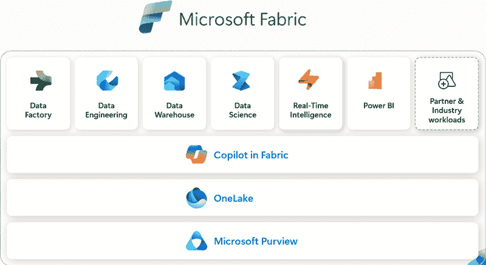

OneLake 是 Fabric 以数据湖为中心的体系结构，它为数据专业人员和企业提供了一个单一的集成环境来协作处理数据项目。 Fabric 的 OneLake 体系结构可促进数据团队成员之间的协作，使得无需在不同系统和团队之间移动和复制数据，从而节省时间。 OneCopy 是 OneLake 的关键组件，可用于从单个副本读取数据，而无需移动或复制数据。

将它看作是用于数据的 OneDrivea；OneLake 将不同区域和云中的存储位置组合到单个逻辑湖中，无需移动或复制数据。 与预先连接 Office 应用程序来使用组织 OneDrive 的方式类似，Fabric 中的所有计算工作负载都预配置为与 OneLake 配合使用。 Fabric 的数据仓库、数据工程（湖屋和笔记本）、数据集成（管道和数据流）、实时智能和 Power BI 都使用 OneLake 作为其本机存储，无需任何额外配置。

OneLake 基于 Azure Data Lake Storage (ADLS) 构建，可以 Delta、Parquet、CSV 和 JSON 等任何格式存储数据。

这意味着 Fabric 中的所有计算引擎都自动将其数据存储在 OneLake 中。 然后，所有计算引擎都可以直接访问存储在 OneLake 中的数据，而无需移动或复制。 对于表格数据，Fabric 中的分析引擎将以 delta-parquet 格式写入数据，并且所有引擎都会与格式无缝交互。

OneLake 的一个重要功能是能够创建快捷方式，这些快捷方式是 OneLake 中指向其他文件或存储位置的嵌入引用。 通过快捷方式，无需复制现有云数据就能快速获取它，而且 Fabric 体验能够从同一个来源派生数据并始终保持同步。

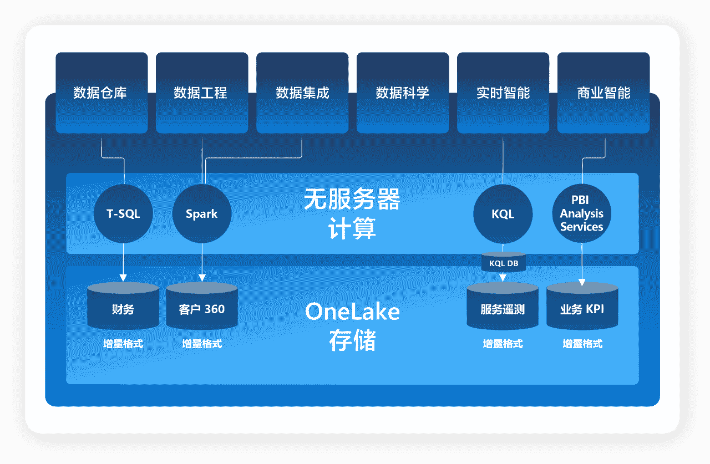

所有 Microsoft Fabric 计算体验都预连接到 OneLake，就像 Office 应用程序预连接以使用组织 OneDrive 一样。 数据工程、数据仓库、数据工厂、Power BI 和实时智能等体验使用 OneLake 作为本机存储。 它们不需要任何额外的配置。

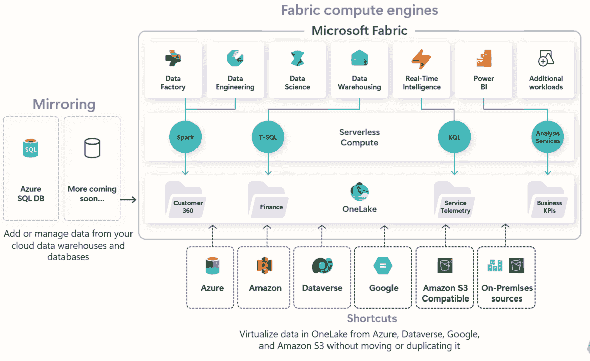

### 数据团队和 Microsoft Fabric

Microsoft Fabric 通过将工具统一到 SaaS 平台来转换分析开发过程，使不同的角色能够灵活地执行必要的技能，而无需重复工作。

+   数据工程师现在可以将大量数据引入、转换和加载到 OneLake 中，并将其呈现在最合理的数据存储中。 可以使用管道和体系结构（如奖牌）简化数据加载模式，可以使用工作区轻松配置数据加载模式。

+   数据分析师获得更多上下文和简化流程，使用数据工厂在上游转换数据，并使用 DirectLake 模式更直接地连接数据。

+   数据科学家可以更轻松地集成本机数据科学技术，然后使用 Power BI 的交互式报告提供基于数据的见解。

+   分析工程师通过精心挑选数据存储资产、确保数据质量以及启用自助服务分析来弥合数据工程与数据分析之间的差距。

+   低到无代码用户和公民开发者现在可以通过 OneLake 中心发现精选数据，并进一步处理和分析数据以满足其需求，而无需依赖于数据工程师或复制数据。

### 启用和使用 Microsoft Fabric

启用 Microsoft Fabric

如果你有管理员权限，可通过 Power BI 服务右上角的“设置”菜单访问管理员中心。 在此处，可以在租户设置中启用 Fabric。

管理员可以向整个组织或特定用户组提供 Fabric，这些用户组可基于其 Microsoft 365 或 Microsoft Entra 安全组进行整理。 管理员还可在容量级别将启用 Fabric 的功能委托给其他用户。

**创建工作区**

工作区是你创建和管理湖屋、仓库和报表等项的协作环境。 所有数据都存储在 OneLake 中，可通过工作区进行访问。 项通过列表或世系视图显示，这样可直观表示各项之间的依赖关系。

使用 OneLake 数据中心发现数据

Microsoft Fabric 中的 OneLake 数据中心可帮助用户轻松查找和访问其组织中的各种数据源。 用户可浏览并连接到数据源，从而确保他们具有适当的数据以满足需求。 用户只能看到与其共享的项目。 下面是使用 OneLake 中心时的一些注意事项：

+   按域缩小结果范围（如果已实现）。

+   在资源管理器中按工作区进行筛选。

+   浏览默认组：“全部数据”、“我的数据”、“组织认可”和“收藏夹”。

+   按关键字或项类型进一步筛选。

**探索工作负载**

Fabric 工作负载看起来与其他 Microsoft 数据产品/服务类似。 Fabric 基于 Power BI 和 Azure Data Lake Storage 构建，包括 Azure Synapse Analytics、Azure 数据工厂、Azure Databricks 和 Azure 机器学习的功能。 Fabric 的独特之处在于，它将这些功能汇集在单个 SaaS 集成体验中，让你无需访问 Azure 资源。

## Microsoft Fabric 中的湖屋入门

Microsoft Fabric 的基础是湖屋，它构建在 OneLake 可缩放的存储层之上，并使用 Apache Spark 和 SQL 计算引擎进行大数据处理。 湖屋是一个统一的平台，它结合了：

+   灵活且可缩放的数据湖存储

+   查询和分析数据仓库的数据的能力

假设你的公司一直使用数据仓库来存储其事务系统中的结构化数据，例如订单历史记录、库存级别和客户信息。 你从社交媒体、网站日志和外部源收集使用现有数据仓库基础结构难以管理和分析的非结构化数据。 你的公司的新指令是通过跨多个源分析各种格式的数据来改进其决策能力，因此公司选择了 Microsoft Fabric。

### 探索 Microsoft Fabric 湖屋

Microsoft Fabric 湖屋是一个数据体系结构平台，用于在单个位置存储、管理和分析结构化数据和非结构化数据。 这是一种灵活且可缩放的解决方案，让组织能够使用各种工具和框架处理大量数据，以处理和分析这些数据。 它与其他数据管理和分析工具集成，为数据工程和分析提供了一种全面的解决方案。

湖屋表示为数据库，并使用 Delta 格式表构建在数据湖之上。 湖屋结合了关系数据仓库基于 SQL 的分析功能和数据湖的灵活性和可伸缩性。 湖屋存储所有数据格式，可与各种分析工具和编程语言一起使用。 作为基于云的解决方案，湖屋可自动缩放并提供高可用性和灾难恢复。

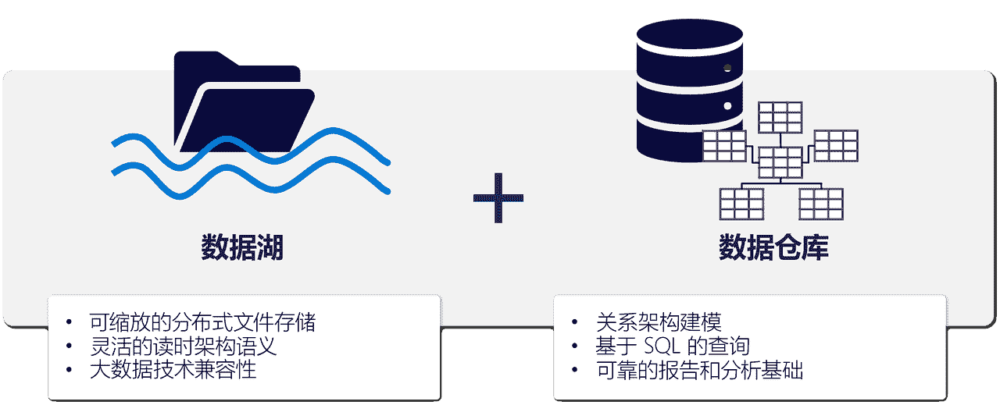

湖屋的一些优点包括：

+   湖屋使用 Spark 和 SQL 引擎来处理大规模数据并支持机器学习或预测建模分析。

+   湖屋数据以读时架构格式进行组织，这意味着可以根据需要定义架构，而不是拥有预定义的架构。

+   湖屋通过 Delta Lake 格式的表支持 ACID（原子性、一致性、隔离性、持续性）事务，以实现数据一致性和完整性。

+   湖屋是供数据工程师、数据科学家和数据分析师访问和使用数据的单个位置。

**将数据加载到湖屋**

Fabric 湖屋是分析解决方案的核心元素。 在加载到湖屋之前，可以按照 ETL（提取、转换和加载）过程引入和转换数据。

可从各种源引入许多通用格式的数据；包括本地文件、数据库或 API。 你还可以为外部源（如 Azure Data Lake Store Gen2 或 OneLake）中的数据创建 Fabric 快捷方式。 可使用湖屋资源管理器浏览文件、文件夹、快捷方式和表，并在 Fabric 平台中查看其内容。

可以使用带笔记本的 Apache Spark 或数据流 Gen2 来转换引入的数据，然后进行加载。 使用数据工厂管道协调不同的 ETL 活动，并将准备好的数据放入湖屋中。

**保护湖屋安全**

湖屋访问权限是通过工作区或项目级共享进行管理的。 协作者应使用工作区角色，因为这些角色授予对工作区中所有项目的访问权限。 项目级共享最适合用于为只读需求（例如分析或 Power BI 报表开发）授予访问权限。

Fabric 湖屋还支持数据管理功能（包括敏感度标签），并且可通过将 Microsoft Purview 与 Fabric 租户一起使用来进行扩展。

### 使用 Microsoft Fabric 湖屋

**创建湖屋**

创建新的数据湖屋时，工作区中会自动创建三个不同的数据项。

+   数据湖屋包含快捷方式、文件夹、文件和表。

+   语义模型（默认）为 Power BI 报表开发人员提供了简单的数据源。

+   SQL 分析终结点允许通过 SQL 以只读访问权限查询数据。

**将数据引入湖屋**

将数据引入数据湖屋是 ETL 过程的第一步。 使用以下任一方法将数据引入到数据湖屋中。

+   上传：上传本地文件。

+   数据流 Gen2：使用 Power Query 导入和转换数据。（这是使用 Excel 或 Power BI 的数据分析师熟悉的工具，可以提供转换的可视化表示形式，作为传统编程的替代方案）

+   Notebooks：使用 Apache Spark 引入、转换和加载数据。

+   数据工厂管道：使用“复制数据”活动

**使用快捷方式访问数据**

另一种访问和使用 Fabric 中数据的方法是使用快捷方式。 通过快捷方式，你可以将数据集成到湖屋中，同时将其存储在外部存储中。

需要获取不同存储帐户甚至不同云提供商中的数据时，快捷方式非常有用。 在数据湖屋中，你可以创建指向不同存储帐户和其他 Fabric 项（如数据仓库、KQL 数据库和其他数据湖屋）的快捷方式。

源数据权限和凭据均由 OneLake 管理。 通过快捷方式访问另一个 OneLake 位置的数据时，调用用户的身份将用于授权访问快捷方式目标路径中的数据。 该用户必须拥有目标位置的权限才能读取数据。

可以在湖屋和 KQL 数据库中创建快捷方式，快捷方式在湖中显示为文件夹。 这允许 Spark、SQL、实时智能和 Analysis Services 在查询数据时都使用快捷方式。

### 在湖屋中探索和转换数据

**转换和加载数据**

大多数数据需要转换才能加载到表中。 可以先将原始数据直接引入数据湖屋中，然后进一步转换并加载到表中。 无论 ETL 设计如何，都可以使用相同的工具来引入数据，从而简化转换和加载数据的过程。 转换后的数据可以作为文件或 Delta 表加载。

+   笔记本更受熟悉 PySpark、SQL 和 Scala 等不同编程语言的数据工程师青睐。

+   数据流 Gen2 非常适合熟悉 Power BI 或 Excel 的开发人员，因为它们使用 PowerQuery 接口。

+   管道提供了一个可视化界面来执行和协调 ETL 过程。 根据需要，管道可以很简单，也可以很复杂。

**分析和可视化数据**

数据经过引入、转换和加载后，便可供其他人使用。 Fabric 项为每个组织提供了所需的灵活性，你可以使用适合自己的工具。

+   数据科学家可以使用笔记本或数据整理器来探索和训练用于 AI 的机器学习模型。

+   报表开发人员可以使用语义模型创建 Power BI 报表。

+   分析人员可以使用 SQL 分析终结点来查询、筛选、聚合，并浏览数据湖屋表中的数据。

通过将 Power BI 的数据可视化功能与数据湖屋的集中式存储和表格架构相结合，可以在单个平台上实现端到端分析解决方案。

### 练习 - 创建 Microsoft Fabric 湖屋

在本练习中探索 Microsoft Fabric 湖屋任务，例如创建湖屋、导入数据、使用 SQL 查询表以及生成报表。 本练习重点介绍湖屋作为数据工程、仓库和分析的核心组件的重要性，它让用户能够在湖屋环境中有效地管理和分析其数据。

https://microsoftlearning.github.io/mslearn-fabric.zh-cn/Instructions/Labs/01-lakehouse.html

实验要点：

1.  启用Fabric免费测试

1.  实验数据repo：https://github.com/MicrosoftLearning/dp-data

1.  实验手册repo：https://github.com/MicrosoftLearning/mslearn-fabric | https://github.com/MicrosoftLearning/mslearn-fabric.zh-cn

## 使用 Microsoft Fabric 中的数据流 Gen2 引入数据

Microsoft Fabric 为数据工程、集成和分析提供统一的解决方案。 端到端分析中的一个关键步骤是数据引入。数据流 Gen2 用于从多个源引入和转换数据，然后将清理后的数据放置到另一个目标。 它们可以合并到数据管道中，以便进行更复杂的活动业务流程，并用作 Power BI 中的数据源。

假设你在一家门店遍布全球的零售公司工作。 作为数据工程师，你需要准备各种源中的数据并将数据转换为适合数据分析和报告的格式。 企业需要使用语义模型来合并来自不同存储的不同数据源。 通过数据流 Gen2，可以准备数据以确保一致性，然后将数据暂存到首选目标中。 它们还可以重复使用并且能实现轻松地更新数据。 在没有数据流的情况下，则必须从每个源手动提取和转换数据，这既耗时又容易出错。

### 了解 Microsoft Fabric 中的数据流 Gen2

**数据流**

数据流是一种基于云的 ETL（提取、转换、加载）工具，用于生成和执行可缩放的数据转换过程。

数据流 Gen2 允许从各种源中提取数据、使用各种转换操作转换数据，并 将数据加载到目标中 。 使用 Power Query Online 还支持使用可视化界面来执行这些任务。

从根本上讲，数据流包括所有减少数据准备时间的转换，然后可以加载到新表中、包含在数据管道中，或者被数据分析师用作数据源。

**如何使用数据流Gen2**

从传统上讲，数据工程师会花费大量时间提取、转换数据并将数据加载为可使用的格式，以便进行下游分析。 数据流 Gen2 旨在提供一种简单、可重用的方式来使用 Power Query Online 执行 ETL 任务。

如果仅选择使用数据管道，请复制数据，然后使用首选的编码语言来提取、转换和加载数据。 或者，可以先创建数据流 Gen2 来提取和转换数据。 还可以将数据加载到湖屋和其他目标中。 现在，业务方可以轻松使用策展语义模型。

可以选择将数据目标添加到你的数据流，数据流会保留所有转换步骤。 若要在转换后执行其他任务或将数据加载到不同的目标，请创建数据管道并将数据流 Gen2 活动添加到业务流程。

另一个选项可以是将数据管道和数据流 Gen2 用于 ELT（提取、加载、转换）过程。 对于此操作顺序，请使用管道将数据提取并加载到首选目标（例如湖屋）中。 然后创建数据流 Gen2 以连接到湖屋数据来清理和转换数据。 在这种情况下，你要提供数据流作为策展语义模型，供数据分析师开发报表。

也可以水平分区数据流。 在你创建全局数据流后，数据分析师可以使用数据流针对特定需求创建专用语义模型。

数据流使你能够提升可重用的 ETL 逻辑，从而避免创建更多到数据源的连接。 数据流提供各种各样的转换，可以手动运行数据流、也可以按刷新计划运行，或者作为数据管道业务流程的一部分运行。

**优势和限制**

在 Microsoft Fabric 中，可通过多种方式访问 ETL 或 ELT 数据。 请考虑使用数据流 Gen2 的优势和限制。

优势：

+   使用一致的数据（例如标准日期维度表）扩展数据。

+   允许自助服务用户单独访问数据仓库的子集。

+   使用数据流优化性能，可以提取一次数据以供重复使用，从而减少较慢源的数据刷新时间。

+   通过仅向较大的分析师组公开数据流来简化数据源复杂性。

+   通过允许用户在将数据加载到目标之前清理和转换数据，确保数据的一致性和质量。

+   通过提供从各种源引入数据的低代码接口来简化数据集成。

限制：

+   数据流不是数据仓库的替代项。

+   不支持行级安全性。

+   需要 Fabric 容量工作区。

### 探索 Microsoft Fabric 中的数据流 Gen2

数据流 Gen2 提供了一种低到无代码解决方案，用于将数据引入、转换和加载到 Fabric 数据存储中。 Power BI 开发人员对此很熟悉，可以快速开始执行上游转换以提高报表的性能。

### 在 Microsoft Fabric 中集成数据流 Gen2 和管道

数据流 Gen2 为 Microsoft Fabric 中的数据转换提供了极佳的选项。 需要对转换后的数据执行其他操作时，数据流和管道的组合将非常有用。

数据管道是数据工程中的一个常见概念，可提供各种各样的活动以进行协调。 一些常见活动包括：

+   复制数据

+   合并数据流

+   添加笔记本

+   获取元数据

+   执行脚本或存储过程

管道提供了一种直观的方式来按特定顺序完成活动。 可以使用数据流进行数据引入、转换和登陆 Fabric 数据存储。 然后将数据流合并到管道中以协调额外的活动，例如在数据流完成后执行脚本或存储过程。

还可以通过触发器计划或激活管道来运行数据流。 通过使用管道来运行数据流，可以在需要数据时刷新数据，而无需手动运行数据流。 在处理企业数据或频繁更改的数据时，自动化使你能够专注于其他职责

### 练习 - 在 Microsoft Fabric 中创建和使用数据流 Gen2

在本练习中，你将使用数据流 Gen2 将转换后的数据加载到湖屋中，并将数据流添加到管道。

[ht](https://microsoftlearning.github.io/mslearn-fabric.zh-cn/Instructions/Labs/05-dataflows-gen2.html)tps://microsoftlearning.github.io/mslearn-fabric/Instructions/Labs/05-dataflows-gen2.html

## 使用 Microsoft Fabric 协调进程和数据移动

数据管道定义协调整个流程的活动序列，通常通过从一个或多个源提取数据并将其加载到目标中；在整个过程中会经常转换它。 管道通常用于自动执行提取、转换和加载 (ETL) 流程，这些流程将事务数据从操作数据存储引入到分析数据存储中（例如湖屋、数据仓库或 SQL 数据库）。

如果你已熟悉 Azure 数据工厂，则很快就能够熟悉 Microsoft Fabric 中的数据管道。 它们使用相同的已连接活动的体系结构来定义一个流程，该流程可以包含多种数据处理任务和控制流逻辑。 可以在 Microsoft Fabric 用户界面中以交互方式运行管道，或将其计划为自动运行。

### 了解管道

Microsoft Fabric 中的管道封装了一系列用于执行数据移动和处理任务的活动。 你可使用管道来定义数据传输和转换活动，并通过管理分支、循环和其他典型处理逻辑的控制流活动来编排这些活动。 使用 Fabric 用户界面中的图形管道画布，可通过少量编码或无需编码来生成复杂的管道。

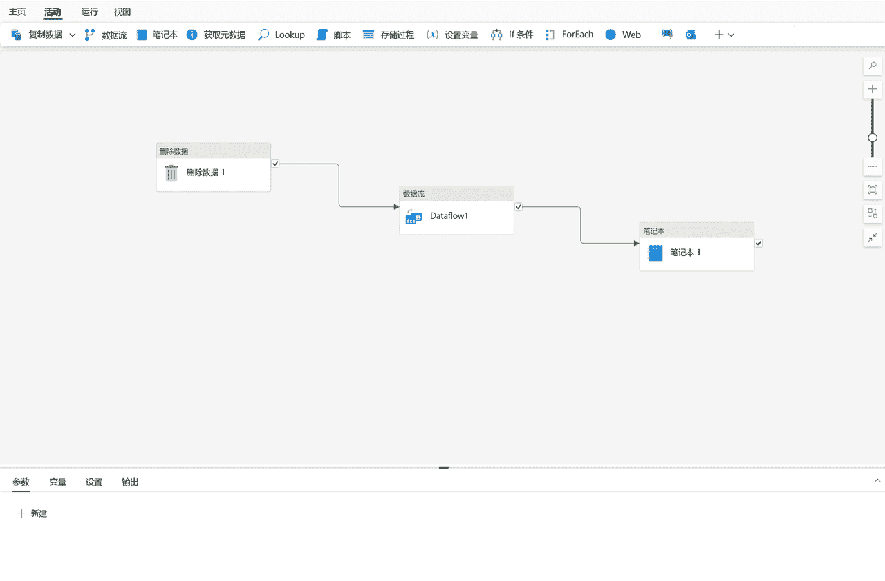

**活动**

活动是管道中的可执行任务。 可通过按顺序连接活动来定义活动流。 特定活动的结果（成功、失败或完成）可用于将流定向到序列中的下一个活动。

管道中有两大类活动。

+   数据转换活动 - 封装数据传输操作的活动，包括简单的复制数据活动（从源提取数据并将其加载到目标）以及更复杂的数据流活动（封装在传输数据时对数据应用转换的数据流 (Gen2)）。 其他数据转换活动包括运行 Spark 笔记本的笔记本活动、运行 SQL 代码的存储过程活动、删除现有数据的删除数据活动等等。 在 OneLake 中，可以将目标配置为湖屋、仓库、SQL 数据库或其他选项。

+   控制流活动 - 用于实现循环、条件分支，或者管理变量和参数值的活动。 广泛的控制流活动使你能够实现复杂的管道逻辑，以协调数据引入和转换流。

**参数**

管道可以参数化，使你能够提供要在每次运行管道时使用的特定值。 例如，你可能希望使用管道将引入的数据保存在文件夹中，但可以灵活地在每次运行管道时指定文件夹名称。

使用参数可提高管道的可重用性，使你能够创建灵活的数据引入和转换过程。

**管道运行**

每次执行管道时，都会启动数据管道运行。 可以在 Fabric 用户界面中按需启动运行，也可以计划以特定频率启动运行。 使用唯一的运行 ID 查看运行详细信息，以确认它们是否已成功完成，并调查用于每次执行的特定设置。

### 使用数据复制活动

“复制数据”活动是数据管道最常见的用途之一。 许多管道由单个“复制数据”活动组成，用于将数据从外部源引入湖屋文件或表。

+   还可以将“复制数据”活动与其他活动结合使用，以创建可重复的数据引入过程，例如，通过使用“删除数据”活动移除现有数据，使用“复制数据”活动将已删除的数据替换为包含外部源数据的文件，以及使用“笔记本”活动运行 Spark 代码，转换文件中的数据并将其加载到表中。

+   将“复制数据”活动添加到管道时，图形工具将引导你完成为复制操作配置数据源和目标所需的步骤。 支持广泛的源连接，因此可以从大多数常见源引入数据。 在 OneLake 中，这包括对湖屋、仓库、SQL 数据库等的支持。

+   如果需要在不应用任何转换的情况下直接在受支持的源和目标之间复制数据，或者想要导入原始数据并在以后的管道活动中应用转换，请使用“复制数据”活动。

+   如果需要在引入数据时对数据应用转换，或合并来自多个源的数据，请考虑使用“数据流”活动运行数据流 (Gen2)。 可以使用 Power Query 用户界面定义包含多个转换步骤的数据流 (Gen2)，并将其包含在管道中。

### 使用管道模板

你可以从任意的所选活动组合定义管道，从而能够创建自定义数据引入和转换过程以满足特定需求。 不过，在许多常见的管道方案中，Microsoft Fabric 包括预定义的管道模板，你可以根据需要使用和自定义这些模板。

### 运行和监视管道

+   完成管道后，可以使用“验证”选项检查配置是否有效，然后以交互方式运行或指定一个计划。

+   可以从管道画布或工作区页面上列出的管道项查看管道运行历史记录，以查看每个运行的详细信息。

+   从工作区页查看管道运行历史记录时，可以选择“运行开始”值以查看单个运行的详细信息；包括以甘特图的形式查看每个活动的各个执行时间的选项。

### 练习 - 使用管道引入数据

在本练习中，将实现一个数据引入解决方案，该解决方案使用管道将数据从外部源复制到湖屋，然后使用 Spark 笔记本转换数据并将其加载到表中。。

https://microsoftlearning.github.io/mslearn-fabric.zh-cn/Instructions/Labs/04-ingest-pipeline.html

## 在 Microsoft Fabric 中使用 Apache Spark

Apache Spark 是用于大规模数据处理和分析的开源并行处理框架。 Spark 在“大数据”处理场景中很受欢迎，可在多个平台实现中使用，包括 Azure HDInsight、Azure Synapse Analytics 和 Microsoft Fabric。

本模块介绍如何在 Microsoft Fabric 中使用 Spark 来引入、处理和分析湖屋中的数据。 虽然本模块中所述的核心技术和代码对于所有 Spark 实现都是通用的，但集成的工具和在与 Microsoft Fabric 中的其他数据服务相同的环境中使用 Spark 的能力使得将基于 Spark 的数据处理合并到整体数据分析解决方案中变得更加容易。

### 准备使用 Apache Spark

Apache Spark 是一个分布式数据处理框架，通过协调群集中多个处理节点之间的工作，实现大规模数据分析，在 Microsoft Fabric 中，这种群集被称为 Spark 池。 更简单地说，Spark 使用“分治法”，通过跨多台计算机分发工作来快速处理大量数据。 分发任务和整理结果的过程由 Spark 进行处理。

Spark 可运行以各种语言编写的代码，这些语言包括 Java、Scala（基于 Java 的脚本语言）、Spark R、Spark SQL 和 PySpark（Python 的特定于 Spark 的变体）。 实际上，大多数数据工程和分析工作负载都是通过结合使用 PySpark 和 Spark SQL 来完成的。

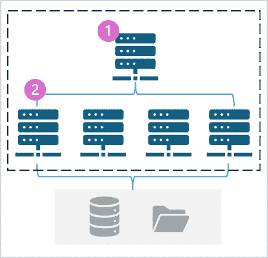

如图所示，Spark 池包含两种类型的节点：

1.  Spark 池中的头节点通过驱动程序协调分布式进程。

1.  池中包括多个工作器节点，在这些节点上，执行程序进程执行实际数据处理任务。

Spark 池使用这种分布式计算体系结构来访问和处理兼容数据存储中的数据，例如基于 OneLake 的数据湖屋。

Microsoft Fabric 中的 Spark 池

Microsoft Fabric 在每个工作区中都提供了一个初学者池，以便用户快速启动和运行 Spark 作业，而不需要过多的设置和配置。 可以对初学者池进行配置，以便根据特定的工作负载需求或成本约束来优化其中包含的节点。

此外，还可以创建具有特定节点配置的自定义 Spark 池，以满足特定数据处理需求。

Spark 池的特定配置设置包括：

+   节点系列：用于 Spark 群集节点的虚拟机类型。 在大多数情况下，内存优化节点提供最佳性能。

+   自动缩放：是否根据需要自动预配节点，如果是，则需要指定分配给池的初始节点数和最大节点数。

+   动态分配：是否根据数据量在工作器节点上动态分配执行程序进程。

如果在工作区中创建了一个或多个自定义 Spark 池，则可以将其中一个（或初学者池）设置为默认池，以便在没有为给定 Spark 作业指定特定池时使用。

**运行时和环境**

Spark 开放源代码生态系统包括多个版本的 Spark 运行时，它决定了所安装的 Apache Spark、Delta Lake、Python 和其他核心软件组件的版本。 此外，还可以在运行时中安装和使用各种代码库来执行常见的任务（有时也包括非常特殊的任务）。 由于大量 Spark 处理是使用 PySpark 执行的，因此大量的 Python 库可确保无论需要执行什么任务，都有一个库可以提供帮助。

在某些情况下，组织可能需要定义多个环境，以支持各种数据处理任务。 每个环境定义了一个特定的运行时版本，以及执行特定操作必须安装的库。 然后，数据工程师和科学家就可以选择在特定任务中与 Spark 池一起使用的环境。

Microsoft Fabric 支持多个 Spark 运行时，并将继续支持新发布的运行时。 可以通过工作区设置界面指定启动 Spark 池时默认环境使用的 Spark 运行时。

可以在 Fabric 工作区中创建自定义环境，以便针对不同的数据处理操作使用特定的 Spark 运行时、库和配置设置。创建环境时，可以：

+   指定应使用的 Spark 运行时。

+   查看每个环境中安装的内置库。

+   从 Python 包索引 (PyPI) 安装特定的公共库。

+   通过上传包文件来安装自定义库。

+   指定环境应使用的 Spark 池。

+   指定 Spark 配置属性以替代默认行为。

+   上传需要在环境中提供的资源文件。

在创建了至少一个自定义环境后，可以在工作区设置中将其指定为默认环境。

### 运行 Spark 代码

要在 Microsoft Fabric 中编辑和运行 Spark 代码，可以使用笔记本，也可以定义 Spark 作业。

**笔记本**

如果要使用 Spark 交互式浏览和分析数据，请使用笔记本。 借助笔记本，可以组合文本、图像和使用多种语言编写的代码，以创建可与他人共享和协作的交互式项目。

笔记本由一个或多个单元格组成，每个单元格可以包含 markdown 格式的内容或可执行代码。 可以在笔记本中以交互方式运行代码，并立即查看结果。

**Spark 作业定义**

如果要在自动化过程中使用 Spark 引入和转换数据，可以定义 Spark 作业以按需或基于计划运行脚本。

要配置 Spark 作业，请在工作区中创建 Spark 作业定义，并指定它应运行的脚本。 还可以指定参考文件（例如，包含脚本中使用的函数定义的 Python 代码文件），以及对包含脚本所处理数据的特定湖屋的引用。

### 处理 Spark 数据帧中的数据

Spark 原本使用一种称为弹性分布式数据集 (RDD) 的数据结构；但是虽然可以编写直接处理 RDD 的代码，但在 Spark 中处理结构化数据最常用的数据结构是数据帧，它作为 Spark SQL 库的一部分提供。 Spark 中的数据帧类似于通用 Pandas Python 库中的数据帧，但经过优化，可以在 Spark 的分布式处理环境中工作。

### 使用 Spark SQL 处理数据

Dataframe API 是名为 Spark SQL 的 Spark 库的一部分，它使数据分析师能够使用 SQL 表达式来查询和操作数据。

在 Spark 目录中创建数据库对象

Spark 目录是关系数据对象（例如视图和表）的元存储。 Spark 运行时可以使用目录将用任何 Spark 支持的语言编写的代码与 SQL 表达式无缝集成，对于一些数据分析师或开发人员来说，SQL 表达式可能更合理。

使用 Spark SQL API 查询数据

可以使用采用任何语言编写的代码中的 Spark SQL API 来查询目录中的数据。 例如，以下 PySpark 代码使用 SQL 查询将 products 表中的数据作为数据帧返回。

**使用 SQL 代码**

除了使用 Spark SQL API 在 Spark 代码中嵌入 SQL 表达式。 在笔记本中，还可以使用 %%sql magic 来运行查询目录中的对象的 SQL 代码

### 在 Spark 笔记本中直观显示数据

分析数据查询结果的最直观的方法之一是将其可视化为图表。 Microsoft Fabric 中的笔记本在用户界面中提供了一些基本的图表绘制功能，并且当无法通过该功能获取所需内容时，可以使用众多 Python 图形库之一在笔记本中创建和显示数据可视化效果。

**使用内置的笔记本图表**

在 Spark 笔记本中显示数据帧或运行 SQL 查询时，结果显示在代码单元下。 默认情况下，结果呈现为表格，但也可以将结果视图更改为图表，并使用图表属性来自定义图表的数据可视化方式

**在代码中使用图形包**

有许多图形包可用于在代码中创建数据可视化效果。 具体而言，Python 支持大量不同种类的包；其中大多数均基于基础 Matplotlib 库构建。 图形库的输出可以在笔记本中呈现，从而可以轻松将引入和操作数据的代码与内联数据可视化效果和标记单元格组合起来，以提供注释。

### 练习 - 使用 Apache Spark 分析数据

现在，你有机会在 Microsoft Fabric 中使用 Apache Spark。 在本练习中，使用 Spark 笔记本来分析和可视化湖屋中文件的数据。

https://microsoftlearning.github.io/mslearn-fabric/Instructions/Labs/02-analyze-spark.html

## 在 Microsoft Fabric 中使用 Delta Lake 表 (DP-601)

Microsoft Fabric 湖屋中的表基于 Apache Spark 中常用的 Linux 基础 Delta Lake 表格式。 Delta Lake 是 Spark 的开源存储层，它支持用于批处理和流式处理数据的关系数据库功能。 通过使用 Delta Lake，可以在 Spark 中实现湖屋体系结构以支持基于 SQL 的支持事务和架构强制实施的数据操作语义。 结果是一个分析数据存储，它提供关系数据库系统的许多优势，以及数据湖中数据文件存储的灵活性。

虽然无需直接使用 Delta Lake API 即可在 Fabric 湖屋中使用表，但了解 Delta Lake 元存储体系结构并熟悉一些更专业的 Delta 表操作可以极大地扩展你在 Microsoft Fabric 上构建高级分析解决方案的能力。

### 了解 Delta Lake

Delta Lake 是一个开源存储层，它将关系数据库语义添加到基于 Spark 的数据湖处理中。

Delta 表是对以 Delta 格式存储的数据文件的架构抽象。 对于每个表，湖屋存储一个包含 Parquet 数据文件的文件夹和一个以 JSON 格式记录事务详细信息的 _delta_Log 文件夹。

使用 Delta 表的优点包括：

+   支持查询和数据修改的关系表。 使用 Apache Spark，可以将数据存储在支持 CRUD（创建、读取、更新和删除）操作的 Delta 表中。 换句话说，可以采用与在关系数据库系统中相同的方式选择、插入、更新和删除数据行。

+   支持 ACID 事务。 关系数据库旨在支持事务数据修改，这些修改提供原子性（事务作为单个工作单元完成）、一致性（事务使数据库保持一致状态）、隔离（进行中的事务不能相互干扰）和持久性（事务完成时，它所做的更改将保留）。 Delta Lake 通过实现事务日志并强制实施并发操作的可序列化隔离，为 Spark 提供相同的事务支持。

+   数据版本控制和按时间顺序查看。 由于所有事务都记录在事务日志中，因此可以跟踪每个表行的多个版本，甚至使用按时间顺序查看功能在查询中检索某行的先前版本。

+   支持批处理和流式处理数据。 虽然大多数关系数据库包括存储静态数据的表，但 Spark 包含通过 Spark 结构化流式处理 API 流式处理数据的本机支持。 Delta Lake 表可用作流式处理数据的接收器（目标）和源。

+   标准格式和互操作性。 Delta 表的基础数据以 Parquet 格式存储，该格式通常用于数据湖引入管道。 此外，可以使用 Microsoft Fabric 湖屋的 SQL 分析终结点来以 SQL 查询 Delta 表。

### 创建 Delta 表

在 Microsoft Fabric 湖屋中创建表时，将在湖屋的元存储中定义 Delta 表，该表的数据存储在该表的基础 Parquet 文件中。

对于 Microsoft Fabric 环境中的大多数交互式工具，将抽象化元存储中的表定义映射到基础文件的详细信息。 但是，在湖屋中使用 Apache Spark 时，可以更好地控制 Delta 表的创建和管理。

### 优化 Delta 表

Spark 是一个并行处理框架，数据存储在一个或多个工作器节点上。 此外，Parquet 文件是不可变的，每次更新或删除都会写入新文件。 此过程可能会导致 Spark 将数据存储在大量小文件中，这被称为“小文件问题”。这意味着对大量数据的查询可能会运行缓慢，甚至无法完成。

OptimizeWrite 函数

OptimizeWrite 是 Delta Lake 的一项功能，可减少写入文件时的文件数。 它不写入许多小文件，而是写入较少的较大文件。 这有助于防止“小文件问题”并确保性能不会降级。

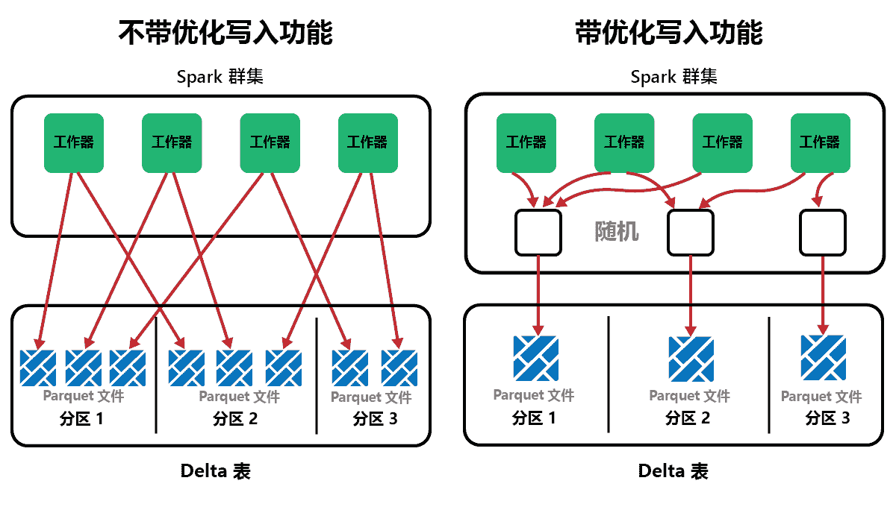

**优化**

优化是一项表维护功能，可将小型 Parquet 文件合并为较少的大型文件。 加载大型表后，你可以运行优化来获得：

+   较少的较大文件

+   更好的压缩

+   跨节点高效数据分布

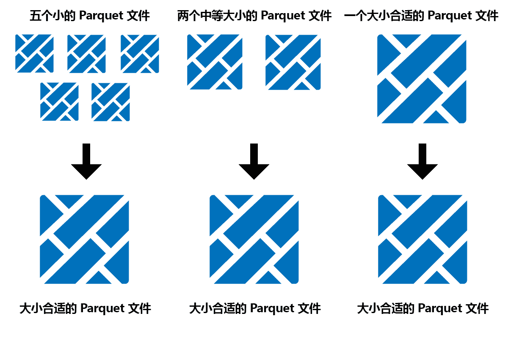

**V-Order 函数**

运行优化时，你还可以选择运行 V 顺序，这是专为 Fabric 中的 Parquet 文件格式设置的。 V 顺序可实现闪电般快速的读取，具有与内存中数据类似的访问速度。 它还提高了成本效率，因为它减少了读取过程中的网络、磁盘和 CPU 资源。

V 顺序在 Microsoft Fabric 中默认启用，并且在写入数据时应用。 它产生大约 15% 的小开销，使写入速度稍慢。 但是，V 顺序使得可以从 Microsoft Fabric 计算引擎（例如 Power BI、SQL、Spark 等）进行更快的读取。

在 Microsoft Fabric 中，Power BI 和 SQL 引擎使用 Microsoft Verti-Scan 技术，该技术充分利用 V 顺序优化来加快读取速度。 Spark 和其他引擎不使用 VertiScan 技术，但仍然受益于 V 顺序优化，读取速度可提高约 10%，有时甚至高达 50%。

V 顺序的工作原理是对 Parquet 文件应用特殊排序、行组分布、字典编码和压缩。 它 100% 兼容开源 Parquet 格式，所有 Parquet 引擎都可以读取它。

V 顺序对写入密集型场景可能无益，例如其中的数据只会被读取一两次的临时数据存储。 在这些情况下，禁用 V 顺序可能会降低用于数据引入的总体处理时间。

**清空**

可以使用 VACUUM 命令移除旧的数据文件。

每个更新或删除操作完成后，都会创建一个新的 Parquet 文件，并在事务日志中创建一个条目。 旧的 Parquet 文件将被保留以实现时间旅行，这意味着 Parquet 文件会随着时间的推移而积累。

VACUUM 命令会移除旧的 Parquet 数据文件，但不会移除事务日志。 运行 VACUUM 时，时间旅行不能回溯到保留期之前。

**对 Delta 表进行分区**

Delta Lake 允许将数据组织到分区中。 这可以通过实现“数据跳过”来提高性能，数据跳过通过基于对象的元数据跳过不相关的数据对象来提高性能。

请考虑存储大量销售数据的情况。 可以按年份对销售数据进行分区。 分区存储在名为“year=2021”、“year=2022”等的子文件夹中。如果你只想报告 2024 年的销售数据，那么可以跳过其他年份的分区，这可以提高读取性能。

但是，对少量数据进行分区可能会降低性能，因为它会增加文件数，并可能加剧“小文件问题”。

在以下情况下请使用分区：

+   你的数据量非常大。

+   表可以拆分为几个大型分区。

在以下情况下不要使用分区：

+   数据量较小。

+   分区列具有较高的基数，因为这会创建大量分区。

+   分区列将导致多个级别

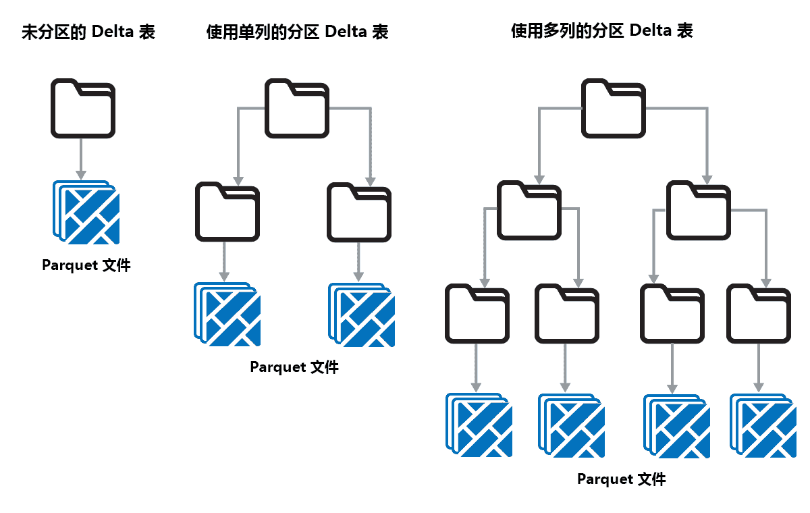

### 在 Spark 中使用 Delta 表

可以使用增量表（或增量格式文件）以多种方式检索和修改数据。

+   在 Spark 中处理增量表中数据的最常见方法是使用 Spark SQL。 可以使用 spark.sql 库以其他语言（如 PySpark 或 Scala）嵌入 SQL 语句。

+   如果要使用增量文件而不是目录表，使用 Delta Lake API 可能更简单。 可以从包含增量格式文件的文件夹位置创建 DeltaTable 的实例，然后使用 API 修改表中的数据。

+   对增量表进行的修改记录在表的事务日志中。 可以使用记录的事务来查看对表所做的更改的历史记录，并检索旧版数据（称为“按时间顺序查看”）

### 将 Delta 表与流式处理数据配合使用

我们浏览到此点的所有数据都是文件中的静态数据。 但是，许多数据分析方案涉及必须准实时处理的流式处理数据。 例如，可能需要捕获物联网 (IoT) 设备发出的读数，并在它们发生时将其存储在表中。 Spark 以相同的方式处理批处理数据和流式处理数据，使能够使用相同的 API 实时处理流数据。

**Spark 结构化流**

典型的流处理解决方案涉及从源中不断读取数据流、选择性地处理它以选择特定字段、聚合值和对值进行分组，或以其他方式处理数据，并将结果写入接收器。

Spark 包括通过 Spark 结构化流式处理对流式处理数据的本机支持，这是一种基于无限数据帧的 API，在该数据帧中捕获流式处理数据进行处理。 Spark 结构化流式处理数据帧可以从多种不同类型的流式处理源读取数据，包括：

+   网络端口

+   实时消息中转服务，例如 Azure 事件中心或 Kafka

+   文件系统位置。

使用 Delta 表进行流式处理

你可以将 Delta 表用作 Spark 结构化流式处理源或接收器。 例如，可以从 IoT 设备捕获实时数据流，并将流直接写入 Delta 表作为接收器。 然后，可以查询该表以查看最新的流式处理数据。 或者，可以将 Delta 表作为流式处理源读取数据，这样就可以在将新数据添加到该表中时几乎实时报告新数据。

### 练习 - 在 Apache Spark 中使用 Delta 表

Microsoft Fabric 湖屋中的表基于开源 Delta Lake 格式。 Delta Lake 添加了对批处理和流式数据的关系语义的支持。 在本练习中，你将创建 Delta 表并使用 SQL 查询浏览数据。

https://microsoftlearning.github.io/mslearn-fabric.zh-cn/Instructions/Labs/03-delta-lake.html

# 使用 Microsoft Fabric 实现数据仓库

## Microsoft Fabric 中的数据仓库入门

关系数据仓库是大多数企业商业智能 (BI) 解决方案的核心。 虽然具体细节可能因数据仓库实现而异，但基于去规范化的多维架构的常见模式已成为关系数据仓库的标准设计。

Microsoft Fabric 的数据仓库是传统数据仓库的现代版本。 它将来自不同部门、系统和数据库的数据集中整理到单个统一的视图中，以便进行分析和报告。 Fabric 的数据仓库提供完整的 SQL 语义，包括在表中插入、更新和删除数据的功能。 Fabric 的数据仓库是独一无二的，因为它基于湖屋构建，该数据仓库以 Delta 格式存储，可以使用 SQL 进行查询。 它被设计为由整个数据团队使用，而不仅仅由数据工程师使用。

Fabric 的数据仓库体验旨在应对这些挑战。 Fabric 使数据工程师、分析师和数据科学家能够协同工作，以创建并查询针对他们特定需求而优化的数据仓库。

### 了解数据仓库基础知识

构建新式数据仓库的过程通常涉及以下内容：

+   数据引入 - 将数据从源系统移动到数据仓库。

+   数据存储 - 以针对分析进行了优化的格式存储数据。

+   数据处理 - 将数据转换为可供分析工具使用的格式。

+   数据分析和交付 - 分析数据以获取见解并将这些见解交付给业务。

借助 Microsoft Fabric，数据工程师和分析师能够在一个工具中引入、存储、转换和可视化数据，同时提供低代码和传统体验。

了解 Fabric 的数据仓库体验

Fabric 的数据仓库是一种关系数据仓库，支持你希望从企业数据仓库获取的全部事务性 T-SQL 功能。 它是一个完全托管、可缩放且高度可用的数据仓库，可用于在湖屋中存储和查询数据。 使用数据仓库，可以完全控制使用 Fabric 门户或 T-SQL 命令创建表以及加载、转换和查询数据的过程。 可以使用 SQL 来查询和分析数据，或使用 Spark 来处理数据并创建机器学习模型。

Fabric 中的数据仓库可促进数据工程师和数据分析师之间的协作，在相同的体验中协同工作。 数据工程师基于湖屋中的数据构建关系层，分析师可以在其中使用 T-SQL 和 Power BI 来浏览数据。

**数据仓库中的表**

数据仓库中的表通常以支持对大量数据进行高效和有效分析的方式组织。 这种组织方式通常称为维度建模，涉及将表结构化为事实数据表和维度表。

+   事实数据表包含要分析的数字数据。 事实数据表通常包含很多行，是用于分析的主要数据源。 例如，事实数据表可能包含为特定日期或特定商店发生的销售订单支付的总金额。

+   维度表包含有关事实数据表中的数据的描述性信息。 维度表通常包含少量行，用于提供事实数据表中数据的上下文。 例如，维度表可能包含有关下销售订单的客户的信息。

**特殊类型的维度表**

特殊类型的维度提供额外的上下文，并实现更全面的数据分析。

时间维度提供有关事件发生的时间段的信息。 此表使数据分析师能够通过时态间隔来聚合数据。 例如，时间维度可能包括表示下销售订单的年份、季度、月份和日期的列。

渐变维度是用于跟踪维度属性随时间的变化的维度表，例如客户地址或产品价格的更改。 它们在数据仓库中非常重要，因为它们使用户能够分析和了解随着时间推移对数据进行的更改。 渐变维度可确保数据保持最新和准确，这对于做出良好的业务决策至关重要。

**数据仓库架构设计**

通常，数据仓库组织为一个星型架构，其中事实数据表与维度表直接相关，如以下示例所示：

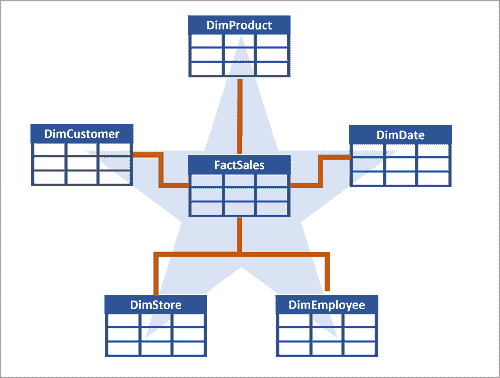

可以使用某些内容的属性将事实数据表中不同级别的数字组合在一起。 例如，可以查找整个区域或仅一个客户的总销售收入。 每个级别的信息可以存储在同一维度表中。

如果有很多级别或某些信息由不同的内容共享，则改用雪花型架构可能更合理。 下面是一个示例：

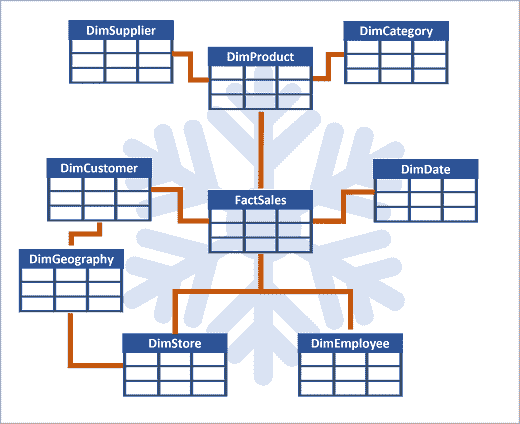

在这种情况下，DimProduct 表已拆分（规范化），以便为产品类别和供应商创建单独的维度表。

+   DimProduct 表中的每一行都包含 DimCategory 和 DimSupplier 表中相应行的键值。

添加了 DimGeography 表，其中包含有关客户和商店所在位置的信息。

+   DimCustomer 和 DimStore 表中的每一行都包含 DimGeography 表中相应行的键值。

### 了解 Fabric 中的数据仓库

+   Fabric 的湖屋是文件、文件夹、表和快捷方式的集合，充当数据湖的数据库。 它由 Spark 引擎和 SQL 引擎用于大数据处理，在使用开放源代码 Delta 格式表时具有适用于 ACID 事务的功能。

+   Fabric 的数据仓库体验可让你从湖屋的湖视图（支持数据工程和 Apache Spark）转换到传统数据仓库提供的 SQL 体验。 借助 Lakehouse，你能够读取表和使用 SQL 分析终结点，而数据仓库则会支持你操作数据。

+   在 Fabric 中的数据仓库体验中，可以在湖屋中的物理数据的基础上构建关系层，并将其公开给分析和报表工具。 可以直接在 Fabric 中从“创建中心”或在“工作区”内创建数据仓库。 创建空仓库后，可以向其添加对象。

+   在数据仓库体验中，你将使用表和视图对数据进行建模，运行 T-SQL 以跨数据仓库和湖屋查询数据，使用 T-SQL 对数据仓库中的数据执行 DML 操作，并提供 Power BI 等报表层。

**将数据引入数据仓库**

可通过多种方法将数据引入 Fabric 数据仓库，包括管道、数据流、跨数据库查询和 COPY INTO 命令。 引入后，数据可供多个业务组分析，这些业务组可以使用跨数据库查询和共享等功能对其进行访问。

### 查询和转换数据

可通过两种方式查询数据仓库中的数据。

+   可视化查询编辑器提供无代码拖放体验来创建查询。

+   如果你熟悉 T-SQL，那么你可能更愿意使用 SQL 查询编辑器来编写查询。

在这两种情况下，都可以创建表、视图和存储过程来查询数据仓库和湖屋中的数据。

### 准备数据以便进行分析和报告

语义模型定义语义模型中不同表之间的关系、数据聚合和汇总方式的规则，以及用于从数据中获取见解的计算或度量值。 这些关系和度量值包含在语义模型中，该语义模型随后用于在 Power BI 中创建报表。

+   建立关系：通过关系，可连接语义模型中的表。 在 Fabric 的“模型”视图中，使用单击拖动界面在数据仓库中的表之间创建关系。

+   创建度量值：度量值是要在数据仓库中分析的指标。 可以使用“模型”视图中的“新建度量值”按钮在 Fabric 中创建度量值

+   隐藏字段：构建语义模型是准备数据以用于下游报表的重要组成部分。 若要简化报表生成器的操作，可以隐藏视图中的元素（表或列）。 右键单击表或列，然后选择“隐藏”。 隐藏字段会从“模型”视图中删除表或列，但该表或列仍可在语义模型中使用。

+   可视化数据：通过 Fabric，可以将单个查询或整个数据仓库的结果可视化，而无需离开数据仓库体验。 在工作时探索数据以确保拥有分析所必要的所有数据和转换特别有用。

### 保护和监视数据仓库

数据仓库安全性对于保护数据免受未经授权的访问非常重要。 Fabric 提供了许多安全功能来帮助保护数据仓库。 其中包括:

+   基于角色的访问控制 (RBAC)，用于控制对仓库及其数据的访问。

+   SSL 加密，用于保护仓库与客户端应用程序之间的通信。

+   Azure 存储服务加密，用于保护传输中的数据和静态数据。

+   Azure Monitor 和 Azure Log Analytics，用于监视仓库活动并审核对数据的访问。

+   多重身份验证 (MFA)，用于向用户帐户添加额外的安全层。

+   用于管理用户标识和对仓库的访问权限的 Microsoft Entra ID 集成。

### 练习 - 分析数据仓库中的数据

创建了一个包含多个表的数据仓库。 使用 SQL 将数据插入了表并对其进行了查询。 还使用了视觉查询工具。 最后，你增强了数据仓库默认数据集的数据模型并将其用作了报表的源.

https://microsoftlearning.github.io/mslearn-fabric.zh-cn/Instructions/Labs/06-data-warehouse.html

## 将数据加载到 Microsoft Fabric 数据仓库中

Microsoft Fabric 数据仓库是一个完整的数据、分析和 AI（人工智能）平台。 它是指存储、组织和管理大量结构化和半结构化数据的过程。

Microsoft Fabric 中的数据仓库通过 Synapse Analytics 提供了一组丰富的功能，以便更轻松地管理和分析数据。 它包括高级查询处理功能，并支持完整的事务性 T-SQL 功能，例如企业数据仓库。

与 Synapse Analytics 中的专用 SQL 池不同，Microsoft Fabric 中的仓库以单个数据湖为中心。 Microsoft Fabric 仓库中的数据以 Parquet 文件格式存储。 此设置让用户可以专注于数据准备、分析和报告等任务。 它利用了 SQL 引擎的丰富功能，其中其数据的唯一副本存储在 Microsoft OneLake 中。

ETL 为数据分析和数据仓库工作流提供了基础。 让我们回顾一下 ETL 过程中数据操作的一些方面。

ETL 过程中的所有这些步骤都可以并行运行，具体取决于当时的场景。 某些数据一旦准备就绪，就会进行加载，而无需等待前面的步骤完成。

### 探索数据加载策略

数据引入/提取和数据加载都是数据仓库方案中 ETL（提取、转换、加载）管道的一部分，但它们通常用于不同的目的。

+   数据引入/提取是要将原始数据从各种源移动到中央存储库中。

+   数据加载则涉及获取已转换或已处理的数据，并将其加载到最终存储目标来进行分析和报告。

**暂存数据**

可能需要生成和使用加载操作中涉及的辅助对象，例如表、存储过程和函数。 这些辅助对象通常称为“暂存”对象。 暂存对象可充当临时存储和转换区域。 他们可以与数据仓库共享资源，也可以驻留在自己的存储区域中。

暂存可充当抽象层，从而简化和便利了对数据仓库中最终表的加载操作。

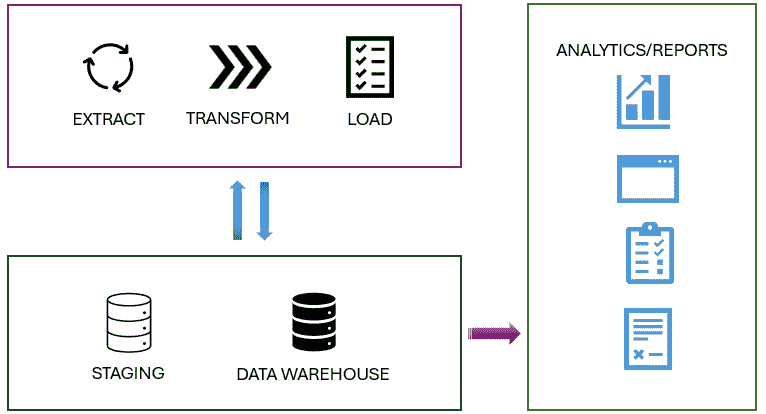

**加载类型**

**加载维度表**

可将维度表视为数据仓库的“谁、什么、在哪里、什么时候、为什么”。 这类似于描述性背景，为事实数据表中找到的原始数字提供了上下文。

**加载事实表**

通常，标准数据仓库加载操作涉及在维度表之后加载事实数据表。 这可确保事实引用的维度已存在于数据仓库中。

临时事实数据通常包括相关维度的业务键，因此加载逻辑必须查找相应的代理键。 在处理数据仓库中的渐变维度时，必须确定维度记录的适当版本，以确保使用正确的代理键。 这会将事实表中记录的事件与事实发生时维度的状态相匹配。

在许多情况下，可以检索维度的最新“当前”版本。 但是，有时可能需要根据 DateTime 列查找正确的维度记录，这些列指示了每个维度版本的有效期。

### 使用数据管道将数据加载到仓库

Microsoft Fabric 的仓库提供集成的数据引入工具，使用户能够通过编码或非编码体验大规模将数据加载和引入到仓库中。

数据管道是用于数据集成的基于云的服务，用于大规模创建数据移动和数据转换的工作流。 可以创建和计划可从不同数据存储引入和加载数据的数据管道。 可以构建通过数据流以可视方式转换数据的复杂 ETL 或 ELT 过程。

Microsoft Fabric 中数据管道的大部分功能都来自Azure 数据工厂，允许在 Microsoft Fabric 生态系统中无缝集成和利用其功能。

### 使用 T-SQL 加载数据

SQL 开发人员或公民开发人员（通常熟悉 SQL 引擎，并且擅长使用 T-SQL）将发现 Microsoft Fabric 中的仓库很有帮助。

这是因为仓库由他们熟悉的同一 SQL 引擎提供支持，使他们能够执行复杂的查询和数据操作。 这些操作包括对来自不同表的数据进行筛选、排序、聚合和联接。 SQL 引擎的各种函数和运算符进一步允许在数据库级别进行复杂的数据分析和转换。

### 使用 Dataflow Gen2 加载和转换数据

[Dataflow Gen2](https://learn.microsoft.com/zh-cn/fabric/data-factory/dataflows-gen2-overview) 是新一代数据流。 它提供了全面的 Power Query 体验，指导你完成将数据导入到数据流的每个步骤。 简化了创建数据流的过程，减少了所涉及的步骤数。

你可以使用数据管道中的数据流将数据引入到湖屋或仓库，或者为 Power BI 报表定义数据集。

### 练习：将数据加载到 Microsoft Fabric 中的仓库内

创建湖屋和包含多个表的数据仓库。 已经获取了数据，并使用跨数据库查询将数据从湖屋加载到仓库。 此外，还使用了查询工具来执行分析查询。

https://microsoftlearning.github.io/mslearn-fabric.zh-cn/Instructions/Labs/06a-data-warehouse-load.html

## 在 Microsoft Fabric 中查询数据仓库

查询数据仓库的过程是商业智能的关键组成部分。 它涉及提取和操作存储在数据仓库中的数据，允许用户从大量数据中提取有价值的见解。

[在典型的](https://learn.microsoft.com/zh-cn/power-bi/guidance/star-schema)数[据仓库中](https://learn.microsoft.com/zh-cn/power-bi/guidance/star-schema#snowflake-dimensions?azure-portal=true)，数据是使用架构（通常是星型架构或雪花架构）进行组织的。 星型架构和雪花架构是关系数据仓库广泛采用的成熟建模方法。 它要求将表分类为维度或事实。

事实数据表存储有关某项业务的可度量量化数据，而维度表包含与事实数据相关的描述性属性。

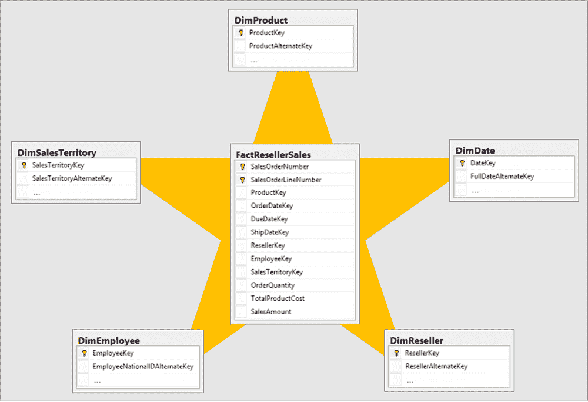

可将维度表视为数据仓库的“谁、什么、在哪里、什么时候、为什么”。 这类似于描述性背景，为事实数据表中找到的原始数字提供了上下文。

例如，如果你在经营一家在线商店，则事实数据表可能包含原始销售数据，即每种产品的销售单位数。 但如果没有维度表，你就不会知道买方身份、购买时间和买方所在位置。

### 查询数据

当数据仓库中的维度表和事实数据表填充数据后，可以使用 T-SQL 查询这些表和执行数据分析。 用于查询 Fabric 仓库中表的 Transact-SQL (T-SQL) 语法与 SQL Server 或 Azure SQL 数据库中使用的 SQL 语法非常相似。 这种相似度让那些已经习惯使用这些平台的人可以轻松过渡。

**按维度属性聚合度量值**

在涉及数据仓库的大多数数据分析场景中，该过程通常基于维度表中的属性围绕事实数据表中的聚合数字度量值进行。 由于星形或雪花架构的结构，此类聚合查询依赖于 JOIN 子句将事实数据表与维度表链接。 此外，它们使用聚合函数和 GROUP BY 子句来定义聚合层次结构。

**雪花型架构中的联接**

在使用雪花型架构时，维度可能被部分规范化；需要多个联接将事实数据表与雪花维度相关联。 例如，假设你的数据仓库包含一个 DimProduct 维度表，其中的产品类别已经被规范化为一个单独的 DimCategory 表。 按产品类别聚合已销售商品的查询可能类似于以下示例：

**使用排名函数**

另一种常见的分析查询是基于维度属性对结果进行分区，并在每个分区中对结果进行排名。 例如，你可能需要按销售收入每年对商店进行排名。

**检索近似计数**

虽然数据仓库的用途主要是为了支持企业的分析数据模型和报表；但数据分析师和数据科学家通常需要执行一些初始数据探索，只是为了确定数据的基本规模和分布情况

### 使用 SQL 查询编辑器

Microsoft Fabric 中的 SQL 查询编辑器是一种支持 Transact-SQL (T-SQL) 的多用途工具，可用于创建和运行脚本来查询数据仓库。 它还提供 IntelliSense 和调试等功能来帮助开发过程。

借助 T-SQL，用户、分析师和开发人员可以操作存储在仓库中的数据。

### 浏览可视化查询编辑器

Microsoft Fabric 数据仓库中的可视化查询编辑器是一个工具，提供用于构建 SQL 查询的直观界面。

它简化了编写和管理查询的过程，特别是对于那些可能不熟悉 SQL 语法的人而言。

+   图形界面：该编辑器提供了一个图形界面，你可在其中拖放表，并直观地设计查询。 这样，可以更轻松地理解你的查询的结构以及表之间的关系。

+   自动化查询生成：使用可视化界面设计查询时，会自动生成相应的 SQL 查询。 这使你可以专注于查询的逻辑，而不是语法。 所有工作区用户都可以将其查询保存到“我的查询”文件夹中。

### 使用客户端工具查询仓库

使用 SQL Server Management Studio (SSMS) 连接到 Fabric 中的数据仓库可以促进工作流，尤其是在你已熟悉该工具的情况下。

### 练习：在 Microsoft Fabric 中查询数据仓库

https://microsoftlearning.github.io/mslearn-fabric.zh-cn/Instructions/Labs/06b-data-warehouse-query.html

## 监视 Microsoft Fabric 数据仓库

数据仓库通常是企业分析和报告的核心，因此属于关键业务资产。 请务必监视数据仓库以跟踪和管理成本、识别和解决查询性能问题，以及深入了解数据的使用方式。

### 监视容量指标

当组织使用 Microsoft Fabric 时，用于购买服务的许可证决定了可用容量。 容量是可用于实现 Fabric 功能的资源池。

Fabric 的使用成本基于容量单位 (CU)。 在 Fabric 资源中执行的每个操作都会消耗 CU，而你的组织会为此付费。 因此，务必确保能够监视容量使用率以规划和管理成本。 在数据仓库工作负载中，数据读取和写入活动都会消耗 CU，因此数据仓库中的查询和 OneLake 存储的基础文件操作是 Fabric 分析解决方案成本的一个重要因素。

### 监视当前活动

可以使用动态管理视图 (DMV) 检索有关数据仓库当前状态的信息。 具体而言，Microsoft Fabric 数据仓库包括以下 DMV：

+   sys.dm_exec_connections：返回有关数据仓库连接的信息。

+   sys.dm_exec_sessions：返回有关经过身份验证的会话的信息。

+   sys.dm_exec_requests：返回有关活动请求的信息。

### 监视查询

Microsoft Fabric 数据仓库包含查询见解功能，该功能提供有关已运行的查询的历史聚合信息，使你能够识别常用查询或长时间运行的查询，并帮助分析和优化查询性能。

查询见解通过以下视图提供：

+   queryinsights.exec_requests_history：每个已完成的 SQL 查询的详细信息。

+   queryinsights.long_running_queries：查询执行时间的详细信息。

+   queryinsights.frequently_run_queries：频繁运行的查询的详细信息。

### 练习 - 在 Microsoft Fabric 中监视数据仓库

在本练习中，将使用了动态管理视图和查询见解来监视 Microsoft Fabric 数据仓库中的活动。

https://microsoftlearning.github.io/mslearn-fabric.zh-cn/Instructions/Labs/06c-monitor-data-warehouse.html

## 保护 Microsoft Fabric 数据仓库

通常精通 SQL 引擎并善于使用 T-SQL 的数据工程师会发现 Microsoft Fabric 中的仓库是易于使用的。

这是因为仓库由他们熟悉的同一 SQL 引擎提供支持，使他们能够执行复杂的查询和数据操作。 SQL 引擎广泛的安全功能会进一步允许在仓库级别建立复杂的安全机制。

+   [工作区角色](https://learn.microsoft.com/zh-cn/fabric/data-warehouse/workspace-roles/) –旨在提供工作区中不同级别的访问控制。 可以将用户分配到各种工作区角色，例如管理员、成员、参与者和查看者。 这些角色对于维护组织中的数据仓库操作的安全性和效率至关重要。

+   [项权限](https://learn.microsoft.com/zh-cn/fabric/data-warehouse/share-warehouse-manage-permissions/) –可以直接将项权限分配给单个仓库。 分配此类权限的主要意图是方便将仓库的共享供下游使用。

+   [数据保护安全性](https://learn.microsoft.com/zh-cn/fabric/data-warehouse/security#granular-security?azure-portal=true) – 为了获得更精确的控制，可以使用 T-SQL 向用户授予特定权限。 仓库支持一系列的数据保护功能，使管理员能够保护敏感数据免受未经授权的访问。 这包括数据库对象的对象级别安全性、表列的列级安全性、使用 WHERE 子句筛选器的表行级别安全性，以及用于模糊敏感数据（例如电子邮件地址）的动态数据掩码。 这些功能可确保跨仓库和 SQL 分析终结点进行数据保护，而无需改用应用程序。

### 探索动态数据掩码

[动态数据掩码 (DDM)](https://learn.microsoft.com/zh-cn/fabric/data-warehouse/dynamic-data-masking) 是一项安全功能，它通过模糊敏感信息来限制对非特权用户的数据公开。

动态数据掩码提供了几个关键优势，可增强数据的安全性和可管理性。 主要优势之一是它的实时掩码功能。 查询敏感数据时，DDM 将动态掩码实时应用于该数据。 此过程意味着不会向未经授权的用户公开实际数据，从而增强数据的安全性。 此外，DDM 易于实现。 它不需要复杂的编码，使所有技能水平的用户都可以访问它。

DDM 的另一个优势是，应用 DDM 时数据库中的数据不会更改。 相反，掩码规则将应用于查询结果。 这项优势意味着实际数据保持完整且安全，而非特权用户只看到经过掩码的数据版本。

### 实现行级别安全性

[行级安全性 (RLS)](https://learn.microsoft.com/zh-cn/fabric/data-warehouse/row-level-security) 是一项功能，可根据组成员身份或执行上下文对表中的行的访问进行精细控制。

例如，在电子商务平台中，可以确保卖家只能访问与其自己的产品相关的订单行。 这样，每个卖家都可以独立管理订单，同时维护其他卖家订单信息的隐私。

如果你有使用 SQL Server 的经验，你会发现行级安全性具有类似的特征和功能。

行级安全性 (RLS) 的工作原理是将称为安全谓词的函数与表相关联。 此函数定义为根据某些条件返回 true 或 false，这通常涉及表中一个或多个列的值。 当用户尝试访问表中的数据时，会调用安全谓词函数。 如果函数返回 true，则行可供用户访问；如果返回 false，则行不会显示在查询结果中。

根据业务需求，RLS 谓词可以像 WHERE CustomerId = 29 一样简单，也可以根据需要变得复杂。

此过程对用户是透明的，由 SQL Server 自动强制实施，确保安全规则的一致应用。

行级安全性主要通过 2 个步骤来实现：

+   筛选器谓词 这是一个内联表值函数，基于所定义的谓词筛选结果。

+   安全策略 该安全策略调用内联表值函数来保护对表中行的访问。

由于访问控制是在仓库级别配置和应用的，因此应用程序更改最少（如果有）。 此外，用户可以直接访问表，并且可以查询自己的数据。

行级别安全性是许多场景下的理想选择，其中包括：

+   需要在行级别隔离部门访问时。

+   需要将客户的数据访问权限限制为仅访问与其公司相关的数据时。

+   需要出于符合性目的限制访问时。

在实现 RLS 时，要考虑下面的一些最佳做法：

+   建议为谓词函数和安全策略创建单独的架构。

+   尽可能避免谓词函数中的类型转换。

+   为了最大限度地提高性能，请避免在谓词函数中使用过多的表联接和递归

### 实现列级安全性

[列级安全性 (CLS)](https://learn.microsoft.com/zh-cn/fabric/data-warehouse/column-level-security) 可用于限制列访问权限，从而保护敏感数据。 它可以精细控制谁能访问特定的数据片段，从而提高数据仓库的整体安全性

我们来看看医疗保健行业列级安全性 (CLS) 的一个实际例子。 假设我们有一个名为 Patients 的表，表中有以下列：PatientID、Name、Address、DateOfBirth 和 MedicalHistory。

MedicalHistory 列包含有关患者的健康敏感信息。 根据医疗保健法规和隐私法，此信息仅可供授权的医务人员（如医生或护士）访问。

下面是在此方案中实现列级安全性的可能方式：

1.  确定敏感列：在本例中，将 MedicalHistory 列确定为包含敏感数据。

1.  定义访问角色：定义允许访问 MedicalHistory 列的 Doctor 和 Nurse 等角色。 Receptionist 或 Patient 等其他角色可能会受到限制，无法访问此列。

1.  向用户分配角色：为仓库中的每个用户分配适当的角色。 例如，可能会为用户 DrSmith 分配 Doctor 角色，同时可能会为用户 JohnDoe 分配 Patient 角色。

1.  实现访问控制：根据用户角色限制对 MedicalHistory 列的访问权限。

列级安全性有助于确保只有经过授权可以查看健康敏感信息的用户才能访问该信息，同时保护患者隐私并遵守医疗保健法规。

### 使用 T-SQL 配置 SQL 精细权限

[如果熟悉关系数据库和企业](https://learn.microsoft.com/zh-cn/sql/t-sql/queries/queries)仓库，则通常知道有四个基本权限控制数据操作语言 (DML)操作。 这些权限（即SELECT、INSERT、UPDATE和DELETE）适用于所有数据库平台。

可针对表和视图授予、撤销或拒绝所有这些权限。 如果使用 GRANT 语句授予权限，则会向 GRANT 语句中引用的用户或角色授予该权限。 还可以使用 DENY 命令拒绝用户的权限。 如果向用户授予了某权限的同时又拒绝了该权限，则 DENY 将始终取代 GRANT，并且将拒绝用户访问特定的对象。

### 练习：在 Microsoft Fabric 中保护仓库

在此练习中，将动态数据掩码规则应用于表中的列，应用了行级安全性，实现了列级安全性，并使用 T-SQL 配置了 SQL 精细权限。

https://microsoftlearning.github.io/mslearn-fabric.zh-cn/Instructions/Labs/06d-secure-data-warehouse.html

# 在 Microsoft Fabric 中使用语义模型

## 设计可缩放语义模型

可伸缩性是指系统、网络或流程处理不断增加的工作的能力，或者在不损害性能或效率的情况下适应数据量和复杂性增长的潜力。 考虑以下事项，设计模型来应对这种增长：

+   灵活性：适应数据量的变化，同时将报告性能保持在可接受水平。

+   降低了复杂性：确保模型更加简单且可管理。

可缩放的语义模型使组织能够轻松分析和报告大型复杂数据源。 Microsoft Fabric 使得在适当的基础上处理大量和大规模数据成为可能。 可缩放的语义模型让你能够在 Power BI 报表中获得最佳使用者体验。

### 选择最佳存储模式

设计可缩放语义模型时，选择适当的存储模式至关重要。 根据数据源，有四个选项：导入、DirectQuery、Direct Lake，以及复合模型。 每个模式都有自己的优点和注意事项，以确保最佳性能和可伸缩性。

**导入模式**

“导入”涉及在 Power BI 中导入和存储数据，从而提供最大的灵活性和最快的性能。 但是，它需要定期刷新才能使数据保持最新，这意味着数据仅保持上次刷新时的最新状态。

导入模型的指导也适用于其他存储模式。 如果模型允许，应始终选择“导入”。 主要目标是减少引入语义模型的数据量以及在 Power BI 中执行的转换次数。 优化提示包括：

+   使用关系数据库时，连接到视图而不是表。

+   仅包括必要的表、行和列。

+   请考虑分区和增量刷新，以避免加载不必要的数据。

+   使用适当的数据类型，例如对 ID 列使用整数而不是字符串。

+   确保查询折叠，从而减少在 Power BI 引擎中完成的工作。

**DirectQuery 模式**

“DirectQuery”可让你直接从源查询数据，而无需将其存储在 Power BI 中，因此非常适合处理大量数据和准实时数据传送。 但是，与导入模式相比，它的性能较慢，建模功能也有限。

优化提示：

+   通过简化 Data Analysis Expressions (DAX) 避免在源处进行复杂的计算。

+   对与事实数据表相关的维度应用双重存储模式。

+   对关系使用“假设引用完整性”属性。

+   避免定义计算列和唯一标识符列上的关系

**Direct Lake 模式**

“Direct Lake”允许直接从 Microsoft Fabric 湖屋或仓库查询数据，而无需将其存储在语义模型中，因此非常适合处理大量数据。 此模式经过优化，可将数据从 Microsoft Fabric 的 Delta 表中快速加载到内存。 虽然它具有快速访问大型数据卷的优势，但它需要设置 Lakehouse 或仓库，以及 Delta 表，并且可能需要经过优化才能获得最佳性能。

优化提示：

+   配置 Direct Lake 以通过快捷方式访问 ADLS (Azure Data Lake Storage) 存储。

+   为复杂的 DAX 查询设置 DirectQuery 的回退行为。

**复合模型**

“复合模式”可以混合“导入”和“DirectQuery”模式，或集成多个 DirectQuery 数据源。 此模式支持多对多关系，无需网桥表。 它通过结合“导入”和“DirectQuery”模式的优势，提供查询和报告功能的灵活性。 但是，它需要定期刷新导入模式表，并且在合并来自不同来源的数据时可能会对性能产生潜在影响。

优化提示：

+   确保后端源有足够的资源。

+   最大程度减少源查询中文本值的数量。

+   保持用于关系的列的基数较低。

### 为大型数据配置语义模型

**大型语义模型存储格式**

使用 Microsoft Fabric 中的大型语义模型存储格式，能够高效地处理更大的数据源。 这种格式非常适合需要更多内存和处理能力的复杂分析模型。 此功能使语义模型能够超越 10GB 的限制。 具体的限制可能会有所不同，因为容量或 Fabric 管理员会决定大型语义模型的限制。 启用此功能非常简单，只需在工作区设置中选中一个选项框即可。

如果语义模型继续增大并且逐渐消耗更多内存，请务必配置增量刷新。

**增量刷新**

通过增量刷新，可以仅刷新自上次刷新以来已更改或新增的数据。 此功能减少了数据刷新所需的时间和资源，非常适合需要频繁更新的大型数据源。

假设你的销售表非常庞大，刷新语义模型需要很长时间。 如果需要保持数据的最新状态，可以配置增量刷新，仅刷新新增或更新的交易数据。

启用增量刷新时，首先需要在 Power Query 中定义参数并使用这些参数筛选行。 应用后，可以在 Power BI Desktop 中配置该表的增量刷新策略。 还可以选择配置该表以通过 DirectQuery 获取最新数据。 若要利用此功能，语义模型必须已发布到受支持的 Fabric 工作区。

**分区**

增量刷新侧重于仅刷新已更改或新增的数据，而分区则涉及将整个表划分为更小的段。 分区操作是将大型表拆分为更小、更易管理的部分，这些部分称为分区。 每个分区都可以独立处理，从而提高查询性能和可管理性。

例如，可以为销售表的每个月或每个季度创建分区，使查询能够针对特定分区，而不是针对整个数据集。

若要启用分区，可以使用 SQL Server Management Studio (SSMS) 或表格编辑器等工具。

### 使用关系

选择模型框架并转换数据后，需要创建关系以根据来自另一个表的数据进行数据筛选和聚合。 创建星形架构并强制执行筛选维度表的规则，使模型关系能够有效地将这些筛选器应用到事实数据表，这是很常见的做法。

**创建星型架构**

在星型架构中，事实数据表和维度表协同工作以组织和分析数据。 事实数据表存储有关业务活动（如销售或事件）的主要数据，而维度表则提供有关这些活动的上下文和说明性信息。

例如，如果你有一个销售事实数据表，该表可能存储诸如销售额和每次销售的日期之类的数据。 维度表随后会提供更多详细信息，例如客户信息、产品详细信息和时间段。 通过将事实数据表链接到维度表，可以轻松地对数据进行筛选、分组和分析。

**创建关系**

通过标识每个表中的相关列并创建关系，就可以直截了当地创建事实数据表和维度表之间的关系。 在数据库或数据仓库之类的关系源中，这些列通常称为“键”。 如果缺少键列，请检查表以确定要将哪些列用于关系。

关系采用不同的类型：

+   “一对多”是最常见的类型，是指一个表中的一条记录与另一个表中的多条记录相关。 通常情况下，一对多是指从具有某个唯一值的维度表到许多行与该值相关的事实数据表的关系。

+   “多对一”本质上与“一对多”相同，具体取决于在表之间配置筛选器的方式。

+   “一对一”不太常见，因为两个表都具有唯一的数据。 考虑一下，你是需要两个表，还是可以将两个表合并为一个表。

+   “多对多”不太常见，但对于复杂数据而言却是必需的。 它允许一个表中的多个记录与另一个表中的多个记录相关联。

对于多对多关系，可能需要使用桥接表。 桥接表通过中间键链接这些表来帮助管理这些关系。 复合模型还允许你合并来自不同源的数据，因而有助于建立多对多关系。

**筛选器方向**

创建关系时，可以配置数据从一个表到另一个表的筛选方向。 在星型架构中，该方向通常是从维度表到事实数据表，因此维度表可以筛选事实数据表的结果。

“双向筛选器”也是可以使用的，有时用于一对一或多对多关系。 在使用双向筛选器之前，请确保数据和关系已正确配置。 请谨慎操作，因为双向筛选器可能会对模型查询性能产生负面影响，并可能使报表用户感到困惑。

“引用完整性”可确保表之间的关系保持一致。 这意味着外键列中的每个值都必须在相关表的主键列中有一个对应值。 与 LEFT OUTER 联接相比，此功能还可以提高使用 INNER 联接时的查询性能。

了解筛选器方向和引用完整性对于准确的数据建模至关重要。 仅当关系路径完整且遵循定义的方向时，筛选器才会传播。 这些配置可确保整个模型的数据一致性和完整性。

**非活动关系**

可以禁用关系并通过 DAX 函数修改其筛选器上下文。 有时需要在表之间建立多个关系，但两个表之间一次只能激活一个关系。 在这种情况下，请使用 DAX 中的 USERELATIONSHIP 函数引用非活动关系以获得相同的筛选行为

**使用已断开连接的表**

一个模型表与另一个模型表不关联的情况不太常见。 有效模型设计中的此类表称为断开连接的表。 断开连接的表不用于将筛选器传播到其他模型表， 它接受“用户输入”（可能包含切片器视觉对象），从而使模型计算能够以有意义的方式使用输入值。 例如，假设有一个断开连接的表，表中有一系列货币汇率值。 按单个汇率值进行筛选时，度量值表达式就可以使用该值来转换销售值。

### 编写 DAX 提高复杂计算的可读性

DAX 提供了一组功能强大的函数，使你能够创建基本到复杂的计算来度量 Power BI 语义模型中的数据。 通过使用筛选条件、变量和迭代器、窗口和信息函数，可以创建高效、可读的公式。

**变量**

DAX 中的变量有助于简化表达式，并通过存储表达式的结果和多次重用表达式来提高性能。 这减少了重复计算的需求，使代码更易于读取和维护。

**迭代器**

DAX 中的迭代器函数（例如 SUMX、AVERAGEX 和 MAXX）对表执行逐行计算并返回单个值。 这些函数对执行依赖于每行上下文的计算非常有用。

**表筛选**

表筛选函数（例如 FILTER、ALL 和 CALCULATETABLE）允许你根据特定条件创建筛选表。 这些函数对创建依赖于筛选上下文的动态计算非常有用。

**开窗函数**

DAX 中的窗口函数（例如 INDEX、OFFSET 和 WINDOW）允许对指定的数据窗口执行计算。 这些函数可用于创建排名、运行总数和其他依赖于数据顺序的计算。

**信息函数**

信息函数（例如 ISBLANK、ISNUMBER 和 CONTAINS）可用于执行检查，并返回有关数据的信息。 这些函数对创建条件计算和处理特殊情况很有用。

### 创建动态计算元素

静态计算和视觉对象可能会影响报表的性能，但你可以通过使用计算组、动态格式字符串和字段参数，为语义模型增加灵活性。 这些功能通过简化计算和减少报表可视化效果，使报表可缩放且用户友好。

**计算组**

使用计算组可以定义可重用的计算，这些计算可应用于多个度量值，从而减少冗余并简化语义模型的维护。 可以使用计算组来简化整个模型中的复杂计算，例如时间智能函数。

**字段参数**

借助字段参数，你可以通过允许用户动态地选择不同的字段或度量值来创建交互式报表。 此功能对于创建可自定义的报表非常有用，用户可以选择他们想要查看的数据。

**动态格式字符串**

通过动态格式字符串，可以根据条件调整度量值的格式，从而提升数据可读性和呈现效果。

### 练习 - 设计可缩放的语义模型

在本练习中，你将通过完成以下任务来设计可缩放的语义模型：

+   选择存储模式。

+   配置增量刷新。

+   创建包含关系的星型架构。

+   创建包含动态元素的 DAX 公式。

https://microsoftlearning.github.io/mslearn-fabric.zh-cn/Instructions/Labs/15-design-scalable-semantic-models.html

## 将度量值添加到 Power BI Desktop 模型

Microsoft Power BI 模型中的度量值是隐式或显式度量值。 隐式度量值是允许视觉对象汇总模型列数据的自动行为。 显式度量值（又简称为度量值）是可以添加到模型的计算。

+   隐式度量值具有以下优点。 隐式度量值的概念易于学习和使用，报表作者可以通过它们灵活地将模型数据可视化。 此外，由于你无需创建显式计算，这意味着，作为数据建模者你的工作量会减少。

+   隐式度量值有一些限制。 尽管已设置正确的汇总方法，但报表作者仍可能会选择使用不当的方法聚合列。 例如，在矩阵视觉对象中，你可能会将“单价”的聚合函数修改为“求和”。

隐式度量值的最有意义的限制是它们仅适用于简单方案，这意味着它们只能汇总使用特定聚合函数的列值。 因此，当需要计算每月销售额与年度销售额的比率时，需要通过编写数据分析表达式 (DAX) 公式来生成显式度量值，以实现更复杂的要求。

### 创建简单的度量值

可以编写一个 DAX 公式，向模型中的任意表添加度量值。 度量值公式必须返回标量或单个值。

度量值不将值存储在模型中。 相反，在查询时会使用它们来返回对模型数据的汇总。 此外，度量值不能直接引用表或列；它们必须将表或列传递到函数中才能生成汇总。

简单的度量值是聚合单个列的值的度量值；它会执行隐式度量值自动执行的操作。

### 创建复合度量值

当度量值引用一个或多个度量值时，它被称为复合度量值。

### 创建快速度量值

[Micr](https://learn.microsoft.com/zh-cn/power-bi/transform-model/desktop-quick-measures/)osoft Power BI Desktop 包含一项名为快速度量的功能。 此功能可为您生成 DAX 表达式，从而帮助您快速执行常见的强大计算。

有许多可用的计算类别和修改每个计算的方法，可以满足您的需求。 此外，您还可以查看快速度量生成的 DAX，并使用它来快速启动或扩展 DAX 知识。

### 比较计算列与度量值

就计算列与度量值之间的相似性而言，两者都是：

+   可以添加到语义模型的计算。

+   使用 DAX 公式定义的。

+   通过将其名称括在方括号中来在 DAX 公式中进行引用的。

计算列和度量值的不同之处包括：

+   用途 - 计算列使用新列扩展表，而度量值定义如何汇总模型数据。

+   计算 - 计算列在数据刷新时使用行上下文进行计算，而度量值在查询时使用筛选上下文进行计算。 后面的模块中介绍了筛选上下文；这是一个重要的主题，需要了解和掌握它，以便能够实现复杂的汇总。

+   存储 计算列（位于“导入存储模式”表中）将各个行的值存储在表中，但度量值从不将值存储在模型中。

+   Visual use 计算列（与任意列一样）可用于筛选、分组或汇总（作为隐式度量值），而度量值专用于汇总。

### 练习 - 在 Power BI Desktop 中创建 DAX 计算

在本练习中，你将学习如何：

+   创建计算表

+   创建计算列

+   创建度量值

https://microsoftlearning.github.io/PL-300-Microsoft-Power-BI-Data-Analyst.zh-cn/Instructions/Labs/04-create-dax-calculations-in-power-bi-desktop.html

## 在 Power BI 中优化模型的性能

### 性能优化简介

性能不佳十有八九是糟糕的语义模型、糟糕的数据分析表达式 (DAX) 或二者混合的直接后果。 针对性能设计语义模型的过程可能会十分繁琐，并且通常会被低估。 但是，如果在开发过程中解决了性能问题，那么你将拥有一个可靠的 Power BI 语义模型，它将返回更好的报告性能和更积极的用户体验。 最终，你还能够维持优化性能。 随着组织发展，其数据大小会增长，其语义模型会变得更加复杂。 通过在早期优化语义模型，可以减轻此增长可能对语义模型性能造成的负面影响。

更小的语义模型使用更少的资源（内存），并在报表中实现更快速的数据刷新、计算和呈现的视觉效果。 因此，性能优化过程涉及最大程度减小语义模型大小，并最高效地使用模型中的数据，这包括：

+   确保使用正确的数据类型。

+   删除不需要的列和行。

+   避免重复值。

+   将数值列替换为度量值。

+   减少基数。

+   分析模型元数据。

+   尽可能汇总数据。

### 查看度量值、关系和视觉对象的性能

** 确定报表性能瓶颈**

+   可以使用 Power BI Desktop 中的性能分析器来了解每个报表元素在用户与其交互时的表现。 例如，可以确定在由用户交互启动时，视觉对象刷新所用的时间。 性能分析器可帮助确定导致性能问题的元素，这在故障排除过程中非常有用

+   可以在性能分析器窗格中查看性能测试的结果。 若要按持续时间顺序（最长到最短）查看任务，请右键单击持续时间(毫秒) 列标题旁的排序图标，然后选择总时间并按降序顺序排列。每个视觉对象的日志信息会显示完成以下类别的任务所花费的时间（持续时间）：

+   DAX 查询 - 视觉对象发送查询所花费的时间，以及 Analysis Services 返回结果所花费的时间。

+   视觉对象显示 - 视觉对象在屏幕上呈现所花费的时间，包括检索 Web 图像或地理编码所花费的时间。

+   其他 - 视觉对象准备查询、等待其他视觉对象完成或执行其他后台处理任务所花费的时间。 如果此类别显示的持续时间很长，则真正能够缩短此持续时间的唯一方法是为其他视觉对象优化 DAX 查询，或减少报表中的视觉对象数量。

**解决问题并优化性能**

+   如果将视觉对象确定为导致性能不佳的瓶颈，则应找到一种方法来提高性能，同时尽可能减少对用户体验的影响。

+   考量报表页上的视觉对象数量；视觉对象越少，性能越好。

+   检查每个视觉对象中的字段数。 报表中的视觉对象越多，出现性能问题的可能性便越高。

+   DAX查询：当您在性能分析器窗格中检查结果时，可以看到 Power BI Desktop 引擎评估每个查询所花费的时间（以毫秒为单位）。

+   语义模型：如果度量值和视觉对象的持续时间显示较低值（换句话说，其持续时间较短），则它们不是产生性能问题的原因。 相反，如果 DAX 查询显示较长的持续时间值，则可能是度量值写得不好或语义模型出现了问题。此问题可能是由模型中的关系、列或元数据所导致，也可能是自动日期/时间选项的状态。

+   关系：应查看表之间的关系，以确保建立了正确的关系。 检查是否正确配置了关系基数属性。 例如，包含唯一值的单端列可能会错误地配置为多端列。 本模块的后文中将详细介绍基数如何影响性能。

+   列：最佳做法是不导入不需要的数据列。 为了避免删除 Power Query 编辑器中的列，应该尝试在将数据加载到 Power BI Desktop 前在源端对其进行处理。

+   元数据：元数据是有关其他数据的信息。 Power BI 元数据包含有关语义模型的信息，例如每列的名称、数据类型和格式、数据库的架构、报表设计、文件的最后修改时间、数据刷新率等等。

+   自动日期/时间功能：优化性能时可以考虑使用的另一种方法是 Power BI Desktop 中的自动日期/时间选项。 默认情况下，此功能是全局启用的，这意味着只要满足某些条件，Power BI Desktop 就会自动为每个日期列创建一个隐藏的计算表。 新的隐藏表是对您的语义模型中已有表的补充。通过自动日期/时间选项，可以在对日历时间段进行筛选、分组和向下钻取时使用时间智能。 建议仅当处理日历时间段时，以及具有的与时间相关的模型要求过于简单时，才使自动日期/时间选项保持启用状态。

### 使用变量改进性能和故障排除

可以在 DAX 公式中使用变量来帮助编写更简单且更高效的计算。 在 Power BI Desktop 中开始进行处理的开发人员未充分使用变量，但它们十分有效，在创建度量值时应默认使用它们。

某些表达式涉及使用许多嵌套函数以及重复使用表达式逻辑。 这些表达式需要较长时间进行处理，难以读取，因而难以进行故障排除。 如果使用变量，则可以节省查询处理时间。 此更改是朝着优化语义模型性能的正确方向迈出的一步。

在语义模型中使用变量具有以下优势：

+   提高了性能 - 变量可以使度量值更高效，因为它们无需 Power BI 多次计算同一表达式。 只需花费大约一半的原始处理时间便可在查询中实现相同结果。

+   改进了可读性 - 变量具有简短的自描述名称，用于代替不明确的多字表达式。 使用变量时，可能会发现更易于阅读和理解公式。

+   简化了调试 - 可以使用变量调试公式和测试表达式，这在故障排除过程中可能非常有用。

+   降低了复杂性 - 变量不需要使用较早或最早的 DAX 函数，这些函数难以理解。 在引入变量之前需要使用这些函数，它们采用引入新筛选上下文的复杂表达式进行编写。 现在可以使用变量而不是这些函数，便可以编写更少的复杂公式。

### 减少基数

基数是一个术语，用于描述列中的值的唯一性。 基数还在两个表之间关系的上下文中用于描述关系的方向。

**确定列中的基数级别**

在其范围内有大量重复值（非重复计数值较低）的列的基数级别较低。 相反，在其范围内有很多唯一值（唯一值计数较高）的列的基数级别较高。

较低的基数会使性能更优化，因此你可能需要减少语义模型中的高基数列数。

**减少关系基数**

导入多个表时，可以使用所有这些表中的数据进行一些分析。 需要这些表之间的关系才能准确计算结果并在报表中显示正确信息。 Power BI Desktop 可帮助更轻松地创建这些关系。 事实上，在大多数情况下无需执行任何操作，自动检测功能会为你完成工作。

**通过减少基数级别来提高性能**

Power BI Desktop 提供了不同的技术，可以用于帮助减少加载到数据模型中的数据，例如汇总。 减少加载到模型中的数据会改进报表的关系基数。 出于此原因，努力尽可能减少加载到模型中的数据十分重要。 这种情况特别适用于大型模型，或是预计会随着时间推移而逐渐变大的模型。

减少模型大小的最有效方法可能是从数据源使用汇总表。  详细信息表可能包含每个事务，而摘要表会每天、每周或每月包含一个记录

### 使用表级别存储优化 DirectQuery 模型

DirectQuery 数据连接模式：

+   它适用于数据频繁更改并需要准实时报告的情况。

+   它无需预先聚合即可处理大型数据。

+   它应用数据主权限制来符合法律要求。

+   它可以与包含 SAP Business Warehouse (BW) 等度量值的多维数据源一起使用。

DirectQuery 连接的局限性

使用 DirectQuery 可能会产生负面影响。 其局限性因所使用的特定数据源而异。 应考虑以下几点：

+   性能 如前所述，整体用户体验在很大程度上取决于底层数据源的性能。

+   安全性 如果在 DirectQuery 模型中使用多个数据源，请务必了解数据在底层数据源之间的移动方式以及相关的安全影响。 您还应确定安全规则是否适用于底层源中的数据，因为在 Power BI 中，每个用户都可以看到该数据。

+   数据转换 与导入的数据相比，源自 DirectQuery 的数据在使用 Power Query 编辑器应用数据转换技术时存在一些局限性。 例如，如果连接到 OLAP 源（如 SAP BW），则无法进行任何转换；整个外部模型都取自数据源。 如果要对数据进行任何转换，则需要在底层数据源中执行此操作。

+   建模 使用 DirectQuery 时，导入数据所具有的某些建模功能会不可用，或受到限制。

+   报告 对于 DirectQuery 模型，也支持导入数据所具有的几乎所有报告功能，前提是基础源提供了适当的性能级别。 不过，在 Power BI 服务中发布报表时不支持“快速见解”和“问答”功能。 此外，使用 Excel 中的浏览功能可能会导致性能较差。

在 Power BI Desktop 中优化数据最佳实践

+   尽可能优化数据源后，可以在 Power BI Desktop 中使用性能分析器来采取进一步措施，即隔离查询以验证查询计划。

+   可以分析发送到底层源的查询的持续时间，以确定需要较长时间进行加载的查询。 换句话说，可以确定瓶颈存在于何处。

+   优化 DirectQuery 模型时，无需使用特殊方法；可以应用对导入数据使用的相同优化技术来调整来自 DirectQuery 源的数据。 例如，可以减少报表页上的视觉对象数，或减少视觉对象中使用的字段数。 还可以删除不需要的列和行。

**优化底层数据源（连接的数据库）**

请考虑使用以下适用于大多数情况的标准数据库做法：

+   避免使用复杂的计算列，因为计算表达式会嵌入到源查询中。 将表达式推送回源会更高效，因为这样可避免向下推送。 还可以考虑将代理键列添加到维度类型表中。

+   检查索引并验证当前索引编制是否正确。 如果需要创建新索引，请确保它们是合适的。

**自定义查询缩减选项**

+   减少由以下对象发送的查询数 默认情况下，每个视觉对象都与每个其他视觉对象交互。 选中此复选框会禁用这种默认交互。 随后，可以选择使用编辑交互功能来选择相互交互的视觉对象。

+   切片器 默认情况下，立即应用切片器更改选项处于选中状态。 要强制让报表用户手动应用切片器更改，请选择向每个切片器添加应用按钮，以在准备就绪时应用更改选项。

+   筛选器 默认情况下，立即应用基本筛选器更改选项处于选中状态。 要强制让报表用户手动应用筛选器更改，请选择以下替代选项之一：

+   向所有基本筛选器添加应用按钮，以在准备就绪时应用更改

+   将单个应用按钮添加到筛选器窗格，以一次性应用更改（预览版）

### 创建和管理聚合

聚合数据时，你会汇总该数据，以更高粒度（级别）呈现该数据。 例如，可以汇总所有销售数据并按日期、客户、产品等对其进行分组。 聚合过程减小了语义模型中的表大小，使你可以专注于重要数据并帮助提高查询性能。

组织可能会由于以下原因而决定在其语义模型中使用聚合：

+   如果要处理大量数据（大数据），则聚合将提供更好的查询性能，并帮助分析和显示此大型数据的见解。 聚合数据会进行缓存，因而使用的资源是详细数据所需资源的一小部分。

+   如果遇到刷新速度缓慢，则聚合会帮助你加快刷新过程。 较小的缓存大小会缩短刷新时间，因此数据可更快地呈现给用户。 可改为刷新较少的数据量，而不是刷新数百万行。

+   如果语义模型较大，则聚合可以帮助减小和维持模型的大小。

+   如果预计语义模型的大小会在将来不断增长，则可以使用聚合减少出现性能和刷新问题以及整体查询问题的可能性，从而作为使语义模型面向未来的主动步骤。

## 创建和管理 Power BI 资产

使用 Power BI，可以将数据划分到多个专用语义模型，所有这些模型都“链接”到一个核心语义模型，这既可以为单独的区域提供灵活性，还能降低整个报表的性能影响。 现在，有了引用其他语义模型的语义模型之后，可以使用 Power BI 服务中的世系视图来探索关系。 如果使用外部工具处理语义模型，则还可以使用 XMLA 终结点来连接和管理语义模型。

### 创建可重用的 Power BI 资产

一个共享语义模型便可确保数据完整性。 当有人创建报表而未删除以前的副本时，此语义模型还能可靠地防止产生孤立的语义模型。 作为企业数据分析师，你有责任成为一名优秀的数据专员，鼓励将数据（而不是质量可疑的不同数据副本）民主化。

**创建专用语义模型**

若要创建专用语义模型，请打开新的 Power BI Desktop 实例并连接到核心语义模型。 现在已实时连接该语义模型，该模型不允许进行任何更改，但可以筛选和可视化数据。 使用“更改模型”选项从实时连接切换到 DirectQuery。

**Power BI 模板文件**

借助 Power BI 模板 .pbit 文件，可以保存报表，针对不同目的重复使用或共享。 这些模板文件是高度可自定义的，具体取决于需求。 保存模板文件时，它将含有保存传统 .pbix 文件时的全部信息。

可以创建标准化的报表设计模板。 设想你的组织刚开始使用 Power BI，其中的用户还在学习如何与报表交互。 例如，可以创建一个模板，含标题标头、说明和适用切片器的预留位置。 现在可以保存并关闭该模板，然后打开模板，开始创建新报表。 如果已有所需格式的报表，也可以删除所有数据源然后保存，这样便只会保存主题和视觉配置。

也可以先使用一个模板，用于创建以后的报表，或将其用作“黄金副本”，用于保留报表修改之前的状态。 在此方案中，可以创建整个报表，然后将模板另存为文件的额外副本。 虽然不建议使用模板文件进行版本控制，但如果仍在开发报表或正在协作处理报表并想要备份时，这种做法可能会有所帮助。 由于 Power BI 模板打开时不会有之前保存的内容，因此所做的任何更改都不会影响模板文件，除非专门保存和覆盖模板文件。

### 管理 Power BI 资产的开发生命周期

生命周期管理是指对开发过程的每个阶段进行跟踪和管理的过程。 Power BI 报表开发过程包括创建可重用的资产，并确定如何处理语义模型和报表的更改。

传统的 Power BI .pbix 文件将语义模型和报表存储在单个二进制文件中，这样就无法使用源代码管理进行精细的跟踪。 将 Power BI 项目文件与代码编辑器和源代码管理系统相结合，可以将版本和代码部署作为持续集成/持续交付 (CI/CD) 系统的一部分进行跟踪和管理。

创建 Power BI 项目文件

Power BI 项目文件将语义模型和报表存储在单独的纯文本文件中，以供代码编辑器和源代码管理解决方案使用。 使用 Power BI 项目来跟踪和管理报表开发可以获得诸多好处：

+   文本编辑器支持：项定义文件是包含语义模型和报表元数据的 JSON 格式的文本文件。

+   源代码管理：Power BI 语义模型和报表项定义可以存储在源代码管理系统（例如 Git）中。

可以在 Microsoft Visual Studio Code (VS Code) 等代码编辑器中使用这些文件，以支持 Git 集成。 将工作保存为 Power BI 项目 (.pbip) 时，报表和语义模型项定义将以单独的纯文本文件形式保存在简单直观的文件夹结构中。

**Power BI 项目结构**

当你创建 Power BI 项目时，所有元数据将存储在平面文件中。 如前面的屏幕截图所示，语义模型和报表有单独的文件夹。 如果你以前曾经向 Power BI 服务发布过报表，可能对这种隔离感到熟悉。

+   语义模型文件夹存储语义模型中存储的所有数据，包括关系、度量和转换。

+   报表文件夹存储视觉对象和报表页面的所有数据，包括自定义视觉对象和移动布局。

现有项目使用 TMSL（表格模型脚本语言），它将数据存储在单个 model.bim 文件中。 你可以启用和升级项目以使用 TMDL（表格模型定义语言），这样就会将元数据存储在单独的文件中。 Power BI 项目目前以预览版提供，如果未启用所有预览版功能，则你的文件夹结构可能有所不同。

### 使用世系视图并认可数据资产

我们介绍了如何创建核心和专用 Power BI 语义模型和模板，以在组织内分发。 现在，报表开发人员可以直接连接到这些特选的语义模型，但可能不确定应使用哪种语义模型和其他项。 如果报表开发人员不清楚与报表相关的数据源或核心语义模型，链式语义模型可能会带来问题。 可以使用认可和世系视图在 Power BI 服务中解决这两个问题。

**认可语义模型**

用户可以在 Power BI 服务中发现其他语义模型并生成自己的报表。 可以使用此功能，并通过认可更轻松地进行协作。 认可通过将竞赛识别为已验证且可信，帮助用户找到所需的高质量内容。

项可以获得三种认可锁屏提醒中的一种：“已推广”、“已认证”或“主数据”：

+   提升意味着项创建者认为该项已准备好共享和重复使用。 对某个项具有写入权限的任何用户都可以进行推广。

+   认证意味着组织授权的审阅者已认证该项目符合组织的质量标准，可被视为可靠且权威，并已准备好在整个组织中使用。

+   主数据表示项中的数据是组织数据的核心源。 主数据指定可用于指示特定数据类型的单一事实来源，例如产品代码或客户列表。

**浏览世系视图**

Power BI 工作区中的世系视图允许查看不同工作区项之间的依赖关系。 例如，可以看到语义模型的底层数据源和最终报表都用线连接起来。

在以下屏幕截图中，我们在世系视图中浏览单个工作区。 从左到右，可以看到不同的数据源、语义模型，最后是报表。

+   数据源包括一个 HTML 文件、两个不同的文本/CSV 文件和一个 SQL Server。

+   销售分析语义模型包括所有数据源。

+   销售分析报表是从销售分析语义模型生成的。

### 使用 XMLA 终结点管理 Power BI 语义模型

Power BI 中的 XMLA 终结点的一些常见用途包括：

+   刷新数据模型的各个组件。

+   系统性地导出数据模型中的数据。

+   自动使用最佳做法分析器。

### 练习：创建可重用的 Power BI 资产

你将创建可重用的资产以支持语义模型和报表开发。 这些资产包括 Power BI 项目和模板文件以及共享语义模型。 最后，你将了解这些项目在 Power BI 服务中如何相互关联的世系视图。

https://microsoftlearning.github.io/mslearn-fabric.zh-cn/Instructions/Labs/16-create-reusable-power-bi-assets.html

实验zip:https://github.com/MicrosoftLearning/mslearn-fabric/raw/refs/heads/main/Allfiles/Labs/16b/16-reusable-assets.zip

# 管理和治理 Microsoft Fabric

## 管理 Microsoft Fabric 环境

### 了解 Fabric 体系结构

Microsoft Fabric 是一个服务型软件平台，它提供一种简单且集成的方法来减少管理开销。 Fabric 提供一种面向企业的一体化分析解决方案，涵盖从数据移动到数据科学、实时分析和商业智能等所有内容。 它提供一套全面的服务，包括：

+   数据仓库

+   数据工程

+   数据集成

+   数据科学

+   实时智能

+   商业智能

Fabric 中的所有数据都存储在 OneLake 中，后者基于 Azure Data Lake Storage (ADLS) Gen2 体系结构构建。 OneLake 本质上是分层的，用于简化整个组织的管理。 每个租户只有一个 OneLake，它提供跨用户、跨区域甚至跨云的单一虚拟管理平台文件系统命名空间。

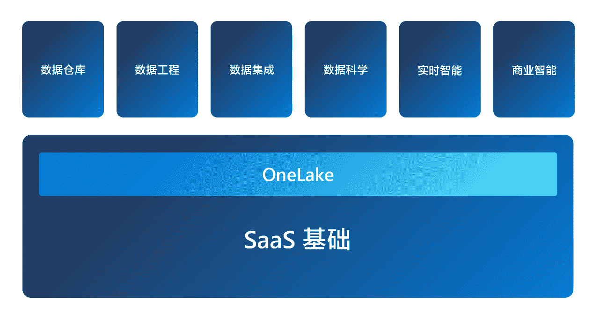

### 了解 Fabric 管理员角色

**管理员任务**

安全性和访问控制：Fabric 管理最重要的方面之一是管理安全性和访问控制，以确保只有授权用户才能访问敏感数据。 使用基于角色的访问控制 (RBAC) 来执行以下操作：

+   定义谁可以查看和编辑内容。

+   设置数据网关以安全地连接到本地数据源。

+   使用 Microsoft Entra ID 管理用户访问权限。

数据治理：有效的 Fabric 管理需要对数据治理原则有深入了解。 应了解如何保护租户中的入站和出站连接，以及如何监视使用情况和性能指标。 还应了解如何应用数据治理策略，以确保只有授权用户才能访问租户中的数据。

自定义和配置：Fabric 管理还涉及自定义和配置平台以满足组织的需求。 这些职责包括配置专用链接来保护租户、定义数据分类策略以及调整报表和仪表板的外观。

监视和优化：作为 Fabric 管理员，你需要知道如何监视平台的性能和使用情况、优化资源以及排查问题。 示例包括配置监视和警报设置、优化查询性能、管理容量和缩放，以及排查数据刷新和连接问题。

具体任务取决于组织的需求和 Fabric 实现的复杂性。

**管理员工具**

Fabric 管理员可以使用以下一种或多种工具执行大多数管理任务：Fabric 管理门户、PowerShell cmdlet、管理 API 和 SDK，以及管理监视工作区。

### 管理 Fabric 安全性

**管理用户：分配和管理许可证**

用户许可证控制用户在 Fabric 环境中的访问权限级别和功能。 管理员确保用户具有有效地完成其工作所需的数据和分析访问权限。 他们还可限制对敏感数据的访问，并确保遵守数据保护法律法规。

通过管理许可证，管理员可以确保有效地仅将许可证分配给需要的用户，从而监视和控制成本。 这有助于防止不必要的开支，并确保组织有效地利用其资源

**管理项目和共享**

作为管理员，你可以管理用户在共享和分配内容方面与 Fabric 的交互方式。 你可以管理用户与他人共享内容的方式，以及将内容分配给他人的方式。 你也可以管理用户与项目（例如数据仓库、数据管道、数据集、报表和仪表板）的交互方式。

工作区中的项目最好通过工作区应用或工作区直接分配。 授予最低许可权限是保护数据的第一步。 共享只读应用以获取对报表的访问权限，或授予对工作区的访问权限以进行协作和开发。 管理和分配项目的另一个方面是强制实施此类最佳做法。

可以根据组织的策略和过程，在组织内外管理共享和分配

### 在 Fabric 中治理数据

**认可 Fabric 内容**

认可是一项关键治理功能，通过将 Fabric 项目标记为已审核和批准来构建对数据资产的信任。 认可项会显示徽章，向用户发出这些资产可靠的信号。 认可可帮助用户信任数据，它还有助于管理员管理环境中项目的整体增长。

**扫描敏感数据**

元数据扫描通过对组织 Fabric 项的所有元数据启用编目和报告来促进数据治理。 扫描程序 API 是一组管理 REST API，可用于扫描 Fabric 项中的敏感数据。 使用扫描程序 API 扫描数据仓库、数据管道、数据集、报表和仪表板中的敏感数据。 扫描程序 API 可用于扫描结构化和非结构化数据。

**跟踪数据世系**

数据世系是用于跟踪通过 Fabric 的数据流的功能，也称为影响分析。 通过数据世系，可以查看数据的来源、转换方式和去向。 工作区中的世系视图可帮助你了解 Fabric 中可用的数据及其使用方式。

## 在 Microsoft Fabric 中安全访问数据

Microsoft Fabric 的安全性围绕特定用例的数据保护进行了优化。 不同的用户需要能够在 Fabric 中执行各种操作来履行其工作职责。 Fabric 有助于实现这一目标，因为它将允许你通过工作区和项权限、计算权限和 OneLake 数据访问角色（预览版）授予用户对特定数据工作负载的访问权限。

### 了解 Fabric 安全模型

组织中的数据访问通常受用户的职责、角色以及组织的 Fabric 部署模式和数据体系结构的限制。 Fabric 具有灵活的多层安全模型，可用于配置安全性以满足不同的数据访问要求。 能够控制不同层的权限意味着可以遵循最低权限原则，从而将用户权限的范围限制为仅拥有执行工作任务所需的权限。

Fabric 有三个安全级别，它们按顺序进行评估，以确定用户是否具有数据访问权限。 针对访问权限的评估顺序为：

1.  Microsoft Entra ID 身份验证：检查用户是否可以向 Microsoft Entra ID（一种 Azure 身份和访问管理服务）进行身份验证。

1.  Fabric 访问权限：检查用户是否可以访问 Fabric。

1.  数据安全性：检查用户是否可以对表或文件执行其所请求的操作。

第三级（即数据安全性）具有多个组成部分。这些部分可以单独配置，也可以一起配置，以满足不同的访问要求。 Fabric 中的主要访问控制包括：

+   工作区角色

+   项权限

+   计算或精细权限

+   OneLake 数据访问控制（预览版）

通过将这些组成部分想象成一个层次结构，有助于了解如何为其单独或整体应用访问控制

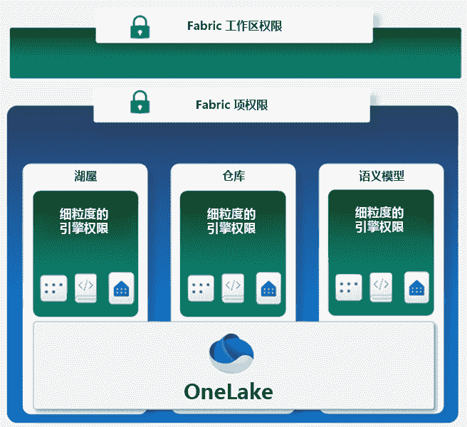

借助 Fabric 中的工作区，你可以使用工作区角色分配所有权和访问策略。 在工作区中，你可以创建 Fabric 数据项，例如湖屋、数据仓库和语义模型。 项权限可以从工作区角色继承，也可以通过共享相应项来单独设置。 当工作区角色过于宽松时，将使用项权限来共享项。

在每个数据项中，可以应用精细引擎权限（例如 Read、ReadData 或 ReadAll）。

你可以在 Fabric 的特定计算引擎（例如 SQL 终结点或语义模型）中应用计算或精细权限。

Fabric 数据项会将其数据存储在 OneLake 中。 通过使用名为“OneLake 数据访问控制（预览版）”的基于角色的访问控制 (RBAC) 功能，可以将对湖屋中数据的访问限制在特定文件或文件夹范围内。

### 配置工作区和项权限

工作区是可供用户协作创建项目组的环境。 项是可在 Fabric 中使用的资源，例如湖屋、仓库和报表。 工作区角色是预配置的权限集，可用于管理用户可以在 Fabric 工作区中执行的操作和访问权限。

项权限用于控制对工作区中单个 Fabric 项的访问权限。 项权限可用于调整通过工作区角色设置的权限；也可用于授予用户对工作区中一个或多个项的访问权限，而无需将用户添加到工作区角色。

### 应用精细权限

当工作区角色提供的权限或项权限不足时，可以通过以下项设置精细权限（例如表和行级安全性以及文件和文件夹访问权限）：

+   SQL 分析终结点

+   OneLake 数据访问角色（预览）

+   仓库

+   语义模型

### 练习：在 Microsoft Fabric 中确保安全的数据访问

https://microsoftlearning.github.io/mslearn-fabric.zh-cn/Instructions/Labs/19-secure-data-access.html

## 使用 Purview 管理 Microsoft Fabric 中的数据

Microsoft Fabric 本身包含许多数据治理功能。 还可以使用 Microsoft Purview 扫描 Fabric 租户以获得一个完整解决方案，该解决方案可帮助组织治理、保护和管理整个数据资产。

### 管理 Microsoft Fabric 中的数据

**数据治理**

数据治理是一个术语，它描述用于确保数据的质量、一致性、安全性和可用性的策略和做法。 该原则包含一系列活动以及在整个生命周期内有效管理数据的责任。

数据治理计划通常包括：

+   审核：记录数据的来源和修改者

+   评估：评估数据的有用性和准确性

+   文档：将数据的性质描述给可能使用它的人员

+   管理：移除不准确的数据，响应访问请求，确保符合数据法

+   保护：保护数据免受未经授权的访问、勒索软件和其他攻击

坚实的数据治理方案可以为公司带来好处，例如：

+   减少混淆并支持良好的决策的单一事实来源。

+   以更高的精度反映其度量的世界的优质数据。

+   更快地满足访问请求。

+   降低数据存储和管理的成本。

Microsoft Fabric 中的数据治理功能

可以在 Fabric 中直接执行许多数据治理任务，无需额外订阅 Microsoft Purview。 我们来探讨一些可用的功能：

管理数据资产

组织的数据资产是其数据资产的整个集合。 大型数据资产需要花费管理时间来维护和管理。 Fabric 可借助这些工具帮助完成此任务：

+   Fabric 管理门户：控制租户设置、容量、域和其他对象，通常是为管理员保留的。

+   租户、域和工作区：可用于控制对数据和功能的访问的逻辑容器。 例如，Fabric 管理员应有权访问租户中的所有设置，而团队级别的数据控制者可能只控制其域或工作区中的设置。

+   域将与单个业务范畴或主题领域相关的数据分组。

+   工作区将单个团队或部门使用的 Fabric 项分组。

+   容量：这些对象限制所有 Fabric 工作负载的计算资源使用量。

+   元数据扫描：扫描会从数据湖中提取名称、标识、敏感度、认可等值。 可以使用此元数据来分析和设置治理策略。

保护和防护数据

安全的数据受到保护，免受未经授权的访问和破坏性攻击。 它也符合你所在的区域中适用的数据存储法规。 Fabric 包含以下有用的工具：

+   数据标记：使用标记来标识数据的敏感度，并应用数据保留和保护策略。

+   工作区角色：使用角色定义有权访问工作区中的数据的用户。

+   数据级控制：在 Fabric 项级别（如表、行和列）使用控制措施来实施精细限制。

+   认证：Fabric 符合许多数据管理认证，包括 HIPAA BAA、ISO/IEC 27017、ISO/IEC 27018、ISO/IEC 27001 和 ISO/IEC 27701。

鼓励数据发现和使用

仅当用户可以找到和分析数据时，数据才有用。 Fabric 的这些功能可以鼓励数据使用：

+   OneLake 数据中心：借助此工具，用户可以轻松查找和浏览你的资产中的数据。

+   认可：用户认可 Fabric 项以将其标识为高质量。 认可能够帮助其他用户信任项包含的数据。

+   数据世系：此功能可帮助用户了解工作区中的项之间的数据流以及更改会带来的影响。

监视数据使用情况

Fabric 使用户能够监视信息的使用方式：

+   监视中心：此中心会显示 Fabric 项发生的情况。 你只能看到你有权查看的 Fabric 项的活动。

+   容量指标：使用容量指标应用监视用量和消耗量。

### 为什么将 Microsoft Purview 与 Microsoft Fabric 配合使用？

Microsoft Purview 为 Microsoft Fabric 中的数据治理提供了最高级别且最灵活的功能。

Microsoft Purview 是一个可靠的数据治理和合规性平台，可用于管理和保护公司的数据资产。 它提供用于数据发现、分类和编录的综合工具。 使用 Purview，可以清楚地了解数据布局。 Purview 可自动识别敏感信息，并为元数据提供集中式存储库。 使用它可跨各种环境（包括本地和基于云的系统）查找、管理和治理数据。

Purview 还支持合规性和风险管理，其功能可监视法规遵从性并评估数据漏洞。 它与其他 Microsoft 服务和第三方工具的集成增强了其实用性。 Purview 通过简化数据访问控制、强制实施策略以及提供数据世系见解来帮助组织维护数据完整性、遵守法规和有效地使用其数据进行战略决策。

Microsoft Purview 是一个可靠的数据治理和合规性平台，可用于管理和保护公司的数据资产。 它提供用于数据发现、分类和编录的综合工具。 使用 Purview，可以清楚地了解数据布局。 Purview 可自动识别敏感信息，并为元数据提供集中式存储库。 使用它可跨各种环境（包括本地和基于云的系统）查找、管理和治理数据。

Purview 还支持合规性和风险管理，其功能可监视法规遵从性并评估数据漏洞。 它与其他 Microsoft 服务和第三方工具的集成增强了其实用性。 Purview 通过简化数据访问控制、强制实施策略以及提供数据世系见解来帮助组织维护数据完整性、遵守法规和有效地使用其数据进行战略决策。

+   Microsoft Purview 数据目录

+   Microsoft Purview 信息保护

+   Microsoft Purview 数据防丢失

+   Microsoft Purview 审核

### 管理 Microsoft Purview 中心中的数据

若要使用 Microsoft Purview 来治理 Microsoft Fabric 项，必须首先连接它们。 将 Purview 连接到 Fabric 后，Fabric 中会显示一个名为“Microsoft Purview 中心”的新页面，其中包含对 Fabric 项的丰富分析。