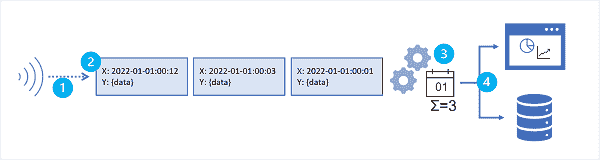
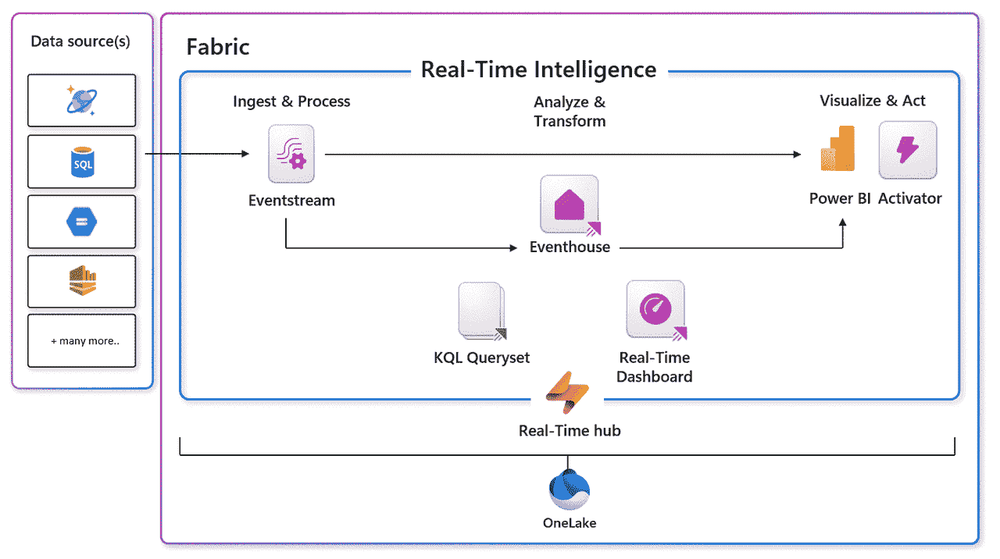

# DP-603： 使用 Microsoft Fabric 实现实时智能

> 来源：[https://zsyhjtnsa5.feishu.cn/docx/T9TOdCsi8oZGObx215bcDwEhnDb](https://zsyhjtnsa5.feishu.cn/docx/T9TOdCsi8oZGObx215bcDwEhnDb)

# Microsoft Fabric 中的实时智能入门

大多数新式数据分析解决方案都支持两种常见的数据分析模式：

+   批处理数据分析，是指将数据以批处理操作形式定期加载到分析数据存储中；启用对来自过去事件的数据的历史分析。

+   实时数据分析，是指随着事件在数据流中的发生，实时（或接近实时）地引入事件的数据，可以对这些数据进行分析、可视化并用于触发自动化响应。

+   批处理数据分析通常可以很好地理解，并且经常使用数据仓库或湖屋体系结构来实现。

+   实时分析可能被视为更专业，但越来越多地以 lambda 体系结构的形式被合并到大规模数据分析解决方案中，该体系结构结合了定期加载批处理数据以用于历史分析，以及引入数据流以进行实时分析。

Microsoft Fabric 提供用于批处理分析和实时分析的功能。 在本模块中，我们将重点介绍 Microsoft Fabric 的“实时智能”功能，探索如何构建实时数据分析解决方案，使用最少的编码即可扩展处理来自各种不同源的大量数据。

## 什么是实时数据分析？

实时数据分析通常基于对数据流的引入和处理，该数据流由一系列永久的数据组成，通常与特定时间点的事件相关。 例如，数据流可能包含提交给社交媒体🧣网站的消息的详细信息，或包含由连接 Internet 的天气传感器记录的一系列环境测量值。

流中的数据可用于创建数据的实时可视化效果，便于进行监视，或者在发生某些条件时触发自动操作。 例如，办公楼中环境控制传感器的数据流可使加热和空调系统能够动态控制，从而优化舒适度和节省成本。 该数据还能保存在数据存储中，以便稍后查询，这使分析师能够更好地了解随时间发生的变化。 例如，营销组织可能会对社交媒体消息进行情绪分析，以查看广告活动是否会导致对公司或其产品的更积极评价，或者农业企业可能会监视温度和降雨趋势以优化灌溉和作物收割。

实时分析的常见目标包括

+   持续分析数据以报告问题或趋势。

+   了解各种条件下的组件或系统行为，以帮助规划未来的增强功能。

+   发生特定事件或超出阈值时触发特定操作或警报。

**实时数据分析解决方案的特征**

1.  数据流是无边界限制的 - 即数据会永久添加到流中。

1.  流中的数据记录通常包含临时（基于时间）的数据，用以指示与记录相关的事件何时发生（或被记录）。

1.  流数据的聚合通常在临时窗口上执行 - 例如，记录每分钟社交媒体帖子的数量或每小时的平均降雨量。

1.  流式数据处理的结果可用于支持实时（或准实时）自动化或可视化，或保存在分析存储中以与其他数据结合以进行历史分析。 许多解决方案结合这些方法来支持实时和历史分析。

## Microsoft Fabric 中的实时智能

Fabric 的实时智能解决方案提供端到端的流式处理解决方案，用于跨 Fabric 服务进行实时数据分析。

实时智能针对各种大小的数据（从几 GB 到几 PB）提供高性能分析。 它可以处理来自不同源和各种格式的数据。 在包括制造业、石油和天然气以及汽车业等许多场景中，Fabric 的实时智能工作负载可用于 IoT 和日志分析等解决方案。

使用 Microsoft Fabric 实时智能，可以：

+   创建事件流来捕获、转换和引入来自各种流数据源的实时数据。

+   将捕获的实时数据存储在 Eventhouse 中，其中包括一个或多个 KQL 数据库。

+   使用 KQL 查询（在 KQL 查询集中组织）在 Eventhouse 中查询和分析中的数据。

+   在实时仪表板中或使用 Power BI 来可视化实时数据。

+   配置使用激活器触发自动操作的警报。

Microsoft Fabric 实时中心提供了用于管理实时数据源的集中位置。在实时中心，可以：

+   查找并连接到实时数据源并创建事件流。

+   订阅 Fabric 和 Azure 事件，并创建事件流和激活器警报。

+   预览和管理实时数据连接，包括导航到 Eventhouse 中捕获的流数据。

+   从事件流中创建实时仪表板。

+   在整个组织中认可和共享实时数据资源。

## 引入和转换实时数据

Microsoft Fabric 中的 Eventstream 用于捕获、转换和加载来自各种流数据源的实时数据。 在系统中设置 Eventstream 时，将定义永久运行的数据处理引擎来引入和转换实时数据。 你告知它从何处获取数据、向何处发送数据，以及如何根据需要更改数据。

Eventstream 的数据源

Microsoft Fabric 中的 Eventstream 支持各种数据源，包括：

+   外部服务，如 Azure 存储、Azure 事件中心、Azure IoT 中心、Apache Kafka 中心、关系数据库服务中的变更数据捕获 (CDC) 源等。

+   Fabric 事件，例如对 Fabric 工作区中项的更改、OneLake 数据存储中的数据更改以及与 Fabric 作业关联的事件。

+   示例数据，其中包括可帮助你探索 Microsoft Fabric 中的实时分析场景的一系列示例。

Eventstream 中的数据转换

你可以在数据于 Eventstream 中流动时对其进行转换，从而能够在存储数据之前对其进行过滤、汇总和重塑。 可用转换包括：

+   筛选：使用“筛选”转换可以根据输入中的字段值筛选事件。 根据数据类型（数字或文本），转换将保留与所选条件（例如 null 或 is not null）匹配的值。

+   管理字段：使用此转换可以添加、删除、更改数据类型，或重命名来自输入或其他转换的字段。

+   聚合：使用“聚合”转换可以在一段时间内每次发生新事件时计算聚合（总和、最小值、最大值或平均值）。 此操作还允许重命名这些计算列，并根据数据中的其他维度筛选或切片聚合。 在同一转换中可以有一个或多个聚合。

+   分组依据：使用分组依据转换来计算某个时间窗口内所有事件的聚合。 可以按一个或多个字段中的值进行分组。 就像聚合转换允许重命名列一样，但提供了更多聚合选项，并包含更复杂的时间窗口选项。 与“聚合”类似，你可以为每个转换添加多个聚合。

+   联合：使用“联合”转换可以连接两个或多个节点，并将具有共享字段（具有相同名称和数据类型）的事件添加到一个表中。 不匹配的字段将被删除，不包含在输出中。

+   扩展：使用此数组转换可为数组中的每个值创建一个新行。

+   联接：使用此转换可以根据两个流之间的匹配条件合并这两个流中的数据

Eventstream 中的数据目标

可以将流中的数据加载到以下目标：

+   Eventhouse：通过此目标，可以将实时事件数据引入 Eventhouse，可以使用 Kusto 查询语言 (KQL) 来查询和分析数据。

+   湖屋：通过此目标，你可以在将实时事件引入湖屋之前转换实时事件。 实时事件会转换为 Delta Lake 格式，然后存储在指定的湖屋表中。

+   派生流：派生流用于将 Eventstream 的输出重定向到另一个Eventstream。 派生流表示流处理后转换的默认流。

+   Fabric 激活器：通过此目标，可以将实时事件数据直接连接到 Fabric 激活器；它是一种智能代理，可根据流中的值自动执行操作。

+   自定义终结点：使用此目标，可以将实时事件路由到自定义终结点。 如果要将实时数据定向到外部系统或 Microsoft Fabric 外部的自定义应用程序，此目标非常有用。

## 存储和查询实时数据

**存储数据**

Eventhouse 是存储实时数据的位置，通常由 Eventstream 引入并加载到表中以供进一步处理和分析。

在 Eventhouse 中，可以创建：

+   KQL 数据库：实时优化的数据存储，用于托管表、存储函数、具体化视图和快捷方式的集合。

+   KQL 查询集：可用于处理 KQL 数据库表中数据的 KQL 查询集合。 KQL 查询集支持使用 Kusto 查询语言 (KQL) 和 Transact-SQL 语言子集编写的查询。

**查询数据**

要从 KQL 数据库中的表查询数据，可使用 Kusto 查询语言 (KQL)，它用于在 Azure 数据资源管理器、Azure Monitor Log Analytics、Microsoft Sentinel 和 Microsoft Fabric 中编写查询。

+   KQL 是处理数据并返回结果的只读请求。 KQL 查询由一个或多个查询语句组成。

+   KQL 查询语句包含一个表名称，后跟一个或多个运算符，这些运算符对数据执行 take、filter、transformaggregate、 或 join 操作。

+   KQL 针对查询大量数据（尤其是基于时间的元素）进行了优化，因此它非常适合实时数据分析。 但是，许多数据专业人员已经熟悉 SQL 语法，因此，Eventhouse 中的 KQL 数据库支持一部分常见的 SQL 表达式。

+   Microsoft Fabric 包括用于实时智能的 Copilot，可帮助编写从 Eventhouse 数据中提取见解所需的查询。 Copilot 使用 AI 了解你要查找的信息，并可以为你生成所需的查询代码。

## 可视化实时数据

实时仪表板提供了一种将数据可视化效果固定到单一可视界面的方法，使你能够一目了然地展示实时见解。 仪表板中的每个磁贴都会根据 KQL 查询显示不同的信息，该查询从 Eventhouse 的表中提取实时数据。

+   可以在工作区中创建实时仪表板，然后配置其源，也可以直接从 Eventhouse 中的 KQL 查询集创建仪表板。

+   由于 Power BI 是 Fabric 平台的核心组件，因此你还可以将 KQL 数据库中的数据可视化为 Power BI 报表。

## 自动执行操作

Activator 是 Microsoft Fabric 中的一项技术，可自动处理触发操作的事件。 例如，可以使用 Activator 通过电子邮件在事件流中的某个值偏离特定范围时发送通知或在实时仪表板更新时运行笔记本执行某种基于 Spark 的数据处理逻辑。

Activator 基于 4 个核心概念运行：事件、对象、属性和规则。

+   事件 - 数据流中的每个记录都表示在特定时间点发生的事件。

+   对象 - 事件记录中的数据可用于表示对象，例如销售订单、传感器或其他业务实体。

+   属性 - 事件数据中的字段可以映射到业务对象的属性，用于表示其状态的某些方面。 例如，total_amount 字段可能表示销售订单总数，或 temperature 字段可能表示环境传感器测量的温度。

+   规则 - 使用 Activator 基于事件自动执行操作的关键是定义根据事件中引用的对象属性值来设置操作触发条件的规则。 例如，可以定义一个规则，规定如果传感器测量的温度超过特定阈值，则向维护管理员发送电子邮件。

Activator 可在各种场景中提供帮助，例如动态库存管理、实时客户参与和云环境中的有效资源分配。 对于需要实时数据分析和操作的任何情况，它都是一种强大的工具。

使用 Activator 可以：

+   在产品销售下降时发起营销行动。

+   当温度变化可能影响易腐商品时发送通知。

+   标记影响应用和网站上的用户体验的实时问题。

+   当货物在预期的时间段内未更新时触发警报。

+   当客户的账户余额超过特定阈值时发送警报。

+   立即响应数据处理工作流中的异常或故障。

+   当同店销售额下降时运行广告。

+   提醒商店经理在食物变质前将其从故障的杂货店冰柜转移。

## 练习 - 探索 Fabric 中的实时智能

在本练习中，你会将实时数据引入到 Microsoft Fabric 中。 然后，你将查询和可视化数据，然后定义警报以根据实时数据流中的阈值自动执行操作。

https://microsoftlearning.github.io/mslearn-fabric.zh-cn/Instructions/Labs/07-real-time-Intelligence.html

# 在 Microsoft Fabric 中使用实时事件流

Eventstreams 使你可以捕获和处理实时事件，而无需编写任何代码。 可以在事件流中设置事件源、目标和转换，以便能够在将数据加载到目标之前收集、筛选、聚合、分组和合并来自实时源的数据。

Microsoft Fabric Eventstreams 的一些主要优势包括：

+   你可以通过无代码体验捕获、转换实时事件并将其路由到各种目标。 可以使用拖放功能形成事件数据处理逻辑，无需编写任何代码。

+   有多个源连接器可从不同的源（例如 Azure 事件中心、Azure IoT 中心、Azure 存储、Apache Kafka 等）获取事件数据。

+   可以将数据发送到各种目标，以便进一步分析或处理。 可以在 Eventstream 中附加多个目标，以便将数据从单个源引入多个存储。

+   Eventstreams 使用可缩放的基础结构自动管理资源。 可缩放的基础结构有助于轻松捕获实时事件，使流式处理 ETL（提取、转换、加载）操作成为可能。

## 事件流的组件

Microsoft Fabric 事件流的工作原理是通过从多个内外部源创建事件管道，将这些事件传输到不同目标。 可以将其视为将数据从一个位置移动到另一个位置的传送带。 还可以在此过程中向数据添加一些转换，例如筛选、聚合或扩充。

可使用事件流的可视化编辑器通过拖放不同的节点（例如源、目标和转换）来设计管道。 还可以实时查看流经管道的事件数据。 Microsoft Fabric 事件流自动处理事件流的缩放、可靠性和安全性。 无需编写任何代码或管理任何基础结构，就可以使用 Microsoft Fabric Eventstream。

事件流的主要组件包括：

+   源：源是事件数据的来源。 可以选择 Azure 事件中心、示例数据或自定义应用作为源类型。 还可以选择源的数据格式和使用者组。

+   转换：可以添加转换来对流处理的数据进行筛选或聚合。 转换包括一些常见的数据操作，例如筛选、联接、聚合和分组以及临时开窗函数，使你能够在离散时间段内分析数据事件。

+   目标：目标是存储转换后的事件数据的位置。 例如，可以将流处理的结果存储在 Eventhouse 或湖屋的表中，也可以将数据重定向到另一个事件流以便进一步处理，或重定向到激活器以触发操作。

可以使用事件流编辑画布添加和管理源和目标。 还可以查看事件数据、检查数据见解，以及查看每个源或目标的日志

## Eventstream 源和目标

**事件流源**

Fabric 实时中心中的事件源包括（但不限于）：

+   Azure 事件中心：Azure 事件中心是一个源，它让你可从 Azure 事件中心获取事件数据。 可以指定 Azure 事件中心的数据格式和使用者组。 还可以使用适当的身份验证和隐私级别创建与 Azure 事件中心的云连接。

+   Azure IoT 中心：一项 SaaS 服务，通过无代码体验可用于连接、监视和管理数百万个 IoT 资产。

+   Azure SQL 数据库变更数据捕获 (CDC)：识别和跟踪数据库中数据的更改的软件过程，可实现实时或准实时数据移动。

+   PostgreSQL 数据库 CDC：适用于 Microsoft Fabric 事件流的 PostgreSQL 数据库 CDC（变更数据捕获）连接器会捕获当前快照并跟踪 PostgreSQL 数据库中的未来变更，从而实现在 Fabric 中实时处理和分析此数据。

+   MySQL 数据库 CDC：适用于 Microsoft Fabric 事件流的 Azure MySQL 数据库 CDC 源连接器会捕获 MySQL 数据库的快照并跟踪表变更，从而实现在 Fabric 中实时处理和分析此数据。

+   Azure Cosmos DB CDC：适用于 Microsoft Fabric 事件流的 Azure Cosmos DB CDC 连接器会捕获并跟踪 Cosmos DB 中的实时数据变更，以便在 Fabric 中进行分析和处理。

+   Google Cloud Pub/Sub：用于在应用程序和服务之间交换事件数据的消息传递服务。

+   Amazon Kinesis 数据流：收集、处理和分析实时流数据。

+   Confluent Cloud Kafka：基于 Apache Kafka 的完全托管服务，用于流处理。

+   Fabric 工作区事件：Fabric 工作区事件是由 Fabric 工作区中的更改触发的事件，例如创建、更新或删除项。 使用 Fabric 事件流时，可以捕获、转换和路由这些事件，以便在 Fabric 中进行深入分析和监视。 此集成提供了跟踪中增强的灵活性以及对工作区活动的了解。

+   Azure blob 存储事件：Azure Blob 存储事件是用于创建、替换或删除 Blob 等操作的系统触发器。 Microsoft Fabric 事件流将这些操作链接到 Fabric 事件，使你可以将 Blob 存储事件作为连续数据流进行处理，以便在 Fabric 中进行路由和分析。 Azure Blob 存储事件的一项独特特征是支持流式或非流式事件。

+   自定义终结点：可使用由 Microsoft Fabric 提供的 REST API 或软件开发工具包 (SDK) 将事件数据从自定义应用发送到事件流。 还可以指定自定义应用的数据格式和使用者组。

+   示例数据：示例数据是一个源，可用于使用由 Microsoft Fabric 提供的现成示例数据。 可以从不同的示例数据集中进行选择，例如 IoT、零售或财务。 还可以调整示例数据生成的频率和持续时间。

**事件流目标**

Microsoft Fabric 事件流还支持在增强模式下将数据发送到以下目标的功能。

+   Eventhouse：此目标提供将实时事件数据导入 KQL 数据库的功能，使你能够利用 Kusto 查询语言 (KQL) 进行数据查询和分析。 将数据存放在 KQL 数据库中能够激发对事件数据的提升理解以及创建综合报表和仪表板的潜力。

+   湖屋:此目标使你能够在将实时事件引入湖屋之前对其进行预处理。 事件将转换为 Delta Lake 格式，然后存储在特定的湖屋表中，从而有助于满足数据仓储需求。

+   自定义终结点：借助此功能，可以将实时事件流量无缝定向到定制应用程序。 它可以将专有应用程序与事件流集成，从而可以立即使用事件数据。 如果你打算将实时数据传输到不是托管在 Microsoft Fabric 上的独立系统，此功能非常有利。

+   派生流：派生的流是在将流操作（例如“筛选”或“管理字段”）应用于事件流后创建的专用目标。 它表示处理后更改的默认流，可以路由到 Fabric 中的各个目标并在实时中心进行监视。

+   Fabric 激活器：通过此目标，可以使用 Fabric 激活器根据流数据中的值触发自动操作。

## Eventstream 转换

可以通过应用以下转换来转换 Eventstream 中的数据：

+   筛选：使用“筛选”转换可以根据输入中的字段值筛选事件。 根据数据类型（数字或文本），转换将保留与所选条件（例如 null 或 is not null）匹配的值。

+   管理字段：使用此转换可以添加、删除、更改数据类型，或重命名来自输入或其他转换的字段。

+   聚合：使用“聚合”转换可以在一段时间内每次发生新事件时计算聚合（总和、最小值、最大值或平均值）。 此操作还允许重命名这些计算列，并根据数据中的其他维度筛选或切片聚合。 在同一转换中可以有一个或多个聚合。

+   分组依据：使用分组依据转换来计算某个时间窗口内所有事件的聚合。 可以按一个或多个字段中的值进行分组。 就像聚合转换允许重命名列一样，但提供了更多聚合选项，并包含更复杂的时间窗口选项。 与“聚合”类似，你可以为每个转换添加多个聚合。

+   联合：使用“联合”转换可以连接两个或多个节点，并将具有共享字段（具有相同名称和数据类型）的事件添加到一个表中。 不匹配的字段将被删除，不包含在输出中。

+   扩展：使用此数组转换可为数组中的每个值创建一个新行。

+   联接：此联接是一种转换，可根据两个流之间的匹配条件合并这两个流中的数据。

开窗函数是一种对临时窗口中包含的数据执行操作的方法，例如聚合、过滤或转换在指定时间段内发生的流事件。 开窗函数可用于分析随时间变化的流数据，例如传感器读数、Web 点击、在线事务等，并提供极大的灵活性来保持对事件发生时事件的准确记录。

事件处理程序编辑器中的 Group by 运算符。 通过此图形界面，可以定义处理、转换和路由事件数据所需的逻辑。 需要在 Group by 运算符设置中指定四个参数来使用这些开窗函数

+   “窗口类型”，其值可以是翻转、滑动、快照、跳跃或会话。

+   “窗口持续时间”是每个窗口间隔的时长，可以秒、分钟、小时甚至天为单位。 例如，持续时间为 10 分钟意味着每个窗口只涉及 10 分钟的事件数据。

+   “窗口偏移量”是一个可选参数，它将每个窗口间隔的开始和结束时间移动指定的时间量。 例如，可将此可选参数设置为 2 分钟的窗口偏移量，这意味着每个窗口会比正常情况晚 2 分钟开始和结束。

+   “分组键”是事件数据中要作为分组依据的一列或多列。 例如，按传感器 ID 或项类别分组。

+   “聚合函数”是一个或多个要应用于每个窗口中每个事件组的函数。 其中，计数、总和、平均值、最小值/最大值甚至自定义函数非常有用。

## 练习 - 在 Microsoft Fabric 中使用 Eventstream 引入实时数据

将探索如何使用事件流捕获流式处理数据的源，转换它，以及将转换后的事件数据加载到表中以进一步分析。

# 在 Microsoft Fabric eventhouse 中使用实时数据

Microsoft Fabric 中的 Eventhouse 为大量数据提供数据存储。 Eventhouse 针对表示基于时间的事件的数据进行了优化，这在实时数据分析场景中很常见。 它们旨在高效处理实时数据流，使组织能够近乎实时地查询和分析数据。

在 Microsoft Fabric 中，通常使用 Eventstream 将实时数据流加载到 Eventhouse。 然后，可以：

+   在 KQL 查询集中，使用 Kusto 查询语言 (KQL) 或结构化查询语言 (SQL) 的子集对数据执行查询。

+   使用实时仪表板可视化数据。

+   使用 Fabric 激活器根据数据自动执行操作。

Eventhouse 是位于所有这些功能中心的 Fabric 数据存储。

## Eventhouse 入门

若要创建事件屋，必须在支持实时智能 Fabric 功能的 Fabric 容量的工作区操作。 然后，可以为数据创建一个或多个 Eventhouse。

+   Eventhouse 包含一个或多个 KQL 数据库，可在其中创建表、存储过程、实体化视图和其他项来管理数据。 创建 Eventhouse 后，可以使用默认的 KQL 数据库或创建新数据库。

+   若要将数据引入 Eventhouse 中的 KQL 数据库，通常是从静态位置（例如本地文件、OneLake、Azure 存储或示例数据集）或实时源（例如 Azure 事件中心或 Fabric 事件流）导入数据。

+   若要查询 KQL 数据库中的表中的数据，可以编写 Kusto 查询语言 (KQL) 代码，或使用结构化查询语言 (SQL) 语句的受限子集。

+   为了更轻松地开发查询，Eventhouse 支持一个或多个 KQL 查询集，它们通过提供示例语法和编码实用工具来简化查询开发。 提供了默认查询集，如果需要，可以创建更多查询集。

+   KQL 语法直观且简洁，包括各种函数和表达式，便于高效地执行复杂的数据分析。

> 对于 KQL 数据库而言，KQL 是首选语言，原因如下：

+   简易性：KQL 是一种比 SQL 更简单的语言，更易于学习和使用。

+   性能：KQL 针对性能进行了优化，可以比 SQL 更高效地处理大量数据。

+   灵活性：KQL 比 SQL 更灵活，允许用户轻松执行复杂的查询。

+   集成：KQL 与其他 Microsoft 产品（如 Azure Monitor 和 Azure Sentinel）集成。

> 与 KQL 相比，使用 SQL 的一个主要缺点是，它不是引擎的本机语言，必须经过转换器。 这样的语言差异可防止它直接从 Queryset 发布到 Power BI。

> 但是，在某些情况下，SQL 可能是一个不错的选择，原因如下：

+   兼容性：SQL 是一种广泛使用的语言，可与许多不同的数据库系统兼容。

+   功能：SQL 具有比 KQL 更广泛的函数和功能。

+   过程编程：SQL 支持过程式编程，使开发人员能够编写复杂的脚本和存储过程。

虽然最终你可能想要基于查询创建实时仪表板或 Power BI 报表，但在浏览查询集中的数据以创建快速数据可视化效果时，它很有用。 与许多常见的笔记本开发环境一样，KQL 查询集支持以图表形式显示查询结果。

[对于基于 AI 的 KQL 查](https://learn.microsoft.com/zh-cn/fabric/get-started/copilot-real-time-intelligence)询协助，可以使用用于实时智能的 Copilot。

管理员启用 Copilot 后，可在查询集菜单栏中看到该选项。 Copilot 作为主查询界面的侧边窗格打开。 提出有关数据的问题时，Copilot 会生成 KQL 代码来回答问题。

## 有效使用 KQL

Eventhouse 中的 KQL 数据库针对大量实时数据进行优化。 为了获得最佳结果，你应该记住一些好的做法。

基于实时数据流的表可能会变得很大。 最大程度地减少查询返回的数据有助于优化性能，并防止因超出数据限制而出错

+   筛选列：使用 project 关键字仅检索所需的列。

+   筛选行：使用 where 关键字筛选基于特定条件返回的行

+   汇总数据：有时，无需在单个事件级别检索数据。 你可以汇总数据来帮助对模式进行分析（通常基于时间间隔）。

## 具体化视图和存储函数

虽然通常可以通过查询表和使用内置函数和运算符来实现分析目标，但 KQL 提供了一些高级功能，可用于创建封装常用数据或逻辑的新对象。

+   具体化视图：具体化视图是源表或其他具体化视图的数据汇总。 该视图封装了 summarize 语句。

+   存储函数：KQL 包括将查询封装为函数的功能，简化了常见查询的重复使用。 还可以为函数指定参数，以便可以使用变量值重复相同的查询。若要创建函数，请使用 .create-or-alter 函数 KQL 命令

## 练习 - 在 Microsoft Fabric Eventhouse 中处理数据

在本练习中，可以使用 KQL 和 SQL 查询 KQL 数据库中的出租车行程数据。

https://microsoftlearning.github.io/mslearn-fabric.zh-cn/Instructions/Labs/12-query-data-in-kql-database.html

# 使用 Microsoft Fabric 创建实时仪表板

假设你是一家公司的分析师，该公司为一个大城市的自行车共享计划提供自行车。 业务依赖于城市不同街区的自行车可用性相关的实时数据。 挑战是创建一个实时仪表板，以便实时深入了解多个位置的自行车和停车位的数量。 此仪表板应易于使用、可访问且安全。 它还应该允许数据探索、筛选和向下钻取功能。 此案例在许多实时数据分析对决策至关重要的行业中很常见。

## 开始使用实时仪表板

Microsoft Fabric 中的实时仪表板基于实时流式处理数据源构建，例如由事件流填充的 Eventhouse 中的表。 每个仪表板包括一个或多个磁贴，每个磁贴都会显示实时数据可视化效果。

## 高级功能

**基础查询**

虽然每个磁贴都有自己的查询，但仪表板设计中的一种常见模式是让多个磁贴基于一组相关的数据集。 你可以通过定义检索与多个磁贴相关的常规记录集的基本查询，然后使用特定于磁贴的查询进一步筛选或对特定数据可视化的数据进行分组，使仪表板更易于维护。

**页**

默认情况下，实时仪表板包含一个页面。 但是，你可以将更多页面添加为容器，以便使用更多磁贴。 这是按项（例如数据源、主题区域，甚至聚合级别或详细信息级别）创建组织的逻辑组的好方法。

**参数**

你可以通过提供用户可用于筛选磁贴中显示的数据的参数，为实时仪表板增添灵活性。 如果希望用户仅在特定时间段内查看数据或专注于某些其他数据子集，则参数会非常实用。

你可以为仪表板定义多个参数，并将筛选器值基于特定文本或查询结果

**自动刷新**

自动刷新会自动更新仪表板数据，无需执行手动重新加载页面或刷新操作。 编辑者可以设置默认刷新频率，编辑者和查看者都可以在查看仪表板期间调整该刷新频率。 但是，编辑者有权建立最低刷新频率来管理群集工作负载，从而防止用户设置低于此阈值的频率。

## 实时仪表板最佳做法

+   明确性和简便性：使仪表板保持简单并避免混乱。

+   对磁贴和视觉对象使用清晰的标签。

+   必要时使用更多页面来提供导航或主题领域。

+   相关性：确保显示的数据与仪表板的用途和受众的需求相关。

+   刷新频率：设置适当的刷新频率，以确保数据是最新的，同时不会导致系统过载。

+   与用户商议以确保刷新率符合预期。

+   易访问性：设计可供所有用户（包括具有查看者权限的用户）访问的仪表板。

+   交互性：包括允许用户与数据交互的功能，例如筛选器和向下钻取功能。

+   定期征求反馈，确保报表继续提供价值。

+   随着用户对产品越来越熟悉，新功能的引入可以提高他们的工作效率。

+   尽可能使用 Copilot 来提高工作效率。

+   性能：优化查询和视觉对象以提高性能，确保流畅的用户体验。

+   包含在呈现实时仪表板期间执行的参数，用于在查询中应用筛选器。

+   查询的数据量不要超过在可视化效果中使用的数量，以满足客户的要求。

+   安全性：实施适当的安全措施。

+   保护敏感数据。

+   请记住，Fabric 是一种软件即服务 (SaaS) 解决方案，正确管理谁有权访问你的系统（身份验证）以及他们有权访问哪些内容（授权）至关重要。

+   测试：定期测试仪表板的功能和性能问题。

+   测试应包括用户验收测试和反馈循环

## 练习 - 开始使用实时仪表板

https://microsoftlearning.github.io/mslearn-fabric.zh-cn/Instructions/Labs/13-real-time-dashboards.html