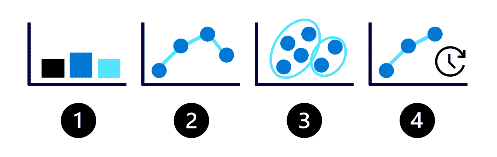
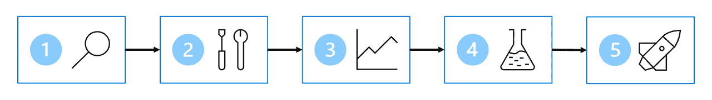
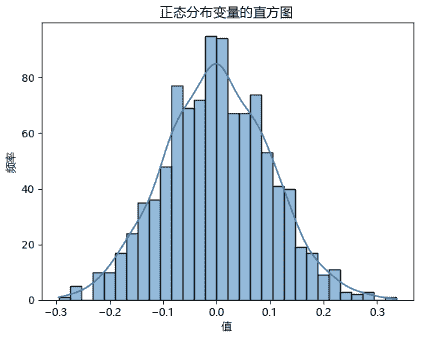
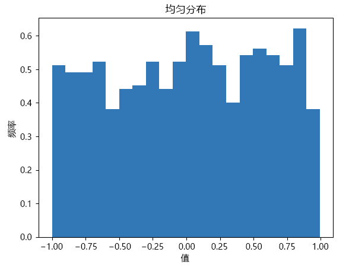
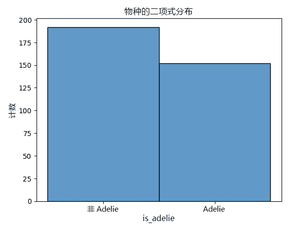
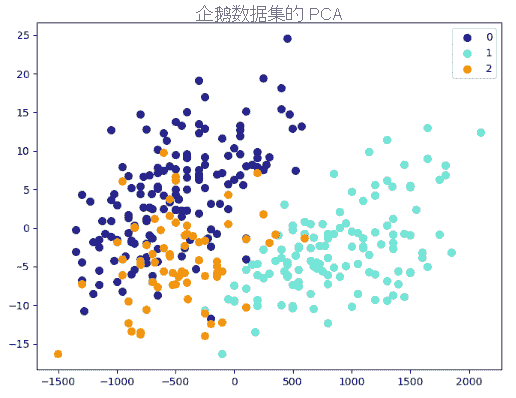

# DP-604：在 Microsoft Fabric 中实现用于 AI 的数据科学和机器学习解决方案

> 来源：[https://zsyhjtnsa5.feishu.cn/docx/PyZtdxU1woGmaAx7tHNc27chnNd](https://zsyhjtnsa5.feishu.cn/docx/PyZtdxU1woGmaAx7tHNc27chnNd)

# Microsoft Fabric 中的数据科学入门

无论何时你想要在组织内作出明智决策时，都可以使用数据科学从你拥有的数据中获取见解。 数据科学是数学、统计学和计算机工程学的结合。

使用数据科学可以分析数据并识别和确定可为组织提供有意义的见解的复杂模式。 可以使用数据科学创建包含在你数据中找到的复杂模式的人工智能 (AI) 模型。 一种常见方法是使用数据科学和 Python 中的 scikit-learn 等库来训练机器学习模型，以此实现 AI。

执行一个全流程的完整数据科学项目可能会很困难。 Microsoft Fabric 提供了一个工作区来管理端到端数据科学项目。

## 了解数据科学过程

将数据可视化是从数据中提取见解的常用方法。 每当有复杂的数据集时，最好深入研究，尝试从数据中找出复杂的模式。

作为数据科学家，你可以训练机器学习模型以从数据中找出模式。 可以使用这些模式来生成新的见解或预测。 例如，可以预测在未来一周内预期销售的产品数量。

尽管训练模型很重要，但它并不是数据科学项目的唯一任务。 在探索典型的数据科学过程之前，让我们先了解一下可以训练的常见机器学习模型。

**探索常见的机器学习模型**

机器学习的目的是训练可以识别大量数据中的模式的模型。 然后，你可以使用这些模式进行预测，从而提供可以对其执行操作的新见解。

机器学习可以展现出无穷的可能性，因此，我们首先来了解四种常见类型的机器学习模型：

1.  分类：预测分类值，例如客户是否可能会流失。

1.  回归：预测数值，例如产品的价格。

1.  聚类分析：将类似的数据点分到群集或组中。

1.  预测：根据时序数据预测未来的数值，例如下个月的预期销售额。

**了解数据科学过程**

1.  定义问题：与业务用户和分析师一起决定模型应预测的内容以及何时成功。

1.  获取数据：通过将数据存储在湖屋中来查找数据源并进行访问。

1.  准备数据：通过将数据从湖屋读取到笔记本中来浏览数据。 根据模型的要求清理和转换数据。

1.  训练模型：通过使用 MLflow 跟踪试验，根据试验和错误来选择算法和超参数值。

1.  生成见解：使用模型批量评分来生成请求的预测。

## 使用 Microsoft Fabric 浏览和处理数据

数据是数据科学的基石，尤其是在旨在训练机器学习模型以实现人工智能时。 通常，随着训练数据集大小的增加，模型会表现出增强的性能。 除了数据数量外，数据的质量也同样重要。

为了保证数据的质量和数量，使用 Microsoft Fabric 强大的数据引入和处理引擎是值得的。 在建立基本的数据引入、浏览和转换管道时，可以灵活地选择低代码或代码优先方法。

**引入数据**

+   若要在 Microsoft Fabric 中处理数据，首先需要引入数据。 你可以从多个源（本地和云数据源）引入数据。 例如，可以从本地计算机或 Azure Data Lake Storage (Gen2) 中存储的 CSV 文件引入数据。

+   连接到数据源后，可以将数据保存到 Microsoft Fabric 湖屋中。 你可以使用湖屋作为中心位置来存储任何结构化、半结构化和非结构化文件。 然后，每当想要访问数据进行浏览或转换时，你都可以轻松连接到该湖屋。

**浏览和转换数据**

+   作为数据科学家，你可能最熟悉的是在笔记本中编写和执行代码。 Microsoft Fabric 提供了一种大家熟悉的笔记本体验，该体验由 Spark 计算提供支持。

+   Apache Spark 是用于实现大规模数据处理和分析的开源并行处理框架。

**使用数据整理器准备数据**

+   为了帮助你更快地浏览和转换数据，Microsoft Fabric 提供了易于使用的数据整理器。

+   启动数据整理器后，你将获得所处理数据的描述性概述。 你可以查看数据的摘要统计信息，以查找任何问题，如缺少值。

+   若要清理数据，可以选择任何内置的数据清理操作。 选择操作时，系统将自动生成结果预览和关联的代码。 选择所有必要的操作后，可以将转换导出为代码，然后对数据执行这些代码。

## 使用 Microsoft Fabric 训练模型并对其进行评分

引入、浏览和预处理数据后，可以使用该数据来训练模型。 训练模型是一个迭代过程，而你希望能够跟踪工作。

+   Microsoft Fabric 与 MLflow 集成，可轻松跟踪和记录工作，使你能够随时查看工作，以确定训练最终模型的最佳方法是什么。 跟踪工作时，可以很容易重现结果。

+   若要比较试验运行，可以跟踪每个运行的参数、指标和项目。试验概述中显示了在试验运行中跟踪的所有参数、指标和项目。 可以在“运行详细信息”选项卡中单独查看试验运行，或使用“运行列表”比较各个运行。

+   若要使用模型生成预测，可以使用 Microsoft Fabric 中的 PREDICT 函数。 PREDICT 函数可与 MLflow 模型轻松集成，让你可以使用该模型生成批量预测。

## 练习 - 浏览 Microsoft Fabric 中的数据科学

在本实验室中，你将引入数据、浏览笔记本中的数据、使用 Data Wrangler 处理数据、训练两种类型的模型。 通过执行所有这些步骤，你将能够探索 Microsoft Fabric 中的数据科学功能。

https://microsoftlearning.github.io/mslearn-fabric.zh-cn/Instructions/Labs/08-data-science-get-started.html

# 使用 Microsoft Fabric 中的笔记本探索数据科学数据

[数据科学](https://learn.microsoft.com/zh-cn/fabric/data-science/data-science-overview/)是一个多学科领域，它使用科学方法、流程、算法和工具从结构化和非结构化数据中提取知识和见解。

在典型的数据科学项目中，从探索数据分析 (EDA) 开始是一种常见做法，其中涉及了解模式、发现异常、测试假设以及与基础数据相关的假设。

从 EDA 中获得的见解可以指导数据科学家选择最适合数据的相应统计或机器学习模型。

借助 Microsoft Fabric 笔记本，可以将浏览结果无缝集成到数据科学工作流中。 然后，这可用于为上游报告解决方案（例如 Power BI 报表）提供源。

## 探索笔记本

[笔记本](https://learn.microsoft.com/zh-cn/fabric/data-engineering/how-to-use-notebook?toc=%2Ffabric%2Fdata-science%2Ftoc.json&bc=%2Ffabric%2Fdata-science%2Fbreadcrumb%2Ftoc.json%3Fazure-portal%3Dtrue)提供了一个交互式环境，你可在其中将 Markdown 格式的文本和图形与包含在笔记本会话中以交互方式运行的代码的单元格组合在一起。

作为数据科学家，你可能最熟悉的是在笔记本中编写和执行代码。 Microsoft Fabric 提供了一种熟悉的笔记本体验，该体验由 Apache Spark 提供支持。

在 Microsoft Fabric 中，数据科学家、业务用户和分析师都在同一平台上工作，从而大规模增强数据共享和协作。

Microsoft Fabric 笔记本当前支持 4 种 Apache Spark 语言：

+   PySpark (Python)

+   Spark (Scala)

+   Spark SQL

+   SparkR

Microsoft Fabric 中的 %pip 命令与许多数据科学笔记本中的 pip 命令执行相同的工作。 使用 %pip 命令将源库直接安装到笔记本中。

通过在笔记本上共享和协作，可在数据科学项目中实现集体问题解决和提高效率。 Microsoft Fabric 笔记本提供了一项强大的功能，即多个用户可以同时编辑同一文档。 此功能在配对编程、远程故障排除和知识共享等方案中非常有用。

## 加载用于探索的数据

在任何数据科学项目中，首先都是加载和探索数据。 其中涉及到了解数据的结构、内容和源，这对后续分析至关重要。

连接到数据源后，可以将数据保存到 Microsoft Fabric 湖屋中。 你可以使用湖屋作为中心位置来存储任何结构化、半结构化和非结构化文件。 然后，每当想要访问数据进行浏览或转换时，你都可以轻松连接到该湖屋。

Microsoft Fabric 中的笔记本简化了处理数据资产的过程。 一旦数据资产位于数据湖中，就可在笔记本中轻松生成代码来引入这些资产。

## 了解数据分布

对于有效的数据分析、可视化和模型构建来说，了解数据的分布至关重要。

如果数据集具有倾斜分布，则表示数据点分布不均匀，并且倾向于向右或向左倾斜。 这可能导致模型不准确地预测来自代表性不足的组的数据点，或者根据不适当的指标进行优化。

**数据分布重要性**

**数据分配类型**

[正态分布](https://en.wikipedia.org/wiki/Normal_distribution)由均值和标准偏差这两个参数表示。 均值指示钟形曲线的中心位置，标准偏差指示分布的扩散。

均匀分布（也称为矩形分布）是一种概率分布，其中所有结果的概率都是相等的。 在分布的支撑点上，每个长度相同的间隔具有相同的概率。

二项式分布

## 检查笔记本中是否存在缺失数据

缺失数据是指数据集中的某些变量缺少值。

识别和处理缺失数据是机器学习项目中数据探索和预处理阶段的关键方面，处理它们的方式可能会显著影响模型的性能。

处理缺失数据的关键步骤包括评估缺失数据量、识别缺失数据的性质，以及选择处理缺失数据值的最佳方法。

**评估缺失值的性质**

在数据科学项目中，由于各种原因可能会出现缺失值，了解其性质对于正确处理它们至关重要。

下面是一些缺失值类型：

+   随机完全缺失 (MCAR)：数据缺失与任何其他变量的值无关，并且是随机的。 这是理想的方案，但在实际数据中通常不是这种情况。

+   随机缺失 (MAR)：数据缺失与某些其他变量的值相关，但与缺失数据本身无关。 例如，如果女性更有可能透露她们的每日步骤数而不是男性，则每日步骤数据为 MAR。

+   非随机缺失 (MNAR)：数据的缺失与缺失数据本身的值相关。 例如，薪水较高的人可能不太可能透露自己的收入。 删除这些记录可能会给模型带来偏差，使其无法准确反映数据中包含的完整信息。

了解数据集中缺失值的性质可指导你如何处理它们。 对于 MCAR 和 MAR，可以选择删除或插补方法。 对于 MNAR，这些方法可能会带来偏差，因此最好收集更多数据或使用可处理缺失值的基于模型的方法。

**决定如何处理缺失数据**

处理缺失数据的方法可能会显著影响分析的结果和模型的性能。 下面是你可能考虑的一些策略。

+   忽略：如果仅缺少少量数据，则可能不会对模型的性能产生重大影响。

+   删除：如果特定行或列有多个缺失值，则最好完全删除它。

+   插补：使用指定的值或估计填充缺失值，例如平[均值、中值、模式或使用机](https://en.wikipedia.org/wiki/K-nearest_neighbors_algorithm)器学习算法（如 K 最近邻域 (KNN)）。

+   将其用作新功能：有时，缺少值的事实可以用作信息本身。 例如，在产品调查中，有关推荐该产品的未回答问题可能表明客户不满。 在这种情况下，非响应可能是一项新功能，表明客户可能不满意。

没有用于处理缺失数据的通用解决方案。 最佳方法取决于数据集的具体细节和要尝试回答的问题。

## 应用高级数据探索技术

高级数据探索技术（如相关性分析和降维）可以帮助发现数据中的隐藏模式和关系，从而提供有价值的见解来指导决策。

相关性是一种统计方法，用于评估两个定量变量之间的线性关系的强度和方向。 相关系数范围为 -1 到 1。

[主体组件分析 (PCA)](https://en.wikipedia.org/wiki/Principal_component_analysis) 用于浏览和预处理数据。

在许多实际数据场景中，我们处理的是难以处理的高维数据。 当用于探索时，PCA 有助于减少变量的数量，同时保留大部分原始信息。 这使得数据更易于处理，并且减少了机器学习算法的资源消耗。

## 在笔记本中可视化图表

数据可视化是数据探索的一个关键方面。 这涉及到以图形格式呈现数据，使复杂的数据更易于理解和使用。

借助 Microsoft Fabric 笔记本和 Apache Spark 数据帧，表格结果会自动显示为图表，无需任何额外的编码

## 练习：在 Microsoft Fabric 中使用笔记本进行数据探索

在此实验中，将使用笔记本进行数据探索。 笔记本是强大的工具，用于交互式地探索和分析数据。 在本练习中，将了解如何创建和使用笔记本来探索数据集、生成摘要统计信息以及创建可视化效果以更好地理解数据。

https://microsoftlearning.github.io/mslearn-fabric.zh-cn/Instructions/Labs/08a-data-science-explore-data.html

# 使用 Microsoft Fabric 中的数据整理器对数据进行预处理

[数据科学](https://learn.microsoft.com/zh-cn/fabric/data-science/data-science-overview/)是一个多学科领域，它使用科学方法、流程、算法和工具从结构化和非结构化数据中提取知识和见解。

在典型的数据科学项目中，从探索数据分析 (EDA) 开始是一种常见做法，其中涉及了解模式、发现异常以及核查与基础数据相关的假设。

了解上述知识后，可以进入预处理阶段。 在该阶段需要解决 EDA 期间发现的数据质量问题，并准备数据进行建模。 预处理会将原始数据转换为机器学习算法可理解的格式，从而提高准确预测能力。

[Micro](https://learn.microsoft.com/en-us/fabric/data-science/data-wrangler)soft Fabric 中的数据整理器提供了一种图形体验，在其中可以轻松生成用于探索和预处理的代码，并在数据用于训练机器学习模型之前确保数据处于最佳状态。

## 了解数据整理器

数据整理器(Data Wrangler)是[基于 ](https://learn.microsoft.com/zh-cn/fabric/data-engineering/how-to-use-notebook?toc=%2Ffabric%2Fdata-science%2Ftoc.json&bc=%2Ffabric%2Fdata-science%2Fbreadcrumb%2Ftoc.json%3Fazure-portal%3Dtrue)Microsoft Fabric 笔记本构建的工具，提供用于探索性和预处理任务的综合平台。 它提供数据显示、动态摘要统计信息、内置可视化效果和常见数据预处理操作库。

数据整理器可以提供用于数据清理、特征工程、数据探索的工具和功能并提高数据预处理效率，从而有助于构建机器学习模型的预处理阶段。

+   数据浏览：该工具类似网格的数据显示允许直观浏览数据，从而深入了解变量。

+   数据清理：数据整理器提供常见数据清理操作库，更便于处理缺失值、离群值和错误的数据类型。

+   特征工程：借助其内置的可视化效果和动态摘要统计信息，数据整理器可帮助了解数据的分布情况并新建功能。

数据整理器可以帮助确保数据在用于训练机器学习模型之前处于最佳状态。 这可以带来更准确的模型和更好的预测。

## 执行数据探索

Data Wrangler 通过易于使用的网格接口促进数据的探索，该接口可动态呈现数据的摘要统计信息。

通过对摘要统计信息的视觉探索，数据科学家能够选择最适合数据的相应统计或机器学习模型。

+   查看摘要统计信息:对于数值变量，网格显示直方图、缺失值和唯一值的计数以及最小值和最大值。 在分类变量方面，网格提供对变量中每个类别的比例的见解。

+   分组和汇总资料:也可以使用运算符面板中的“分组依据和聚合”运算符在数据中应用聚合

+   生成代码:在 Data Wrangler 中，使用任何内置或自定义运算符时，在笔记本中添加和执行生成的代码之前，数据帧不会更改

## 处理缺失数据

缺失数据是指数据集中的某些变量缺少值。

处理缺失数据是机器学习项目中预处理阶段的关键方面，处理它们的方式可能会显著影响模型的性能.

有关如何处理缺失数据有几个选项。

+   忽略：缺少的最小数据可能不会对模型产生重大影响。

+   删除：删除包含许多缺失值的行或列可能更好。

+   插补：使用指定的值或估计填充缺失值，例如平[均值、中值、模式或使用机](https://en.wikipedia.org/wiki/K-nearest_neighbors_algorithm)器学习算法（如 K 最近邻域 (KNN)）。

+   将其用作新功能：有时，缺少值的事实可以用作信息本身。 例如，在产品调查中，有关推荐该产品的未回答问题可能表明客户不满。 在这种情况下，非响应可能是一项新功能，表明客户可能不满意。

## 使用运算符转换数据

虽然数据整理器中的许多运算符直观且易于使用，但其他运算符需要更深入地理解才能进行充分利用。

**使用独热编码运算符**

某些机器学习模型（如线性回归）要求所有输入和输出变量都是数字，并且不支持分类变量。 分类数据是指被分为多个类别的变量，这些类别不带有数值或顺序。

在[独热编码](https://learn.microsoft.com/zh-cn/dotnet/machine-learning/how-to-guides/prepare-data-ml-net#work-with-categorical-data?azure-portal=true)中，特征中的每个类别都表示为 1 和 0 的二进制向量。

例如，如果你有一个“宠物”变量，其值为“狗”、“猫”和“鸟”，将创建三个新变量（每种宠物类型一个）。 对于每个数据点，它代表的宠物标记为 1，其他宠物标记为 0。 因此，如果数据点表示“狗”，则它编码为 [1， 0， 0]。 如果代表“猫”，则编码为 [0, 1, 0]；如果代表“鸟”，则编码为 [0, 0, 1]。

**使用多标签二值化器运算符**

当每个数据点恰好属于一个类别时，使用独热编码。 另一方面，当每个数据点可以属于多个类别时，可以使用多标签二值化器运算符。

多标签二值化器运算符允许你使用文本分隔符将分类数据拆分为每个类别的新列，其中每个新列在与该类别匹配的行中包含 1，否则为 0。

**使用最小-最大缩放运算符**

最小-最大缩放或最小-最大归一化是转换数字特征的过程。 此过程可缩放数据范围，同时保留原始分布的形状和变量之间的关系。

它确保特征的重要性是由其相对值而不是绝对值决定的。 换而言之，特征并不会仅仅因为它们具有更大的缩放而被认为更重要。

它获取数据中的每个值，减去该数据的最小值，然后除以数据的范围（最大值减去最小值）。

结果是，数据通常会重新缩放为 0 到 1 的范围，这对于某些类型的机器学习算法非常有用，特别是那些使用距离度量（如 K-Nearest Neighbors）的数据。

## 练习：使用 Microsoft Fabric 中的数据整理器对数据进行预处理

在本实验室中，你将了解如何使用 Microsoft Fabric 中的数据整理器对数据进行预处理，以及如何使用常见数据科学操作库生成代码。

https://microsoftlearning.github.io/mslearn-fabric.zh-cn/Instructions/Labs/08b-data-science-preprocess-data-wrangler.html

# 在 Microsoft Fabric 中使用 MLflow 训练和跟踪机器学习模型

若要从数据中获取有价值的见解，可以使用数据科学训练机器学习模型。 作为数据科学家，你可能熟悉如何使用开源框架（如 scikit-learn 和 TensorFlow）来训练模型。 Microsoft Fabric 提供熟悉的笔记本体验来训练模型，并与开源框架 MLflow 集成，以轻松跟踪和管理模型。

## 了解如何训练机器学习模型

如何进行机器学习训练取决于训练的模型类型。 对于传统模型，常见方法是通过以下步骤进行迭代：

+   通过在笔记本中提供数据帧形式的数据来加载数据。

+   通过可视化数据并了解特征（模型输入）之间的关系及其如何影响标签（模型输出）来探索数据。

+   准备数据（也称为特征工程）。

+   将数据拆分为训练数据集和测试数据集。

+   训练模型。

+   通过检查性能指标来评估模型

## 使用 MLflow 和试验训练和跟踪模型

每当训练模型时，你都希望结果可重现。 通过跟踪和记录工作，可以随时查看工作，并确定训练模型的最佳方法。

MLflow 是用于跟踪和管理机器学习试验的开源库。 具体而言，MLflow 跟踪是 MLflow 的一个组件，用于记录你正在训练的模型的所有内容，例如参数、指标和项目。

当你在 Microsoft Fabric 中打开笔记本时，已安装了 MLflow。 若要使用 MLflow 来跟踪模型，只需导入库（使用 import mlflow）并开始进行记录。

## 在 Microsoft Fabric 中管理模型

使用 MLflow 跟踪模型项目

训练某个模型后，可以使用该模型来评分并生成新的预测。 若要轻松集成模型，需要存储该模型，以便可以在不同的环境中加载该模型。 常见方法是将模型存储为 pickle 文件（一个序列化对象）。

MLflow 通过添加 MLmodel 文件向模型的输出添加另一层。 MLmodel 文件指定模型的元数据，例如模型的训练方式和时间，以及模型的预期输入和输出。

**了解 MLmodel 文件**

使用 MLflow 记录模型时，所有相关模型资产都将与试验运行一起存储在 model 文件夹中。

model 文件夹包含 MLmodel 文件，该文件是有关如何加载和使用模型的单一事实来源。

MLmodel 文件可能包括：

+   artifact_path：在训练期间，模型将记录到此路径。

+   flavor：用于创建模型的机器学习库。

+   model_uuid：注册的模型的唯一标识符。

+   run_id：在运行期间创建了模型的作业运行的唯一标识符。

+   signature：指定模型的输入和输出的架构：

+   inputs：模型的有效输入。 例如，训练数据集的子集。

+   outputs：有效的模型输出。 例如，输入数据集的模型预测。

在 Microsoft Fabric 中管理模型

在 Microsoft Fabric 中训练期间使用 MLflow 跟踪模型时，所有模型项目都将存储在 model 文件夹中。 可以在试验运行中找到 model 文件夹：

模型文件夹包含：

+   MLmodel：包含模型的元数据。

+   conda.yaml：包含运行模型所需的 Anaconda 环境。

+   model.pkl：包含训练的模型

+   python_env.yaml：描述运行模型所需的 Python 环境。 引用 requirements.txt 文件。

+   requirements.txt：列出运行模型所需的 Python 包。

**将模型保存到工作区**

选择要使用的模型时，可以从试验运行将模型保存到工作区中。 通过保存模型，可以在包含所有模型项目和元数据的工作区中创建版本受控的新模型。

## 练习 - 在 Microsoft Fabric 中训练和跟踪模型

在此实验中，你将训练机器学习模型来预测糖尿病的定量度量。 将使用 scikit-learn 训练回归模型，并使用 MLflow 跟踪和比较模型。

https://microsoftlearning.github.io/mslearn-fabric.zh-cn/Instructions/Labs/08c-data-science-train.html

# 在 Microsoft Fabric 中使用已部署的模型生成批量预测

作为数据科学家，你会用大量时间来训练机器学习模型，从数据中找出复杂模式。 训练后，需要使用模型获得有价值的见解。

例如，用历史销售数据训练模型后，可以生成未来一周的预测。 或者，使用客户数据训练模型，找出可能流失的客户。 无论拥有哪种用例，在训练模型后，你都想要将模型应用到新的数据集，生成预测。

Microsoft Fabric 有助于在使用 MLflow 跟踪模型后应用该模型。

## 自定义模型的行为以进行批量评分

训练模型后，需要使用模型来生成新的预测。 例如，假设你已训练一个预测模型。 每周将该模型应用于历史销售数据，以生成未来一周的销售预测。

在 Microsoft Fabric 中，可以使用保存的模型并将其应用于数据，以生成和保存新的预测。 该模型采用新数据作为输入，执行必要的转换，并输出预测。

有关模型的预期输入和输出的信息存储在模型训练期间创建的模型工件中。 使用 MLflow 跟踪模型时，可以在批量评分期间更改模型的预期行为。

**自定义模型的行为**

若要将训练的模型应用于新数据，则模型需要知道预期数据输入的情况，以及如何输出预测。 有关预期输入和输出的信息与其他元数据一起存储在 MLmodel 文件中。

在 Microsoft Fabric 中使用 MLflow 跟踪机器学习模型时，将推断模型的预期输入和输出。 使用 MLflow 的自动记录，系统会为你自动创建 model 文件夹和 MLmodel 文件。

每当想要更改模型的预期输入和输出时，都可以更改在 Microsoft Fabric 工作区中跟踪模型时创建 MLmodel 文件的方式。 数据输入和输出的架构在模型签名中定义。

将模型保存到 Microsoft Fabric 工作区

在 Microsoft Fabric 中使用 MLflow 训练和跟踪机器学习模型后，可以在试验运行中检查 model 输出文件夹的内容。 通过专门浏览 MLmodel 文件，可以确定模型在批量评分期间是否按预期方式运行。

若要使用跟踪模型生成批量预测，需要保存该模型。 在 Microsoft Fabric 中保存模型时，可以：

+   创建新模型。

+   将新版本添加到现有模型。

若要保存模型，需要指定 model 输出文件夹，因为该文件夹包含有关该模型在批量评分期间的行为以及模型工件本身的所有必要信息。 通常来说，训练的模型以 pickle 文件的形式存储在同一文件夹中。

## 在生成预测之前准备数据

每当向新数据应用模型时，最重要的是确保输入数据的架构与模型对输入数据的预期保持一致。

更具体地说，需要验证输入列的数据类型是否与模型签名中定义的数据类型相同。 首先，获取要为其生成预测的数据。

+   处理 Delta 表中的数据：若要对 Microsoft Fabric 中的新数据应用模型，应将新数据存储为湖屋中的 Delta 表。

+   了解模型签名中的数据类型：跟踪机器学习模型和在 MLmodel 文件中定义签名时，可通过两个选项来描述模型的预期输入和输出。

+   基于列的 - 非常适合按列组织的表格数据。

+   基于张量的 - 非常适合作为数组传递的输入数据，如图像。

+   设置输入数据的数据类型：将数据引入 Delta Lake 并了解模型的签名后，需要确保数据的数据类型与模型的预期输入匹配

## 生成预测并将其保存到 Delta 表

要生成预测，需要将经过训练的模型应用于新数据。 要应用模型的数据应存储在 Delta 表中，模型应保存在 Microsoft Fabric 工作区中。 然后，可以使用 PREDICT 函数将模型应用于数据并获取批量预测。

使用向导生成 PREDICT 函数

开发代码以生成批量预测的一种简单方法是使用 Microsoft Fabric 中提供的向导。

运行 PREDICT 函数以应用模型

可以使用向导或直接创建代码来生成预测。 要在笔记本中应用模型，可使用以下参数创建 MLFlowTransformer 对象：

+   inputCols：作为模型输入传递的数据帧的列名。

+   outputCols：输出或预测的列名称。

+   modelName：Microsoft Fabric 中保存的模型的名称。

+   modelVersion：保存的模型的版本。

## 练习 - 生成和保存批量预测

在本实验室中，你将使用机器学习模型来预测糖尿病的定量度量值。

https://microsoftlearning.github.io/mslearn-fabric.zh-cn/Instructions/Labs/08d-data-science-batch.html