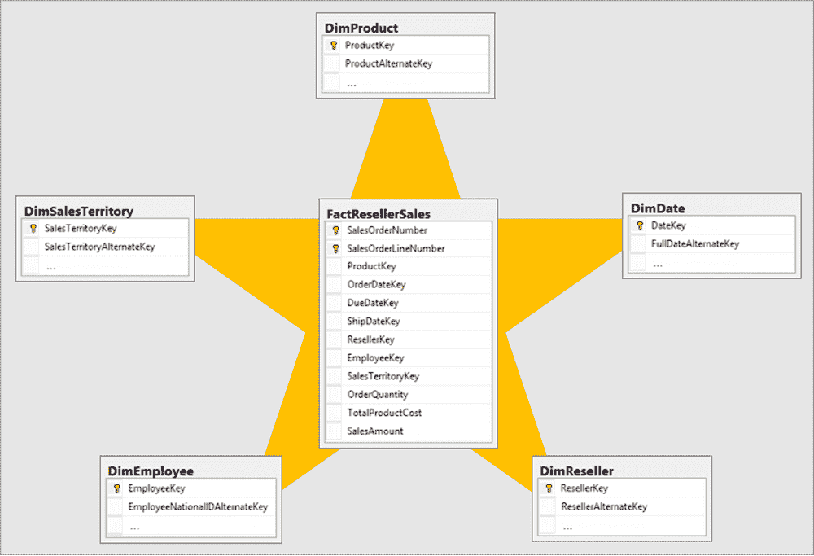

# DP-700：Microsoft Fabric 数据工程师

> 来源：[https://zsyhjtnsa5.feishu.cn/docx/CqSpdPurqoYt19xzQfhccIG0n3f](https://zsyhjtnsa5.feishu.cn/docx/CqSpdPurqoYt19xzQfhccIG0n3f)

本课程介绍使用 Microsoft Fabric 实现数据工程解决方案的方法和实践。学生将了解如何设计和开发有效的数据加载模式、数据体系结构和编排流程。本课程的目标包括引入和转换数据以及保护、管理和监视数据工程解决方案。本课程专为熟练掌握数据集成和编排的资深数据专业人员设计，例如持有“DP-203：Azure 数据工程师”认证的专业人员。

## 使用 Microsoft Fabric 引入数据

> 略，内容整合到后续章节

## 使用 Microsoft Fabric 实现湖屋

### 使用 Microsoft Fabric 进行端到端分析

Microsoft Fabric 是一个端到端分析平台，为数据专业人员和企业提供单一的集成环境来协作处理数据项目。Fabric 提供了一组集成服务，使你能够在单个环境中引入、存储、处理和分析数据。

什么是 Microsoft Fabric，它如何简化数据分析？

Microsoft Fabric 是一个统一的软件即服务（SaaS）平台，旨在简化端到端的数据分析。它通过将各种数据工具和服务（如 Power BI、Azure Synapse Analytics 和 Azure 数据工厂）整合到一个单一、易于使用的平台中，从而消除了传统分析解决方案中存在的复杂性、分散性和高成本问题。所有数据都以单一开放格式存储在 OneLake 中，确保了可伸缩性、成本效益和全球可访问性。

OneLake 在 Microsoft Fabric 中扮演什么角色？

OneLake 是 Microsoft Fabric 的核心集中式数据存储架构。它是一个逻辑数据湖，将来自不同区域和云的数据统一起来，而无需移动或复制数据。OneLake 基于 Azure Data Lake Storage（ADLS）构建，支持多种数据格式（如 Delta、Parquet、CSV 和 JSON）。Fabric 中的所有计算引擎都会自动将其数据存储在 OneLake 中，从而无需在系统之间移动或复制数据，实现无缝协作和数据一致性。它还支持“快捷方式”功能，允许用户无需复制即可访问 OneLake 外部的现有云数据。

Microsoft Fabric 如何促进团队协作？

Microsoft Fabric 通过提供一个统一的 SaaS 平台来增强数据专业人员之间的协作，该平台消除了数据孤岛并减少了对多个系统的需求。它允许不同的角色，如数据工程师、数据分析师和数据科学家，有效地协作而无需重复工作。例如，数据工程师可以将数据直接引入和转换到 OneLake 中，数据分析师可以利用 Direct Lake 模式直接连接到 OneLake 以创建交互式报告，而数据科学家可以使用集成笔记本构建机器学习模型。OneLake 的集中式数据治理功能也有助于团队轻松发现和访问所需的数据，同时保持严格的访问控制。

如何在 Microsoft Fabric 中管理和治理数据？

Microsoft Fabric 通过其 OneLake 集中管理和治理数据，OneLake 既受到保护又开放协作。管理功能集中在“管理门户”中，管理员可以在其中管理组和权限、配置数据源和网关，以及监视使用情况和性能。管理员还可以访问 Fabric 管理员 API 和 SDK 来自动化任务。OneLake 目录在数据管理中也起着关键作用，提供有关敏感度标签、项目元数据和数据刷新状态的见解，以帮助分析、监视和维护数据治理。

Microsoft Fabric 中的“工作区”有什么作用？

工作区是 Microsoft Fabric 中的逻辑容器，用于组织和管理数据、报告和其他资产。它们提供了明确的资源分离，以便更轻松地控制访问和维护安全性。每个工作区都有自己的权限集，确保只有授权用户才能查看或修改其内容，从而支持团队协作，同时保持对业务和 IT 用户的严格访问控制。在工作区设置中，用户还可以配置许可证类型、OneDrive 访问权限、Azure Data Lake Gen2 存储连接、Git 集成（用于版本控制）和 Spark 工作负载设置（用于性能优化）。

Microsoft Fabric 支持哪些数据工作负载类型？

Microsoft Fabric 提供多种工作负载类型，每种类型都支持不同的项目类型，用于存储、处理和分析数据。这些工作负载包括：

+ 数据工程：用于创建湖仓和构建数据资源。

+ 数据工厂：用于引入、转换和协调数据。

+ 数据科学：用于使用机器学习进行趋势检测、离群值识别和预测。

+ 数据仓库：用于在传统仓库中合并多个源进行分析。

+ 数据库：用于创建和管理数据库。

+ 行业解决方案：用于使用开箱即用的行业数据解决方案。

+ 实时智能：用于处理、监视和分析流数据。

+ Power BI：用于创建报告和仪表板。

这些工作负载集成了现有 Microsoft 工具的功能，并支持数据网格架构。

谁可以启用 Microsoft Fabric，以及如何启用？

Microsoft Fabric 必须先为组织启用，然后才能探索其功能。以下管理员角色之一可以启用 Fabric：

+ Fabric 管理员（以前是 Power BI 管理员）

+ Power Platform 管理员

+ Microsoft 365 管理员

管理员可以在 Power BI 服务中的“管理门户”>“租户设置”中启用 Fabric。它可以为整个组织或特定的 Microsoft 365 或 Microsoft Entra 安全组启用。管理员还可以将此功能委托给容量级别的其他用户。对于当前未使用 Fabric 或 Power BI 的组织，可以注册免费的 Fabric 试用版来探索其功能。

Microsoft Fabric 如何解决传统数据团队面临的挑战？

在传统分析开发中，数据团队经常面临挑战，例如由于数据任务和工作流划分而导致的延迟和误解。数据工程师和数据分析师之间需要广泛的协调，并且数据科学家在将本机技术与现有系统集成时遇到困难。Microsoft Fabric 通过将工具统一到一个 SaaS 平台来简化此过程。它允许数据工程师将数据直接引入 OneLake，数据分析师使用 Direct Lake 模式和 Power BI 高效创建报告，数据科学家使用集成笔记本和 Azure 机器学习构建和部署模型。此外，分析工程师和低代码/无代码用户可以发现数据集并执行 ETL 任务，从而消除数据孤岛并增强协作。

### Microsoft Fabric 中的湖屋入门

什么是 Microsoft Fabric 湖屋，它提供了哪些核心功能？

Microsoft Fabric 湖屋是一个分析解决方案，它将关系数据仓库基于 SQL 的分析能力与数据湖的灵活性和可伸缩性相结合。它以数据库形式呈现，并使用 Delta 格式表构建在数据湖之上。

创建新的数据湖屋时，工作区中会自动创建三个数据项：

+ 数据湖屋：包含快捷方式、文件夹、文件和表，供用户添加和交互。

+ 语义模型（默认）：为 Power BI 报表开发人员提供简单的数据源。

+ SQL 分析终结点：允许通过 SQL 以只读访问权限查询数据。

您可以在两种模式下处理湖屋数据：直接与数据湖屋交互以添加和管理数据，或者使用 SQL 分析终结点来查询表并管理其关系语义模型。

如何将数据引入 Microsoft Fabric 湖屋？

将数据引入数据湖屋是 ETL（提取、转换和加载）过程的第一步。以下是几种常见的方法：

+ 上传：直接上传本地文件。

+ 数据流 Gen2：使用 Power Query 导入和转换数据，适用于熟悉 Power BI 或 Excel 的开发人员。

+ 笔记本：使用 Apache Spark 引入、转换和加载数据，适合熟悉 PySpark、SQL 和 Scala 的数据工程师。

+ 数据工厂管道：使用“复制数据”活动以可视化界面执行和协调 ETL 过程。

数据可以直接加载到文件或表中。此外，还可以使用 Spark 作业定义提交批处理/流式处理作业，通过上传编译输出（如 Java 中的 `.jar`）的二进制文件，对湖屋托管的数据应用不同的转换逻辑。

什么是快捷方式，它们在湖屋中如何使用？

快捷方式是 Fabric 中访问和使用数据的另一种方式，允许您将数据集成到湖屋中，同时将其存储在外部存储中。当需要获取不同存储账户甚至不同云提供商中的数据时，快捷方式非常有用。

在数据湖屋中，您可以创建指向不同存储账户和其他 Fabric 项（如数据仓库、KQL 数据库和其他数据湖屋）的快捷方式。源数据权限和凭据均由 OneLake 管理，通过快捷方式访问数据时，调用用户的身份将用于授权访问。快捷方式在湖中显示为文件夹，允许 Spark、SQL、实时智能和 Analysis Services 在查询数据时都使用快捷方式。

在湖屋中如何探索和转换数据？

大多数原始数据在加载到表之前都需要进行转换。您可以使用以下工具来探索和转换数据：

+ 笔记本：数据工程师可以使用 PySpark、SQL 和 Scala 等不同编程语言进行数据转换。

+ 数据流 Gen2：适用于熟悉 PowerQuery 接口的开发人员，提供转换的可视化表示形式。

+ 管道：提供一个可视化界面来执行和协调 ETL 过程，可以根据需要进行简单或复杂的配置。

转换后的数据可以作为文件或 Delta 表加载回湖屋。

湖屋有哪些主要优势？

湖屋结合了数据仓库和数据湖的优点，提供了多个优势：

+ 统一平台：是数据工程师、数据科学家和数据分析师访问和使用数据的单个位置。

+ 数据处理能力：使用 Spark 和 SQL 引擎处理大规模数据，并支持机器学习和预测建模分析。

+ 灵活性：数据以读时架构格式组织，这意味着可以根据需要定义架构。

+ 数据一致性与完整性：通过 Delta Lake 格式的表支持 ACID（原子性、一致性、隔离性、持续性）事务。

+ 可伸缩性、高可用性和灾难恢复：作为基于云的解决方案，湖屋可自动缩放并提供这些关键功能。

数据在湖屋中经过处理后，可以如何进行分析和可视化？

数据经过引入、转换和加载后，即可供其他人使用。Fabric 为每个组织提供了灵活性，可以使用适合自己的工具进行分析和可视化：

+ 数据科学家：可以使用笔记本或数据整理器来探索和训练用于 AI 的机器学习模型。

+ 报表开发人员：可以使用语义模型创建 Power BI 报表，利用 Power BI 的数据可视化功能。

+ 分析师：可以使用 SQL 分析终结点来查询、筛选、聚合和浏览数据湖屋表中的数据。

通过将 Power BI 的数据可视化功能与数据湖屋的集中式存储和表格架构相结合，可以在单个平台上实现端到端分析解决方案。

湖屋可以用于哪些具体的应用场景？

湖屋因其多功能性，可以用于多种不同的应用场景，包括：

+ 使用 SQL 进行分析：利用 SQL 分析终结点直接查询和分析数据。

+ 训练机器学习模型：数据科学家可以使用湖屋中的数据来开发和训练 AI 模型。

+ 对实时数据执行分析：湖屋能够处理流式数据，支持实时分析需求。

+ 在 Power BI 中开发报表：报表开发人员可以使用湖屋作为数据源，创建丰富的 Power BI 仪表板和报告。

如何保障 Microsoft Fabric 湖屋的安全性？

湖屋的访问权限主要通过工作区或项目级共享进行管理：

+ 工作区角色：协作者应使用工作区角色，因为这些角色授予对工作区中所有项目的访问权限。

+ 项目级共享：最适合用于为只读需求（例如分析或 Power BI 报表开发）授予访问权限。

此外，Fabric 湖屋还支持数据管理功能，包括敏感度标签。通过将 Microsoft Purview 与 Fabric 租户一起使用，可以进一步扩展数据治理和安全性。

#### 练习 - 创建 Microsoft Fabric 湖屋

https://microsoftlearning.github.io/mslearn-fabric/Instructions/Labs/01-lakehouse.html

> 这个实验的核心是引导用户完整体验 Lakehouse（湖屋）这一核心概念，从最原始的文件上传，到将其转化为结构化的、可查询的表，再到用多种工具对其进行分析，全面展示了 Lakehouse 如何集数据湖的灵活性与数据仓库的分析能力于一体。

1. 创建湖屋（Create a lakehouse）

> 这个步骤是搭建整个数据分析平台的基础，引入了 Lakehouse 的核心结构。

+ **技术细节**： 用户在工作区中创建一个新的 Lakehouse 项。创建完成后，用户会看到一个包含两个核心逻辑文件夹的界面：

1. `Tables`（表）：这个区域用于存放结构化的、由元数据管理的数据。在 Fabric Lakehouse 中，这里的表都是基于开源的 Delta Lake 格式。

1. `Files`（文件）：这个区域是纯粹的数据湖存储（基于 OneLake，底层是 Azure Data Lake Storage Gen2），可以存放任何格式的原始文件（如 CSV、JSON、Parquet、图片等）。

+ **知识点**：

+ 湖屋架构（Lakehouse Architecture）：这是整个实验的核心理念。Lakehouse 试图结合数据湖（低成本、格式灵活、适合非结构化数据）和数据仓库（结构化、支持 ACID 事务、SQL 查询性能高）的最佳优点。`Files` 文件夹代表了“湖”的灵活性，而 `Tables` 文件夹代表了“屋”的结构和管理能力。

+ `Delta Lake`：这是理解 Lakehouse 的关键技术。它是一种在数据湖文件（如 Parquet）之上增加了一个事务日志层（`_delta_log`）的存储格式。这个日志层为数据湖带来了 ACID 事务、版本控制（时间旅行）、Schema 强制等数据库级别的可靠性功能。

1. 上传文件（Upload a file）

> 这个环节展示了将数据引入 Lakehouse 最直接、最简单的方式。

+ **技术细节**： 用户在 `Files` 文件夹下创建一个子文件夹，然后使用 UI 将本地的 `sales.csv` 文件上传进去。

+ **知识点**：

+ 数据暂存（Data Staging）：`Files` 区域常常被用作原始数据的登陆区或暂存区。数据以其最原始的形态被加载到这里，为后续的转换和处理做准备。

+ 多种摄取方式：实验中提到了，文件上传只是多种数据摄取方式中的一种。在生产环境中，更常用的可能是通过数据管道（Pipelines）或数据流（Dataflows）来自动化地从各种数据源（数据库、API 等）拉取数据。

1. 探索快捷方式（Explore shortcuts）

> 虽然实验中没有实际创建一个快捷方式，但它特意引导用户打开这个界面，旨在介绍一个 Fabric OneLake 架构中的革命性概念。

+ **技术细节**： 用户在 `Files` 文件夹的菜单中点击“新建快捷方式”，查看可以连接的数据源类型。

+ **知识点**：

+ 快捷方式（Shortcut）：它不是数据的副本，而是一个指向存储在其他位置（如另一个 Lakehouse、Amazon S3、ADLS Gen2）的数据的符号链接或指针。

+ 零拷贝集成（Zero-Copy Integration）：这是快捷方式的核心价值。通过使用快捷方式，你可以在 Lakehouse 中分析数据，而无需物理上将数据复制或移动过来。这极大地减少了数据冗余、降低了存储成本、避免了因数据同步延迟导致的不一致性，是实现数据网格（Data Mesh）和统一数据治理的关键技术。

1. 将文件数据加载到表中（Load file data into a table）

> 这是整个实验中最关键的转换步骤，展示了如何将一个原始文件“升级”为一个受管理的、可靠的 Delta 表。

+ **技术细节**： 用户在 `sales.csv` 文件的菜单中选择“加载到表”。Fabric 会自动执行一个过程：

1. 读取 CSV：读取 `sales.csv` 文件的内容。

1. 推断 Schema：自动识别文件的第一行作为列名，并根据数据内容推断每一列的数据类型。

1. 转换为 Delta Lake 格式：将数据以 Parquet 格式（一种高效的列式存储格式）写入 `Tables` 文件夹下的一个新目录中，并同时创建一个 `_delta_log` 事务日志文件夹。

+ **知识点**：

+ 从“湖”到“屋”：这个操作是数据从 `Files` 区域（原始、非托管）到 `Tables` 区域（结构化、托管）的典型流程。

+ `.parquet` + `_delta_log`：实验引导用户“查看文件”，让他们亲眼看到一个 Delta 表的物理构成——由数据文件（`.parquet`）和事务日志（`_delta_log`）组成。这加深了对 Delta Lake 工作原理的理解。

1. 使用 SQL 查询表（Use SQL to query tables）

> 这个环节展示了 Lakehouse 的“类仓库”能力，即如何使用标准的 SQL 来查询数据。

+ **技术细节**： 用户在界面右上角从“Lakehouse”视图切换到“SQL 分析终结点（SQL analytics endpoint）”视图。这是一个为 Lakehouse 中的 Delta 表自动创建的、只读的 SQL 查询引擎。用户可以在这里使用标准的 T-SQL 语句（包括 `JOIN`、`GROUP BY`、`ORDER BY` 等）来查询 `sales` 表。

+ **知识点**：


# Microsoft Fabric 数据集成与分析

## Lakehouse 与 SQL 分析概述

**SQL on the Lake** 是 Lakehouse 架构的核心承诺之一。通过 SQL 分析终结点，数据分析师和 BI 工具可以使用他们最熟悉的 SQL 语言来直接查询存储在数据湖中的数据，而无需学习 Spark 或其他大数据编程框架，极大地降低了数据分析的门槛。

**计算与存储分离**：Lakehouse 本身负责数据的存储（OneLake），而 SQL 分析终结点是一个独立的计算引擎，专门负责执行 SQL 查询。这种架构提供了极好的弹性和可扩展性。

### 创建可视化查询（Create a visual query）

> 这个环节展示了另一种面向不同用户群体的无代码查询方式。

#### 技术细节

用户选择“新建可视化查询”，这会打开一个 Power Query 的图形化界面。用户通过拖拽表、点击菜单按钮（如“选择列”、“分组依据”）来构建数据转换和聚合的步骤。

#### 知识点

- **用户角色多样性**：Fabric 的一个核心设计理念是为不同技术背景的用户（数据工程师、SQL 分析师、业务分析师）提供他们各自熟悉的工具。SQL 查询编辑器面向的是习惯写代码的分析师，而可视化查询则面向广大的 Power BI 和 Excel 用户。
- **统一数据源**：无论使用 T-SQL 还是 Power Query，它们操作的都是背后同一份存储在 Lakehouse 中的 Delta 表数据。这确保了不同工具、不同用户分析结果的一致性，避免了数据孤岛。

实验要点：

1. 启用 Fabric 免费测试
2. 实验数据 repo：`https://github.com/MicrosoftLearning/dp-data`
3. 实验手册 repo：`https://github.com/MicrosoftLearning/mslearn-fabric` | `https://github.com/MicrosoftLearning/mslearn-fabric.zh-cn`

## 使用 Microsoft Fabric 中的数据流 Gen2 引入数据

Microsoft Fabric 为数据工程、集成和分析提供统一的解决方案。端到端分析中的一个关键步骤是数据引入。数据流 Gen2 用于从多个源引入和转换数据，然后将清理后的数据放置到另一个目标。它们可以合并到数据管道中，以便进行更复杂的活动业务流程，并用作 Power BI 中的数据源。

假设你在一家门店遍布全球的零售公司工作。作为数据工程师，你需要准备各种源中的数据并将数据转换为适合数据分析和报告的格式。企业需要使用语义模型来合并来自不同存储的不同数据源。通过数据流 Gen2，可以准备数据以确保一致性，然后将数据暂存到首选目标中。它们还可以重复使用并且能实现轻松地更新数据。在没有数据流的情况下，则必须从每个源手动提取和转换数据，这既耗时又容易出错。

### 数据流 Gen2 是什么？

数据流 Gen2 是一种基于云的 ETL（提取、转换、加载）工具，用于构建和执行可扩展的数据转换过程。它允许用户从各种数据源中提取数据，使用多种转换操作进行转换，并将数据加载到指定目标。通过 Power Query Online，它提供了一个可视化界面来执行这些任务，旨在简化数据准备并将其加载到新表、数据管道或作为数据分析师的数据源。

### 数据流 Gen2 如何简化数据准备？

数据流 Gen2 旨在为数据工程师和自助服务用户提供一种简单、可重用的方式来执行 ETL 任务。传统上，数据工程师需要花费大量时间将数据提取、转换并加载为可用格式。数据流 Gen2 通过 Power Query Online 提供低代码界面，允许用户连接到各种数据源，执行筛选、排序、透视、合并、拆分等转换，并确保数据在加载到目标之前的一致性和质量。它还支持将数据直接放置到湖屋或其他目标中，从而简化了为下游分析策展语义模型的创建。

### 如何在 Microsoft Fabric 中使用数据流 Gen2？

在 Microsoft Fabric 中，数据流 Gen2 可以在数据工厂工作负载、Power BI 工作区或直接在湖屋中创建。它利用 Power Query Online 提供一个可视化界面，包括功能区（用于数据源连接器和转换操作）、查询窗格（显示查询和表）、图示视图（可视化数据流和转换）、数据预览窗格（显示数据子集以供验证）和查询设置窗格（列出应用的所有转换步骤）。这些步骤可以重命名、重新排序或删除，用户还可以通过高级编辑器查看 M 代码。数据流 Gen2 支持将数据加载到 Fabric 环境中的 Lakehouse、Warehouse 和 SQL 数据库，以及 Azure SQL 数据库、Azure Data Explorer 或 Azure Synapse Analytics。

### 数据流 Gen2 如何与数据管道协同工作？

数据流 Gen2 可以与数据管道集成，以协调额外的活动和自动化。虽然数据流 Gen2 专注于数据引入、转换和加载到 Fabric 数据存储，但数据管道可以对转换后的数据执行额外的操作，例如复制数据、合并数据流、添加笔记本、获取元数据、执行脚本或存储过程。数据管道提供了一种直观的方式来按特定顺序完成活动，并且可以通过触发器进行计划或激活，从而实现数据刷新的自动化，而无需手动运行数据流，这对于企业数据或频繁更改的数据尤其有用。

### 数据流 Gen2 有哪些主要优势？

使用数据流 Gen2 的主要优势包括：

- 数据扩展和一致性：允许使用一致的数据（如标准日期维度表）扩展数据，并确保数据一致性和质量。
- 自助服务访问：允许自助服务用户单独访问数据仓库的子集。
- 性能优化：可以通过一次提取数据以供重复使用来优化性能，从而减少较慢源的数据刷新时间。
- 简化数据源复杂性：通过仅向较大的分析师组公开数据流来简化数据源复杂性。
- 简化数据集成：通过提供从各种源引入数据的低代码接口来简化数据集成。
- 可重用性：提升可重用的 ETL 逻辑，避免创建更多到数据源的连接。
- 自动化：可以手动运行、按刷新计划运行或作为数据管道业务流程的一部分运行。

### 数据流 Gen2 有哪些限制？

尽管有许多优势，数据流 Gen2 也有一些限制：

- 它不是数据仓库的替代品。
- 不支持行级安全性。
- 需要 Fabric 容量工作区。

### 数据流 Gen2 如何支持 ELT（提取、加载、转换）过程？

除了传统的 ETL 过程，数据流 Gen2 还可以用于 ELT 过程。在这种情况下，可以使用管道将数据提取并加载到首选目标（例如湖屋）。然后，可以创建数据流 Gen2 来连接到湖屋数据以进行清理和转换。在这种情况下，数据流将作为策展语义模型提供，供数据分析师开发报表。

### 数据流 Gen2 的可视化界面提供了哪些关键功能？

数据流 Gen2 的可视化界面（基于 Power Query Online）提供了以下关键功能：

- Power Query 功能区：支持各种数据源连接器和广泛的数据转换操作，如筛选、排序、透视、合并、拆分、替换值、添加/删除/重命名列等。
- 查询窗格：显示不同的数据源（称为查询），加载到数据存储时变为表。支持复制、引用或禁用查询加载。
- 图示视图：提供数据源连接方式和应用转换的可视化表示，显示查询形状和连接线。
- 数据预览窗格：显示数据子集以进行预览，允许用户通过拖放或右键单击列来交互和查看转换效果。
- 查询设置窗格：显示“已应用的步骤”，每个转换表示为一个步骤，可以重命名、重新排序或删除，并支持修改或查看数据源查询。还包括“数据目标”选项，用于将数据加载到 Fabric 环境中的各种位置。

### 练习 - 在 Microsoft Fabric 中创建和使用数据流 Gen2

[中文实验手册](https://microsoftlearning.github.io/mslearn-fabric.zh-cn/Instructions/Labs/05-dataflows-gen2.html)
[英文实验手册](https://microsoftlearning.github.io/mslearn-fabric/Instructions/Labs/05-dataflows-gen2.html)

> 这个实验的核心是引导用户全面掌握 Dataflow Gen2 （第二代数据流） 这一核心数据集成工具。它展示了如何使用熟悉的 Power Query Online 界面来提取数据、进行数据转换，并将结果加载到 Lakehouse （湖屋），最后再将这个数据流作为一个原子操作集成到数据管道 （Pipeline） 中进行编排。

#### 1. 创建湖屋（Create a lakehouse）

> 这个步骤是为整个数据流处理流程设定一个明确的目标。

**技术细节**：用户在工作区中创建一个新的 Lakehouse 项。

**知识点**：在这个实验的上下文中，Lakehouse 的角色是作为 Dataflow Gen2 的数据目的地（Data Destination）或数据仓库（Data Sink）。经过数据流处理后的、干净规整的数据，最终将被写入到这个 Lakehouse 的一个 Delta 表中，以供后续的分析和查询。

#### 2. 创建数据流（Gen2）以引入数据（Create Dataflow（Gen2） to ingest data）

> 这个环节是实验的核心，展示了数据提取和转换的全过程。

**技术细节**：

1. 启动 Dataflow Gen2：用户创建一个新的数据流，这会直接打开 Power Query Online 编辑器，这是一个完全可视化的、基于步骤的数据转换界面。
2. 数据源连接：用户通过“从文本/CSV 文件导入”连接到一个公开的 URL（.../orders.csv）。Power Query 会自动处理 HTTP 请求，并对返回的数据进行初步解析。
3. 初始转换步骤：Power Query 会自动生成一些初始步骤，如 `源`、`提升的标题` 和 `已更改的类型`，这些步骤会自动将 CSV 的第一行用作列名，并根据数据内容推断列的数据类型。
4. 添加自定义列：实验的关键操作是添加一个自定义列。用户使用 Power Query 的 M 公式语言 `Date.Month([OrderDate])` 来从 `OrderDate` 列中提取月份。这是一个非常直观的数据转换（Transform）或特征工程操作。

**知识点**：

- **Power Query Online**：这是 Dataflow Gen2 的核心引擎和用户界面。对于广大的 Power BI 和 Excel 用户来说，这是一个非常熟悉的环境，极大地降低了学习 ETL 工具的门槛。
- **M 公式语言**：虽然 Power Query 提供了大量的图形化操作按钮，但其背后都是由 M 语言驱动的。自定义列功能展示了其灵活性，用户可以编写简单的表达式来完成复杂的转换逻辑。
- **步骤式转换（Step-based Transformation）**：在右侧的“应用的步骤”窗格中，用户的每一步操作（如添加列、更改类型）都会被记录下来。这个过程是线性的、可追溯的，用户可以轻松地返回到任何一步查看当时的数据状态，或者修改某一步的配置，这使得调试和维护变得非常容易。

#### 3. 为数据流添加数据目标（Add a data destination for the data flow）

> 数据转换逻辑定义好之后，需要指定处理结果的存放位置。

**技术细节**：

1. 用户在“添加数据目标”菜单中选择“Lakehouse”。
2. 配置目标：
   - 选择之前创建的 Lakehouse。
   - 指定一个新的表名 `orders`。
   - 更新方法（`Update Method`）：选择了“追加（`Append`）”。这意味着每次数据流运行时，它会将转换后的数据追加到 `orders` 表的末尾。如果选择“替换（`Replace`）”，则会先清空表再写入新数据。
3. 发布（Publish/Save and Run）：当用户点击“发布”或“保存并运行”时，Fabric 会在后台执行以下操作：
   - 保存 Dataflow Gen2 的定义。
   - 触发一次运行：立即执行在 Power Query 中定义的所有步骤：从 URL 获取数据 -> 添加自定义列 -> 将结果写入 Lakehouse 的 `orders` Delta 表。

**知识点**：

- **端到端 ETL 流程**：从数据源连接、数据转换到数据加载，Dataflow Gen2 在一个统一的界面中完成了完整的 ETL（提取、转换、加载）流程。
- **计算下沉（Compute Engine）**：Dataflow Gen2 的一个重要特性是，它不仅仅是一个定义工具，当它运行时，Fabric 会在后台启动一个计算引擎来大规模地执行这些转换步骤，并将数据高效地写入 Lakehouse。

#### 4. 将数据流添加到管道（Add the data flow to a pipeline）

> 这个环节展示了如何将单个的数据流任务编排到一个更大的工作流中。

**技术细节**：

1. 用户创建一个新的数据管道（Data Pipeline）。
2. 从活动列表中，将一个“数据流（`Dataflow`）”活动拖拽到管道画布上。
3. 将这个活动配置为指向之前创建的 `Dataflow 1`。
4. 用户可以运行（`Run`）整个管道，管道会去调用并执行这个数据流。

**知识点**：

- **任务编排与自动化（Orchestration and Automation）**：管道是 Fabric 中的核心编排工具。虽然在这个实验中管道只包含一个数据流活动，但在实际场景中，一个管道可以包含多个步骤，例如：先运行一个数据流加载 A 表，成功后再运行另一个数据流加载 B 表，最后运行一个 Spark Notebook 对 A、B 两表进行合并。
- **模块化与可重用性**：将 ETL 逻辑封装在数据流中，使得这个数据流可以被多个不同的管道重复调用。这是一种非常好的工程实践，它将“做什么（数据流定义转换逻辑）”和“何时做（管道定义执行时机和顺序）”解耦。

## 使用 Microsoft Fabric 协调进程和数据移动

数据管道定义协调整个流程的活动序列，通常通过从一个或多个源提取数据并将其加载到目标中；在整个过程中会经常转换它。管道通常用于自动执行提取、转换和加载（ETL）流程，这些流程将事务数据从操作数据存储引入到分析数据存储中（例如湖屋、数据仓库或 SQL 数据库）。

如果你已熟悉 Azure 数据工厂，则很快就能够熟悉 Microsoft Fabric 中的数据管道。它们使用相同的已连接活动的体系结构来定义一个流程，该流程可以包含多种数据处理任务和控制流逻辑。可以在 Microsoft Fabric 用户界面中以交互方式运行管道，或将其计划为自动运行。

### Microsoft Fabric 中的管道是什么？

Microsoft Fabric 中的管道封装了一系列用于执行数据移动和处理任务的活动。它们用于定义数据传输和转换活动，并通过管理分支、循环和其他典型处理逻辑的控制流活动来编排这些活动。用户可以使用图形管道画布以少量编码或无需编码的方式构建复杂的管道。

### 管道中的核心概念有哪些？

管道中的核心概念包括：

- **活动**：管道中的可执行任务，通过顺序连接定义活动流。活动的结果（成功、失败或完成）可用于将流定向到序列中的下一个活动。活动分为两大类：
  - **数据转换活动**：封装数据传输操作，如 `复制数据` 活动（提取并加载数据）、`数据流` 活动（在传输时转换数据）、`笔记本` 活动（运行 Spark 笔记本）、`存储过程` 活动（运行 SQL 代码）和 `删除数据` 活动（删除现有数据）。
  - **控制流活动**：用于实现循环、条件分支或管理变量和参数值，以协调数据引入和转换流。
- **参数**：使管道参数化，允许每次运行管道时提供特定值，从而提高管道的可重用性，实现灵活的数据引入和转换过程。
- **管道运行**：每次执行管道时启动的数据管道运行，可以在 Fabric 用户界面中按需启动或按特定频率计划启动。每次运行都有唯一的运行 ID，可用于查看详细信息、确认完成状态和调查设置。

### “复制数据”活动的主要用途是什么？

“复制数据”活动是数据管道中最常见的用途之一。它主要用于将数据从外部源引入湖屋文件或表，通常不需要应用任何转换。当需要将原始数据导入并在后续管道活动中进行转换时，或者需要在受支持的源和目标之间直接复制数据时，此活动非常有用。

### “复制数据”活动可以与其他哪些活动结合使用？

“复制数据”活动可以与其他活动结合使用，以创建可重复的数据引入过程。例如，它可以与“删除数据”活动结合使用以移除现有数据，然后用“复制数据”活动替换为包含外部源数据的文件。此外，还可以与“笔记本”活动结合，运行 Spark 代码以转换文件中的数据并将其加载到表中。

### 何时应该使用“复制数据”活动，何时应该考虑使用“数据流”活动？

当需要在不应用任何转换的情况下直接在受支持的源和目标之间复制数据，或者想要导入原始数据并在以后的管道活动中应用转换时，应使用“复制数据”活动。

如果需要在引入数据时对数据应用转换，或合并来自多个源的数据，则应考虑使用“数据流”活动来运行数据流（Gen2）。数据流（Gen2）可以使用 Power Query 用户界面定义包含多个转换步骤。

### 如何创建和自定义管道？

用户可以从任意的所选活动组合定义管道，从而创建自定义数据引入和转换过程。此外，Microsoft Fabric 也提供了预定义的管道模板，用户可以根据需要使用和自定义这些模板。要基于模板创建管道，只需在新建管道时选择“模板”选项，然后选择最合适的模板并在管道画布中进行编辑和自定义。

### 完成管道后如何运行和监视它？

完成管道后，可以使用“验证”选项检查配置是否有效。之后，可以以交互方式运行管道或指定一个计划。管道运行历史记录可以通过管道画布或工作区页面上列出的管道项进行查看，以查看每个运行的详细信息，包括是否成功完成以及每次执行使用的特定设置。

### 管道的参数化有什么好处？


管道参数化能够让用户在每次运行管道时提供特定的值。例如，用户可以灵活地在每次运行管道时指定引入数据保存的文件夹名称。使用参数化可以显著提高管道的可重用性，从而创建更加灵活和适应性强的数据引入和转换过程，而无需为每个略有不同的场景都创建一个新的管道。

## 练习 - 使用管道引入数据

在本练习中，将实现一个数据引入解决方案，该解决方案使用管道将数据从外部源复制到湖屋，然后使用 Spark 笔记本转换数据并将其加载到表中。

https://microsoftlearning.github.io/mslearn-fabric.zh-cn/Instructions/Labs/04-ingest-pipeline.html

### 创建管道（Create a pipeline）

> 这个环节的目标是将原始数据从外部源搬运到数据湖的临时区域。

> + 核心操作：实验创建了一个数据管道，并在其中只配置了一个核心步骤——“复制数据” `Copy Data`。
> + 功能：这个步骤被设置为从一个公开的网页链接 `URL` 上抓取一个名为 `sales.csv` 的文件，然后把它原封不动地存放到湖屋 `Lakehouse` 的 `Files/new_data` 文件夹下。
> + 角色：这一步是典型的 `E`（Extract）和 `L`（Load）过程，即把数据从源头提取出来，加载到我们的数据平台中，为后续处理做准备。此时的数据还是原始的 CSV 格式。

### 创建笔记本（Create a notebook）

> 这个环节的目标是开发数据转换的核心业务逻辑。

> + 核心操作：实验创建了一个 Spark Notebook，并编写了一段 PySpark 代码。
> + 功能：这段代码会：
> 1. 读取之前管道复制过来的 `sales.csv` 文件。
> 1. 进行一系列的 `Transform` 操作，比如从日期中提取年份和月份，从客户全名中拆分出姓和名。
> 1. 最后，将处理干净、结构规整的数据以高效的 Delta 格式保存为一张名为 `sales` 的表。
> + 角色：这一步是典型的 `T`（Transform）过程。它独立于数据摄取，专注于如何对数据进行清洗、加工和建模。通过单独运行，可以方便地测试和调试转换逻辑。

### 修改管道（Modify the pipeline）

> 这个环节的目标是将前面独立开发的各个部分串联起来，形成一个完整的、自动化的、可重复运行的数据处理流水线（ETL）。

> + 核心操作：实验回到了最初创建的管道，并对其进行了扩展和重组，最终形成了一个包含三个步骤的顺序工作流。
> + 最终管道的作用和流程：
> 1. 第一步：删除旧文件（`Delete Data`）：在开始新的数据加载之前，管道会先自动删除 `new_data` 文件夹下所有旧的 `.csv` 文件。这确保了每次运行都是从一个干净的状态开始，避免了重复处理旧数据。
> 1. 第二步：复制新数据（`Copy Data`）：只有在旧文件被成功删除后，管道才会执行第二步，即从外部 `URL` 重新抓取最新的 `sales.csv` 文件，并放到 `new_data` 文件夹。
> 1. 第三步：运行笔记本（`Run Notebook`）：当新数据成功复制后，管道会自动触发并运行之前创建的那个 Spark Notebook。Notebook 会读取新复制来的 CSV 文件，执行所有的数据转换逻辑，并将最终结果追加（或写入）到一个名为 `new_sales` 的 Delta 表中。

> 总结：通过这三个环节，实验构建了一个非常经典和实用的 ELT（Extract-Load-Transform）自动化数据管道。
> + 它首先通过管道的复制活动高效地将外部原始数据（`E` - 提取）并（`L` - 加载）到湖屋的临时文件区。
> + 然后，它利用管道的编排能力，自动调用一个 Spark Notebook 来对这些原始数据进行复杂的（`T` - 转换），并将最终的干净数据存入可供分析的 Delta 表中。
> 整个流程实现了从数据获取到数据转换的自动化，并且通过“先删除再复制”的逻辑，保证了每次运行都是处理最新的数据，非常健壮和可靠。

## 在 Microsoft Fabric 中使用 Apache Spark

Apache Spark 是用于大规模数据处理和分析的开源并行处理框架。Spark 在“大数据”处理场景中很受欢迎，可在多个平台实现中使用，包括 Azure HDInsight、Azure Synapse Analytics 和 Microsoft Fabric。

本模块介绍如何在 Microsoft Fabric 中使用 Spark 来引入、处理和分析湖屋中的数据。虽然本模块中所述的核心技术和代码对于所有 Spark 实现都是通用的，但集成的工具和在与 Microsoft Fabric 中的其他数据服务相同的环境中使用 Spark 的能力使得将基于 Spark 的数据处理合并到整体数据分析解决方案中变得更加容易。

### 什么是 Apache Spark，它在 Microsoft Fabric 中如何工作？

Apache Spark 是一个分布式数据处理框架，用于大规模数据分析。它通过在群集中的多个处理节点之间协调工作来实现这一点。在 Microsoft Fabric 中，这种群集被称为 Spark 池。Spark 采用“分而治之”的方法，通过在多台计算机上分发工作来快速处理大量数据，Spark 负责处理分发任务和整理结果的过程。

在 Microsoft Fabric 中，Spark 池包含两种类型的节点：头节点（通过驱动程序协调分布式进程）和多个工作器节点（执行实际数据处理任务）。这种分布式计算架构允许 Spark 访问和处理兼容数据存储中的数据，例如基于 OneLake 的湖屋。

### 如何在 Spark 中处理结构化数据？

在 Spark 中处理结构化数据最常用的数据结构是数据帧，它是 Spark SQL 库的一部分。数据帧类似于通用 Pandas Python 库中的数据帧，但经过优化，可以在 Spark 的分布式处理环境中工作。

你可以将数据加载到数据帧中，无论是从带有推断架构的 CSV 文件（Spark 自动识别列名和数据类型），还是通过指定显式架构（当数据文件不包含列名时非常有用）。数据帧允许你执行各种操作，例如：

+ 筛选和分组：可以使用 `DataFrame` 类的方法对数据进行筛选、排序、分组和执行其他操作。例如，`select` 方法用于检索特定列，`where` 方法用于筛选行，而 `groupBy` 和 `count` 方法用于聚合数据。
+ 保存数据帧：转换后的数据帧可以保存到各种文件格式中，例如 Parquet，这是一种高效的数据分析格式。

### 什么是 Spark 目录以及如何使用它来查询数据？

Spark 目录是关系数据对象（例如视图和表）的元存储。它允许 Spark 运行时无缝集成用任何 Spark 支持的语言编写的代码与 SQL 表达式。

在 Spark 目录中使数据帧中的数据可用于查询的最简单方法是创建临时视图（`df.createOrReplaceTempView("products_view")`），该视图在当前会话结束时自动删除。你还可以创建持久保存在目录中的表。

表是元数据结构，其基础数据存储在与目录关联的存储位置。在 Microsoft Fabric 中，托管表的数据存储在湖屋的“表”存储位置中。可以使用 `spark.catalog.createTable` 方法创建空表，或使用 `saveAsTable` 方法将数据帧另存为表（`df.write.format("delta").saveAsTable("products")`）。删除托管表也会删除其基础数据。

你还可以创建外部表，它们定义目录中的元数据，但其基础数据来自外部存储位置，例如湖屋中“文件”存储区域的文件夹。删除外部表不会删除基础数据。

### 如何在 Spark 中使用 SQL 查询数据？

有两种主要方式可以在 Spark 中使用 SQL 查询数据：

+ 使用 Spark SQL API：你可以在用任何 Spark 支持的语言编写的代码中嵌入 SQL 表达式。例如，在 PySpark 中，你可以使用 `spark.sql()` 方法执行 SQL 查询，并将结果作为数据帧返回。

```
bikes_df = spark.sql("SELECT ProductID, ProductName, ListPrice FROM products WHERE Category IN ('Mountain Bikes', 'Road Bikes')")
```

+ 使用 SQL 代码单元格：在笔记本中，你可以使用 `%%sql` magic 命令直接运行 SQL 代码来查询目录中的对象。

```
%%sql
SELECT Category, COUNT(ProductID) AS ProductCount
FROM products
GROUP BY Category
ORDER BY Category
```

+ 这种方式会在笔记本中自动将结果显示为表格。

### Spark 中的数据分区有什么用？

分区是一种优化技术，可以最大限度地提高 Spark 工作器节点的性能，特别是在查询数据时通过消除不必要的磁盘 I/O 来提高性能。

当你将数据帧保存为一组分区文件时，可以使用 `partitionBy` 方法。例如，`bikes_df.write.partitionBy("Category").mode("overwrite").parquet("Files/bike_data")` 会创建一个包含子文件夹的文件夹结构（例如 `Category=Mountain Bikes`），每个子文件夹都包含相应类别的数据文件。

加载分区数据时，你可以指定分区字段的显式值或通配符，以从层次结构中的任何文件夹加载数据。例如，`spark.read.parquet('Files/bike_data/Category=Road Bikes')` 将仅加载“公路自行车”类别的数据。需要注意的是，在生成的数据帧中，文件路径中指定的分区列会被省略。

### 如何在 Microsoft Fabric 的 Spark 笔记本中可视化数据？

Microsoft Fabric 中的笔记本提供了内置的基本图表绘制功能。当你显示数据帧或运行 SQL 查询时，结果会默认以表格形式呈现，但你可以将结果视图更改为图表并自定义其数据可视化方式。

对于更高级或自定义的可视化效果，你可以在代码中使用各种图形包，特别是 Python 中有大量的图形包可用，其中大多数都基于 Matplotlib 库构建。你可以在笔记本中编写代码来生成图表，并将它们与数据引入、操作代码和标记单元格结合起来进行注释。

例如，你可以使用 `matplotlib.pyplot` 库来创建图表。需要注意的是，像 Matplotlib 这样的库通常要求数据位于 Pandas 数据帧中，因此你可能需要使用 `toPandas()` 方法将 Spark 数据帧转换为 Pandas 数据帧。

### 在 Microsoft Fabric 中运行 Spark 代码的两种主要方式是什么？

在 Microsoft Fabric 中编辑和运行 Spark 代码有两种主要方式：

+ 笔记本（Notebooks）：如果你想以交互方式探索和分析数据，笔记本是理想的选择。它们允许你组合使用多种语言编写的文本、图像和代码，创建可共享和协作的交互式项目。笔记本由一个或多个单元格组成，每个单元格可以包含 Markdown 格式的内容或可执行代码，你可以立即运行代码并查看结果。
+ Spark 作业定义（Spark Job Definitions）：如果你想在自动化过程中使用 Spark 引入和转换数据，可以定义 Spark 作业以按需或基于计划运行脚本。要配置 Spark 作业，你需要在工作区中创建 Spark 作业定义，指定要运行的脚本，还可以指定参考文件（例如，包含函数定义的 Python 代码文件）以及对包含脚本所处理数据的特定湖屋的引用。

### Microsoft Fabric 中有哪些额外的 Spark 配置选项可以优化性能和管理？

Microsoft Fabric 提供了一些额外的 Spark 配置选项来进一步优化性能和管理：

+ 本机执行引擎（Native Execution Engine）：这是一种矢量化处理引擎，可以直接在湖屋基础设施上运行 Spark 操作。它可以通过启用 `spark.native.enabled` 和 `spark.shuffle.manager` 属性来显著提高处理 Parquet 或 Delta 文件格式大型数据集时的查询性能，可以在环境级别或单个笔记本中启用。
+ 高并发模式（High Concurrency Mode）：此模式允许在多个并发用户或进程之间共享 Spark 会话，从而优化 Spark 资源的使用效率。它确保了代码隔离，避免了在一个笔记本中的变量受到另一个笔记本中的代码的影响。可以在工作区设置中启用此功能。
+ 自动 MLFlow 日志记录（Automatic MLFlow Logging）：MLFlow 是一个用于管理机器学习训练和模型部署的开源库。Microsoft Fabric 默认隐式记录机器学习试验活动，无需数据科学家显式编码，但此功能可以在工作区设置中禁用。
+ Fabric 容量的 Spark 管理（Spark Management for Fabric Capacity）：管理员可以在 Fabric 容量级别管理 Spark 设置，从而限制和覆盖组织内工作区中的 Spark 设置。
+ Spark 运行时和环境（Runtimes and Environments）：Microsoft Fabric 支持多个 Spark 运行时版本，并且用户可以创建自定义环境。这些环境定义了特定的运行时版本、必须安装的库、Spark 池选择以及 Spark 配置属性，以支持各种数据处理任务。

### 练习 - 使用 Apache Spark 分析数据

现在，你有机会在 Microsoft Fabric 中使用 Apache Spark。在本练习中，使用 Spark 笔记本来分析和可视化湖屋中文件的数据。

https://microsoftlearning.github.io/mslearn-fabric/Instructions/Labs/02-analyze-spark.html

> 这个实验的核心是引导学生体验一次完整的数据分析流程：从加载原始数据，到使用 Spark DataFrame API 进行探索、转换和聚合，再到将结果持久化并进行可视化。

#### 创建工作区和湖屋（Workspace and Lakehouse）

+ 操作功能：这一步完全通过 Microsoft Fabric 的用户界面（UI）操作完成，没有代码。学生需要：
1. 创建一个新的工作区（Workspace），它是在 Fabric 中组织项目（如 Notebooks、数据、报告等）的基本容器。
1. 在工作区内，创建一个新的湖屋（Lakehouse）。湖屋是 Fabric 中用于存储和管理数据的核心组件，它结合了数据湖的灵活性和数据仓库的结构化管理能力。

+ 学习要点：
+ 熟悉 Fabric 环境：这是使用 Fabric 的第一步，旨在让学生了解其核心的组织结构（工作区 -> 湖屋）。
+ 理解 Lakehouse 的角色：学生会认识到 Lakehouse 是本次实验所有数据存储和计算的中心枢纽。之后上传的文件和创建的表都会存放在这个湖屋里。

#### 将数据上传到湖屋（Upload Data to the Lakehouse）

+ 操作功能：这一步同样是通过 UI 操作完成。学生需要将实验提供的 `orders.zip` 压缩文件上传到上一步创建的湖屋的 `Files` 目录下。上传后，再利用 Fabric 界面提供的功能直接将这个 `.zip` 文件解压缩。

+ 学习要点：
+ 基本数据导入：学习如何将本地的原始数据文件导入到 Fabric 的云端存储中，这是任何数据分析项目的起点。
+ 理解 Lakehouse 的存储结构：学生会首次接触到湖屋内部的两个主要区域：
+ `Files` 目录：用于存放任意格式的原始文件，如 CSV、JSON、Parquet 等，类似于传统的数据湖存储。本次实验的原始数据就先放在这里。
+ `Tables` 目录：用于存放被 Spark 或 SQL 管理的结构化表（主要是 Delta 格式）。后续步骤中创建的表会出现在这里。

#### 创建和探索 `DataFrame`

> 这部分是实验的起点，旨在让学生掌握将原始文件（CSVs）加载到 Spark 的核心数据结构 `DataFrame` 中，并对其进行初步探索。

+ 数据加载与 Schema 定义：
+ 代码功能：实验从使用 Fabric 的 UI 自动生成代码 `spark.read.format("csv")...load(...)` 开始，加载单个 CSV 文件。接着，代码会逐步演进：
1. 修正 `header` 选项，因为初始加载错误地将数据行当作了列名。
1. 使用 `StructType` 和 `StructField` 手动定义一个健壮的 `Schema`，为每列指定正确的名称和数据类型（如 `IntegerType`、`DateType`）。
1. 修改 `load` 的路径，使用通配符 `*.csv` 一次性加载 `orders` 文件夹下的所有 CSV 文件到一个 `DataFrame` 中。

+ 学习要点：
+ `Schema` 的重要性：这是 Spark 处理结构化数据的基石。学生能直观地看到，没有明确的 `Schema`，Spark 会做出错误的推断（如列名和数据类型），而定义 `Schema` 能确保数据的准确性和后续操作的可靠性。
+ 高效加载数据：学习如何使用通配符一次性读取多个结构相同的文件，这是处理分片或分时数据的常见操作。
+ 数据探索与过滤：


## DataFrame API 基本操作

+ **代码功能**： 这部分使用 `DataFrame` 的原生方法进行数据分析。

+ `df['CustomerName', 'Email']` 或 `df.select(...)`： 选择特定的列。

+ `.distinct().count()`： 计算不重复的记录数。

+ `.where(df['Item']=='...')`： 根据条件过滤行。

+ **学习要点**：

+ **DataFrame API**: 掌握 Spark `DataFrame` 最基础、最核心的操作，包括选择（Projection）和过滤（Filter）。

+ **不可变性**： 理解 Spark 中 `DataFrame` 的转换（Transformation）操作（如 `select`， `where`）不会修改原始 `DataFrame`，而是返回一个新的 `DataFrame`。

+ **数据聚合与分组**：

+ **代码功能**：

+ `df.select(...).groupBy("Item").sum()`： 按商品（`Item`）分组，计算每个商品的总销售量。

+ `df.select(year(col("OrderDate")).alias("Year")).groupBy("Year").count()`： 使用 Spark SQL 内置函数 `year` 从日期中提取年份，重命名为 `"Year"`，然后按年份分组统计订单数量。

+ **学习要点**：

+ **聚合操作**： 学习数据分析中最常见的模式之一：拆分-应用-合并（Split-Apply-Combine），通过 `groupBy` 和聚合函数（`sum`， `count`）实现。

+ **使用内置函数**： 了解如何从 `pyspark.sql.functions` 导入强大的函数来处理和转换数据，例如日期处理、字符串操作等。

## 数据转换与持久化

> 这部分聚焦于更复杂的数据处理（数据工程任务），并将清理、转换后的结果保存下来，为后续分析做准备。

### 转换数据（特征工程）

+ **代码功能**：

+ `.withColumn("Year", year(col("OrderDate")))`： 基于现有列（`OrderDate`）创建新列（`Year`， `Month`）。

+ `.withColumn("FirstName", split(col("CustomerName"), " ").getItem(0))`： 使用 `split` 函数拆分 `CustomerName` 列，提取出姓和名。

+ **学习要点**：

+ **数据规整与丰富**： 这是数据准备的关键步骤。学生学习如何根据业务需求，从现有数据中派生出新的、更有价值的特征列。

### 保存为 Parquet 格式

+ **代码功能**： `transformed_df.write.mode("overwrite").parquet('Files/transformed_data/orders')` 这段代码将转换后的 `DataFrame` 以 Parquet 格式保存到湖屋的 `Files` 目录中。

+ **学习要点**：

+ **列式存储**： 了解 `Parquet` 格式的优势。它是一种高效的列式存储格式，非常适合大规模数据分析，能显著提升查询性能并节省存储空间。

+ **数据生命周期**： 理解数据处理的完整流程：原始数据 -> 转换后的中间数据 -> 最终应用。保存中间结果是数据工程中的常见实践。

### 分区保存 （Partitioning）

+ **代码功能**： `orders_df.write.partitionBy("Year","Month")...parquet(...)` 这段代码在保存 Parquet 文件时，额外指定了按“年”和“月”进行分区。

+ **学习要点**：

+ **性能优化**： 这是 Spark 中最重要的数据布局优化技巧之一。通过分区，数据被物理地存储在 `Year=2021/Month=12` 这样的子文件夹结构中。当查询带有 `WHERE Year = 2021` 这样的条件时，Spark 可以直接跳过所有其他年份的文件夹，极大地减少了需要读取的数据量，从而实现查询性能的飞跃。

## 使用 SQL 和表

> 这部分内容旨在告诉学生，除了使用 Python API，还可以利用他们已有的 SQL 技能在 Spark 中进行数据分析，体现了 Lakehouse 的核心理念。

### 创建 Delta 表

+ **代码功能**： `df.write.format("delta").saveAsTable("salesorders")` 这段代码将 `DataFrame` 保存为一个由 Spark Metastore 管理的 Delta 表。

+ **学习要点**：

+ **文件到表的抽象**： 理解 Spark 如何在文件系统（数据湖）之上提供一个关系型数据库的抽象层。分析师不再需要关心底层是 Parquet 还是 CSV 文件，只需像查询数据库表一样查询 `salesorders`。

+ **Delta Lake 的价值**： 实验强调了使用 Delta 格式是 Fabric 中的首选，因为它为数据湖带来了事务性、可靠性和版本控制等数据库功能。

### 执行 SQL 查询

+ **代码功能**：

+ `spark.sql("SELECT ...")`： 在 PySpark 代码中嵌入并执行一条 SQL 语句，其返回结果是一个 `DataFrame`。

+ `%%sql`： 使用 Notebook 的“魔法命令”将整个代码单元格的语言切换为 SQL，可以直接编写和运行 SQL 查询。

+ **学习要点**：

+ **语言灵活性**： 学生可以根据任务需求和个人偏好，在同一个 Notebook 中无缝切换 Python 和 SQL，极大地提高了开发效率。

## 数据可视化

> 最后一部分将分析结果以图表的形式呈现，让数据洞察更加直观。

+ **代码功能**： 实验展示了三种可视化方法：

### 内置图表工具

直接在 SQL 查询结果上点击按钮生成简单的图表。

### Matplotlib

使用经典的 Python 可视化库。这需要一个关键步骤：`df_spark.toPandas()`，将 Spark `DataFrame` 转换为 Pandas `DataFrame`。

### Seaborn

在 `Matplotlib` 基础上构建的更高级的库，可以用更简洁的代码生成更美观的图表。

+ **学习要点**：

+ **结果呈现**： 数据分析的最后一公里是将数字和表格转化为有意义的视觉故事。

+ Spark 与 Python 生态的集成： 理解 Spark 主要负责大规模分布式计算，而当数据聚合到较小规模（可以装入单机内存）时，通常会将其转换为 Pandas `DataFrame`，以便利用 Python 生态中丰富的可视化和数据科学库（如 `Matplotlib`， `Seaborn`， `Scikit-learn`）。这是一个非常重要且常见的实践模式。

> **总结：实验核心功能点**

> 该实验旨在让学生全面掌握在 Fabric 中使用 Spark 进行数据分析的核心技能，包括：

### 端到端的数据流程

体验从数据加载、清洗、转换、聚合到存储和可视化的完整过程。

### Spark DataFrame API

熟练使用 `select`， `filter`， `groupBy`， `withColumn` 等核心 API 对数据进行操作。

### 性能优化基础

通过学习 `Parquet` 格式和数据分区，了解提升大数据查询性能的关键技术。

### SQL 与代码的融合

理解 Lakehouse 架构的优势，能够在代码和 SQL 之间灵活切换，满足不同角色的分析需求。

### 生态系统集成

掌握如何将 Spark 与 Pandas、`Matplotlib` 等标准 Python 数据科学生态库结合使用。

## 在 Microsoft Fabric 中使用 Delta Lake 表 （DP-601）

Microsoft Fabric 湖屋中的表基于 Apache Spark 中常用的 Linux 基础 Delta Lake 表格式。 Delta Lake 是 Spark 的开源存储层，它支持用于批处理和流式处理数据的关系数据库功能。 通过使用 Delta Lake，可以在 Spark 中实现湖屋体系结构以支持基于 SQL 的支持事务和架构强制实施的数据操作语义。 结果是一个分析数据存储，它提供关系数据库系统的许多优势，以及数据湖中数据文件存储的灵活性。

虽然无需直接使用 Delta Lake API 即可在 Fabric 湖屋中使用表，但了解 Delta Lake 元存储体系结构并熟悉一些更专业的 Delta 表操作可以极大地扩展你在 Microsoft Fabric 上构建高级分析解决方案的能力。

### 什么是 Delta Lake？

Delta Lake 是一个开源存储层，它将关系数据库语义添加到基于 Spark 的数据湖处理中。它能够为 Spark 提供类似关系数据库的事务支持，包括 `ACID` 事务、数据版本控制和时间旅行，以及对批处理和流式处理数据的支持。在 Microsoft Fabric 湖屋中，所有表都是 Delta 表，并以三角形 Delta （Δ） 图标表示。

### Delta 表如何存储数据和元数据？

Delta 表是对以 Delta 格式存储的数据文件的架构抽象。对于每个 Delta 表，湖屋会存储一个包含 `Parquet` 数据文件的文件夹和一个名为 `_delta_log` 的文件夹，后者以 `JSON` 格式记录事务详情。这种结构允许 Delta Lake 提供 `ACID` 事务、数据版本控制和时间旅行等功能。

### 使用 Delta 表有哪些主要优势？

使用 Delta 表的主要优势包括：

+ 支持关系型操作：支持 `CRUD`（创建、读取、更新和删除）操作，允许像在关系数据库中一样处理数据行。

+ `ACID` 事务：通过实现事务日志和强制执行并发操作的可序列化隔离，确保原子性、一致性、隔离性和持久性。

+ 数据版本控制和时间旅行：由于所有事务都记录在事务日志中，因此可以跟踪每个表行的多个版本，并使用时间旅行功能检索某个行的先前版本。

+ 支持批处理和流式处理数据：Delta Lake 表可以用作 Spark 结构化流式处理数据的接收器（目标）和源。

+ 标准格式和互操作性：底层数据以 `Parquet` 格式存储，并且可以通过 Microsoft Fabric 湖屋的 SQL 分析终结点进行 SQL 查询。

### Delta Lake 如何解决“小文件问题”并优化读取性能？

Delta Lake 通过以下功能解决“小文件问题”并优化读取性能：

+ `OptimizeWrite` 函数：在数据写入时减少文件数量，通过写入更少、更大的文件来防止“小文件问题”。在 Microsoft Fabric 中，此功能默认启用。

+ `OPTIMIZE` 命令：表维护功能，可以将小型 `Parquet` 文件合并为更少、更大的文件，从而提高压缩率和跨节点的有效数据分布。

+ `V-Order` 函数：优化运行时的可选功能，专为 Fabric 中的 `Parquet` 文件格式设计。`V-Order` 通过应用特殊的排序、行组分布、字典编码和压缩，实现闪电般的快速读取，显著提高 Microsoft Fabric 计算引擎（如 Power BI、`SQL`、`Spark` 等）的读取速度。

### 什么是 V-Order，它如何提高性能？

`V-Order` 是 Delta Lake 在 Microsoft Fabric 中的一项优化功能，旨在最大化 `Parquet` 文件的读取速度。它通过对 `Parquet` 文件应用特殊的排序、行组分布、字典编码和压缩来实现这一点。`V-Order` 在写入数据时默认启用，虽然会带来大约 15% 的小写入开销，但能使 Microsoft Fabric 计算引擎（如 Power BI 和 `SQL` 引擎利用 `Verti-Scan` 技术，`Spark` 和其他引擎也能受益）的读取速度大幅提升。

### VACUUM 命令在 Delta 表维护中扮演什么角色？

`VACUUM` 命令用于移除 Delta 表中旧的、不再被事务日志引用的数据文件。每次更新或删除操作都会创建新的 `Parquet` 文件并保留旧文件以支持时间旅行，导致文件随时间累积。运行 `VACUUM` 会永久删除超过指定保留期（默认 7 天）的数据文件，从而释放存储空间。需要注意的是，一旦文件被 `VACUUM` 移除，时间旅行就不能回溯到该保留期之前。

### 何时应该对 Delta 表进行分区？

对 Delta 表进行分区是一种优化技术，通过基于元数据跳过不相关的数据对象（称为“数据跳过”）来提高查询性能。您应该在以下情况下考虑分区：

+ 数据量非常大：当数据集庞大时，分区能显著提升性能。

+ 表可以拆分为几个大型分区：分区列应该能将数据有效分割成数量适中、大小合理的分区。

不建议在以下情况下进行分区：

+ 数据量较小：分区会增加文件数量，可能加剧“小文件问题”。

+ 分区列基数较高：基数过高会导致创建大量小分区，反而降低性能。

+ 分区列将导致多个级别：多级别分区可能使数据管理和查询复杂化。

分区是固定的数据布局，因此在决定分区策略时应考虑数据的使用方式和粒度。

### Delta 表如何支持流式处理数据？

Delta 表可以无缝地作为 Spark 结构化流式处理的源和接收器。这意味着：

+ 作为流式处理接收器：可以从 `IoT` 设备或其他实时数据源捕获数据流，并将数据流直接写入 Delta 表。

+ 作为流式处理源：可以从 Delta 表读取数据，从而在表中添加新数据时几乎实时地报告和处理这些新数据。

Spark 结构化流式处理 `API` 允许用户像处理批处理数据一样处理流式处理数据，Delta Lake 的事务日志特性确保了流处理过程中的数据一致性和可靠性。

### 练习 - 在 Apache Spark 中使用 Delta 表

Microsoft Fabric 湖屋中的表基于开源 Delta Lake 格式。 Delta Lake 添加了对批处理和流式数据的关系语义的支持。 在本练习中，你将创建 Delta 表并使用 SQL 查询浏览数据。

https://microsoftlearning.github.io/mslearn-fabric.zh-cn/Instructions/Labs/03-delta-lake.html

>

#### 环境准备

首先，创建一个新的 Fabric 工作区和一个湖屋（Lakehouse）作为实验环境。 （略）

#### 数据上传与读取

将一个名为 `products.csv` 的数据文件上传到湖屋中，然后使用 Spark Notebook 将其读取为数据帧（`DataFrame`）。 （略）

#### 创建 Delta 表

> 这部分旨在让学生理解 Delta Lake 中最核心的表格式概念，特别是托管表和外部表之间的区别。

##### 创建托管表 （Managed Table）

+ **代码功能**： `df.write.format("delta").save("Tables/products")` 这段代码将之前读取的 `products.csv` 文件的数据帧（`DataFrame`）以 Delta 格式保存到湖屋的 `Tables` 目录中，并自动创建一个名为 `products` 的 SQL 表。

+ **学习要点**：

+ **简便性**： 这是在 Fabric 中创建 Delta 表最直接的方式。

+ **统一管理**： Fabric 会同时管理表的元数据（表结构、名称等）和底层的数据文件（`Parquet` 文件）。 如果你用 SQL 命令 `DROP TABLE`，元数据和数据会一起被删除。

##### 创建外部表 （External Table）

+ **代码功能**： `df.write.format("delta").save(f"{lakehouse_path}/products_external")` 先将数据以 Delta 格式保存到湖屋的 `Files` 目录下的一个指定位置。 接着，`spark.sql(f"CREATE TABLE products_external_sql ...")` 这段代码在 Fabric 的元数据中注册一个表，但告诉它数据实际存储在之前指定的 `Files` 路径下。

+ **学习要点**：

+ **灵活性**： 实现了数据和元数据的分离。 你可以删除这个表（`DROP TABLE`），但底层的数据文件会保留下来，可以被其他表或服务重新引用。

+ **数据共享**： 这种方式更适合于多个计算引擎或团队需要访问同一份底层数据的场景。

#### 使用 Delta Lake 表的版本控制（时间旅行）

> 这部分是 Delta Lake 的核心亮点功能，展示了其如何自动管理数据版本并允许用户访问历史数据。

##### 更新数据

+ **代码功能**： `new_df.write.format("delta").mode("overwrite").save("Tables/products")` 这段代码用一个新的数据帧 `new_df` 的内容覆盖 `products` 表。

+ **学习要点**： 演示了对 Delta 表进行更新操作（在这里是覆盖写）。 Delta Lake 会将这次更改记录为一个新的版本，而不会直接删除旧数据。

##### 查看历史记录

+ **代码功能**： `spark.sql("DESCRIBE HISTORY products").show()` 这条命令会查询并显示 `products` 表的事务日志。 输出会包含版本号、操作类型（如 `WRITE`， `CREATE`）、时间戳和操作用户等信息。

+ **学习要点**：

+ **数据可审计性**： Delta Lake 提供了清晰的数据血缘和审计追踪能力，每一次变更都有记录。

+ **事务日志**： 这是 Delta Lake 实现 `ACID` 事务和版本控制的基础。

##### 查询旧版本数据（时间旅行）


## Delta Lake 实验核心功能总结

### 读取历史版本数据

**代码功能**：`spark.read.format("delta").option("versionAsOf", 0).load("Tables/products")` 这段代码读取 `products` 表，但通过 `option("versionAsOf", 0)` 明确指定要加载版本号为 0 的数据，也就是被覆盖前的原始数据。

**学习要点**：

**数据恢复**：可以轻松地查看或恢复到任意历史版本的数据，有效防止误操作导致的数据丢失。

**历史分析**：可以对不同时间点的数据快照进行比较和分析。

### 使用 SQL 查询表

> 这部分展示了 Delta 表如何与标准的 SQL 查询无缝集成，方便数据分析。

**代码功能**：实验中使用了 `%%sql` 魔法命令来执行标准的 SQL 查询，例如 `SELECT ...` 和 `GROUP BY ...`。还通过 `df.createOrReplaceTempView("products_view")` 创建了一个临时视图。

**学习要点**：

**SQL 兼容性**：Delta Lake 表可以像任何传统数据库中的表一样，被 Spark SQL 查询和操作，降低了数据分析师的使用门槛。

**多种查询方式**：用户既可以通过 SQL 直接查询在元数据中注册的表，也可以将数据帧注册为临时视图后进行查询。

### 处理流式数据

> 这部分是实验的进阶内容，演示了 Delta Lake 如何作为流式数据处理的“接收器”（Sink），构建可靠的实时数据管道。

#### 模拟并读取数据流

**代码功能**：实验首先通过一个循环程序不断生成新的 JSON 文件来模拟一个连续的数据流。然后使用 `spark.readStream` 创建一个流式数据帧来读取这些文件。

**学习要点**：理解 Spark 结构化流的基本工作原理：将不断到达的数据视为一个持续增长的表。

#### 将流数据写入 Delta 表

**代码功能**：`streaming_df.writeStream.format("delta")...toTable("iot_data")` 这段代码是核心，它定义了一个流式写入操作：将 `streaming_df` 中的数据以追加（`append`）模式持续写入名为 `iot_data` 的 Delta 表中。`checkpointLocation` 选项用于保证流处理的容错性。

**学习要点**：

**统一批处理和流处理**：Delta Lake 可以同时处理批处理（如之前的覆盖写）和流处理（持续追加），是构建湖屋（Lakehouse）架构的关键技术。它为流式数据提供了 ACID 事务保证，解决了传统数据湖在处理流式数据时可能出现的数据不一致问题。

**实时数据入湖**：展示了如何将实时数据源（如 IoT、日志等）可靠地、低延迟地摄取到数据湖中。

#### 查询正在写入的表

**代码功能**：当流式作业正在运行时，学生可以并行地执行 `SELECT * FROM iot_data` SQL 查询。

**学习要点**：数据一旦写入 Delta 表就立即可供查询，实现了数据的实时分析。

> **总结：实验核心功能点**

> 总的来说，该实验旨在让学生掌握 Microsoft Fabric 环境下，以 Delta Lake 为核心的数据工程能力，具体包括：

1. **可靠的数据存储**：学习如何创建和管理具有 ACID 事务能力的 Delta 表。

1. **数据版本与治理**：掌握 Delta Lake 的“时间旅行”功能，实现数据审计、回滚和历史分析。

1. **灵活的数据管理**：理解托管表和外部表的区别及其适用场景。

1. **统一的数据架构**：体验 Delta Lake 如何无缝集成批处理和流处理，是构建 Lakehouse 架构的基石。

1. **简化的数据分析**：了解如何使用标准 SQL 对 Delta 表进行复杂的查询和分析。

## 使用分层体系结构设计来组织 Fabric 湖屋

奖牌体系结构为湖屋环境带来了结构和效率。此模块将引导你了解其铜牌、银牌和金牌层，确保你知道如何有效地组织、优化和管护数据。

### 什么是奖牌体系结构，它在数据湖屋中扮演什么角色？

奖牌体系结构是一种推荐的数据设计模式，用于在数据湖屋中逻辑地组织数据。它旨在通过将数据分为不同质量级别的层来提高数据质量。这个体系结构通常包括青铜（原始）、白银（验证）和黄金（扩充）三个层，每一层都代表更高的数据质量水平。它确保数据在经过各种检查和更改时保持可靠和一致，并以更易于分析的方式安全存储数据。

### 奖牌体系结构的三个主要层级及其功能分别是什么？

奖牌体系结构主要包含以下三个层级：

+   青铜层（原始层）：这是数据湖屋的第一层，作为所有数据的着陆区，无论其格式是结构化的、半结构化的还是非结构化的。数据以原始格式存储，不进行任何更改。

+   白银层（验证层）：这是数据湖屋的第二层，用于验证和优化数据。典型的活动包括组合、合并数据，以及强制执行数据验证规则（例如删除空值和重复数据）。白银层是整个组织或团队的中央存储库，数据以一致的格式存储，并可供多个团队访问。

+   黄金层（扩充层）：这是数据湖屋的第三层，数据在此层经过进一步优化，以满足特定的业务和分析需求。这可能涉及将数据聚合到特定粒度（例如每日或每小时），或使用外部信息进行扩充。数据到达黄金阶段后，即可供下游团队（包括分析、数据科学或机器学习运营）使用。

### 如何根据组织的需求定制奖牌体系结构？

奖牌体系结构非常灵活，可以根据组织的特定要求进行定制。例如，在将数据转换为青铜层之前，可以有一个额外的“原始”层用于以特定格式着陆数据。或者，对于已针对特定用例进一步优化和扩充的数据，可以具有一个“白金”层。无论层的名称和数量如何，都可以根据组织的具体用例增加或调整层级。这种灵活性确保了企业在采用其优势和现有数据模型方面兼具兼容性和灵活性。

### 在 Fabric 中如何在奖牌层之间移动和转换数据？

在 Fabric 的湖屋中，可以通过多种方式在奖牌层之间移动数据，以优化、组织数据并为下游数据活动做准备。主要工具有：

+   数据转换：涉及到改变数据的结构或内容以满足特定要求。在 Fabric 中，可以使用 `Dataflows (Gen2)` 或笔记本。对于较小的语义模型和简单转换，数据流是很好的选择。对于更大的语义模型和更复杂的转换，笔记本是更好的选择，它们还可以将转换后的数据保存为湖屋中的托管 Delta 表以供报告。

+   数据业务流程：指协调和管理多个数据相关过程，确保它们协同工作以实现所需结果。在 Fabric 中，主要工具是管道，它们是一系列步骤，用于将数据从一个位置移动到另一个位置，例如将数据从奖牌体系结构的一个层移动到下一层。管道可以自动按计划运行或由事件触发。

### 在 Fabric 中实现奖牌体系结构的关键步骤是什么？

在 Fabric 中实现奖牌体系结构通常涉及以下关键步骤：

1. 打好基础：创建 Fabric 湖屋。可以为多个奖牌体系结构使用同一个湖屋，或者使用不同的湖屋，甚至不同工作区中的不同湖屋，具体取决于用例。

1. 设计体系结构：定义层并确定数据在它们之间的流动方式。最直接的实现是使用青铜层作为原始层，白银层作为策展层，黄金层作为表示层。黄金层应以星型架构建模并进行报告优化。

1. 将数据引入青铜层：使用管道、数据流或笔记本将数据引入青铜层。

1. 转换数据并将其加载到白银层：使用数据流或笔记本对白银层中的数据进行转换，重点关注数据质量和一致性而非数据建模。

1. 生成黄金层：使用维度模型对数据进行建模以进行报告，建立关系，定义度量值，并纳入进行有效报告所需的任何其他元素。可以使用数据流或笔记本进行转换，然后将数据加载到湖屋中的黄金 Delta 表中。

1. 允许下游使用：通过设置工作区或项权限，或通过连接到 SQL 分析终结点，允许数据在下游使用。

### 如何在 Fabric 中保护湖屋并处理 CI/CD？

+   保护湖屋：通过确保只有经过授权的用户才能访问数据来保护湖屋。在 Fabric 中，可以通过在工作区或项级别设置权限来实现。为了提高安全性并实现高效的容量管理，可以将湖屋的不同层战略性地存储在单独的工作区中，并限制对青铜层和黄金层的只读访问，同时决定是否允许用户在白银层上构建。

+   CI/CD 注意事项：为湖屋体系结构设计 CI/CD 过程涉及实施数据质量检查、版本控制、自动化部署、监视和安全措施。Fabric 本机提供了多种工具和技术来支持 CI/CD，例如 `Git` 集成，它允许将开发过程、工具和最佳实践直接集成到 Fabric 平台中，实现工作备份、版本控制、协作和利用熟悉的源代码管理工具的功能。CI/CD 在湖屋的黄金层至关重要，它可确保高质量、经过验证且可靠的数据可供使用。

### 如何在 Fabric 湖屋中查询和报告数据？

在 Fabric 湖屋中，团队可以使用多种工具和技术来查询和报告数据，包括 SQL 分析终结点和 Power BI 语义模型中的 Direct Lake 模式。

+   查询数据：团队可以使用 SQL 来浏览和查询黄金层中的数据。可以通过 T-SQL 语言在奖牌体系结构的任一层分析 Delta 表中的数据，保存函数，生成视图并应用 SQL 安全性。SQL 分析终结点可以从查询工具和应用程序连接到湖屋，并提供可视化查询体验、管理语义模型和查询数据。需要注意的是，SQL 分析终结点在只读模式下运行，修改数据需要使用数据流、笔记本或管道。

+   报告数据：除了使用 SQL 分析终结点进行数据探索外，还可以使用 Power BI 语义模型来浏览数据。语义模型是一种以商业友好术语查看数据的方式，通常表示为星型架构。创建 Lakehouse 时会自动创建默认语义模型，也可以创建非默认的自定义 Power BI 语义模型。数据分析师可以使用 Direct Lake 模式连接到语义模型，该模式下语义模型可以直接从 Lakehouse 中的 Delta 表访问数据。

### 奖牌体系结构如何支持针对不同需求的定制化报告？

奖牌体系结构的灵活性是其一大亮点，它能够创建针对不同受众或域定制的多个黄金层，从而支持定制化报告。通过定制这些层，可以确保每个层的结构和组织方式符合不同用户组的要求，并提高性能、易用性以及不同利益相关者的数据相关性。例如，财务团队、销售团队和数据科学家都可以拥有针对各自特定分析要求优化的黄金层。这种能力确保了数据处理和访问针对特定用例进行了优化，并且可以为需要特定数据格式的应用程序、第三方工具或系统生成已清理且格式正确的数据。

## 练习 - 使用奖牌体系结构组织 Fabric 湖屋

在本练习中，你将使用笔记本在 Fabric 湖屋中构建奖牌体系结构。你将创建工作区、创建湖屋、将数据上传到铜层、转换数据并将其加载到银 Delta 表、进一步转换数据并将其加载到金 Delta 表，然后浏览语义模型并创建关系

`https://microsoftlearning.github.io/mslearn-fabric.zh-cn/Instructions/Labs/03b-medallion-lakehouse.html`

### 第一部分：从铜层到银层的数据转换 （Bronze to Silver）

这个阶段的目标是将原始、可能混乱的数据进行基础的清洗、结构化和丰富，使其成为一个可靠、可查询的基础数据层。

#### 1. 数据加载与结构化

+   首先，实验使用 `Spark Notebook` 读取存放在铜层（`bronze` 文件夹）的所有原始 CSV 文件。

+   在读取时，它强制应用了一个预先定义好的模式（`Schema`）。这一步非常关键，它将纯文本数据转换为了具有明确数据类型（如日期、整数、字符串）的结构化数据帧（`DataFrame`），避免了数据类型错误的问题。

#### 2. 数据清理与丰富

+   接着，对加载后的数据进行了一系列转换操作，以提升数据质量和可用性：

+   **添加审计列**：增加了如 `FileName`（数据来源追溯）、`CreatedTS`（创建时间戳）等列，用于数据治理和审计。

+   **应用业务规则**：增加了一个 `IsFlagged` 列，根据订单日期应用了一个简单的业务逻辑，这是数据丰富的初步形式。

+   **处理空值**：将 `CustomerName` 列中的空值或空字符串统一更新为 `Unknown`，这是一个典型的数据清洗步骤。

#### 3. 加载到银层 Delta 表

+   最后，将这个经过清洗和丰富的数据帧写入到一个名为 `sales_silver` 的 Delta 表中。

+   写入时使用了 `merge` 操作（也常被称为 `Upsert`）。这个操作可以智能地判断：如果新数据在表中已存在（根据订单号、日期等关键字段判断），则可以更新它；如果不存在，则插入为新记录。这确保了数据处理的可重复性，即使多次运行也不会产生重复数据。

> **小结**：银层阶段完成后，我们得到了一张单一的、干净的、结构化的宽表（`sales_silver`）。它包含了所有原始数据，并进行了一致性处理，为后续的分析和建模做好了准备。

### 第二部分：从银层到金层的数据转换 （Silver to Gold）

这个阶段的目标是将银层的整合数据，按照业务需求进行建模，转换成专门为分析和报告优化过的数据模型，通常是星型架构（`Star Schema`）。

#### 1. 创建维度表 （Dimension Tables）

+   实验的核心工作是将银层的宽表拆分成多个维度表，每个维度表代表一个业务实体（如谁、什么、何时）。

+   **客户维度**（`dimcustomer_gold`）：从 `sales_silver` 表中提取不重复的客户信息，拆分姓名，并为每个客户生成一个唯一的、数字类型的代理键 `CustomerID`。

+   **产品维度**（`dimproduct_gold`）：提取不重复的产品信息，解析产品名称和规格，并为每个产品生成唯一的 `ItemID`。

+   **日期维度**（`dimdate_gold`）：提取所有不重复的订单日期，并从中派生出年、月、日等多个时间相关的字段，方便按时间进行切片分析。

+   在创建每个维度表时，同样使用了 `merge` 操作，以确保当有新客户或新产品出现时，只将新增的部分插入到维度表中。

#### 2. 创建事实表 （Fact Table）

+   维度表建立后，实验创建了中心的事实表 `factsales_gold`。

+   这个过程通过将银层表（`sales_silver`）与刚刚创建的三个维度表（客户、产品、日期）进行连接（`Join`）来实现。

+   连接的目的是用维度表中简短、高效的代理键（如 `CustomerID`，`ItemID`）来替换原始表中冗长的文本描述（如 `CustomerName`，`Item`）。

+   最终，事实表中只保留了这些外键和业务过程中的度量值（如 `Quantity`，`UnitPrice`，`Tax`）。

#### 3. 加载到金层 Delta 表

+   所有维度表和事实表都以 Delta 格式存储在金层。这使得最终的数据模型既有高性能的查询能力，又具备事务性和可靠性。

> **小结**：金层阶段完成后，数据不再是一张大宽表，而被组织成了一个经典的星型架构。这个架构由一个包含度量值的事实表和多个描述业务背景的维度表组成，非常适合 `Power BI` 等 BI 工具进行高效的聚合、钻取和切片分析。

# 使用 Microsoft Fabric 实现实时智能

## Microsoft Fabric 中的实时智能入门

大多数新式数据分析解决方案都支持两种常见的数据分析模式：

+   批处理数据分析，是指将数据以批处理操作形式定期加载到分析数据存储中；启用对来自过去事件的数据的历史分析。

+   实时数据分析，是指随着事件在数据流中的发生，实时（或接近实时）地引入事件的数据，可以对这些数据进行分析、可视化并用于触发自动化响应。

+   批处理数据分析通常可以很好地理解，并且经常使用数据仓库或湖屋体系结构来实现。

+   实时分析可能被视为更专业，但越来越多地以 `lambda` 体系结构的形式被合并到大规模数据分析解决方案中，该体系结构结合了定期加载批处理数据以用于历史分析，以及引入数据流以进行实时分析。

Microsoft Fabric 提供用于批处理分析和实时分析的功能。在本模块中，我们将重点介绍 Microsoft Fabric 的“实时智能”功能，探索如何构建实时数据分析解决方案，使用最少的编码即可扩展处理来自各种不同源的大量数据。

### 什么是 Microsoft Fabric 中的实时智能？

Microsoft Fabric 中的实时智能提供了一套端到端的流式处理解决方案，用于跨 Fabric 服务进行实时数据分析。它能够高效处理从几 GB 到几 PB 的各种规模数据，并支持来自不同源和各种格式的数据。其应用场景广泛，包括物联网（IoT）和日志分析，尤其适用于制造业、石油和天然气以及汽车业等领域。该解决方案允许用户创建事件流来捕获、转换和引入实时数据，将数据存储在包含 `KQL` 数据库的 `Eventhouse` 中，使用 `KQL` 查询分析数据，通过实时仪表板或 `Power BI` 可视化数据，并配置激活器以触发自动操作和警报。

### Microsoft Fabric 实时中心的作用是什么？

Microsoft Fabric 实时中心是管理实时数据源的集中式平台。用户可以通过选择主 Fabric 菜单栏中的“实时”图标来访问它。在实时中心，用户可以：查找并连接到实时数据源并创建事件流；订阅 Fabric 和 Azure 事件，并创建事件流和激活器警报；预览和管理实时数据连接，包括导航到 `Eventhouse` 中捕获的流数据；从事件流中创建实时仪表板；以及在整个组织中认可和共享实时数据资源。

### Eventhouse 在 Microsoft Fabric 实时智能中扮演什么角色？


Eventhouse 是 Microsoft Fabric 实时智能中存储实时数据的主要位置。它通常通过 Eventstream 引入数据，并将数据加载到表中以进行进一步的处理和分析。在 Eventhouse 中，用户可以创建 KQL 数据库（一种实时优化的数据存储，用于托管表、存储函数、具体化视图和快捷方式的集合），以及 KQL 查询集（可用于处理 KQL 数据库表中数据的 KQL 查询集合，支持 Kusto 查询语言 （KQL） 和 Transact-SQL 语言子集）。

## 如何在 Eventhouse 中查询和分析实时数据？

在 Eventhouse 中，用户可以使用 Kusto 查询语言 （KQL） 从 KQL 数据库中的表查询数据。KQL 是一种专为处理大量数据（尤其是基于时间的数据）而优化的只读请求语言，广泛用于 Azure 数据资源管理器、Azure Monitor Log Analytics、Microsoft Sentinel 和 Microsoft Fabric 中。一个 KQL 查询通常由一个表名称和其后一个或多个对数据执行 `take`、`filter`、`transform`、`aggregate` 或 `join` 操作的运算符组成。此外，Eventhouse 中的 KQL 数据库也支持一部分常见的 SQL 表达式，以方便熟悉 SQL 语法的专业人员。Microsoft Fabric 还包含了用于实时智能的 Copilot，这是一个 AI 助手，可以帮助用户编写从 Eventhouse 数据中提取见解所需的查询。

## 如何可视化 Microsoft Fabric 中的实时数据？

在 Microsoft Fabric 中，实时数据可以通过实时仪表板或 Power BI 进行可视化。实时仪表板提供了一个单一的可视化界面，可以将数据可视化效果固定到其中，以便一目了然地展示实时见解。仪表板中的每个磁贴都根据 KQL 查询显示不同的信息，这些查询从 Eventhouse 的表中提取实时数据。仪表板由一个或多个磁贴组成，每个磁贴都包含基于 KQL 查询表达式的可视化效果，并且在发布后，用户可以交互式地探索数据，进行钻取、筛选、聚合和更改可视化类型。由于 Power BI 是 Fabric 平台的核心组件，用户还可以将 KQL 数据库中的数据可视化为 Power BI 报表。

## Eventstream 在实时数据处理中有什么作用？

Microsoft Fabric 中的 Eventstream 用于捕获、转换和加载来自各种流数据源的实时数据。当在系统中设置 Eventstream 时，它会定义一个永久运行的数据处理引擎，负责引入和转换实时数据。用户可以配置 Eventstream 从何处获取数据、向何处发送数据，以及如何根据需要更改数据。Eventstream 支持多种数据源，包括外部服务（如 Azure 存储、Azure 事件中心、Apache Kafka 中心等）、Fabric 事件（如对 Fabric 工作区中项的更改）以及示例数据。它还支持多种数据转换操作，如筛选、管理字段、聚合、分组依据、联合、扩展和联接，以便在数据存储前对其进行过滤、汇总和重塑。

## 实时数据分析的常见目标和特点是什么？

实时数据分析通常基于对数据流的引入和处理，这些数据流由一系列永久数据组成，通常与特定时间点的事件相关。实时分析的常见目标包括：持续分析数据以报告问题或趋势；了解各种条件下的组件或系统行为，以帮助规划未来的增强功能；以及在发生特定事件或超出阈值时触发特定操作或警报。用于实时数据分析的流处理解决方案通常具有以下特点：数据流是无边界限制的，即数据会永久添加到流中；流中的数据记录通常包含临时（基于时间）的数据；流数据的聚合通常在临时窗口上执行；以及流式数据处理的结果可用于支持实时（或准实时）自动化或可视化，或保存在分析存储中以进行历史分析。

## Activator 在 Microsoft Fabric 中如何实现操作自动化？

Activator 是 Microsoft Fabric 中一项用于自动处理触发操作的事件的技术。它基于四个核心概念运行：事件、对象、属性和规则。

+   事件：数据流中的每个记录都表示在特定时间点发生的事件。

+   对象：事件记录中的数据可用于表示对象，例如销售订单、传感器或其他业务实体。

+   属性：事件数据中的字段可以映射到业务对象的属性，用于表示其状态的某些方面。

+   规则：通过定义规则，Activator 可以根据事件中引用的对象属性值来设置操作触发条件，从而自动执行操作。

例如，Activator 可以用于在产品销售下降时发起营销行动、当温度变化可能影响易腐商品时发送通知、标记影响应用和网站用户体验的实时问题、当货物在预期的时间段内未更新时触发警报等。它在动态库存管理、实时客户参与和云环境中的有效资源分配等各种场景中都非常有用。

### 练习 - 探索 Fabric 中的实时智能

在本练习中，你会将实时数据引入到 Microsoft Fabric 中。然后，你将查询和可视化数据，然后定义警报以根据实时数据流中的阈值自动执行操作。

`https://microsoftlearning.github.io/mslearn-fabric.zh-cn/Instructions/Labs/07-real-time-Intelligence.html`

> 这个实验的核心是构建一个端到端的实时数据处理与监控系统，具体流程如下：

1.  创建事件流 （`Create Event Stream`）

> 这个过程首先要解决的是数据的实时捕获。实验通过创建一个“事件流”来实现这一点。这个事件流被配置为连接到一个持续不断产生数据的外部数据源——在这里是一个模拟的实时股票市场数据源。

> 它的核心作用就像一个数据管道的入口，专门用来接收和处理连续的数据流，为后续的分析做准备。

1.  创建 Eventhouse

> 捕获到的实时数据需要一个地方进行存储和分析。为此，实验创建了一个名为“Eventhouse”的组件。Eventhouse 是一个专门为处理流式数据而优化的数据库。

> 创建后，之前的“事件流”就被设置为将所有捕获到的股票数据实时地、持续不断地写入到 Eventhouse 的一个表中。这样就建立了一个从数据源到数据存储的完整、不间断的流动链路。

1.  查询捕获的数据

> 数据存入 Eventhouse 后，就可以对其进行查询和分析。实验使用 Kusto 查询语言 （KQL） 来与数据进行交互。

> 关键点在于，这里的查询是针对动态变化的数据进行的。实验演示了如何执行一个“时间窗口”查询（例如，计算过去 5 分钟内每只股票的平均价格）。当你反复运行这个查询时，会得到不同的结果，因为它总是在最新的数据集上进行计算，直观地展示了数据的实时性。

1.  创建实时仪表板 （`Create a Real-time Dashboard`）

> 为了更直观地监控数据，实验将刚才创建的 KQL 查询结果“固定”到一个实时仪表板上。这个仪表板上的图表（例如柱形图）并不是静态的，它会自动刷新，持续地展示最新查询结果。

> 这为业务监控提供了一个“驾驶舱”视图，用户无需手动刷新就能看到业务指标（如股票均价）的实时变化。

1.  创建警报 （`Create an Alert`）

> 最后一步是从被动的监控转向主动的响应。实验在仪表板的基础上设置了一个“警报”。

> 这个警报被配置为在后台自动、周期性地运行查询来检查数据。同时，它定义了一个触发条件（例如，当某支股票的价格在 5 分钟内上涨超过 100 美元时）。一旦这个条件被满足，系统就会自动执行一个动作，比如发送一封电子邮件通知。这展示了如何构建一个能够对实时数据中的关键事件自动做出反应的自动化系统。

## 在 Microsoft Fabric 中使用实时事件流

Eventstreams 使你可以捕获和处理实时事件，而无需编写任何代码。可以在事件流中设置事件源、目标和转换，以便能够在将数据加载到目标之前收集、筛选、聚合、分组和合并来自实时源的数据。

Microsoft Fabric Eventstreams 的一些主要优势包括：

+   你可以通过无代码体验捕获、转换实时事件并将其路由到各种目标。可以使用拖放功能形成事件数据处理逻辑，无需编写任何代码。

+   有多个源连接器可从不同的源（例如 Azure 事件中心、Azure IoT 中心、Azure 存储、Apache Kafka 等）获取事件数据。

+   可以将数据发送到各种目标，以便进一步分析或处理。可以在 Eventstream 中附加多个目标，以便将数据从单个源引入多个存储。

+   Eventstreams 使用可缩放的基础结构自动管理资源。可缩放的基础结构有助于轻松捕获实时事件，使流式处理 ETL（提取、转换、加载）操作成为可能。

### 事件流的基本组件有哪些？

事件流主要由三个组件构成：源 （Sources）、转换 （Transformations） 和 目标 （Destinations）。源是事件数据的来源，例如 Azure 事件中心或自定义应用程序。转换允许对数据进行实时处理，如筛选、聚合和联接，以及应用时间窗口函数进行分析。目标是经过转换的事件数据最终存储或发送到的位置，例如 Eventhouse 或湖屋，也可以是自定义应用程序或 Fabric 激活器。

### 事件流如何从源捕获数据？

事件流从各种实时数据源捕获数据。这些源包括但不限于：

+   云服务：Azure 事件中心、Azure IoT 中心、Azure Cosmos DB CDC、Google Cloud Pub/Sub、Amazon Kinesis 数据流、Confluent Cloud Kafka。

+   数据库变更数据捕获 （CDC）：Azure SQL 数据库 CDC、PostgreSQL 数据库 CDC、MySQL 数据库 CDC，它们可以捕获数据库中的实时数据更改。

+   Microsoft Fabric 相关事件：Fabric 工作区事件（由工作区内的创建、更新、删除等操作触发）和 Azure Blob 存储事件（由 Blob 的创建、替换、删除等操作触发）。

+   自定义应用：可以通过 Microsoft Fabric 提供的 REST API 或 SDK 将事件数据从自定义应用程序发送到事件流。

+   示例数据：提供了预置的示例数据集（如 IoT、零售或财务）供测试使用。

### 事件流支持哪些常见数据转换操作？

事件流提供了多种数据转换操作，可以通过拖放编辑界面轻松应用，包括：

+   筛选 （`Filter`）：根据字段值筛选事件。

+   管理字段 （`Manage Fields`）：添加、删除、更改数据类型或重命名字段。

+   聚合 （`Aggregate`）：在一段时间内计算聚合值（总和、最小值、最大值、平均值）。

+   分组依据 （`Group By`）：在时间窗口内按一个或多个字段计算所有事件的聚合，提供更多聚合选项和复杂的时间窗口选项。

+   联合 （`Union`）：连接两个或多个节点，将具有相同名称和数据类型的共享字段事件添加到一张表中。

+   扩展 （`Expand`）：为数组中的每个值创建新行。

+   联接 （`Join`）：根据两个流之间的匹配条件合并这两个流中的数据。

### 什么是事件流中的“开窗函数”？它有哪些类型？

“开窗函数”是一种对特定时间窗口内的数据执行操作的方法，用于分析随时间变化的流事件，如传感器读数或在线事务。它们通常与“分组依据”转换结合使用。

主要的窗口类型包括：

+   翻转窗口 （`Tumbling Window`）：将传入事件划分为固定、不重叠的时间间隔。

+   滑动窗口 （`Sliding Window`）：将事件划分为固定、重叠的时间间隔。

+   会话窗口 （`Session Window`）：根据无活动的间隙将事件划分为可变、不重叠的时间间隔。

+   跳跃窗口 （`Hopping Window`）：模拟计划的重叠窗口，类似于翻转窗口但具有重叠。

+   快照窗口 （`Snapshot Window`）：将具有相同时间戳的事件流事件分组。

使用开窗函数时，还需要指定“窗口持续时间”（窗口长度）、可选的“窗口偏移量”（窗口开始和结束时间的偏移）、“分组键”（用于分组的列）和“聚合函数”（应用于组的函数）。

### 事件流可以将数据发送到哪些目标？

事件流能够将处理后的数据发送到多个目标，而不会相互冲突：

+   Eventhouse：将实时事件数据导入 KQL 数据库，以便使用 Kusto 查询语言 （KQL） 进行查询和分析，并创建报告和仪表板。

+   湖屋 （`Lakehouse`）：在预处理事件后将其转换为 `Delta Lake` 格式，并存储在特定的湖屋表中，以满足数据仓储需求。

+   自定义终结点 （`Custom Endpoint`）：将实时事件流量无缝定向到定制应用程序，以便立即使用事件数据或传输到非 Microsoft Fabric 托管的独立系统。

+   派生流 （`Derived Stream`）：将应用了流操作（如筛选或管理字段）后的处理流作为专用目标，该流可以在 Fabric 中路由到各种目标并在实时中心进行监视。

+   Fabric Activator：根据流数据中的值触发自动操作。

### 如何设计和管理事件流管道？

Microsoft Fabric 事件流提供了一个直观的可视化编辑器，允许用户通过拖放不同的节点（如源、目标和转换）来设计复杂的事件数据处理工作流。用户可以实时查看流经管道的事件数据，检查数据见解，并查看每个源或目标的日志。Microsoft Fabric 会自动处理事件流的缩放、可靠性和安全性，无需编写代码或管理基础架构。

### 事件流的主要优势是什么？

事件流的主要优势在于它能够轻松地从多个内部和外部源捕获实时数据，对其进行实时转换（包括复杂的聚合和时间窗口分析），然后将处理后的数据可靠地传输到各种目标进行存储、分析或触发自动化操作。它通过拖放式的可视化界面简化了复杂事件数据处理工作流的构建，且无需编写代码或管理底层基础设施，从而提高了效率和灵活性。

### “更改数据捕获 （CDC）”在事件流中扮演什么角色？

“更改数据捕获 （CDC）”在事件流中扮演着关键的数据源角色。它是一种软件过程，用于识别和跟踪数据库中数据的更改，从而实现实时或准实时的数据移动。通过 Azure SQL 数据库 CDC、PostgreSQL 数据库 CDC 和 MySQL 数据库 CDC 等连接器，事件流能够捕获这些数据库的当前快照，并持续跟踪未来的表更改，从而允许在 Microsoft Fabric 中对这些实时数据进行处理和分析。这对于需要基于数据库最新状态进行实时响应或分析的场景非常有利。

### 练习 - 在 Microsoft Fabric 中使用 Eventstream 引入实时数据

将探索如何使用事件流捕获流式处理数据的源，转换它，以及将转换后的事件数据加载到表中以进一步分析。

`https://microsoftlearning.github.io/mslearn-fabric/Instructions/Labs/09-real-time-analytics-eventstream.html`

> 这个实验的核心是引导用户构建一个完整的实时数据处理流程，该流程不仅能捕获数据，还能在数据流动过程中对其进行实时转换和聚合。

1.  创建 Eventhouse （事件库）

> 这是数据处理流程的目的地。首先，实验创建了一个名为 Eventhouse 的组件，它本质上是一个专门为实时数据优化的 KQL （Kusto 查询语言） 数据库。此刻它还是空的，等待数据被注入。

1.  创建 Eventstream （事件流） 并配置源与目标

> 这是构建数据管道的核心步骤，分为三个子部分：

+   创建事件流： 用户创建一个名为 Eventstream 的新项目，它就像一个可视化的画布，用来定义数据从哪里来、经过什么处理、到哪里去。

+   添加数据源： 在事件流中，配置一个数据源。本实验使用一个模拟的“自行车”样本数据源，它会持续不断地发出关于自行车租赁点信息的实时事件。

+   添加目标： 接着，将事件流的输出连接到之前创建的 Eventhouse。系统会自动创建一个名为 `bikes` 的新表，用来存储从数据源接收到的原始、未经处理的实时数据。

> 完成这一步后，一个基本的数据捕获管道就建成了。用户可以通过查询 `bikes` 表来验证原始数据是否在被持续不断地写入。

1.  在事件流中转换数据

> 这是实验的进阶部分，展示了事件流的实时处理能力。用户不是将数据直接存入数据库，而是在数据流动过程中增加了一个处理环节：

+   添加转换操作： 在事件流的可视化画布上，用户在数据源和目标之间插入了一个“分组 （`Group by`）”操作。

+   定义聚合逻辑： 这个“分组”操作被配置为按“街道 （`Street`）”对数据进行分组，并以 5 秒为一个时间窗口，计算每个街道上自行车的总和 （`Sum`）。

+   创建新的目标： 这个经过聚合处理后的数据，被发送到一个新的目标表中，名为 `bikes-by-street`。

> 这样一来，数据流就被分成了两条路径：一条将原始数据存入 `bikes` 表，另一条将实时聚合后的数据存入 `bikes-by-street` 表。

1.  查询转换后的数据

> 最后一步是验证数据转换的结果。用户现在可以去查询新创建的 `bikes-by-street` 表。查询结果不再是密集的单条记录，而是每隔 5 秒为每个街道生成的一条汇总记录，直接显示了该时间窗口内的自行车总数。这证明了事件流成功地在数据抵达数据库之前，就完成了实时的聚合与转换。

## 在 Microsoft Fabric Eventhouse 中使用实时数据

Microsoft Fabric 中的 Eventhouse 为大量数据提供数据存储。Eventhouse 针对表示基于时间的事件的数据进行了优化，这在实时数据分析场景中很常见。它们旨在高效处理实时数据流，使组织能够近乎实时地查询和分析数据。

在 Microsoft Fabric 中，通常使用 Eventstream 将实时数据流加载到 Eventhouse。然后，可以：


# Eventhouse 和 KQL 查询

## Eventhouse 简介

在 `KQL 查询集` 中，使用 `Kusto 查询语言（KQL）` 或 `结构化查询语言（SQL）` 的子集对数据执行查询。

使用实时仪表板可视化数据。

使用 `Fabric 激活器` 根据数据自动执行操作。

`Eventhouse` 是位于所有这些功能中心的 `Fabric` 数据存储。

## Eventhouse 主要用途

`Eventhouse` 是在支持实时智能 `Fabric` 功能的 `Fabric` 容量工作区中操作的，用于管理数据的实体。它包含一个或多个 `KQL 数据库`，您可以在其中创建表、存储过程、实体化视图和其他项来组织和存储数据。`Eventhouse` 主要用于从静态位置（如本地文件、`OneLake`、`Azure 存储`）或实时源（如 `Azure 事件中心` 或 `Fabric 事件流`）引入数据，并对这些数据进行查询和分析。

## Eventhouse 支持的查询语言

`Eventhouse` 中的 `KQL 数据库` 主要支持 `Kusto 查询语言（KQL）` 进行数据查询。此外，它也支持 `结构化查询语言（SQL）` 语句的受限子集。尽管 `SQL` 具有兼容性和广泛功能等优点，但 `KQL` 是 `KQL 数据库` 的首选语言，因为它更简单易学、针对性能进行了优化、更灵活，并且与 `Azure Monitor` 和 `Azure Sentinel` 等其他 `Microsoft` 产品集成度更高。值得注意的是，使用 `SQL` 的主要缺点是它不是引擎的本机语言，这可能会阻止其直接发布到 `Power BI`。

## KQL 查询集有哪些作用？

`KQL 查询集` 是 `Eventhouse` 中的一个功能，旨在简化查询开发。它们通过提供示例语法和编码实用工具来帮助用户更轻松地编写 `KQL` 查询。`Eventhouse` 提供了一个默认查询集，用户也可以根据需要创建更多查询集。除了协助查询开发外，`KQL 查询集` 还支持以图表形式显示查询结果，这对于在探索数据时创建快速数据可视化效果非常有用。

## 如何优化 KQL 查询以获得最佳性能？

为了在 `Eventhouse` 中处理大量实时数据时获得最佳性能，有几个 `KQL` 查询的最佳实践：

+   筛选列（`project`）：仅检索您需要的列，以最大限度地减少返回的数据量。例如，`Automotive | project trip_id, vendor_id`。

+   筛选行（`where`）：使用 `where` 关键字根据特定条件筛选返回的行。`KQL` 提供了强大的时间筛选支持，例如 `getmonth()`、`getyear()` 和 `ago()` 函数。对于流式数据，您还可以使用 `ingestion_time()` 函数根据数据加载到表中的时间进行筛选。

+   汇总数据（`summarize`）：当您不需要在单个事件级别检索数据时，可以汇总数据以帮助分析模式，通常基于时间间隔。例如，`summarize average_fare = avg(fare_amount) by vendor_id, pickup_hour`。

遵循这些实践有助于优化性能并防止因超出数据限制而导致错误。

## 具体化视图在 Eventhouse 中有什么用处？

具体化视图是源表或其他具体化视图的数据汇总。它们封装了 `summarize` 语句，旨在通过预先计算和存储汇总数据来提高查询性能。例如，您可以创建一个具体化视图来汇总每天每个供应商的行程数。创建后，具体化视图可以像查询普通表一样进行查询。它们在 `Eventhouse` 页面的 `KQL 数据库` 的具体化视图文件夹中列出。

## 什么是存储函数，以及如何创建和使用它们？

存储函数是 `KQL` 中的一种高级功能，允许您将查询封装为可重复使用的函数。这简化了常见查询的重复使用，并且您可以为函数指定参数，以便可以使用变量值重复相同的查询逻辑。

要创建函数，可以使用 `create-or-alter function` `KQL` 命令。例如：

```
.create-or-alter function trips_by_min_passenger_count(num_passengers:long) {
    Automotive | where passenger_count &gt;= num_passengers | project trip_id, pickup_datetime
}
```

调用函数时，只需像表格一样使用它，并传入所需的参数。例如，`trips_by_min_passenger_count(3) | take 10`。

## Copilot 如何协助 KQL 查询？

在实时智能的 `Eventhouse` 中，`Copilot` 可以提供基于 AI 的 `KQL` 查询协助。当管理员启用 `Copilot` 后，您可以在查询集菜单栏中看到该选项。`Copilot` 会作为主查询界面的侧边窗格打开，您可以向它提出有关数据的问题，它将生成 `KQL` 代码来回答您的问题，从而简化查询的编写过程。

## KQL 与 SQL 相比有哪些优势和劣势？

### KQL 的优势

+   简易性：比 `SQL` 更简单，易于学习和使用。

+   性能：针对性能进行了优化，可以更高效地处理大量数据。

+   灵活性：比 `SQL` 更灵活，允许用户轻松执行复杂的查询。

+   集成：与 `Azure Monitor` 和 `Azure Sentinel` 等其他 `Microsoft` 产品集成。

+   原生性：是引擎的本机语言，支持直接从 `Queryset` 发布到 `Power BI`。

### KQL 的劣势（相对于 SQL）

+   功能可能不如 `SQL` 广泛。

+   不支持过程式编程。

### SQL 的优势

+   兼容性：广泛使用的语言，与许多不同的数据库系统兼容。

+   功能：具有比 `KQL` 更广泛的函数和功能。

+   过程编程：支持过程式编程，使开发人员能够编写复杂的脚本和存储过程。

### SQL 的劣势（相对于 KQL）

+   不是 `KQL 数据库` 引擎的本机语言，必须经过转换器。

+   语言差异可能导致无法直接从 `Queryset` 发布到 `Power BI`。

### 练习 - 在 Microsoft Fabric Eventhouse 中处理数据

在本练习中，可以使用 `KQL` 和 `SQL` 查询 `KQL 数据库` 中的出租车行程数据。

`https://microsoftlearning.github.io/mslearn-fabric.zh-cn/Instructions/Labs/12-query-data-in-kql-database.html`

> 这个实验的核心目的之一就是展示 `Microsoft Fabric Eventhouse` 的一大特色：它同时支持两种主流的查询语言，以适应不同背景的数据分析人员。

> 使用 `KQL`（`Kusto 查询语言`）查询数据

> `KQL` 是 `Eventhouse` 的原生查询语言，专为日志、事件和实时时序数据分析而设计。它的语法特点是使用管道符 `|` 将一系列操作串联起来，形成一个清晰的数据处理流水线。

> 在实验中，使用 `KQL` 的过程如下：

1. **数据探索与抽样**：

+   以表名 `Automotive` 开始，然后用 `| take 100` 简单地获取 100 条样本数据进行预览。

+   使用 `| project vendor_id, trip_distance` 来选择特定的列，类似于 SQL 的 `SELECT`。它还可以直接重命名列，如 `["Trip Distance"] = trip_distance`。

1. **数据聚合与分组**：

+   核心动词是 `summarize`。例如，`| summarize sum(trip_distance)` 计算了总行程距离。

+   分组操作通过在 `summarize` 后面跟一个 `by` 子句来实现，例如 `by pickup_boroname`，这等同于 SQL 的 `GROUP BY`。

1. **数据清洗与转换**：

+   实验使用 `case` 函数来处理空值或空字符串，将其归类为 `"Unidentified"`。这种条件逻辑的写法非常直观。

1. **排序与筛选**：

+   使用 `sort by` 或 `order by` 对结果进行排序（两者在 `KQL` 中作用相同）。

+   使用 `where` 子句进行数据筛选，例如 `| where pickup_boroname == "Manhattan"`。

> `KQL` 的整体感觉：它的语法流程就像是在讲述一个数据处理的故事：“先拿来 `Automotive` 这张表，然后 `|` 只看这几列，然后 `|` 按照行政区进行汇总，最后 `|` 按行政区排序。” 这种流式处理的思维模式对于探索性分析非常高效和直观。

> 使用 `Transact-SQL`（`T-SQL`）查询数据

> `T-SQL` 是传统关系型数据库（如 `SQL Server`）的标准查询语言。`Fabric` 为 `Eventhouse` 提供了一个 `T-SQL` 终结点，主要是为了兼容性，让习惯使用 `SQL` 的用户和现有的 `BI` 工具（如 `Power BI`、`Tableau` 等）可以无缝连接并查询数据。

> 实验中明确指出，这个 `T-SQL` 终结点是只读的，并且功能受限，推荐将 `KQL` 作为主要查询语言。

> 在实验中，使用 `T-SQL` 的过程与 `KQL` 完全平行，旨在展示如何用熟悉的语法完成相同的任务：

1. **数据探索与抽样**：

+   使用经典的 `SELECT TOP 100 * FROM Automotive` 来获取样本。

+   使用 `SELECT TOP 10 vendor_id, trip_distance` 选择特定列，并用 `AS [Trip Distance]` 为列起别名。

1. **数据聚合与分组**：

+   使用标准的 `SUM(trip_distance)` 聚合函数和 `GROUP BY pickup_boroname` 子句。

1. **数据清洗与转换**：

+   使用标准的 `CASE WHEN ... THEN ... ELSE ... END` 语法来处理空值。

1. **排序与筛选**：

+   使用 `ORDER BY Borough ASC` 进行排序。

+   使用 `HAVING Borough = 'Manhattan'` 来筛选聚合后的结果。这里用 `HAVING` 而不是 `WHERE`，是因为筛选条件作用于 `GROUP BY` 之后的结果，这是标准的 `SQL` 语法。

> `T-SQL` 的整体感觉：语法结构是声明式的，遵循 `SELECT...FROM...WHERE...GROUP BY...HAVING...ORDER BY` 的固定顺序。对于任何有 `SQL` 基础的人来说，都非常熟悉，上手没有任何障碍。

> **对比总结**

> **核心结论**：这个实验通过并列对比，清晰地传达了 `Microsoft Fabric` 的一个核心价值主张：它既为实时分析场景提供了强大且优化的原生工具（`KQL`），又通过提供熟悉的兼容接口（`T-SQL`），极大地保护了用户现有的技术投资和知识体系，让不同背景的团队都能在同一个平台上协作。

## 使用 Microsoft Fabric 创建实时仪表板

假设你是一家公司的分析师，该公司为一个大城市的自行车共享计划提供自行车。业务依赖于城市不同街区的自行车可用性相关的实时数据。挑战是创建一个实时仪表板，以便实时深入了解多个位置的自行车和停车位的数量。此仪表板应易于使用、可访问且安全。它还应该允许数据探索、筛选和向下钻取功能。此案例在许多实时数据分析对决策至关重要的行业中很常见。

## 什么是实时仪表板？

实时仪表板基于实时流式处理数据源构建，例如由事件流填充的 `Eventhouse` 中的表。每个仪表板都包含一个或多个磁贴，每个磁贴都会显示实时数据可视化效果。它们旨在提供即时、最新的数据展示，以便用户能够快速理解和响应不断变化的信息。

## 如何创建实时仪表板？

创建实时仪表板需要一个实时数据源，例如包含 `KQL 数据库` 的 `Eventhouse`。然后，可以使用引用实时数据的数据源来创建仪表板。在创建过程中，您需要配置数据源的授权（直通标识或仪表板编辑者的标识），并创建至少一个磁贴。每个磁贴都显示 `KQL` 查询的结果，最初以表格形式显示，随后可以编辑以定义图表、地图或其他数据可视化效果。您可以添加多个磁贴并进行排列，还可以添加文本磁贴以提供额外信息。

## 构建实时仪表板时有哪些关键的最佳实践？

构建实时仪表板时，应遵循以下最佳实践：

+   明确性和简便性：保持仪表板简洁，避免混乱，使用清晰的标签，必要时使用多页面进行导航。

+   相关性：确保显示的数据与仪表板的用途和受众需求相关。

+   刷新频率：设置适当的刷新频率，确保数据最新但不会导致系统过载，并与用户协商以符合预期。

+   易访问性：设计可供所有用户（包括具有查看者权限的用户）访问的仪表板。

+   交互性：包含筛选器和向下钻取等功能，允许用户与数据交互，并定期征求反馈。

+   性能：优化查询和视觉对象以提高性能，确保流畅的用户体验，并避免查询超出可视化所需的数据量。

+   安全性：实施适当的安全措施，保护敏感数据，并正确管理用户访问（身份验证和授权）。

+   测试：定期测试仪表板的功能和性能问题，包括用户验收测试和反馈循环。

## 如何优化仪表板的查询和数据管理？

为了优化仪表板的查询和数据管理，可以使用以下高级功能：

+   基础查询：定义一个检索与多个磁贴相关的通用记录集的基础查询。这可以简化仪表板的维护，因为特定于磁贴的查询可以进一步筛选或分组这些基础数据。

+   参数：允许用户通过参数筛选磁贴中显示的数据，例如按特定时间段或数据子集进行筛选。这些参数可以基于文本输入或查询结果。

+   自动刷新：设置自动刷新功能，无需手动操作即可更新仪表板数据。编辑者可以设置默认刷新频率，并建立最低刷新频率以管理集群工作负载。

## 实时仪表板如何实现用户交互和灵活性？

实时仪表板通过以下方式实现用户交互和灵活性：

+   交互性功能：包含筛选器、向下钻取功能等，允许用户根据自身需求探索数据。

+   参数：引入用户可自定义的参数，例如基于特定文本或查询结果的筛选器，使用户能够动态调整视图。

+   多页面设计：将更多页面添加到仪表板作为容器，可以根据数据源、主题区域或聚合级别等创建逻辑分组，提供更丰富的导航体验。

+   反馈机制：定期征求用户反馈，以确保仪表板持续提供价值，并根据用户熟悉度引入新功能以提高效率。

## 实时仪表板中的“磁贴”和“页面”有什么作用？

+   磁贴：仪表板至少包含一个磁贴，每个磁贴都显示 `KQL` 查询的结果，并支持将数据可视化为图表、地图或其他视觉对象。您可以添加多个磁贴并进行排列，以组织数据的可视化方式。

+   页面：默认情况下，实时仪表板包含一个页面，但可以添加更多页面作为容器。页面是按项（例如数据源、主题区域，甚至聚合级别或详细信息级别）创建组织的逻辑组的好方法，有助于管理和呈现大量的相关数据。

## 实时仪表板中的数据授权方案有哪些？

在将仪表板连接到数据源时，可以指定两种授权方案：

+   直通标识：使用查看仪表板的用户的标识来访问仪表板中的数据。这意味着每个查看者只能看到其自身权限范围内的数据。

+   仪表板编辑者的标识：使用创建仪表板的用户的标识来访问仪表板中的数据。在这种情况下，所有查看者都将通过编辑者的权限访问数据。

## 为什么实时仪表板的性能和安全性很重要？

+   性能：优化查询和视觉对象对于确保流畅的用户体验至关重要。如果仪表板加载缓慢或响应迟钝，会降低用户的工作效率和满意度。性能优化包括在查询中应用筛选器以减少处理的数据量，以及避免查询超出可视化所需的数量。

+   安全性：实时仪表板通常处理敏感数据，因此实施适当的安全措施至关重要。`Fabric` 作为一个软件即服务（`SaaS`）解决方案，正确管理谁有权访问您的系统（身份验证）以及他们有权访问哪些内容（授权）是保护敏感数据的关键。忽视安全性可能导致数据泄露或未经授权的访问。

### 练习 - 开始使用实时仪表板

`https://microsoftlearning.github.io/mslearn-fabric.zh-cn/Instructions/Labs/13-real-time-dashboards.html`

> 这个实验的核心是引导用户端到端地构建一个完整的实时数据可视化解决方案，从数据流入开始，到最终形成一个可交互、可共享的动态仪表板。

>

1. **创建 Eventhouse 和事件流（Create Eventhouse and Eventstream）**

> 这个阶段是整个实时分析流程的数据基础建设，负责建立一个持续不断的数据流入管道。

+   **技术细节**：

1. **Eventhouse**: 首先创建一个 `Eventhouse`，它在后台创建了一个 `KQL`（`Kusto 查询语言`）数据库。这个数据库经过了高度优化，专门用于存储和查询大规模、高吞吐量的流式事件数据。

1. **Eventstream**: 接着创建一个 `Eventstream`。在这个流中：

+   **数据源（Source）**: 配置了一个内置的“自行车”示例数据源。这是一个模拟器，会持续不断地生成 `JSON` 格式的事件数据流，模拟现实世界中自行车租赁点的状态更新。

+   目标（Destination）: 将这个事件流的输出目标设置为之前创建的 `Eventhouse`。系统会自动在 `KQL 数据库` 中创建一个名为 `bikes` 的新表，并开始将所有流入的 `JSON` 事件实时地、持续地写入这张表。

+   **发布（Publish）**: `Publish` 操作是激活整个数据流的关键步骤，它启动了从源到目标的持续数据传输。

+   **知识点**：

+   实时数据摄取（Real-time Data Ingestion）: 这个过程展示了 `Fabric` 中最基础的实时数据管道模式：数据源 -> 事件流 -> `Eventhouse`。这是一个典型的流处理架构的“提取-加载”（EL）部分。

+   `Schema On Read`: `KQL 数据库` 通常采用“读取时模式”的策略。对于 `JSON` 这样的半结构化数据，它能直接将其存入，并在查询时动态解析字段，提供了极大的灵活性。

>

1. **创建实时仪表板（Create Real-time Dashboard）**

> 数据开始流入数据库后，这个阶段的核心是将流动的数据进行可视化呈现。


+   **技术细节**：

    1.  **数据源连接**：仪表板首先需要连接到数据。这里它连接到 OneLake 数据中心，并选择了之前创建的 Eventhouse 中的 KQL 数据库。

    1.  **仪表板磁贴（`Tile`）**：仪表板是由一个个独立的“磁贴”组成的。每个磁贴都由一个独立的 KQL 查询驱动。

    1.  **KQL 查询 - 条形图**：

        +   `bikes | where ingestion_time() between (ago(30min) .. now())`：这是实时仪表板查询的标志性语句。`ago(30min)` 表示只查询过去 30 分钟内到达的数据，确保了仪表板的实时性。

        +   `| summarize latest_observation = arg_max(ingestion_time(), *) by `Neighbourhood``：这是 KQL 中一个极其强大的函数。它的作用是：按 `Neighbourhood` 分组，并在每个组内找出 `ingestion_time()`（数据到达时间）最大的那一整行数据（`*`）。这完美地解决了“获取每个社区最新状态”的业务问题。

        +   `| project ...`：选择最终要在图表中显示的列。

    1.  **KQL 查询 - 地图**：使用了与条形图类似的 `arg_max` 逻辑来获取每个社区的最新状态，但 `project` 出了 `Latitude` 和 `Longitude` 列，以供地图视觉对象使用。

    1.  **可视化转换**：查询结果默认以表格形式显示，但用户可以在“`视觉`格式设置”中轻松地将其转换为条形图或地图等多种图表类型，并配置 X/Y 轴、颜色、大小等视觉属性。

+   **知识点**：

    +   **实时仪表板的本质**：它不是对静态数据的报告，而是一个会持续查询动态变化的数据源的“活”视图。

    +   **KQL 的时序分析能力**：`ago()` 和 `arg_max` 的组合是 KQL 在处理时序和事件流数据方面的核心优势，能够非常高效地完成“最新状态”、“窗口聚合”等复杂查询。

    +   **数据驱动的可视化**：不同的查询结果（是否包含地理位置信息）决定了可以使用哪些类型的视觉对象，体现了数据与可视化的紧密结合。

1.  创建基础查询（`Base Query`）

> 这个环节旨在优化仪表板的结构，提高其可维护性，是构建复杂仪表板时的最佳实践。

+   **技术细节**：

    1.  用户观察到条形图和地图两个磁贴的 KQL 查询有大量重复代码（前半部分的 `where` 和 `summarize` 完全相同）。

    1.  于是，创建一个名为 `base_bike_data` 的基础查询（`Base Query`），将这段公共的查询逻辑提取出来。

    1.  然后，修改两个磁贴的查询，让它们不再直接查询原始表，而是直接从 `base_bike_data` 这个“中间结果”开始，再用 `| project` 挑选出各自需要的列。

+   **知识点**：

    +   DRY 原则（Don't Repeat Yourself）：这是软件工程中的一个核心原则，同样适用于数据分析和仪表板开发。通过基础查询，避免了代码冗余，使得未来如果需要修改核心的筛选逻辑（例如，时间窗口从 30 分钟改为 1 小时），只需修改 `base_bike_data` 这一个地方即可，所有使用它的磁贴都会自动更新。

    +   **`查询的模块化与抽象`**：基础查询就像是仪表板内部的一个可重用函数或视图，它将复杂的数据准备逻辑封装起来，让每个磁贴的查询更简洁，专注于最终的呈现。

1.  添加参数（`Add Parameters`）

> 这个环节的核心是将静态的仪表板转变为可交互的分析工具。

+   **技术细节**：

    1.  创建一个名为 `selected_neighbourhoods` 的参数（`Parameter`），类型为“多选”。

    1.  这个参数的下拉列表选项不是手动输入的，而是通过另一个 KQL 查询 `bikes | distinct Neighbourhood` 动态生成的。这确保了筛选器中的选项总是与数据中的实际社区保持同步。

    1.  修改 `基础查询`，加入 `and (isempty(['selected_neighbourhoods']) or Neighbourhood in (['selected_neighbourhoods']))` 这段逻辑。

+   **知识点**：

    +   **`交互式分析`**：参数是实现用户交互的核心机制，允许用户根据自己的需求动态地对数据进行切片和钻取。

    +   **`参数化查询`**：在查询中嵌入参数变量，使其能够根据用户的选择动态改变行为。`isempty(...) or ... in (...)` 是处理“全选”场景（当用户没有选择任何特定项时，应返回所有数据）的标准 KQL 写法。

1.  **添加页面、配置自动刷新和共享**

> 这些是仪表板的最终完善和交付步骤。

+   **技术细节**：

    +   **页面（`Pages`）**：允许在一个仪表板中组织多个不同的视图，用于展示不同主题或不同粒度的分析。

    +   自动刷新（`Auto-refresh`）：这是实时仪表板的灵魂。用户可以配置一个刷新频率（例如每 30 分钟）。启用后，仪表板会在浏览器中自动、定期地重新执行所有 KQL 查询，并将最新的结果呈现在图表上，无需用户手动点击刷新按钮。

    +   **共享（`Share`）**：生成一个链接，供其他有权限的用户访问和使用这个交互式的实时仪表板。

+   **知识点**：

    +   业务监控（Business Monitoring）：自动刷新功能使得这种仪表板非常适合用于业务监控场景（如运营中心的大屏幕），因为它能持续反映业务的最新状态。

    +   **`分析成果的交付`**：共享功能是数据分析工作流的最后一环，它将开发好的数据产品交付给最终的业务用户。

# 使用 Microsoft Fabric 实现数据仓库

## Microsoft Fabric 中的数据仓库入门

关系数据仓库是大多数企业商业智能（BI）解决方案的核心。虽然具体细节可能因数据仓库实现而异，但基于去规范化的多维架构的常见模式已成为关系数据仓库的标准设计。

Microsoft Fabric 的数据仓库是传统数据仓库的现代版本。它将来自不同部门、系统和数据库的数据集中整理到单个统一的视图中，以便进行分析和报告。Fabric 的数据仓库提供完整的 SQL 语义，包括在表中插入、更新和删除数据的功能。Fabric 的数据仓库是独一无二的，因为它基于湖屋构建，该数据仓库以 Delta 格式存储，可以使用 SQL 进行查询。它被设计为由整个数据团队使用，而不仅仅由数据工程师使用。

Fabric 的数据仓库体验旨在应对这些挑战。Fabric 使数据工程师、分析师和数据科学家能够协同工作，以创建并查询针对他们特定需求而优化的数据仓库。

### Microsoft Fabric 中的数据仓库与湖屋有何不同？

Fabric 中的湖屋是文件、文件夹、表和快捷方式的集合，充当数据湖的数据库。它由 Spark 引擎和 SQL 引擎用于大数据处理，并支持使用开放源代码 Delta 格式表进行 ACID 事务。

数据仓库体验则允许你在湖屋的物理数据基础上构建关系层，并将其公开给分析和报表工具。虽然湖屋支持读取表和使用 SQL 分析终结点，但数据仓库更进一步，允许你对数据执行操作，包括使用 T-SQL 进行数据操纵语言（DML）操作。简而言之，湖屋是数据存储的基础，而数据仓库则在其之上提供了一个关系层和更强大的 SQL 功能，用于数据建模和操作。

### 如何将数据引入 Fabric 数据仓库？

将数据引入 Fabric 数据仓库有多种方法：

+   管道（Pipelines）：用于自动化和编排数据移动和转换。

+   数据流（Dataflows）：用于在云中转换和加载数据。

+   跨数据库查询（Cross-database queries）：可以直接从数据仓库查询湖屋中的数据，而无需复制数据。这在你希望使用数据仓库查询湖屋中的表而不进行更改时特别有用。

+   `COPY INTO` 命令：允许你从外部位置（如 Azure Blob 存储中的 CSV 文件）将数据直接复制到数据仓库的表中。例如：`COPY INTO dbo.Region FROM 'https://mystorageaccountxxx.blob.core.windows.net/private/Region.csv' ...`

此外，你还可以使用 SQL Server Management Studio（SSMS）或其他 SQL 客户端连接到数据仓库并运行 `CREATE TABLE` 语句来创建表，或者直接在 Fabric UI 中创建表。

### 数据仓库中的表是如何组织的，为什么它们很重要？

数据仓库中的表通常以维度建模的方式组织，旨在支持对大量数据进行高效和有效的分析。这种组织方式涉及将表结构化为：

+   事实数据表（Fact Tables）：包含要分析的数值数据，通常包含大量行，是分析的主要数据源。例如，特定日期或商店的销售订单总金额。

+   维度表（Dimension Tables）：包含有关事实数据表中数据的描述性信息，通常包含少量行，用于提供事实数据表中数据的上下文。例如，有关下销售订单的客户信息。

维度表通常包含代理键（数据仓库中每行的唯一标识符）和备用键（源系统中实体的自然键或业务键）。代理键用于维护数据仓库中的一致性和准确性，而备用键则用于维护数据仓库与源系统之间的可追溯性。

特殊类型的维度表包括：

+   时间维度（Time Dimensions）：提供事件发生的时间段信息，允许按时间间隔聚合数据。

+   渐变维度（Slowly Changing Dimensions - SCD）：用于跟踪维度属性随时间的变化，例如客户地址或产品价格的更改，确保数据保持最新和准确。

这种组织方式通常构成星型架构（Star Schema），其中事实数据表与维度表直接相关。如果存在多层信息共享或复杂性，可能会使用雪花型架构（Snowflake Schema），它对维度表进行规范化（拆分）。

### 如何在 Fabric 数据仓库中创建和使用表克隆？

在 Fabric 数据仓库中，你可以创建存储成本极低的零复制表克隆。这些克隆实际上是表的元数据副本，但仍然引用 OneLake 中相同的基础数据文件（通常存储为 Parquet 文件），从而避免了重复存储，有助于节省成本。

创建表克隆非常有用的一些场景包括：

+   开发和测试：允许开发人员和测试人员创建表的副本来进行开发、调试、测试和验证，而不会影响生产数据。

+   数据恢复：如果发布失败或数据损坏，表克隆可以保留以前的数据状态，从而实现数据恢复。

+   历史报表：有助于创建历史报表，以反映特定时间点的数据状态，并保留特定业务里程碑处的数据。

你可以使用 `CREATE TABLE AS CLONE OF` T-SQL 命令来创建表克隆。

### 在 Fabric 数据仓库中如何确保数据安全性和进行监控？

安全性：Fabric 提供了多项安全功能来保护数据仓库：

+   基于角色的访问控制（RBAC）：通过工作区权限（控制对工作区中所有项的访问）和项权限（授予对单个仓库的访问权限）来控制对仓库及其数据的访问。

+   TLS 加密：保护仓库与客户端应用程序之间的通信。

+   Azure 存储服务加密：保护传输中和静态的数据。

+   Azure Monitor 和 Azure Log Analytics：用于监控仓库活动和审计数据访问权限。

+   多重身份验证（MFA）：为用户账户增加额外的安全层。

+   Microsoft Entra ID 集成：管理用户身份和对仓库的访问权限。

通过 SQL `GRANT` 命令或在 Fabric 门户中，可以向用户授予以下项权限：

+   `Read`：允许用户使用 SQL 连接字符串进行连接。

+   `ReadData`：允许用户从仓库中的任何表/视图中读取数据。

+   `ReadAll`：允许用户读取 OneLake 中可供 Spark 使用的原始 Parquet 文件的数据。

监控：监视数据仓库中的活动对于确保最佳性能、高效资源利用率和安全性至关重要。你可以使用 `动态管理视图（DMV）` 来监视连接、会话和请求状态，以查看实时 SQL 查询生命周期见解。

目前 Fabric 中有三个可用的 DMV：

+   `sys.dm_exec_connections`：返回有关仓库和引擎之间建立的每个连接的信息。

+   `sys.dm_exec_sessions`：返回有关项和引擎之间经过身份验证的每个会话的信息。

+   `sys.dm_exec_requests`：返回有关会话中每个活动请求的信息。

通过 `sys.dm_exec_requests`，你可以识别长时间运行的查询，并采取措施优化或终止它们（需要工作区管理员权限才能终止会话）。

### 如何在 Fabric 数据仓库中查询和转换数据？

Fabric 数据仓库提供了两种主要方法来查询数据：

+   SQL 查询编辑器（SQL Query Editor）：如果你熟悉 T-SQL，可以使用此编辑器编写查询。它提供了智能感知、代码补全、语法高亮和客户端解析/验证等功能，类似于 SQL Server Management Studio（SSMS）或 Azure Data Studio（ADS）。

+   视觉查询编辑器（Visual Query Editor）：提供了一个无代码的拖放体验，类似于 Power Query 的联机图表视图。你可以将表拖到画布上，然后使用“转换”菜单或可视化对象上的“+”按钮添加列、筛选器和其他转换。

无论使用哪种编辑器，你都可以创建表、视图和存储过程来查询数据仓库和湖屋中的数据。此外，还存在一个 SQL 分析终结点，可以从任何工具进行连接。

### Fabric 数据仓库如何支持数据分析和报表生成？

Fabric 通过 `语义模型（Semantic Models）` 和与 Power BI 的无缝集成来支持数据分析和报表生成。

+   `语义模型`：定义了模型中不同表之间的关系、数据聚合规则以及用于获取见解的计算或度量值。每当创建数据仓库时，Fabric 都会自动创建一个语义模型，供分析师和/或业务用户连接以进行报告。这些模型会自动与数据仓库保持同步。你也可以创建自定义语义模型以满足特定需求。

+   `关系`：在 Fabric 的“模型”视图中，你可以使用拖放界面在数据仓库中的表之间创建关系，以连接语义模型中的表。

+   `度量值`：度量值是使用数据分析表达式（DAX）公式语言基于数据仓库中表的数据计算的字段，用于在数据仓库中分析指标。

+   `隐藏字段`：为了简化报表生成器的工作，你可以隐藏视图中的元素（表或列），这些字段将从“模型”视图中移除，但仍可在语义模型中使用。

你可以使用 Fabric 中的 `新建报表` 按钮，根据整个数据仓库的内容创建新的 Power BI 报表，从而直接在 Power BI 服务中构建和保存报表。

### 数据加载到数据仓库的典型流程是怎样的？

数据加载到数据仓库通常作为一个周期性批处理过程来执行，以固定的时间间隔（例如每天、每周或每月）进行插入和更新。一个典型的数据仓库加载流程按照以下顺序执行任务：

1.  引入新数据：将要加载的新数据引入数据湖中，并根据需要应用预加载清理或转换。

1.  加载到临时表：将文件中的数据加载到关系数据仓库中的临时表（`staging tables`）中。临时表是临时性的，可用于数据清理、转换、验证，以及从多个源加载数据到同一个目标表中。

1.  加载维度表：从临时表中的维度数据加载维度表，根据需要更新现有行或插入新行，并生成代理键值。

1.  加载事实数据表：从临时表中的事实数据加载事实数据表，查找相关维度的相应代理键。

1.  加载后优化：通过更新索引和表分布统计信息执行加载后优化，以确保最佳查询性能。

如果 Lakehouse 中有表并且你希望在数据仓库中查询它而不进行更改，则无需将数据从 Lakehouse 复制到数据仓库，可以直接使用跨数据库查询功能。

### 练习 - 分析数据仓库中的数据

创建了一个包含多个表的数据仓库。使用 SQL 将数据插入了表并对其进行了查询。还使用了视觉查询工具。最后，你增强了数据仓库默认数据集的数据模型并将其用作了报表的源。

`https://microsoftlearning.github.io/mslearn-fabric.zh-cn/Instructions/Labs/06-data-warehouse.html`

> 这个实验的核心是引导用户体验在 Microsoft Fabric 中创建一个完整且功能齐全的关系型数据仓库的全过程，从建表、加载数据，到用多种方式进行查询和分析。

#### 创建数据仓库（Create a data warehouse）

> 这是基础步骤。用户首先创建一个“数据仓库”资源。这与之前实验中的“湖屋（Lakehouse）”不同，数据仓库是一个功能完整的关系型数据库，完全支持读写操作（`INSERT`, `UPDATE`, `DELETE`），专为大规模结构化数据分析而设计。

#### 创建表并插入数据（Create tables and insert data）

> 在空的数据仓库中，用户需要构建其数据结构并填充数据。

+   首先，通过标准的 `CREATE TABLE` T-SQL 语句来定义表的结构，例如创建一个产品维度表 `DimProduct`。

+   接着，使用 `INSERT INTO` 语句向表中加载数据，展示了仓库的写入能力。

+   最后，为了快速构建一个完整的示例环境，实验提供了一个预先写好的大型 T-SQL 脚本，用户运行此脚本可以一次性创建出所有需要的维度表（如 `DimCustomer`, `DimDate`）和事实表（`FactSalesOrder`），并加载相应的数据，形成一个经典的星型架构。

#### 查询数据仓库表（Query data warehouse tables）

> 这是数据仓库的核心应用场景。用户使用标准的 T-SQL 来进行分析查询。

+   实验展示了典型的数仓查询模式：通过 `JOIN` 将事实表与一个或多个维度表连接起来。

+   然后使用 `SUM` 等聚合函数和 `GROUP BY` 子句，按维度（例如按时间和地区）对事实数据（例如销售总额）进行汇总分析。


## 创建视图 （Create a view）

> 为了简化复杂的查询并使其可重用，实验演示了如何创建数据库视图。

+ 用户将一个复杂的、包含多表连接和聚合逻辑的查询，封装到一个名为 `vSalesByRegion` 的视图中。

+ 创建视图后，任何需要这些汇总数据的用户，都可以通过一个非常简单的 `SELECT` 语句来查询这个视图，而无需再关心底层复杂的连接逻辑。

## 创建可视化查询 （Create a visual query）

> 此步骤介绍了在 Fabric 中一种无需编写代码的查询方式。

+ 用户打开一个图形化的查询设计器，这个界面类似于 Power Query。

+ 通过拖拽的方式将需要的表（如 `FactSalesOrder` 和 `DimProduct`）添加到画布上。

+ 使用界面上的按钮来执行操作，例如 `Merge Queries` 来实现表的连接，以及使用筛选器来过滤数据。这为不熟悉 SQL 的用户提供了一种直观的数据探索和分析方法。

## （可选）定义数据模型

> 这是为下游的商业智能 （BI） 分析做准备的关键一步。

+ 用户在数据仓库之上创建一个新的“语义模型 （semantic model）”。

+ 在这个模型中，用户通过拖拽关键字段（例如 `ProductKey`）的方式，在事实表和维度表之间建立关系 （Relationships）。

+ 定义好这些关系后，BI 工具（如 Power BI）就能正确理解数据结构，从而支持在报表中进行准确的交互式筛选和聚合计算。

## 将数据加载到 Microsoft Fabric 数据仓库中

Microsoft Fabric 数据仓库是一个完整的数据、分析和 AI（人工智能）平台。它是指存储、组织和管理大量结构化和半结构化数据的过程。

Microsoft Fabric 中的数据仓库通过 Synapse Analytics 提供了一组丰富的功能，以便更轻松地管理和分析数据。它包括高级查询处理功能，并支持完整的事务性 T-SQL 功能，例如企业数据仓库。

与 Synapse Analytics 中的专用 SQL 池不同，Microsoft Fabric 中的仓库以单个数据湖为中心。Microsoft Fabric 仓库中的数据以 Parquet 文件格式存储。此设置让用户可以专注于数据准备、分析和报告等任务。它利用了 SQL 引擎的丰富功能，其中其数据的唯一副本存储在 Microsoft OneLake 中。

ETL 为数据分析和数据仓库工作流提供了基础。让我们回顾一下 ETL 过程中数据操作的一些方面。

ETL 过程中的所有这些步骤都可以并行运行，具体取决于当时的场景。某些数据一旦准备就绪，就会进行加载，而无需等待前面的步骤完成。

### 数据流 Gen2 的主要优势和用途是什么？

数据流 Gen2 是新一代数据流，提供全面的 Power Query 体验，简化了数据流的创建过程。其主要优势包括：

+ 全面的 Power Query 体验：指导用户完成将数据导入数据流的每个步骤。

+ 简化的创建过程：减少了创建数据流所需的步骤。

+ 强大的数据转换功能：用户可以清理、重塑、删除列和创建新列。

+ Copilot 集成：利用 AI 辅助进行数据转换，例如根据自然语言指令自动添加转换步骤。

+ 数据目标分离：能够将 ETL 逻辑与目标存储分开，提高代码的整洁性和可维护性。支持 Azure SQL 数据库、Lakehouse、Azure 数据资源管理器 （Kusto）、Azure Synapse Analytics （SQL DW） 和仓库作为数据目标。

+ 灵活的更新方法：在将数据加载到仓库时，可以选择“附加”（添加新行）或“取代”（替换整个内容）。

+ 可重用和可计划：发布数据流后，可以手动或按计划执行，将 ETL 操作封装到可重用的单元中。

数据流 Gen2 可用于将数据引入湖仓或仓库，或为 Power BI 报表定义数据集。

### 在 Microsoft Fabric 中，有哪些主要的数据加载策略？

在 Microsoft Fabric 中，有多种方法可以将数据加载到仓库中，每种方法都有其特定的优势和适用场景：

+ 数据流 Gen2：提供无代码或低代码的 Power Query 体验，用于数据导入、转换和加载到各种目标（如仓库）。它简化了 ETL 过程，并支持 Copilot 进行智能数据转换。

+ T-SQL：对于熟悉 SQL 引擎的开发人员，可以使用 T-SQL 语句直接将数据加载到仓库。

+ `COPY` 语句：这是从外部 Azure 存储帐户（如 Blob 存储）高效引入数据的主要方法。它支持多种文件格式（如 CSV、Parquet），可以处理错误行，并能加载多个文件。

+ `CREATE TABLE AS SELECT` （CTAS） 和 `INSERT...SELECT`：这些语句用于从同一工作区中的其他仓库和湖屋加载或合并数据，非常适合跨数据资产的集成和分析。

+ 数据管道：作为基于云的服务，数据管道用于大规模创建数据移动和数据转换的工作流。它们提供编码和非编码（图形用户界面）体验，支持计划任务，并能够构建复杂的 ETL 或 ELT 过程。其中的“复制数据助手”提供了一个分步界面来配置数据复制任务。

选择哪种策略取决于用户的技术背景、数据量、数据源类型以及所需的转换复杂性。

### 数据引入和数据加载之间有什么区别？

尽管数据引入和数据加载都是 ETL（提取、转换、加载）管道的一部分，但它们的目的不同：

+ 数据引入/提取：这指的是将原始数据从各种源移动到中央存储库（例如 OneLake 中的 Delta Parquet 格式存储）。这个阶段主要关注数据的原始获取和初步汇集。

+ 数据加载：这涉及获取已经过转换或处理的数据，并将其加载到最终的目标存储中，以便进行分析和报告。这个阶段关注的是数据的最终准备和整合，以供下游消费。

简而言之，数据引入是将数据带入系统，而数据加载是将已处理的数据放入其最终的分析位置。

### 什么是数据暂存及其重要性？

数据暂存是指在数据加载操作中生成和使用的辅助对象（例如表、存储过程和函数）作为临时存储和转换区域。这些暂存对象可以与数据仓库共享资源，也可以驻留在自己的存储区域中。

数据暂存的重要性体现在：

+ 简化加载操作：它充当一个抽象层，简化了向数据仓库中最终表加载数据的操作。

+ 最小化性能影响：暂存区域提供了一个缓冲区，有助于最大限度地减少加载操作对数据仓库性能的影响。这在数据仓库需要在数据加载过程中保持运行和响应状态的环境中尤为重要。

+ 数据质量控制：可以在暂存区域执行数据清洗、验证和转换，确保只有高质量、已处理的数据进入最终的数据仓库。

### 数据加载有哪些类型，何时使用它们？

在加载数据仓库时，主要有两种类型的数据加载：

+ 完整（初始）加载：

  + 描述：首次填充数据仓库的过程。

  + 操作：所有表都会被截断并重新加载，旧数据会丢失。

  + 持续时间：由于处理的数据量大，可能需要更长时间才能完成。

  + 复杂性：实现起来相对容易，因为不保留历史记录。

  + 最佳使用：设置新的数据仓库，或需要完全刷新数据时。

+ 增量加载：

  + 描述：使用自上次更新以来的更改来更新数据仓库的过程。

  + 操作：历史记录会保留，表使用新信息进行更新。

  + 持续时间：比初始加载所需时间短。

  + 复杂性：与初始加载相比，实现更为复杂，因为它需要跟踪源数据中自上次加载以来所做更改的机制（例如变更数据捕获 CDC、更改跟踪或触发器）。

  + 最佳使用：对数据仓库进行常规更新，例如每日或每小时更新。

在某些情况下，可以组合使用这两种方法。完整加载和增量加载之间的选择取决于数据量、数据特征以及数据仓库的要求。

### 什么是代理键和业务键，它们在数据仓库中扮演什么角色？

在数据仓库中，代理键和业务键对于有效的数据仓库和数据集成都是必不可少的，但它们的作用不同：

+ 代理键：

  + 描述：代理键是系统生成的标识符，用于唯一标识数据仓库内表中的记录。它没有业务意义，通常是整数或唯一标识符。

  + 作用：它们用于在数据仓库中保持一致性和准确性，尤其是在集成来自多个来源的数据时。它们有助于避免因源系统更改（如重用或更改业务键）而导致的问题。

+ 业务键（或自然键）：

  + 描述：业务键是来自源系统的标识符，具有业务意义。它用于唯一标识源系统中的记录。示例包括产品代码、客户 ID 和员工编号。

  + 作用：业务键对于维护数据仓库和源系统之间的可跟踪性非常重要。它们有助于确保仓库中的数据可以准确匹配源系统中的相应记录。

在数据加载过程中，特别是加载事实数据表时，通常需要查找维度表中业务键对应的代理键，以确保事实数据与正确的维度上下文关联。

### 什么是渐变维度 （SCD），为什么它在数据仓库中很重要？

渐变维度 （SCD） 是指那些随时间推移而缓慢且不可预测地变化的维度属性。例如，零售企业中客户的地址。SCD 在数据仓库中很重要，因为它允许保留历史数据，从而实现历史分析。

如果不处理渐变维度，用新数据直接覆盖旧数据会导致历史信息的丢失，这会阻碍基于时间序列的分析。

数据仓库中存在多种类型的渐变维度，其中最常用的是类型 1 和类型 2：

+ 类型 0 SCD：维度属性永不更改。

+ 类型 1 SCD：覆盖现有数据，不保留历史记录。这意味着一旦属性更改，旧值就永久丢失。

+ 类型 2 SCD：添加新的更改记录，为给定自然关键值保留完整的历史记录。当同一元素的新版本被引入数据仓库时，旧版本被视为已过期，新版本变为活动状态。这是通过添加新的行并使用日期范围或活动标志来表示记录的有效期间来实现的。

+ 类型 3 SCD：以新列的形式添加历史记录，例如，为旧值添加一个额外的列。

+ 类型 4 SCD：添加新维度以存储历史属性。

+ 类型 5 SCD：结合了类型 4 和类型 1 的特点，用于处理大型维度中某些属性随时间变化的情况。

+ 类型 6 SCD：类型 2 和类型 3 的组合。

选择合适的 SCD 类型取决于对历史数据保留和分析的需求。

### 在加载事实数据表时，如何处理维度和代理键？

在加载事实数据表时，通常在维度表加载之后进行，以确保事实引用的维度已存在于数据仓库中。处理维度和代理键的关键步骤包括：

+ 查找代理键：临时事实数据通常包含相关维度的业务键。加载逻辑必须查找这些业务键在维度表中对应的代理键。

+ 处理渐变维度：在处理渐变维度时，必须确定维度记录的适当版本，以确保使用正确的代理键。这会将事实表中记录的事件与事实发生时维度的状态相匹配。

+ 最新版本或基于日期：在许多情况下，可以检索维度的最新“当前”版本。但是，有时可能需要根据日期时间列查找正确的维度记录，这些列指示了每个维度版本的有效期（特别是对于类型 2 SCD）。

例如，在 T-SQL 中，可以使用子查询或联接来根据事实表中的业务键和日期信息，从维度表中查找相应的代理键，并将其插入到事实表中。这确保了事实数据能够准确地与相应时间点的维度属性关联起来。

### 练习：将数据加载到 Microsoft Fabric 中的仓库内

创建湖屋和包含多个表的数据仓库。已经获取了数据，并使用跨数据库查询将数据从湖屋加载到仓库。此外，还使用了查询工具来执行分析查询。

`https://microsoftlearning.github.io/mslearn-fabric.zh-cn/Instructions/Labs/06a-data-warehouse-load.html`

> 这个实验的核心是展示一个非常经典的数据仓库加载模式（ELT：提取-加载-转换），并突显 Microsoft Fabric 中湖屋 （Lakehouse） 和仓库 （Warehouse） 如何协同工作。

#### 创建湖屋并上传文件 （Create Lakehouse and Upload Files）

> 这个阶段是数据准备和暂存。

+ 首先，实验创建一个湖屋。在这里，湖屋的角色是作为原始数据的登陆区 （Landing Zone） 或暂存区 （Staging Area）。

+ 然后，用户将一个包含销售数据的原始 `sales.csv` 文件上传到湖屋的 Files 目录下。此时，数据还只是一个简单的文件，未经任何处理。

#### 在湖屋中创建表格 （Create Tables in the Lakehouse）

> 这一步是对暂存数据进行初步结构化。

+ 实验利用 Fabric 的一个便捷功能，直接从上传的 `sales.csv` 文件一键创建了一个名为 `staging_sales` 的 Delta 表。

+ 这样做的目的是将原始文件转换成一个结构化的、可以通过 SQL 查询的表。这个表明确地作为后续加载过程的源数据。

#### 创建仓库 （Create a Warehouse）

> 这是为最终分析准备目标环境。

+ 实验创建了一个独立的数据仓库资源。与湖屋的只读 SQL 端点不同，这个仓库是一个功能完整的关系型数据库，支持所有读写操作，是存放经过清洗和建模后的最终数据的理想场所。

#### 创建事实表、维度和视图 （Create Fact Tables， Dimensions， and Views）

> 这个阶段是在数据仓库中构建最终的数据模型。

+ 用户在仓库中运行 T-SQL 脚本，创建了目标星型架构的“骨架”——一个事实表 `Fact_Sales` 和两个维度表 `Dim_Customer`、`Dim_Item`。这些表在创建时是空的。

+ 最关键的一步是，在仓库中创建了一个名为 `Staging_Sales` 的视图。这个视图并不存储数据，而是直接指向并读取湖屋中的 `staging_sales` 表。这建立了一条从仓库到湖屋的直接数据通道，是 Fabric 跨组件查询能力的核心体现。

#### 将数据加载到仓库 （Load Data into the Warehouse）

> 这是核心的 ETL （提取-转换-加载） 过程。

+ 实验创建了一个 T-SQL 存储过程 `LoadDataFromStaging`。这个存储过程封装了所有的数据加载和转换逻辑。

+ 当执行这个存储过程时，它会：

  1. 从 `Staging_Sales` 视图（即从湖屋）中读取数据。

  1. 提取出不重复的客户和商品信息，并将其插入 `INSERT` 到仓库的 `Dim_Customer` 和 `Dim_Item` 维度表中。

  1. 将完整的交易记录插入到 `Fact_Sales` 事实表中。

+ 这清晰地展示了如何将暂存在湖屋的数据，经过处理后，正式加载到数据仓库的星型架构中。

#### 运行分析查询 （Run Analytical Queries）

> 这是整个流程的最终目的和价值体现。

+ 数据加载完成后，用户直接在数据仓库中运行多个分析查询。

+ 这些查询通过将事实表和维度表进行连接 `JOIN`，并使用聚合函数 `SUM` 和分组 `GROUP BY`，来回答具体的业务问题，例如“哪个客户的销售额最高？”或“哪个产品的销量最好？”。这展示了在结构化的数据仓库中进行高性能分析的优势。

## 在 Microsoft Fabric 中查询数据仓库

查询数据仓库的过程是商业智能的关键组成部分。它涉及提取和操作存储在数据仓库中的数据，允许用户从大量数据中提取有价值的见解。

在典型的[数据仓库](https://learn.microsoft.com/zh-cn/power-bi/guidance/star-schema)中，数据是使用架构（通常是星型架构或[雪花架构](https://learn.microsoft.com/zh-cn/power-bi/guidance/star-schema#snowflake-dimensions?azure-portal=true)）进行组织的。星型架构和雪花架构是关系数据仓库广泛采用的成熟建模方法。它要求将表分类为维度或事实。

事实数据表存储有关某项业务的可度量量化数据，而维度表包含与事实数据相关的描述性属性。



可将维度表视为数据仓库的“谁、什么、在哪里、什么时候、为什么”。这类似于描述性背景，为事实数据表中找到的原始数字提供了上下文。

例如，如果你在经营一家在线商店，则事实数据表可能包含原始销售数据，即每种产品的销售单位数。但如果没有维度表，你就不会知道买方身份、购买时间和买方所在位置。

### Microsoft Fabric 中的 SQL 查询编辑器有哪些主要功能和用途？

SQL 查询编辑器是 Microsoft Fabric 中用于查询数据仓库的多功能工具。它支持 Transact-SQL （T-SQL），并提供 `IntelliSense` 和调试等功能来辅助开发。它的用途不仅仅是查询，还包括数据管理，例如创建新表、插入行、授予对象权限和执行复杂查询。该编辑器旨在无缝执行这些任务。

### 如何启动 SQL 查询编辑器并运行查询？

要启动 SQL 查询编辑器，您需要从“我的工作区”中选择仓库资产，这将自动连接到数据仓库。在仓库“资源管理器”中，可以通过以下几种方式启动新的查询编辑器：

1. 从“开始”菜单中选择“新建 SQL 查询”或任何可用模板。

1. 在“查询”节点下的“我的查询”中选择“...”，然后选择“新建 SQL 查询”。

1. 选择“查询”选项卡。无论采用哪种方式，都会在“资源管理器”的“我的查询”文件夹中自动创建一个新的查询项，并且任何更新都会自动保存。要运行查询，只需在编辑器中输入查询并选择顶部的“运行”。结果会显示在“结果”部分，最多预览 10,000 行。

### 如何导出 SQL 查询结果或将其保存为视图/表？

您可以将查询结果导出为 Excel 文件，方法是选择“下载 Excel 文件”。请注意，您需要在查询中选择一条 `SELECT` 语句的文本才能导出结果。此外，查询编辑器还提供将突出显示的查询保存为视图或表的功能。

+ 另存为视图：使用查询编辑器中突出显示的 `SELECT` 语句在仓库中创建视图。


+   另存为表：使用查询结果创建新表。对于这两种选项，在确认创建之前都必须提供架构和名称。

## 除了 SQL 查询编辑器，还有哪些客户端工具可以连接到 Microsoft Fabric 数据仓库？

除了 SQL 查询编辑器，您还可以使用 `SQL Server Management Studio`（`SSMS`）连接到 Fabric 中的数据仓库，这对于熟悉该工具的用户来说非常方便。连接步骤包括导航到 Microsoft Fabric 工作区，在仓库资产上选择“复制 SQL 连接字符串”，然后将该字符串粘贴到 `SSMS` 的“服务器”名称框中并提供凭据。建立连接后，`SSMS` 会显示已连接的仓库及其表和视图。任何其他第三方工具也可以通过 `ODBC` 或 `OLE DB` 驱动程序和 Microsoft Entra ID（以前称为 Azure Active Directory）身份验证使用 SQL 连接字符串连接到 Microsoft Fabric 仓库或 SQL 分析终结点。

## Microsoft Fabric 数据仓库支持哪些身份验证选项？

Microsoft Fabric 中的 SQL 连接字符串支持两种类型的经过身份验证的用户：

+   Microsoft Entra ID（以前称为 Azure Active Directory）用户主体或用户标识
+   Microsoft Entra ID（以前称为 Azure Active Directory）服务主体。需要注意的是，不支持 `SQL 身份验证`。

## 可视化查询编辑器与 SQL 查询编辑器有何不同？

可视化查询编辑器提供了一个直观的图形界面，您可以在其中拖放表并可视化地设计查询。它简化了查询编写和管理过程，特别适合不熟悉 SQL 语法的人员。当您使用可视化界面设计查询时，相应的 SQL 查询会自动生成，让您可以专注于查询逻辑而不是语法。它对用户友好，即使是几乎没有 SQL 经验的用户也可以使用，从而实现组织内的数据访问民主化。与 SQL 查询编辑器类似，“另存为表”和“另存为视图”选项在可视化查询编辑器中也可用，用于重用查询或基于先前查询结果创建更复杂的查询。

## 在 Microsoft Fabric 数据仓库中如何执行数据聚合和排名？

在数据仓库中，数据分析通常涉及基于维度属性聚合事实数据表中的数字度量。这通常通过 `JOIN` 子句将事实数据表与维度表链接起来，并使用聚合函数（如 `SUM`）和 `GROUP BY` 子句来定义聚合层次结构。例如，您可以按年和季度聚合销售额，或者通过联接更多维度表（如客户维度）进一步细分。对于排名，您可以使用 Transact-SQL 排名函数，例如 `ROW_NUMBER`、`RANK`、`DENSE_RANK` 和 `NTILE`。这些函数允许您根据维度属性对结果进行分区，并在每个分区中对结果进行排名。例如，您可以使用它们按产品类别对产品列表价格进行排名，或将数据按百分位数进行分区。

## 何时以及为何使用 `APPROX_COUNT_DISTINCT` 函数？

当数据仓库中的数据量非常大，并且精确计数可能需要很长时间才能完成时，可以使用 `APPROX_COUNT_DISTINCT` 函数来检索近似计数。它使用 `HyperLogLog` 算法，结果的保证最大误差率为 2%（概率为 97%）。虽然结果不那么准确，但对于确定数据的基本规模和分布情况的初始数据探索来说，一个近似值通常就足够了。在处理大量数据时，使用 `APPROX_COUNT_DISTINCT` 可以更快地完成查询，这在基本数据探索过程中，降低准确性可能是可以接受的折衷。

### 练习 - 在 Microsoft Fabric 中查询数据仓库

在本练习中，将使用了动态管理视图和查询见解来监视 Microsoft Fabric 数据仓库中的活动。

`https://microsoftlearning.github.io/mslearn-fabric/Instructions/Labs/06b-data-warehouse-query.html`

> 这个实验的核心是引导用户全面体验 Microsoft Fabric 数据仓库的核心功能，不仅仅是查询，还包括数据质量管理和对象封装，展示其作为一个成熟的关系型分析平台的综合能力。

1. 创建示例数据仓库（Create a sample data warehouse）

> 这个步骤旨在通过一个“一键部署”的功能，快速为用户提供一个功能完备、包含真实数据的实验环境，从而跳过繁琐的数据准备阶段。

+ **技术细节**：用户选择创建“示例仓库”后，Fabric 会自动执行一系列后台操作：

1. **资源调配**：创建一个完整的数据仓库实例。
1. **模式创建**：运行预定义的 `DDL`（Data Definition Language）脚本，创建出符合星型架构（Star Schema）的表结构。这通常包括一个中心事实表（如 `dbo.Trip`，记录了每次行程的度量值）和多个维度表（如 `dbo.Date`、`dbo.Geography`，提供行程的上下文信息）。
1. **数据加载**：将预置的样本数据（出租车行程数据）加载到这些表中。

+ **知识点**：

+ **星型架构**：这是数据仓库建模中最经典、最常用的模式。它的结构清晰，查询性能高，非常适合分析类查询。
+ **快速上手**：这个功能极大地降低了学习门槛，让用户可以立即专注于数据仓库的核心应用——查询和分析，而无需先成为一名 ETL 工程师。

1. 查询数据仓库（Query data warehouse）

> 这个环节是数据仓库价值的核心体现，展示了如何通过 T-SQL 从结构化数据中提取复杂的业务洞察。

+ **技术细节与分析模式**：

1. **按月汇总销售额**：

+ **SQL 命令**：`JOIN dbo.Trip`（事实表）与 `dbo.Date`（维度表）on a key（`DateID`），`GROUP BY D.MonthName`，and aggregates `COUNT(*)` and `SUM(T.TotalAmount)`。

+ **知识点**：这是最典型的数据仓库查询模式——事实与维度的连接。通过 `JOIN`，我们可以利用维度表（`Date`）中预先计算好的、人类可读的属性（如 `MonthName`）来对事实表（`Trip`）中的度量值（`TotalAmount`）进行切片和聚合。

1. **按星期分析平均值**：

+ **SQL 命令**：与上一步类似，但聚合函数换成了 `AVG()`，维度属性换成了 `DayName`。

+ **知识点**：展示了聚合函数的多样性，可以根据业务问题（是关心“总量”还是“平均水平”）灵活选用。同时再次强调了维度表的价值——它提供了丰富的分析角度。

1. **查询热门下客点**：

+ **SQL 命令**：使用了 `TOP 10` 和 `ORDER BY TotalTrips DESC`。

+ **知识点**：这是另一种常见的分析模式——“Top N”分析或排名分析。它用于识别出在某个维度上表现最突出（最多、最快、最贵等）的成员，是业务决策的重要依据。

1. 验证数据一致性（Verify data consistency）

> 这个环节从理想化的分析转向了现实世界的数据问题，展示了数据质量保证（Data Quality Assurance）的基本流程。

+ **技术细节**：

1. **数据探查**：使用 `SELECT COUNT(*)` 配合 `WHERE` 子句来识别不符合业务逻辑的数据。例如，`WHERE TripDurationSeconds > 86400`（行程超过 24 小时）或 `< 0`（时长为负）都是明显的数据质量问题。
1. **数据清洗**：使用 `DML`（Data Manipulation Language）命令 `DELETE FROM ... WHERE ...` 来移除被识别出的脏数据。

+ **知识点**：

+ **数据质量的重要性**：强调了在进行任何有意义的分析之前，必须先确保数据的准确性和一致性，否则分析结果将是“垃圾进，垃圾出”（Garbage In，Garbage Out）。
+ **数据仓库的读写能力**：这个操作明确地展示了 Fabric 数据仓库与湖屋 SQL 端点的关键区别——它是一个完全可读写的系统，支持 `INSERT`、`UPDATE`、`DELETE` 等完整的 `DML` 操作，允许工程师在其中直接进行数据清洗和修正。

1. 另存为视图（Save as view）

> 这个环节介绍了一种将复杂逻辑封装起来，以简化查询、提高代码复用性的重要数据库技术。

+ **技术细节**：

1. 用户先构建一个完整的分析查询（包含 `JOIN`，`WHERE`，`GROUP BY`）。
1. 然后使用 Fabric UI 提供的“另存为视图”功能。在后台，Fabric 会执行一个 `CREATE VIEW vw_JanTrip AS ...` 的 `DDL` 命令，将这个查询的定义作为一个名为 `vw_JanTrip` 的数据库对象永久保存下来。

+ **知识点**：

+ **视图（View）**：视图是一个虚拟表，其内容由一个查询定义。它不实际存储数据，而是每次被查询时动态执行其底层的 `SELECT` 语句。
+ **抽象与简化**：视图的最大好处是抽象化。它将复杂的底层表结构和连接逻辑隐藏在一个简单的名称后面。数据分析师或报表开发者只需 `SELECT * FROM vw_JanTrip`，就能获得需要的结果，而无需理解或重写复杂的 T-SQL，极大地提高了生产效率和降低了出错率。
+ **安全性**：虽然本实验未涉及，但视图也是一种常用的安全工具。管理员可以创建一个只暴露部分列或行的视图，然后将视图的查询权限授予用户，从而实现精细的数据访问控制。

## 监视 Microsoft Fabric 数据仓库

什么是 Microsoft Fabric 中的容量？

容量是 Microsoft Fabric 中用于实现其功能的资源池。组织购买的服务许可证决定了可用的容量。Fabric 的使用成本基于容量单位（CU），因为在 Fabric 资源中执行的每个操作都会消耗 CU。

### 为什么监视容量使用率很重要？

监视容量使用率对于规划和管理成本至关重要。数据读取和写入活动（如数据仓库中的查询和 OneLake 存储的基础文件操作）都会消耗 CU，这些是 Fabric 分析解决方案成本的重要因素。通过监视，可以优化容量许可证以满足需求。

### 如何使用 Microsoft Fabric 容量指标应用来监视容量？

Microsoft Fabric 容量指标应用是一个管理员可以安装在 Fabric 环境中以监视容量使用率的应用。它可以筛选以仅显示仓库活动，帮助观察容量利用率趋势，识别哪些进程消耗了 CU，并检测是否存在限制（表示所需容量超出许可证约束）。

### 哪些动态管理视图（DMV）可用于监视数据仓库中的当前活动？

Microsoft Fabric 数据仓库包含以下 DMV，可用于检索有关当前状态的信息：

+   `sys.dm_exec_connections`：提供有关数据仓库连接的信息。
+   `sys.dm_exec_sessions`：提供有关已验证会话的信息。
+   `sys.dm_exec_requests`：提供有关活动请求的信息。

### 如何使用 DMV 识别长时间运行的查询？

可以通过查询 `dm_exec-*` DMV 来获取有关数据仓库中当前活动的详细信息。例如，可以连接 `sys.dm_exec_connections`、`sys.dm_exec_sessions` 和 `sys.dm_exec_requests` 表，筛选出状态为“运行中”且属于当前数据库的请求，然后按 `total_elapsed_time` 降序排序，以识别可能需要优化的长时间运行的查询。

### Microsoft Fabric 数据仓库中的查询见解功能是什么？

查询见解功能提供有关已运行查询的历史聚合信息。它允许识别常用查询或长时间运行的查询，并有助于分析和优化查询性能。

### 查询见解通过哪些视图提供信息？

查询见解通过以下视图提供信息：

+   `queryinsights.exec_requests_history`：提供每个已完成 SQL 查询的详细信息。
+   `queryinsights.long_running_queries`：提供查询执行时间的详细信息。
+   `queryinsights.frequently_run_queries`：提供频繁运行查询的详细信息。

### 如何使用查询见解视图来识别长时间运行或频繁运行的查询？

要识别长时间运行的查询，可以查询 `queryinsights.long_running_queries` 视图，例如，按中值完成时间降序排列那些运行次数超过一次的命令。要查找常用查询，可以查询 `queryinsights.frequently_run_queries` 视图，例如，按运行次数降序排列，以获取成功和失败运行的详细信息。需要注意的是，具有谓词的参数化语句会被视为相同的查询以便提供聚合指标。

### 练习 - 在 Microsoft Fabric 中监视数据仓库

`https://microsoftlearning.github.io/mslearn-fabric/Instructions/Labs/06c-monitor-data-warehouse.html`

> 这个实验的核心目的是向用户介绍 Microsoft Fabric 数据仓库内置的监控和性能分析工具，让用户学会如何诊断和理解仓库的运行状态。

1. 创建示例数据仓库（Create a sample data warehouse）

> 为了能立即开始监控实验，这个步骤并没有让用户从零开始建表和加载数据。

+ **核心操作**：用户直接选择创建一个“示例仓库（Sample warehouse）”。
+ **结果**：系统会自动创建一个名为 `sample-dw` 的数据仓库，并预先填充了用于出租车行程分析的样本数据。这样，用户就有了一个包含真实数据和负载的、可以立即进行监控和查询的环境。

1. 探索动态管理视图（Explore dynamic management views - DMVs）

> 这个环节的核心是学习如何监控仓库的实时、动态活动。DMVs 是一些系统视图，它们提供了关于仓库当前状态的即时信息。

+ **核心操作**：用户通过 T-SQL 查询一系列以 `sys.dm_` 开头的系统视图。
+ `sys.dm_exec_connections`：查看当前有哪些连接到仓库。
+ `sys.dm_exec_sessions`：查看当前有哪些用户会话。
+ `sys.dm_exec_requests`：查看当前正在执行的请求（查询）。

+ **关键演示**：为了直观地展示 `DMVs` 的作用，实验指导用户在一个查询窗口中运行一个长时间运行的查询（一个无限循环），然后在另一个窗口中查询 `sys.dm_exec_requests` 视图。用户能够实时地看到那个长时间运行的查询，并监控其执行时间等信息。当用户手动取消那个查询后，再次查询 DMV，会发现该查询记录消失了。这清晰地展示了如何使用 DMVs 来诊断当前正在运行的任务。

1. 探索查询见解（Explore query insights）

> 这个环节与上一步互补，核心是学习如何对仓库的历史查询性能进行分析。查询见解是一组专门为性能分析而设计的视图，提供了关于过去执行的查询的丰富信息。

+ **核心操作**：用户查询一系列以 `queryinsights.` 开头的视图。
+ `queryinsights.exec_requests_history`：查看所有历史执行过的查询记录。
+ `queryinsights.frequently_run_queries`：快速找出那些被频繁执行的查询，这些可能是优化的重点。
+ `queryinsights.long_running_queries`：快速定位那些长时间运行的查询，这些是潜在的性能瓶颈。

> **总结：** 这个实验通过两个核心部分，教会了用户两种互补的监控思路：

1. **实时诊断（DMVs）**：当需要知道“现在发生了什么？”时，例如系统变慢，需要找出是哪个查询在消耗资源。
1. 历史分析（Query Insights）：当需要进行“事后复盘和长期优化”时，例如分析上个月的整体查询性能，找出最耗时或最频繁的查询来进行针对性优化。

## 保护 Microsoft Fabric 数据仓库

通常精通 SQL 引擎并善于使用 T-SQL 的数据工程师会发现 Microsoft Fabric 中的仓库是易于使用的。

这是因为仓库由他们熟悉的同一 SQL 引擎提供支持，使他们能够执行复杂的查询和数据操作。 SQL 引擎广泛的安全功能会进一步允许在仓库级别建立复杂的安全机制。

+   [工作区角色](https://learn.microsoft.com/zh-cn/fabric/data-warehouse/workspace-roles/) –旨在提供工作区中不同级别的访问控制。可以将用户分配到各种工作区角色，例如管理员、成员、参与者和查看者。这些角色对于维护组织中的数据仓库操作的安全性和效率至关重要。
+   [项权限](https://learn.microsoft.com/zh-cn/fabric/data-warehouse/share-warehouse-manage-permissions/) –可以直接将项权限分配给单个仓库。分配此类权限的主要意图是方便将仓库的共享供下游使用。


# [数据保护安全性](https://learn.microsoft.com/zh-cn/fabric/data-warehouse/security#granular-security?azure-portal=true)

为了获得更精确的控制，可以使用 `T-SQL` 向用户授予特定权限。仓库支持一系列的数据保护功能，使管理员能够保护敏感数据免受未经授权的访问。这包括数据库对象的对象级别安全性、表列的列级安全性、使用 `WHERE` 子句筛选器的表行级别安全性，以及用于模糊敏感数据（例如电子邮件地址）的动态数据掩码。这些功能可确保跨仓库和 SQL 分析终结点进行数据保护，而无需改用应用程序。

## 什么是 SQL 精细权限，它涵盖哪些基本数据操作？

SQL 精细权限指的是对数据库对象进行细粒度的权限控制。它主要涵盖四种基本的数据操作语言（DML）操作：

- `SELECT`：允许用户查看对象（表或视图）中的数据。如果此权限被拒绝，用户将无法查看对象内的数据。
- `INSERT`：允许用户向对象中插入数据。如果此权限被拒绝，用户将阻止用户将数据插入对象。
- `UPDATE`：允许用户在对象中升级数据。如果此权限被拒绝，用户将阻止用户更新对象中的数据。
- `DELETE`：允许用户在对象中删除数据。如果此权限被拒绝，用户将阻止用户删除对象中的数据。

这些权限可以针对表、视图、函数和存储过程进行授予、撤销或拒绝。`DENY` 命令的优先级高于 `GRANT`，即如果同时授予和拒绝某权限，拒绝操作会生效。

## 除了基本的 DML 操作外，还有哪些权限可以应用于函数和存储过程？

除了基本的 `SELECT`、`INSERT`、`UPDATE` 和 `DELETE` 权限之外，函数和存储过程还可以拥有以下权限：

- `ALTER`：授予用户更改对象定义的能力。
- `CONTROL`：授予用户对该对象的所有权限。

## 最低权限原则是什么？为什么它在数据库安全中很重要？

最低权限原则的基本思想是，仅应向用户和应用程序授予其完成任务所需的权限。这意味着应用程序应仅具有完成手头任务所需的权限，不多也不少。

例如，如果应用程序通过存储过程访问所有数据，则该应用程序应仅具有执行存储过程的权限，而不能直接访问表。

此原则在数据库安全中至关重要，因为它可以最大限度地减少潜在的攻击面。通过限制用户和应用程序的权限，即使发生安全漏洞，未经授权的访问和数据泄露的风险也会大大降低。

## 列级安全性 （CLS） 是什么？它是如何保护敏感数据的？

列级安全性 （CLS） 是一种用于限制对特定列访问权限的功能，从而保护敏感数据。它允许对谁可以访问特定数据片段进行精细控制，从而提高数据仓库的整体安全性。

CLS 通过以下方式保护敏感数据：

1. 确定敏感列：首先识别包含敏感信息的列。
1. 定义访问角色：创建不同的用户角色，并为每个角色定义其可以访问的列。
1. 向用户分配角色：将适当的角色分配给数据库中的每个用户。
1. 实现访问控制：根据用户的角色限制对敏感列的访问。

例如，在一个包含患者医疗历史的表中，只有授权的医务人员（如医生或护士）才能访问 `MedicalHistory` 列，而接待员或患者则被拒绝访问。`CLS` 的实现通常通过 `DENY SELECT ON dbo.TableName (ColumnName) TO RoleName;` 语法来完成。

## 列级安全性 （CLS） 和视图在数据访问控制方面有什么区别和优势？

列级安全性 （CLS） 和视图都可以用于限制对敏感数据的访问，但它们在实现方式和优势上有所不同：

| 方面 | 列级安全性 | 视图 |
| --- | --- | --- |
| 访问控制粒度 | 可实现更精细的控制。可以为同一表中不同列上的不同用户或角色指定不同的访问权限。 | 需要为不同的权限集创建不同的视图。 |
| 维护 | 权限绑定到列本身，以便自动适应表结构的更改。 | 如果基础表结构发生更改，可能需要更新视图来反映这些更改。 |
| 性能 | 通常效率更高，因为它直接对表数据进行操作。 | 可能会产生性能开销，尤其是它们很复杂或者基础表较大时。 |
| 透明度 | 这些限制对用户是透明的。用户照常查询表，数据库引擎负责应用安全规则。 | 用户需要查询其他对象（视图而不是表）。 |
| 灵活性 | 不如视图灵活。 | 非常灵活，除了列级安全性之外，还可以提供行级安全性（通过在视图定义中包含 `WHERE` 子句）。它们还可以转换数据（例如，通过计算派生列），这是列级安全性无法实现的。 |

选择使用哪种方法取决于应用程序的具体要求。

## 行级安全性 （RLS） 是什么？它是如何工作的？

行级安全性 （RLS） 是一项功能，可根据组成员身份或执行上下文对表中的行的访问进行精细控制。

`RLS` 的工作原理是将一个称为安全谓词的函数与表相关联。这个函数被定义为根据某些条件返回 `true` 或 `false`，这通常涉及表中一个或多个列的值。当用户尝试访问表中的数据时，会调用安全谓词函数。如果函数返回 `true`，则行可供用户访问；如果函数返回 `false`，则行不会显示在查询结果中。

这个过程对用户是透明的，由 SQL Server 自动强制实施，确保安全规则的一致应用。`RLS` 主要通过以下两个步骤实现：

1. 过滤谓词：这是一个内联表值函数，它根据定义的谓词来过滤结果，控制 `SELECT`、`UPDATE` 和 `DELETE` 操作的可见性。
1. 安全策略：此安全策略调用内联表值函数来保护对表中行的访问。

例如，在电子商务平台中，`RLS` 可以确保卖家只能访问与其自己的产品相关的订单行，同时维护其他卖家订单信息的隐私。

## 什么是动态数据掩码 （DDM）？它如何增强数据安全性和可管理性？

动态数据掩码 （DDM） 是一项安全功能，它通过模糊敏感信息来限制对非特权用户的数据公开。

`DDM` 增强数据安全性和可管理性的主要优势包括：

- 实时掩码功能：在查询敏感数据时，`DDM` 会实时动态地应用掩码。这意味着未经授权的用户不会暴露实际数据，从而增强数据安全性。
- 易于实现：它不需要复杂的编码，使得所有技能水平的用户都可以访问它。
- 数据不变性：应用 `DDM` 时，数据库中的实际数据不会更改。相反，掩码规则应用于查询结果。这意味着实际数据保持完整且安全，而非特权用户只看到经过掩码的数据版本。
- 灵活性：它在列级别设置，提供全面掩码、部分掩码和针对数值数据的随机掩码等多种掩码类型。这允许管理员在尽量减少对应用程序层影响的情况下指定需要披露的敏感数据量。

例如，电子邮件地址可以只显示第一个字母和常量后缀，电话号码可以部分隐藏，而信用卡号可以只显示最后四位。

## 动态数据掩码 （DDM） 在数据安全策略中应如何定位？

动态数据掩码 （DDM） 不应被视为全面的数据安全解决方案，而应作为全面的数据安全策略的一部分。虽然 `DDM` 可以限制非特权用户的数据暴露，但它并没有物理地模糊处理数据。这意味着具有查询权限的非特权用户仍有可能通过特制的查询推断出实际数据（即旁道攻击）。

因此，`DDM` 应该与以下措施结合使用：

- 正确管理对象级安全性：使用 SQL 精细权限控制对表、视图、函数和存储过程的访问。
- 遵循最小必需权限原则：确保用户和应用程序只获得其完成任务所需的最低权限。

通过将 `DDM` 与这些最佳实践结合起来，可以构建一个更强大和全面的数据安全框架。

### 练习：在 Microsoft Fabric 中保护仓库

在此练习中，将动态数据掩码规则应用于表中的列，应用了行级安全性，实现了列级安全性，并使用 `T-SQL` 配置了 SQL 精细权限。

https://microsoftlearning.github.io/mslearn-fabric.zh-cn/Instructions/Labs/06d-secure-data-warehouse.html

> 这个实验的核心是向用户全面展示 Microsoft Fabric 数据仓库中可用的多层次安全功能，以及如何通过标准的 `T-SQL` 命令来精细地控制数据访问权限。

#### 1. 创建数据仓库 （Create a Data Warehouse）

这个步骤是为后续所有安全功能的演示提供一个实验环境。用户创建一个空的数据仓库，所有用于测试安全性的表、函数和策略都将在这个仓库中创建。

#### 1. 应用动态数据掩码 （Apply Dynamic Data Masking）

这个环节的目标是在不改变原始数据的情况下，对敏感数据显示进行模糊处理。

- **核心操作**：在 `CREATE TABLE` 语句中，直接为特定列（如 `FirstName`、`Phone`、`Email`）指定 `MASKED WITH` 属性，并选择不同的掩码函数（如部分显示、默认值、电子邮件格式）。
- **演示效果**：
  - 管理员查询时，能看到完整的原始数据。
  - 没有权限的普通用户（工作区查看者）查询时，看到的是被处理过的数据（例如，`catherine0@...` 显示为 `cXXXX@XXX.com`）。
  - 最后，实验演示了如何通过 `GRANT UNMASK` 命令，为特定用户授予查看原始数据的权限。

#### 1. 应用行级安全性 （Apply Row-Level Security - RLS）

这个环节的目标是根据查询用户的身份，控制其能看到哪些数据行。

- **核心操作**：
  1. 创建一个安全谓词函数（security predicate function）。这个函数是核心逻辑，它定义了一个规则：只有当某行数据中的 `SalesRep` 列的值等于当前登录用户的用户名（`USER_NAME()`）时，该函数才返回 `"true"`。
  1. 创建一个安全策略（security policy），将这个函数“附加”到 `Sales` 表上。
- **演示效果**：当不同的销售代表用户查询同一个 `Sales` 表时，他们每个人都只能看到属于自己的销售记录，其他人的记录会被自动、透明地过滤掉。

#### 1. 实现列级安全性 （Implement Column-Level Security）

这个环节的目标是控制用户是否有权限访问表中的特定列。

- **核心操作**：使用一个非常直接的 `DENY SELECT ON Table(Column)` 命令，明确禁止某个用户访问 `Orders` 表中的 `CreditCard` 敏感列。
- **演示效果**：被限制的用户在执行 `SELECT *` 查询时会收到权限错误，因为他无权访问 `CreditCard` 列。但是，如果他只查询被授权的列（如 `OrderID`、`CustomerID`），查询就能成功。

#### 1. 使用 T-SQL 配置 SQL 精细权限

这个环节展示了最传统、最灵活的数据库权限管理方式，即控制用户能对哪些数据库对象（表、存储过程等）执行哪些操作（读、写、执行等）。

- **核心操作**：实验使用 `GRANT` 和 `DENY` 命令进行组合授权。
  - `DENY SELECT on dbo.Parts`：禁止某个用户读取 `Parts` 表。
  - `GRANT EXECUTE on dbo.sp_PrintMessage`：同时，允许同一个用户执行 `sp_PrintMessage` 这个存储过程。
- **演示效果**：被授权的用户在尝试查询 `Parts` 表时会失败，但在执行存储过程时却能成功。这证明了权限可以被精细地控制到“对象+操作”的粒度。

> **总结：** 这个实验通过四个实际操作，系统地介绍了 Fabric 数据仓库的四种核心安全机制，它们从不同维度保护数据：
>
> - 动态数据掩码：控制数据的显示格式。
> - 行级安全性：控制用户能访问的数据行。
> - 列级安全性：控制用户能访问的数据列。
> - SQL 精细权限：控制用户能对数据库对象执行的具体操作。

# 管理 Microsoft Fabric 环境

## 在 Microsoft Fabric 中实现持续集成和持续交付 （CI/CD）

Fabric 中的生命周期管理使用部署管道和源代码管理集成来帮助实现持续集成和持续交付 （CI/CD）。 可以将 Fabric 与 GitHub 和 Azure DevOps 等版本控制系统集成，改进交付过程，并集成自动化测试。

### 什么是持续集成 （CI） 和持续交付 （CD）？

持续集成 （CI） 和持续交付 （CD） 是软件开发中的最佳实践，旨在提高效率、减少错误并加快功能向用户的交付。

- 持续集成 （CI）：开发人员频繁地将代码更改提交到共享版本控制系统（如 Git）中的主代码库。提交后，会自动执行构建过程和自动化测试来验证更改。这有助于在开发过程的早期识别并修复冲突和 bug，避免了长时间独立开发后合并代码可能出现的复杂问题。
- 持续交付 （CD）：在 CI 完成后，代码被部署到一个过渡环境（如测试环境），在那里执行更多的自动化测试。如果这些测试通过，代码就可以随时手动或自动发布到生产环境。

持续部署是 CD 的进一步延伸，它在代码通过自动化测试后，自动将其发布到生产环境，无需人工干预。

### Microsoft Fabric 中的 CI/CD 如何运作？

在 Microsoft Fabric 中，CI/CD 用于管理 Fabric 项的生命周期，它分为两个主要部分：

- 集成：主要通过 Git 实现，用于版本控制和团队协作。开发人员可以在独立的分支上工作，并将更改提交到 Git 存储库。
- 部署：主要通过 Fabric 部署管道 实现，用于将代码更改从一个环境（如开发）推广到另一个环境（如测试和生产）。

为了实现 CI/CD 流程的自动化，可以使用 Fabric REST API 以编程方式管理这些集成和部署过程。

### Git 在 Fabric CI/CD 中扮演什么角色？

Git 在 Fabric 的 CI/CD 流程中扮演着至关重要的角色，主要体现在以下几个方面：

- 版本控制：Git 允许跟踪代码修订、查看代码历史记录，并在需要时还原到以前的代码版本，从而有效管理代码随时间的变化。
- 团队协作：通过 Git，团队成员可以使用分支进行协作。每个开发人员都可以在独立的开发环境中工作，将其更改提交到自己的分支，并在准备就绪时将其合并到主代码分支中。
- 防止冲突和 bug：频繁地将代码更改合并到共享存储库有助于在开发过程的早期识别并解决冲突和 bug，避免了在后期发现问题时带来的高昂成本和时间延迟。

Fabric 支持 GitHub 和 Azure DevOps 作为版本控制系统，并且 Git 集成位于 Fabric 的工作区级别。

### 如何将 Fabric 工作区连接到 Git 存储库？

要将 Fabric 工作区连接到 Git 存储库，需要执行以下步骤：

1. 设置 Git 存储库：首先，在 GitHub 或 Azure DevOps 中设置一个 Git 存储库。这将是存储和管理 Fabric 项的中心位置。
1. 连接工作区：在 Fabric 中，进入你想要连接到存储库的工作区。在工作区设置中找到“Git 集成”选项，并建立与之前设置的 Git 存储库的连接。
1. 选择或创建分支：连接时，你可以选择一个现有的 Git 存储库分支，或创建一个新的分支来同步。Fabric 会确保工作区和 Git 之间内容保持同步。

连接后，工作区会显示一个 Git 状态列，指示工作区中的项与远程分支中的项之间的同步状态。

### Fabric 中的部署管道是什么，以及它是如何工作的？

Fabric 部署管道是一种在内容开发生命周期中自动移动内容的方法，通常包括开发、测试和生产阶段。它支持 CI/CD 方法，确保 Fabric 内容得到更新、测试和定期刷新，然后才交付给最终用户。

工作方式：

1. 创建管道：你可以通过 Fabric 左侧导航窗格的“工作区”图标或工作区顶部的“创建部署管道”图标来创建部署管道。
1. 定义阶段：创建管道后，你需要定义并命名管道中的不同阶段，例如“开发”、“测试”和“生产”。
1. 分配工作区：将你的 Fabric 工作区分配到相应的管道阶段。例如，一个开发工作区分配给开发阶段，一个测试工作区分配给测试阶段。
1. 部署内容：部署过程允许你将一个阶段的内容克隆到另一个阶段。例如，你可以从开发阶段部署内容到测试阶段。这会复制所有工作区内容到目标阶段。

部署管道可以与 Git 分支结合使用，其中每个环境的内容驻留在不同的 Git 存储库或分支中，从而促进开发、测试和生产环境之间的内容流动。

### 如何在 Fabric 中同步工作区和 Git 存储库的更改？

连接到 Git 存储库后，Fabric 工作区会显示一个 Git 状态列和源代码管理图标，指示工作区中的项与远程分支中的项之间的同步状态和差异数量。

- 将工作区更改同步到 Git：当你对工作区进行更改时，使用“源代码管理”窗口中的“更改”选项将这些更改提交（同步）到你的 Git 分支。
- 将 Git 更改同步到工作区：当 Git 分支中有新的提交时，使用“源代码管理”窗口中的“更新”选项将这些提交同步到你的工作区。

这种双向同步确保了工作区和 Git 存储库之间的内容一致性。

### 在 Fabric 中进行功能开发时，最佳实践是什么？

由于在共享工作区中直接进行更改会影响所有其他用户，因此最佳实践是在独立的环境中进行功能开发：

1. 使用独立的工作区：将开发工作区连接到主分支，然后从“源代码管理”中选择“分支到新工作区”，为你的工作创建一个独立的开发工作区和分支。在这个新的隔离环境中进行更改，并提交到你的独立分支。
1. 使用客户端工具：对于某些项（如 Power BI Desktop 用于报表和语义模型，或 VS Code 用于 Notebooks），可以在本地计算机上克隆存储库，在专用分支中进行开发。当准备好在 Fabric 中进行测试时，将更改推送到远程存储库，并将独立的 Fabric 工作区连接到此分支进行测试。

在两种情况下，完成开发后，应在 Git 中创建“拉取请求 （PR）”，将更改从专用分支合并到主分支。一旦 PR 合并，与主分支关联的共享工作区会被提示更新。

### Fabric REST API 如何帮助自动化 CI/CD 流程？

Fabric REST API 提供了强大的功能来自动化 Fabric 中的 CI/CD 流程，从而提高效率和工作效率。

主要用途包括：

- Git 集成自动化：
  - 将工作区中的更改提交到已连接的远程分支。
  - 使用推送到已连接分支的提交更新工作区。
  - 查看哪些项具有传入的更改，以及哪些项有尚未提交到 Git 的更改（通过 Git 状态 API）。


## 部署管道自动化

+ 列出指定部署管道指定阶段中支持的项。
+ 从指定部署管道的指定阶段部署项到下一个阶段。

通过使用 Fabric REST API，可以自动执行重复性任务，确保数据处理的一致性，并与其他系统和应用程序无缝集成，从而提供精简高效的数据管道。

### 练习：在 Microsoft Fabric 中实现部署管道

使用 Microsoft Fabric 中的部署管道，可以在开发、测试和生产等环境之间自动复制对 Fabric 项中内容所做的更改。可以使用部署管道在内容到达最终用户之前进行开发和测试。在本练习中，你将创建一个部署管道，并将阶段分配给管道。然后在开发工作区中创建一些内容，并使用部署管道在开发、测试和生产管道阶段之间进行部署。

`https://microsoftlearning.github.io/mslearn-fabric.zh-cn/Instructions/Labs/21-implement-cicd.html`

> 这个实验的核心是向用户展示如何使用 Microsoft Fabric 中的部署管道（Deployment Pipelines）功能，来实现开发、测试、生产（Dev/Test/Prod）环境的内容自动化管理与发布，这是软件开发和数据工程中的一个核心 DevOps 实践。

1. **创建部署管道（Create a deployment pipeline）**

> 这个环节是搭建整个发布流程的骨架。

+ 用户创建一个新的、空的“部署管道”资源。这个管道本身不包含任何内容，它是一个可视化的容器，预先定义了“开发”、“测试”和“生产”这三个逻辑阶段，用来管理内容从开发到最终上线的整个生命周期。

1. **将工作区分配给部署管道的各个阶段（Assign workspaces to pipeline stages）**

> 这个步骤是将抽象的发布阶段与实际的工作区进行关联。

+ 用户将之前创建的三个独立工作区（名为“开发”、“测试”、“生产”）分别指定给部署管道中对应的三个阶段。
+ 完成之后，这个管道就明确了内容的流动路径：它知道“开发”阶段的内容存放在“开发”工作区，“测试”阶段的内容存放在“测试”工作区，以此类推。

1. **创建内容（Create content）**

> 为了模拟真实的开发流程，这个环节只在“开发”阶段进行操作。

+ 用户在“开发”工作区中创建了一个新的 Fabric 项目（一个带有示例数据的湖屋）。
+ 创建完成后，当用户返回部署管道的视图时，管道会自动检测到“开发”阶段有了新的内容，而“测试”和“生产”阶段还是空的，并用可视化的标记（例如橙色 X）来提示各个阶段内容的不一致。

1. **在各个阶段之间部署内容（Deploy content between stages）**

> 这是部署管道的核心功能——内容的自动化发布与同步。整个过程通过点击按钮完成，无需手动复制粘贴：

1. **从开发到测试**：用户首先将“开发”阶段的湖屋部署到“测试”阶段。管道会自动将湖屋的所有内容和结构完整地复制到“测试”工作区。
1. **从测试到生产**：在测试环境验证无误后，用户再将“测试”阶段的内容部署到“生产”阶段。管道会再次执行复制操作，将内容推送到最终用户访问的“生产”工作区。

> 每一步部署完成后，管道都会用可视化的标记（例如绿色对勾）来确认相邻阶段的内容已经完全同步。用户也可以亲自检查各个工作区，验证内容确实被成功、一致地复制了。

## 监视和优化分析解决方案

什么是监视以及它在 Microsoft Fabric 中扮演什么角色？

监视是收集系统数据和指标的过程，用于确定系统是否正常运行并按预期运行。它揭示了错误的发生时间和地点。在 Microsoft Fabric 中，监视至关重要，因为它允许用户跟踪数据移动、转换和其他任务的执行情况，以确保数据及时到达预期位置，并且系统错误或延迟不会影响用户或下游活动。通过有效识别和处理长时间运行的操作和错误，可以最大程度地减少停机时间并快速解决任何根本问题。

在 Fabric 中，哪些关键活动是需要监视的？

在 Microsoft Fabric 中，有几个关键活动是需要监视的，以确保数据处理流程的顺利和高效：

+ 数据管道活动：监视数据引入任务的成功或失败，查找错误，并比较当前与过去的性能以识别问题。
+ 数据流：跟踪开始和结束时间、状态、持续时间以及表加载活动，并深入分析错误信息。
+ 语义模型刷新：监视刷新重试以识别暂时性问题，并在将问题分类为失败之前进行调查。
+ Spark 作业、笔记本和湖屋：监视 Spark 作业进度、任务执行、资源使用情况和查看 Spark 日志。
+ Microsoft Fabric 事件流：监视流式处理事件数据、引入状态和引入性能，因为这些流设置为永久运行以引入实时事件。

**监视的最佳实践有哪些？**

为了确保数据引入、转换和加载过程顺利运行，以下是一些监视的最佳实践：

+ 确定要监视的项目和跟踪指标：明确你需要关注的关键数据点。
+ 定期收集和分析数据：建立正常行为基线，以便在发生异常时快速发现。
+ 定期查看日志和指标：确定和建立正常系统行为的参数。
+ 采取行动解决问题：当指标和日志显示与正常行为存在偏差时，应立即采取措施。
+ 使用监视数据优化性能：利用收集到的数据识别瓶颈或性能问题并加以改进。

**什么是 Microsoft Fabric 激活器（Activator）？**

Microsoft Fabric 激活器（Activator）是 Microsoft Fabric 中的一项技术，它能够自动处理和触发基于流式数据事件的操作。当数据流中出现数据变化、异常或关键事件时，Activator 可以根据预定义的规则自动发送警报、执行 Fabric 任务项（如运行管道）或启动 Power Automate 工作流。例如，当风速超过某个阈值时，可以使用 Activator 向水手发送电子邮件。

激活器（Activator）的关键概念是什么？

激活器基于四个核心概念运行，这些概念定义了它是如何处理和响应事件的：

+ 事件：数据流中的每个记录都表示在特定时间点发生的事件。
+ 对象：事件记录中的数据可以用来表示业务实体，如销售订单或传感器。
+ 属性：事件数据中的字段可以映射到业务对象的属性，例如销售订单的总金额或环境传感器的温度。
+ 规则：规则定义了操作触发的条件，这些条件基于事件中引用的对象属性值。例如，如果传感器测量的温度超过特定阈值，则向维护管理员发送电子邮件。

激活器（Activator）有哪些实际应用场景？

激活器在各种需要实时数据分析和操作的场景中都非常有用，包括：

+ 在产品销售下降时发起营销行动。
+ 当温度变化可能影响易腐商品时发送通知。
+ 标记影响应用和网站上的用户体验的实时问题。
+ 当货物在预期的时间段内未更新时触发警报。
+ 当客户的账户余额超过特定阈值时发送警报。
+ 立即响应数据处理工作流中的异常或故障。
+ 当同店销售额下降时运行广告。
+ 提醒门店经理在食物变质前，将其从故障的杂货店冰柜中移走。

什么是 Microsoft Fabric 监视中心？

Microsoft Fabric 监视中心是 Microsoft Fabric 中的一个监视可视化工具。它从选定的 Fabric 项目和流程中收集并聚合数据，将 Fabric 活动数据存储在一个通用接口中。这意味着用户可以在一个位置查看 Fabric 中多个不同数据集成、转换、移动和分析活动的状态，而无需单独监视每个活动，从而简化了监视过程并有助于识别趋势或异常。

监视中心可以显示哪些活动以及如何查看活动详情？

监视中心可以显示多种活动的监视元数据，包括：

+ 数据管道执行历史记录。
+ 数据流执行。
+ 数据市场和语义模型刷新。
+ Spark 作业和笔记本执行历史记录和作业详细信息。

要查看活动详情，用户可以通过 Fabric 导航窗格中选择“监视”来打开监视中心。在监视中心，可以选择每个活动，并通过悬停在活动上时显示的省略号来执行多种操作，例如：打开活动、重试此活动、查看活动详情或历史记录。选择“查看详细信息”时，屏幕会自定义显示所选活动期间发生的元数据，如活动状态、开始时间和结束时间、持续时间以及活动统计信息。此外，某些活动还包含超链接，允许用户深入了解执行详细信息，包括错误信息和执行成功或失败的情况。

### 练习 - 在监视中心监视 Fabric 活动

Microsoft Fabric 中的监视中心提供了一个可以监视活动的中心位置。可以使用监视中心查看与有权查看的项目相关的事件。

`https://microsoftlearning.github.io/mslearn-fabric.zh-cn/Instructions/Labs/18-monitor-hub.html`

> 这个实验的核心是向用户介绍 Microsoft Fabric 中监视中心（Monitoring Hub）的功能，展示它如何作为一个集中式平台来跟踪、查看和管理在 Fabric 工作区中发生的各种活动和后台作业。

1. **创建湖屋（Create a lakehouse）**

> 这个步骤为后续的所有活动提供了一个目标环境。用户创建一个湖屋，它将作为后续数据流的数据写入目的地，以及 Spark 笔记本的数据读取源。基本上，它是后续所有被监控活动的“发生地”。

1. **创建和监视数据流（Create and monitor a data flow）**

> 这个环节的核心是生成一个活动并立即观察其监控过程。

+ 用户创建一个数据流（Data Flow Gen2），配置它从一个公开的 CSV 文件中提取产品数据，并将其加载到湖屋的表中。
+ 在发布并运行数据流后，实验立即引导用户进入监视中心。在这里，用户可以实时看到这个数据流的运行状态，从“正在进行中”变为“已成功”。
+ 这直观地展示了监视中心如何自动捕获和跟踪在 Fabric 中发生的后台作业。

1. **创建和监视 Spark 笔记本（Create and monitor a Spark notebook）**

> 为了证明监视中心不仅仅局限于数据流，这个环节生成了另一种类型的活动——Spark 作业。

+ 用户创建一个 Spark 笔记本，并运行一段简单的代码来查询之前由数据流创建的 `products` 表。
+ 在笔记本运行完成后，用户再次返回监视中心，会发现这次笔记本的执行活动也已经被记录下来。
+ 这强调了监视中心是一个集中式的平台，能够统一监控 Fabric 中不同类型计算任务的执行情况。

1. **监视项目历史记录（Monitor item history）**

> 这个环节展示了监视中心如何处理重复执行的任务。

+ 用户手动重新运行了一次之前的数据流。
+ 随后，在监视中心里，实验指导用户找到这个数据流的条目，并通过其菜单选择“历史运行”。用户会看到一个列表，其中包含了该数据流的每一次执行记录。
+ 这说明监视中心不仅跟踪当前活动，还维护了每个项目的完整执行历史，方便用户追溯和排查问题，并可以查看单次运行的详细信息。

1. **自定义监视中心视图（Customize the monitoring hub view）**

> 在真实的生产环境中，监视中心可能会有成百上千条记录。这个环节展示了如何有效地从大量信息中筛选出有用的内容。

+ 用户学习了如何使用监视中心内置的筛选器（例如，只看“已成功”的“数据流”）和列选项（例如，添加“持续时间”、“提交者”等列）。
+ 这表明监视中心是一个可交互、可定制的工具，用户可以根据自己的需要调整视图，从而快速定位到自己关心的活动。

## 管理 Microsoft Fabric 环境

什么是 Microsoft Fabric 及其主要功能？

Microsoft Fabric 是一个全面的服务型软件平台，旨在提供一体化的分析解决方案，从而简化管理并覆盖数据移动、数据科学、实时分析和商业智能等多个领域。它提供了一套广泛的服务，包括数据仓库、数据工程、数据集成、数据科学、实时智能和商业智能。Fabric 中的所有数据都存储在 OneLake 中，该湖基于 Azure Data Lake Storage （ADLS） Gen2 架构构建，为整个组织提供一个统一的虚拟文件系统命名空间。

Microsoft Fabric 中的核心概念有哪些？

+ 租户（Tenant）：组织用于创建、存储和管理 Fabric 项的专用空间，通常与 Microsoft Entra ID 保持一致，并映射到 OneLake 的根目录。
+ 容量（Capacity）：在给定时间内可用的一组专用资源，定义了执行活动或生成输出的能力。容量需求因项目和使用时长而异，通过 Fabric SKU 和试用版提供。
+ 域（Domain）：工作区的逻辑分组，用于以适合组织的方式组织项目，以便不同人员组更轻松地访问。
+ 工作区（Workspace）：项的集合，汇集了单个租户中的不同功能，充当容器，利用所执行工作的容量，并控制可以访问其中项的人员。
+ 项（Item）：Fabric 平台的构建基块，是在 Fabric 中创建和管理的对象，例如数据仓库、数据管道、数据集、报表和仪表板。

Fabric 管理员的主要职责是什么？

Fabric 管理员（以前称为 Power BI 管理员）负责确保 Fabric 平台的平稳运行，其职责包括：

+ 安全性和访问控制：管理基于角色的访问控制（RBAC），定义谁可以查看和编辑内容，设置数据网关以安全连接到本地数据源，并使用 Microsoft Entra ID 管理用户访问权限。
+ 数据治理：保护租户中的入站和出站连接，监控使用情况和性能指标，并应用数据治理策略以确保只有授权用户才能访问数据。
+ 自定义和配置：配置专用链接以保护租户，定义数据分类策略，或调整报表和仪表板的外观。
+ 监视和优化：监视平台性能和使用情况，优化资源，配置监视和警报设置，优化查询性能，管理容量和缩放，以及排查数据刷新和连接问题。

Fabric 管理员可以使用哪些工具来执行管理任务？

Fabric 管理员可以使用多种工具来有效地管理平台：

+ Fabric 管理门户：一个基于 Web 的门户，用于集中管理平台的各个方面，包括查看和应用租户或容量设置，管理用户、管理员和组，访问审核日志，以及监控使用情况和性能。
+ PowerShell cmdlet：一组可用于自动执行常见管理任务的简单命令，例如创建和管理组、配置数据源和网关，以及监控使用情况和性能。
+ 管理 API 和 SDK：允许开发人员以编程方式与 Fabric 系统交互的工具，可用于自动化管理任务并将 Fabric 与其他系统集成。
+ 管理监视工作区：为租户管理员提供功能使用情况和采用数据集与报表，提供有关 Fabric 环境使用情况和性能的见解，帮助识别趋势、模式和排查问题。

Fabric 如何支持数据治理？

Fabric 包含内置的治理功能，以帮助管理和控制数据：

+ 认可（Endorsement）：通过将 Fabric 项目标记为“已提升”或“已认证”来构建对数据资产的信任。“已提升”内容由工作区成员或 Fabric 管理员标记，“已认证”内容需要更正式的审查流程，并由管理员管理。
+ 敏感数据扫描：通过扫描器 API 对数据仓库、数据管道、数据集、报表和仪表板中的元数据进行扫描，以识别敏感数据。
+ 数据世系（Data Lineage）：跟踪数据通过 Fabric 的流向，也称为影响分析，帮助用户了解数据的来源、转换方式和去向。
+ Microsoft Purview 中心（预览版）：提供有关敏感数据、项目认可和域的报告，并作为访问 Microsoft Purview 门户中更高级功能的网关，例如数据目录、信息保护、数据丢失防护和审核。

Fabric 如何管理安全性，特别是用户访问和内容共享？

作为 Fabric 管理员，管理安全性是核心职责，包括：

+ 用户许可证管理：通过 Microsoft 365 管理中心处理，控制用户在 Fabric 环境中的访问和功能级别，确保用户拥有完成工作所需的数据和分析权限，同时限制对敏感数据的访问，并遵守数据保护法规。这也有助于优化成本。
+ 项目和共享管理：管理员可以管理用户如何共享和分发内容。最佳实践包括授予最低许可权限，例如共享只读应用程序以访问报表，或授予对工作区的访问权限以进行协作和开发。可以根据组织策略在组织内部或外部管理共享和分发。

“认可”在 Fabric 数据治理中扮演什么角色？

“认可”是 Fabric 中一项关键的治理功能，通过将 Fabric 项目标记为已审核和批准，从而在数据资产中建立信任。它通过徽章向用户发出信号，表明这些资产是可靠的。认可有助于用户信任数据，也帮助管理员管理环境中项目的整体增长。它分为两种类型：

+ 已提升（Promoted）：由工作区成员（具有参与者或管理员角色）或 Fabric 管理员标记。
+ 已认证（Certified）：需要一个更正式的流程，由指定的审阅者审查内容，并由管理员管理和自定义认证流程。

**OneLake 在 Microsoft Fabric 架构中有什么作用？**

OneLake 是 Microsoft Fabric 中所有数据的核心存储位置。它基于 Azure Data Lake Storage （ADLS） Gen2 架构构建，具有分层结构，旨在简化整个组织的数据管理。每个租户只有一个 OneLake，它提供一个单一的虚拟管理平台文件系统命名空间，能够跨用户、跨区域甚至跨云管理数据，极大地提升了数据管理的一致性和效率。

## 在 Microsoft Fabric 中安全访问数据

Microsoft Fabric 的安全性围绕特定用例的数据保护进行了优化。不同的用户需要能够在 Fabric 中执行各种操作来履行其工作职责。Fabric 有助于实现这一目标，因为它将允许你通过工作区和项权限、计算权限和 OneLake 数据访问角色（预览版）授予用户对特定数据工作负载的访问权限。


# Fabric 安全模型与访问控制

## Fabric 安全模型的核心原则与评估流程

Fabric 的安全模型旨在灵活、多层，以限制数据访问，遵循“最低权限原则”。这意味着用户只能拥有执行其工作任务所需的权限。访问权限的评估按以下三个顺序进行：

1. Microsoft Entra ID 身份验证：首先检查用户是否可以通过 Microsoft Entra ID（Azure 的身份和访问管理服务）进行身份验证。
1. Fabric 访问权限：其次检查用户是否可以访问 Fabric 平台本身。
1. 数据安全性：最后检查用户是否可以对特定的表或文件执行其请求的操作。

第三级数据安全性包含多个可独立或组合配置的组成部分，以满足不同的访问需求。

## Fabric 中的主要访问控制组成部分

Fabric 中的主要访问控制组成部分包括：

+ 工作区角色：在工作区级别分配所有权和访问策略，工作区是用户协作创建项目组的环境。它有四种预配置角色：管理员、成员、参与者和查看者，适用于工作区中的所有项。
+ 项权限：用于控制对工作区中单个 Fabric 项（如湖屋、数据仓库、语义模型）的访问。项权限可以从工作区角色继承，也可以通过共享特定项单独设置。当工作区角色提供的访问权限过多时，可以使用项权限来确保更精细的安全控制。
+ 计算或精细权限：在 Fabric 的特定计算引擎（如 SQL 终结点或语义模型）中应用，例如 `Read`、`ReadData` 或 `ReadAll` 等权限。
+ OneLake 数据访问控制（预览版）：这是一个基于角色的访问控制（RBAC）功能，用于将 Lakehouse 中的数据访问限制到 OneLake 中特定的文件或文件夹。

这些组成部分可以看作一个层次结构，从宏观到微观，逐步细化对数据和操作的访问控制。

## 工作区角色与项权限的区别及组合使用

工作区角色是预配置的权限集，用于管理用户在 Fabric 工作区中的操作和访问权限。它们适用于工作区中的所有项，提供了一种粗粒度的访问控制。例如，“参与者”角色允许用户修改工作区中的内容并创建 Fabric 项。

项权限用于控制对工作区中单个 Fabric 项的访问。它们可以调整通过工作区角色设置的权限，或者在不将用户添加到工作区角色的情况下授予用户对一个或多个项的访问权限。项权限提供了更细粒度的控制，有助于遵循“最低权限原则”。

选择和组合使用：

+ 当用户需要对工作区中的所有或大部分项进行相同级别的访问和操作时，分配工作区角色是高效的。
+ 如果用户只需要访问或操作工作区中的特定项，或者工作区角色提供的权限过多，则应使用项权限。例如，如果一名工程师不再需要创建 Fabric 项，而只需要查看单个湖屋并读取其中的数据，则可以移除其工作区角色，并仅配置该湖屋的项权限。
+ 项权限可以与工作区角色搭配使用，以进一步细化特定项的访问控制。

## 在湖屋中通过 SQL 分析终结点配置精细权限

每个湖屋都会自动生成一个 SQL 分析终结点，它允许在湖屋的湖视图和 SQL 视图之间进行转换。通过 SQL 分析终结点，可以使用 T-SQL 数据控制语言（DCL）命令（如 `GRANT`、`DENY`、`REVOKE`）将精细权限应用于 SQL 对象。

此外，SQL 分析终结点还支持应用以下精细安全功能：

+ 行级安全性（RLS）：限制用户在表中可以查看的行。
+ 列级安全性（CLS）：限制用户在表中可以查看的列。
+ 动态数据掩码（DDM）：隐藏敏感数据，同时仍允许查询访问。

SQL 分析终结点主要用于读取湖屋 `/Tables` 文件夹中的数据。

## 除 SQL 分析终结点外配置湖屋精细数据访问的其他方法

除了通过 SQL 分析终结点配置权限，湖屋的精细数据访问权限还可以通过以下方式配置：

+ OneLake 数据访问角色（预览版）：当工作区和项权限提供的权限不够精细时，可以使用 OneLake 数据访问角色来保护湖屋的湖视图中的文件夹。你可以在湖屋中创建自定义角色，并仅授予对 OneLake 中特定文件或文件夹的读取权限。文件夹安全性会通过继承方式沿用至所有子文件夹。
+ 湖屋的湖视图：用于读取湖屋 `/Tables` 和 `/Files` 文件夹中的数据，而 OneLake 数据访问角色就是在此视图中进行管理的。

## 为数据仓库配置精细权限

为数据仓库配置精细权限的方式与通过 SQL 分析终结点为湖屋配置权限类似。你可以使用 SQL 分析终结点将精细权限应用于仓库，并应用相同的权限：

+ `GRANT`、`REVOKE` 和 `DENY` 等 T-SQL DCL 命令。
+ 行级安全性（RLS）。
+ 列级安全性（CLS）。
+ 动态数据掩码（DDM）。

## 为语义模型配置精细权限

用户在工作区中的角色会隐式授予他们对工作区中语义模型的权限。然而，为了实现更精细的控制，语义模型允许使用数据分析表达式（DAX）定义安全性，特别是通过行级安全性（RLS）。RLS 允许管理员根据用户身份或执行上下文，限制特定用户对语义模型中数据的访问。

## OneLake 数据访问控制（预览版）

OneLake 数据访问控制（预览版）是一个基于角色的访问控制（RBAC）功能，用于将 Lakehouse 中的数据访问限制到 OneLake 中特定的文件或文件夹。它提供了比工作区和项权限更细粒度的数据访问权限控制。

配置 OneLake 数据访问角色：

1. 从湖屋的湖视图菜单中，选择“管理 OneLake 数据访问权限（预览版）”。
1. 在“新建角色”窗口中，创建新的角色名称，然后选择要授予访问权限的特定文件或文件夹。
1. 创建角色后，将用户或安全组分配给该角色，并选择要分配的权限（例如读取权限）。

文件夹安全性会通过继承方式沿用至所有子文件夹，这意味着如果对某个文件夹授予了权限，则其所有子文件夹也会继承该权限。

## 练习：在 Microsoft Fabric 中确保安全的数据访问

https://microsoftlearning.github.io/mslearn-fabric.zh-cn/Instructions/Labs/19-secure-data-access.html

> 这个实验的核心是通过一系列循序渐进的操作，向用户展示 Microsoft Fabric 中三个不同层次的安全模型如何协同工作，以实现从粗粒度到细粒度的灵活数据访问控制。

### 1. 创建数据仓库和湖屋（Create a Data Warehouse and Lakehouse）

> 这个步骤是为后续的安全权限测试准备实验对象。

+ 用户在一个工作区中同时创建了一个示例数据仓库和一个示例湖屋。
+ 这样做的目的是为了后续能够清晰地对比，不同的权限设置如何影响用户对这两种不同类型数据资产（仓库和湖屋）的访问能力。

### 2. 应用工作区访问控制（Apply workspace access controls）

> 这个环节展示了 Fabric 中最顶层、最粗粒度的权限管理方式。

+ **核心操作**：实验通过“管理访问权限”功能，将一个测试用户（用户 B）添加为工作区的“查看者（Viewer）”角色。
+ **演示效果**：
  + 在被授权之前，用户 B 完全看不到这个工作区。
  + 被授予“查看者”角色后，用户 B 能够看到工作区中的所有项目，包括数据仓库和湖屋，并且可以读取其中的数据。
  + 这证明了工作区角色是一种“一刀切”的权限模型，适用于需要让用户访问工作区内所有内容的场景。

### 3. 应用项访问控制（Apply item access controls）

> 这个环节展示了更细粒度的权限管理，即针对工作区内的单个项目进行授权。

+ **核心操作**：
  1. 首先，管理员将用户 B 从工作区的“查看者”角色中移除，回收了其所有权限。
  1. 然后，管理员单独对数据仓库这个项目进行“管理权限”，将用户 B 添加进来，并只授予其“使用 SQL 读取所有数据（`ReadData`）”的权限。
+ **演示效果**：
  + 此时，用户 B 再也看不到整个工作区的内容列表了。
  + 但是，他可以直接访问那个被单独授权的数据仓库，并能查询其中的数据。
  + 同时，他完全无法访问同一工作区中的湖屋。
  + 这证明了项级权限可以实现“按需授权”，精确控制用户只能访问其工作所需的特定资源。

### 4. 在湖屋中应用 OneLake 数据访问角色（Apply OneLake data access roles in a lakehouse）

> 这个环节展示了 Fabric 中最精细的数据安全模型，可以控制到湖屋内的文件夹/表级别。

+ **核心操作**：
  1. 首先，管理员为用户 B 授予了湖屋的“读取（`Read`）”权限，但不授予其“读取所有数据”的权限。这使得用户 B 能看到湖屋这个项目，但看不到里面的任何数据。
  1. 接着，管理员在湖屋中启用“OneLake 数据访问（预览）”功能，并创建了一个名为 `publicholidays` 的新角色。
  1. 这个新角色被配置为只能读取 `publicholidays` 这一个文件夹（对应同名的表）。
  1. 最后，将用户 B 分配给这个新创建的角色。
+ **演示效果**：
  + 用户 B 现在可以访问湖屋了。
  + 但是，在湖屋中，他只能看到并查询 `publicholidays` 这一个表的数据。湖屋中其他的所有表和文件夹对他都是不可见的。
  + 这证明了 OneLake 数据访问角色提供了最底层、最精细的权限控制，能够实现复杂的数据隔离和授权需求。

> **总结**：这个实验通过一个“层层递进”的权限配置过程，清晰地展示了 Fabric 的多层安全模型：

1. 工作区角色：管理对工作区所有内容的访问。
1. 项权限：管理对工作区内单个项目（如一个仓库或一个湖屋）的访问。
1. OneLake 数据访问角色：管理对湖屋内特定文件夹/表的访问。用户可以根据实际的安全需求，灵活地组合使用这三种方式，实现从“全有或全无”到“精确到表”的各种复杂权限控制。
