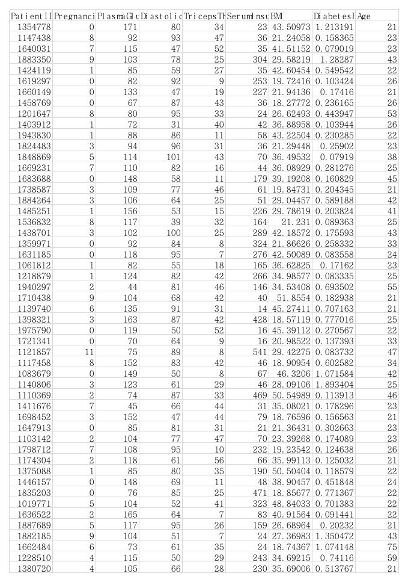
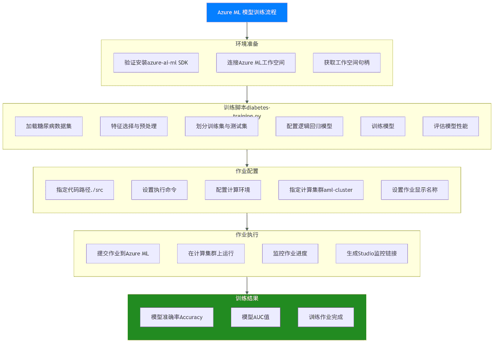
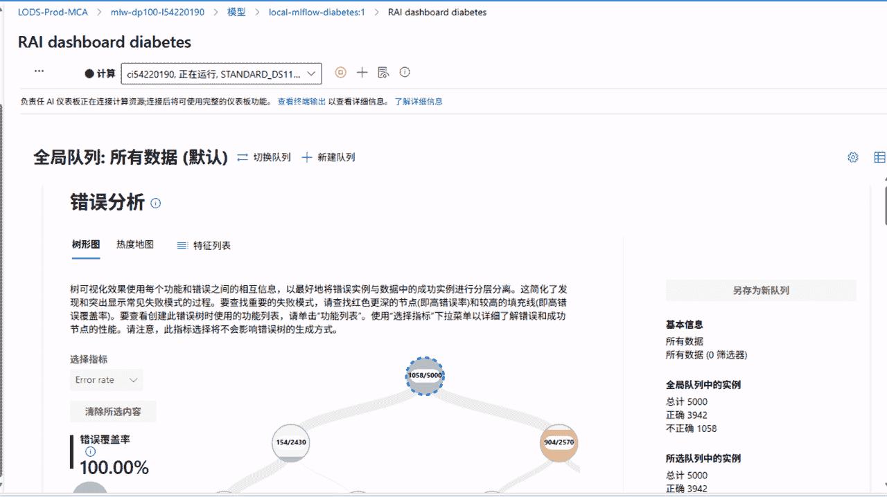
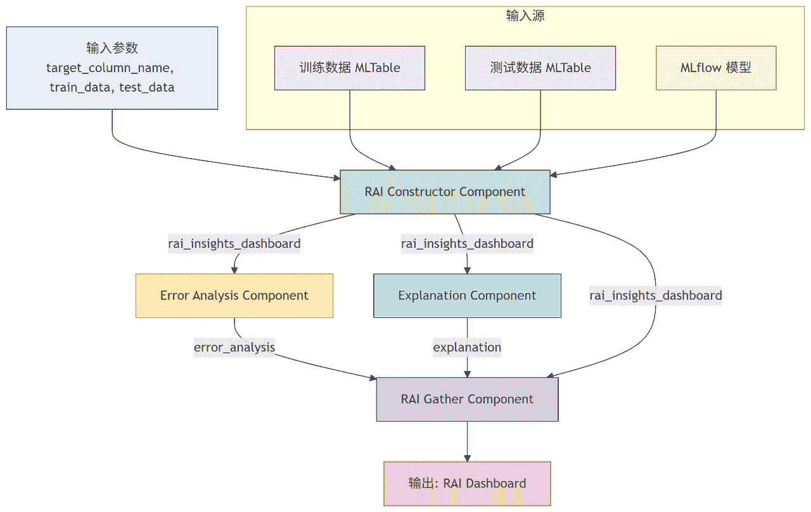
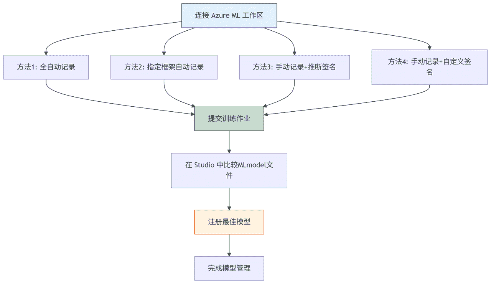
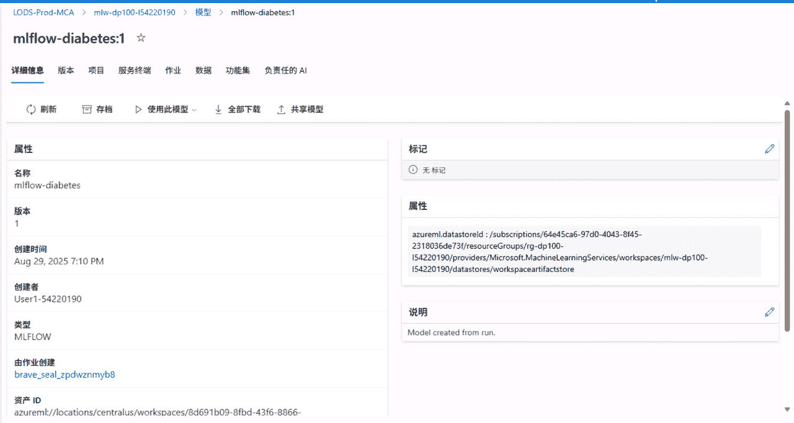
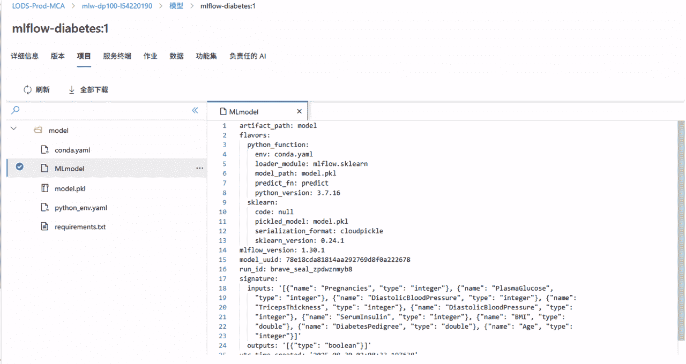
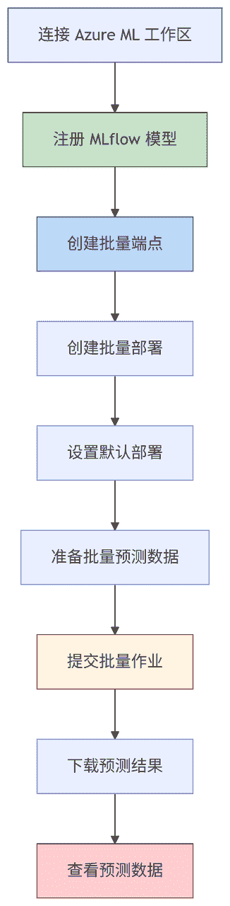
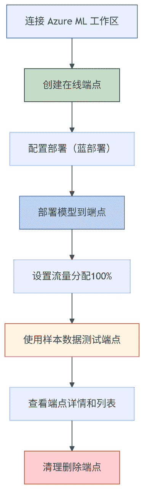

# DP-100: 在 Azure 上设计和实现数据科学解决方案

> 来源：[https://zsyhjtnsa5.feishu.cn/docx/RNH6dVPyGoveDgxsMpKcNK6enfb](https://zsyhjtnsa5.feishu.cn/docx/RNH6dVPyGoveDgxsMpKcNK6enfb)

# 机器学习概览

在**机器学习领域，“特征”** （Features） 和“标签” （Labels） 是两个最基础且核心的概念。简而言之，特征是输入，标签是输出。 机器学习模型通过学习特征与标签之间的关系，来对新的、未知的数据进行预测。

## 特征和标签

### 什么是特征 （Features）？

特征是用来描述数据实例的、可测量的属性或变量。 它们是机器学习模型用来进行预测的输入信息。 你可以把特征看作是回答一个问题所需的数据点。在机器学习问题中，特征通常被表示为“x”。

**特征的类型可以多种多样，例如：**

+   数值型特征 （Numerical Features）: 可以用数字表示的特征，如房屋的面积、人的年龄、商品的温度等。

+   类别型特征 （Categorical Features）: 表示类别的特征，如颜色（“红”、“绿”、“蓝”）、城市（“北京”、“上海”、“广州”）等。

+   文本特征 （Text Features）: 由文本组成的特征，例如电子邮件的内容或产品评论。

选择合适的特征是机器学习任务中至关重要的一步，因为模型的性能在很大程度上取决于特征的选择。

### 什么是标签 （Labels）？

标签是我们要预测的目标变量，也就是我们希望机器学习模型学习并预测的结果。 在监督学习中，标签是数据样本的“答案”或“结果”。 标签通常被表示为“y”。

**标签也有不同的类型：**

+   分类标签 （Categorical Labels）: 表示离散的类别。如果只有两种可能的类别（例如“是/否”、“垃圾邮件/非垃圾邮件”），则称为二元标签 （Binary Labels）。 如果有多个类别（例如识别动物图片时的“猫”、“狗”、“鸟”），则为多类别标签。

+   回归标签 （Continuous Labels）: 表示一个连续的数值。例如，预测房价时的具体价格，或预测气温时的具体温度值。

### 特征和标签的关系

在监督学习中，主要目标就是利用特征来预测标签。 整个过程可以概括为：

1.  **训练数据：** 我们向模型提供一组“有标签样本” （labeled examples）。每个样本都包含描述它的特征以及对应的正确标签。

1.  **模型学习：** 模型通过分析这些训练数据，学习并发现特征与标签之间的潜在模式和关系。

1.  **预测：** 模型训练完成后，我们就可以给它输入只有特征的“无标签样本” （unlabeled examples）。 模型会运用它学到的知识，来预测这些新样本的标签。

### 举例说明

为了更好地理解这两个概念，让我们来看几个例子：

| **任务场景** | **特征 （输入变量）** | **标签 （预测目标）** |
| --- | --- | --- |
| **房价预测** | 房屋面积、卧室数量、地理位置、建造年份 | 房屋的实际售价 |
| **垃圾邮件识别** | 发件人地址、邮件标题中的关键词（如“免费”、“优惠”）、邮件长度 | “垃圾邮件” 或 “非垃圾邮件” |
| **手写数字识别** | 图片中每个像素点的灰度值 | 图片代表的实际数字 （0-9） |

总而言之，特征是用来进行预测的依据，而标签是我们希望预测出的结果。二者共同构成了监督学习的基础。

## 示例数据分析

diabetes.csv 文件：



[diabetes.csv](https://internal-api-drive-stream.feishu.cn/space/api/box/stream/download/all/SmqJbCyxOoJVyGxIBVtcsdqUn9d)

这个文件包含了一个用于预测糖尿病的数据集，是机器学习中一个非常经典的用于二元分类任务的数据集。

### 表格结构分析

这是一个典型的结构化数据集，其格式为 CSV（逗号分隔值）。

+   **每一行**：代表一个独立的样本，在这里就是一位病人的信息记录。

+   **每一列**：代表一个特定的属性。最后一列 Diabetic 是我们要预测的目标，而前面的列则是用来进行预测的依据。

### 列（属性）详解

根据您之前了解的“特征”和“标签”概念，我们可以将这个表格的列进行如下划分：

| 列名 | 中文含义（可能） | 角色 | 解释 |
| --- | --- | --- | --- |
| PatientID | 病人 ID | 标识符 （Identifier） | **每个**病人的唯一编号。这个 ID 本身不包含预测价值，通常在训练模型时会排除掉。 |
| Pregnancies | 怀孕次数 | **特征** | 病人的怀孕次数。 |
| PlasmaGlucose | 血浆葡萄糖浓度 | **特征** | 空腹血糖水平，是诊断糖尿病的重要指标。 |
| DiastolicBloodPressure | 舒张压 | **特征** | 病人的舒张压（毫米汞柱）。 |
| TricepsThickness | 肱三头肌皮褶厚度 | **特征** | 衡量身体脂肪的指标之一（毫米）。 |
| SerumInsulin | 血清胰岛素 | **特征** | 2 小时血清胰岛素水平（μU/ml）。 |
| BMI | 身体质量指数 | **特征** | 身体质量指数（体重/身高²），常用的健康指标。 |
| DiabetesPedigree | 糖尿病家族史函数 | **特征** | 一个综合了家族中糖尿病史的函数，值越大可能遗传风险越高。 |
| Age | 年龄 | **特征** | 病人的年龄（岁）。 |
| Diabetic | 是否患糖尿病 | **标签** | 这是我们需要模型预测的目标。 |

### 机器学习任务视角

因此，在这个数据集中，机器学习模型的任务就是：

+   **学习****：通**过分析大量的病人数据，找出前 8 个特**征（**从Pregnancies到Age）与标签（Diabetic）之间的潜在模式和关联。

+   **预测**：当输入一位新病人的 8 项特征数据时，模型能够利用学到的模式，给出一个关于他/她是否患有糖尿病的预测（预测结果为 0 或 1）。

这是一个典型的**监督学习**中的**二元分类**问题。

## 机器学习过程解析

然。如果我们要使用 diabetes.csv 这个数据，通过分类算法来建立一个机器学习模型，其大致过程可以分为以下几个关键步骤。

这是一个非常标准且经典的机器学习工作流程。

### 机器学习建模（分类任务）流程概览

| 步骤 | 名称 | 目标 | 针对 diabetes.csv 的具体操作 |
| --- | --- | --- | --- |
| **1** | **目标定义与数据加载** | 明确问题，并将数据读入工作环境。 | 预测 Diabetic 列（0 或 1），使用 Pandas 等库加载diabetes.csv文件。 |
| **2** | **数据探索与预处理** | 理解数据、清洗数据、为建模做准备。 | 检查缺失值、异常值，分离特征（X）和标签（y），拆分训练集和测试集。 |
| **3** | **选择与训练模型** | 选择合适的分类算法，并在训练数据上进行学习。 | 从逻辑回归、随机森林等算法中选择一个，使用训练集数据进行训练。 |
| **4** | **模型评估** | 检验模型在未知数据上的表现好坏。 | 使用测试集进行预测，并通过准确率、混淆矩阵、F1 分数等指标评估性能。 |
| **5** | **模型优化 （可选）** | 调整模型以获得更好的性能。 | 通过交叉验证、调整超参数等方法进一步提升模型效果。 |
| **6** | **预测与应用** | 使用最终模型对新数据进行预测。 | 将新的病人数据输入模型，预测其是否患有糖尿病。 |

### 详细步骤分解

#### 第 1 步：目标定义与数据加载

1.  **明确目标**：我们的目标是一个**二元分类**任务。

+   特征 （Features / X）：Pregnancies， PlasmaGlucose， DiastolicBloodPressure， TricepsThickness， SerumInsulin， BMI， DiabetesPedigree， Age。

+   **标签 （Label / y）**：Diabetic （0 代表健康， 1 代表患病）。

1.  **加载数据**：使用 Python 中的 Pandas 库，将 diabetes.csv 文件加载到一个数据框（DataFrame）中，以便进行后续分析。

#### 第 2 步：数据探索与预处理 （EDA & Preprocessing）

这是机器学习流程中**最关键也最耗时**的一步。数据的质量直接决定了模型性能的上限。

1.  **探索性数据分析 （Exploratory** Data Analysis， EDA）：

+   **查看基本信息**：检查数据有多少行、多少列，各列的数据类型是什么。

+   **统计摘要**：查看数值型特征的均值、标准差、最大/最小值等，这有助于发现异常值。例如，PlasmaGlucose（血糖）或BMI为 0 是不符合生理常识的，这可能代表数据缺失，需要特殊处理。

+   **检查缺失值**：确认数据中是否存在空值（NaN）。

+   **可视化分析**：绘制直方图查看每个特征的分布，绘制箱线图检查异常点，绘制相关性热力图查看特征之间的关联性。

1.  **数据清洗与准备**：

+   **处理异常/缺失值**：对于像血糖为 0 这样的异常值，可以选择删除该行数据，或者用该列的中位数/平均数等进行填充。

+   **分离特征和标签**：将数据表拆分为两部分：

+   X：包含所有**特征**列的数据框。通常需要**删除** PatientID 列，因为它只是一个标识，没有预测价值。

+   y：只包含**标签**列（Diabetic）的序列。

+   **拆分数据集**：将 X 和 y 按**照一定比例（如 80%训练，**20%测试）拆分为训练集 （Training Set） 和测试集 （Test Set）。

+   **训练集** （X_train， y_train） 用于“教”模型学习特征和标签间的关系。

+   **测试集** （X_test， y_test） 是模型从未见过的数据，用于在模型训练完成后评估其真实性能。这一步至关重要，可以防止模型“死记硬背”，确保其泛化能力。

+   特征缩放 （Feature Scaling）：由于各个特征的数值范围差异很大**（例如**** Ag**e 和 SerumInsulin），很多算法（如逻辑回归、支持向量机）的性能会受到影响。因此，通常需要对特征进行标准化 （Standardization） 或归一化 （Normalization），使所有特征都在相似的尺度上。

#### 第 3 步：选择并训练模型

1.  **选择算法**：根据问题的性质，选择一个或多个合适的分类算法。常见的选择包括：

+   逻辑回归 （Logistic Regression）：简单、快速，是很好的基线模型。

+   K-近邻 （K-Nearest Neighbors， KNN）：基于实例的简单算法。

+   支持向量机 （Support Vector Machine， SVM）：在很多情况下表现优异。

+   决策树 （Decision Tree）：模型可解释性强，易于理解。

+   随机森林 （Random Forest）：由多个决策树构成的集成模型，通常性能强大且不易过拟合。

+   **梯度提升机 （Gradient Boo**sting Machines， GDM）：如 XGBoost、LightGBM 等，是目前在结构化数据上表现最好的算法之一。

1.  **训练模型**：实例化选定的算法，并使用训练集 （X_train， y_train） 对其进行训练。在 scikit-learn 库中，这个过程通常就是调用模型的 .fit() 方法。

#### 第 4 步：模型评估

训练完成后，我们需要知道模型的好坏。

1.  **进行预测**：使用训练好的模型，对测试集中的特征 （X_test） 进行预测，得到一组预测标签 （y_pred）。

1.  **评估性能**：比较预测标签 （y_pred） 和真实标签 （y_test），计算评估指标：

+   **准确率 （Accuracy）**：最直观的指标，即预测正确的样本数占总样本数的比例。

+   混淆矩阵 （Confusion Matrix）：一个表格，展示了模型在每个类别上的预测情况（真阳性、假阳性、真阴性、假阴性），是计算其他指标的基础。

+   **精确率 （Precision）** 和 **召回率 （Recall）**：在医疗诊断等场景中比准确率更重要。精确率关注“预测为阳性的样本中有多少是真的阳性”，召回率关注“所有真的阳性样本中有多少被模型成功预测出来”。

+   **F1-Score**：精确率和召回率的调和平均数，是一个综合性指标。

#### 第 5 步：模型优化 （可选）

如果初始模型的性能不满足要求，可以进行优化。

+   **超参数调优**：每个算法都有一些需要手动设置的参数（称为超参数），例如 KNN 中的 K 值。通过交叉验证 （Cross-Validation） 和网格搜索 （Grid Search） 等技术，可以找到最佳的超参数组合。

+   **特征工程**：创造新的特征或选择更有用的特征子集，也可能提升模型性能。

#### 第 6 步：预测与应用

一旦模型经过训练和评估，达到了满意的性能，就可以将其用于实际的预测任务中。对于这个例子，就是输入一个新病人的体检数据，模型会输出一个预测结果：0（健康）或 1（患有糖尿病）。

整个过程是一个不断迭代、优化的循环，直到获得一个性能稳定且符合业务需求的模型。

# 课程实验解析

实验 repo

https://github.com/MicrosoftLearning/mslearn-azure-ml/tree/main/Instructions

## 实验概述：从个人工坊到现代化 AI 工厂的演进之路

**课程核心思想：** 本**系列实验将带**领学生走完一个完整的机**器学习项目生命周期。我们将从**一个简单的、在本地运行的脚本开始，逐步引入规范化、自动化和工程化的最佳实践，最终将模型部署成一个可供全球访问的、可靠的生产级服务。整个过程就像将一个个人手工作坊，一步步升级改造为一座高度自动化的现代 AI 工厂。

### **第一部分：导论 —— 熟悉你的“工厂”**车间 （Familiarization）

#### **实**验 1: 探索 Azure Machine Learning （Explore Azure Machine Learning）

+   **核心目标：** 这是整个课程的**“入职培训”和“地图导览”**。目标是让学生熟悉 Azure ML Studio 这个“工厂”的布局，知道“原材料仓库”（数据）、“生产车间”（计算资源）、“质检部门”（实验）和“成品仓库”（模型）都在哪里。

+   **关键知识点：** Workspace （工作区）， Studio UI （界面）， Compute （计算）， Data （数据）， Experiments （实验）， Models （模型）， Endpoints （终结点） 的基本概念。

+   **在课程中的定位：** **一切的起点。** 为后续所有实验建立一个直观的、可视化的认知框架。学生在这里“认路”，为后续的动手操作打下基础。

### **第二部分：模型开发核心 —— 建立你的“手工生产线**” （Core Development）

这个阶段，我们聚焦于代码优先 （Code-First） 的方法，教会学生如何使用基础工具，完成一次标准、规范的手动模型开发流程。

#### **实验 2: 探索开发者工具 （Expl**ore developer tools）

+   **核心目标：** **“Hello World”**。学会最基本的操作：将一个本地 Python 脚本提交到云端的计算集群上运行。

+   **关键知识点：** SDK， Experiment， Compute Cluster， ScriptRunConfig （旧版 SDK 概念，但思想相通）。

+   **在课程中的定位：** **第一次点火。** 让学生完成从本地到云端的第一次跨越，理解远程执行的基本原理。这是“手工生产线”的第一个工位。

#### 实验 3: 让数据可用 （Make data available）

+   **核心目标：** 将**“原材料” （数据）**** 进行标**准化管理。学会将本地数据文件，注册为云端一个版本化的、可追溯的数据资产。

+   **关键知识点：** Datastore （数据存储）， Dataset （数据集）。

+   **在课程中的定位：** **规范化原材料入库。** 学生的思维从“我有一个 CSV 文件”提升到“我有一个版本化的数据资产”。这是实现可复现科学的第一步。

#### **实验 4: 使用计算与环境 （Work with compu**te and environments）

+   **核心目标：** 精细化管理**“生产设备” （计算资源）** 和 **“操作规程” （软件环境）**。学会区分用于开发的“调试车间”（Compute Instance）和用于生产的“主生产线”（Compute Cluster），并学会如何打包和复用软件环境，确保生产条件的一致性。

+   **关键知识点：** Compute Instance （计算实例）， Environment （环境） 作为可复用资产。

+   **在课程中的定位：** **完善生产线的基础设施。** 学生开始具备“环境隔离”和“资源策略”的工程化思维，这是从“能跑就行”到“跑得专业”的关键转变。

### **第**三部分：开发加速与自动化 —— 安装你的“自动化设备” （Accelerating Development）

这个阶段，我们引入各种自动化工具，将之前“手工生产线”上的重复性、探索性工作交给机器，大幅提升效率。

#### **实**验 5 & 6: AutoML 与 Designer （Automated ML & No-Code Designer）

+   **核心目标：** 体验**“一键式”**和**“可视化”**的建模方式。AutoML 让你放弃对建模过程的控制，以换取极高的自动化效率；Designer 则让你通过拖拽来构建流程，降低了技术门槛。

+   **关键知识点：** AutoML （自动化机器学习）， Designer （设计器）， Low-Code/No-Code （低代码/无代码）。

+   **在课程中的定位：** 引入两条全新的“全自动生产线”。 这两条线与我们之前的手工线并行。它们展示了解决问题的不同路径，特别适合快速原型验证和为非程序员赋能。

#### **实验 7 & 8: 使用 MLflow 和命令作业 （ML**flow & Command Jobs）

+   **核心目标：** **升级我们的“手工生产线”**。引入行业标准的 **MLflow** 来实现对实验过程的**自动化记录**，并使用现代化的 **SDK v2 命令作业**来**标准化地打包和执行**我们的任务。

+   **关键知识点：** MLflow Tracking， autolog()， Command Job， YAML 定义， Inputs/Outputs。

+   **在课程中的定位：** 为手工线加装“传感器”和“机器人手臂”。 MLflow （autolog） 就像自动记录各项生产参数**的传感器。命**令作业 （Command Job） 就像一个标准化的机器人手臂，可以精确、可靠地执行我们定义的任何操作。这是我们手工线现代化的核心。

#### 实验 9: 超参数调优 （Hyperparameter Tuning）

+   **核心目标：**** 将“调参”这**个最繁琐的手工环节自动化。学会定义搜索空间，让平台智能地、并行地为我们寻找最佳的模型“配方”。

+   **关键知识点：** SweepJob （扫描作业）， Search Space （搜索空间）， Sampling Algorithm （采样算法）。

+   **在课程中的定位：** **为手工线加装“智能优化器”。** 如果说之前的 for 循环调参是手摇鼓风机，那么 SweepJob 就是一台由 AI 控制的、带有多个传感器的精密温控鼓风系统。

### **第四部分：生产化与 MLOps —— 建立“成品交付流水线” **（Production & MLOps）

这个阶段，我们将重心从“如何做出一个好模型”，彻底转向“如何管理、编排和交付这些模型”，进入真正的 MLOps 领域。

#### 实验 9 （续）: 运行管道 （Run Pipelines）

+   **核心目标：** 从执行“单个任务”升级为编排**“多步工作流”**。学会将数据处理、训练、评估等多个**独立**的作业，串联成一个自动化的、可复用的管道。

+   **关键知识点：** PipelineJob （管道作业）， Component （组件）， DAG （有向无环图）。

+   **在课程中的定位：** **建造真正的“流水线”。** 我们不再是逐个操作机器人手臂，而是将多个机器人手臂（组件）连接起来，形成一条从原材料到准成品的完整流水线。

#### **实**验 10: 模型比较、治理与负责任 AI （Model Governance & Responsible AI）

+   **核心目标：** **建立“质检与仓储”部门****。学会如****何利用之****前记录的所有实验数据，横向**比较不同模型的性能，并为选出的“冠军”模型进行深度质检（如公平性、可解释性分析），最后将其正式存入“成品仓库”（模型注册表）。

+   **关键知识点：** Model Registry （模型注册表）， MLflow Model Flavor， Responsible AI Dashboard （RAI 仪表板）。

+   **在课程中的定位：** **品控与入库。** 这是模型交付前的最后一道关卡，确保我们交付的模型不仅性能高，而且是可靠、可信和被妥善管理的。

#### 实验 11: 模型部署 （Model Deployment）

+   **核心目标：** 打通“最后一公里”，将产品交付给客户。 学会根据不同的业务场景，将仓库中的模型部署成两种核心的生产服务。

+   **关键知识点：**

+   批量终**结点 （Ba**tch Endp**oint**）: 用于高吞吐、离线的预测，就像一辆重型卡车，负责大规模的货物运输。

+   在线终**结点 （On**line Endp**oint）**: 用于低延迟、实时的预测，就像一辆 F1 赛车，负责即时的响应。

+   **在课程中的定位：** **物流与交付。** 这是我们 AI 工厂创造的价值最终触达用户的环节，也是整个机器学习生命周期的闭环。

通过这条精心设计的路径，学生将不再是零散地学习功能点，而是在一个宏大的、符合行业实践的叙事框架中，逐步构建起对企业级机器学习全貌的深刻理解。

## Explore the Azure Machine Learning workspace

https://github.com/MicrosoftLearning/mslearn-azure-ml/blob/main/Instructions/02-Explore-Azure-Machine-Learning.md

### 核心目标

这个实验是整个学习路径的**“入门导览”****。其核心目标不是让你构建一个具体的模**型，而是引导你熟悉 Azure Machine Learning Studio 的网页界面，并直观地理解平台中各个核心资产（如计算、数据、模型等）的用途和所在位置。它为后续所有基于代码或基于界面的实验提供了必要的背景知识和“地图”。

### 流程分析

这个实验的流程本质上是一次有向导的、对 Azure ML Studio 界面的探索之旅。

1.  **预配资源 （Provision** Resource）: 在 Azure 门户中创建一个 Azure 机器学习工作区 （Workspace）。这是所有后续工作的基础容器。

1.  探索计算资源 （Explore Compute）: 导航到 Studio 的“计算”页面，直观地查看不同类型的计算资源，理解它们的区别：

+   计算实例 （Compute Instance）: 作为个人的、基于云的开发工作站，用于运行 Notebooks。

+   计算集群 （Compute Cluster）: 作为可按需扩展的、用于执行训练任务的强大后端。

1.  探索数据资产 （Explore Data）: 导航到“数据”页面，了解 Azure ML 是如何管理数据的：

+   数据存储 （Datastore）: 查看它如何作为连接到云存储（如 Azure Blob 存储）的桥梁。

+   **数据集 （Dataset）:** 查看 diabetes dataset 是如何被注册为一个带有版本和元数据的数据资产，并可以直接在界面中预览。

1.  探索创作工具 （Explore Authoring Tools）: 概览 Studio 中用于构建模型的不同方法：

+   **Notebooks:** 查看集成的 Jupyter 环境，这是后续代码优先实验的主要工作区。

+   自动化 ML （Automated ML）: 了解用于自动寻找最佳模型的无代码界面。

+   **设计器 （Designer）:** 了解用于通过拖放方式构建流程的可视化画布。

1.  查看资产注册表 （View Asset Registries）: 浏览“资产”区域，了解实验的产出物是如何被管理的：

+   **模型 （Models）:** 查看模型注册表，这里是所有已训练并注册的模型的存放位置。

+   终结点 （Endpoints）: 了解模型部署后，用于提供实时预测服务的管理位置。

+   实验 （Experiments）: 查看所有已提交运行的记录、日志和结果的中心位置。

### 关键知识点介绍

+   **Work**space （工作区）: 你的 Azure ML 项目的顶级容器。它集中管理了所有机器学习相关的资产，包括计算、数据、代码、环境、模型和实验记录，是所有操作的中心枢纽。

+   **Azure M**achine Learning Studio: 用于访问和管理工作区内所有资产的可视化网页界面。

+   Com**pute Instanc**e （计算实例）: 一个个人的、云端的开发工作站。它预装了 Jupyter 和其他常用工具，是你编写、测试和调试代码的主要场所。

+   **Compute **Cluster （计算集群）: 一个由一个或多个计算节点（虚拟机）组成的可伸缩计算资源池。它专为运行计算密集型的训练任务而设计，可以按需自动扩展和缩减，以平衡性能和成本。

+   **Data**store （数据存储）: 工作区与你的云端物理存储（例如 Azure Blob 容器）之间的连接桥梁。它让 Azure ML 知道你的数据文件实际存放在哪里。

+   **Dataset （数据集）:** 对数据存储中特定数据的**一个版本化引用**。它本身不复制数据，而是封装了访问这些数据的元信息。通过将数据注册为数据集，可以实现数据的溯源、共享和复用。

+   Experime**nt （实**验）: 工作区内的一个逻辑文**件夹，用于组织和记录一**系列相关的“运行” （Runs）。每一次模型训练的尝试都是一次运行，其配置、日志、输出指标和产出的模型文件都会被详细记录在实验中，便于跟踪、比较和复现。

+   M**odels**** （模**型） & Endpoints （终结点）: 模型注册表用于对训练完成的优质模型进行版本化管理。终结点则是将这些注册好的模型部署为可供外部应用调用的实时 API 服务的管理单元。

## Explore developer tools for workspace interaction

https://github.com/MicrosoftLearning/mslearn-azure-ml/blob/main/Instructions/02-Explore-developer-tools.md

+   **核心目标：** 这是你的 "Hello World"。目标是让你完成最基本的操作：在你的云端工作区，提交一个 Python 脚本到一个远程的计算集群上运行。

+   **流程分析：**

1.  **连接 （Connect）:** 在 Notebook 中使用 SDK 连接到你的 Azure ML 工作区。

1.  指定计算资源 （Specify Compute）: 获取一个已经创建好的计算集群的引用。

1.  封装逻辑 （Encapsulate）: 将训练逻辑（尽管很简单）写入一个单独的 .py 脚本文件。

1.  配置与提交 （Configure & Submit）: 使用 ScriptRunConfig 将脚本和计算目标绑定，然后提交给一个 Experiment 来执行。

+   **关键知识点介绍：**

+   Workspace （工作区）: 你的 Azure ML 项目的顶级容器。它包含了你所有的机器学习资产：数据、计算资源、实验、模型、环境等。是所有操作的起点。

+   Com**pu**te Cluster （计算集群）: 用于训练的可伸缩计算资源。它是一个或多个虚拟机的集群，可以根据你的任务需求自动创建和删除，非常适合运行计算密集型的训练脚本。

+   Experiment （实验）: 工作区内的一个组织单元，用于对一系列相关的“运行”（Runs） 进行分组。每次你提交一个任务，它就成为实验中的一次“运行”，所有的日志、指标和产出都会被记录下来，便于追溯和比较。

### 实验环境解析

setup.sh 脚本是一个典型的**环境构建自动化脚本**。它的核心目标是：**确保运行实验的计算环境（在这里是 Azure ML Notebooks 的虚拟机）已**经安装了所有必需的软件库，并且配置好了连接 Azure ML 工作区所需的信息。

简单来说，在运行任何机器学习代码之前，先执行这个脚本，就能一键完成所有的准备工作，确保后续的实验能够顺利进行，它会依次执行以下几个核心操作：

#### 1. 安装/升级 Azure ML 核心库 （SDK）

+   **命令：** pip install --upgrade azureml-sdk[notebooks,automl]

+   **目的：** 这是最关键的一步，它负责安装与 Azure Machine Learning 服务进行交互的 Python 软件开发工具包 （SDK）。

+   --upgrade： 这个参数确保即时环境中已经安装了旧版本的 azureml-sdk，也会将其升级到最新版，以保证能使用最新的功能并修复已知的 bug。

+   [notebooks,automl]： 这部分叫做“extras”，意味着除了安装基础的 SDK 外，还额外安装了两组特定的依赖包：

+   notebooks： 安装用于在 Jupyter Notebook 环境中提供更好用户体验的库，比如交互式的小部件 （widgets），可以用来显示任务运行的实时进度条。

+   automl： 安装支持 Azure 自动化机器学习 （Automated ML） 功能的库。这暗示了这个 setup 脚本可能是为后续进行自动化机器学习实验做准备的。

#### 2. 安装其他必要的 Python 库

+   **命令：** pip install scikit-learn==0.22.1 pandas matplotlib

+   **目的：** 安装数据科学和机器学习任务中最常用的一些基础库。

+   scikit-learn==0.22.1： 这是用于机器学习的**核心库，包****含了大量的算法（**如逻辑回**归、随机森林）和工具（**如数据拆分、评估指标）。特别注意 ==0.22.1，这表示强制安装一个特定的版本。这么做的目的是为了保证实验的可复现性 （Reproducibility）。因为不同版本的库可能在算法实现上有微小差异，导致结果不同。通过固定版本，可以确保任何人在任何时间运行这个实验，都能得到一致的结果。

+   pandas： 用于数据处理和分析，是加载和操作像 diabetes.csv 这样的表格数据的标准工具。

+   matplotlib： 用于数据可视化，可以绘制图表来分析数据或展示模型结果。

#### 3. 创建工作区配置文件

+   **命令：** python create_config.py

+   **目的：** 这一步是为了方便地连接到你的 Azure ML 工作区。

+   这个命令会执行一个名为 create_config.py 的 Python 脚本（该脚本并未在此处展示，但通常会包含在实验文件中）。

+   **这个 Pyth****on 脚本的作用是生成****一个名为** config.json 的文件。

+   config.json** 文件中会**包**含你的 A**zu**re 订阅 ID**、资源组名称和 ML 工作区名称。

+   有了这个配置文件，后续的 Jupyter Notebook 就可以通过一行简单的代码 ws = Workspace.from_config() 自动加载这些连接信息并连接到正确的工作区，而不需要在代码中硬编码这些敏感或易变的信息。这是一种非常好的工程实践。

这个 setup.sh 脚本体现了机器学习项目管理中的几个重要原则：

1.  自动化 （Automation）: 将所有环境准备步骤都写在一个脚本里，避免了手动逐一输入命令的繁琐和可能出现的遗漏或拼写错误。

1.  可复现性 （Reproducibility）: 通过精确指定库的版本号，确保了研究或开发环境的一致性，使得实验结果可以被他人复现。

1.  环境隔离 （Environment Isolation）: 脚本明确定义了项目所需的所有依赖，方便使用虚拟环境（如 venv 或 conda）来创建一个独立、干净的运行环境，避免与其他项目产生库版本冲突。

1.  **配置与代码分离 （Separation of Conf**iguration and Code）: 通过 create_config.py 生成配置文件，将连接信息与业务逻辑代码（Jupyter Notebook）分离开，提高了代码的可移植性和安全性。

总而言之，这个脚本是整个实验的**“初始化程序”**，它构建了一个标准化的、可信赖的运行环境，是后续所有机器学习工作的基石。

### 核心处理流程解析

这个Run train**ing scri**pt.ipynb笔记本演示的是在 Azure Machine Learning （Azure ML） 这个云平台上，如何规范化、可重复地运行一个机器学习训练任务。它展示的流程不仅仅是在一台机器上写代码和运行，而是如何利用云平台的优势来管理和扩展机器学习项目。

这个流程的核心思想是**将“做什么”（训练逻辑）与“在哪**里做/怎么做”（环境与计算资源）分离开来。

我们仍然可以按照之前讨论的机器学习流程来理解，但这次会加上 Azure ML 平台特有的概念：

#### 第 1 步：环境搭建与连接 （Setting up the Environment）

+   **流程目标：** 准备好进行机器学习实验的工作区。

+   **笔记本中的操作：**

1.  连接到 Azure ML 工作区 （Workspace）： 工作区是 Azure ML 里的顶级容器，它集中管理你所有的机器学习资产，比如数据、计算资源、代码、模型和实验记录。这步操作就像是打开你的项目总文件夹。

1.  创建或指定一个实验 （Experiment）： 实验可以看作是工作区内的一个子文件夹，专门用来组织一系列相关的训练运行 （Runs）。例如，你可以创建一个名为 diabetes-training 的实验，所有针对糖尿病预测的训练尝试都会被记录在这里。这对于比较不同算法或参数的效果至关重要。

#### 第 2 步：数据准备与计算资源配置 （Data and Compute）

+   **流程目标：** 确保训练代码能访问到所需的数据，并指定用于执行训练的计算机。

+   **笔记本中的操作：**

1.  **准备数据：** 笔记本将 diabetes.csv 数据上传到 Azure ML 的数据存储 （Datastore） 中。数据存储是一个指向云端存储（如 Azure Blob Storage）的链接。这样做的好处是，数据成为了一个独立的云端资产，任何授权的计算资源都可以方便地访问它，而不需要每次都手动上传。

1.  创建计算目标 （Compute Target）： 这一步是云平台的核心优势。笔记本会创建一个计算集群 （Compute Cluster）。这不再是你自己的本地电脑，而是在云端的一个或多个强大的虚拟机，专门用于运行训练任务。你可以根据需要指定它的规模（如 CPU 核心数、内存大小），并且它可以在不用时自动缩减规模以节省成本。

#### 第 3 步：封装训练逻辑 （Encapsulating the Training Logic）

+   **流程目标：** 将核心的机器学习代码（数据处理、模型训练、评估）打包成一个独立的、可重复执行的脚本。

+   **笔记本中的操作：**

1.  **创建训练脚本 （****train.py****）：** 笔记本并没有在单元格里直接写训练代码，而是将这些代码写入一个单独的 Python 文件 train.py 中。这个脚本是一个完整的、可以独立运行的程序，它负责：

+   接收参数（例如，通过 argparse 接收学习率、正则化强度等超参数）。

+   从 Azure ML 数据存储中加载 diabetes.csv 数据。

+   执行之前我们讨论过的步骤：**数据拆分**（训练集/测试集）、**模型训练**（这里用的是逻辑回归）、**模型评估**（计算准确率）。

+   记录指标 （Logging Metrics）： 使用 MLflow 或 Azure ML SDK 将模型的性能指标（如准确率）记录到本次“运行”中。

+   **保存模型**：将训练好的模型保存为一个文件（例如 diabetes_model.pkl）。

#### 第 4-5 步：配置并提交训练任务 （Configuring and Submitting the Run）

+   **流程目标：** 将训练脚本、数据、计算资源和软件环境这几个要素组合在一起，形成一个完整的“任务”，然后提交给 Azure ML 执行。

+   **笔记本中的操作：**

1.  定义软件环境 （Environment）： 指定训练脚本运行时所需要的 Python 库（如 pandas， scikit-learn， matplotlib 等）及其版本。这确保了无论在哪台机器上运行，代码的依赖环境都是一致的，避免了“在我电脑上能跑”的问题。

1.  配置脚本运行 （ScriptRunConfig）： 这是将所有部分粘合在一起的关键对象。它告诉 Azure ML：

+   **要运行哪个脚本** （train.py）。

+   **在哪个计算资源上运行** （之前创建的计算集群）。

+   **使用哪个软件环境** （上一步定义的依赖库）。

+   **传递哪些参数**给脚本 （例如，传入数据存储的挂载点和模型的正则化率）。

1.  提交实验运行 （Submit the Run）： 最后，将这个配置好的任务提交给实验。Azure ML 会自动配置好计算集群，将数据和代码传输过去，并执行 train.py 脚本。

#### 第 6 步：监控、评估与模型管理 （Monitoring， Evaluation， and Management）

+   **流程目标：** 跟踪训练过程，获取结果，并将最终产出的优质模型进行正式的保存和版本管理。

+   **笔记本中的操作：**

1.  **监控运行：** 笔记本会显示一个链接，可以跳转到 Azure ML Studio 的网页界面，实时查看运行日志、资源使用情况和记录的指标。

1.  **获取结果：** 待运行结束后，可以从“运行”对象中轻松取回记录的指标（如准确率）和生成的产物（如保存的模型文件）。

1.  注**册模**型 （Model Registration）： 这是非常重要的一步。笔记本会将训练好的模型文件（diabetes_model.pkl）注册到工作区的模型注册表 （Model Registry） 中。注册模型意味着你将它作为一个正式的、有版本号的资产保存下来。这样做的好处是：

+   **版本控制：** 你可以清楚地知道哪个版本的模型是由哪次训练、哪个版本的代码生成的。

+   **部署准备：** 只有注册后的模型才能被轻松地部署为可供调用的 API 服务。



这个笔记本展示的流程，是从**探索性的本地开发**迈向企业级的机器学习运维 （MLOps） 的第一步。它将一个简单的分类任务，用一种结构化、可追溯、可重复的方式在云平台上执行。

**核心区别在于：**

+   **本地开发：** 数据、代码、环境和计算都在你的个人电脑上，混在一起。

+   **Azure ML 流程：** 数据、代码、环境和计算资源被清晰地分离和管理，通过“实验运行”将它们组合并执行，最终产出的模型也被正式地注册和版本化。这种方式更适合团队协作和长期项目维护。

#### 训练结果

```
Training a logistic regression model with regularization rate of 0.01
Accuracy: 0.774
AUC:0.8483203144435048
```

1.  **模型表现良好：**** 综合来看，这是一个相**当成功的初步训练结果。特别是 0.848 的 AUC 表明，逻辑回归这个简单的模型已经能够很好地捕捉到数据中的关键信息，并具备了优秀的区分能力。

1.  **AUC 与准确率的对比：** AUC（0.848）比准确率（0.774）给出的评价更高。这可能暗示数据集中两个类别（患病/不患病）的数量可能存在一些不平衡。但无论如何，高 AUC 保证了模型的核心分辨能力是值得信赖的。

1.  **后续步骤：**

+   这是一个很好的**基线模型**。你可以将这个 77.4% 的准确率和 84.8% 的 AUC 作为后续优化的比较基准。

+   接下来可以尝试更复杂的模型（如随机森林、梯度提升树等），看看它们的性能是否能超越这个基线。

+   也可以尝试调整逻辑回归的**正则化率**（例如，尝试 0.1， 1， 10 等），看看是否能找到一个更好的超参数，进一步提升模型性能。

>

> **详细分析：**

> **这是一个**典**型的机**器**学习模型**训练结果，包含三个核心部分：模型配置、准确率和 AUC。

1.  模型训练配置

> 2 Training a logistic regression model with regularization rate of 0.01 （正在训练一个逻辑回归模型，正则化率为 0.01）

> 这行描述了你正在训练的**模型类型**和**一个关键的超参数**。

+   **逻辑回归** （Logistic Regression）: 这是你选择的机器学习算法。它是一种非常经典且高效的二元分类算法，用于预测一个样本属于两个类别中哪一个的概率。在你的场景中，它就是预测病人“是糖尿病 （1）”还是“非糖尿病 （0）”。它通常是解决分类问题时首选的基线模型 （Baseline Model）。

+   正则化率 （Regu**lar**ization Rate） = 0.01： 这是模型的一个重要超参数，用于防止模型过拟合 （Overfitting）。

+   **过拟合**是指模型在训练数据上表现得过于完美，以至于把数据中的噪声和偶然性也学了进去，导致它在新的、未见过的数据上表现很差（泛化能力弱）。

+   **正则化**通过给模型的复杂度增加一个“惩罚项”来避免这种情况。

+   **正则化率 ****0.01** 控制了这个“惩罚”的强度。这个值越小，惩罚越轻；值越大，惩罚越重。0.01 是一个比较温和的正则化强度，意味着你允许模型有一定的复杂度，同时施加了轻微的限制来防止它变得过于复杂。

1.  评估指标：准确率 （Accuracy）

> 3 Accuracy: 0.774

+   **什么是准确率？**** 这是最直观、最容易理解的评估**指标。它的计算公式是：正确预测的样本数 / 总样本数。

+   **分析：**0.774** 的准确率**意味着，在你的测试数据集上，这个模型有 77.4% 的预测是正确的。通俗地讲，大约每 4 个病人，模型能正确判断出 3 个。

+   **评价：**

+   **优点：** 这是一个不错的起点。它远比随机猜测（50%）要好，证明模型确实从数据中学到了一些有用的模式。

+   **潜在问题：** 准确率在**数据类别不均衡**的情况下具有很强的误导性。例如，如果数据集中 90% 的人都是健康的，那么一个“无脑”模型即使把所有人都预测为“健康”，也能达到 90% 的准确率，但这个模型对于识别真正生病的病人毫无用处。因此，我们通常需要结合其他指标来综合评估，比如下面的 AUC。

1.  评估指标：AUC

> AUC: 0.8483203144435048

+   **什么是 AUC？** AUC （Area Under the ROC Curve） 是一个更专业、更稳健的分类模型评估指标。它衡量的是模型将正样本和负样本区分开来的整体能力。

+   AUC 的值介于 0 和 1 之间。

+   **AUC = 0.5：** 模型没有任何分辨能力，相当于随机猜测。

+   **AUC = 1.0：** 模型是一个完美的分类器，可以 100% 地区分出正负样本。

+   通常认为，AUC 在 0.8 以上就表示模型具有相当不错的性能。

+   **分析：**0.848 的 AUC 是一个**非常好**的分数。它表明你的模型在区分“糖尿病患者”和“非糖尿病患者”方面具有很强的能力。即使在数据类别不均衡的情况下，这个指标也比准确率更能反映模型的真实水平。

+   **评价：** 这个指标告诉你，当你随机抽取一个真正的糖尿**病患者和一**个非糖尿病患者时，你的模型有 84.8% 的概率会给前者打出比后者更高的“患病”分数。这证明模型学到的模式是稳健的。

## Make data available in Azure Machine Learning

https://github.com/MicrosoftLearning/mslearn-azure-ml/blob/main/Instructions/03-Make-data-available.md

+   **核心目标：** **引入规范的数据管理方法。这个实**验的核心差异在于，它不再将数据看作是代码文件夹里的一个普通文件，而是将其提升为云平台上的一个受版本控制的、可独立访问的资产。

+   流程分析 （与 Lab 02 对比）:

1.  数据上传与注册 （New Step）: 不再只是把 diabetes.csv 放在本地，而是先将其上传到 Azure ML 的数据存储 （Datastore），然后基于这个文件创建一个表格数据集 （TabularDataset） 并进行注册。

1.  **脚本修改：** 训练脚本 （train.py） 的数据加载部分被修改，它不再从本地文件路径读取数据，而是通过 Azure ML 的机制接收并加载这个注册好的 Dataset。

1.  提交运行的流程与 Lab 02 类似，只是在配置中需要指明输入数据是这个 Dataset。

+   **关键知识点介绍：**

+   Datastore （数据存储）: 这是你的 Azure 存**储账户（如** Blob Storage）在 Azure ML 工作区中的一个链接或引用。它让工作区知道你的数据实际存放在哪里。

+   **Dataset （数据集）:** 这是对 Datastore 中数据的**抽象和引用**。它本身不存储数据，但包含了如何访问数据的元数据。将其注册后，数据集就有了名称和版本**，可以被**团**队成员轻**松复用，并能追踪哪个模型是由哪个版本的数据训练出来的。这是实现数据溯源和可复现性的关键一步。

### 实验环境解析

**实验 02 （****Lab/02****）** 和 **实验 03 （****Lab/03****）** 在环境构建上的差异。这两个 setup.sh 脚本几乎完全一样，唯一的区别在于第一行安装 Azure ML SDK 的命令。

+   Lab 02 的 setup.sh 会执行：

```
ip install --upgrade azureml-sdk[notebooks]
```

+   Lab 03 的 setup.sh （您提供的链接） 会执行：

```
pip install --upgrade azureml-sdk[notebooks,automl]
```

**差异解析**

**关键的不同点**在于 Lab 03 的脚本中增加了 automl 这个附加依赖项。

+   **[notebooks]**： 这个部分是两个脚本共有的，它为在 Jupyter Notebook 环境中提供更好的交互式体验安装了必要的组件。

+   **[automl]**** （Lab 03 新增）**: 这是为 **Azure 自动化机器学习 （Automat**ed Machine Learning） 功能安装的特定依赖包。

**这意味着什么？**

这个细微的差异揭示了两个实验的核心目标不同：

1.  实验 02 （Run training scrip**t）: 其环境准**备脚本只安装了基础的 SDK 和 Notebooks 插件。这表明该实验的重点是手动编写训练逻辑，并使用 Azure ML 作为平台来执行和管理这个手动编写的脚本。开发者需要自己负责数据预处理、算法选择和模型训练的全过程。

1.  **实验 03 （您链接的脚本）:** 该脚本额外安装了 automl** 包，明确表示**这个实验环境是为进行自动化机器学习任务而准备的。在 AutoML 实验中，开发者不再需要手动选择和调优模型，而是定义好目标（例如，预测 Diabetic 列），然后让 Azure ML 服务自动地去尝试多种不同的算法、数据预处理步骤和超参数组合，最终找出性能最好的模型。

**总结一下：**

+   **实验 02 的环境**是为**“我自己动手写代码训练模型”**而准备的。

+   **实验 03 的环境**是为“让 Azure ML 平台自动帮我找到最佳模型”而准备的。

### 核心流程解析

我们来解析 Work with data.ipynb （Lab 03） 的流程，并重点与 Run training script.ipynb （Lab 02） 进行对比，只解释其中的差异部分。

这两个实验展示了解决同一个分类问题的两种截然不同的方法，这也代表了机器学习实践中的两种主要思路：

+   **Lab 02 （手动建模）:** 你是**“厨师”**。你需要自己准备食材（数据）、挑选菜谱（算法）、控制火候（超参数），并最终做出一道菜（模型）。

+   Lab** 03 （自**动化机器学习 - AutoML）: 你是“餐厅经理”。你告诉厨房你要做什么菜（定义问题），提供食材（数据），并设定上菜时间和服务标准（设置约束和评估指标）。厨房（Azure AutoML 服务）会自动尝试多种菜谱和烹饪方法，并把做得最好的一道菜（最佳模型）呈现给你。

**从 Lab 0**2 到 Lab 03 的流程演进，最核心的变化是抽象层次的提升。

**在 La**b 02 中，你关注的是机器学习的实现细节（如何用代码实现一个模型的训练）。

**而在 L**ab 03 中，你关注的是机器学习的问题定义（你要解决什么问题，用什么标准衡量好坏）。具体的模型选择、特征工程和超参数调优这些繁琐的“实现细节”被 Azure AutoML 服务自动化处理了。这极大地提高了寻找一个高性能基线模型的效率。

## Work with compute resources in Azure Machine Learning

https://github.com/MicrosoftLearning/mslearn-azure-ml/blob/main/Instructions/04-Work-with-compute.md

+   **核心目标：** 区分并策略性地使用不同类型的计算资源。

+   **流程分析 （与之前对比）:**

1.  **创建两种计算目标：**** 明确地**创建了两种计算资**源：一个**用于开发的计算实例和一个用于训练的计算集群。

1.  **演示两种执行方式：**

+   本地运行 （Local Run）: 提交一个简单的 h**ello**.py 脚本到 local 计算目标，这实际上就是在当前的计算实例上运行，用于快速测试和调试。

+   远程运行 （Remote Run）: **提交完整**的 train.py 脚本到计算集群上，用于正式的训练。

+   **关键知识点介绍：**

+   Compute Instance （计算实例）: 一个完全配置好的、由你独占的云端开发环境。它预装了 Jupyter、Python 和常用的数据科学库。它是你编写、测试和调试代码的地方。

### 实验环境解析

好的，我们来解析 Labs/04/setup.sh 这个环境创建脚本，并重点关注它与之前 Lab 02 和 Lab 03 脚本的差异。

这个脚本的目的是为了搭建一个专注于模型可解释性 （Model Interpretability） 和 可解释化人工智能 （Explainable AI - XAI） 的实验环境。

之前的实验关注点在于：

+   **Lab 02:** 如何**运行**一个手动编写的训练脚本。

+   **Lab 03:** 如何**自动化寻找**最佳模型。

而 **Lab 04**** 的关注点**是：在我们训练出一个模型后，如何理解和解释这个模型的决策过程。

这个脚本最大的不同体现在安装的 Python 库上。

1.  **核心 SDK 安装的差异：**

+   **旧命令 （Lab 03）:** pip install --upgrade azureml-sdk[notebooks,automl]

+   **新命令 （Lab 04）:** pip install --upgrade azureml-sdk[notebooks,explain,interpret]

1.  **差异解释：**

+   automl 附加依赖项被移除了。这表明 Lab 04 不再关注自动化机器学习，而是回到了手动建模的流程。

+   新增了 **explain** 和 **interpret** 这两个附加依赖项。它们的作用是安装 Azure ML SDK 中与模型解释相关的核心组件，让 SDK 具备了调用和管理解释性功能的能力。

1.  **新增的独立库安装：**

1.  这个脚本还增加了两个全新的、独立的 pip install 命令：

+   pip install azureml-interpret

+   **解释：**** 这是 Az**ure ML 平台专门用于模型可解释性的核心功能包。它提供了多种解释器（Explainer）工具，这些工具可以分析一个已经训练好的模型（通常是像“黑箱”一样复杂的模型），并揭示出模型做出某个特定预测时，每个输入特征的“贡献度”或“重要性”。这个包是实现 XAI 的关键。

+   **pip install azureml-c**ontrib-explain-model

+   **解释：** 这是一个“贡献”（contrib**）包，通常包含一些**更高级、更前沿或用于特定场景的功能。这个包提供了用于可视化模型解释结果的工具。简单来说，azureml-interpret 负责计算出解释数据，而这个包负责将这些数据以图表等直观的形式展示出来，让你能更容易地理解模型的行为。

从 Lab 02 到 Lab 04，这三个环境构建脚本清晰地展示了一个机器学习项目的生命周期演进：

1.  **Lab 02: 基础执行** -> 安装基础 SDK，学会如何在云上运行一个训练任务。

1.  **Lab 03: 效率优化** -> 安装 automl 包，学会如何利用云平台自动寻找最优模型。

1.  **Lab 04: 模型审视与信任** -> 安装 interpret 和 explain 相关包，学会在得到一个模型后，如何深入分析它的内部决策逻辑，确保模型的公平性、可靠性和透明度。

**因此，Lab** 04 的环境准备工作明确地将实验重心从“构建模型”转向了“理解模型”。

### 核心流程解析

我们来解析 Labs/04/Work with compute.ipynb 的流程，并将其与之前实验的流程进行对比，重点关注差异部分。

尽管 Lab 04 的环境准备脚本 （setup.sh） 安装了模型解释相关的库，但这个特定的笔记本 （Work with compute.ipynb） 实际上并没有使用它们。它的核心教学内容是关于 计算资源 （Compute） 的管理和使用。

这个实验的重点从“如何训练模型”转向了“在哪里以及如何高效地运行我们的代码”。它引入了不同类型的计算资源，并解释了它们各自的适用场景。

+   之前的实验 （Lab 02 & 03）: 将计算集群 （Compute Cluster） 视作一个理所当然的后台执行环境。我们创建它，然后把任务扔给它执行。

+   **Lab 04:** 明确地将计算资源作为核心学习对象，教你如何根据任务需求（开发、调试 vs。 正式训练）来选择和使用不同的计算环境。

**这个实验**的核心差异在于它将机器学习流程中的“计算”环节从一个简单的背景板提升到了舞台中央。

之前的实验教会了你**“做什么”****（手动训练或**自动训练）。**而 L**ab 04 则教会你“在哪里做”，并让你理解为什么要做出这样的选择：

+   **快速迭代和开发** -> 使用 **计算实例**。

+   **规模化和正式训练** -> 使用 **计算集群**。

这种对计算资源的精细化管理和策略性使用，是从单纯的机器学习实践者向更专业的机器学习工程师 （MLE） 或 MLOps 实践者迈进的重要一步。它强调了在云环境中，如何根据任务的不同阶段（开发 vs。 生产）来最高效、最经济地利用资源。

## Work with environments in Azure Machine Learning

https://github.com/MicrosoftLearning/mslearn-azure-ml/blob/main/Instructions/04-Work-with-environments.md

+   **核心目标：**** 学习如**何管理和复用软件环境，确保实验的可复现性。

+   **流程分析 （与之前对比）:**

1.  创建和注册环境 （New Step）: 不再是在提交任务时临**时定**义依赖，而是先从一个 conda_dependencies.yml 文件创建一个 Environment 对象，然后给它命名并注册到工作区，使其成为一个像 Dataset 一样的可复用资产。

1.  **复用环境：** 在 ScriptRunConfig 中，直接通过名称和版本号引用这个已经注册好的环境。

+   **关键知识点介绍：**

+   E**nviro**nment （环境）: 一个封装了运行脚本所需的所有软件依赖（Python 解释器、Conda/Pip 包、Docker 设置等）的版本化资产。通过注册和复用环境，可以确保任何人在任何时间、任何计算资源上运行你的代码，都能得到完全一致的软件环境，从而保证了实验结果的一致性和可靠性。

### 核心流程解析

解析 Work with environments.ipynb 的流程，并只与上一个场景 Work with compute.ipynb 进行比较。

**这两个笔记本**都属于 Lab 04，关注的是机器学习工作流中的基础设施管理，但侧重点完全不同：

+   **上一个场景 （****Wo**rk wi**th c**ompute.i**py**nb）: 核心是 “硬件” —— 即代码在哪里运行。它教你如何管理和选择不同的计算资源（计算实例 vs。 计算集群）。

+   **这个新场景 （****Wo**rk wi**th e**nvironme**nts.**ipynb）: 核心是 “软件” —— 即代码在什么环境下运行。它教你如何创建、管理和复用运行代码所需的软件环境（Python 版本、库依赖等）。

简单来说，上一个场景关心的是**“电脑”****，而这个场景关心的是装在“**电脑”里的“操作系统和已安装的程序”。

这个场景 （Work with e**nvironme**nts.ipynb） 相比上一个场景，在工程化和可复现性方面又前进了一大步。

+   Work with compute.ipynb 的做法可以理解为：每次要请客吃饭（运行任务），你都临时告诉新来的厨师（计算资源）需要买什么菜（软件依赖）。

+   Work with environments.ipynb 的做法则是：你先制定好一份标准化的菜单和配料表（注册 Environment），并给它取个名字（如“川菜一号套餐”）。之后每次请客，你只需要告诉任何一个厨师（计算资源）：“去做一份‘川菜一号套餐’”，厨师就能准确无误地准备好所有东西。

通过将软件环境作为**独立、版本化的资产****进行管理，极大地提升了机器学习**工作流的健壮性、可复现性和团队协作效率。这是 MLOps （机器学习运维） 的一个核心实践。

## Train a model with the Azure Machine Learning Designer

https://github.com/MicrosoftLearning/mslearn-azure-ml/blob/main/Instructions/05-Designer-train-model.md

+   **核心目标：** 体验一种**完全不同**的、**可视化的、无代码的**建模方式。这个实验的受众可以扩展到非程序员。

+   流程分析 （与所有之前实验对比）:

1.  **界面转变：** 核心工作区从 Jupyter Notebook 变为 Azure ML Designer 的图形画布。

1.  **拖放式构建：**** 不**再编写代码，而是从左侧的组件库中拖拽预置的模块（代表数据、算法或操作）到画布上。

1.  **连接成流：** 像画流程图一样，用“线”将这些模块的输入/输出端口连接起来，构成一个完整的端到端工作流（从数据输入到模型评估）。

1.  **配置通过属性面板：** 每个模块的参数（如拆分比例、算法超参数）都在右侧的属性面板中通过点击和填写来设置。

1.  **提交管道作业：** 将整个可视化流程作为一个**管道 （Pipeline）** 提交运行。

+   **关键知识点介绍：**

+   **Designer:** Azure ML 中提供的一个图形化界面，用于通过拖放组件来构建、测试和部署机器学习模型。

+   **Pipeline （管道）:** 在 Designer 中，由一系列相互连接的模块组成的工作流被称为管道。它定义了从数据到模型的整个流程。

+   Component/Module （组件/模块）: Designer 中的每一个可拖拽的框都是一个组件，它封装了一个特定的功能，如数据读取、数据拆分、逻辑回归算法、模型训练等。

**这个实验****（**Lab 05）代表了一种与之前所有实验都截然不同的机器学习工作方式。之前的实验都是代码优先 （Code-First） 的，而 Lab 05 引入的是 Azure ML Designer——一个可视化的、低代码/无代码 （Low-Code/No-Code） 的界面。

### 环境构建脚本 （setup1.sh） 解析

这个脚本和 Lab 03、04 的脚本非常相似，它安装了一个非常全面的 Azure ML SDK 版本：

pip install --upgrade azureml-sdk[notebooks,automl,explain,interpret]

与上一个场景 （Lab 04） 的差异：

+   它**重新加入**了 automl 依赖包。

+   它**保留**了 explain 和 interpret 依赖包。

**这说明什么？**

这个脚本的目标是创建一个“全功能”的 Notebook 环境，使其不仅能提交手动编写的脚本任务（如 Lab 02/04），还能提交 AutoML 任务（如 Lab 03），并且能够处理和分析这些任务的结果，包括进行模型解释。

然而，**对于 Lab 05 本身的核心内容——使用 Desi**gner 来说，这个脚本的意义发生了变化。在这个实验中，J**upyter Note**book 不再是定义和执行训练逻辑的主要工具，而更像是一个“启动器”或“控制器”，用来确保云端的计算资源（计算集群）已经就绪。实际的机器学习流程构建将完全在 Designer 的图形化界面中完成。

### 核心理念的根本差异

在深入流程之前，理解这个核心差异至关重要：

+   之前的所有**实验 **（**Code-**First）: 你是一名程序员或数据科学家。你通过编写 Python 代码，使用 SDK 来精确地定义每一个步骤：如何加载数据、如何拆分数据、使用哪个算法、如何评估模型。你拥有完全的控制权和灵活性。

+   Lab 0**5 （Vi**s**ual****/Low-Code）: 你是一**名流程设计师或分析师。你不再编写复杂的代码，而是在一个可视化的画布上，通过拖放和连接预先构建好的功能模块来组装你的机器学习工作流。这极大地降低了技术门槛，并使得整个流程一目了然。

### Designer 流程解析 （与上一个 Code-First 场景对比）

### 小结

Work with **comp**ute.ipyn**b 和 Work wi**th environments.ipynb 教会了你如何通过代码来管理机器学习的“硬件”和“软件”环境。

而 Designe**r-train-m**odel.md 则提供了一个完全不同的抽象层面。它将这些环境和计算资源作为背景，让你专注于以可视化的方式构建和理解机器学习的逻辑流。

**关键的转变是：**

+   从命令式 （Imperat**ive**） 编程（“告诉系统一步步如何**做”）转**向了声明式 （Declarative） 构建（“告诉系统你想要什么样的流程”）。

+   受众从专业的程序员和数据科学家扩展到了可能不具备深厚编码背景的业务分析师、数据分析师或学生。

+   优势在于**快速原型设计**和**流程的直观性**。整个端到端的流程都清晰地展示在画布上，非常容易理解和解释给他人听。而它的劣势在于灵活性和定制化能力不如代码优先的方法。

## Train a classification model with Automated Machine Learning

https://github.com/MicrosoftLearning/mslearn-azure-ml/blob/main/Instructions/06-AutoML-classification-model.md

### 实验特点与知识点分析

#### 核心目标

这个实验的核心目标是让你**将机器学习建模的“主**导权”从你手中交给 Azure 的自动化服务。你不再需要手动编写代码来选择算法或调整参数，而是学会如何定义一个机器学习问题（任务类型、数据、目标），然后让 AutoML 平台自动地为你探索、训练和比较大量的模型，并最终交付出性能最佳的模型。这极大地提高了建模效率，并降低了技术门槛。

#### 流程分析

**这个实验主****要在 **Azur**e M**L Studio 的图形化界面中完成，其流程体现了“声明式”的思想（告诉系统做什么，而不是怎么做）：

1.  启动 AutoML 作业 （Start Job）: 在 Studio 界面中，选择创建一个新的自动化 ML 作业。

1.  选择数据 （Select Data）: 指定用于训练的数据，即之前已经注册好的 diabetes 数据集。

1.  配置作业 （Configure Job）: 这是核心配置步骤，通过填写表单来定义问题：

+   指定一个新的**实验名称**来组织这次运行。

+   指定目标列 （Target Column），即我们想要预测的 Diabetic。

+   选择一个计算集群 （Compute Cluster） 来执行这个大规模的搜索任务。

1.  定义任务与设置 （Define Task & Settings）:

+   明确任务类型为“分类 （Classification）”。

+   选择一个主要评估指标 （Primary Metric），例如“准确率”或“AUC_weighted”，这是 AutoML 用来评判“最佳模型”的最终标准。

+   （可选）设置退出条件 （Exit Criteria），比如总运行时长、最大尝试次数等，以控制成本和时间。

+   （可选）启用模型可解释性 （Explainability），让 AutoML 在找到最佳模型的同时，也生成解释报告。

1.  提交并监控 （Submit & Monitor）: 提交作业后，Azure ML 会启动一个父运行 （Parent Run），该运行会自动派生出大量的子运行 （Child Runs）。每一个子运行都代表 AutoML 对一种特定算法和超参数组合的尝试。你可以在界面上实时看到各个模型的“打榜”情况。

1.  审查结果 （Review Results）: 作业完成后，AutoML 会提供一个所有已尝试模型的排行榜。你可以直接查看性能最佳的模型的详细指标、图表和解释，并一键将其注册到工作区。

#### 关键知识点介绍

+   **自动化机器学习 （Automated Machine**** Lea**r**ning** **- Aut**oML）: 一种自动完成机器学习模型开发中耗时且迭代性任务的过程。它能自动进行特征工程、算法选择和超参数调优，旨在以最小的人工干预找到性能最佳的模型。

+   **父运行****与子运**行 （**Par**ent Run & Child Runs）: 这是理解 AutoML 工作方式的关键。你提交的是一个父运行（代表整个 AutoML 任务），它会管理和启动多个子运行。每个子运行都是一次独立的模型训练尝试（例如，用特定参数的 LightGBM 模型进行训练）。

+   **主要指标** （Primary Metric）: 你必须为 AutoML 指定一个优化目标。这个指标（如准确率、AUC）是它用来在所有子运行中比较和排序模型、并最终决定“冠军”的唯一标准。

+   **防护栏/退出条件 （Guardr**ails/Exit Criteria）: AutoML 可能会尝试成百上千个模型，为了有效管理时间和成本，你可以设置“防护栏”，例如 timeout_minutes （总运行时长上限） 或 max_trials （最大尝试次数），一旦达到条件，任务就会停止。

+   模型可解释性 （Model Explainability）: AutoML 不仅是一个“黑箱”。你可以要求它为最终胜出的模型生成解释，告诉你哪些特征对模型的预测影响最大，帮助你理解和信任这个由机器自动找到的模型。

### 实验核心流程分析

接下来，我们深入分析您提供的核心代码片段。这段代码展示了如何通过 Azure ML Python SDK v2 以编程方式来配置和运行一个与上述 UI 操作完全等价的 AutoML 作业。

```
from azure.ai.ml import automl

# 1. 配置分类作业
classification_job = automl.classification(
    compute=&quot;aml-cluster&quot;,
    experiment_name=&quot;auto-ml-class-dev&quot;,
    training_data=my_training_data_input,
    target_column_name=&quot;Diabetic&quot;,
    primary_metric=&quot;accuracy&quot;,
    n_cross_validations=5,
    enable_model_explainability=True
)

# 2. 设置限制（可选）
classification_job.set_limits(
    timeout_minutes=60, 
    trial_timeout_minutes=20, 
    max_trials=5,
    enable_early_termination=True,
)

# 3. 设置训练属性（可选）
classification_job.set_training(
    blocked_training_algorithms=[&quot;LogisticRegression&quot;], 
    enable_onnx_compatible_models=True
)
```

#### 核心步骤分解

**1. ****automl.c**lassification(.**..**)： 定义核心问题

这是整个 AutoML 作业的灵魂，它精确地定义了我们要解决的问题是什么。

+   co**mpute=**"aml-cluster"： 在哪里运行？ 指定使用名为 aml-cluster 的计算集群来执行这个任务。

+   ex**perime**nt_name="..."： 记录在哪里？ 将本次 AutoML 运行的所有结果记录到这个实验名下。

+   tr**aining**_data=...： 用什么数据？ 指定输入的训练数据。

+   ta**rget_**column_name="Diabetic"： 预测什么？ 明确指出 Diabetic 列是我们的预测目标（标签 y）。

+   pr**imary_met****ric="accuracy"**： 成功的标准是什么？ 告诉 AutoML，我们的最终目标是找到准确率 （accuracy） 最高的模型。

+   n_**cross_valid**ations=5： 如何验证**模型的可靠性？** 指示 AutoML 使用 5 折交叉验证来评估每个子模型的性能。这比简单的训练/测试集拆分更稳健，可以有效避免偶然性，确保评估结果的可靠性。

+   en**able_m**odel_explainability=True： 需要解释吗？ 要求 AutoML 在找到最佳模型后，自动为其计算并生成可解释性报告。

**2. ****.set_limi****ts(...)： 设置**“防护栏”

这个部分用于控制 AutoML 作业的资源消耗（时间和金钱），确保它不会无休止地运行下去。

+   timeout_minutes=60： 整个 AutoML 作业（父运行）最多运行 60 分钟。

+   trial_timeout_minutes=20： 任何一个子模型的训练（子运行）最多只能花费 20 分钟。

+   max_trials=5： 最多只尝试 5 个不同的模型（子运行）。

+   en**able_e**arly_termination=True： 启用智能停止。这是一个非常重要的优化。如果 AutoML 发现后续尝试的新模型性能不再有显著提升，它就会提前终止整个搜索过程，从而节省时间和计算资源。

**3. ****.set_tra****ining**(...)： 定制训练过程

这个部分允许你对 AutoML 的默认行为进行一些微调和控制。

+   blocked_training_algorithms=["Lo**gisticRe****gr**ession"]： 不想用什么算法？ 在这里，我们明确告诉 AutoML 不要尝试逻辑回归算法。这可能是因为我们已经知道它在这个数据集上表现不佳，或者我们想专注于探索更复杂的模型。

+   en**able_onnx_**compatible_models=True： 需要为部署做准备吗？ 这是一个高级选项。ONNX 是一种开放的神经网络交换格式，可以让模型在不同平台间轻松迁移并进行性能优化。将此项设为 True 会确保最终找到的最佳模型是与 ONNX 格式兼容的，这极大地便利了后续的生产部署。

## Track model training in notebooks with MLflow

https://github.com/MicrosoftLearning/mslearn-azure-ml/blob/main/Instructions/07-Notebooks-mlflow-tracking.md

### 实验特点与知识点分析 （基于 Instructions/07-Notebooks-mlflow-tracking.md）

#### 核心目标

**这个实验的核心目标是引入行**业标准的实验跟踪框架 MLflow，让你学会如何将训练过程中的关键信息系统性地记录下来。这解决了手动运行实验时信息混乱、结果难以比较和复现的痛点。你将从简单的 print() 结果输出，升级为对每一次训练尝试的参数、指标和产出模型进行精细化、可追溯的监控。

#### 流程分析

这个实验在 Jupyter Notebook 中通过 Python SDK 和 MLflow 库完成，其流程体现了“为代码注入监控能力”的思想：

1.  准备工作 （Preparation）: 与之前的实验类似，首先连接到 Azure ML 工作区，并准备好用于训练和测试的数据集。

1.  **设定实**验循环 （Set up Experiment Loop）: 流程的核心是建立一个循环，该循环会遍历一个或多个需要尝试的超参数（例如，本例中的不同正则化率 reg_rate）。

1.  **在循环中注入 MLflow （Inject **MLflow in the loop）: 在每一次循环（即每一次独立的训练尝试）中，执行以下操作：

+   开始一次运行 （Start a Run）: 使用 mlflow.start_run() 来声明一次新的实验运行的开始。这会在 Azure ML 中创建一个用于记录所有后续信息的“容器”。

+   记录参数 （Log Parameters）: 使用 mlflow.log_param() 记录本次运行时所使用的超参数（例如，reg_rate 的具体值）。

+   执行模型训练 （Train Model）: 正常执行 model.fit() 来训练模型。

+   记录指标 （Log Metrics）: 模型训练和评估后，使用 mlflow.log_metric() 记录衡量模型性能的关键指标（例如，Accuracy 和 AUC）。

+   记录产物 （Log Artifacts）: 使用 mlflow.sklearn.log_model() 将训练好的模型文件本身保存为这次运行的“产物”，它会被上传到 Azure ML。

1.  结果审查与查询 （Review and Query Results）: 实验循环结束后，你将学会如何利用这些被记录下来的信息：

+   **通过 UI 审查：** 在 Azure ML Studio 的“实验”页面，你可以看到所有运行的列表，清晰地比较不同参数下的性能指标，并查看图表。

+   **通过 SDK 查询：**** 编写代码来**获取本次实验的所有运行记录，以编程方式找出主要指标最高（例如 AUC 最高）的那一次“最佳运行”，并下载其对应的模型文件用于后续部署。

#### 关键知识点介绍

+   **MLflow:**** 一个用****于管理整个机器学习生命周期的开**源平台。它主要包含四个组件，本次实验的核心是 MLflow Tracking。

+   MLflow Tracking:** MLflow 的核心组件，提**供了一套 API，用于记录和查询实验代码的参数、指标、代码版本和产出文件。它使得实验过程变得高度结构化和可追溯。

+   Azure ML 与 MLflow 的集成： 这是本实验的一个关键优势。你不需要自己搭建和维护 MLflow 服务器。Azure ML 工作区可以无缝地充当 MLflow Tracking 的后端。当你调用 mlflow.log_* 等命令时，所有的数据都会被安全、可靠地记录到你的 Azure ML 工作区中，并与你的实验运行关联起来。

+   **运行 （Run）:**** 在** MLflow 的语境中，一次运行是指你的训练脚本的一次完整执行。每一次运行都像一个独立的实验记录，包含了它的输入（参数）、输出（指标）和产物（模型文件等）。

+   参数 （**Pa**rameters）: 运行的输入配置，通常指模型的超参数（如学习率、正则化率、树的数量等）。它们是键值对，用于记录“我们是用什么配置跑出这个结果的”。

+   **指标 （Metrics）:** 运行的**输出**结果，用于衡量模型的性能（如准确率、AUC、MSE 等）。它们是数值，可以随时间变化（例如，记录每个 epoch 的损失），用于回答“这次运行的结果怎么样”。

+   产物/工件 **（Art**ifacts）: 运行产生的任何文件。最常见的产物是训练好的模型文件（.pkl 文件），但也可以是图片（如混淆矩阵图）、特征重要性文件（.csv）等。

### 实验核心流程分析

接下来，我们深入分析该 Notebook 中的核心代码片段。

```
# Iterate through a range of regularization rates
for reg_rate in np.arange(0.01, 0.1, 0.01):
    
    # Start a new MLflow run
    with mlflow.start_run():
        
        # Log the regularization rate parameter
        mlflow.log_param(&quot;reg_rate&quot;, reg_rate)
        
        # Train a logistic regression model
        model = LogisticRegression(C=1/reg_rate, solver=&quot;liblinear&quot;).fit(X_train, y_train)
        
        # calculate and log performance metrics
        y_hat = model.predict(X_test)
        acc = np.average(y_hat == y_test)
        auc = roc_auc_score(y_test, y_hat)
        mlflow.log_metric(&quot;Accuracy&quot;, acc)
        mlflow.log_metric(&quot;AUC&quot;, auc)
        
        # Log the model as an artifact
        mlflow.sklearn.log_model(sk_model=model, artifact_path=&quot;logistic_regression_model&quot;)
```

#### 核心步骤分解

**1. ****for re**g_rate in ...： 实验循环

这行代码建立了一个循环，目的是系统性地探索不同的正则化率 reg_rate（从 0.01 到 0.1，步长 0.01）对模型性能的影响。这个循环结构是进行系统性实验的基础。

**2. ****with mlflow**.start_run():： 启动并管理一次运行

这是 MLflow 的核心用法。with 语句确保了：

+   在代码块开始时，一个新的“运行”被创建并设为活动状态。

+   在代码块结束时（无论成功或失败），这个“运行”都会被正确地关闭。

+   所有在这个代码块内部的 mlflow.log_* 调用都会被自动关联到这一次特定的运行中。

**3. ****mlflow.log_param("****reg_rat**e", reg_rate)： 记录超参数

这行代码将当前循环**中使用的 re**g_rate 值以键值对（"reg_rate": 0.01）的形式记录下来。这至关重要，因为它确保了我们事后可以准确地知道每一个性能指标是对应于哪一个参数配置的，实现了结果的可复现性。

**4. ****model.fit(...)**** & ****y_hat = mo**d**el.p**redict(...)： 标准的训练和预测

这两行是标准的 scikit-learn 模型训练和预测代码，与不使用 MLflow 时完全一样。这体现了 MLflow 的一个优点：它可以非侵入式地集成到你现有的代码中，你只需要在关键位置添加记录语句即可。

**5. ****mlflow.l**og_metric(...)： 记录性能指标

在计算出准确率 acc 和 auc 之后，这两行代码将它们作为数值指标记录下来。这些指标会自动与当前运行（以及该运行的参数）关联。在 Azure ML Studio 中，你可以基于这些指标对所有运行进行排序和可视化，轻松找出性能最佳的运行。

**6. ****mlflow.s**klearn.log_model(...)： 记录模型产物

这是非常关键的一步。**它不仅仅是保存了一个 m**odel.pkl 文件。mlflow.sklearn 是 MLflow 的一个“风格”（flavor），它在保存模型的同时，还会额外记录下：

+   **环境依赖：** 一个 conda.yaml 文件，记录了训练该模型时所使用的 Python 库及其版本。

+   **加载方式：** 一个 MLmodel** 文件，定义了如何加**载和使用这个模型。
这种“带风格”的模型记录方式极大地增强了模型的复现和部署能力。其他人或下游系统不仅能得到模型文件，还能准确地知道该如何重建环境并使用它。

我们来详细对比实验 07 （MLflow Tracking） 和实验 **06 （AutoML**）。这两个实验都致力于提升模型开发的效率和规范性，但它们通过截然不同的哲学和路径来实现这一目标。

### AutoML 和 MLFlow Tracking 核心理念与角色的根本差异

#### 流程与方法的对比

+   **AutoML （实验 06）** 就像是去一家高级的**自助餐厅**。

+   你只需要告诉服务员你的**偏好**（比如“我喜欢海鲜，并且预算是 500 元”）。

+   餐厅（AutoML 引擎）会自动为你呈上由大厨精心搭配好的、各式各样的菜品（尝试不同模型）。

+   最后，还会为你推荐一道综合评价最高的菜（最佳模型）。你不用关心每道菜具体的烹饪过程。

+   MLflow Tracking （实验 07） 就像是你在一个设备齐全的专业厨房里自己做菜，并带着一个非常认真的助手。

+   你（科学家）亲自挑选食材（数据），设计菜谱（算法），控制火候（超参数）。

+   你的助手（MLflow）则在一旁一丝不苟地记录下你用的每一种配料的克数（log_param），每道菜的出锅时间和顾客评分（log_metric），并把做好的成品菜肴贴上标签、妥善保存（log_model）。

+   最终，你得到的是一本详尽的烹饪日志，可以帮你分析和改进你的厨艺。

**总而言之，Au****toML 是一**个强大的“问题解决者”，而 MLflow 是一个强大的“过程记录者”。它们服务于机器学习流程的不同需求，前者追求自动化的最优结果，后者追求手动的精确控制和可追溯性。在实际项目中，两者也常常结合使用：先用 AutoML 快速找到一个高性能的模型方向，然后再用 MLflow 对这个方向的模型进行更精细、更深入的手动调优和研究。

## Run a training script as a command job in Azure Machine Learning

https://github.com/MicrosoftLearning/mslearn-azure-ml/blob/main/Instructions/08-Script-command-job.md

### 实验特点与知识点分析

#### 核心目标

这个实验的核心目标是向你介绍 Azure ML Python SDK v2 的核心设计理念，即通过“作业 （Job）”来提交和管理你的工作。它将之前实验中分散的配置（如 ScriptRunConfig）整合成一个更现代化、更结构化的命令作业 （Command Job） 对象。目标是让你学会如何以一种更规范、更灵活的方式，将你的本地 Python 脚本封装成一个独立的、可在云端重复执行的作业。

#### 流程分析

这个实验在 Jupyter Notebook 中完成，其流程展示了 SDK v2 提交作业的标准模式：

1.  连接工作区 （Connect to Workspace）: 使用 MLClient 对象通过身份验证连接到你的 Azure ML 工作区。这是所有 v2 SDK 操作的入口。

1.  准备数据和计算资源 （Prepare Data & Compute）: 确保用于训练的数据（diabetes 数据集）和计算资源（aml-cluster）已经存在或被创建。

1.  创建训练脚本 （Create Trai**ning Sc**ript）: 编写一个包含完整训练逻辑的 Python 脚本 （main.py）。这个脚本被设计成可以通过命令行参数来接收输入（如数据路径、超参数）。

1.  定义命令作业 （Define the Command Job）: 这是流程的核心。不再使用旧版的 ScriptRunConfig，而是实例化一个 command 对象来清晰地定义作业的所有组成部分：

+   **代码 （Code）:** 指定包含训练脚本的本地文件夹路径。

+   **命令 （Command）:**** 定义在**云端计算节点上需要执行的确切终端命令，包括如何调用 Python 脚本以及如何传递参数。

+   **输入 （Inputs）:** 以键值对的形式，将云端的**数据资产**（如 diabetes 数据集）映射到命令中的**具名参数**。

+   **计算资源 （Compute）:** 指定执行此命令的计算目标（例如 aml-cluster）。

+   环境 （Environment）: 指定运行此命令所需的软件环境（例如，一个包含 scikit-learn 和 pandas 的 Docker 镜像或 Conda 环境）。

1.  提交作业 （Submit the Job）: 使用 ml_client.jobs.create_or_update() 方法将这个完整定义的 command 作业对象提交到 Azure ML。

1.  监控和审查结果 （Monitor and Review）: 提交后，你会得到一个指向 Studio 页面的链接，可以实时监控作业的运行日志和状态。作业完成后，其输出（如训练好的模型）会被保存在 Azure ML 中。

#### 关键知识点介绍

+   Azure ML SDK v2: 这是 Azure ML P**ython SDK 的最新版本。它**的设计更加面向对象和声明式，核心理念是将一切操作都视为对“资产”（Assets） 或“作业”（Jobs） 的管理。

+   **MLClient:**** SDK **v2 中与 Azure ML 工作区进行交互的主要客户端。所有操作，如创建计算资源、注册数据集、提交作业等，都通过这个客户端的方法来完成。

+   **作业 （Job）:** 在 SDK v2 中，“作业”是执行一次操作的统一规范。它取代了旧版 SDK 中的“运行”（Run） 和各种配置对象。作业可以是训练模型的脚本、数据处理的流程，或是任何你希望在 Azure ML 计算资源上执行的任务。

+   命令作业 **（C**omman**d **Job）**: **最基础也是最**常用**的一种作业**类型。它**封装了执行一个命令行脚本所需的所有信息：要运行的代码、要执行的命令、所需的输入数据、运行的环境以及使用的计算资源。这种封装方式使得整个任务非常独立和可移植。

+   输入与输出 （Inputs & Output**s）: **SDK v2 强调对**作业**的输入和输出进行显式定义。你可以将一个 Azure ML 数据资产（azureml:<dataset_name>:<version>）作为输入，并将其映射到脚本的命令行参数上。同样，你也可以定义输出，以便将脚本产生的文件（如模型）保存回 Azure ML。

+   **YAML 定义：** 虽然本实验主要在 Python 中定义作业，但 SD**K v2 的一个强大**之处在于，所有作业和资产都可以用 YAML 文件来定义。这实现了配置与代码的彻底分离，非常适合 MLOps 场景，便于版本控制和 CI/CD 集成。

---

### 实验核心流程分析 （基于 Labs/08/Run script as a command job.ipynb 代码）

接下来，我们深入分析该 Notebook 中的核心代码片段。

```
from azure.ai.ml import command
from azure.ai.ml import Input

Define the command job
job = command(
    code=&quot;./src&quot;,  # location of source code
    command=&quot;python main.py --data ${{inputs.diabetes}} --reg_rate ${{inputs.reg_rate}}&quot;,
    inputs={
        &quot;diabetes&quot;: Input(
            type=&quot;uri_file&quot;,
            path=&quot;azureml:diabetes-folder/diabetes.csv&quot;
        ),
        &quot;reg_rate&quot;: 0.01
    },
    compute=&quot;aml-cluster&quot;,
    environment=&quot;AzureML-sklearn-1.0-ubuntu20.04-py38-cpu@latest&quot;,
    display_name=&quot;diabetes-train-sdk-v2&quot;,
    experiment_name=&quot;diabetes-training&quot;
)

submit the command
returned_job = ml_client.jobs.create_or_update(job)
```

#### 核心步骤分解

**1. ****from azure.ai.ml i****mport co**mmand, Inpu**t： 导**入核**心组**件

这行代码导入了定义一个命令作业和其输入所需的核心类。

**2. ****job = comman**d(...)：** 实**例化并配置命令作业

这是整个流程的核心。它创建了一个 command 对象，并以一种非常清晰、结构化的方式定义了作业的每一个方面：

+   code="./src"： **代码在哪里？** 指定包含我们训练脚本 （main.py） 的本地文件夹是 ./src。在提交时，这个文件夹的内容会被自动上传。

+   command="python main.py --data ${{inputs.diabe**tes}} --**reg_rate ${{inputs.reg_rate}}"： 要执行什么命令？ 这定义了作业启动后，在计算节点上要执行的确切终端命令。

+   python main.py： 调用我们的训练脚本。

+   --data ${**{inpu**ts.diabetes}}： 这是一个关键的表达式绑定。它告诉 Azure ML：

+   创建一个名为 --data 的命令行参数。

+   这个参数的值应该被替换为下面 inputs 字典中 diabetes 这个键所指向的**实际路径**。${{...}} 是 v2 SDK 中用于引用的标准语法。

+   --reg_rate ${{inputs.reg_rate}}： 同样，将 --reg_rate 参数与 inputs 字典中 reg_rate 的值绑定。

+   inputs={...}： **命令的输入是什么？** 这个字典定义了 command 字符串中引用的所有输入。

+   "diabetes": Input(...)： 定义一个名为 diabetes 的输入。

+   type="uri_file"： 指定输入类型是一个指向文件的 URI。

+   path="azureml:diabetes-fo**lder/di**abetes.c**sv"： **指定输入的来源。这是一个标准的资产 ID，指向名为 diabetes-folder 的数据资产的 **diabetes**.csv 文件。这实现了数据与代码的解耦。

+   "reg_rate": 0.01： 定义一个名为 reg**_rate 的输入，它的值**是一个字面量 （literal） 0.01。这使得超参数的配置非常清晰。

+   co**mpute=**"aml-cluster"： 在哪里运行？ 指定使用名为 aml-cluster 的计算集群。

+   env**ironment="A**zureML-sklearn-1.0-ubuntu20.04-py38-cpu@latest"： 在什么软件环境中运行？ 这里直接引用了一个由 Azure ML 官方维护的“策展环境”（Curated Environment）。这种方式非常方便，因为它免去了你手动定义所有库依赖的麻烦。

+   displ**ay_name=**"..." & experiment_name="..."： 如何组织和展示？ 为这次运行指定一个易于辨认的显示名称，并将其归类到 diabetes-training 这个实验中。

**3. ****returned_job = ml_client.jobs.c****reate_**or_update(job)： 提交作业

最后，通过 MLClient 的 .jobs.create_or_update() 方法，将这个完整配置好的 job 对象提交到 Azure ML 服务。服务会解析这个对象的全部配置，准备好计算资源、环境和数据，然后执行你指定的命令。这个方法会返回一个代表已提交作业的对象，你可以用它来监控作业的状态。

## Use MLflow to track training jobs

https://github.com/MicrosoftLearning/mslearn-azure-ml/blob/main/Instructions/08-Script-mlflow-tracking.md

### 实验特点与知识点分析 （基于 Instructions/08-Script-mlflow-tracking.md）

#### 核心目标

**这个实验**的核心目标是让你学会如何将** MLf**low 强大的跟踪能力深度集成到标准化的 SDK v2 命令作业中。你将从之前手动编写 MLflow 记录代码，升级为利用 MLflow 的自动化日志记录 （autologging） 功能。最终目标是创建一个“自描述”、“自记录”的训练作业，它在执行时能自动捕获关键信息，极大地提升实验的可追溯性和效率。

#### 流程分析

这个实验在 Jupyter Notebook 中完成，其流程展示了如何将 MLflow 无缝嵌入到现代化的作业提交过程中：

1.  连接工作区 （Connect to Workspace）: 使用 MLClient 与 Azure ML 工作区建立连接，这是所有后续操作的起点。

1.  准备数据与计算资源 （Prepare Data & Compute）: 确保实验所需的数据资产和计算集群已经就绪。

1.  **创建带有自动化日志的训练脚本 （Create Scrip**t with **Autolog**ging）: 这是流程中的一个关键演进。你会编写一个新的训练脚本 （main.py），其核心变化是在训练逻辑开始前，仅仅添加一行 mlflow.autolog()。

1.  **定义并提交命令作业 （Define and **Submit Command Job）: 像上一个实验一样，使用 comman**d 对象来封**装作业的定义。值得注意的是，作业的定义方式与不使用 MLflow 时几乎完全一样。这体现了 MLflow 集成的非侵入性。

1.  提交作业 （Submit the Job）: 使用 ml_client.jobs.create_or_update() 提交作业。Azure ML 后端会自动识别脚本中的 MLflow 指令，并将所有日志信息捕获到本次作业的运行记录中。

1.  **审查自动记录的结果 （Review **Auto**logg**ed Results）: 作业完成后，核心的验证步骤是在 Azure ML Studio 中打开这次运行的详情页。你会发现，即使脚本中没有写一行 mlflow.log_metric 或 mlflow.log_param，运行的“参数”、“指标”和“产物”标签页下已经自动填充了所有相关的实验信息。

#### 关键知识点介绍

+   MLflow 自**动日志记录** （autologging）: 这是本次实验的核心技术点。mlflow.autolog() 是一个强大的“一键启动”功能。当你调用它时，MLflow 会自**动检测**你代码中使用的常见机器学习库（如 scikit-learn， TensorFlow， PyTorch， LightGBM 等）。一旦检测到，它会在这些库的关键函数（如 model.fit()）执行前后，自动地记录下所有相关信息，包括：

+   超参数 （Parameters）: 模型的配置参数（例如，逻辑回归的 C 值）。

+   **性能指标 （Metrics）:** 模型的评估指标（例如，准确率、精确率、召回率、F1 分数等）。

+   模型产物 （Artifacts）: 训练好的模型本身，以及其他产出物（例如，特征重要性图）。

+   S**DK v2 作业中的无缝** MLflow 集成： 这是 Azure ML 平台的一个强大特性。当你在一个作为 **Azur**e ML 作业运行的脚本中使用 MLflow 时，你不需要进行任何额外的配置。Azure ML 的运行环境会自动设置好 MLflow Tracking URI，确保所有 mlflow 的日志记录都会被自动捕获并关联到 Azure ML 中对应的“运行 （Run）”上。

+   **运行 （Run） 对象：** **每一次作业的提**交都会在 Azure ML 中创建一个“运行”对象。这个对象不仅是作业执行的载体，也成为了一个集中的信息容器，所有由 MLflow（无论是自动还是手动）记录的参数、指标和产物都会被存储在这里，便于后续的查询、比较和分析。

+   作业输出 vs。 MLflow 产**物： 在**脚本中，**我们**依然可以将模型保存到 outputs 文件夹，这是作业的原生输出。同时，mlflow.autolog() 也会将模型记录为 MLflow 的产物。后者的优势在于它记录得更“智能”，会附带模型的“风格”（flavor），包含了环境依赖和加载方法，使得模型的复用和部署更加可靠。

---

### 实验核心流程分析 （基于 Labs/08/Use MLflow to track jobs.ipynb 代码）

接下来，我们深入分析该 Notebook 中的核心代码片段。

1.  核心的训练脚本 （src/main.py）

```
# ... imports ...
import mlflow
import argparse
from sklearn.linear_model import LogisticRegression
import joblib

# Start MLflow logging
mlflow.autolog()

def main():
    # parse arguments
    parser = argparse.ArgumentParser()
    parser.add_argument(&quot;--data&quot;, type=str, help=&quot;path to input data&quot;)
    args = parser.parse_args()

    # ... load data ...
    
    # Train a logistic regression model
    model = LogisticRegression().fit(X_train, y_train)

    # Save the model
    joblib.dump(value=model, filename=&quot;outputs/model.pkl&quot;)

if __name__ == &#x27;__main__&#x27;:
    main()
```

+   mlflow.au**tolog()：** 这是整个脚本中最关键的一行代码。它的位置就在所有模型训练逻辑开始之前。

+   **自动化实现**： 当 model.fit(X_train, y_train) 这行代码执行时，autolog 会自动发挥作用。因为它检测到 model 是一个 scikit-learn 模型，它会：

1.  **自动记录参数**： 检查 model 的所有超参数（如 C， solver 等）并将它们记录下来。

1.  **自动记录指标**： 在 fit 完成后，它会自动使用测试数据（如果有的话，或者在某些情况下会使用训练数据）对模型进行评估，并记录下一整套标准的分类指标（accuracy， precision， recall， f1-score 等）。

1.  **自动记录模型**： 将训练好的 model 对象以 MLflow 的格式记录为一个产物，包含 conda.yaml 和 MLmodel 文件。

+   **代码简洁性**： 请注意，这个脚本中**没有任何**手动的 mlflow.log_param 或 mlflow.log_metric 调用。所有的跟踪记录都由 autolog() 自动完成，极大地简化了代码。

1.  命令作业的定义

```
from azure.ai.ml import command
from azure.ai.ml import Input

# Define the command job
job = command(
    code=&quot;./src&quot;,
    command=&quot;python main.py --data ${{inputs.diabetes}}&quot;,
    inputs={
        &quot;diabetes&quot;: Input(
            type=&quot;uri_file&quot;,
            path=&quot;azureml:diabetes-folder/diabetes.csv&quot;
        )
    },
    compute=&quot;aml-cluster&quot;,
    environment=&quot;AzureML-sklearn-1.0-ubuntu20.04-py38-cpu@latest&quot;,
    display_name=&quot;diabetes-train-mlflow-autolog&quot;,
    experiment_name=&quot;diabetes-training-mlflow&quot;
)

# submit the command
returned_job = ml_client.jobs.create_or_update(job)
```

+   **与上一个实验的惊人相似性****： 这个作业**定义部分与上一个“不带 MLflow”的实验几乎完全一样。唯一的区别可能只是 display_name 和 experiment_name。

+   **体现的核心思想****： 这恰恰是本实验的重**点之一。M**Lflow 的****集成是在你的业务逻辑脚本内部**完成的，而负责调度和执行的“外壳” （即 command 作业） 不需要关心这些细节。这种设计使得你的组件（代码、作业定义）保持了高度的模块化和独立性。你可以轻松地为一个已有的作业脚本开启或关闭 MLflow 跟踪功能，而无需修改任何作业提交的配置代码。这在 MLOps 实践中是非常重要的原则。

## Perform hyperparameter tuning with a sweep job

https://github.com/MicrosoftLearning/mslearn-azure-ml/blob/main/Instructions/09-Hyperparameter-tuning.md

### 实验特点与知识点分析 （基于 Instructions/09-Hyperparameter-tuning.md）

#### 核心目标

这个实验的核心目标是让你从**“手动、串行”**的超参数试错方式，升级为**“自动化、并行”****的智能搜**索**。你将学**会如何定义一个超参数的搜索空间**和采**样方法，然后将繁重的、重复的训练任务外包给 Azure ML 平台。平台会利用其强大的并行计算能力，高效地探索大量超参数组合，并自动找出性能最佳的那一组。

#### 流程分析

这个实验在 Jupyter Notebook 中完成，其流程展示了如何构建和提交一个复杂的扫描作业 （Sweep Job）：

1.  **准备基础组件 （P**repare Bas**e **Component）: 首先，像之前的实验一样，创建一个标准的命令作业 （Command Job）。这个命令作业就是我们进行超参数搜索的“模板”或“蓝图”。它的特殊之处在于，它的命令行参数（如 --reg_rate）不再被赋予一个固定的值，而是作为后续扫描过程中的变量。

1.  定义搜索空间 （Define the Search Space）: 这是流程的核心。你需要告诉 Azure ML 要在哪个范围内搜索超参数。例如，为正则化率 reg_rate 定义一个从 0.01 到 0.1 的均匀分布。

1.  配置扫描作业 （Configure the Sweep Job）: 将上述所有部分组合成一个 sweep 对象：

+   **目标 （Trial）:** 指定使用第一步中创建的“命令作业模板”作为每一次尝试的基础。

+   搜索空间 （Search Space）: 关联第二步中定义的参数范围。

+   采样算法 （Sampling Algorithm）: 选择一种搜索策略，例如随机采样、网格采样或更智能的贝叶斯采样。

+   目标指标 （Obje**cti**v**e）:** 明确告诉扫描作业要最大化或最小化哪个指标（例如，最大化 AUC）。这是它用来评判“好坏”的唯一标准。

1.  设置限制与策略 （Set Limits and Policies）:

+   **限制 （Limits）:** 设置总尝试次数、最大并行尝试次数等，以控制成本和时间。

+   早停策略 （Early Termination Policy）: （可选）配置一个智能策略，如果一个尝试在早期就表现不佳，就提前终止它，从而节省计算资源。

1.  提交并监控 （Submit and Monitor）: 将配置好的 sweep 作业提交到 Azure ML。你会看到一个父运行 （Parent Run）被创建，它会陆续启动大量的子运行 （Child Runs），每个子运行都代表着用一组特定超参数进行的一次训练尝试。

1.  获取最佳结果 （Get the Be**st T**rial）: 作业完成后，你可以通过 SDK 或 UI 轻松地查询到父运行，并直接获取到性能最好的那个子运行及其对应的超参数组合和产出的模型。

#### 关键知识点介绍

+   超参数 （Hyp**er**parameter）: 在模型训练开始之前就需要手动设置的参数，它们控制着学习过程本身（例如，学习率、正则化强度、树的数量）。超参数的选择对模型最终性能有至关重要的影响。

+   **扫描作业 （**Sweep Job）: 这是 Azure ML SDK v2 中用于执行超参数搜索的专用作业类型。它本质上是一个“元作业 （Meta-Job）”，负责管理和调度大量的、由“命令作业模板”定义的子作业。

+   **搜索空间 （S**earch Space）: 对每个你想要调优的超参数，定义其取值范围和分布。例如：

+   uniform(0.01, 0.1)： 在 0.01 到 0.1 之间均匀取值。

+   choice(16, 32, 64)： 从 16， 32， 64 这几个离散值中选择一个。

+   loguniform(0.001, 0.1)： 在对数尺度上均匀取值，适用于学习率等参数。

+   采样算法** （Sampling Alg**orithm）: 定义了如何从搜索空间中抽取参数组合进行尝试的策略：

+   网格采样 （Grid Sampling）: 尝试所有参数值的笛卡尔积组合，非常彻底但计算成本高。

+   随机采样 （Random Sampling）: 在搜索空间中随机抽取组合，通常比网格采样更高效。

+   贝叶斯**采样 （**Bayesian Sampling）: 一种智能采样方法。它会根据已完成的尝试结果，来动态地、有偏好地选择下一组最有可能带来性能提升的参数组合，通常能以更少的尝试次数找到更好的结果。

+   **目标 （Objective）:** 扫描作业的**优化目标**，由一个**目标指标 （Metric）**和一个**优化方向 （Goal）**（maximize 或 minimize）组成。例如，Objective(goal="maximize", primary_metric="AUC")。

+   **尝试 （Trial）:** 扫描作业启动的**每一次独立的训练运行**，即一个子运行。

### 实验核心流程分析 （基于 Labs/09/Hyperparameter tuning.ipynb 代码）

接下来，我们深入分析该 Notebook 中的核心代码片段。

```
from azure.ai.ml import command, Input
from azure.ai.ml.sweep import Choice, Uniform, MedianStoppingPolicy

# 1. Create a command job to be used as a trial
command_job = command(
    code=&quot;./src&quot;,
    command=&quot;python main.py --diabetes-csv ${{inputs.diabetes}} --learning_rate ${{inputs.learning_rate}}&quot;,
    inputs={
        &quot;diabetes&quot;: Input(type=&quot;uri_file&quot;, path=&quot;azureml:diabetes-folder/diabetes.csv&quot;)
    },
    # ... compute, environment ...
)

# 2. Configure the sweep job
sweep_job = command_job.sweep(
    compute=&quot;aml-cluster&quot;,
    sampling_algorithm=&quot;random&quot;,
    primary_metric=&quot;AUC&quot;,
    goal=&quot;Maximize&quot;,
    search_space={
        &quot;learning_rate&quot;: Uniform(min_value=0.01, max_value=0.1),
    },
    limits=sweep.SweepJobLimits(max_total_trials=4, max_concurrent_trials=2, timeout=1200)
)
```

（注意：为了教学清晰，我将代码结构稍作调整和简化，核心逻辑保持不变）

#### 核心步骤分解

**1. ****command_**job = command(...)： 定义“蓝图”

+   这一步与上一个实验非常相似，我们首先定义一个基础的 command 作业。

+   **关键不同点：** 在 command 字符串中，--learning_rate 这个参数的值被设置为一个**占位符** ${{**in**puts.lea**rning_ra**te}}。我们没有在 inputs 字典中为它提供一个具体的值。这使得它成为了一个“可配置的变量”，等待 sweep 作业来填充。

**2. ****sweep_jo**b = command_job.sweep(...)： 配置扫描作业

+   这是整个流程的**核心**。我们直接在“命令作业蓝图” （command_job） 上调用 .sweep() 方法来构建扫描作业。这种链式调用使得代码非常直观。

+   sa**mplin**g_alg**orit**hm="random"： 如何搜索？ 指定使用随机采样算法。

+   primary_metric="AUC"** 和 goa**l="Maximize"：** 目标**是什么？ 明确指示扫描作业的目标是最大化脚本中记录的名叫 AUC 的指标。

+   se**arch_s**pac**e={**...}： 在哪里搜索？ 这是最关键的配置。

+   "learning_rate": Uniform(min_value=0.01, max_value=0.1)： 这个配置将 search_space **中的 le**arning_rate 键，与 com**mand**_job 中那个名为 learning_rate 的占位符输入关联了起来。它告诉扫描作业：对于每一次尝试，你需要从 0.01 到 0.1 的均匀分布中抽取一个值，然后用这个值去填充 command_job 的 learning_rate 输入。

+   limits=...： **设置边界**。

+   max_total_trials=4： 总共最多运行 4 次尝试。

+   max_concurrent_trials=2： 在计算集群上，最多同时并行运行 2 次尝试。

+   timeout=1200： 整个扫描作业（父运行）在 1200 秒（20 分钟）后会自动超时。

**总结一下：** 这个流程的精髓在于**分层定义**。你首先定义了一个**“单次运行该如何执行”**的模板 （command_job），然后在此基础上，定义了一个“如何多次、智能地、并行地执行这个模板”的元流程 （sweep_job）。这是一种非常强大和模块化的工作模式。

> **Q：**能否解释一下超参数的作用，因为我觉得这似乎是一种自动调参数的设计？我总是以为它和 auto ml 是一回事，对不起，我对 ml 的原理所知甚少，请给我一个浅显的解释，谢谢！

>

> **A：**当**然，这是一**个非常好的问题，也是很多初学者都会混淆的地方。您的感觉是对的，它们都是“自动调参”的设计，但它们“自动”的范围和层次完全不同。

> 让我用一个尽可能浅显易懂的比喻来解释。

### 设想你在烤一个蛋糕

> 在这个比喻中：

+   **蛋糕** = 你最终得到的**机器学习模型**。

+   **食材**** （**面粉， 鸡蛋， 糖） = 你的数据。

+   **烤箱** = 你的**算法** （例如，逻辑回归、决策树等）。

+   **烤箱的旋钮** （温度、时间） = 超参数 （Hyperparameters）。

#### 什么是超参数？

> **超参数**就像是你家烤箱上的那些**旋钮**——**“烘烤温度”**和**“烘烤时间”**。

1.  **你必须在使用前设定它们**：在你把蛋糕糊放进烤箱**之前**，**你必**须先决定好要用多少度来烤、烤多久。你不能等蛋糕烤到一半再去调温度。同样，在模型开始“学习”（训练）之前，你也必须先把学习率、正则化率这些超参数设定好。

1.  **它们控制着“学习”的过程**：

+   **温度太低、时间太短**：蛋糕烤不熟，里面还是生的（这叫欠拟合 （Underfitting），模型太简单了，什么都没学会）。

+   **温度太高、时间太长**：蛋糕烤焦了，外面糊了，里面也硬邦邦的（这叫过拟合 （Overfitting），模型学得太过火了，把数据中的一些偶然噪声都当成了规律）。

+   只有**恰到好处的温度和时间组合**，才能烤出一个完美的蛋糕（得到一个性能最好的模型）。

1.  **我们不知道最佳值是多少**：**对于一个新**的烤箱和一份新的蛋糕配方，你一开始并不知道“最佳”的温度和时间是多少。你只能靠经验猜测，或者多尝试几次。

> 所以，**超参数调优**，就是**“为了找到能烤出最好蛋糕的‘温度’和‘**时间’组合，而反复试验、调整旋钮的过程”。

### 超参数调优 （Hyperparameter Tuning） vs。 AutoML

> 现在，我们来看看这两种“自动调参”的区别。

#### 超参数调优 （Lab 09） - 你是“专业的蛋糕师”

+   **你知道用哪个烤箱****：你**已经自己选好了要用哪个牌子、哪个型号的烤箱（你自己选定了要用“逻辑回归”这个算法）。

+   **你只想让机器帮你试旋钮**：你的工作是把蛋糕糊放进烤箱。但你不想自己一次次地去试“180 度烤 30 分钟”、“190 度烤 25 分钟”……这个过程太繁琐了。

+   于是，你雇佣了一个聪明的机器人助**手：****你对**机器人说：“我的烤箱是这个型号（你提供了 CommandJob），你帮我把温度在 150 到 200 度之间、时间在 20 到 40 分钟之间，多试几种组合。每烤出一个蛋糕，你就尝一下，告诉我哪个最好吃（primary_metric）”。

+   **结论**：**超参数调优**是**你指定了算法**，然后让机器帮你在这个算法的“旋钮”（超参数）上做大量的、智能的实验，来找到最佳设置。你仍然在主导，只是将“调旋钮”这个重复性工作自动化了。

#### AutoML （Lab 06） - 你是“餐厅老板”

+   **你连用哪个烤箱都不知道**：你只知道你想做一个“巧克力蛋糕”（你定义了问题和数据），但你不知道是用普通烤箱、微波炉烤箱、还是空气炸锅烤箱（你不知道该用逻辑回归、决策树、还是神经网络）。

+   **你想让机器帮你搞定一切**：你不想当蛋糕师，你只想得到一个完美的蛋糕。

+   于是，你直接承包了一个全自动的“智能厨房”：你对厨房的中央电脑说：“这是我的食材（数据），我的目标是做一个最好吃的巧克力蛋糕（primary_metric）。给你 24 小时，你自己看着办吧！”

+   **然后，这个智能厨房开始疯狂工作**：

1.  它拿出**各种各样的烤箱**（尝试不同的算法）。

1.  对于每一种烤箱，它都**自动地去尝试各种旋钮组合**（自动进行超参数调优）。

1.  它甚至还会**自动地对你的食材进行一些预处理**（自动进行特征工程）。

1.  **最后，它把所有**成品比较了一下，直接把最好吃的那一个端到你面前。

+   **结论**：**AutoML** 是一个**更高层次的自动化****。你基本上只**提供数据和**目标，它不仅会帮你**自动调超参**数，还会帮你自动选择用**哪个算法，甚至还会自动做一些数据准备工作。你放弃了大部分的控制权，以换取极高的自动化和效率。

## Run pipelines in Azure Machine Learning

https://github.com/MicrosoftLearning/mslearn-azure-ml/blob/main/Instructions/09-Run-pipelines.md

### 实验特点与知识点分析 （基于 Instructions/09-Run-pipelines.md）

#### 核心目标

**这个实验的核心目标是让你从**“**执行单个、庞大的脚本”，升级为**“编排多个、模**块化的组件”。你将学会如何****将一个端到端的机器学习流程（例**如，数据准备 -> 模型训练 -> 模型评估与注册）拆分成多个独立的、可复用的组件 （Components），然后将它们以管道 （Pipeline） 的形式串联起来。这极大地提升了工作流的模块化、可复用性和团队协作效率，是 MLOps 实践的基石。

#### 流程分析

这个实验在 Jupyter Notebook 中完成，其流程展示了如何定义和运行一个现代化的管道作业：

1.  **为每个步骤创建脚本 （Create Scr**ipts for Each Step）: 将原本可能在一个大脚本中的逻辑，拆分成多个独立的 Python 脚本。例如：

+   prep.py： 负责数据清洗和预处理。

+   train.py： 负责模型训练。

+   register.py： 负责评估模型并将其注册到工作区。 这些脚本都被设计成通过命令行参数接收输入和指定输出路径。

1.  **将脚本封装成组件 （Wrap Scrip**ts into Components）: 这是流程的核心之一。为上一步中的每一个脚本，创建一个对应的命令组件 （Command Component） 定义。这个定义就像一个函数的“签名”，它清晰地声明了：

+   **组件的名称和版本**。

+   **输入 （Inputs）:** 组件需要接收哪些数据或参数（例如，train.py 需要接收处理好的训练数据）。

+   **输出 （Outputs）:** 组件会产生哪些数据（例如，prep.py 会输出清洗后的数据文件夹）。

+   执行逻辑 （Command & Environment）: 组件内部具体要执行什么命令，以及在什么软件环境中执行。

1.  **将组件组装成管道 （Assemble Componen**ts into a Pipeline）: 这是流程的另一个核心。你会定义一个管道函数 （Pipeline Function），在函数内部：

+   **实例化**你在上一步中定义的各个组件。

+   **“连接”组件：** 将上一个组件的**输出**，作为下一个组件的**输入****进行传递。这种连**接方式清晰地定义了组件之间的依赖关系和数据流。

1.  提交管道作业 （Submit the Pipeline Job）: 将定义好的管道实例化，并像提交普通作业一样，使用 ml_client.jobs.create_or_update() 将其提交到 Azure ML。

1.  审查结果 （Review Results）: 提交后，你会在 Azure ML Studio 中看到一个图形化的管道视图，可以清晰地看到每个组件的执行状态、数据流向，并能独立查看每个组件的日志和输出。

#### 关键知识点介绍

+   **管道 （Pipeline）:** 一个由多个按顺序或并行执行的**组件 （Components）** 组成的、自动化的工作流。它定义了一个端到端的机器学习流程，并管理着组件之间的数据依赖关系。

+   **组件 （Component）:** 管道中的一个**独立、可复用的计算单元**。你可以把它想象成一个带有一组明确输入和输出的“黑盒子”。最常见的组**件是命令组件 **（Command Component），它本质上是对我们之前学习的命令作业 （Command Job） 的一次“标准化封装”，使其变得可复用。

+   模块化 （Modularity）: 这是管道带来的最大好处。将流程拆分成组件后，每个组件都可以被独立开发、测试、版本化和复用。例如，数据科学家可以专注于优化 train 组件，而数据工程师可以专注于维护 prep 组件。

+   可复用性 （Reusability）: 一旦一个组件被定义并注册到工作区，它就可以像函数一样，在任何其他管道中被直接调用，极大地减少了重复工作。

+   **智能重运行 （In**telligent Rerun /** Caching****）:**** Azu**re ML 的管道非**常智能。当你重新运行一**个管道时，如果某个组件的代码、输入数据和配置都没有发生变化，Azure ML 会自动跳过这个组件的执行，直接复用它上一次的运行结果。这在开发和调试大型管道时，可以节省大量的时间和计算成本。

+   **有向无环图 （Directed A****cycl****ic G**raph - DAG）: 管道的底层结构是一个 DAG。“有向”意味着数据流是有方向的（从上游组件到下游组件），“无环”意味着工作流中不存在循环依赖，保证了流程可以从一个明确的起点执行到一个明确的终点。

---

### 实验核心流程分析 （基于 Labs/09/Run a pipeline job.ipynb 代码）

接下来，我们深入分析该 Notebook 中的核心代码。

1.  将脚本封装成组件

```
from azure.ai.ml import load_component

# Load components from YAML files
prep_component = load_component(source=&quot;./components/prep.yml&quot;)
train_component = load_component(source=&quot;./components/train.yml&quot;)
register_component = load_component(source=&quot;./components/register.yml&quot;)
```

+   **最佳实践 - YAML 定义****： 这个实验采****用的是最佳实践，即将每个组件**的定义写在独立的 YAML 文件中，而不是在 Python 代码里动态定义。这样做实现了组件定义与管道逻辑的彻底分离。

+   **prep.yml**** （示例）:**

```
$schema: https://azuremlschemas.azureedge.net/latest/commandComponent.schema.json
name: prep_diabetes_data
version: 1
display_name: Prepare Diabetes Data

inputs:
  raw_data:
    type: uri_folder
outputs:
  prep_data:
    type: uri_folder

code: ../src/prep/
command: &gt;-
  python prep.py 
  --raw-data ${{inputs.raw_data}} 
  --prep-data ${{outputs.prep_data}}
environment: azureml:AzureML-sklearn-1.0-ubuntu20.04-py38-cpu@latest
```

+   load_component(...)： 这个**函数会读**取 YAML 文件，并将其解析成一个可以在 Python 管道中调用的“函数”。

1.  将组件组装成管道

```
from azure.ai.ml.dsl import pipeline

# Define a pipeline function using the @pipeline decorator
@pipeline(
    compute=&quot;aml-cluster&quot;,
    description=&quot;Diabetes training pipeline&quot;
)
def diabetes_pipeline(pipeline_input_data):
    
    # 1. Call the &#x27;prep&#x27; component
    prep_job = prep_component(
        raw_data=pipeline_input_data
    )
    
    # 2. Call the &#x27;train&#x27; component, using the output of the &#x27;prep&#x27; component
    train_job = train_component(
        training_data=prep_job.outputs.prep_data
    )
    
    # 3. Call the &#x27;register&#x27; component, using outputs from &#x27;prep&#x27; and &#x27;train&#x27;
    register_job = register_component(
        evaluation_output=prep_job.outputs.prep_data, # Assuming some data is needed
        model_output=train_job.outputs.model_output
    )

    # Return the outputs of the pipeline
    return {
        &quot;pipeline_job_model_output&quot;: register_job.outputs.model_output
    }
```

+   **@pipeline**** 装饰器**： 这是定义一个管道的**标准方式**。它将一个普通的 Python 函数转换成一个管道构造器。你可以在这里定义管道级别的默认设置，如默认的计算集群。

+   **管道函数 **diabetes_pipeline(...)：

+   **实例化组件**： **pr**ep_job = prep_component(...) 这一行看起来就像在调用一个函数，实际上它是在管道的“图”中创建了一个节点。

+   **连接组件 （数据流）**: 这是**最核心**的部分。training_data=prep_job.outputs.prep_data 这行代码清晰地声明了：train 组件的 training_data 输入，来自**于 pr**ep 组件的 prep_data 输出。这就建立起了两个组件之间的依赖关系。Azure ML 会自动理解，必须等 prep_job 成功完成后，才能开始运行 train_job。

1.  提交管道作业

```
# Instantiate the pipeline by calling the pipeline function
pipeline_job = diabetes_pipeline(
    pipeline_input_data=Input(type=&quot;uri_folder&quot;, path=&quot;azureml:diabetes-folder&quot;)
)

# Submit the pipeline job
returned_job = ml_client.jobs.create_or_update(pipeline_job)
```

+   **pipeline_job = di****abet**es_pipeline(...)： 调用我们之前定义的管道函数，并为整个管道的初始输入 （pipeline_input_data） 提供具体的数据源。

+   **ml_client.jobs.c**re**at**e_or_update(...)： 提交。Azure ML 会接收到这个管道的完整定义（所有组件及其依赖关系），然后按照这个“有向无环图”来调度和执行每一个组件。

## Create and explore the Responsible AI dashboard

https://github.com/MicrosoftLearning/mslearn-azure-ml/blob/main/Instructions/10-Compare-models.md

这个实验与之前的实验有很大的不同。之前的实验主要关注“如何构建和优化一个性能指标高的模型”，而这个实验则将重心转向了“如何深入理解、评估和信任我们构建的模型”，尤其是在公平性、可解释性和鲁棒性等方面。

### 实验特点与知识点分析 （基于 Instructions/10-Compare-models.md）

（注意：您提供的 Instructions 链接 10-Compare-models.md 似乎与 Notebook Create Responsible AI dashboard.ipynb 的核心内容不完全匹配。前者更侧重于比较不同运行的指标，而 Notebook 则完全专注于生成 RAI 仪表板。我将以后者 Notebook 的内容为准进行分析，因为它更深入、更独特。)

#### 核心目标

**这个实验的核心目标是让你学会使用 **Azure ML** 的负责任 AI 仪**表板 （Responsible AI Dashboard），对单个模型进行全面的、多维度的诊断。你将超越简单的准确率和 AUC 指标，深入探索模型的内部行为，评估其在不同数据子集上的公平性，并理解其决策的原因。这旨在培养一种超越性能指标、关注模型社会影响和可靠性的思维模式。

#### 流程分析

这个实验在 Jupyter Notebook 中完成，其流程展示了如何为已训练好的模型构建和生成 RAI 仪表板：

1.  准备工作 （Prepa**ration）:** 首先，需要准备**好一个已经**训练好的模型和一个用于评估的测试数据集。这通常是之前实验中产出的最佳模型。

1.  **构建 RAI 组件 （Bui**ld RAI Components）: 这是流程的核心。你需要通过代码来定义想要在仪表板中包含的“洞察”（Insights） 组件。常见的组件包括：

+   可解释性 （Interpretability）: 配置工具来解释模型的整体行为（哪些特征最重要）和单个预测的原因。

+   **错误分析** （Error Analysis）: 配置工具来自动识别和诊断模型在哪些数据子集上表现最差。

+   公平性评估 （Fairness**）: 配**置工具来评估模型在受保护的敏感特征（如性别、种族等）的不同群体之间是否存在性能偏差。

1.  **定义管道作业 ****（D**efine the Pipeline Job）: 将上一步中定义的所有 RAI 组件，组装成一个特殊的管道作业。这个管道作业的输入是你的模型和数据，它的输出则是生成好的、可交互的 RAI 仪表板。

1.  **提交并运行管道 （Submit an**d Run the Pipeline）: 提交这个管道作业。Azure ML 会在后端运行一系列复杂的分析，计算出可解释性、错误分析和公平性评估所需的所有数据。

1.  审**查和交互 （Revie**w and Interact）: 作业完成后，你可以在 Azure ML Studio 的作业详情页找到生成的 RAI 仪表板。这是一个可交互的 Web UI，你可以：

+   查看全局和局部的特征重要性。

+   通过决策树的形式，下钻到模型错误率最高的特定人群（例如，“年龄大于 50 且 BMI 小于 25 的男性”）。

+   比较模型在不同性别或年龄段的性能指标（如准确率、假阳性率），以发现潜在的偏见。

#### 关键知识点介绍

+   负责任的人工智能 （Responsible AI - RAI）: 这是一个涵盖了多种工具、实践和原则的广义术语，旨在确保 AI 系统的开发和运作是安全、可信和合乎道德的。其核心支柱包括：公平性、可靠性与安全性、隐私与保密、包容性、透明度、问责制。

+   RAI 仪表板 （RAI Da**shboard）: Azu**re ML 提供的一个集成化、可交互的可视化工具，它将多种 RAI 工具（如可解释性、错误分析、公平性评估）的洞察力整合在一个视图中，帮助开发者和利益相关者全面诊断和评估模型。

+   **可解释性 （Interpretabilit**y / Explainability）: 理解模型为何做出特定决策的能力。

+   全局解释 （**Gl**obal Explanation）: 解释模型在整体层面上的行为，例如“在所有预测中，血糖浓度是最重要的特征”。

+   局部解释 （**Lo**cal Explanation）: 解释模型对单个数据点的预测原因，例如“对于这位特定患者，我们预测他患有糖尿病，主要是因为他的血糖值很高，而且年龄也偏大”。

+   错误分**析 （Erro****r Analysi**s）: 一种超越整体错误率的诊断技术。它帮助你自动识别出模型表现不佳的特定数据队列或子集。这对于发现模型的盲点、指导数据增强和模型改进至关重要。

+   **公平性 （Fairness）:**** 评估模**型是否对其预测结果在不同人群（由敏感特征定义，如性别、年龄、种族等）之间造成了不成比例的伤害或偏见。

+   差异指标 （Disparity Metrics）: 用于量化不公平性的指标，例如比较不同群体之间的准确率差异、假阳性率差异等。

---

### 实验核心流程分析 （基于 Labs/10/Create Responsible AI dashboard.ipynb 代码）

接下来，我们深入分析该 Notebook 中的核心代码片段。

1.  初始化 RAI 组件

```
from raiwidgets import ResponsibleAIDashboard
from responsibleai import RAIInsights

# ... load model and data ...

# 1. Initialize the RAIInsights object
rai_insights = RAIInsights(model, train_data, test_data, target_column, &#x27;classification&#x27;)

# 2. Add specific RAI components (insights)
rai_insights.explainer.add()
rai_insights.error_analysis.add()
rai_insights.fairness.add(
    sensitive_features=test_data[&#x27;AgeGroup&#x27;],
    fairness_metric=&#x27;accuracy_score&#x27;
)
```

+   RAIInsight**s(..**.)： 这是构建仪表板的中心对象。你需要用你的模型、训练数据、测试数据和目标列来初始化它。

+   **.add()**** 方法**：

+   rai_**insi**ghts.explainer.add()： 添加可解释性组件。

+   rai_**insi**ghts.error_analysis.add()： 添加错误分析组件。

+   rai_**ins**ights.fairness.add(...)： 添加公平性组件。这个组件需要额外的配置：

+   sensitive_feat**ures**=...： 明确告诉它我们要基于哪个敏感特征（这里是年龄段 AgeGroup）来评估公平性。

+   fairness_metric=...： 指定用于比较不同群体性能的指标（这里是 accuracy_score）。

1.  计算洞察并生成仪表板

```
# 3. Compute the insights
rai_insights.compute()

# 4. Generate the dashboard in the notebook
ResponsibleAIDashboard(rai_insights)
```

+   rai_in**sight**s.compute()： 这是一个计算密集型的步骤。它会触发后台的所有分析计算（例如，训练解释器模型、构建错误分析树、计算各种公平性指标）。

+   **ResponsibleAIDas**hboard(rai_insights)： 当计算完成后，这一行**代码会读取 rai_in**sights 对象中所有计算好的结果，并在 Jupyter Notebook 的输出单元格中渲染出一个可交互的仪表板。这使得你可以在开发环境中就进行初步的探索和分析。

1.  （可选但推荐） 通过管道作业大规模生成和持久化

在更正式的 MLOps 流程中，通常会将上述步骤封装在一个管道中，以便在大规模数据上运行，并将生成的仪表板持久化地保存在 Azure ML 中。Notebook 中通常会展示如何构建这样的管道。

```
# This is a conceptual representation
from azure.ai.ml.entities import PipelineJob
from azure.ai.ml.components import CommandComponent

# Create a component that runs the RAI generation script
rai_component = CommandComponent(
    name=&quot;generate_rai_dashboard&quot;,
    command=&quot;python generate_rai.py --model ${{inputs.model}} --test_data ${{inputs.test_data}}&quot;,
    # ... inputs, outputs, environment ...
)

# Build a pipeline with this single component
@pipeline
def rai_pipeline(model_input, test_data_input):
    rai_job = rai_component(model=model_input, test_data=test_data_input)

# Submit the pipeline
# ...
```

+   **封装为组件**：** 最**佳实践是将 RAI Insights 的生成逻辑封装在一个独立的 Python 脚本中，然后为这个脚本创建一个组件。

+   **构建管道**： 创建一个包含这个 RAI 组件的管道。这个管道的输入是你想要分析的模型和数据，输出则是生成的仪表板。

+   **提交运行**： 提交这个管道作业。作业成功后，你就可以在 Azure ML Studio 的作业详情页找到一个永久的、可供团队共享的链接，指向这个完整的、可交互的 RAI 仪表板。



附录：流水线图示，这个流水线体现了典型的 Azure ML 管道设计模式，其中组件通过输出/输入连接来建立执行顺序和数据流。



**各组件功能说明：**

| 组件 | 功能 | 颜色标识 |
| --- | --- | --- |
| **输入参数** | 目标列名、数据引用 | 浅蓝色 |
| **训练/测试数据** | MLTable 格式的数据资产 | 淡紫色 |
| **MLflow 模型** | 已注册的糖尿病预测模型 | 淡橙色 |
| **RAI Constructor** | 初始化仪表板框架 | 淡绿色 |
| **Error Analysis** | 错误分析和性能差异检测 | 淡黄色 |
| **Explanation** | 模型可解释性和特征重要性 | 淡蓝色 |
| **RAI Gather** | 汇总所有分析结果 | 淡紫色 |
| **输出仪表板** | 最终的可视化仪表板 | 淡红色 |

**数据流方向：**

+   **实线箭头**：表示数据依赖和传递关系

+   **组件顺序**：Constructor → Analysis Components → Gather → Output

+   **并行处理**：Error Analysis 和 Explanation 可以并行执行

## Log and register models with MLflow

https://github.com/MicrosoftLearning/mslearn-azure-ml/blob/main/Instructions/10-Log-mlflow-models.md

**这个实验是对之**前多个实验中已经接触过的 MLflow 功能的一次深度聚焦和总结。它旨在巩固和深化你对“将模型作为标准产物进行规范化记录”的理解，并将其正式与 Azure ML 的模型注册表 （Model Registry） 连接起来。

### 实验特点与知识点分析 （基于 Instructions/10-Log-mlflow-models.md）

#### 核心目标

这个实验的核心目标是让你掌握使用 MLflow 记录和注册模型的完整流程，并深刻理**解一个被 MLflow 记**录的“模型”**不仅仅是一个模**型文件，而是一个包含了元数据、环境依赖和部署规范的、自包含的“标准软件包”。最终目标是让你学会如何将实验产出的最佳模型，从一个临时的“运行产物”提升为一个版本化的、可在生产中复用的正式“资产”。

#### 流程分析

这个实验在 Jupyter Notebook 中完成，其流程将模型从训练产出到正式注册的路径清晰地展现出来：

1.  准备工作 （Preparation）: 首先，连接到工作区，并准备好数据和计算资源。

1.  **在**训练脚本中集成 MLflow （Integrate MLflow in Training Script）: 编写一个训练脚本 （main.py），并在其中集成 MLflow。这个实验会同时展示两种核心的记录方式：

+   手动记录 （Manual Logging）: 使用 mlflow.log_metric 和 mlflow.sklearn.log_model 等命令，精确地、手动地记录你关心的每一个指标和最终的模型。

+   自动记录 （Autologging）: 使用 mlflow.autolog()，让 MLflow 自动捕获所有相关的指标、参数和模型。

1.  运行训练作业 （Run Training Job）: 将上述脚本封装在一个命令作业 （Command Job） 中并提交运行。作业成功后，一个包含了所有 MLflow 记录信息的“运行 （Run）”对象就被创建了。

1.  从运行中获取模型 （Retrieve Model from Run）: 这是流程的关键一步。你会学习如何通过编程方式：

+   查询一个特定的**运行 （Run）**。

+   从这个运行的**产物 （Artifacts）** 中，找到由 MLflow 记录的那个模型。

1.  注册模型 （Register the Model）: 这是最终的目标。你会调用 mlflow**.r**egister_mode**l() 函****数，或者使****用 M**LClient 的方法，将上一步中找到的模型注册到 Azure ML 的模型注册表中。在注册时，你需要为其指定一个在注册表中唯一的名称，Azure ML 会自动为其分配一个版本号。

1.  审查注册的模型 （Review Registered Model）: 最后，在 Azure ML Studio 的“模型”页面，你可以看到刚刚注册的模型。你会发现它拥有一个清晰的名称、递增的版本号，并且其“产物”标签页下包含了所有 MLflow 记录的标准化文件（MLmodel， conda.yaml 等）。

#### 关键知识点介绍

+   **模型注册表 （Mode**l Regist**ry）: **这是 Azure ML 工作区中一个用于集中管理、版本化和追踪所有生产级模型的中央存储库。它就像一个专业的“成品仓库”，而不是存放临时实验结果的“车间”。

+   **注册模型 vs。 运行产物：** 这是理解本实验的核心。

+   运行**产物 （Run A**rtifact）: 是某一次特定实验运行的直接输出。它与那次运行紧密绑定，比较临时，可能有很多个版本，好坏不一。

+   注册模型 （Regis**tere**d Model）**: 是你从众多运行产物中**精**挑细选出**来的、被认为是“最佳”或“可用于生产”的模型。它被赋予了一个正式的、业务相关的名称（如 diabetes-prediction-model）和递增的版本号（v1， v2， ...），脱离了单一的实验运行，成为了一个独立的、可被长期管理和追踪的一等资产。

+   MLflow 模型“风格” （Model Flavor）: 当你使**用 ml**flow.sklear**n.log_m**odel 这样的命令时，MLflow 不仅保存了模型本身（例如 model.pkl），还创建了一个名为 MLmodel 的配置文件。这个文件定义了模型的“风格”，例如 sklearn 风格。这个“风格”告诉下游工具（如部署服务）应该如何加载和使用这个模型，极大地提升了模型的互操作性。

+   模型签名 （Model Signature）: （可选但**推荐）在使用**** MLflo**w 记录模型时，可以为其定义一个“签名”，它清晰地描述了模型的输入数据格式（例如，需要哪些列、各列的数据类型）和输出数据格式。这就像一个函数的 API 文档，使得模型的集成和部署更加可靠。

+   **环境依赖 （****conda.yaml****）:** MLflow 在记录**模型时，会自动生成**一个 conda.yaml 文件，其中记录了训练该模型时所使用的所有 Python 库及其精确版本。这确保了无论模型被部署到哪里，都可以为其重建一个完全一致的运行环境，从而保证了预测结果的可复现性，避免了“在我电脑上能跑”的问题。

### 实验核心流程分析 （基于 Labs/10/Log models with MLflow.ipynb 代码）

接下来，我们深入分析该 Notebook 中的核心代码。

1.  运行一个会记录模型的训练作业

这部分与之前的实验类似，首先会提交一个 command 作业，其核心的 main.py 脚本中包含了 MLflow 记录逻辑。

```
# In main.py
import mlflow
mlflow.autolog() # Or manual mlflow.sklearn.log_model(...)
# ... training logic ...
```

作业运行成功后，我们就有了一个包含模型产物的 run 对象。

1.  从运行中获取并注册模型

```
from azure.ai.ml.entities import Model
from azure.ai.ml.constants import AssetTypes

# 1. Get the latest run from the experiment
runs = ml_client.jobs.list(experiment_name=experiment_name)
latest_run = next(iter(runs)) # A simplified way to get the latest run

# 2. Define the path to the model artifact in the run
model_path_in_run = &quot;runs:/{}/model&quot;.format(latest_run.name)

# 3. Create a model definition
model_to_register = Model(
    path=model_path_in_run,
    name=&quot;mlflow-diabetes-model&quot;,
    description=&quot;MLflow model to predict diabetes&quot;,
    type=AssetTypes.MLFLOW_MODEL
)

# 4. Register the model using MLClient
registered_model = ml_client.models.create_or_update(model_to_register)
```

#### 核心步骤分解

**1. **runs = ml_client.jobs.list(...)： 首先，我们使用 MLClient 来查询指定实验 （experiment_name） 下的所有历史运行记录。

**2. ****m**odel**_pa**th_in_run = "runs:/{}/model".format(latest_run.name)： 这是最关键的一步。我们构造了一个特殊的 URI 字符串。

+   runs:/...**： 这是**一个 Azure ML **特有**的命名空间，表示我们要引用的是某次运行的产物。

+   {latest_run.name}： 这是我们想要引用的那次运行的唯一 ID。

+   /model： 这是由 MLflow（特别是 au**tolo**g 或 log_model）在该运行的产物中创建的文件夹的标准名称。

+   这个完整的路径 runs:/<run_id>/model 就精确地指向了我们想要注册的那个由 MLflow 生成的“模型软件包”。

**3. **model_to_regist**er **= Model(...)： 我们创建了一个 Model 实体对象，它定义了我们想要在注册表中创建的模型的元数据。

+   pa**th=**model_path_in_r**un：** 核心！ 我们告诉注册表，这个新模型的源文件在哪里。

+   **name="mlflo**w-diabetes-model"： 我们为这个模型在注册表中指定一个正式的、业务相关的名称。如果这个名称的模型已经存在，create_or_update 会为其创建一个新的版本；如果不存在，则会创建 v1。

+   **type=Asset**Types.MLFLOW_MODEL： 我们明确地告诉 Azure ML，这是一个 MLflow 风格的模型。这会让 Azure ML 在后续操作（如无代码部署）中对其进行优化。

**4. ****m**l_cl**ient.m**odels.create_or_update(model_to_register)： 这是“执行注册”的命令。MLClient 会找到 path 指向的源文件，将它们复制到模型注册表的存储中，并记录下所有相关的元数据，最终创建一个新的、版本化的模型资产。

**这个流程**清晰地展示了如何将一个实验性的、与特定运行绑定的产物，“晋升”为一个持久的、版本化的、准备好被部署的生产级资产。

整个流程展示了在 Azure Machine Learning 中使用 MLflow 的多种方式来记录和管理模型。这是一个渐进式的 MLflow 模型记录教程，展示了从自动记录到手动定制的四种不同方法：



**四种模型记录方法详解**

1. **全自动记录** （train-model-autolog.py）

+   **特点**： 使用 mlflow.autolog() 全自动记录

+   **功能**： MLflow 自动推断模型框架、参数、指标和模型文件

+   **优势**： 最简单，无需额外代码

2. **指定框架自动记录** （train-model-sklearn.py）

+   **特点**： 使用 mlflow.sklearn.autolog() 指定框架

+   **新增功能**： 增加了 AUC 计算和 ROC 曲线绘制

+   **优势**： 更明确的框架指定，额外指标记录

3. **手动记录 + 推断签名** （train-model-infer.py）

+   **特点**： 手动调用 mlflow.sklearn.log_model()，签名自动推断

+   **关键代码**： infer_signature(X_train, y_hat)

+   **优势**： 平衡自动化和控制性

4. **手动记录 + 自定义签名** （train-model-signature.py）

+   **特点**： 完全手动定义模型签名

+   **关键代码**： 手动创建 ModelSignature 和 Schema

+   **优势**： 完全控制输入输出规范

**技术架构亮点**

1.  **统一环境**： 所有作业使用相同的 AzureML-sklearn-0.24-ubuntu18.04-py37-cpu 环境

1.  **相同计算资源**： 都运行在 aml-cluster 计算集群上

1.  **相同实验**： 所有作业都属于 diabetes-training 实验

1.  **标准化输出**： 每个作业都生成标准的 MLmodel 文件

**最终成果**

流程的最后阶段将最佳模型注册到 Azure ML 模型库中：

+   **模型类型**： MLFLOW_MODEL

+   **模型路径**： 直接从作业输出 artifacts 引用

+   **可追溯性**： 清楚记录模型来源的训练作业

**业务价值**

这个流程展示了如何通过 MLflow 实现：

+   **实验追踪**： 比较不同记录方法的效果

+   **模型可重现性**： 确保模型及其环境可重现

+   **标准化部署**： MLflow 格式便于后续部署

+   **元数据管理**： 丰富的模型元信息用于治理

这种渐进式的方法让用户可以从简单开始，逐步深入了解 MLflow 的高级功能，最终实现完全可控的模型管理。





## Deploy a model to a batch endpoint

https://github.com/MicrosoftLearning/mslearn-azure-ml/blob/main/Instructions/11-Deploy-batch-endpoint.md

**这个实验标志**着机器学习生命周期从“模型开发”阶段到“模型运维与生产化 （MLOps）”阶段的一个关键跨越。我们不再是构建或优化模型，而是将已经选定的“冠军”模型发布成一个可用的服务。

### 实验特点与知识点分析 （基于 Instructions/11-Deploy-batch-endpoint.md）

#### 核心目标

**这个实验的核**心目标是让你学**会如何将一**个**已经注册好的模**型，部署**成一个批量推断**服务。你将创建一个批量终结点，它能够接收大量输入数据，在后端启动一个异步的计算作业来处理这些数据，并将预测结果保存下来供后续使用。这适用于那些不需要实时响应、但需要处理大规模数据的业务场景。

#### 流程分析

这个实验在 Jupyter Notebook 中完成，其流程清晰地展示了创建、部署和调用批量终结点的完整步骤：

1.  准备工作 （Preparation）:

+   **获取模型：** 从 Azure ML **模型注册表**中获取一个之前已经注册好的、特定版本的模型。

+   **准备数据：** 准备一批用于批量推断的、**无标签**的输入数据，并将其注册为一个数据资产。

+   **准备计算资源：** 确保有一个用于执行批量推断作业的计算集群。

1.  创建批量终结点 **（Create Batch **Endpoint）:** 首先，创建一个终结点 （**Endpoint） 本身。终结点是一个持久的 HTTPS URL，它是所有批量部署的“入口”或“地址”。一个终结点可以托管多个部署。

1.  创建评分脚本 （Create Scoring Script）**: 编写一个 Pyt**hon 脚本 （batch_driver.py 或类似名称），这个脚本定义了如何使用模型进行预测。它的核心逻辑是：

+   **init()**** 函数：** 在作业开始时被调用一次，负责从指定的路径加载模型到内存中。

+   **run()**** 函数：** 接收一小批输入数据文件，使用已加载的模型对数据进行预测，并返回预测结果。

1.  创建批量部署 （Create **Batch Deploymen**t）: 这是流程的核心。你会创建一个部署 （Deployment），它将模型、评分脚本、软件环境和计算配置绑定在一起，并将其“挂载”到之前创建的终结点下。

1.  调用终结点 （I**nv**oke the Endpoint）: 使用 ml_client.batch_endpoints.invoke() 命令来调用批量终结点，并发起一个批量推断作业。在调用时，你需要指定：

+   要使用的终结点名称。

+   要处理的输入数据。

1.  **监控作业并获取结果 （Monitor J**ob and **Get** Results）: 调用终结点会异步地启动一个后端作业。你需要通过代码或 UI 来监控这个作业的运行状态。作业完成后，预测结果会被保存在云端存储中，你可以下载并查看这些结果。

#### 关键知识点介绍

+   批量推**断 （Batc**h Inference）: 一**种异**步的、离线的模型预测模式。它旨在高效地处理大量数据，并且不要求立即返回结果。典型的应用场景包括：每日客户流失预测、每周产品推荐生成、对新上传的一批图片进行分类等。

+   **终结点 （Endpoint）:** 一个**稳定的、持久的 URL**，它为外部客户端提供了一个调用部署在其下的**一个或多个服务**的**统一入口。终结点的存在**将服务的调用接口与服务的具体实现（部署）解耦了。

+   部**署 （Depl**oyment**）: 服**务的**具体实现。它**是一个将模型、代码（评分脚本）、环境和计算资源打包在一起的单元。一个终结点可以有多个部署，这使得实现蓝绿部署或 A/B 测试等高级部署策略成为可能（例如，将 90% 的流量发给旧的 v1 部署，10% 的流量发给新的 v2 部署）。

+   评分脚本** （Sc**oring Script）: 部署的“大脑”。这是一个遵循特定结构（init() 和 run()）的 Python 脚本，它定义了从接收数据、使用模型进行预测到返回结果的完整逻辑。对于批量部署，run() 方法通常处理的是一个文件列表。

+   **异步****调用 （A**synchronous Invocation）: 与实时服务不同，调用批量终结点不会立即返回预测结果。它会立即返回一个作业 ID，并告诉你“好的，我已经收到了你的请求，正在后台处理，你可以用这个 ID 稍后来查询结果”。这种异步模式是处理长时间运行的大规模任务的关键。

+   作业输出 （Job Output）: 批量推断作业的输出（即预测结果）会被保存在 Azure Blob Storage 中。你需要通过作业对象来获取输出文件的路径，然后才能下载和查看。

---

### 实验核心流程分析 （基于 Labs/11/Deploy to batch endpoint.ipynb 代码）

1.  创建终结点

```
from azure.ai.ml.entities import BatchEndpoint

# configure the endpoint
endpoint = BatchEndpoint(
    name=&quot;diabetes-batch-endpoint&quot;,
    description=&quot;A batch endpoint for diabetes prediction.&quot;
)

# create the endpoint
ml_client.batch_endpoints.begin_create_or_update(endpoint)
```

+   **这一**步相对简单，我们只是定义了一个终结点的名称和描述，然后使用 ml_client 来创建它。这个操作只需要执行一次。创建后，diabetes-batch-endpoint 这个名称就在你的工作区中被保留了。

1.  创建评分脚本 (src/batch_driver.py)

```
import os
import mlflow
import pandas as pd

def init():
    global model
    # model_path is the path to the model folder
    model_path = os.path.join(os.environ[&quot;AZUREML_MODEL_DIR&quot;], &quot;model&quot;)
    model = mlflow.pyfunc.load_model(model_path)

def run(mini_batch):
    results = pd.DataFrame()
    for file_path in mini_batch:
        data = pd.read_csv(file_path)
        # ... feature engineering ...
        predictions = model.predict(X)
        # ... append predictions to results ...
    return results
```

+   **init()**:

+   os.env**iron**["AZUREML_MODEL_DIR"]: 这是一个环境变量，Azure ML 的部署服务会自动设置它，指向包含所有模型文件的根目录。

+   mlflow.pyfunc.load_model(...): 使用 MLflow 的标准方式来加载模型。这能正确地处理 MLmodel 文件定义的“风格”，非常可靠。

+   **run(mini_batch)**:

+   mini_batch: 这是一个**文件路径的列表**。批量服务会自动将输入的文件夹拆分成小批次的文件列表来调用这个 run 函数。

+   循环处理每个文件，进行预测，然后将所有结果合并成一个 pandas DataFrame 并返回。

1.  创建部署

```
from azure.ai.ml.entities import BatchDeployment, Model, Environment

# Get the registered model
model = ml_client.models.get(name=&quot;mlflow-diabetes-model&quot;, version=&quot;1&quot;)
# Get the environment
env = ml_client.environments.get(name=&quot;AzureML-sklearn-1.0-ubuntu20.04-py38-cpu&quot;, version=&quot;1&quot;)

deployment = BatchDeployment(
    name=&quot;diabetes-batch-deployment-v1&quot;,
    description=&quot;A batch deployment for the diabetes classifier.&quot;,
    endpoint_name=endpoint.name,
    model=model,
    code_configuration={&quot;code&quot;: &quot;./src&quot;, &quot;scoring_script&quot;: &quot;batch_driver.py&quot;},
    environment=env,
    compute=&quot;aml-cluster&quot;,
    instance_count=2,
    max_concurrency_per_instance=2,
    mini_batch_size=10,
    output_file_name=&quot;predictions.csv&quot;
)

ml_client.batch_deployments.begin_create_or_update(deployment)
```

+   这是**核心配置**步骤。BatchDeployment 对象将所有必要的部分“粘合”在一起：

+   endpoint_name: 指定这个部署要挂载到哪个终结点下。

+   model=model: 关联要部署的模型资产。

+   code**_con**figuration: 指定评分脚本的位置。

+   environment=env: 指定运行评分脚本所需的**软件环境**。

+   compute=**"aml**-cluster": 指定使用哪个计算集群来执行作业。

+   instance_count=2: 作业运行时，请求在集群上使用 2 个计算节点。

+   mini_batch_size=10: 每次调用 run() 函数时，mini_batch 列表的大小为 10 个文件。

1.  调用终结点

```
# get the input data asset
input_data = ml_client.data.get(name=&quot;diabetes-batch-data&quot;, version=&quot;1&quot;)

# invoke the endpoint
job = ml_client.batch_endpoints.invoke(
    endpoint_name=endpoint.name,
    input=input_data
)
```

+   ml_client.batch_end**points**.invoke(...) 是“启动按钮”。

+   它告诉 Azure ML：“请使用 diabetes-batch-endpoint 这个终结点（它会自动路由到默认的部署），去处理 diabetes-batch-data 这份数据”。

+   这个调用会立即返回一个 job 对象，你可以用它来监控后端作业的执行情况。



**批量处理优势**

+   高效处理: 同时处理多个文件，适合夜间批量预测场景

+   资源优化: 按需分配计算资源，完成后自动释放

+   错误处理: 内置重试机制和超时设置

**MLflow 集成优势**

+   自动配置: 无需编写评分脚本和环境配置

+   标准格式: 自动处理输入输出格式

+   模型一致性: 确保部署模型与训练模型一致

**可扩展性设计**

+   多部署支持: 一个端点可以部署多个模型版本

+   流量控制: 可以设置默认部署和流量分配

+   监控日志: 详细的日志记录和作业监控

**业务场景实现**

这个流程完美实现了设想的医疗场景：

1.  日间数据收集: 诊所收集患者测量数据并保存为单独文件

1.  夜间批量预测: 利用空闲时间进行糖尿病风险预测

1.  次日结果查看: 早上即可获取所有患者的预测结果

1.  风险患者跟进: 针对高风险患者进行后续跟踪

## Deploy a model to a managed online endpoint

https://github.com/MicrosoftLearning/mslearn-azure-ml/blob/main/Instructions/11-Deploy-online-endpoint.md

这个实验与上一个“批量终结点”形成了鲜明的对比，共同构成了模型生产化部署的两种主要模式。

### 实验特点与知识点分析 （基于 Instructions/11-Deploy-online-endpoint.md）

#### 核心目标

**这个实验的核心目标是让你学会如**何将一个模型部**署成一个实**时**的、低****延迟的 **Web 服务。你将创建一个在线终结点，它会暴露一个 REST API 接口，任何经过授权的外部应用程序（如网站、移动 App、业务系统）都可以通过发送 HTTP 请求，同步地获取模型的预测结果。这适用于那些需要即时响应的交互式业务场景。

#### 流程分析

这个实验在 Jupyter Notebook 中完成，其流程与批量部署有相似之处，但在关键环节有本质不同：

1.  准备工作 （Preparation）:

+   **获取模型：** 从模型注册表中获取要部署的模型。

+   **准备计算资源：**** 在线部**署不使用临时的计算集群，而是需要一个永久在线的计算资源。这个实验会创建一个托管在线终结点 （Managed Online Endpoint），Azure ML 会在后台自动为你预配和管理所需的计算基础设施。

1.  创建评分脚本 （Create Scoring Script）: 编写一个评分脚本 （score.py）。它的结构与批量部署的脚本非常相似，但处理逻辑有本质区别：

+   **init()**** 函数：** 同样是在服务启动时被调用一次，负责加载模型。

+   **run()**** 函数：** 它的输入不再是文件列表，而是**原始的请求数据**（通常是 JSON 格式的字符串）。它需要解析这些**数据，用模型进**行预测，然后将预测结**果以 JSON 格式返回。**它的设计目标是快速处理单个或少数几个请求。

1.  创建在线终**结点 （C**reate Online Endpoint）: 创建一个在线终结点。与批量终结点一样，它也是一个持久的 HTTPS URL，是服务的入口。

1.  创建在线部署 （Create Onl**ine Deployme**nt）: 这是流程的核心。你会创建一个托管在线部署 （Managed Online Deployment），它将模型、评分脚本、软件环境与计算实例的规格（虚拟机大小和数量）绑定在一起。

1.  **分配流量** （Allocate Traffic）: 部署创建完成后，你需要明确告诉终结点，应该将多少比例的实时流量分配给这个新的部署。通常，对于第一个部署，你会将 100% 的流量都分配给它。

1.  测试终结点 （T**est** the Endpoi**nt**）**: 使用** ml_client.online_endpoints.invoke() 命令来同步地调用终结点，并发送一个样本数据文件（如 sample.json）进行测试。与批量部署不同，这个调用会阻塞并立即返回预测结果。

1.  清理资源 （Cle**an up）: 由于在线终**结点会持续占用计算资源并产生费用，实验的最后一步通常是删除终结点以停止计费。

#### 关键知识点介绍

+   **在**线推断** （Onlin**e Inference**） /** 实时推断 （Real-time Inference）: 一种同步的、在线的模型预测模式。它旨在以低延迟（通常是毫秒级）响应单个或小批量的预测请求。典型的应用场景包括：信用卡欺诈检测、人脸识别解锁、在线广告推荐、聊天机器人等。

+   在线终结点 （Online Endpoint）: 与批量终结点类似，是一个稳定的 URL 入口，但专门用于处理实时请求。

+   **托管在线部署 **（Managed Online Deplo**ymen**t）: 这是 Azure ML 推荐的在线部署方式。你只需要指定所需的虚拟机 SKU（例如 Standard_DS2_v2）和实例数量，Azure ML 就会在后台自动为你处理所有复杂的底层基础设施，包括虚拟机的预配、操作系统的更新、安全补丁和服务的自动扩缩容。这极大地简化了 MLOps 的工作。

+   **同步调用** （Synchronous Invocation）: 这是与批量部署最本质的区别。当你调用在线终结点时，你的客户端程序会一直等待，直到服务处理完请求并返回预测结果。这是一个典型的“请求-响应”（Request-Response） 模式。

+   **REST API:** 在线终结点本质上是一个符合 **RESTful** 规范的 Web API。这意味着任何能够发送标准 HTTP 请求的编程语言或工具（如 Python 的 requests 库、curl 命令、Postman 等）都可以与它进行交互。

+   流量分配 （Traffic Allocation）: 这是一个强大的功能，它允许**你在同一个终结**点**下部署多个版本的模型**（例如 v1 和 v2），然后精确地控制每个版本接收的实时流量比例（例如，90% 流量给 v1，10% 给 v2）。这是实现 A/B 测试和蓝绿部署/金丝雀发布等高级部署策略的基础。

---

### 实验核心流程分析 （基于 Labs/11/Deploy to online endpoint.ipynb 代码）

接下来，我们深入分析该 Notebook 中的核心代码。

1.  创建终结点

```
from azure.ai.ml.entities import ManagedOnlineEndpoint

endpoint = ManagedOnlineEndpoint(
    name=&quot;diabetes-online-endpoint&quot;,
    description=&quot;An online endpoint for diabetes prediction.&quot;,
    auth_mode=&quot;key&quot;
)

ml_client.online_endpoints.begin_create_or_update(endpoint)
```

+   与批量终结点类似，我们首先创建一个终结点。这里使用的是 ManagedOnlineEndpoint，表明我们希望由 Azure 来管理底层的基础设施。

+   auth_mode="key" 指定了访问这个终结点需要使用密钥进行身份验证。

1.  创建评分脚本 （src/score.py）

```
import os
import json
import mlflow

def init():
    global model
    model_path = os.path.join(os.environ[&quot;AZUREML_MODEL_DIR&quot;], &quot;model&quot;)
    model = mlflow.pyfunc.load_model(model_path)

def run(raw_data):
    try:
        data = json.loads(raw_data)[&#x27;data&#x27;]
        # ... convert data to pandas DataFrame, perform feature engineering ...
        
        result = model.predict(X)
        
        return result.tolist()
    except Exception as e:
        error = str(e)
        return error```
*   **`run(raw_data)`**:
    *   `raw_data`: 这是一个**JSON 格式的字符串**，是 HTTP 请求的原始正文。
    *   `data = json.loads(raw_data)[&#x27;data&#x27;]`: 第一步是**解析 JSON**，并提取出包含特征数据的部分。
    *   `return result.tolist()`: **返回值也必须是 JSON 可序列化的**。这里将 NumPy 数组或 Pandas Series 转换成了 Python 列表，以便能被自动序列化为 JSON 字符串并返回给客户端。

#### 3. 创建部署

```python
from azure.ai.ml.entities import ManagedOnlineDeployment, Model, Environment

model = ml_client.models.get(name=&quot;mlflow-diabetes-model&quot;, version=&quot;1&quot;)
env = ... # Get environment

deployment = ManagedOnlineDeployment(
    name=&quot;diabetes-online-deployment-v1&quot;,
    endpoint_name=endpoint.name,
    model=model,
    code_configuration={&quot;code&quot;: &quot;./src&quot;, &quot;scoring_script&quot;: &quot;score.py&quot;},
    environment=env,
    instance_type=&quot;Standard_DS2_v2&quot;,
    instance_count=1
)

ml_client.online_deployments.begin_create_or_update(deployment)
```

+   ManagedOnlineDeployment 对象将在线服务的所有部分“粘合”在一起。

+   大部分参数（name， endpoint_name， model， code_configuration， environment）与批量部署非常相似。

+   **关键不同点：**

+   **instance**_type="Standard_DS2_v2"： 你需要明确指定用于托管服务的虚拟机的 SKU。

+   instance_count=1： 指定要预配的虚拟机实例数量。对于高流量的服务，你可以增加这个数量来实现负载均衡和高可用。

1.  分配流量并调用

```
# Allocate 100% of the traffic to the new deployment
endpoint.traffic = {&quot;diabetes-online-deployment-v1&quot;: 100}
ml_client.online_endpoints.begin_create_or_update(endpoint)

# Invoke the endpoint with a sample file
response = ml_client.online_endpoints.invoke(
    endpoint_name=endpoint.name,
    request_file=&quot;./sample.json&quot;
)
```

+   endpoint.traffi**c = {**...}： 在部署创建完成后，这是一个独立的操作，用于更新终结点的流量路由规则。

+   **ml_client.online_e**nd**poin**ts.invoke(...)： 同步调用。这个函数会发送一个 HTTP POST 请求到终结点。

+   request_file： 指定一个本地文件，其内容将作为请求的正文发送。

+   response： 这个变量会**立即接收到**服务返回的预测结果（例如 [1, 0]），整个过程是阻塞的。

这个实验最终产出的，是一个可以被集成到任何现代应用程序中的、功能完备的、可扩展的实时 AI 服务。



**核心功能特点**

1. 实时服务架构

+   端点类型: 托管在线端点（Managed Online Endpoint）

+   认证方式: 密钥认证（auth_mode="key"）

+   访问方式: HTTPS REST API 调用

+   实时响应: 低延迟预测服务

2. MLflow 集成优势

+   无需配置: 自动处理环境和评分脚本

+   直接部署: 从本地模型文件夹直接部署

+   标准格式: 自动处理输入输出格式

3. 蓝绿部署模式

+   部署策略: 使用"blue"作为初始部署名称

+   流量控制: 支持多版本模型和流量分配

+   无缝更新: 支持未来蓝绿部署切换

**与批量端点的对比**

**业务应用场景**

这个在线端点适合以下场景：

+   实时诊断: 医生即时输入患者数据获取预测结果

+   健康应用: 移动应用实时糖尿病风险评估

+   临床决策: 即时辅助医疗决策制定

+   API集成: 与其他医疗系统集成提供智能服务

**成本管理提醒**

特别强调了在线端点的成本特性：

+   无法暂停: 在线端点需要持续运行，不能像计算集群那样暂停

+   按需删除: 使用完毕后需要手动删除以避免持续计费

+   资源选择: 支持选择不同规格的计算实例控制成本

这个 notebook 提供了一个完整的实时机器学习服务部署模板，非常适合生产环境的实时预测需求。

## AIGC附加实验

实验核心目标

**为一款“Python编程辅导应用”选择最合适的**、能够“看图写代码”的多模态大语言模型。

具体来说，学生需要在一个能够接受图像输入（一张饼图）并生成相应 Python 绘图代码的场景中，从 GPT-4 Turbo、GPT-4o 和 GPT-4o mini 这三个备选模型中，通过一系列的评估和比较，找出性价比最高、最符合需求的模型。

---

### Compare language models from the model catalog

https://github.com/MicrosoftLearning/mslearn-genaiops/blob/main/Instructions/02-Compare-models.md

#### 第一阶段：自动化环境搭建 (Automated Setup)

这一步的目标是**一键式地创建所有必需的云端资源**，让学生可以立刻开始核心的比较任务，而无需手动进行繁琐的配置。

1.  **启动 Cloud Shell:** 在 Azure 门户中打开一个命令行环境。

1.  **克隆代码库:** 从 GitHub 下载包含所有实验脚本和自动化部署模板的代码。

1.  **使用 ****azd** (Azure Developer CLI) 自动化部署:

+   **初始化 (****azd init****):** 设置一个环境名称，这将作为所有后续创建的资源名称的前缀，确保唯一性。

+   **一键部署 (****azd up****):** 这是最关键的命令。azd 会读取预先定义好的模板，自动地在学生的 Azure 订阅中完成以下所有操作：

+   创建一个资源组 (Resource Group)来管理所有资源。

+   创建一个Azure AI 中心 (Azure AI Hub)，作为所有 AI 资产的管理中枢。

+   创建一个**Azure **AI 项目 (Azure AI Project)，作为本次具体任务的工作空间。

+   在 AI 项目中，自动地**部署并配置**好 GPT-4 Turbo, GPT-4o, GPT-4o mini 这三个模型，使它们立即可用。

+   **结果:** 学生得到了一个完全配置好的、包含所有必需模型的 AI 环境，耗时约10分钟。

#### 第二阶段：宏观可视化比较 (High-level Visual Comparison)

这一步的目标是利用 Azure AI Foundry **门户提供的可视化工具**，对三个模型进行一个高层次、基于通用基准的初步筛选。

1.  访问 Azure AI Foundry 门户: 登录到 ai.azure.com。

1.  进入模型目录 (Model Catalog): 找到并打开模型比较功能。

1.  **选择比较对象:** 将 GPT-4 Turbo、GPT-4o 和 GPT-4o mini 添加到比较视图中。

1.  **设置比较维度:**

+   **X 轴:** 设为“准确度 (Accuracy)”。

+   **Y 轴:** 设为**“成本 (Cost)”**。

1.  **初步决策:**

+   **学生会看到一个**散点图，直观地展示了这三个模型在通用基准数据集上的准确度和成本关系。

+   根据这个图，学生通常可以**初步排除**掉一个性价比明显较低的模型（例如，成本最高但准确度并非最高）。

#### 第三阶段：编程化特定场景评估 (Programmatic Use-Case Specific Evaluation)

这一步的目标是**深入到具体的应用场景中**，通过编写和运行 Python 脚本，来评**估剩余模**型在处理我们“看饼图写代码”这个特定任务时的表现。

1.  配置本地开发环境 (在 Cloud Shell 中):

+   **获取项目终结点:** 从 Azure 门户中复制 AI 项目的 API 终结点，这是从代码中连接到我们 AI 服务的“地址”。

+   **安装依赖库:** 创建一个 Python 虚拟环境，并安装 azure-ai-projects, openai 等必要的库。

+   **配置环境变量:** 将复制的 API 终结点写入 .env 文件，以便脚本可以安全地读取。

1.  **发送提示并评估输出质量 (Qual**itative Evaluation):

+   **运行 ****model1.py**** (针对 GPT-4o):** 这个脚本会将饼图图像编码，并连同一段文本提示（“请为这张图生成 Python 代码”）一起发送给 GPT-4o 模型。然后打印出模型生成的代码。

+   **运行 ****model2.py** (针对 GPT-4o mini): 对 GPT-4o mini 模型重复同样的操作。

+   **主观比较:** 学生需要**直接比较**两个模型生成的代码。哪个更准确？哪个更简洁？哪个包含了更完**整的**绘图逻辑（如标题、标签等）？这是一种定性的评估。

+   (可选) 学生还可以运行模型生成的代码，实际生成一张图片，来验证其正确性。

#### 第四阶段：量化指标比较 (Quantitative Metric Comparison)

这一步的目标是利用 Azure **Monitor 捕**获的**遥测**数据，对模型的资源消耗（即成本）进行量化的比较。

1.  **获取资源 ID:** 从 Azure 门户复制 AI 资源的唯一标识符 (Resource ID)。

1.  **运行 ****plot.py****:** 这个脚本会：

+   连接到 Azure Monitor 服务。

+   查询与我们之前两次模型调用相关的“已处理的令牌 (Tokens Processed)”指标。

+   使用 matplotlib 库，将两个模型在调用过程中消耗的令牌数量绘制成一张图表。

1.  **下载并分析图表 (****plot.png****):**

+   学生会看到一张图，清晰地展示了完成同一个任务，哪个模型消耗的令牌更多（通常意味着成本更高）。

#### 第五阶段：最终决策与清理 (Final Decision & Cleanup)

这是整个实验的收尾。

1.  **综合决策:** 学生需要结合**所有**获得的信息来做出最终选择：

+   **宏观基准 (阶段二):** 通用性能和成本的初步印象。

+   **定性评估 (阶段三):** 在我们特定场景下，哪个模型生成的代码质量更好。

+   **量化评估 (阶段四):** 在我们特定场景下，哪个模型消耗的资源更少、成本更低。

+   **权衡 (Trade-off):** 最终的选择往往是一个权衡。例如，某个模型可能代码质量稍好一点，但成本高出很多，那么另一个模型可能就是“足够好”且更经济的选择。

1.  **清理资源:** 最后，指导学生删除通过 azd 创建的整个资源组，以避免产生不必要的 Azure 费用。

---

通过这个完整的流程，学生不仅学会了如何调用 AI 模型，更重要的是，他们体验了一套从宏观筛选到微观验证，从定性评估到定量分析的、系统化的模型选型方法论。

### 与 Prompty 一起探索提示工程 (Explore prompt engineering with Prompty)

https://github.com/MicrosoftLearning/mslearn-genaiops/blob/main/Instructions/03-Prompt-engeering.md

学生将通过一系列的动手实践，学习如何缩短系统提示、分析用户输入、以及通过结构化指令来引导模型生成更简洁、更高效的回复。

#### 第一阶段：环境搭建与配置 (Setup)

这一步与之前的实验非常相似，目标是快速搭建一个包含所需 AI 模型和开发工具的云端环境。

1.  **自动化部署 (****azd up****):** 使用 Azure Developer CLI (azd) 一键式地在 Azure 中创建：

+   AI 中心和 AI 项目。

+   AI 服务资源（例如 Azure OpenAI）。

+   （隐式地）部署了像 GPT-4o 这样的模型。

1.  **获取凭据:**** 部署完成后，从 Azure** 门**户中获取 AI 服务的终**结点 (Endpoint) 和密钥 (API Key)，这是从代码中调用模型的身份凭证。

1.  配置 Cloud Shell 开发环境:

+   **创建虚拟环境并安装库:** 安装 openai, prompty[azure] 等必要的 Python 库。prompty 是本次实验的核心工具。

+   **配置环境变量 (****.env****):** 将获取的终结点和密钥写入 .env 文件，以便 Python 脚本可以安全、方便地加载它们。

#### **第二阶段：系统提示优化 (System **Prompt Optimization)

这一步的目标是让学生理解系统提示的长度直接影响成本和性能，并学会如何对其进行优化。

1.  **理解 Prompty 文件 (****start.prompty****):**

+   学生会查看一个 .prompty 文件。这是一个**结构化**的提示模板文件，它将**系统指令**、**用户输入占位符**、**模型配置**等分离开来，使得提示的管理更加规范。

+   学生会看到一个初始的、相对冗长的系统提示，例如：“你是一个乐于助人的助手。你的工作是以简洁和准确的方式回答问题并向用户提供信息。”

1.  **手动优化提示:**

+   **任务:** 学生需要思考如何在保持核心意图不变的前提下，缩短这个系统提示。

+   **方法:** 删除冗余词汇，聚焦核心指令。例如，将其优化为：“你是一个乐于助人的助手。简洁准确地回答问题。”

+   **操作:** 学生直接编辑 .prompty 文件并保存优化后的版本。

1.  **量化验证优化效果 (****token-count.py****):**

+   **目标:** 验证优化是否真的减少了消耗。

+   **工具:** 运行一个名为 token-count.py 的脚本，该脚本使用 tiktoken** 库来精确计算优化前和优化**后提示的词元 (Token) 数量。

+   **结果:** 学生会直观地看到，几个词的改动就能带来词元数量的显著下降，这意味着更低的成本和更快的处理速度。

#### **第三阶段：用户提示分析与改造 (User Prompt A**nalysis & Rewriting)

这一步的目标是让学生学会**分析用户输入的模式**，并掌握如何通过**改造用户提示**来引导模型生成更可控、更简洁的输出。

1.  分析用户交互模式 (理论分析):

+   **任务:** 学生会得到一个包含多种不同风格用户提示的列表（例如，“总结《战争与和平》”、“给我10个科幻点子”、“向10岁孩子解释量子纠缠”）。

+   **思考:** 学生需要判断哪类提示更容易导致模型生成长篇大论的、复杂的回复。他们会发现开放式的、创造性的、要求详细解释的提示，往往会消耗更多的词元。

1.  **验证分析 (****op**timize-prompt.py):

+   **工具:** 运行一个名为 optimize-prompt.py 的主应用脚本，该脚本加载了之前优化好的 .prompty 文件。

+   **操作:** 学生将上一步中的各种用户提示输入到这个应用中，亲眼观察不同提示风格导致的输出长度差异，从而验证自己的判断。

1.  实践提示改造 (Hands-on Rewriting):

+   **任务:** 给定一个典型的长格式用户提示，例如：“全面概述人工智能的历史，包括关键里程碑、主要贡献者以及从 1950 年代至今机器学习技术的演变。”

+   **目标:** 学生需要运用**提示工程技巧**来重写这个提示，以获得一个更简洁、更有条理的回复。

+   **技巧：**

+   限制范围 (Scope Limiting): 将“全面概述”改为更具体的要求。

+   **明确要求简洁 (Explicit**ly Ask for Brevity): 直接在提示中加入“简要地”、“用列表形式”等词语。

+   使用格式引导 (Formatting Guidance): 要求模型使用项目符号、编号列表等结构化形式输出。

+   **示例:** 重写后的提示可能是：“用项目符号列出 AI 历史上的 5 个关键里程碑。”

1.  **对比验证改造效果:**

+   学生会分别使用**原始长提示**和**重写后的短提示**来调用模型。

+   他们会直观地看到，重写后的提示不仅能得到更符合预期的、结构化的答案，而且通过再次运行 **token-count.**py，他们会发现回复的词元数量也大幅减少了。

#### **第**四阶段：(可选) 实际应用与总结 (Optional Application & Conclusion)

这是对所学技能的综合应用和回顾。

1.  **(可选) 应用到实际场景:** 鼓励学生思考如何将学到的提示优化技巧，应用到一个具体的应用场景中，比如构建一个需要快速响应的客户支持聊天机器人。

1.  **总结:** **实验的最**后**会引导学**生回顾整个过程，强调提示优化是生成式 AI 开发中的一项核心技能，它直接关系到应用的成本效益和用户体验。

1.  **清理资源:** 指导学生删除通过 azd 创建的资源组，以避免产生不必要的 Azure 费用。

---

**通过**这个实验，学生将从一个全新的、以语言为核心的角度来理**解和优化 AI 模型。**他们学到的不再是调整学习率这样的数学参数，而是如何通过精确、高效地与模型沟通，来驾驭这个强大的工具，这在生成式 AI 时代至关重要。

# 附录

## Azure ML 核心概念与知识图谱

### 一、 基础架构与核心容器 （The Foundation）

1.  工作区 （Workspace）:

+   **定义：** Azure ML 的**顶级容器**和**协作边界**。它是所有机器学习资产的中央枢纽。

+   **重要性：** 理解一切操作都发生在工作区这个“项目空间”内是入门的第一步。

1.  Azure ML Studio:

+   **定义：** 用于与工作区进行交互的**可视化网页界面**。

+   **重要性：** 提供了代码优先（Notebooks）和 UI 优先（Designer， AutoML）两种工作模式的统一入口，是探索和管理所有资产的直观方式。

### 二、 计算资源 （Compute Resources - “在哪里运行”）

1.  计算实例 （Compute Instance）:

+   **定义：** 一个**个人的、云端的开发工作站**（托管的虚拟机）。

+   **重要性：** 是**你编写和调试代码的地方**。它提供了预装好的 Jupyter 环境，是你进行探索性分析和开发工作的“主场”。

1.  计算集群 （Compute Cluster）:

+   **定义：**** 一个由一个或多个计算节点**组成的、可按需自动伸缩的计算资源池。

+   **重要性：** 是你执行正式的、计算密集型任务（如模型训练、超参数调优、批量推断）的地方。它的核心优势是弹性和成本效益。

### 三、 核心资产 （Assets - “我们有什么”）

1.  数据资产 （Data Asset）:

+   **定义：** 对云端存储中数据的**一个版本化的引用**。

+   **重要性：**** 将数据从一个普**通**的“文件**”提升为一个受管理的“资产”，实现了数据与代码的解耦和数据溯源，是可复现研究的基石。

1.  环境 （Environment）:

+   **定义：** 一个封装了运行代码所需的所有**软件依赖****（Pyth**on 包、Docker 设置等）的版本化资产。

+   **重要性：**** 解决了“**在**我电脑上**能跑”的问题，确保了实验和部署的环境一致性和可复现性。

1.  模型 （Model） 与模型注册表 （Model Registry）:

+   **定义：** **模型注册表****是一个用于集**中**管理**、版本化和追踪生产级模型的“成品仓库”。模型是存放在其中的一个核心资产。

+   **重要性：** 实现了实验产出（临时）与生产资产（正式）的分离。只有被注册的模型才能被轻松地追踪、治理和部署。

1.  **组件 （Component）:**

+   **定义：** 一个独立的、可复用的、带有一组明确输入和输出的计算单元（通常是封装了一个脚本）。

+   **重要性：** 它是构建复杂**管道 （Pipeline）** 的“乐高积木”，是实现工作流**模块化**和**可复用性**的核心。

### 四、 执行与编排 （Execution & Orchestration - “我们做什么”）

1.  **作业 （Job）:**

+   **定义：**** SDK v2 的核心**概念，代表了执行一次操作的统一规范。

+   **重要性：** 将所有执行任务（无论是简单的脚本还是复杂的流程）都统一为“作业”对象，使得配置和管理更加一致和现代化。

1.  命令作业 （Command Job）:

+   **定义：** 最基础的作业类型，用于**运行一个命令行脚本**。它清晰地封装了代码、命令、输入、环境和计算资源。

+   **重要性：** 是**执行自定义训练或数据处理逻辑**的标准方式，是构建组件和扫描作业的基础。

1.  扫描作业 （Sweep Job）:

+   **定义：** 一种“元作业”，用于**自动化地执行超参数调优**。

+   **重要性：** 将繁琐的手动调参过程，升级为**智能的、并行的**自动化搜索，极大地提升了模型优化的效率。

1.  管道作业 （Pipeline Job）:

+   **定义：** 由多个按顺序或并行执行的**组件**编排而成的**端到端工作流**。

+   **重要性：** 实现了复杂流程的**自动化、模块化和智能重运行**，是 MLOps 中 CI/CD （持续集成/持续交付） 的核心。

### 五、 跟踪与治理 （Tracking & Governance - “我们如何保证质量”）

1.  实验 （Experiment） 与运行 （Run）:

+   **定义：** **实验**是用于组织**运行**的逻辑文件夹。**运行**是某次作业执行的**一次记录**。

+   **重要性：** 提供了**实验可追溯性**的框架。每一次执行的所有信息（配置、日志、指标、产物）都被一个唯一的“运行”对象所捕获。

1.  **MLflow 集成：**

+   **定义：**** A**zure ML 与行业标准工具 MLflow 的无缝集成，用于跟踪实验的参数、指标和产物。

+   **重要性：**** 提供了一套强大**且通用**的 API 来实现**精细化的实验记录。其 autolog() 功能更是极大地简化了跟踪过程。

1.  负责任的人工智能 （Responsible AI - RAI）:

+   **定义：** 一套用于**深度诊断模型**的工具和原则，涵盖可解释性、公平性和错误分析。

+   **重要性：**** 将模型评估从单一的性**能指标，扩展到对模型行为、偏见和可靠性的全面审视，是构建可信 AI 的关键。

### 六、 部署与生产化 （Deployment & Production - “如何创造价值”）

1.  **终结点 （Endpoint）:**

+   **定义：** 一个稳定的、持久的 HTTPS URL，是外部应用调用模型的入口。

+   **重要性：** 将**服务的调用接口**与**服务的具体实现（部署）**解耦，为实现 A/B 测试和蓝绿部署等高级策略提供了基础。

1.  部署 （Deployment）:

+   **定义：** **服务的具体实现**，它将模型、评分脚本、环境和计算配置打包在一起。

+   **重要性：** 是模型的实际运行实例。一个终结点可以有多个部署，通过流量分配来实现灵活的上线策略。

1.  **批量终结点 （Batch Endpoint） vs。 在线终结**点 （Online Endpoint）:

+   **定义：** 两种核心的部署模式。**批量**用于**高吞吐、异步、离线**的预测；**在线**用于**低延迟、同步、实时**的预测。

+   **重要性：** 让你可以根据不同的业务场景，选择最合适的服务模式来交付模型的价值。

## 拓展阅读：从 Azure 实验到通用机器学习方法论

**亲爱的同学们：**

祝贺大家完成了本次 Azure 机器学习的系列实验！你们已经掌握了如何在一个顶级的云平台上，完成从数据准备、模型训练、优化到生产化部署的端到端流程。

然而，工具日新月异，平台层出不穷。一个优秀的工程师或科学家的真正价值，在于掌握那些超越具体工具的、可迁移的核心思想和通用方法论。本篇阅读材料旨在帮助大家打破平台的壁垒，将我们在 Azure ML 中学到的实践经验，与更广阔的机器学习世界连接起来。

---

### **模块一：拓宽机器学习问题的边界**

我们整个课程都聚焦于一个经典的**二元分类 （Bina**ry Classification） 问题——预测病人是否患有糖尿病。这属于监督学习 （Supervised Learning） 的范收，因为我们的数据集中包含了明确的“标准答案”——标签 （Label）。但现实世界的问题远不止于此。

1.  回归 （Regression）：当答案不再是“是/否”

**回归是监督**学习的另一大核心任务。与分类不同，它的目标是预测一个连续的数值。

+   **核心思想：** 模型需要学习特征与一个连续变量之间的函数关系。

+   **应用场景：**

+   **金融：** 预测一只股票明天的价格。

+   **零售：** 预测一个新产品未来三个月的销量。

+   **房地产：** 根据房屋的面积、位置、房龄等特征，预测其售价。

+   **与我们实验的异同：**

+   **相同点：** 绝大多数流程是复用的，比如数据探索、特征工程、拆分训练/测试集、使用 model.fit() 进行训练等。

+   **不同点：**

+   **模型选择：** 你会选择专门的回归算法，如线性**回归 （Linear R**egression）、决策树回归 （Decision Tree Regressor）、支持向量回归 （SVR） 等。

+   **评估指标：** 你不再使用准确率或 AUC。评估回归模型的“好坏”，通常使用以下指标：

+   均方误差 （Mean Squared Error - MSE）: 衡量预测值与真实值之差的平方的平均值。值越小越好。

+   R² 分数 （R-squared Score）: 表示模型的预测能在多大程度上解释真实值的变化。值越接近 1 越好。

1.  **无监督学习 （Unsupervised L**earning）：当数据没有“标准答案”

在很多情况下，我们拥有海量的数据，但它们都没有标签。无监督学习的目标，就是让机器自动地从这些无标签的数据中发现一些潜在的结构、模式或规律。

+   **核心思想：** 数据本身就是答案，模型的目标是揭示其内在结构。

+   核心任务 1 - 聚类 （Clustering）:

+   **目标：** 将相似的数据点自动地“物以类聚”，划分到不同的群组中。

+   **应用场景：**

+   **客户分群：** 根据用户的购买历史、浏览行为，将他们自动分为“高价值客户”、“价格敏感型客户”、“沉睡客户”等，以便进行精准营销。

+   **图像分割：** 将图像中颜色或纹理相似的像素点聚集在一起，以识别出不同的物体。

+   **核心任务 2 - 降维 （Dimens**ionality Reduction）:

+   **目标：** 当数据的特征维度非常高时（例如，一张图片的上万个像素点），保留最重要的信息，去除冗余和噪声，将数据“压缩”到更低的维度。

+   **应用场景：**

+   **数据可视化：** 将高维数据降到二维或三维，以便在图表上进行可视化展示。

+   **特征提取：** 作为监督学习的预处理步骤，用更少、更精华的特征来训练模型，可以提升训练速度并可能改善模型性能。

---

### 模块二：深入建模前的“上游”关键工作

我们的实验大多从一个相对干净的 diabetes.csv 文件开始，这为我们省去了大量工作。但在真实世界中，数据往往是混乱、不完整且充满噪声的。模型训练 （model.fit()） 之前的准备工作，往往占据了整个项目 80% 的时间。

1.  **探索性数据分析 （Exploratory **Data Analysis - EDA）

在动手建模之前，你需要像一位侦探一样，对你的数据进行“审问”和“勘察”。

+   **核心思想：** 通过**统计分析**和**数据可视化**，深入理解数据的特性，为后续步骤提供洞察。

+   **常用方法：**

+   **统计摘要：** 使用 .describe() 方法查看数值型特征的均值、标准差、分位数等，快速发现异常（例如，年龄出现负数）。

+   直方图 （Histogram）: 查看单个特征的分布情况（例如，年龄分布是否符合正态分布）。

+   **箱线图 （Box Plot）:** 直观地识别出特征中的异常值 （Outliers）。

+   散点图 （Scatter Plot）: 查看两个数值型特征之间的关系（例如，年龄和血糖浓度是否存在线性关系）。

+   相关性热力图 （Correlation Heatmap）: 一次性查看所有数值型特征两两之间的相关性，帮助发现共线性问题。

1.  特征工程 （Feature Engineering）

这通常被认为是艺术与科学的结合，是决定模型性能上限的关键步骤。

+   **核心思想：** 利用你对业务和数据的理解，从原始数据中提取或创造出新的、更有预测能力的特征。

+   **常用技巧：**

+   **处理类别特征：** 将“性别”（男/女）这样的文本特征，通过独热编码 （One-Hot Encoding） 等方法转换为模型可以理解的数值。

+   **处理缺失值：** 对数据中的空值，选择合适的策略进行填充（例如，用均值、中位数填充，或者使用更复杂的插值算法）。

+   **创造交互特征：** 将多个特征进行组合。例如，在我们的糖尿病数据中，可以创造一个 BMI_x_Age 的新特征，它可能比单独的 BMI 或 Age 更具预测力。

+   **特征分箱 （Binning）:** 将连续的特征（如年龄）转换成离散的类别特征（如“青年”、“中年”、“老年”），有时这能帮助模型更好地捕捉非线性关系。

1.  特征缩放 （Feature Scaling）

+   **核心思想：** 将不同尺度和范围的数值型特征，转换到同一个相对固定的尺度上。

+   **为什么重要？** 很多算法（如逻辑回归、支持向量机、神经网络）的性能会受到特征尺度的巨大影响。如果不进行缩放，一个取值范围在 0-1000 的特征，其影响力可能会完全压倒一个取值范围在 0-1 的特征。

+   **常用方法：**

+   标准化 （Standardization）: 将特征缩放到均值为 0，标准差为 1 的分布。这是最常用、最稳健的方法。

+   归一化 （Normalization）: 将特征缩放到一个固定的区间，通常是。

### **模块三：更全面的模型评估指标**

准确率 （Accuracy） 和 AUC 是很好的起点，但它们无法描绘出模型性能的全貌，尤其是在像医疗诊断这样“犯错”的代价极高的场景中。

1.  混淆矩阵 （Confusion Matrix）：所有指标的基石

这是一个 2x2 的矩阵，清晰地展示了模型在二元分类任务中的所有可能结果：

+   TP （True Positive）: 实际是病人，模型也正确地预测为病人。

+   **FN （False N**egative）: 实际是病人，但模型错误地预测为健康。这是最危险的错误类型！

+   FP （False Positive）: 实际是健康，但模型错误地预测为病人。

+   TN （True Negative）: 实际是健康，模型也正确地预测为健康。

1.  **精确率 （Precision） 与 召回率** （Recall）：一对重要的“矛盾体”

+   召回率 （Recall） = TP / （TP + FN）

+   **业务含义：** 在所有**真正患有糖尿病**的病人中，我们的模型成功**找出了**多少比例？

+   **关注点：** **宁可错杀一千，不可放过一个。** 召回率越高，意味着“漏诊”的病人越少。在医疗、金融反欺诈等领域，召回率往往是比精确率更重要的指标。

+   精确率 （Precision） = TP / （TP + FP）

+   **业务含义：** 在所有被我们模型**预测为患有糖尿病**的人中，有多少是**真的**患病？

+   **关注点：** **我发出的警报必须准确。** 精确率越高，意味着“误诊”的健康人越少。

+   权衡关系 （Trade-off）: 通常情况下，追求高召回率可能会导致精确率下降（为了找出所有病人，模型可能会变得更“激进”，导致误诊增多），反之亦然。你需要根据具体的业务需求来决定更看重哪个指标。

1.  F1 分数 （F1-Score）

+   **核心思想：** 精确率和召回率的**调和平均数**，是一个能够同时兼顾两者的综合性指标。当你想在一个指标中平衡精确率和召回率时，F1 分数是一个很好的选择。

### 模块四：通用概念映射：Azure ML 与开源生态的“罗塞塔石碑”

你在** Az**ure ML 中学到的每一个概念，几乎都能在广阔的开源世界中找到对应的工具或理念。理解这种映射关系，是让你能够将在本课程中学到的知识和经验迁移出去的最关键一环。

**结语：**

我们希望通过这篇材料，能帮助大家将视野从一个具体的平台，拓展到整个机器学习工**程的广阔领域。请记住，你在这**里学到的不仅仅是如何点击按钮或调用 API，更是一种结构化的、工程化的、可复现的解决机器学习问题的思维方式和工作流程。这，才是你未来职业生涯中最宝贵的财富。

##