# AI-102 实验

> 来源：[https://zsyhjtnsa5.feishu.cn/docx/Rc9wdcqU2oCNZQxsZjmcEyU0ntf](https://zsyhjtnsa5.feishu.cn/docx/Rc9wdcqU2oCNZQxsZjmcEyU0ntf)

# AI 概览

## 分析图片

https://learn.microsoft.com/zh-cn/rest/api/computervision/analyze-image/analyze-image?view=rest-computervision-v3.2&tabs=HTTP#code-try-0

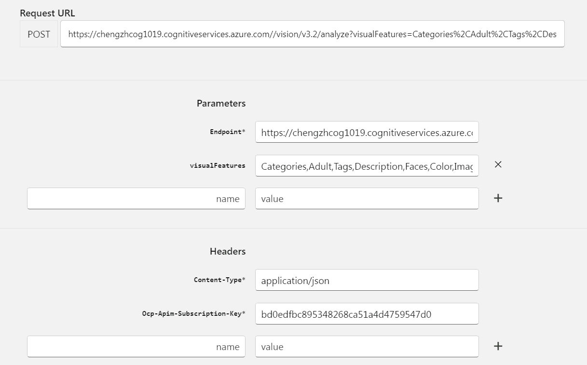

素材

https://upload.wikimedia.org/wikipedia/commons/b/bb/Asianelephant3.jpg

增加参数

```
visualFeatures 
Categories,Adult,Tags,Description,Faces,Color,ImageType,Objects,Brands
```

输出

```
{
  &quot;categories&quot;: [],
  &quot;adult&quot;: {
    &quot;isAdultContent&quot;: false,
    &quot;isRacyContent&quot;: false,
    &quot;isGoryContent&quot;: false,
    &quot;adultScore&quot;: 0.01300809346139431,
    &quot;racyScore&quot;: 0.0640704333782196,
    &quot;goreScore&quot;: 0.00121571053750813
  },
  &quot;color&quot;: {
    &quot;dominantColorForeground&quot;: &quot;White&quot;,
    &quot;dominantColorBackground&quot;: &quot;Brown&quot;,
    &quot;dominantColors&quot;: [
      &quot;Brown&quot;,
      &quot;White&quot;
    ],
    &quot;accentColor&quot;: &quot;958936&quot;,
    &quot;isBwImg&quot;: false,
    &quot;isBWImg&quot;: false
  },
  &quot;imageType&quot;: {
    &quot;clipArtType&quot;: 0,
    &quot;lineDrawingType&quot;: 0
  },
  &quot;tags&quot;: [
    {
      &quot;name&quot;: &quot;animal&quot;,
      &quot;confidence&quot;: 0.999893307685852
    },
    {
      &quot;name&quot;: &quot;mammal&quot;,
      &quot;confidence&quot;: 0.9998044371604919
    },
    {
      &quot;name&quot;: &quot;elephant&quot;,
      &quot;confidence&quot;: 0.9983136653900146
    },
    {
      &quot;name&quot;: &quot;outdoor&quot;,
      &quot;confidence&quot;: 0.9963775277137756
    },
    {
      &quot;name&quot;: &quot;tree&quot;,
      &quot;confidence&quot;: 0.9856871366500854
    },
    {
      &quot;name&quot;: &quot;elephants and mammoths&quot;,
      &quot;confidence&quot;: 0.9711592197418213
    },
    {
      &quot;name&quot;: &quot;asian elephant&quot;,
      &quot;confidence&quot;: 0.968725323677063
    },
    {
      &quot;name&quot;: &quot;indian elephant&quot;,
      &quot;confidence&quot;: 0.9646812081336975
    },
    {
      &quot;name&quot;: &quot;sky&quot;,
      &quot;confidence&quot;: 0.9505905508995056
    },
    {
      &quot;name&quot;: &quot;grass&quot;,
      &quot;confidence&quot;: 0.9481005072593689
    },
    {
      &quot;name&quot;: &quot;plant&quot;,
      &quot;confidence&quot;: 0.944722056388855
    },
    {
      &quot;name&quot;: &quot;terrestrial animal&quot;,
      &quot;confidence&quot;: 0.9430838823318481
    },
    {
      &quot;name&quot;: &quot;zoo&quot;,
      &quot;confidence&quot;: 0.9215219616889954
    },
    {
      &quot;name&quot;: &quot;african elephant&quot;,
      &quot;confidence&quot;: 0.9079951643943787
    },
    {
      &quot;name&quot;: &quot;tusk&quot;,
      &quot;confidence&quot;: 0.8962415456771851
    },
    {
      &quot;name&quot;: &quot;wildlife&quot;,
      &quot;confidence&quot;: 0.8827495574951172
    },
    {
      &quot;name&quot;: &quot;standing&quot;,
      &quot;confidence&quot;: 0.8641688823699951
    },
    {
      &quot;name&quot;: &quot;ground&quot;,
      &quot;confidence&quot;: 0.6812244653701782
    }
  ],
  &quot;description&quot;: {
    &quot;tags&quot;: [
      &quot;tree&quot;,
      &quot;outdoor&quot;,
      &quot;elephant&quot;,
      &quot;grass&quot;,
      &quot;standing&quot;,
      &quot;enclosure&quot;,
      &quot;zoo&quot;,
      &quot;dirt&quot;
    ],
    &quot;captions&quot;: [
      {
        &quot;text&quot;: &quot;an elephant walking in a zoo&quot;,
        &quot;confidence&quot;: 0.39302825927734375
      }
    ]
  },
  &quot;faces&quot;: [],
  &quot;objects&quot;: [
    {
      &quot;rectangle&quot;: {
        &quot;x&quot;: 813,
        &quot;y&quot;: 41,
        &quot;w&quot;: 162,
        &quot;h&quot;: 346
      },
      &quot;object&quot;: &quot;tree&quot;,
      &quot;confidence&quot;: 0.519,
      &quot;parent&quot;: {
        &quot;object&quot;: &quot;plant&quot;,
        &quot;confidence&quot;: 0.52
      }
    },
    {
      &quot;rectangle&quot;: {
        &quot;x&quot;: 429,
        &quot;y&quot;: 200,
        &quot;w&quot;: 494,
        &quot;h&quot;: 423
      },
      &quot;object&quot;: &quot;elephant&quot;,
      &quot;confidence&quot;: 0.813,
      &quot;parent&quot;: {
        &quot;object&quot;: &quot;mammal&quot;,
        &quot;confidence&quot;: 0.93,
        &quot;parent&quot;: {
          &quot;object&quot;: &quot;animal&quot;,
          &quot;confidence&quot;: 0.932
        }
      }
    }
  ],
  &quot;brands&quot;: [],
  &quot;requestId&quot;: &quot;6ec58062-dbed-43f5-b688-09e421e805ac&quot;,
  &quot;metadata&quot;: {
    &quot;height&quot;: 750,
    &quot;width&quot;: 1000,
    &quot;format&quot;: &quot;Jpeg&quot;
  },
  &quot;modelVersion&quot;: &quot;2021-05-01&quot;
}
```

> 这个输出是一个 JSON 格式的图像分析结果，通常由计算机视觉 API（如 Microsoft Azure Computer Vision API）生成。以下是对各个字段的解释：

1.  **categories**

> 当前为空数组，表示系统没有为这张图片归类到任何预定义的类别中。

1.  **adult**

> 包含图片是否包含成人内容的判断：

> isAdultContent： false（非成人内容）

> isRacyContent： false（非色情内容）

> isGoryContent： false（非暴力血腥内容）

> 对应的分数（值越低越安全）：

> adultScore： 0.013（成人内容可能性极低）

> racyScore： 0.064（色情内容可能性低）

> goreScore： 0.001（暴力血腥内容可能性极低）

1.  **color**

> 图片的颜色分析：

> 前景主色：White（白色）

> 背景主色：Brown（棕色）

> 所有主色：["Brown", "White"]（棕色和白色）

> 强调色：958936（十六进制颜色码，一种土黄色）

> isBwImg： false（非黑白图片）

1.  **imageType**

> 图片类型判断：

> clipArtType： 0（非剪贴画）

> lineDrawingType： 0（非线描图）

1.  **tags**

> 系统识别的标签列表，按置信度排序：

> 高置信度标签：animal（动物）、mammal（哺乳动物）、elephant（大象）、outdoor（户外）、tree（树）等。

> 其他相关标签：grass（草地）、zoo（动物园）、tusk（象牙）等。

1.  **description**

> 对图片的文本描述：

> tags： 相关关键词（如tree， elephant， zoo等）。

> captions： 生成的描述文本：

> "an elephant walking in a zoo"（一只大象在动物园里行走），置信度为 0.393。

1.  **faces**

> 为空数组，表示图片中未检测到人脸。

1.  **objects**

> 检测到的具体对象及其位置：

> **树**：

> 位置：矩形框（x=813, y=41, 宽=162, 高=346）

> 置信度：0.519

> 父对象：plant（植物，置信度 0.52）

> **大象**：

> 位置：矩形框（x=429, y=200, 宽=494, 高=423）

> 置信度：0.813

> 父对象层级：mammal（哺乳动物）→ animal（动物）。

1.  **brands**

> 为空数组，表示未检测到品牌标志。

1.  **metadata**

+   图片元数据：

+   高度：750像素

+   宽度：1000像素

+   格式：Jpeg

1.  **modelVersion**

+   使用的模型版本：2021-05-01

> **总结**

> 这张图片展示了一只大象（可能是亚洲象或非洲象）在动物园的户外环境中站立或行走，背景有树木和草地。图片无成人或暴力内容，主色调为棕色和白色，且未检测到人脸或品牌。分析结果由 2021 年 5 月版本的模型生成。

## 使用 REST 和 SDK 调用 Azure AI Service

https://microsoftlearning.github.io/mslearn-ai-services/Instructions/Exercises/01-use-azure-ai-services.html

.env

```
AI_SERVICE_ENDPOINT=YOUR_AI_SERVICES_ENDPOINT
AI_SERVICE_KEY=YOUR_AI_SERVICES_KEY
```

# 计算机视觉

## 图像分析

https://microsoftlearning.github.io/mslearn-ai-vision/Instructions/Exercises/01-analyze-images.html

```
from dotenv import load_dotenv
import os
from PIL import Image, ImageDraw
# import sys # No longer needed for command-line arguments
from matplotlib import pyplot as plt
from azure.core.exceptions import HttpResponseError
# import requests # This import was in the skeleton but is not used by the instructions.

# Import namespaces
from azure.ai.vision.imageanalysis import ImageAnalysisClient
from azure.ai.vision.imageanalysis.models import VisualFeatures
from azure.core.credentials import AzureKeyCredential

# For Jupyter Notebook, you might want to display plots inline
# %matplotlib inline # Uncomment this line if you run this in a Jupyter cell and want plots inline (though this script saves to file)

def main_interactive():
    global cv_client

    # Clear the console (less effective/needed in Jupyter, but kept for consistency if run elsewhere)
    # os.system(&#x27;cls&#x27; if os.name==&#x27;nt&#x27; else &#x27;clear&#x27;) 
    # In Jupyter, output is cleared per cell execution usually.

    try:
        # Get Configuration Settings
        # Make sure you have a .env file in the same directory as your notebook
        # or provide the path to the .env file if it&#x27;s elsewhere.
        # Example: load_dotenv(dotenv_path=os.path.join(os.getcwd(), &#x27;.env&#x27;))
        if not load_dotenv():
            print(&quot;Warning: .env file not found. Make sure AI_SERVICE_ENDPOINT and AI_SERVICE_KEY are set as environment variables or in a .env file.&quot;)

        ai_endpoint = os.getenv(&#x27;AI_SERVICE_ENDPOINT&#x27;)
        ai_key = os.getenv(&#x27;AI_SERVICE_KEY&#x27;)

        # Validate credentials
        if not ai_endpoint or not ai_key:
            print(&quot;Error: AI_SERVICE_ENDPOINT or AI_SERVICE_KEY not found.&quot;)
            print(&quot;Please ensure you have a .env file in the same directory as the notebook (or where Python is executed from),&quot;)
            print(&quot;and it contains your Azure AI service endpoint and key, OR that these are set as environment variables.&quot;)
            return

        # --- Interactive Image Selection ---
        print(&quot;Please choose an image to analyze:&quot;)
        print(&quot;1: images/building.jpg&quot;)
        print(&quot;2: images/person.jpg&quot;)
        print(&quot;3: images/street.jpg&quot;)

        image_options = {
            &quot;1&quot;: &quot;images/building.jpg&quot;,
            &quot;2&quot;: &quot;images/person.jpg&quot;,
            &quot;3&quot;: &quot;images/street.jpg&quot;
        }
        
        choice = &quot;&quot;
        while choice not in image_options:
            choice = input(&quot;Enter your choice (1, 2, or 3): &quot;)
            if choice not in image_options:
                print(&quot;Invalid choice. Please enter 1, 2, or 3.&quot;)
        
        image_file = image_options[choice]
        print(f&quot;You selected: {image_file}&quot;)
        # --- End Interactive Image Selection ---

        if not os.path.exists(image_file):
            print(f&quot;Error: Image file &#x27;{image_file}&#x27; not found. Make sure the &#x27;images&#x27; folder and its contents are accessible.&quot;)
            return

        with open(image_file, &quot;rb&quot;) as f:
            image_data = f.read()

        # Authenticate Azure AI Vision client
        cv_client = ImageAnalysisClient(
            endpoint=ai_endpoint,
            credential=AzureKeyCredential(ai_key)
        )
        
        # Analyze image
        AnalyzeImage(image_file, image_data, cv_client)
        
    except Exception as ex:
        print(f&quot;An unexpected error occurred in main_interactive: {ex}&quot;)


def AnalyzeImage(image_filename, image_data, cv_client):
    print(f&#x27;\nAnalyzing {image_filename}...&#x27;)

    try:
        # Get result with specified features to be retrieved
        result = cv_client.analyze(
            image_data=image_data,
            visual_features=[
                VisualFeatures.CAPTION,
                VisualFeatures.DENSE_CAPTIONS,
                VisualFeatures.TAGS,
                VisualFeatures.OBJECTS,
                VisualFeatures.PEOPLE],
        )

    except HttpResponseError as e:
        print(f&quot;Status code: {e.status_code}&quot;)
        print(f&quot;Reason: {e.reason}&quot;)
        if hasattr(e, &#x27;error&#x27;) and hasattr(e.error, &#x27;message&#x27;):
             print(f&quot;Message: {e.error.message}&quot;)
        else:
            print(f&quot;Full error: {e}&quot;)
        return # Exit if analysis fails
    except Exception as ex_analyze:
        print(f&quot;Error during analysis: {ex_analyze}&quot;)
        return


    # Display analysis results
    if result: # Check if result is not None
        # Get image captions
        if result.caption is not None:
            print(&quot;\nCaption:&quot;)
            print(&quot; Caption: &#x27;{}&#x27; (confidence: {:.2f}%)&quot;.format(result.caption.text, result.caption.confidence * 100))

        # Get image dense captions
        if result.dense_captions is not None:
            print(&quot;\nDense Captions:&quot;)
            for caption in result.dense_captions.list:
                print(&quot; Caption: &#x27;{}&#x27; (confidence: {:.2f}%)&quot;.format(caption.text, caption.confidence * 100))

        # Get image tags
        if result.tags is not None:
            print(&quot;\nTags:&quot;)
            for tag in result.tags.list:
                print(&quot; Tag: &#x27;{}&#x27; (confidence: {:.2f}%)&quot;.format(tag.name, tag.confidence * 100))

        # Get objects in the image
        if result.objects is not None and len(result.objects.list) &gt; 0:
            print(&quot;\nObjects in image:&quot;)

            # Prepare image for drawing
            image = Image.open(image_filename)
            fig = plt.figure(figsize=(image.width/100, image.height/100))
            plt.axis(&#x27;off&#x27;)
            draw = ImageDraw.Draw(image)
            color = &#x27;cyan&#x27;

            for detected_object in result.objects.list:
                # Print object name
                if detected_object.tags and len(detected_object.tags) &gt; 0:
                    print(&quot; {} (confidence: {:.2f}%)&quot;.format(detected_object.tags[0].name, detected_object.tags[0].confidence * 100))
                    
                    # Draw object bounding box
                    r = detected_object.bounding_box
                    bounding_box = ((r.x, r.y), (r.x + r.width, r.y + r.height)) 
                    draw.rectangle(bounding_box, outline=color, width=3)
                    plt.annotate(detected_object.tags[0].name,(r.x, r.y), backgroundcolor=color)
                else:
                    print(&quot; Detected object with no tags.&quot;)


            # Save annotated image
            plt.imshow(image)
            plt.tight_layout(pad=0)
            outputfile = &#x27;objects.jpg&#x27;
            try:
                fig.savefig(outputfile)
                print(f&#x27;  Results saved in {outputfile}&#x27;)
            except Exception as e_save:
                print(f&quot;Error saving {outputfile}: {e_save}&quot;)
            plt.close(fig) # Close the figure to free memory
        
        elif result.objects is not None and len(result.objects.list) == 0:
            print(&quot;\nNo objects detected in the image.&quot;)


        # Get people in the image
        if result.people is not None and len(result.people.list) &gt; 0:
            print(&quot;\nPeople in image:&quot;)

            # Prepare image for drawing
            # Re-open the original image for drawing people, so it doesn&#x27;t include object annotations
            image = Image.open(image_filename) 
            fig = plt.figure(figsize=(image.width/100, image.height/100))
            plt.axis(&#x27;off&#x27;)
            draw = ImageDraw.Draw(image)
            color = &#x27;cyan&#x27;

            for detected_people in result.people.list:
                # Draw object bounding box
                r = detected_people.bounding_box
                bounding_box = ((r.x, r.y), (r.x + r.width, r.y + r.height))
                draw.rectangle(bounding_box, outline=color, width=3)

                # Return the confidence of the person detected
                # (Optional) Uncomment the Console.Writeline command under the Return the confidence of the person detected section
                # In Python, this would be:
                # print(&quot; BoundingBox: {}, Confidence: {:.2f}%&quot;.format(detected_people.bounding_box, detected_people.confidence * 100))
                
            # Save annotated image
            plt.imshow(image)
            plt.tight_layout(pad=0)
            outputfile = &#x27;people.jpg&#x27;
            try:
                fig.savefig(outputfile)
                print(f&#x27;  Results saved in {outputfile}&#x27;)
            except Exception as e_save:
                print(f&quot;Error saving {outputfile}: {e_save}&quot;)
            plt.close(fig) # Close the figure to free memory

        elif result.people is not None and len(result.people.list) == 0:
            print(&quot;\nNo people detected in the image.&quot;)
    else:
        print(&quot;Analysis returned no result.&quot;)

# To run in Jupyter Notebook, you would call this function directly in a cell:
# if __name__ == &quot;__main__&quot;: # This guard is good practice but not strictly necessary if only calling main_interactive()
main_interactive()
```

> 好的，这是根据代码和手册步骤，对每个主要导入模块（或其中的特定类/函数）在脚本中作用的简要介绍：

1.  from dotenv import load_dotenv:

+   **功能**：load_dotenv 函数用于从一个名为 .env 的文件中加载环境变量。在这个脚本中，它用来加载 Azure AI 服务的 AI_SERVICE_ENDPOINT （终结点） 和 AI_SERVICE_KEY （密钥），这样就不需要将这些敏感信息硬编码到脚本中。

1.  **import os**:

+   **功能**：提供了与操作系统交互的功能。

+   os.getenv()： 用于读取通过 load_dotenv 加载的环境变量（如 API 密钥和终结点）。

+   os.path.exists()： 用于检查指定的图像文件路径是否存在。

+   os.system('cls' if os.name=='nt' else 'clear')： （虽然在 Jupyter Notebook 中效果不明显）用于尝试清除终端/控制台的输出。

1.  from PIL import Image, ImageDraw （Pillow 库）:

+   **Image**:

+   **功能**：用于打开和操作图像文件。在这个脚本中，Image.open(image_filename) 用来打开本地的图像文件，以便后续在其上绘制检测框。

+   **ImageDraw**:

+   **功能**：提供在图像上进行 2D 图形绘制（如形状、文本）的功能。在这个脚本中，ImageDraw.Draw(image) 创建一个绘图对象，然后使用其 rectangle() 方法来绘制检测到的物体和人物的边界框。

1.  **from matplotlib **import pyplot as plt:

+   **功能**：一个广泛使用的 Python 绘图库。

+   plt.figure()： 创建一个新的图形窗口。

+   plt.axis('off')： 关闭坐标轴的显示，使图像看起来更干净。

+   plt.imshow(image)： 在图形窗口中显示图像。

+   plt.annotate()： 在图像的指定位置添加文本注释（例如，在边界框旁边标注物体名称）。

+   fig.savefig(outputfile)： 将带有标注的图像保存到文件（如 objects.jpg， people.jpg）。

+   plt.close(fig)： 关闭图形，释放资源。

1.  **from azure.core.exceptions impo**rt HttpResponseError:

+   **功能**：Azure SDK 中定义的一个特定异常类型。当调用 Azure 服务 API 时，如果发生 HTTP 错误（例如，身份验证失败、请求无效、服务内部错误等），会抛出此异常。脚本中的 try...except HttpResponseError 块用于捕获并处理这类网络或服务相关的错误。

1.  **f**rom azure.ai.vision.imageanalysis import ImageAnalysisClient:

+   **功能**：这是 Azure AI Vision SDK 的核心客户端类。你需要创建这个类的一个实例，以便与 Azure AI 视觉服务进行通信。它包含了进行图像分析所需的方法，如 analyze()。

1.  **f**rom azure.ai.vision.imageanalysis.models import VisualFeatures:

+   **功能**：提供了一个名为 VisualFeatures 的枚举（enum）。这个枚举定义了你可以请求视觉服务分析的各种视觉特征，例如：

+   VisualFeatures.CAPTION （图像描述）

+   VisualFeatures.DENSE_CAPTIONS （密集描述）

+   VisualFeatures.TAGS （标签）

+   VisualFeatures.OBJECTS （物体检测）

+   VisualFeatures.PEOPLE （人物检测）
在调用 client.analyze() 方法时，你会传入一个包含这些特征的列表，告诉服务你希望得到哪些分析结果。

1.  **f**rom azure.core.credentials import AzureKeyCredential:

+   **功能**：Azure SDK 中用于处理基于密钥的身份验证的类。AzureKeyCredential(ai_key) 使用你的 Azure 服务密钥创建一个凭据对象。这个凭据对象随后被传递给 ImageAnalysisClient 的构造函数，以便客户端在向 Azure 发送请求时能够成功验证身份。

输出结果

```
Please choose an image to analyze:
1: images/building.jpg
2: images/person.jpg
3: images/street.jpg
Enter your choice (1, 2, or 3): 3
You selected: images/street.jpg

Analyzing images/street.jpg...

Caption:
 Caption: &#x27;a man walking a dog on a leash on a street&#x27; (confidence: 82.05%)

Dense Captions:
 Caption: &#x27;a man walking a dog on a leash on a street&#x27; (confidence: 82.05%)
 Caption: &#x27;a man walking on a street&#x27; (confidence: 69.03%)
 Caption: &#x27;a yellow car on the street&#x27; (confidence: 78.22%)
 Caption: &#x27;a black dog walking on the street&#x27; (confidence: 75.31%)
 Caption: &#x27;a blurry image of a blue car&#x27; (confidence: 82.01%)
 Caption: &#x27;a yellow taxi cab on the street&#x27; (confidence: 72.42%)

Tags:
 Tag: &#x27;outdoor&#x27; (confidence: 99.87%)
 Tag: &#x27;land vehicle&#x27; (confidence: 99.02%)
 Tag: &#x27;vehicle&#x27; (confidence: 98.89%)
 Tag: &#x27;building&#x27; (confidence: 98.55%)
 Tag: &#x27;road&#x27; (confidence: 95.98%)
 Tag: &#x27;wheel&#x27; (confidence: 95.14%)
 Tag: &#x27;street&#x27; (confidence: 94.71%)
 Tag: &#x27;person&#x27; (confidence: 93.01%)
 Tag: &#x27;clothing&#x27; (confidence: 91.19%)
 Tag: &#x27;taxi&#x27; (confidence: 90.95%)
 Tag: &#x27;car&#x27; (confidence: 84.01%)
 Tag: &#x27;dog&#x27; (confidence: 82.68%)
 Tag: &#x27;yellow&#x27; (confidence: 77.08%)
 Tag: &#x27;walking&#x27; (confidence: 74.11%)
 Tag: &#x27;city&#x27; (confidence: 64.80%)
 Tag: &#x27;woman&#x27; (confidence: 57.53%)

Objects in image:
 car (confidence: 72.40%)
 taxi (confidence: 77.00%)
 person (confidence: 78.10%)
 dog (confidence: 54.40%)
  Results saved in objects.jpg

People in image:
  Results saved in people.jpg
```

> 好的，我们来逐步解析这段输出，它展示了对 images/street.jpg 这张图片进行图像分析的结果。

1.  **用户交互与图片选择**：

```
 Please choose an image to analyze:
 1: images/building.jpg
 2: images/person.jpg
 3: images/street.jpg
 Enter your choice (1, 2, or 3): 3
 You selected: images/street.jpg
```

+   **解析**： 这部分显示了程序的用户交互界面。程序提供了三个图片选项，用户输入了 3，选择了 images/street.jpg 进行分析。

1.  **开始分析**：

```
 Analyzing images/street.jpg...
```

+   **解析**： 程序确认了用户的选择，并开始调用 Azure AI Vision 服务对 street.jpg进行分析。

1.  **Caption （图像描述）**:

```
 Caption:
  Caption: &#x27;a man walking a dog on a leash on a street&#x27; (confidence: 82.05%)
```

+   **解析**： 这是 Azure AI Vision 为整个图像生成的最主要的描述性语句。

+   'a man walking a dog on a leash on a street'：AI 认为图片内容是一个男人在街上用狗绳遛狗。

+   (confidence: 82.05%)：AI 对这个描述的准确性有 82.05%的置信度。置信度越高，AI 越确定这个描述是正确的。

1.  Dense Captions （密集描述）:

```
 Dense Captions:
  Caption: &#x27;a man walking a dog on a leash on a street&#x27; (confidence: 82.05%)
  Caption: &#x27;a man walking on a street&#x27; (confidence: 69.03%)
  Caption: &#x27;a yellow car on the street&#x27; (confidence: 78.22%)
  Caption: &#x27;a black dog walking on the street&#x27; (confidence: 75.31%)
  Caption: &#x27;a blurry image of a blue car&#x27; (confidence: 82.01%)
  Caption: &#x27;a yellow taxi cab on the street&#x27; (confidence: 72.42%)
```

+   **解析**： 密集描述会识别图像中多个不同的区域或物体，并为它们分别生成描述。这比单一的整体描述提供了更丰富的细节。

+   它再次提到了“男人遛狗”，并给出了相似的置信度。

+   它还识别出“男人在街上走”、“街上有辆黄色的车”、“黑狗在街上走”、“一辆蓝色汽车的模糊图像”（可能图片中某处有辆不太清晰的蓝色车）、“街上有辆黄色的出租车”。

+   每个密集描述也都有自己的置信度分数。

1.  **Tags （标签）**:

```
 Tags:
  Tag: &#x27;outdoor&#x27; (confidence: 99.87%)
  Tag: &#x27;land vehicle&#x27; (confidence: 99.02%)
  ... (其他标签) ...
  Tag: &#x27;woman&#x27; (confidence: 57.53%)
```

+   **解析**： 标签是描述图像内容的一些关键词。这些标签可以帮助分类和搜索图像。

+   例如，'outdoor' （户外场景） 的置信度非常高 （99.87%），表明 AI 非常确定这是个户外场景。

+   其他标签如 'land vehicle' （陆地车辆）， 'building' （建筑）， 'road' （道路）， 'person' （人）， 'dog' （狗）， 'car' （汽车）， 'taxi' （出租车） 都与街景的典型元素相符。

+   注意到 'woman' （女人） 的置信度相对较低 （57.53%），这可能意味着图片中有人，但 AI 不太确定其性别，或者某个物体被误识别。

1.  Objects in image （图像中的物体检测）:

```
 Objects in image:
  car (confidence: 72.40%)
  taxi (confidence: 77.00%)
  person (confidence: 78.10%)
  dog (confidence: 54.40%)
   Results saved in objects.jpg
```

+   **解析**： 这部分列出了 AI 在图像中检测到的具体物体，并给出了每个物体的置信度。

+   检测到了 'car' （汽车）， 'taxi' （出租车）， 'person' （人）， 和 'dog' （狗）。

+   Results saved in objects.jpg：表示 AI 不仅识别了这些物体，还将它们的位置（通过边界框）在原始图片上标注出来，并保存为名为 objects.jpg 的新图片。你可以打开这个文件查看具体的标注。

1.  People in image （图像中的人物检测）:

```
 People in image:
   Results saved in people.jpg
```

+   **解析**： 这部分专门针对图像中的人物进行检测。

+   Results saved in people.jpg：与物体检测类似，AI 会将检测到的人物（通过边界框）在原始图片上标注出来，并保存为名为 people.jpg 的新图片。

+   （可选）如果代码中取消了打印人物检测置信度的注释，这里还会显示每个人物边界框及其对应的置信度。

> **总结**：

> 这张 street.jpg 的分析结果表明，Azure AI Vision 成功地理解了图像的主要场景（一个男人在街上遛狗，周围有车辆和建筑）。它提供了：

+   一个整体的描述。

+   对图像不同部分的多个详细描述。

+   一系列相关的标签。

+   识别并定位了图像中的关键物体（汽车、出租车、人、狗）。

+   专门检测并定位了图像中的人。

> 输出的 objects.jpg 和 people.jpg 文件会直观地展示这些检测结果在图像上的具体位置。置信度分数帮助我们了解 AI 对其每个判断的把握程度。

street.jpg


objects.jpg


people.jpg


## OCR 实验

https://microsoftlearning.github.io/mslearn-ai-vision/Instructions/Exercises/05-ocr.html#prepare-to-use-the-azure-ai-vision-sdk

```
from dotenv import load_dotenv
import os
import time # time模块在此版本中未直接使用，但保留以防未来需要
from PIL import Image, ImageDraw
from matplotlib import pyplot as plt

# Import namespaces
from azure.ai.vision.imageanalysis import ImageAnalysisClient
from azure.ai.vision.imageanalysis.models import VisualFeatures
from azure.core.credentials import AzureKeyCredential
from azure.core.exceptions import HttpResponseError # 导入用于错误处理


def main():

    global cv_client # 将 cv_client 声明为全局变量，以便 GetTextRead 可以访问

    try:
        # Get Configuration Settings
        load_dotenv()
        ai_endpoint = os.getenv(&#x27;AI_SERVICE_ENDPOINT&#x27;)
        ai_key = os.getenv(&#x27;AI_SERVICE_KEY&#x27;)

        if not ai_endpoint or not ai_key:
            print(&quot;错误：环境变量 AI_SERVICE_ENDPOINT 或 AI_SERVICE_KEY 未设置。&quot;)
            print(&quot;请确保您的 .env 文件包含这些值。&quot;)
            return

        # Authenticate Azure AI Vision client
        cv_client = ImageAnalysisClient(
            endpoint=ai_endpoint,
            credential=AzureKeyCredential(ai_key)
        )
        

        # Menu for text reading functions
        print(&#x27;\n1: Use Read API for image (Lincoln.jpg)\n2: Read handwriting (Note.jpg)\nAny other key to quit\n&#x27;)
        command = input(&#x27;Enter a number:&#x27;)
        if command == &#x27;1&#x27;:
            image_file = os.path.join(&#x27;images&#x27;,&#x27;Lincoln.jpg&#x27;)
            if not os.path.exists(image_file):
                print(f&quot;错误：图片文件 &#x27;{image_file}&#x27; 未找到。&quot;)
                return
            GetTextRead(image_file)
        elif command ==&#x27;2&#x27;:
            image_file = os.path.join(&#x27;images&#x27;,&#x27;Note.jpg&#x27;)
            if not os.path.exists(image_file):
                print(f&quot;错误：图片文件 &#x27;{image_file}&#x27; 未找到。&quot;)
                return
            GetTextRead(image_file)
        # else: # 任何其他键退出
        #     print(&quot;程序退出。&quot;)
                

    except Exception as ex:
        print(f&quot;发生错误: {ex}&quot;)

def GetTextRead(image_file):
    print(f&#x27;\n正在从 {image_file} 读取文本...&#x27;)

    # Open image file
    with open(image_file, &quot;rb&quot;) as f:
            image_data = f.read()
    
    result = None # 初始化 result

    try:
        # Use Analyze image function to read text in image
        result = cv_client.analyze(
            image_data=image_data,
            visual_features=[VisualFeatures.READ]
        )
    except HttpResponseError as e:
        print(f&quot;--- 调用 API 时发生错误 ---&quot;)
        print(f&quot;状态码: {e.status_code}&quot;)
        print(f&quot;原因: {e.reason}&quot;)
        if hasattr(e, &#x27;error&#x27;) and hasattr(e.error, &#x27;message&#x27;):
            print(f&quot;错误消息: {e.error.message}&quot;)
        return # 如果API调用失败则退出函数
    except Exception as general_ex:
        print(f&quot;--- 分析过程中发生未知错误 ---&quot;)
        print(general_ex)
        return


    # Display the image and overlay it with the extracted text
    if result and result.read is not None: # 确保 result 和 result.read 都有效
        print(&quot;\nText:&quot;)

        # Prepare image for drawing
        image = Image.open(image_file)
        # fig = plt.figure(figsize=(image.width/100, image.height/100)) # 创建与图片大小匹配的figure
        # plt.axis(&#x27;off&#x27;) # 关闭坐标轴
        draw = ImageDraw.Draw(image)
        color = &#x27;cyan&#x27; # 边界框颜色

        for line in result.read.blocks[0].lines: # 假设文本在第一个 block 中
            # Return the text detected in the image
            print(f&quot;  {line.text}&quot;)    
            
            # drawLinePolygon = True # 这个变量在手册中用于C#控制是否画线框，Python中可以直接画
            
            # Convert Azure&#x27;s BoundingPolygon to PIL/Pillow format
            # line.bounding_polygon is a list of Point objects like {&#x27;x&#x27;: 10, &#x27;y&#x27;: 20}
            line_bounding_polygon_points = []
            for point in line.bounding_polygon:
                line_bounding_polygon_points.append((point.x, point.y))
            
            # Return the position bounding box around each line
            print(&quot;   Bounding Polygon: {}&quot;.format(line_bounding_polygon_points)) # 打印转换后的多边形点
            
            # Draw line bounding polygon (手册中先画线，再画词，这里我们只画词的框，如手册最终效果)
            # if drawLinePolygon: # 如果要画线的框，取消注释下面这行
                # draw.polygon(line_bounding_polygon_points, outline=color, width=3)

            # Return each word detected in the image and the position bounding box around each word with the confidence level of each word
            for word in line.words:
                word_bounding_polygon_points = []
                for point in word.bounding_polygon:
                    word_bounding_polygon_points.append((point.x, point.y))
                
                print(f&quot;    Word: &#x27;{word.text}&#x27;, Bounding Polygon: {word_bounding_polygon_points}, Confidence: {word.confidence:.4f}&quot;)
                
                # Draw word bounding polygon
                # drawLinePolygon = False # 手册C#中用于切换，Python中直接绘制
                draw.polygon(word_bounding_polygon_points, outline=color, width=3) # 绘制每个单词的边界框
            
        # Save image (使用Pillow保存，因为我们用Pillow绘制的)
        outputfile = &#x27;text.jpg&#x27;
        image.save(outputfile)
        print(f&#x27;\n  带有文本高亮的图片已保存至: {outputfile}&#x27;)

        # 如果想用 matplotlib 显示和保存（如手册中的fig.savefig）：
        # 需要在循环前创建 fig 和 plt.axis(&#x27;off&#x27;)
        # 并在循环后执行以下操作：
        # plt.imshow(image)
        # plt.tight_layout(pad=0)
        # outputfile_mpl = &#x27;text_mpl.jpg&#x27;
        # fig.savefig(outputfile_mpl)
        # print(f&#x27;\n  Matplotlib 保存的图片: {outputfile_mpl}&#x27;)
        # plt.show() # 可选，直接显示图片

    elif result and result.read is None:
        print(&quot;\n未在图片中检测到文本。&quot;)
    else:
        print(&quot;\n分析未返回有效结果。&quot;)


if __name__ == &quot;__main__&quot;:
    main()
```

>

1.  **环境配置与初始化 （****main()**** 函数的开头部分）**：

+   **功能**：此模块负责设置程序运行所需的环境。

+   **具体操作**：

+   加载 .env 文件中的环境变量，主要是 Azure AI Vision 服务的 API 端点 （AI_SERVICE_ENDPOINT） 和密钥 （AI_SERVICE_KEY）。这是为了安全地存储和访问敏感信息。

+   使用获取到的端点和密钥，初始化并认证 ImageAnalysisClient 对象 （cv_client）。这个 cv_client 是后续与 Azure 服务进行所有通信的接口。

+   **与输出的关联**：这部分操作在后台完成，用户直接看到的输出始于菜单。如果这里配置错误（例如，API Key 无效），GetTextRead 中的 API 调用会失败。

1.  **用户交互与任务分发 （****main()**** 函数的菜单部分）**：

+   **功能**：提供一个简单的命令行菜单，让用户选择要执行的操作（是分析印刷体图像还是手写体图像）。

+   **具体操作**：

+   向用户显示选项："1: Use Read API for image （Lincoln.jpg）" 和 "2: Read handwriting （Note.jpg）"。

+   接收用户的输入。

+   根据用户的选择（在您的例子中是 '1'），确定要处理的图像文件路径 （images\Lincoln.jpg）。

+   调用核心的文本读取函数 GetTextRead()，并将选定的图像文件路径传递给它。

+   **与输出的关联**：您的输出清晰地显示了菜单和您选择的 '1'：

```
      1: Use Read API for image (Lincoln.jpg)
2: Read handwriting (Note.jpg)
Any other key to quit

Enter a number:1
```

1.  **图像数据准备与 API 调****用 （GetTex**tRead() 函数的开头部分）：

+   **功能**：负责读取本地图像文件，并调用 Azure AI Vision 服务进行文本识别。

+   **具体操作**：

+   打印提示信息，告知用户正在处理哪个文件（例如，正在从 images\Lincoln.jpg 读取文本...）。

+   以二进制格式打开并读取指定的图像文件，将其内容存入 image_data。

+   使用之前初始化的 cv_client 对象，调用其 analyze() 方法。关键参数是：

+   image_data： 包含图像二进制内容。

+   visual_features=[VisualFeatures.READ]： 明确指示 Azure 服务执行文本读取（OCR）功能。

+   API 调用成功后，结果会存储在 result 对象中。

+   **与输出的关联**：

```
      正在从 images\Lincoln.jpg 读取文本...
```

+   这行输出直接对应了此模块开始处理图像的动作。后续的文本输出都来源于 result 对象中的数据。

1.  **文本结果解析与控制台输出 （****GetTextRead()**** 函数中处理 ****result.read**** 的部分）**：

+   **功能**：解析从 Azure 服务返回的结构化文本识别结果，并在控制台友好地显示这些信息。

+   **具体操作**：

+   检查 result 和 result.read 是否有效，确保服务成功返回了文本信息。

+   遍历识别到的文本行 （line in result.read.blocks.lines）。

+   对于每一行：

+   打印该行的完整文本 （line.text）。

+   打印该行在图像中的边界多边形坐标 （line.bounding_polygon）。

+   进一步遍历该行中的每一个单词 （word in line.words）。

+   对于每一个单词：

+   打印单词的文本内容 （word.text）。

+   打印单词在图像中的边界多边形坐标 （word.bounding_polygon）。

+   打印单词识别的置信度 （word.confidence）。

+   **与输出的关联**：这部分代码直接生成了您提供的大部分控制台输出，例如：

1.  **图像处理与结果可视化 （****GetTextRead()** 函数中使用 Pillow 绘图和保存的部分）：

+   **功能**：在原始图像的副本上，根据识别到的文本位置信息，绘制边界框以高亮显示文本，并将处理后的图像保存到文件。

+   **具体操作**：

+   使用 Pillow 库 （Image.open()） 打开原始图像文件。

+   创建一个 ImageDraw.Draw() 对象，用于在图像上绘图。

+   在遍历每个识别到的单词时，获取其边界多边形坐标。

+   使用 draw.polygon() 方法，在图像上围绕每个单词绘制一个青色 （cyan） 的多边形框。

+   所有单词处理完毕后，将这张带有高亮文本框的图像保存为 text.jpg 文件。

+   在控制台打印保存成功的消息。

+   **与输出的关联**：

```
      带有文本高亮的图片已保存至: text.jpg
```

+   这行输出确认了此模块已成功执行。同时，您应该能在程序运行的目录下找到一个名为 text.jpg 的图片文件，打开它会看到 Lincoln.jpg 图像上的文本单词被青色的框标记出来了。

> 总结来说，这个程序的工作流程是：

> **配置 -> 用户选**择 -> 读取图像 -> 调用**云服务分析文本 **-> 解析结果并打印 -> 在图像上标记文本 -> 保存标记后的图像。

> 核心在于利用 Azure AI Vision SDK 与云服务通信，获取文本的详细信息（内容、位置、置信度），然后本地代码负责展示这些信息并进行可视化处理。您的输出完整地反映了这一流程的每一步。

输出

```
1: Use Read API for image (Lincoln.jpg)
2: Read handwriting (Note.jpg)
Any other key to quit

Enter a number:1

正在从 images\Lincoln.jpg 读取文本...

Text:
  IN THIS TEMPLE
   Bounding Polygon: [(328, 171), (477, 169), (477, 184), (328, 186)]
    Word: &#x27;IN&#x27;, Bounding Polygon: [(328, 171), (342, 171), (342, 187), (328, 187)], Confidence: 0.9930
    Word: &#x27;THIS&#x27;, Bounding Polygon: [(357, 171), (397, 170), (397, 185), (357, 186)], Confidence: 0.9910
    Word: &#x27;TEMPLE&#x27;, Bounding Polygon: [(407, 170), (474, 170), (474, 184), (407, 185)], Confidence: 0.9930
  AS IN THE HEARTS OF THE PEOPLE
   Bounding Polygon: [(240, 193), (564, 188), (564, 203), (240, 210)]
    Word: &#x27;AS&#x27;, Bounding Polygon: [(241, 194), (262, 194), (262, 210), (241, 211)], Confidence: 0.9950
    Word: &#x27;IN&#x27;, Bounding Polygon: [(270, 193), (284, 193), (284, 210), (270, 210)], Confidence: 0.9980
    Word: &#x27;THE&#x27;, Bounding Polygon: [(298, 193), (332, 192), (332, 208), (298, 209)], Confidence: 0.9930
    Word: &#x27;HEARTS&#x27;, Bounding Polygon: [(340, 192), (410, 191), (410, 207), (340, 208)], Confidence: 0.9940
    Word: &#x27;OF&#x27;, Bounding Polygon: [(420, 190), (444, 190), (444, 206), (420, 206)], Confidence: 0.9930
    Word: &#x27;THE&#x27;, Bounding Polygon: [(452, 190), (487, 189), (487, 205), (452, 206)], Confidence: 0.9930
    Word: &#x27;PEOPLE&#x27;, Bounding Polygon: [(495, 189), (562, 188), (562, 204), (495, 205)], Confidence: 0.9960
  FOR WHOM HE SAVED THE UNION
   Bounding Polygon: [(237, 214), (568, 208), (569, 224), (237, 231)]
    Word: &#x27;FOR&#x27;, Bounding Polygon: [(238, 214), (271, 213), (271, 231), (237, 231)], Confidence: 0.9950
    Word: &#x27;WHOM&#x27;, Bounding Polygon: [(281, 213), (339, 212), (339, 229), (281, 230)], Confidence: 0.9880
    Word: &#x27;HE&#x27;, Bounding Polygon: [(355, 212), (378, 212), (378, 228), (354, 229)], Confidence: 0.9980
    Word: &#x27;SAVED&#x27;, Bounding Polygon: [(388, 212), (441, 211), (440, 227), (388, 228)], Confidence: 0.9940
    Word: &#x27;THE&#x27;, Bounding Polygon: [(455, 211), (491, 210), (490, 226), (455, 227)], Confidence: 0.9930
    Word: &#x27;UNION&#x27;, Bounding Polygon: [(501, 210), (560, 209), (559, 225), (500, 226)], Confidence: 0.9970
  THE MEMORY OF ABRAHAM LINCOLN
   Bounding Polygon: [(226, 235), (575, 229), (576, 245), (226, 252)]
    Word: &#x27;THE&#x27;, Bounding Polygon: [(228, 235), (260, 235), (260, 252), (228, 252)], Confidence: 0.9980
    Word: &#x27;MEMORY&#x27;, Bounding Polygon: [(268, 235), (349, 234), (349, 250), (268, 251)], Confidence: 0.9960
    Word: &#x27;OF&#x27;, Bounding Polygon: [(358, 234), (382, 234), (381, 250), (357, 250)], Confidence: 0.9990
    Word: &#x27;ABRAHAM&#x27;, Bounding Polygon: [(389, 233), (473, 232), (472, 248), (389, 249)], Confidence: 0.9960
    Word: &#x27;LINCOLN&#x27;, Bounding Polygon: [(488, 231), (570, 229), (570, 245), (487, 247)], Confidence: 0.9940
  IS ENSHRINED FOREVER
   Bounding Polygon: [(288, 255), (515, 253), (516, 268), (288, 271)]
    Word: &#x27;IS&#x27;, Bounding Polygon: [(288, 256), (302, 256), (302, 272), (288, 272)], Confidence: 0.9960
    Word: &#x27;ENSHRINED&#x27;, Bounding Polygon: [(311, 256), (416, 255), (417, 270), (311, 272)], Confidence: 0.9930
    Word: &#x27;FOREVER&#x27;, Bounding Polygon: [(431, 255), (510, 253), (511, 268), (431, 270)], Confidence: 0.9950

  带有文本高亮的图片已保存至: text.jpg
```

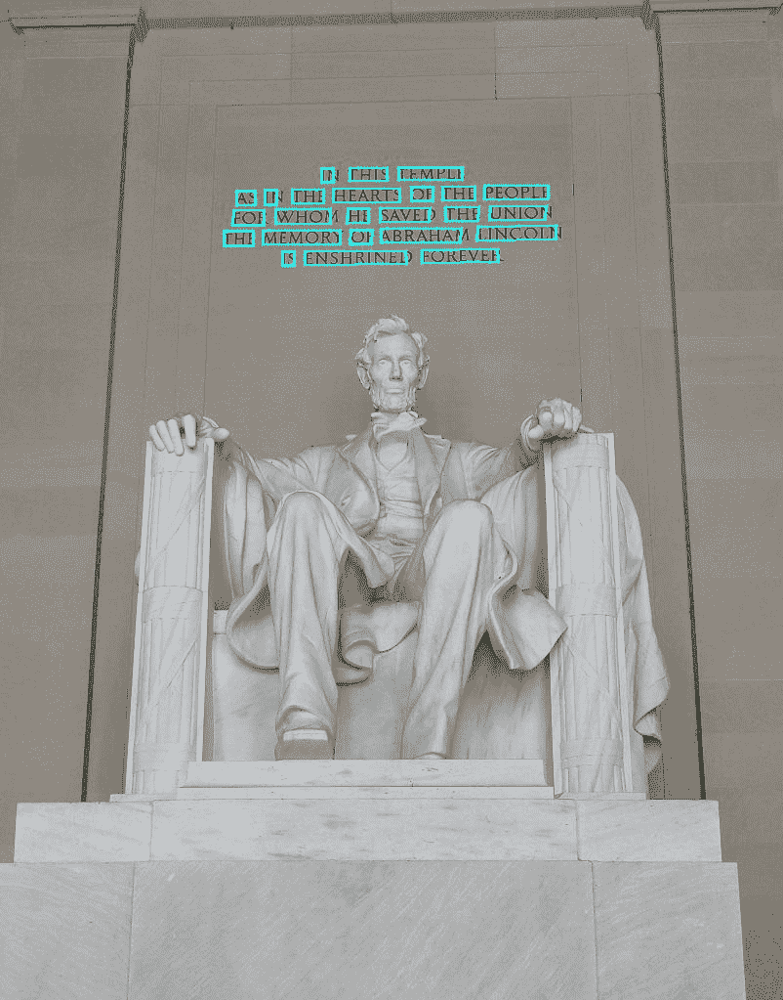

## 人脸识别

https://microsoftlearning.github.io/mslearn-ai-vision/Instructions/Exercises/04-face-service.html

```
from dotenv import load_dotenv
import os
from PIL import Image, ImageDraw
from matplotlib import pyplot as plt

# Import namespaces
from azure.ai.vision.face import FaceClient
from azure.ai.vision.face.models import FaceDetectionModel, FaceRecognitionModel, FaceAttributeTypeDetection03
from azure.core.credentials import AzureKeyCredential

def main():

    global face_client

    try:
        # Get Configuration Settings
        load_dotenv()
        cog_endpoint = os.getenv(&#x27;AI_SERVICE_ENDPOINT&#x27;)
        cog_key = os.getenv(&#x27;AI_SERVICE_KEY&#x27;)

        # Authenticate Face client
        face_client = FaceClient(
            endpoint=cog_endpoint,
            credential=AzureKeyCredential(cog_key)
        )

        # Menu for face functions
        print(&#x27;1: Detect faces in images/people.jpg&#x27;)
        print(&#x27;2: Detect faces in images/person1.jpg&#x27;)
        print(&#x27;3: Detect faces in images/person2.jpg&#x27;)
        print(&#x27;Any other key to quit&#x27;)
        command = input(&#x27;Enter a number:&#x27;)

        if command == &#x27;1&#x27;:
            DetectFaces(os.path.join(&#x27;images&#x27;,&#x27;people.jpg&#x27;))
        elif command == &#x27;2&#x27;:
            DetectFaces(os.path.join(&#x27;images&#x27;,&#x27;person1.jpg&#x27;))
        elif command == &#x27;3&#x27;:
            DetectFaces(os.path.join(&#x27;images&#x27;,&#x27;person2.jpg&#x27;))

    except Exception as ex:
        print(ex)

def DetectFaces(image_file):
    print(&#x27;Detecting faces in&#x27;, image_file)

    # Specify facial features to be retrieved
    features = [FaceAttributeTypeDetection03.HEAD_POSE,
                FaceAttributeTypeDetection03.BLUR,
                FaceAttributeTypeDetection03.MASK]

    # Get faces
    with open(image_file, mode=&quot;rb&quot;) as image_data:
        detected_faces = face_client.detect(
            image_content=image_data.read(),
            detection_model=FaceDetectionModel.DETECTION03,
            recognition_model=FaceRecognitionModel.RECOGNITION04,
            return_face_id=False,
            return_face_attributes=features,
        )

    if len(detected_faces) &gt; 0:
        print(len(detected_faces), &#x27;faces detected.&#x27;)

        # Prepare image for drawing
        fig = plt.figure(figsize=(8, 6))
        plt.axis(&#x27;off&#x27;)
        image = Image.open(image_file)
        draw = ImageDraw.Draw(image)
        color = &#x27;lightgreen&#x27;
        face_count = 0

        # Draw and annotate each face
        for face in detected_faces:

            # Get face properties
            face_count += 1
            print(&#x27;\nFace number {}&#x27;.format(face_count))

            if face.face_attributes:
                if face.face_attributes.head_pose:
                    print(&#x27; - Head Pose (Yaw): {}&#x27;.format(face.face_attributes.head_pose.yaw))
                    print(&#x27; - Head Pose (Pitch): {}&#x27;.format(face.face_attributes.head_pose.pitch))
                    print(&#x27; - Head Pose (Roll): {}&#x27;.format(face.face_attributes.head_pose.roll))
                if face.face_attributes.blur:
                    print(&#x27; - Blur: {}&#x27;.format(face.face_attributes.blur.blur_level))
                if face.face_attributes.mask:
                    print(&#x27; - Mask: {}&#x27;.format(face.face_attributes.mask.type))
            else:
                print(&#x27; - No attributes found for this face.&#x27;)


            # Draw and annotate face
            r = face.face_rectangle
            bounding_box = ((r.left, r.top), (r.left + r.width, r.top + r.height))
            draw = ImageDraw.Draw(image)
            draw.rectangle(bounding_box, outline=color, width=5)
            annotation = &#x27;Face number {}&#x27;.format(face_count)
            plt.annotate(annotation,(r.left, r.top), backgroundcolor=color)

        # Save annotated image
        plt.imshow(image)
        # Create a unique output file name based on the input file
        base_name = os.path.basename(image_file)
        name, ext = os.path.splitext(base_name)
        outputfile = f&#x27;detected_faces_{name}.jpg&#x27;
        fig.savefig(outputfile)

        print(&#x27;\nResults saved in&#x27;, outputfile)
    else:
        print(&#x27;No faces detected in&#x27;, image_file)

if __name__ == &quot;__main__&quot;:
    main()
```

> 代码的核心目的是使用 Azure AI 人脸服务来检测和分析图像中的人脸。以下是根据手册指引添加的主要功能部分的说明：

1.  **导入必要的模块：**

+   from azure.ai.vision.face import FaceClient： 导入 FaceClient 类，这是与 Azure 人脸服务进行交互的主要入口点。

+   from azure.ai.vision.face.models import FaceDetectionModel, FaceRecognitionModel, FaceAttributeTypeDetection03:

+   FaceDetectionModel 和 FaceRecognitionModel： 这些允许你指定人脸服务应该使用哪些特定的 AI 模型来进行人脸的检测和识别（特征提取）。手册中指定了 DETECTION03 和 RECOGNITION04。

+   FaceAttributeTypeDetection03： 这个枚举类型用来精确指定你希望服务分析并返回哪些面部属性，例如头部姿态、模糊度、是否佩戴口罩等。

+   from azure.core.credentials import AzureKeyCredential： 这个类用于创建一个凭据对象，通过你的 API 密钥向 Azure 服务进行身份验证。

1.  **人脸客户端认证 （在 ****main**** 函数中）:**

+   代码首先会从 .env 文件中加载你的 Azure AI 服务的配置信息（包括服务的终结点 cog_endpoint 和密钥 cog_key）。

+   然后，它会创建一个 FaceClient 的实例：face_client = FaceClient(endpoint=cog_endpoint, credential=AzureKeyCredential(cog_key))。这个 face_client 对象就是后续所有与人脸服务 API 交互的工具。

1.  **图像选择菜单 （在 ****main** 函数中 – 这是基于您后续请求的扩展）:

+   程序提供了一个简单的文本菜单，允许用户选择要分析的图像：images/people.jpg， images/person1.jpg， 或 images/person2.jpg。

+   根据用户的输入，程序会调用 DetectFaces 函数，并将选定图像的路径传递给它。

1.  **检测和分析人脸 （在 ****DetectFaces**** 函数中）:**

+   **指定要检索的面部特征：**

+   features = [FaceAttributeTypeDetection03.HEAD_POSE, FaceAttributeTypeDetection03.BLUR, FaceAttributeTypeDetection03.MASK]

+   这行代码定义了一个列表，明确告诉人脸服务，对于检测到的每个人脸，你希望获取哪些属性。根据手册，这里包括：

+   HEAD_POSE：头部的姿态（例如，偏航角、俯仰角、翻滚角）。

+   BLUR：图像中人脸的模糊程度。

+   MASK：人脸是否佩戴了口罩及其类型。

+   获取人脸 （这是与 Azure 服务交互的核心）:

+   图像文件以二进制读取模式 （"rb"） 打开。

+   调用 face_client.detect(...) 方法。这个方法会将图像数据发送到 Azure 人脸服务，并请求进行人脸检测和属性分析。关键参数包括：

+   image_content=image_data.read()： 传入图像的二进制数据。

+   detection_model=FaceDetectionModel.DETECTION03： 指定使用的人脸检测模型。

+   recognition_model=FaceRecognitionModel.RECOGNITION04： 指定使用的人脸识别（特征提取）模型。

+   return_face_id=False： 根据手册此步骤的要求，不返回每个人脸的唯一 ID。

+   return_face_attributes=features： 告诉服务返回我们之前定义的 features 列表中的属性。

+   **处理并可视化结果：**

+   如果服务在图像中检测到任何数量的人脸 （if len(detected_faces) > 0:）:

+   程序会打印出检测到的人脸数量。

+   使用 PIL (Pillow)库打开原始图像，并使用 matplotlib 准备绘图环境。

+   它会遍历每个检测到的人脸 （for face in detected_faces:）:

+   从 face.face_attributes 中提取所请求的属性（头部姿态、模糊度、口罩信息），并在控制台上打印出来。

+   使用 ImageDraw.Draw(image).rectangle(...) 在原始图像上围绕每个人脸绘制一个浅绿色的边界框。

+   使用 plt.annotate(...) 在每个边界框附近添加一个文本标注，如 "Face number 1"。

+   最后，将带有边界框和标注的已处理图像显示出来，并保存到一个新的 .jpg 文件中（文件名会基于原始输入文件名动态生成，例如 detected_faces_people.jpg）。

> 总而言之，根据手册添加的代码使得应用程序能够：

1.  安全地连接到 Azure 人脸服务。

1.  上传指定的图像。

1.  请求服务检测图像中的人脸，并分析其头部姿态、模糊度和口罩佩戴情况。

1.  在控制台显示详细的分析结果，并在图像上标记出人脸位置，然后保存这个带有标记的图像。

```
1: Detect faces in images/people.jpg
2: Detect faces in images/person1.jpg
3: Detect faces in images/person2.jpg
Any other key to quit
Enter a number:3
Detecting faces in images\person2.jpg
1 faces detected.

Face number 1
Head Pose (Yaw): 33.2
Head Pose (Pitch): -26.7
Head Pose (Roll): -12.2
Blur: high
Mask: noMask

Results saved in detected_faces_person2.jpg
```

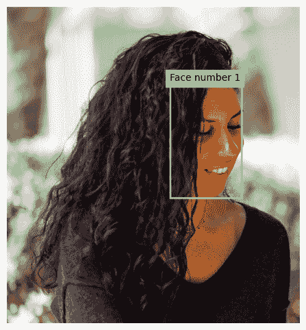

# Azure OpenAI

参见：[AOAI 代码实践](https://zsyhjtnsa5.feishu.cn/wiki/A7gDw0T2piVGfOkJlFfcITqMn2g)

# 自然语言

https://microsoftlearning.github.io/mslearn-ai-language/Instructions/Exercises/01-analyze-text.html

## 文本分析

```
from dotenv import load_dotenv
import os

# Import namespaces
from azure.core.credentials import AzureKeyCredential
from azure.ai.textanalytics import TextAnalyticsClient

def main():
    try:
        # Get Configuration Settings
        load_dotenv()
        ai_endpoint = os.getenv(&#x27;AI_SERVICE_ENDPOINT&#x27;)
        ai_key = os.getenv(&#x27;AI_SERVICE_KEY&#x27;)

        # Create client using endpoint and key
        credential = AzureKeyCredential(ai_key)
        ai_client = TextAnalyticsClient(endpoint=ai_endpoint, credential=credential)

        # Analyze each text file in the reviews folder
        reviews_folder = &#x27;reviews&#x27;
        for file_name in os.listdir(reviews_folder):
            # Read the file contents
            print(&#x27;\n-------------\n&#x27; + file_name)
            text = open(os.path.join(reviews_folder, file_name), encoding=&#x27;utf8&#x27;).read()
            print(&#x27;\n&#x27; + text)

            # Get language
            detectedLanguage = ai_client.detect_language(documents=[text])[0]
            print(&#x27;\nLanguage: {}&#x27;.format(detectedLanguage.primary_language.name))

            # Get sentiment
            sentimentAnalysis = ai_client.analyze_sentiment(documents=[text])[0]
            print(&quot;\nSentiment: {}&quot;.format(sentimentAnalysis.sentiment))

            # Get key phrases
            phrases = ai_client.extract_key_phrases(documents=[text])[0].key_phrases
            if len(phrases) &gt; 0:
                print(&quot;\nKey Phrases:&quot;)
                for phrase in phrases:
                    print(&#x27;\t{}&#x27;.format(phrase))

            # Get entities
            entities = ai_client.recognize_entities(documents=[text])[0].entities
            if len(entities) &gt; 0:
                print(&quot;\nEntities&quot;)
                for entity in entities:
                    print(&#x27;\t{} ({})&#x27;.format(entity.text, entity.category))

            # Get linked entities
            entities = ai_client.recognize_linked_entities(documents=[text])[0].entities
            if len(entities) &gt; 0:
                print(&quot;\nLinks&quot;)
                for linked_entity in entities:
                    print(&#x27;\t{} ({})&#x27;.format(linked_entity.name, linked_entity.url))

    except Exception as ex:
        print(ex)


if __name__ == &quot;__main__&quot;:
    main()
```

> 这些代码片段的目的是逐步启用 Azure AI 语言服务的不同文本分析功能。

1.  导入命名空间 （Import namespaces）

```
      # import namespacesfrom azure.core.credentials import AzureKeyCredential
from azure.ai.textanalytics import TextAnalyticsClient
```

+   from azure.core.credentials import AzureKeyCredential:

+   **作用**： 这个类用于处理 Azure 服务的身份验证。具体来说，它允许你使用你的 Azure AI 语言服务密钥（API Key）来授权你的应用程序访问该服务。

+   **为什么需要**： Azure 服务需要知道是谁在发出请求，以及该请求是否被授权。AzureKeyCredential 对象会安全地包装你的服务密钥。

+   from azure.ai.textanalytics import TextAnalyticsClient:

+   **作用**： 这是 Azure AI 语言文本分析 SDK 的核心客户端类。你需要创建这个类的一个实例，才能调用文本分析的各种功能，如语言检测、情感分析等。

+   **为什么需要**： 它是与 Azure AI 语言服务进行所有交互的入口点。

1.  **创建客户端 （Create client usi**ng endpoint and key）

```
      # Create client using endpoint and key
credential = AzureKeyCredential(ai_key)
ai_client = TextAnalyticsClient(endpoint=ai_endpoint, credential=credential)
```

+   credential = AzureKeyCredential(ai_key):

+   **作用**： 创建一个 AzureKeyCredential 类的实例。它接收从 .env 文件中加载的 ai_key （你的 Azure AI 语言服务密钥） 作为参数。

+   **为什么需要**： 这个 credential 对象将被传递给 TextAnalyticsClient，用于向 Azure 服务证明你的应用程序有权访问。

+   ai_client = TextAnalyticsClient(endpoint=ai_endpoint, credential=credential):

+   **作用**： 创建 TextAnalyticsClient 类的实例，这个实例就是我们之后用来调用所有文本分析 API 的对象。

+   **参数**：

+   endpoint=ai_endpoint： 指定你的 Azure AI 语言服务的终结点 URL （从 .env 文件加载）。SDK 需要知道向哪个服务器地址发送请求。

+   credential=credential： 传入上一步创建的 credential 对象，用于身份验证。

+   **为什么需要**： 这个 ai_client 对象是实际执行文本分析操作的工具。

1.  获取语言 （Get language）

```
      # Get language
detectedLanguage = ai_client.detect_language(documents=[text])[0]
print(&#x27;\nLanguage: {}&#x27;.format(detectedLanguage.primary_language.name))
```

+   detectedLanguage = ai_client.detect_language(documents=[text])[0]:

+   ai_client.detect_language(...)： 调用 TextAnalyticsClient 对象的 detect_language 方法来检测输入文本的语言。

+   documents=[text]： 这个方法期望接收一个文档列表作为输入。即使我们只分析一个文档 （text变量的内容），也需要将其包装在一个列表中。

+   [0]： detect_language 方法（以及其他许多文本分析方法）返回一个结果列表，每个结果对应输入列表中的一个文档。由于我们只发送了一个文档，所以我们通过索引 [0] 来获取这第一个（也是唯一一个）文档的检测结果。

+   detectedLanguage.primary_language.name:

+   detectedLanguage 是单个文档的语言检测结果对象。

+   它有一个 primary_language 属性，表示最可能的主要语言。

+   primary_language 对象有一个 name 属性，它包含语言的名称 （例如 "English"， "Chinese_Simplified"， "Spanish"）。

+   **作用**： 识别给定文本是用什么语言编写的。

1.  获取情感 （Get sentiment）

```
      # Get sentiment
sentimentAnalysis = ai_client.analyze_sentiment(documents=[text])[0]
print(&quot;\nSentiment: {}&quot;.format(sentimentAnalysis.sentiment))
```

+   sentimentAnalysis = ai_client.analyze_sentiment(documents=[text])[0]:

+   ai_client.analyze_sentiment(...)： 调用情感分析功能。

+   documents=[text] 和 [0]： 与语言检测的逻辑相同，处理单个文档并获取其结果。

+   sentimentAnalysis.sentiment:

+   sentimentAnalysis 是单个文档的情感分析结果对象。

+   它有一个 sentiment 属性，表示文本的整体情感，通常是 "positive" （积极）， "negative" （消极）， "neutral" （中性）， 或 "mixed" （混合）。

+   **作用**： 判断文本所表达的情感是积极的、消极的还是中性的。

1.  获取关键短语 （Get key phrases）

```
      # Get key phrases
phrases = ai_client.extract_key_phrases(documents=[text])[0].key_phrases
if len(phrases) &gt; 0:
    print(&quot;\nKey Phrases:&quot;)for phrase in phrases:
        print(&#x27;\t{}&#x27;.format(phrase))
```

+   phrases = ai_client.extract_key_phrases(documents=[text])[0].key_phrases:

+   ai_client.extract_key_phrases(...)： 调用关键短语提取功能。

+   documents=[text] 和 [0]： 逻辑同上。

+   .key_phrases： 单个文档的关键短语提取结果对象有一个 key_phrases 属性，这是一个包含字符串的列表，每个字符串都是从文本中提取出的一个关键短语。

+   if len(phrases) > 0: ... for phrase in phrases: ...： 检查是否提取到了任何关键短语，如果有，则遍历并打印它们。

+   **作用**： 从文本中识别出主要的谈论点或核心概念。

1.  获取实体 （Get entities）

```
      # Get entities
entities = ai_client.recognize_entities(documents=[text])[0].entities
if len(entities) &gt; 0:
    print(&quot;\nEntities&quot;)for entity in entities:
        print(&#x27;\t{} ({})&#x27;.format(entity.text, entity.category))
```

+   entities = ai_client.recognize_entities(documents=[text])[0].entities:

+   ai_client.recognize_entities(...)： 调用命名实体识别 （NER） 功能。

+   documents=[text] 和 [0]： 逻辑同上。

+   .entities： 单个文档的实体识别结果对象有一个 entities 属性，这是一个 CategorizedEntity 对象列表。

+   entity.text： CategorizedEntity 对象包含被识别出的实体文本 （例如 "Microsoft"， "London"）。

+   entity.category： CategorizedEntity 对象还包含该实体的类别 （例如 "Organization"， "Location"， "Person"， "DateTime"）。

+   **作用**： 识别并分类文本中提到的已知实体，如人名、地名、组织机构名、日期、数量等。

1.  获取链接实体 （Get linked entities）

```
      # Get linked entities
entities = ai_client.recognize_linked_entities(documents=[text])[0].entities
if len(entities) &gt; 0:
    print(&quot;\nLinks&quot;)for linked_entity in entities:
        print(&#x27;\t{} ({})&#x27;.format(linked_entity.name, linked_entity.url))
```

+   entities = ai_client.recognize_linked_entities(documents=[text])[0].entities： （注意：这里变量名 entities 被重用了，在实际项目中为了清晰，可能会使用不同的名称，如 linked_entities_result）

+   ai_client.recognize_linked_entities(...)： 调用链接实体识别功能。

+   documents=[text] 和 [0]： 逻辑同上。

+   .entities： 单个文档的链接实体识别结果对象有一个 entities 属性，这是一个 LinkedEntity 对象列表。

+   linked_entity.name： LinkedEntity 对象包含实体在知识库中的规范名称 （例如 "Microsoft Corporation"）。

+   linked_entity.url： LinkedEntity 对象包含一个指向该实体在知识库 （通常是维基百科） 中的 URL 链接。

+   **作用**： 识别文本中的实体，并将其链接到知名知识库（如维基百科）中的对应条目，有助于消除歧义并提供更丰富的上下文信息。

> 总结来说，这些添加的代码块逐步构建了一个完整的文本分析流程：首先配置并创建与 Azure AI 语言服务的连接，然后针对每个评论文件，依次调用服务的不同功能来提取语言、情感、关键短语、命名实体和链接实体信息，并将结果打印出来。每个功能都通过 ai_client 对象的方法调用，并遵循相似的模式（传入文档列表，获取结果列表中的第一个元素）。

输出

```
-------------
review1.txt

Good Hotel and staff
The Royal Hotel, London, UK
3/2/2018
Clean rooms, good service, great location near Buckingham Palace and Westminster Abbey, and so on. We thoroughly enjoyed our stay. The courtyard is very peaceful and we went to a restaurant which is part of the same group and is Indian ( West coast so plenty of fish) with a Michelin Star. We had the taster menu which was fabulous. The rooms were very well appointed with a kitchen, lounge, bedroom and enormous bathroom. Thoroughly recommended.

Language: English

Sentiment: positive

Key Phrases:
        The Royal Hotel
        Good Hotel
        good service
        great location
        Buckingham Palace
        Westminster Abbey
        same group
        West coast
        Michelin Star
        taster menu
        enormous bathroom
        Clean rooms
        staff
        London
        UK
        stay
        courtyard
        restaurant
        part
        plenty
        fish
        kitchen
        lounge
        bedroom

Entities
        Hotel (Location)
        staff (PersonType)
        Royal Hotel, London, UK (Address)
        3/2/2018 (DateTime)
        Buckingham Palace (Location)
        Westminster Abbey (Location)
        courtyard (Location)
        restaurant (Location)
        Indian (PersonType)
        West coast (Location)
        fish (Product)
        taster (Product)
        rooms (Location)
        kitchen (Location)
        lounge (Location)
        bedroom (Location)
        bathroom (Location)

Links
        GOOD Music (https://en.wikipedia.org/wiki/GOOD_Music)
        Hotel (https://en.wikipedia.org/wiki/Hotel)
        The Royal Hotel (https://en.wikipedia.org/wiki/The_Royal_Hotel)
        London (https://en.wikipedia.org/wiki/London)
        Buckingham Palace (https://en.wikipedia.org/wiki/Buckingham_Palace)
        Westminster Abbey (https://en.wikipedia.org/wiki/Westminster_Abbey)
        India (https://en.wikipedia.org/wiki/India)
        West Coast Main Line (https://en.wikipedia.org/wiki/West_Coast_Main_Line)
        Michelin Guide (https://en.wikipedia.org/wiki/Michelin_Guide)

-------------
review2.txt

Tired hotel with poor service
The Royal Hotel, London, United Kingdom
5/6/2018
This is a old hotel (has been around since 1950&#x27;s) and the room furnishings are average - becoming a bit old now and require changing. The internet didn&#x27;t work and had to come to one of their office rooms to check in for my flight home. The website says it&#x27;s close to the British Museum, but it&#x27;s too far to walk.

Language: English

Sentiment: negative

Key Phrases:
        The Royal Hotel
        Tired hotel
        old hotel
        poor service
        United Kingdom
        room furnishings
        office rooms
        flight home
        British Museum
        London
        changing
        internet
        website
        1950

Entities
        hotel (Location)
        The Royal Hotel (Organization)
        London (Location)
        United Kingdom (Location)
        5/6/2018 (DateTime)
        hotel (Location)
        since 1950&#x27;s (DateTime)
        furnishings (Product)
        now (DateTime)
        internet (Skill)
        one (Quantity)
        office rooms (Location)
        flight (Event)
        home (Location)
        British Museum (Location)

Links
        The Royal Hotel (https://en.wikipedia.org/wiki/The_Royal_Hotel)
        London (https://en.wikipedia.org/wiki/London)
        British Museum (https://en.wikipedia.org/wiki/British_Museum)

-------------
review3.txt

Good location and helpful staff, but on a busy road.
The Lombard Hotel, San Francisco, USA
8/16/2018
We stayed here in August after reading reviews. We were very pleased with location, just behind Chestnut Street, a cosmopolitan and trendy area with plenty of restaurants to choose from. The
Marina district was lovely to wander through, very interesting houses. Make sure to walk to the San Francisco Museum of Fine Arts and the Marina to get a good view of Golden Gate bridge and the city. On a bus route and easy to get into centre. Rooms were clean with plenty of room and staff were friendly and helpful. The only down side was the noise from Lombard Street so ask to have a room furthest away from traffic noise.

Language: English

Sentiment: mixed

Key Phrases:
        Golden Gate bridge
        The Lombard Hotel
        The Marina district
        San Francisco Museum
        Lombard Street
        busy road
        Chestnut Street
        trendy area
        interesting houses
        Fine Arts
        good view
        bus route
        down side
        Good location
        helpful staff
        traffic noise
        USA
        We
        August
        reviews
        cosmopolitan
        plenty
        restaurants
        city
        centre
        Rooms

Entities
        staff (PersonType)
        Hotel (Location)
        San Francisco (Location)
        USA (Location)
        8/16/2018 (DateTime)
        August (DateTime)
        Chestnut Street (Address)
        restaurants (Location)
        Marina district (Location)
        houses (Location)
        San Francisco Museum of Fine Arts (Location)
        Marina (Location)
        Golden Gate bridge (Location)
        city (Location)
        centre (Location)
        Rooms (Location)
        staff (PersonType)
        Lombard Street (Address)
        room (Location)

Links
        Lombardy (https://en.wikipedia.org/wiki/Lombardy)
        Hotel (https://en.wikipedia.org/wiki/Hotel)
        San Francisco (https://en.wikipedia.org/wiki/San_Francisco)
        Chestnut Street (Philadelphia) (https://en.wikipedia.org/wiki/Chestnut_Street_(Philadelphia))
        Marina District, San Francisco (https://en.wikipedia.org/wiki/Marina_District,_San_Francisco)
        Museum of Fine Arts, Boston (https://en.wikipedia.org/wiki/Museum_of_Fine_Arts,_Boston)
        Golden Gate Bridge (https://en.wikipedia.org/wiki/Golden_Gate_Bridge)
        Room (https://en.wikipedia.org/wiki/Room)
        Lombard Street (San Francisco) (https://en.wikipedia.org/wiki/Lombard_Street_(San_Francisco))

-------------
review4.txt

Very noisy and rooms are tiny
The Lombard Hotel, San Francisco, USA
9/5/2018
Hotel is located on Lombard street which is a very busy SIX lane street directly off the Golden Gate Bridge. Traffic from early morning until late at night especially on weekends. Noise would not be so bad if rooms were better insulated but they are not. Had to put cotton balls in my ears to be able to sleep--was too tired to enjoy the city the next day. Rooms are TINY. I picked the room because it had two queen size beds--but the room barely had space to fit them. With family of four in the room it was tight. With all that said, rooms are clean and they&#x27;ve made an effort to update them. The hotel is in Marina district with lots of good places to eat, within walking distance to Presidio. May be good hotel for young stay-up-late adults on a budget


Language: English

Sentiment: mixed

Key Phrases:
        two queen size beds
        busy SIX lane street
        Golden Gate Bridge
        The Lombard Hotel
        Lombard street
        San Francisco
        early morning
        cotton balls
        Marina district
        good places
        walking distance
        late adults
        good hotel
        rooms
        USA
        Traffic
        night
        weekends
        Noise
        ears
        city
        TINY
        space
        family
        effort
        lots
        Presidio
        young
        budget

Entities
        rooms (Location)
        Hotel (Location)
        San Francisco (Location)
        USA (Location)
        9/5/2018 (DateTime)
        Hotel (Location)
        Lombard street (Address)
        SIX (Quantity)
        Golden Gate Bridge (Location)
        early morning until late at night (DateTime)
        weekends (DateTime)
        rooms (Location)
        cotton balls (Product)
        city (Location)
        the next day (DateTime)
        Rooms (Location)
        room (Location)
        two (Quantity)
        beds (Product)
        room (Location)
        four (Quantity)
        room (Location)
        rooms (Location)
        hotel (Location)
        Marina district (Location)
        Presidio (Location)
        hotel (Location)
        young (PersonType)
        adults (PersonType)

Links
        Lombard, Illinois (https://en.wikipedia.org/wiki/Lombard,_Illinois)
        Hotel (https://en.wikipedia.org/wiki/Hotel)
        San Francisco (https://en.wikipedia.org/wiki/San_Francisco)
        Lombard Street (San Francisco) (https://en.wikipedia.org/wiki/Lombard_Street_(San_Francisco))
        Golden Gate Bridge (https://en.wikipedia.org/wiki/Golden_Gate_Bridge)
        Traffic (https://en.wikipedia.org/wiki/Traffic)
        Noise rock (https://en.wikipedia.org/wiki/Noise_rock)
        Room (https://en.wikipedia.org/wiki/Room)
        Marina District, San Francisco (https://en.wikipedia.org/wiki/Marina_District,_San_Francisco)
        Presidio of San Francisco (https://en.wikipedia.org/wiki/Presidio_of_San_Francisco)
        May (https://en.wikipedia.org/wiki/May)

-------------
review5.txt

Un hôtel agréable
L&#x27;Hotel Buckingham, Londres, UK
J’adore cet hôtel. Le personnel est très amical et les chambres sont confortables.

Language: French

Sentiment: positive

Key Phrases:
        hôtel agréable
        L&#x27;Hotel Buckingham
        Londres
        UK
        personnel
        chambres

Entities
        hôtel (Location)
        Buckingham (Organization)
        Londres (Location)
        UK (Location)
        hôtel (Location)
        personnel (PersonType)
        chambres (Location)

Links
        United Nations (https://en.wikipedia.org/wiki/United_Nations)
        L&#x27;Hôtel (https://en.wikipedia.org/wiki/L&#x27;Hôtel)
        Buckingham (https://en.wikipedia.org/wiki/Buckingham)
        London (https://en.wikipedia.org/wiki/London)
        United Kingdom (https://en.wikipedia.org/wiki/United_Kingdom)
```

## 语音合成

https://microsoftlearning.github.io/mslearn-ai-language/Instructions/Exercises/07-speech.html

```
 pip install azure-cognitiveservices-speech==1.30.0
  pip install playsound==1.2.2
```

```
from dotenv import load_dotenv
from datetime import datetime
import os

# Import namespaces
import azure.cognitiveservices.speech as speech_sdk
from playsound import playsound


def main():
    try:
        global speech_config

        # Get Configuration Settings
        load_dotenv()
        ai_key = os.getenv(&#x27;AI_SERVICE_KEY&#x27;)
        ai_region = os.getenv(&#x27;SPEECH_REGION&#x27;)

        # Configure speech service
        speech_config = speech_sdk.SpeechConfig(ai_key, ai_region)
        print(&#x27;Ready to use speech service in:&#x27;, speech_config.region)

        # Get spoken input
        command = TranscribeCommand()
        if command.lower() == &#x27;what time is it?&#x27;:
            TellTime()

    except Exception as ex:
        print(ex)


def TranscribeCommand():
    command = &#x27;&#x27;

    # Configure speech recognition
    current_dir = os.getcwd()
    audioFile = current_dir + &#x27;\\time.wav&#x27;
    playsound(audioFile)
    audio_config = speech_sdk.AudioConfig(filename=audioFile)
    speech_recognizer = speech_sdk.SpeechRecognizer(speech_config, audio_config)

    # Process speech input
    speech = speech_recognizer.recognize_once_async().get()
    if speech.reason == speech_sdk.ResultReason.RecognizedSpeech:
        command = speech.text
        print(command)
    else:
        print(speech.reason)
        if speech.reason == speech_sdk.ResultReason.Canceled:
            cancellation = speech.cancellation_details
            print(cancellation.reason)
            print(cancellation.error_details)

    # Return the command
    return command


def TellTime():
    now = datetime.now()
    response_text = &#x27;The time is {}:{:02d}&#x27;.format(now.hour, now.minute)

    # Configure speech synthesis
    speech_config.speech_synthesis_voice_name = &quot;en-GB-RyanNeural&quot;
    speech_synthesizer = speech_sdk.SpeechSynthesizer(speech_config)

    # Synthesize spoken output
    speak = speech_synthesizer.speak_text_async(response_text).get()
    if speak.reason != speech_sdk.ResultReason.SynthesizingAudioCompleted:
        print(speak.reason)

    # Print the response
    print(response_text)


if __name__ == &quot;__main__&quot;:
    main()
```

> **代码功能总览**

> 这段代码实现了一个简单的语音助手程序。它的核心功能是：

1.  **识别一个音频文件中的语音**：程序会读取一个名为 time.wav 的音频文件，并将其中的英文语音转换成文字。

1.  **理解命令**：程序会检查转换后的文字是不是“what time is it？”.

1.  **语音回答**：如果命令正确，程序会获取当前系统时间，并用语音合成技术将当前时间（例如 "The time is 14:30"）播报出来。

> 简单来说，这是一个“语音提问、语音回答”的演示程序，但它的“提问”部分是来自一个固定的音频文件，而不是实时麦克风。

---

> **1. ****main()**** 函数 （主流程控制）**

> 这是程序的入口和总指挥。

+   **加载配置**：

+   load_dotenv()： 从项目根目录下的 .env 文件中加载环境变量。

+   os.getenv(...)： 读取 Azure AI 服务的密钥 （AI_SERVICE_KEY） 和区域 （SPEECH_REGION）。这样做是为了不把敏感信息直接写在代码里。

+   **配置语音服务**：

+   speech_sdk.SpeechConfig(...)： 使用获取到的密钥和区域信息，初始化 Azure 语音服务的配置。这是后续所有语音功能的“通行证”。

+   **执行命令**：

+   TranscribeCommand()： 调用这个函数来识别音频文件中的命令。

+   if command.lower() == 'what time is it?'： 判断识别出的命令（转换成小写后）是否是“what time is it？”.

+   TellTime()： 如果命令匹配，就调用这个函数来播报时间。

> **2. ****TranscribeC**ommand() 函数 （语音转文本）

> 这个函数扮演了程序的“耳朵”角色。

+   **播放音频**：

+   playsound(audioFile)： 首先，它会播放 time.wav 这个文件。这样做的目的是让你能听到程序正在“处理”的语音是什么。

+   **配置音频源**：

+   audio_config = speech_sdk.AudioConfig(filename=audioFile)： 告诉 Azure SDK，语音的来源不是麦克风，而是 time.wav 这个文件。

+   **识别语音**：

+   speech_recognizer = speech_sdk.SpeechRecognizer(...)： 创建一个语音识别器。

+   speech_recognizer.recognize_once_async().get()： 启动一次性的语音识别。程序会把音频文件发送到 Azure 云端进行处理，然后等待返回结果。

+   **处理结果**：

+   if speech.reason == speech_sdk.ResultReason.RecognizedSpeech： 如果成功识别出语音，就将识别到的文本 （speech.text） 打印出来并返回。

+   else： 如果失败（比如音频质量差、网络问题等），则打印出失败的原因。

> **3. ****TellTime()**** 函数 （文本转语音）**

> 这个函数扮演了程序的“嘴巴”角色。

+   **获取当前时间**：

+   now = datetime.now()： 使用 datetime 库获取当前的日期和时间。

+   response_text = 'The time is {}:{:02d}'.format(...)： 将时间格式化成一个友好的字符串，例如 "The time is 10:05"。

+   **配置语音合成**：

+   speech_config.speech_synthesis_voice_name = "en-GB-RyanNeural"： 指定用来朗读的语音角色。这里选择了一个名为 "Ryan" 的英式男性神经语音。

+   speech_synthesizer = speech_sdk.SpeechSynthesizer(...)： 创建一个语音合成器。

+   **合成并播放语音**：

+   speech_synthesizer.speak_text_async(response_text).get()： 将文本字符串发送给 Azure 服务，服务会将其转换成音频数据并直接通过你的扬声器播放出来。

```
Ready to use speech service in: eastus
What time is it?
The time is 11:38
```

# 知识挖掘

https://microsoftlearning.github.io/mslearn-knowledge-mining/Instructions/Exercises/01-azure-search.html

```
import os
from flask import Flask, request, render_template, redirect, url_for
from dotenv import load_dotenv

# Import search namespaces
from azure.core.credentials import AzureKeyCredential
from azure.search.documents import SearchClient


app = Flask(__name__)

# Azure Search constants
load_dotenv()
search_endpoint = os.getenv(&#x27;SEARCH_SERVICE_ENDPOINT&#x27;)
search_key = os.getenv(&#x27;SEARCH_SERVICE_QUERY_KEY&#x27;)
search_index = os.getenv(&#x27;SEARCH_INDEX_NAME&#x27;)

# Wrapper function for request to search index
def search_query(search_text, filter_by=None, sort_order=None):
    try:

        # Create a search client
        azure_credential = AzureKeyCredential(search_key)
        search_client = SearchClient(search_endpoint, search_index, azure_credential)
        

        # Submit search query
        results =  search_client.search(search_text,
                                        search_mode=&quot;all&quot;,
                                        include_total_count=True,
                                        filter=filter_by,
                                        order_by=sort_order,
                                        facets=[&#x27;metadata_author&#x27;],
                                        highlight_fields=&#x27;merged_content-3,imageCaption-3&#x27;,
                                        select = &quot;url,metadata_storage_name,metadata_author,metadata_storage_size,metadata_storage_last_modified,language,sentiment,merged_content,keyphrases,locations,imageTags,imageCaption&quot;)
        return results
        


    except Exception as ex:
        raise ex

# Home page route
@app.route(&quot;/&quot;)
def home():
    return render_template(&quot;default.html&quot;)

# Search results route
@app.route(&quot;/search&quot;, methods=[&#x27;GET&#x27;])
def search():
    try:

        # Get the search terms from the request form
        search_text = request.args[&quot;search&quot;]

        # If a facet is selected, use it in a filter
        filter_expression = None
        if &#x27;facet&#x27; in request.args:
            filter_expression = &quot;metadata_author eq &#x27;{0}&#x27;&quot;.format(request.args[&quot;facet&quot;])

        # If a sort field is specified, modify the search expression accordingly
        sort_expression = &#x27;search.score()&#x27;
        sort_field = &#x27;relevance&#x27; #default sort is search.score(), which is relevance
        if &#x27;sort&#x27; in request.args:
            sort_field = request.args[&quot;sort&quot;]
            if sort_field == &#x27;file_name&#x27;:
                sort_expression = &#x27;metadata_storage_name asc&#x27;
            elif sort_field == &#x27;size&#x27;:
                sort_expression = &#x27;metadata_storage_size desc&#x27;
            elif sort_field == &#x27;date&#x27;:
                sort_expression = &#x27;metadata_storage_last_modified desc&#x27;
            elif sort_field == &#x27;sentiment&#x27;:
                sort_expression = &#x27;sentiment desc&#x27;

        # submit the query and get the results
        results = search_query(search_text, filter_expression, sort_expression)

        # render the results
        return render_template(&quot;search.html&quot;, search_results=results, search_terms=search_text)

    except Exception as error:
        return render_template(&quot;error.html&quot;, error_message=error)
```

> 这段代码是一个基于 Flask 的 Web 应用程序，用于与 Azure Cognitive Search（Azure 认知搜索）服务交互。以下是各模块的简要功能说明：

> **1. 导入模块**

+   **os**： 用于读取环境变量。

+   **flask**： Web 框架，处理 HTTP 请求和渲染模板。

+   Flask： 主应用类。

+   request： 获取 HTTP 请求参数。

+   render_template： 渲染 HTML 模板。

+   redirect/url_for： 重定向和路由生成。

+   **dotenv**： 从 .env 文件加载环境变量（如 Azure 搜索服务的密钥和端点）。

+   azure.search.documents： Azure 搜索服务的 Python SDK。

+   AzureKeyCredential： 用于认证的密钥凭证。

+   SearchClient： 与 Azure 搜索索引交互的客户端。

> **2. 初始化配置**

+   **load_dotenv()**： 加载 .env 文件中的环境变量。

+   **Azure 搜索常量**：

+   search_endpoint： 搜索服务的 URL。

+   search_key： 查询密钥（用于认证）。

+   search_index： 要查询的索引名称。

> **3. 核心函数 ****search_query**

+   **功能**： 封装对 Azure 搜索索引的查询逻辑。

+   **参数**：

+   search_text： 用户输入的搜索词。

+   filter_by： 可选的筛选条件（如按作者过滤）。

+   sort_order： 可选的排序规则（如按文件名、大小、日期等）。

+   **操作**：

1.  创建 SearchClient 客户端。

1.  提交搜索请求，配置包括：

+   搜索模式、总计数、筛选器、排序、分面（facets）、高亮字段等。

1.  返回搜索结果。

> **4. Flask 路由**

> **（1） 主页路由 （****/****）**

+   渲染静态页面 default.html（通常是一个搜索框）。

> **（2） 搜索路由 （****/search****）**

+   **功能**： 处理用户搜索请求并返回结果。

+   **流程**：

1.  从 URL 参数获取搜索词（search_text）。

1.  处理可选参数：

+   **facet**： 按作者过滤（生成 filter_expression）。

+   **sort**： 根据用户选择生成排序表达式（如按文件名、文件大小、日期或相关性）。

1.  调用 search_query 获取结果。

1.  渲染 search.html 模板，传入搜索结果和搜索词。

+   **错误处理**： 如果出错，渲染 error.html 显示错误信息。

> **总结**

+   这是一个简单的搜索应用，前端通过 Flask 提供界面，后端调用 Azure Cognitive Search 实现搜索功能。

+   支持关键词搜索、分面筛选（按作者）、结果排序（按名称、大小、日期等）和高亮显示匹配内容。

+   配置通过环境变量管理，避免硬编码敏感信息。

# 文档智能

https://microsoftlearning.github.io/mslearn-ai-document-intelligence/Instructions/Exercises/01-use-prebuilt-models.html

```
pip install azure-ai-formrecognizer==3.3.3
```

```
from azure.core.credentials import AzureKeyCredential
from azure.ai.formrecognizer import DocumentAnalysisClient

# Store connection information
endpoint = &quot;https://chengzhcos250514.cognitiveservices.azure.com/&quot;
key = &quot;xxx&quot;

fileUri = &quot;https://github.com/MicrosoftLearning/mslearn-ai-document-intelligence/blob/main/Labfiles/01-prebuild-models/sample-invoice/sample-invoice.pdf?raw=true&quot;
fileLocale = &quot;en-US&quot;
fileModelId = &quot;prebuilt-invoice&quot;

print(f&quot;\nConnecting to Forms Recognizer at: {endpoint}&quot;)
print(f&quot;Analyzing invoice at: {fileUri}&quot;)

# Create the client
document_analysis_client = DocumentAnalysisClient(
    endpoint=endpoint, credential=AzureKeyCredential(key)
)
# Analyse the invoice
poller = document_analysis_client.begin_analyze_document_from_url(
    fileModelId, fileUri, locale=fileLocale
)
# Display invoice information to the user
receipts = poller.result()
    
for idx, receipt in enumerate(receipts.documents):
    vendor_name = receipt.fields.get(&quot;VendorName&quot;)
    if vendor_name:
        print(f&quot;\nVendor Name: {vendor_name.value}, with confidence {vendor_name.confidence}.&quot;)

    customer_name = receipt.fields.get(&quot;CustomerName&quot;)
    if customer_name:
        print(f&quot;Customer Name: &#x27;{customer_name.value}, with confidence {customer_name.confidence}.&quot;)

    invoice_total = receipt.fields.get(&quot;InvoiceTotal&quot;)
    if invoice_total:
        print(f&quot;Invoice Total: &#x27;{invoice_total.value.symbol}{invoice_total.value.amount}, with confidence {invoice_total.confidence}.&quot;)

print(&quot;\nAnalysis complete.\n&quot;)
```

> 这段代码使用 Azure 表单识别器（Form Recognizer） 服务来 **解析 PDF 发票**，并提取关键信息（如供应商名称、客户名称和发票总金额）。以下是代码的主要模块和功能概述：

> **1. 初始化和配置**

+   **导入 Azure SDK**：

+   AzureKeyCredential：用于身份验证的密钥凭证

+   DocumentAnalysisClient：用于与 Azure 表单识别器交互的客户端

+   **设置连接参数**：

+   endpoint：Azure 表单识别器的服务终结点

+   key：API 密钥（示例中隐藏为 "xxx"，实际使用时需替换）

+   **定义要分析的 PDF 发票**：

+   fileUri：发票 PDF 的 URL（GitHub 上的示例文件）

+   fileLocale：语言区域（en-US 表示美式英语）

+   fileModelId：使用的预训练模型（prebuilt-invoice 表示标准发票模型）

> **2. 创建客户端并分析发票**

+   **初始化 ****DocumentAnalysisClient**：

+   传入 endpoint 和 key 以建立连接

+   **调用 ****begin_analyze_document_from_url**：

+   异步分析指定 URL 的 PDF 发票

+   返回一个 poller 对象，用于跟踪分析进度

> **3. 提取并显示发票信息**

+   **获取分析结果**：

+   poller.result() 返回解析后的数据（存储在 receipts 变量中）

+   **遍历提取的字段**：

+   供应商名称（VendorName）：打印名称及置信度

+   客户名称（CustomerName）：打印名称及置信度

+   发票总额（InvoiceTotal）：打印货币符号、金额及置信度

> **核心功能总结**

+   **用途**：自动化解析发票 PDF，提取结构化数据（如金额、买卖方信息）。

+   **关键技术**：Azure 表单识别器的预训练模型（prebuilt-invoice）。

+   **输出**：字段值 + 置信度（0～1，表示识别准确性）。

输出

```
[C](https://chengzhcos250514.cognitiveservices.azure.com/)[onnecting to Forms Recognizer at: https://chengzhcos250514.cognitivese](https://github.com/MicrosoftLearning/mslearn-ai-document-intelligence/blob/main/Labfiles/01-prebuild-models/sample-invoice/sample-invoice.pdf?raw=true)rvices.azure.com/
Analyzing invoice at: https://github.com/MicrosoftLearning/mslearn-ai-document-intelligence/blob/main/Labfiles/01-prebuild-models/sample-invoice/sample-invoice.pdf?raw=true

Vendor Name: CONTOSO LTD., with confidence 0.937.
Customer Name: &#x27;MICROSOFT CORPORATION, with confidence 0.919.
Invoice Total: &#x27;$110.0, with confidence 0.969.

Analysis complete.
```

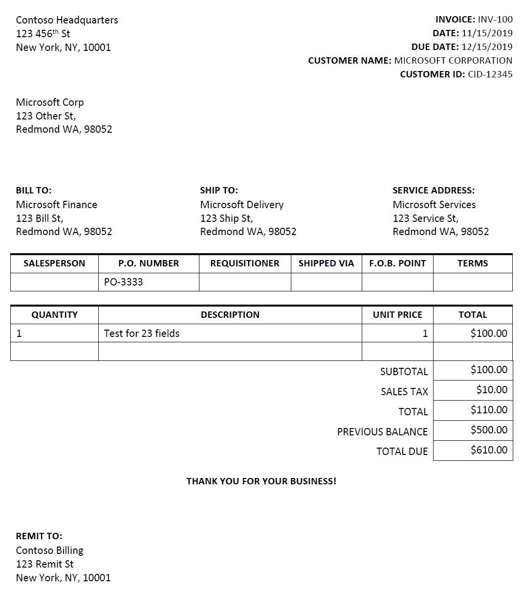

# Applied Skills：使用 Azure AI 语言构建自然语言处理解决方案

## 一般准则

**在**此应用场景中，某些资源的部署可能需要几分钟的时间。在部署完成期间，请查看实验室中的其他任务。你可以执行不依赖于该部署的其他任务。

感谢你同意帮助我们的团队使用 Azure AI 语言构建自然语言处理解决方案。

在 Azure 中执行任务时，必须遵循我们的一些一般准则。

+   创建对象时，请使用默认设置，除非有不同的配置要求。

+   只有创建、删除或修改对象才能达到上述要求。 对环境进行不必要的更改可能会对您的最终成绩产生不利影响。

+   如果有多种实现目标的方法，请务必选择管理工作量最小的方法。

此致

首席技术官 （CTO）

## 现有环境

以下是用于访问 Azure 中的资源的凭据：

用户名：User-@labinstanceid

密码：password-@labinstanceid

可以通过单击“**说明**”选项卡找到这些凭据。

你已获得 rg-@labinstanceid 资源组的权限。 请在此资源组中创建所有 Azure 对象。

我们还创建了名为 sa@labinstanceid 的存储帐户供你使用。

此致

网络管理员

> 注意：需要留意此处的** labinstanceid **之后创建资源需要使用相同的 ID

## Part I：概念验证

你好，

感谢你同意帮助我们的 IT 部门构建概念证明 （PoC） 来对文本进行分类。 一位同事已经开始构建示例解决方案，该解决方案可以识别位置信息和电子邮件地址。 我们需要你帮助敲定该解决方案并将其连接到 Azure，以证明该技术已准备就绪。

**这是你的任务：**

你需要创建一个可以识别位置信息和电子邮件地址的 PoC 解决方案。 该解决方案必须使用最适合该用例的模型。 该解决方案必须满足以下要求：

+   在 rg-@labinstanceid 中新建名为 lang-@labinstanceid 的语言服务。

+   确保语言服务支持自定义文本分类和命名实体识别 （NER）。

+   确保语言服务使用免费层，并在北欧 Azure 区域中预配。

+   使用现有 sa@labinstanceid 存储帐户。

+   确保 PoC 应用的源代码连接到新建资源中的相应模型。 可以在 C:\PoC 中找到应用。 该应用有 C# 版本和 Python 版本。 修改你喜欢的版本。 无需修改这两个版本。 完成任务后，应用必须能继续正常运行。

此致

项目管理团队

> 解题过程

+   在 **RG1 中创建名为 **lang-36478729** 的新语言服务**。


+   保语言服务支持自定义文本分类和命名实体识别 （NER）。


+   确保语言服务使用免费层，并在北欧 Azure 区域中预配。

+   使用现有的 **sa36478729** 存储帐户。

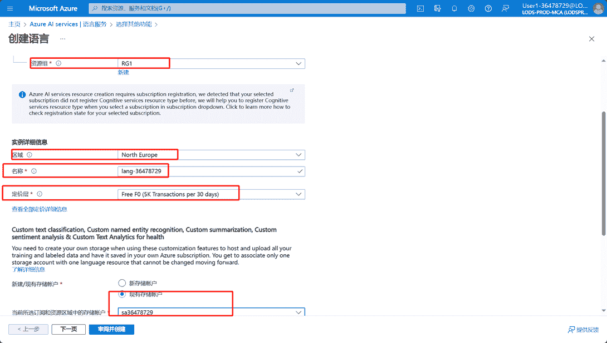

+   确保 PoC 应用的源代码连接到新创建的资源中的相应模型。您可以在 C：\PoC 中找到该应用。该应用有 C# 版本和 Python 版本。修改您喜欢的版本。您不需要修改这两个版本。完成任务后，应用必须继续正常运行。

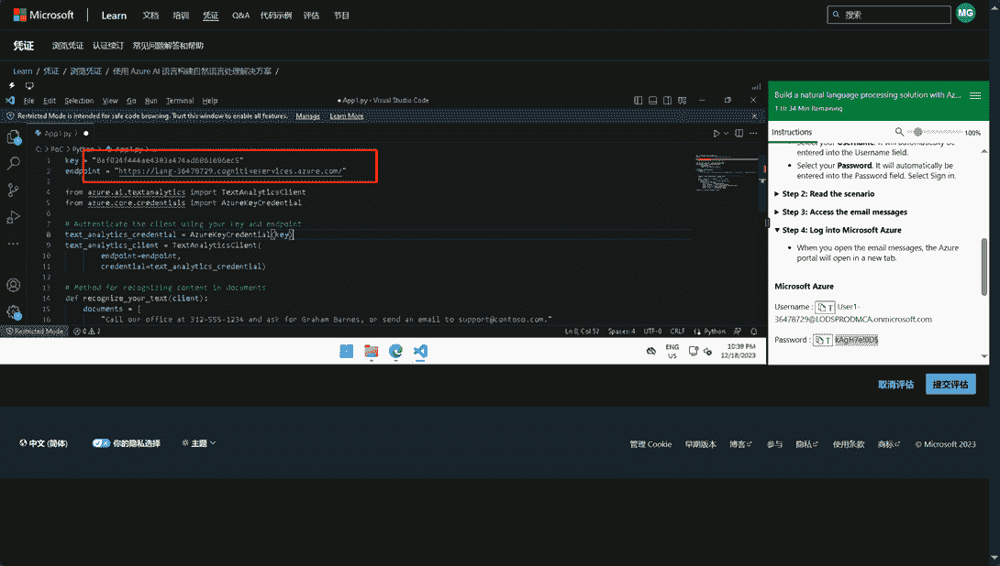

## Part II：发票验证

你好，

我们要从网上商店日志中提取信息来验证我们的发票系统。 我们需要你将日志上传到训练模型并正确标记它们。 标记后，你必须训练模型，以便我们的开发人员可以在稍后的验证过程中使用它。

**这是你的任务：**

你需要使用命名实体识别 （NER） 从网上商店收到的日志文件中提取名称和价格。 创建的项目必须满足以下要求：

+   项目必须命名为 Webshop。

+   语言必须是英语（美国），而不是多语言。

+   项目必须使用两个名为 Price 和 CustomerName 的新实体。

+   sa@labinstanceid/webshop 容器中的示例数据必须标有 Price 和 CustomerName。

+   必须启动模型训练。

无需等待训练完成即可开始下一个任务。

此致

项目管理团队

> 解题思路

+   项目必须命名为 Webshop。


+   语言必须是英语（美国），而不是多语言。


+   项目必须使用两个名为 Price 和 CustomerName 的新实体。


+   sa@labinstanceid/webshop 容器中的示例数据必须标有 Price 和 CustomerName。


+   必须启动模型训练。


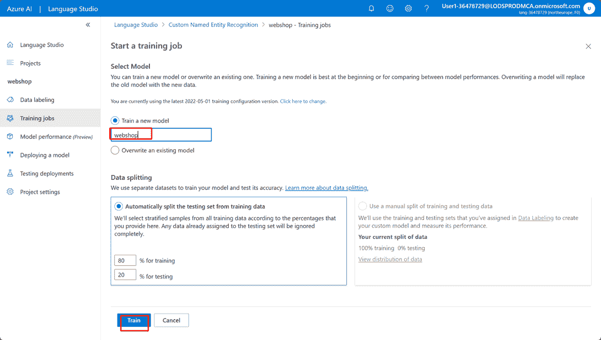

## Part III：聊天机器人后端

你好，

我们计划构建一个聊天机器人应用，它可以回答用户问题并允许用户订购产品。 我们需要你构建一个供聊天机器人使用的语言理解解决方案。

**这是你的任务：**

你需要创建一个新的语言理解项目。 该解决方案必须满足以下要求：

+   **使用 C:\pr**ojects 文件夹中 lang4567 的现有项目定义。

+   使用标准训练模式。

+   将数据拆分为训练占比 85% 和测试占比 15%。

+   将模型的部署配置为使用名称 **lang4567**。

+   将 CLU_PoC 应用的源代码修改为使用已部署模型的 API 终结点。 可以在 c:\CLU_PoC 中找到应用。 该应用有 C# 版本和 Python 版本。 修改你喜欢的版本。 无需修改这两个版本。 请注意，这不是生产代码，我们将对客户端密码进行硬编码以用于测试目的。

+   确保 CLU_PoC 应用仅打印置信度分数超过 80% 的意向值。

此致

项目管理团队

> 解题步骤

+   **使用 C:\pr**ojects 文件夹中 lang4567 的现有项目定义。


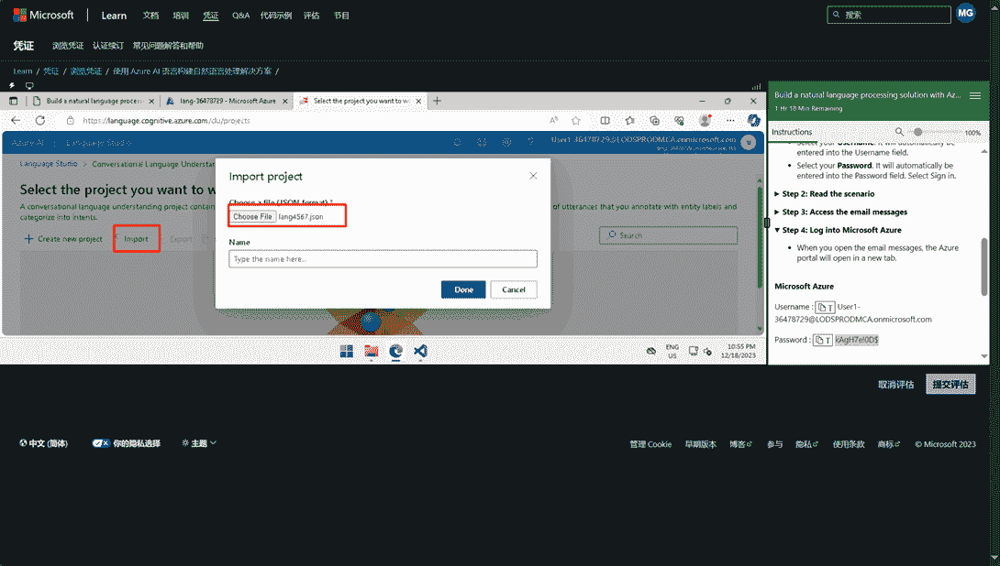

+   使用标准训练模式。

+   将数据拆分为训练占比 85% 和测试占比 15%。


+   将模型的部署配置为使用名称 **lang4567**。

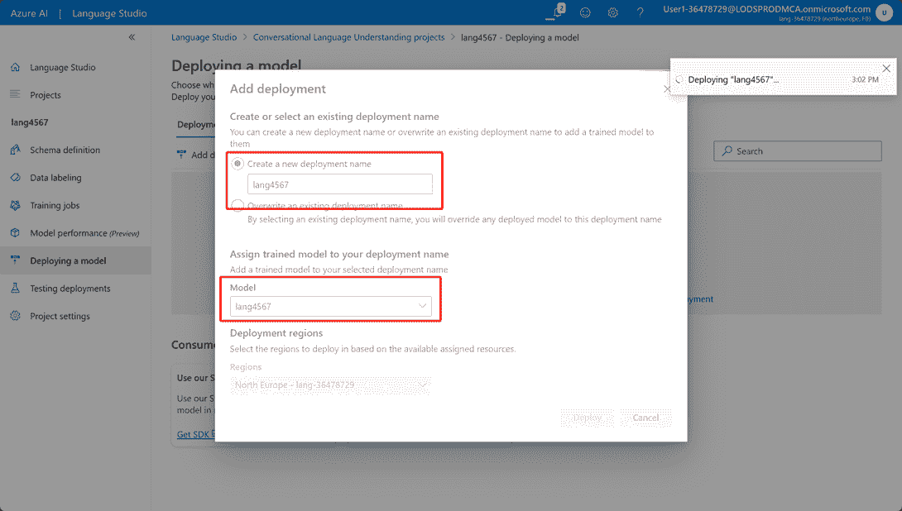

+   将 CLU_PoC 应用的源代码修改为使用已部署模型的 API 终结点。 可以在 c:\CLU_PoC 中找到应用。 该应用有 C# 版本和 Python 版本。 修改你喜欢的版本。 无需修改这两个版本。 请注意，这不是生产代码，我们将对客户端密码进行硬编码以用于测试目的。

+   确保 CLU_PoC 应用仅打印置信度分数超过 80% 的意向值。

使用以下代码（注意需要替换key和endpoint的值）

```
key = &quot;EyPVzuGNGl8WOQFfdt9raTUDxWDALSrNyLUjEYMyrqwE9zkbyc4kJQQJ99AKACi5YpzXJ3w3AAAaACOGUtYC&quot;
endpoint = &quot;https://lang-lod49820879.cognitiveservices.azure.com/&quot;
project_name = &quot;lang4567&quot;
deployment_name = &quot;lang4567&quot;

import sys
from azure.core.credentials import AzureKeyCredential
# add import statement for client library
from azure.ai.language.conversations import ConversationAnalysisClient

def main():
    # analyze query
    if (len(sys.argv) &gt; 1):
        query = sys.argv[1]
    else:
        query = &quot;Send an email to Carol about the tomorrow&#x27;s demo&quot;
    
    client = ConversationAnalysisClient(endpoint, AzureKeyCredential(key)) # replace null with correct method
    with client:
        result = client.analyze_conversation( # replace null with correct method
            task={
                &quot;kind&quot;: &quot;Conversation&quot;,
                &quot;analysisInput&quot;: {
                    &quot;conversationItem&quot;: {
                        &quot;participantId&quot;: &quot;1&quot;,
                        &quot;id&quot;: &quot;1&quot;,
                        &quot;modality&quot;: &quot;text&quot;,
                        &quot;language&quot;: &quot;en&quot;,
                        &quot;text&quot;: query
                    },
                    &quot;isLoggingEnabled&quot;: False
                },
                &quot;parameters&quot;: {
                    &quot;projectName&quot;: project_name,
                    &quot;deploymentName&quot;: deployment_name,
                    &quot;verbose&quot;: True
                }
            }
        )

    # view result
    print(f&quot;query: {result[&#x27;result&#x27;][&#x27;query&#x27;]}&quot;)
    if result[&#x27;result&#x27;][&#x27;prediction&#x27;][&#x27;intents&#x27;][0][&#x27;confidenceScore&#x27;] &gt; 0.8:
        print(f&quot;category: {result[&#x27;result&#x27;][&#x27;prediction&#x27;][&#x27;intents&#x27;][0][&#x27;category&#x27;]}&quot;)
        print(f&quot;confidence score: {result[&#x27;result&#x27;][&#x27;prediction&#x27;][&#x27;intents&#x27;][0][&#x27;confidenceScore&#x27;]}\n&quot;)

    print(&quot;entities:&quot;)
    for entity in result[&#x27;result&#x27;][&#x27;prediction&#x27;][&#x27;entities&#x27;][&#x27;confidenceScore&#x27;]:
        print(f&quot;\ncategory: {entity[&#x27;category&#x27;]}&quot;)
        print(f&quot;text: {entity[&#x27;text&#x27;]}&quot;)
        print(f&quot;confidence score: {entity[&#x27;confidenceScore&#x27;]}&quot;)

if __name__ == &#x27;__main__&#x27;:
    main()

```

#

# Applied Skills：创建智能文档处理解决方案

## 一般准则

**在**此应用场景中，某些资源的部署可能需要几分钟的时间。在部署完成期间，请查看实验室中的其他任务。你可以执行不依赖于该部署的其他任务。

感谢你同意帮助我们的团队使用 Azure AI 文档智能创建智能文档处理解决方案。

在 Azure 中执行任务时，必须遵循我们的一些一般准则。

+   创建对象时，请使用默认设置，除非有不同的配置要求。

+   请仅仅创建、删除或修改对象来达到上述要求。 对环境进行不必要的更改可能会对你的最终分数产生不利影响。

+   如果有多种实现目标的方法，请始终选择管理工作量最小的方法。

此致

首席技术官 （CTO）

## 现有环境

你将协助我们的团队使用 Azure AI 文档智能创建文档智能解决方案。

以下是用于访问 Azure 资源的凭据：

用户名：User-@labinstanceid

密码：password-@labinstanceid

你也可以在“**说明**”选项卡中找到登录信息。

你已获得 rg-@labinstanceid 资源组的权限。 请在此资源组中创建所有 Azure 对象。

此致

网络管理员

## Part I：创建原型

你好，

我们希望构建一个原型，以使用 Azure AI 文档智能自**动从发票和收据中**提取数据。 我们有位于 c:\files 的示例文件。

**这是你的任务：**

你需要创建一个新的使用免费定价层的 Azure AI 文档智能资**源。 然后使用预**生成模型来分析发票和收据。 将每个文件的 JSON 输出保存到 c:\files。

创建 JSON 输出后，按模型类型对所有文件进行排序，然后将文件上传到 prototype@labinstanceid。 请为每种模型类型使用单独的 Blob 存储容器。

备注：如果无法在 Azure 门户中找到文档智能资源类型，则可能需要使用以前的名称“表单识别器”进行搜索。

此致

项目管理团队

> 解题步骤

+   打开文档智能 Studio

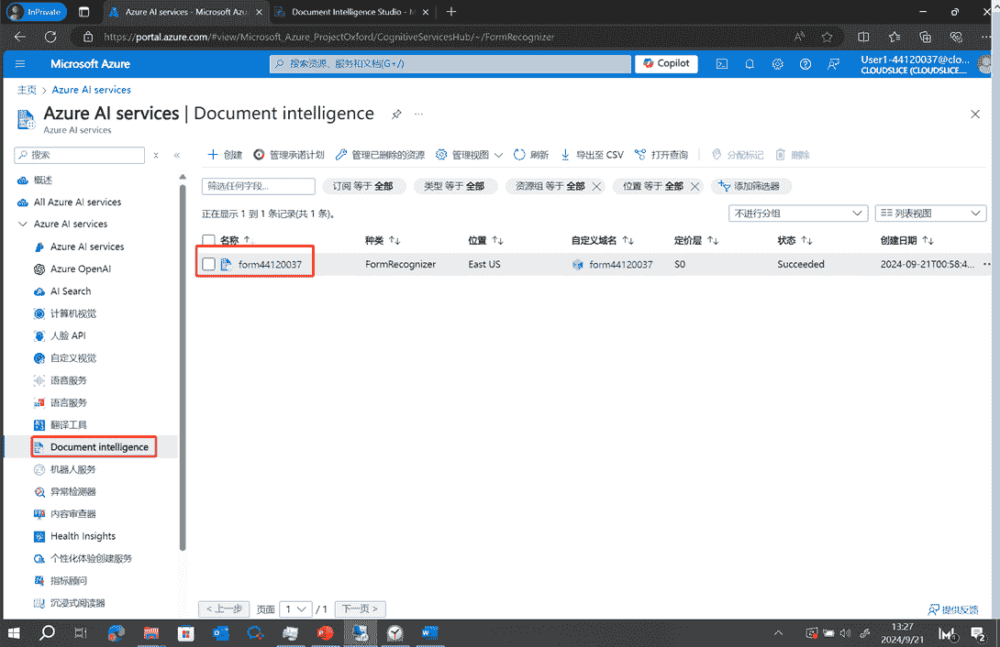

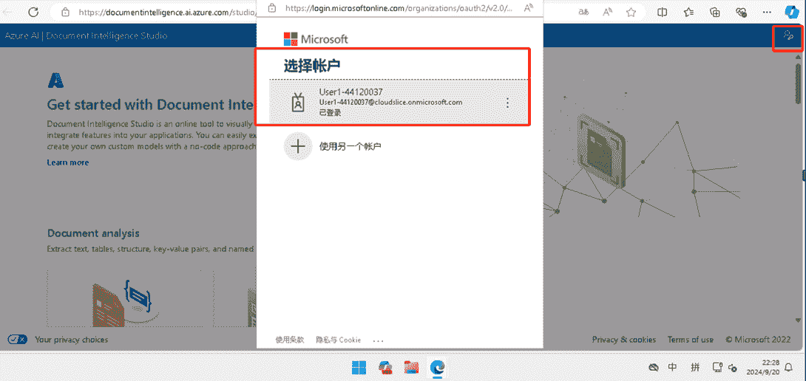

+   使用预生成模型分析发票和收据


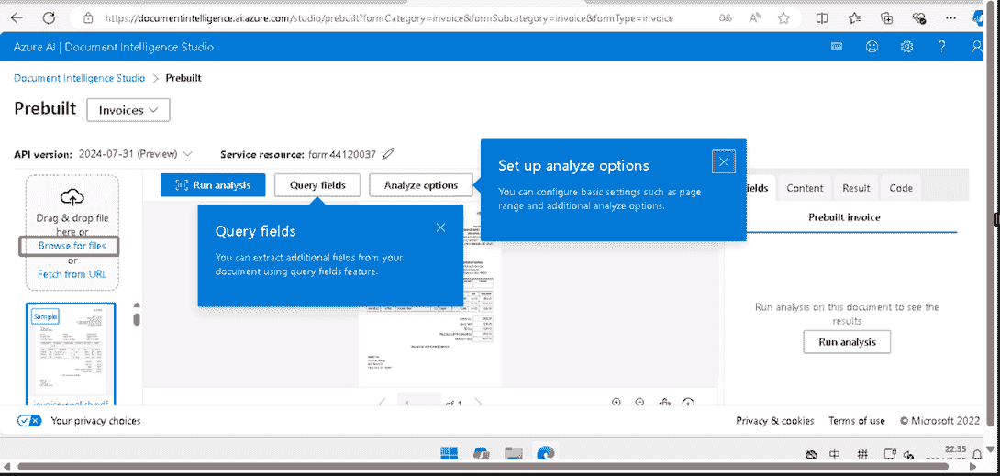


+   ** 将每个文件的 **JSON 输出保存到 c:\files

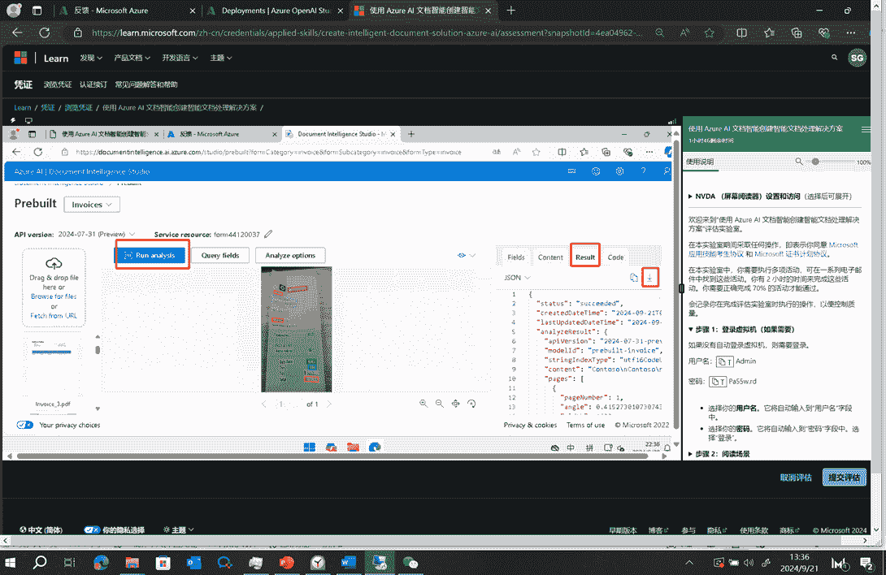

+   为每种模型类型在 prototype@labinstanceid 中创建单独的 Blob 存储容器，并上传文件

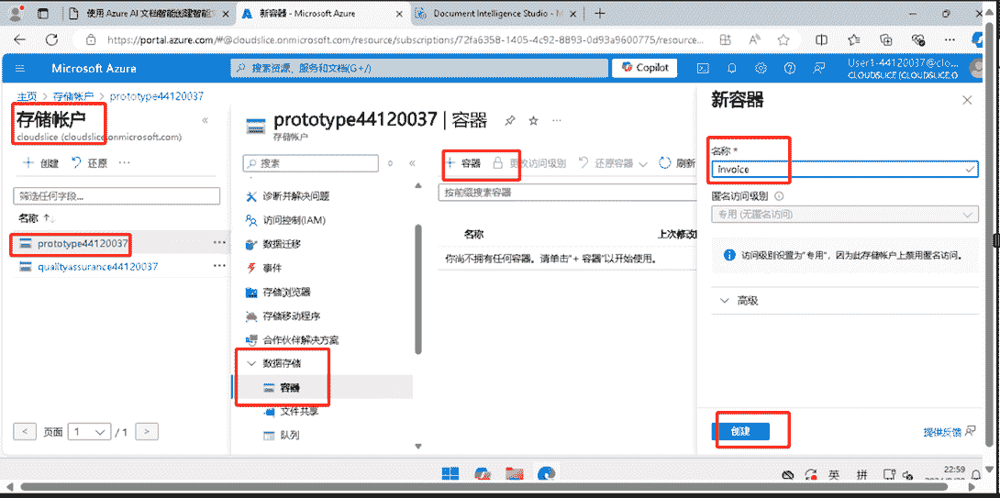

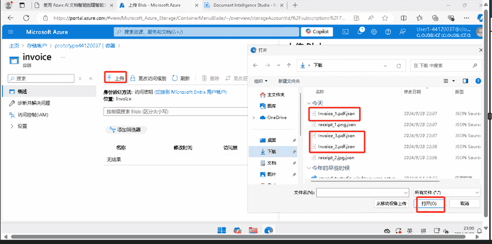

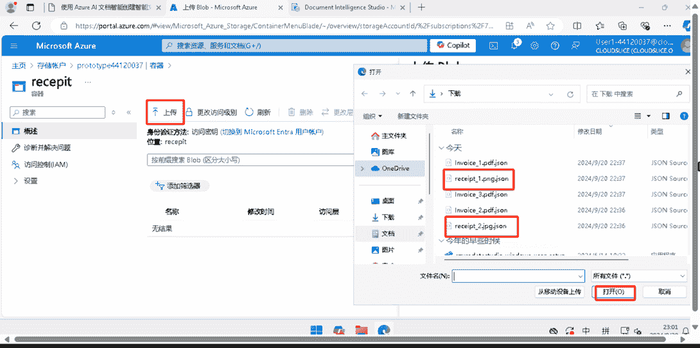

## Part II：训练自定义模型

你好，

我们在 qualityassurance@labinstanceid 存储帐户中有一些文档。 我们需要使用自定义模型来分析文档。

**这是你的任务：**

你需要创建一个名为 **Documents**** 的自定义 Azure AI** 文档智能项目，该项目使用模板模型和 2022-08-31 API 版本。

你需要为该项目执行以下任务：

+   将项目链接到 form@labinstanceid 资源。

+   使用 qualityassurance@labinstanceid 存储帐户中的 documents-training 容器。

+   使用下表中显示的标签。

+   **标记文档后，训练模型并**将模型命名为 QA-Template。

+   最后，使用位于 **c:\QA_Test** 中的文件测试模型。 将 **Report0008.jpg** 的 JSON 结果保存到同一文件夹中。

此致

质量保证团队

> 解题步骤

+   将项目链接到 form@labinstanceid 资源。


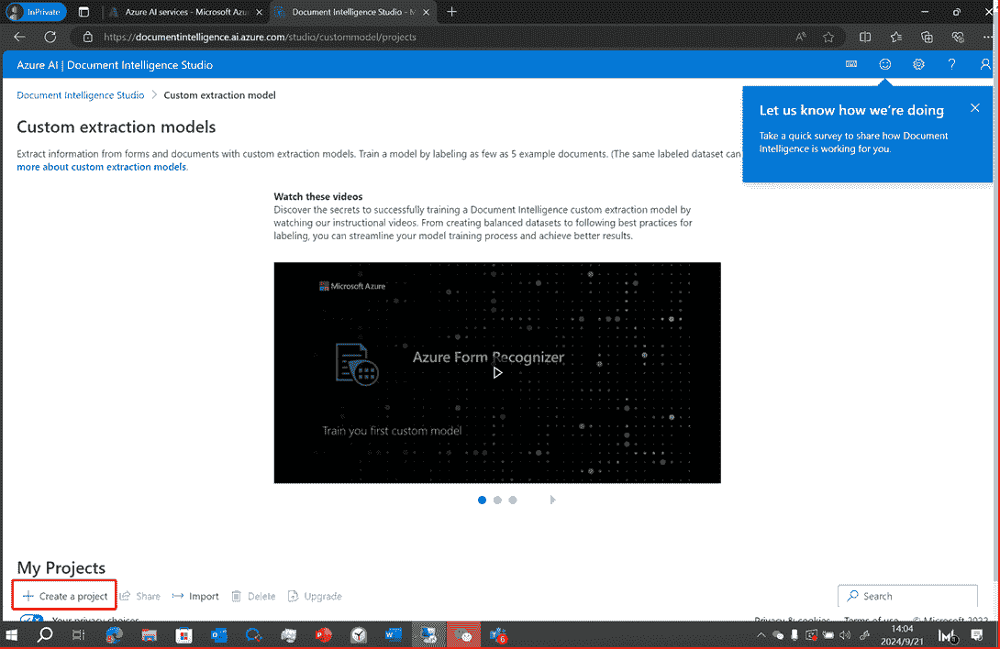

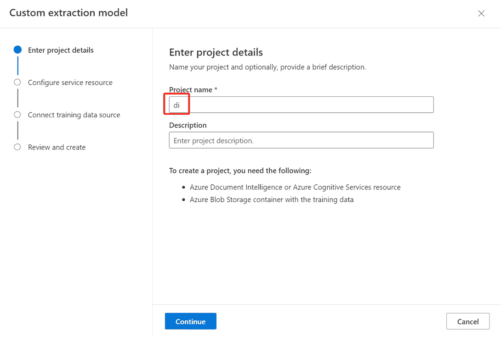


+   使用 qualityassurance@labinstanceid 存储帐户中的 documents-training 容器。


+   使用下表中显示的标签。

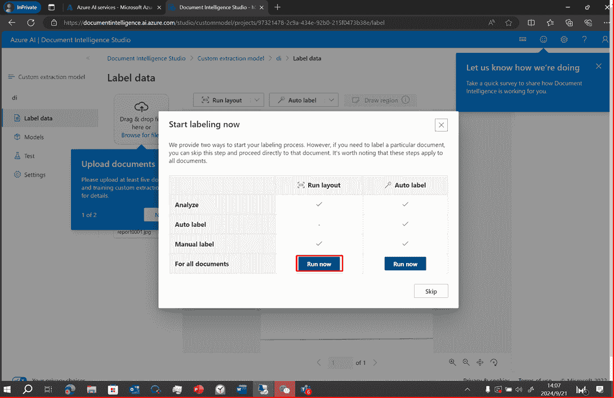

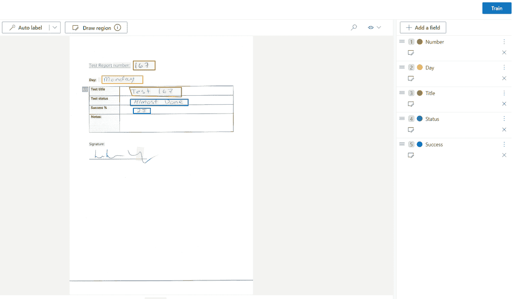

+   **标记文档后，训练模型并**将模型命名为 QA-Template。

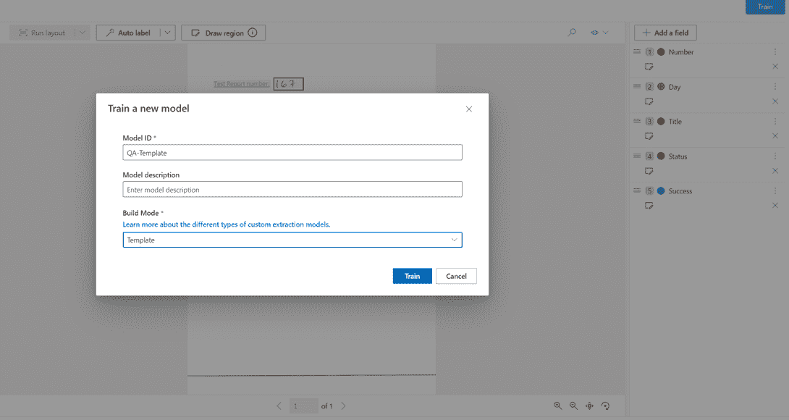

+   最后，使用位于 **c:\QA_Test** 中的文件测试模型。 将 **Report0008.jpg** 的 JSON 结果保存到同一文件夹中。

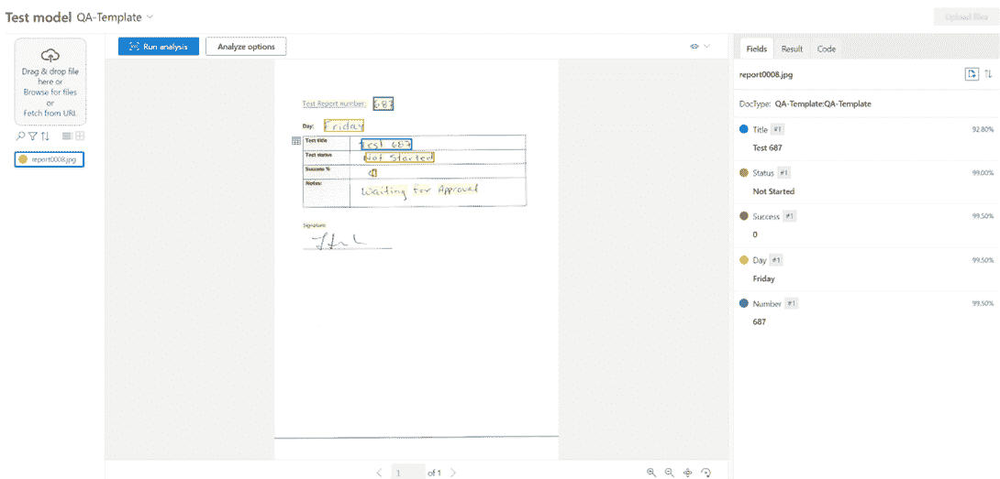

## Part III：编程访问

你好，

我们正在构建一个应用，以便使用 Azure AI 文档智能以编程方式处理发票。 我们将从发票中提取信息，然后根据发票计算总计。

我们已经创建了该应用的 C# 和 Python 版本，但我们需要你的帮助来完成代码。 你只需用自己选择的语言来完成该应用即可。 我们将让另一位开发人员使用其他语言完成代码。

应用的源代码和示例发票位于 **c:\app1** 中。

**这是你的任务：**

你需要在应用中完成代码以满足以下要求：

+   使用 Azure AI 文档智能中的预生成发票模型。

+   处理 c:\app1\invoices 中的文档。

+   计算所有发票的“总计”字段的总和。

+   省略任何置信度分数小于 75% 的文档。

此致

体系结构团队

> 解题步骤

参考 python 代码

```
import os
from dotenv import load_dotenv
from azure.ai.formrecognizer import FormRecognizerClient
from azure.core.credentials import AzureKeyCredential

task = FormRecognizerClient.begin_recognize_content
def analyze_invoice(form_recognizer_client, file_path, invoice_total):
    with open(file_path, &quot;rb&quot;) as f:
        form_data = f.read()
    # Need to determine which method to send the form to
    task = form_recognizer_client.begin_recognize_receipts(form_data)
    analyzed_result = task.result()
    for receipt in analyzed_result:
        for name, field in receipt.fields.items():
            if name == &quot;VendorName&quot;:
                print(&quot;Vendor Name: &#x27;{}&#x27;&quot;.format(field.value))
            if name == &quot;InvoiceTotal&quot;:
                if field.value is not None:
                    print(&quot;Invoice Total: &#x27;{}&#x27; with a confidence score of &#x27;{}&#x27;&quot;.format(
                        field.value, field.confidence))
                    # Add to invoice total, and filter by confidence &gt; 0.75
                    if field.confidence &gt; 0.75:
                        invoice_total += field.value
                    
    return invoice_total

def main():
    try:
        # Get configuration settings
        load_dotenv()
        form_endpoint = os.getenv(&#x27;FORM_ENDPOINT&#x27;)
        form_key = os.getenv(&#x27;FORM_KEY&#x27;)
        # Create client using endpoint and key
        form_recognizer_client = FormRecognizerClient(
            form_endpoint, AzureKeyCredential(form_key))
        # Analyze all files in the folder c:\app1\invoices
        folder_path = r&quot;C:\App1\Invoices&quot;
        invoice_total = 0
        for filename in os.listdir(folder_path):
            if filename.endswith(&quot;.pdf&quot;):
                file_path = os.path.join(folder_path, filename)
                print(&quot;Analyzing file: {}&quot;.format(file_path))
                invoice_total = analyze_invoice(form_recognizer_client, file_path, invoice_total)
        print(&quot;\nTotal Invoice Amount: {}&quot;.format(invoice_total))
    except Exception as ex:
        print(ex)

if __name__ == &#x27;__main__&#x27;:
    main()

```

同时记得修改。env 文件

# 备注

+   本次实验的代码均为python

+   为了配合理解章节内容理解示例代码运行机制，使用Juypter Notebook会是一个比较好的选择。

+   对于综合演练和项目实操，建议使用VS Code运行相关实例代码

## 安装 Python 和 Notebook

+   安装 python：https://www.liaoxuefeng.com/wiki/1016959663602400/1016959856222624

+   安装 Jypter Notebook：https://zhuanlan.zhihu.com/p/33105153

+   VS Code 的安装和初始化配置：https://code.visualstudio.com/docs/setup/windows

+   在 VS Code 上配置 Python 环境：https://code.visualstudio.com/docs/python/python-quick-start

+   在 VS Code 上配置 https://code.visualstudio.com/docs/datascience/jupyter-notebooks