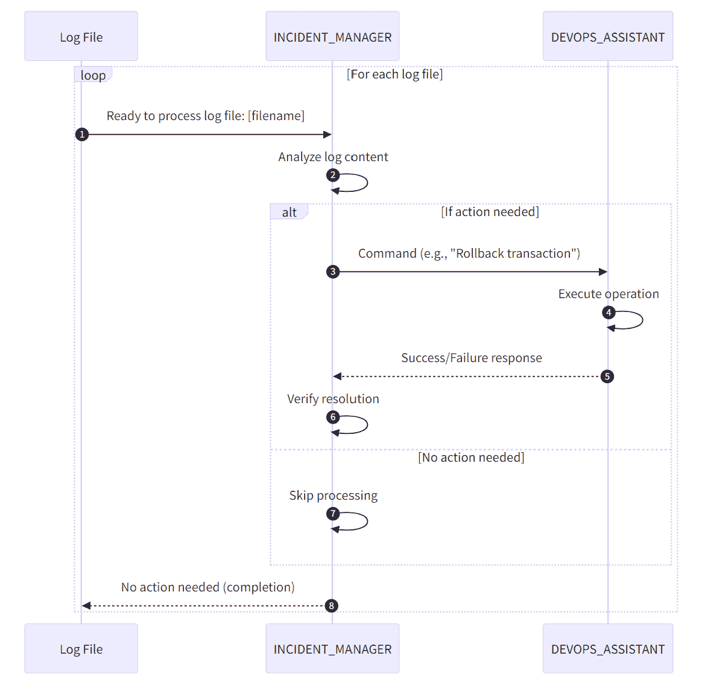
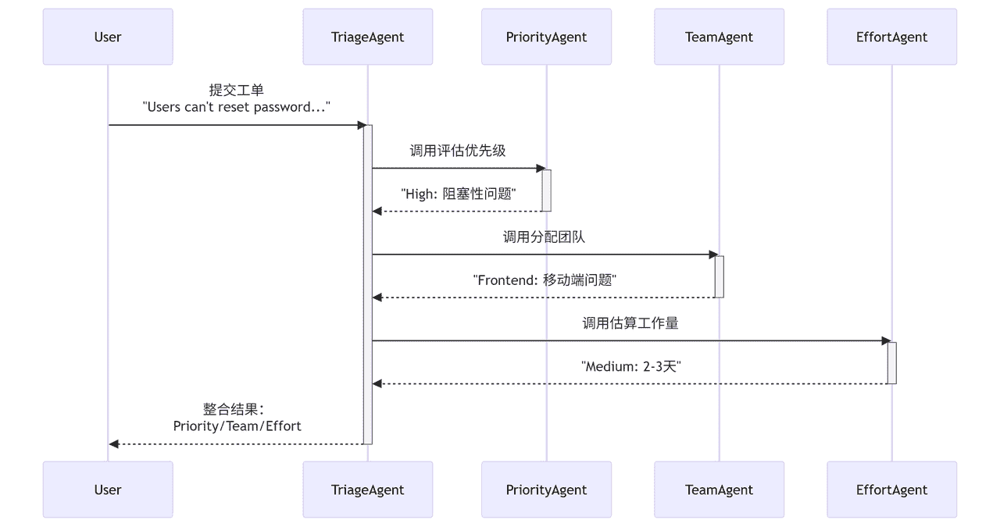
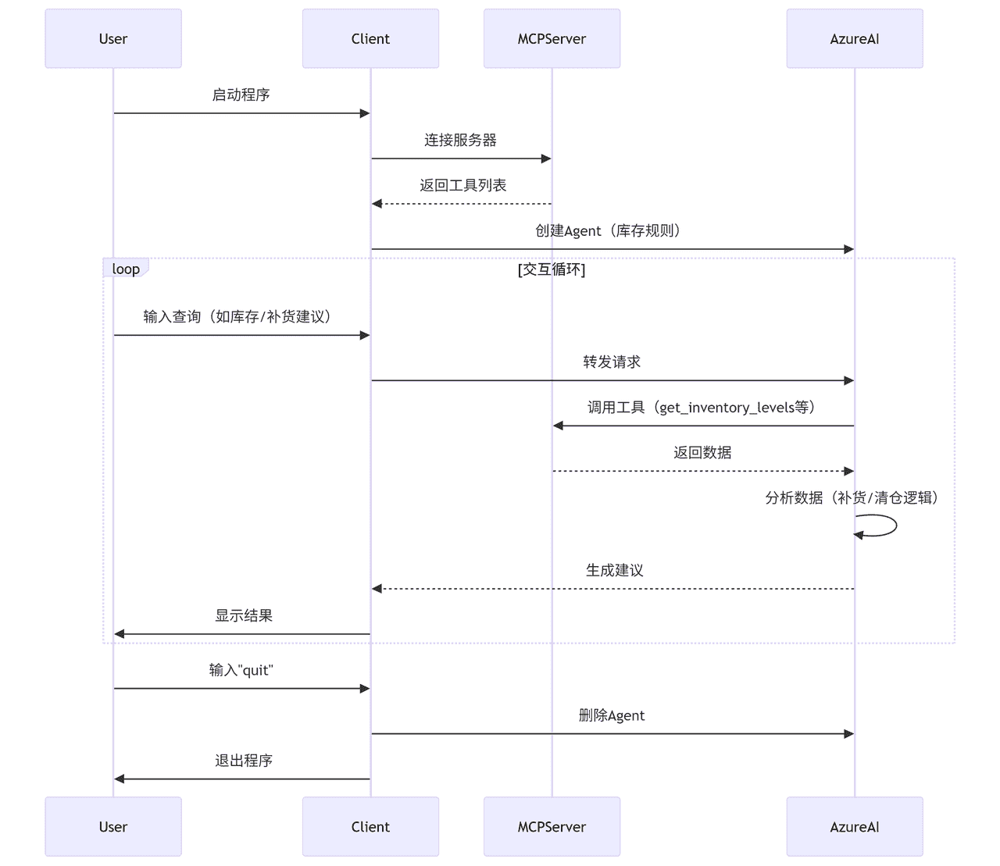

# AI-3026 在 Azure 上开发 AI 代理

> 来源：[https://zsyhjtnsa5.feishu.cn/docx/Ai57drHcIonKGyxvd7DcAeByn2f](https://zsyhjtnsa5.feishu.cn/docx/Ai57drHcIonKGyxvd7DcAeByn2f)

## 实验 Repo

`https://github.com/MicrosoftLearning/mslearn-ai-agents.zh-cn`

`https://github.com/MicrosoftLearning/mslearn-ai-agents`

## Azure 上的 AI 代理开发入门

`https://learn.microsoft.com/zh-cn/training/modules/ai-agent-fundamentals/`

### 什么是 AI 代理？

AI 代理是结合了生成式 AI 模型和上下文数据的智能软件服务，能够根据用户输入和环境因素自动执行任务。它们可以理解提示、利用知识源提供有根据的响应，并执行编程功能来自动化操作，例如根据既定政策处理费用报销或预订旅行安排。

### AI 代理的核心组件有哪些？

AI 代理由三个主要组件构成：

+   模型：这些是已部署的生成式 AI 模型（例如常见的 OpenAI 模型或 Azure AI Foundry 模型目录中的模型），负责推理提示并生成自然语言响应。

+   知识：这是指数据源，如 Microsoft Bing 搜索结果、Azure AI 搜索索引或用户自己的数据和文档，用于为代理提供上下文数据，从而生成具体的、有根据的提示。

+   工具：这些是编程功能，使代理能够自动化操作。它们包括用于访问 Azure AI 搜索和 Bing 知识的内置工具、代码解释器工具，以及可由用户自定义的代码或 Azure Functions。

### Azure AI 代理服务在 AI 代理开发中扮演什么角色？

Azure AI 代理服务是 Azure AI Foundry 中的一项服务，专门用于创建、测试和管理 AI 代理。它提供了一个可视化代理开发体验，并支持使用 Azure AI Foundry SDK 进行代码优先的开发。该服务基于 OpenAI 助手 API，但增加了模型、数据集成和企业安全性的选择，使其能够更灵活地与各种 Azure AI 服务集成。

### AI 代理如何通过知识和工具增强其功能？

AI 代理通过整合“知识”和“工具”来增强其功能。知识源为代理提供上下文数据，使其能够生成具体且有根据的响应，而不是仅依靠其训练数据。工具则是可执行特定操作的编程函数，让代理能够自动化任务。例如，代理可以使用知识来查找公司费用政策，并使用工具来提交费用报销或预订航班。

### AI 代理如何处理用户交互和会话历史？

用户和 AI 代理之间的对话发生在“线程”上。这个线程会保留会话中交换的所有消息历史记录以及生成的任何数据资产，如文件。这确保了代理能够理解对话的上下文并提供连贯的响应，从而实现持续且有意义的交互。

### 是否可以开发涉及多个 AI 代理的解决方案？

可以，组织可以开发“多代理解决方案”，其中多个 AI 代理彼此协调协作。例如，一个旅行预订代理可以预订航班和酒店，然后自动向费用代理提交附带相应收据的费用报销，从而实现跨不同领域任务的无缝自动化和协作。

### 除了 Azure AI 代理服务，还有哪些其他 AI 代理开发选项？

除了 Azure AI 代理服务，还有多种开发 AI 代理的选项，它们各有特点，适用于不同的开发场景和技能水平：

+   OpenAI 助手 API：提供 Azure AI 代理服务的一部分功能，主要与 OpenAI 模型配合使用。

+   语义内核：一个轻量级开源开发工具包，用于构建 AI 代理和协调多代理解决方案。

+   AutoGen：一个开源框架，用于快速开发代理，尤其适用于研究和构思。

+   Microsoft 365 代理 SDK：用于创建自托管代理，可通过 Slack 或 Messenger 等多种通道交付。

+   Microsoft Copilot Studio：一个低代码开发环境，使“公民开发者”能够快速构建和部署与 Microsoft 365 生态系统或常用通道集成的代理。

+   Microsoft 365 Copilot 中的 Copilot Studio 代理生成器：一种声明性工具，供业务用户创作用于常见任务的基本代理。

### 如何选择适合特定需求的 AI 代理开发解决方案？

选择合适的 AI 代理开发解决方案取决于多种因素，包括开发人员的技能水平、所需的复杂性以及与现有系统的集成需求：

+   对于几乎没有软件开发经验的业务用户：Microsoft 365 Copilot Chat 中的 Copilot Studio 代理生成器是创建简单声明性代理的理想选择。

+   对于具备技术技能的业务用户（Power Platform）：Copilot Studio 使他们能够利用其业务领域知识构建低代码代理解决方案，扩展 Microsoft 365 Copilot 或向常用渠道添加代理功能。

+   对于需要复杂 Microsoft 365 Copilot 功能扩展的专业开发人员：Microsoft 365 代理 SDK 适用于构建与 Copilot Studio 相同渠道的代理。

+   对于需要使用 Azure 后端服务、多种模型、自定义存储和搜索服务，并与 Azure AI 服务集成的专业开发人员：应在 Azure AI Foundry 中使用 Azure AI 代理服务。

+   对于构建单一独立代理：从 Azure AI 代理服务开始。如果需要构建多代理解决方案，则使用语义内核来协调解决方案中的代理。 在某些情况下，对工具、编程语言偏好和其他考虑因素的熟悉程度也会影响最终的决策。

### 练习-探索 AI 代理开发

`https://github.com/MicrosoftLearning/mslearn-ai-agents/blob/main/Instructions/01-agent-fundamentals.md`

## 使用 Azure AI 代理服务开发 AI 代理

`https://learn.microsoft.com/zh-cn/training/modules/develop-ai-agent-azure/`

### 什么是 AI 代理？它为何如此有用？

AI 代理是一种软件服务，它利用生成式 AI 来理解并代表用户或其他程序执行任务。它们使用先进的 AI 模型来理解上下文、做出决策、利用基础数据并采取行动以实现特定目标。与传统应用程序不同，AI 代理可以独立运行、执行复杂的工作流并实现流程自动化，而无需持续的人工干预。

AI 代理具有多项优势：

+   自动化日常任务：它们能够处理重复性任务，使人工员工能够专注于更具战略性和创造性的活动，从而提高生产力和效率。

+   增强决策：通过处理大量数据并提供深入见解，AI 代理支持更好的决策制定。它们可以分析趋势、预测结果并根据实时数据提供建议。

+   可扩展性：AI 代理能够扩展操作，而无需按比例增加人力资源，这对于寻求增长的企业非常有益，同时可以显著降低运营成本。

+   24/7 可用性：与所有软件一样，AI 代理可以不间断地连续运行，确保及时完成任务并提供全天候的客户服务。

### AI 代理在哪些领域有实际应用？

AI 代理在各个行业都有广泛的应用。一些值得注意的示例包括：

+   个人生产力代理：帮助个人完成日常任务，如安排会议、发送电子邮件和管理待办事项列表（例如 Microsoft 365 Copilot）。

+   研究代理：持续监控市场趋势、收集数据和生成报告，可用于金融服务、医疗保健和市场营销。

+   销售代理：自动化潜在客户开发和资格审查流程，研究潜在客户、发送个性化跟进消息甚至安排销售电话。

+   客户服务代理：处理例行查询、提供信息和解决常见问题，可集成到聊天机器人中以提供即时客户支持（例如 Cineplex）。

+   开发人员代理：协助执行软件开发任务，如代码审查、错误修复和存储库管理，自动化代码库更新、建议改进并确保维护编码标准（例如 GitHub Copilot）。

### Azure AI 代理服务如何简化 AI 代理的开发？

Azure AI 代理服务是一个完全托管的服务，旨在让开发人员能够安全地构建、部署和扩展高质量、可扩展的 AI 代理，而无需管理底层计算和存储资源。它通过以下方式简化了开发过程：

+   减少代码量：以前，实现类似代理的体验需要数百行代码，而 Azure AI 代理服务将所需的代码量减少到不到 50 行，从而简化了引用基础数据或连接到自定义函数等操作。

+   处理底层基础设施：该服务负责处理 AI Foundry 中的所有操作，从而无需开发人员手动管理底层基础设施。

+   自动化工具调用：它处理整个工具调用生命周期，包括运行模型、调用工具和返回结果。

+   安全管理的数据：通过线程安全地管理对话状态，无需开发人员手动处理此状态。

### 在 Azure 上开发 AI 代理时涉及哪些高级步骤？

在 Azure AI 代理服务上开发 AI 代理时，代码中需要实现以下高级步骤：

1.  连接到 AI Foundry 项目：使用项目连接字符串和 Entra ID 身份验证连接到 AI Foundry 项目。

1.  获取或创建代理引用：获取对现有代理的引用，或创建一个新代理，指定模型部署（用于解释和响应提示）、代理的功能和行为描述以及代理可用于执行任务的工具和资源。

1.  创建聊天会话线程：为与代理的聊天会话创建线程。所有对话都在有状态线程上执行，该线程保留聊天期间生成的消息历史记录和数据项目。

1.  将消息添加到线程并调用代理：将消息添加到线程并使用代理调用它。

1.  检查线程状态并检索消息：在线程准备就绪后检查其状态并检索消息和数据项目。

1.  重复聊天循环：重复前两个步骤作为聊天循环，直到聊天结束。

1.  清理资源：完成后，删除代理和线程以清理资源并删除不再需要的数据。

### AI 代理可以使用哪些类型的工具？

AI 代理的大部分增强功能都来自它们确定何时以及如何使用“工具”的能力。工具使代理可以使用附加功能，并且如果聊天或任务需要使用一个或多个工具，代理将调用该工具并处理响应。工具分为两个主要类别：

+   知识工具：这些工具增强了代理的上下文或知识。示例包括：

+   必应搜索：使用必应搜索结果将来自 Web 的实时数据作为提示的基础。

+   文件搜索：使用矢量存储中文件中的数据作为提示的基础。

+   Azure AI 搜索：使用来自 Azure AI 搜索查询结果的数据作为提示的基础。

+   Microsoft Fabric：使用 Fabric 数据代理将 Fabric 数据存储中的数据作为提示的基础。

+   操作工具：这些工具执行操作或运行函数。示例包括：

+   代码解释器：模型生成的 Python 代码的沙盒，可以访问和处理上传的文件。

+   函数：调用自定义函数代码（必须提供函数定义和实现）。

+   Azure 函数：在无服务器 Azure 函数中调用代码。

+   OpenAPI 规范：基于 OpenAPI 3.0 规范调用外部 API。

通过连接内置和自定义工具，可以允许代理代表您执行无数任务。

### Azure AI 代理服务与直接使用推理 API 有何不同？

与直接使用推理 API 进行开发相比，Azure AI 代理服务提供了一种更简化、更安全的方式来构建和部署 AI 代理。关键区别在于：

+   管理复杂性：Azure AI 代理服务是一个完全托管的服务，可处理底层计算和存储资源，以及工具调用生命周期和对话状态管理。而直接使用推理 API 需要开发人员手动处理所有这些复杂性。

+   代码量：Azure AI 代理服务显著减少了构建代理所需的代码量（不到 50 行），而直接使用推理 API 则需要大量的编码工作。

+   内置工具：该服务包含用于文件检索、代码解释以及与数据源（如必应、Azure AI 搜索和 Azure 函数）交互的开箱即用工具，而直接使用推理 API 则需要开发人员自己集成这些功能。

+   安全性：Azure AI 代理服务确保数据隐私并符合安全数据处理和无密钥身份验证，提供企业级安全性。

### Azure AI 代理服务支持哪些模型选择和安全功能？

Azure AI 代理服务提供：

+   灵活的模型选择：开发人员可以从各种模型中进行选择，包括 Azure OpenAI 模型以及其他模型，如 Llama 3、Mistral 和 Cohere。

+   企业级安全性：该服务确保数据隐私并符合安全数据处理和无密钥身份验证。

+   可自定义的存储解决方案：开发人员可以使用平台管理的存储或自带 Azure Blob 存储，以便完全可见性和控制。

### 在 Azure 上部署 AI 代理需要哪些资源？

Azure AI 代理服务是一个完全托管的服务，旨在帮助开发人员构建代理，而无需担心基础资源。通过 Azure，AI Foundry 和代理服务将预置必要的云资源。如果需要，您可以在构建代理时选择连接自己的资源，从而灵活地利用最适合您的 Azure 服务。

至少，您需要为代理创建具有 Azure AI 项目的 Azure AI 中心。您可以根据需要添加更多 Azure 服务。可以使用 Azure AI Foundry 门户创建资源，也可以使用预定义的 `bicep` 模板在订阅中部署资源。Azure AI 代理服务解决方案的两种常见架构包括：

+   基本代理设置：包括 Azure AI 中心、Azure AI 项目和 Azure AI 服务资源的最小配置。

+   标准代理设置：更全面的配置，包括基本代理设置和 Azure Key Vault、Azure AI 搜索和 Azure 存储。

### 练习-部署 AI 代理

`https://github.com/MicrosoftLearning/mslearn-ai-agents/blob/main/Instructions/02-build-ai-agent.md`


```python
import os
from dotenv import load_dotenv
from typing import Any
from pathlib import Path


# Add references
# Add references
from azure.identity import DefaultAzureCredential
from azure.ai.agents import AgentsClient
from azure.ai.agents.models import FilePurpose, CodeInterpreterTool, ListSortOrder, MessageRole

def main(): 

    # Clear the console
    os.system('cls' if os.name == 'nt' else 'clear')

    # Load environment variables from .env file
    load_dotenv()
    project_endpoint = os.getenv("PROJECT_ENDPOINT")
    model_deployment = os.getenv("MODEL_DEPLOYMENT_NAME")

    # Display the data to be analyzed
    script_dir = Path(__file__).parent  # Get the directory of the script
    file_path = script_dir / 'data.txt'

    with file_path.open('r') as file:
        data = file.read() + "\n"
        print(data)

    # Connect to the Agent client
    # Connect to the Agent client
    agent_client = AgentsClient(
       endpoint=project_endpoint,
       credential=DefaultAzureCredential(
           exclude_environment_credential=True,
           exclude_managed_identity_credential=True
       )
    )
    with agent_client:
        # Upload the data file and create a CodeInterpreterTool
        # Upload the data file and create a CodeInterpreterTool
        file = agent_client.files.upload_and_poll(
            file_path=file_path, purpose=FilePurpose.AGENTS
        )
        print(f"Uploaded {file.filename}")
        
        code_interpreter = CodeInterpreterTool(file_ids=[file.id])

        # Define an agent that uses the CodeInterpreterTool
        # Define an agent that uses the CodeInterpreterTool
        agent = agent_client.create_agent(
            model=model_deployment,
            name="data-agent",
            instructions="You are an AI agent that analyzes the data in the file that has been uploaded. Use Python to calculate statistical metrics as necessary.",
            tools=code_interpreter.definitions,
            tool_resources=code_interpreter.resources,
        )
        print(f"Using agent: {agent.name}")

        # Create a thread for the conversation
        # Create a thread for the conversation
        thread = agent_client.threads.create()

        # Loop until the user types 'quit'
        while True:
            # Get input text
            user_prompt = input("Enter a prompt (or type 'quit' to exit): ")
            if user_prompt.lower() == "quit":
                break
            if len(user_prompt) == 0:
                print("Please enter a prompt.")
                continue

            # Send a prompt to the agent
            # Send a prompt to the agent
            message = agent_client.messages.create(
                thread_id=thread.id,
                role="user",
                content=user_prompt,
            )
            
            run = agent_client.runs.create_and_process(thread_id=thread.id, agent_id=agent.id)

            # Check the run status for failures
            # Check the run status for failures
            if run.status == "failed":
                print(f"Run failed: {run.last_error}")

            # Show the latest response from the agent
            # Show the latest response from the agent
            last_msg = agent_client.messages.get_last_message_text_by_role(
               thread_id=thread.id,
               role=MessageRole.AGENT,
            )
            if last_msg:
               print(f"Last Message: {last_msg.text.value}")

        # Get the conversation history
        # Show the latest response from the agent
        last_msg = agent_client.messages.get_last_message_text_by_role(
           thread_id=thread.id,
           role=MessageRole.AGENT,
        )
        if last_msg:
           print(f"Last Message: {last_msg.text.value}")

        # Clean up
        # Clean up
        agent_client.delete_agent(agent.id)

if __name__ == '__main__': 
    main()
```

> 这段代码实现了一个基于 Azure AI 的数据分析代理系统，主要功能是让 AI 代理分析用户上传的数据文件并回答相关问题。以下是核心功能解析：

## 核心功能

- 加载并显示本地数据文件（`data.txt`）

- 创建具备 Python 代码解释能力的 AI 代理

- 交互式分析数据文件内容

- 支持自然语言提问获取分析结果

## 关键技术实现

### 文件处理

- 使用`file_path.open()`读取数据文件

- 通过`upload_and_poll()`上传至 Azure 服务

### AI 代理配置

```python
CodeInterpreterTool(file_ids=[file.id])  # 赋予代理代码解释能力
```

```python
instructions="...Use Python to calculate statistical metrics..."  # 指定分析任务
```

### 交互系统

- 创建独立对话线程（`threads.create()`）

- 循环处理用户输入（`while True`）

- 实时显示 AI 响应

## 典型工作流程

1）加载本地数据文件 → 2）上传至云端 → 3）创建分析代理 → 4）接收用户问题 → 5）执行 Python 分析 → 6）返回结果

## 技术特点

- 使用 Azure 的代码解释器工具（`CodeInterpreterTool`）

- 支持动态 Python 代码执行

- 完整的对话历史管理

- 自动化的资源清理机制

> 这个系统适合需要自然语言交互式数据分析的场景，用户可以用普通英语提问，AI 会自动转换为 Python 代码分析数据文件并返回结果。相比前一个技术支持代理，这个代理更专注于数据计算和分析能力。

```
Category,Cost
Accommodation, 674.56
Transportation, 2301.00
Meals, 267.89
Misc., 34.50

Uploaded data.txt
Using agent: data-agent
Enter a prompt (or type 'quit' to exit): What's the category with the highest cost?
Last Message: The category with the highest cost is **Transportation**, with a cost of **2301.00**.
Enter a prompt (or type 'quit' to exit): Create a text-based bar chart showing cost by category
Last Message: Here's a text-based bar chart showing the cost by category:

+----------------+--------+------------------------------------------------------------------+

|    Category    |  Cost  |                             Bar                                |

+----------------+--------+------------------------------------------------------------------+

| Transportation | 2301.0 | ****************************************************************|

| Accommodation  | 674.56 | ************************                                       |

|     Meals      | 267.89 | **********                                                    |

|     Misc.      |  34.5  | **                                                           |

+----------------+--------+------------------------------------------------------------------+

```

This chart represents the cost for each category with proportional asterisks (`*`).
Enter a prompt (or type 'quit' to exit): What's the standard deviation of cost?
Last Message: The standard deviation of the costs is approximately **1022.47**.
Enter a prompt (or type 'quit' to exit): quit
Last Message: The standard deviation of the costs is approximately **1022.47**.
```

> 这个输出展示了数据分析 AI 代理的完整工作流程，验证了代码的各项功能。以下是关键点分析：

## 数据加载阶段

- 成功读取并显示了 CSV 格式的支出数据（4 个类别及其金额）

- 文件上传确认显示"Uploaded data.txt"

- 代理初始化成功（Using agent: `data-agent`）

## 自然语言交互分析

### 最高支出查询

- 用户提问："What's the category with the highest cost？"

- 代理正确识别 **Transportation** 为最高（**2301.00**）

- 证明代码解释器能理解数据结构并执行比较操作

### 文本图表生成

- 用户请求："Create a text-based bar chart..."

- 代理生成 ASCII 柱状图，用星号数量直观显示金额比例

- 显示 Transportation 的星号数量明显多于其他类别

- 验证了 `CodeInterpreterTool` 的 Python 代码生成能力

### 统计分析

- 用户提问标准差计算

- 代理返回"1022.47"的合理结果

- 表明能执行 `numpy`/`pandas` 等数学运算

## 技术实现验证

- 文件处理：确认数据文件被正确解析

- 代码解释器：成功执行了：

  - 数据排序（最高支出判断）

  - 可视化（ASCII 图表生成）

  - 统计分析（标准差计算）

- 对话管理：保持多轮对话上下文

## 典型应用场景

- 财务数据分析（自动统计/可视化）

- 运营报表生成（自然语言驱动）

- 教育演示（交互式数据分析教学）

> 输出结果完美对应了代码设计的所有关键功能：

- 文件上传（`upload_and_poll`）

- 代码解释（`CodeInterpreterTool`）

- 动态响应（`create_and_process`）

- 多轮对话（`thread` 维护）

特别是 ASCII 图表的生成，证明了代理不仅能计算原始数据，还能用创造性的方式呈现结果，远超简单的数据查询功能。标准差的计算结果也验证了复杂统计功能的实现。

# 将自定义工具集成到代理中

https://learn.microsoft.com/zh-cn/training/modules/build-agent-with-custom-tools/

## 什么是 Azure AI Foundry 代理服务中的自定义工具？

Azure AI Foundry 代理服务中的自定义工具是允许 AI 代理扩展其功能并执行特定任务的功能。它们通过自动化重复性工作、提供定制解决方案以及提高输出的准确性和一致性来显著提高工作效率。

## 使用自定义工具的主要优势是什么？

使用自定义工具的主要优势包括：


# 自定义工具与 Azure AI 代理

## 自定义工具的优势

+ 提高工作效率：通过自动化重复性任务和简化工作流程。

+ 提高准确性：通过提供精确和一致的输出，减少人为错误。

+ 定制解决方案：满足特定的业务需求并优化流程。

### 自定义工具在客户支持自动化中如何应用？

在客户支持自动化中，零售公司可以将 Azure AI 代理与其客户关系管理（CRM）系统连接。AI 代理能够检索客户订单历史、处理退款并提供实时发货状态更新。这能加快客户查询的解决速度，减少支持团队的工作量，并提高客户满意度。

### 自定义工具如何改善库存管理和医疗保健预约安排？

+ 库存管理：制造公司可以开发一个自定义工具，将 AI 代理与其库存管理系统关联。AI 代理可以检查库存水平、使用历史数据预测补货需求，并自动向供应商下订单，从而简化库存流程和优化供应链运营。

+ 医疗保健预约安排：医疗保健提供商可以将自定义计划工具与 AI 代理集成。AI 代理可以访问患者记录、建议可用的预约时段，并向患者发送提醒，从而减轻管理负担、改善患者体验并更好地利用资源。

### 在 Azure AI Foundry 代理服务中，有哪些主要选项可以实现自定义工具？

在 Azure AI Foundry 代理服务中，有几种主要的选项可以实现自定义工具：

+ 函数调用：允许代理根据用户输入动态执行预定义函数。

+ Azure Functions：提供无服务器计算能力，用于事件驱动的工作流。

+ OpenAPI 规范工具：允许代理使用标准化规范与外部 API 交互。

+ Azure 逻辑应用：提供低代码/无代码解决方案，用于添加工作流并连接应用、数据和服务。

### “函数调用”是如何工作的？

“函数调用”允许代理根据用户输入动态执行预定义的函数。这意味着开发者可以定义代理可以调用的函数（例如，一个获取特定地点降雪量的函数），然后将这些函数注册到代理中。当代理识别出用户提示需要这些函数检索的信息时，它会动态地调用相应的函数来获取并提供所需的信息。

### Azure Functions 和 OpenAPI 规范在自定义工具集成中有何作用？

+ Azure Functions：Azure Functions 提供无服务器计算功能，非常适合事件驱动的工作流。它们支持触发器和绑定，使代理能够响应 HTTP 请求或队列消息等触发器，从而简化了 AI 代理与外部系统和服务的交互。

+ OpenAPI 规范工具：这些工具允许代理使用 OpenAPI 3.0 规范与外部 API 交互。这种方法简化了 API 集成，并确保与各种服务兼容，从而增强了代理的功能。

### 代理如何“知道”何时调用自定义工具？

代理的强大之处在于其“声明性”性质。开发者无需编写显式调用自定义工具函数的代码。相反，代理本身会根据用户提示中的消息和提供给它的工具定义（包括有意义的名称和记录良好的参数）来决定何时以及如何调用工具函数。代理能够“找出”何时需要某个工具以及如何单独调用它来响应用户请求。

## 练习-在 AI 代理中使用自定义函数

https://github.com/MicrosoftLearning/mslearn-ai-agents/blob/main/Instructions/03-agent-custom-functions.md

`user_functions.py`

```
import json
from pathlib import Path
import uuid
from typing import Any, Callable, Set

# Create a function to submit a support ticket
# Create a function to submit a support ticket
def submit_support_ticket(email_address: str, description: str) -> str:
    script_dir = Path(__file__).parent  # Get the directory of the script
    ticket_number = str(uuid.uuid4()).replace('-', '')[:6]
    file_name = f"ticket-{ticket_number}.txt"
    file_path = script_dir / file_name
    text = f"Support ticket: {ticket_number}\nSubmitted by: {email_address}\nDescription:\n{description}"
    file_path.write_text(text)

    message_json = json.dumps({"message": f"Support ticket {ticket_number} submitted. The ticket file is saved as {file_name}"})
    return message_json

# Define a set of callable functions
# Define a set of callable functions
user_functions: Set[Callable[..., Any]] = {
    submit_support_ticket
}

```

> 这段代码实现了一个简单的技术支持工单提交系统，主要功能是生成并保存工单文件。以下是代码解析：

1. 核心函数 `submit_support_ticket`

+ 输入参数：

+ `email_address`： 用户邮箱地址

+ `description`： 问题描述

+ 功能实现：

+ 使用`uuid`生成 6 位随机工单号（去除横线后取前 6 位）

+ 创建工单文件名格式：`ticket-{工单号}.txt`

+ 在脚本同级目录生成工单文件，内容包含：

```
Support ticket: {工单号}
Submitted by: {邮箱}
Description:
{问题描述}
```

+ 返回 JSON 格式的成功消息

1. 函数集合 `user_functions`

+ 类型注解：`Set[Callable[..., Any]]` 表示可调用函数的集合

+ 当前仅包含`submit_support_ticket`这一个函数

+ 设计目的：便于统一管理所有可调用的用户功能函数

1. 关键技术点

+ 文件操作：使用`pathlib.Path`进行跨平台路径处理

+ 唯一 ID 生成：采用`uuid4`保证工单号唯一性

+ 数据持久化：以文本文件形式保存工单

+ 接口标准化：返回 JSON 格式的响应

1. 典型输出示例

> 当调用`submit_support_ticket("user@example.com", "系统无法登录")`时：

+ 生成文件`ticket-3a7b42.txt`：

```
Support ticket: 3a7b42
Submitted by: user@example.com
Description:
系统无法登录
```

+ 返回 JSON：

```
{"message": "Support ticket 3a7b42 submitted. The ticket file is saved as ticket-3a7b42.txt"}
```

> 这个实现适合作为技术支持的底层服务模块，可以与前端界面或 AI 代理结合使用。关键优点是实现了工单追踪的原子化操作，每个工单都有唯一标识和完整记录。

`agent.py`

```
import os
from dotenv import load_dotenv
from typing import Any
from pathlib import Path


# Add references
# Add references
from azure.identity import DefaultAzureCredential
from azure.ai.agents import AgentsClient
from azure.ai.agents.models import FunctionTool, ToolSet, ListSortOrder, MessageRole
from user_functions import user_functions

def main(): 

    # Clear the console
    os.system('cls' if os.name=='nt' else 'clear')

    # Load environment variables from .env file
    load_dotenv()
    project_endpoint = os.getenv("PROJECT_ENDPOINT")
    model_deployment = os.getenv("MODEL_DEPLOYMENT_NAME")


    # Connect to the Agent client
    # Connect to the Agent client
    agent_client = AgentsClient(
       endpoint=project_endpoint,
       credential=DefaultAzureCredential
           (exclude_environment_credential=True,
            exclude_managed_identity_credential=True)
    )
    

    # Define an agent that can use the custom functions
    # Define an agent that can use the custom functions
    with agent_client:
    
        functions = FunctionTool(user_functions)
        toolset = ToolSet()
        toolset.add(functions)
        agent_client.enable_auto_function_calls(toolset)
            
        agent = agent_client.create_agent(
            model=model_deployment,
            name="support-agent",
            instructions="""You are a technical support agent.
                            When a user has a technical issue, you get their email address and a description of the issue.
                            Then you use those values to submit a support ticket using the function available to you.
                            If a file is saved, tell the user the file name.
                         """,
            toolset=toolset
        )
    
        thread = agent_client.threads.create()
        print(f"You're chatting with: {agent.name} ({agent.id})")

    
        # Loop until the user types 'quit'
        while True:
            # Get input text
            user_prompt = input("Enter a prompt (or type 'quit' to exit): ")
            if user_prompt.lower() == "quit":
                break
            if len(user_prompt) == 0:
                print("Please enter a prompt.")
                continue

            # Send a prompt to the agent
            # Send a prompt to the agent
            message = agent_client.messages.create(
                thread_id=thread.id,
                role="user",
                content=user_prompt
            )
            run = agent_client.runs.create_and_process(thread_id=thread.id, agent_id=agent.id)


            # Check the run status for failures
            # Check the run status for failures
            if run.status == "failed":
                print(f"Run failed: {run.last_error}")

                
            # Show the latest response from the agent
            # Show the latest response from the agent
            last_msg = agent_client.messages.get_last_message_text_by_role(
               thread_id=thread.id,
               role=MessageRole.AGENT,
            )
            if last_msg:
                print(f"Last Message: {last_msg.text.value}")


        # Get the conversation history
        # Get the conversation history
        print("\nConversation Log:\n")
        messages = agent_client.messages.list(thread_id=thread.id, order=ListSortOrder.ASCENDING)
        for message in messages:
            if message.text_messages:
               last_msg = message.text_messages[-1]
               print(f"{message.role}: {last_msg.text.value}\n")
        

        # Clean up
        # Clean up
        agent_client.delete_agent(agent.id)
        print("Deleted agent")

    

if __name__ == '__main__': 
    main()
```

> 这段代码实现了一个基于 Azure AI 的技术支持聊天代理系统，能够自动处理用户的技术问题并生成支持工单。以下是代码的详细解析：

1. 核心功能

+ 创建 AI 技术支持代理，处理用户的技术问题

+ 集成自定义函数（来自 `user_functions.py`）提交支持工单

+ 维护完整的对话历史记录

+ 提供交互式聊天界面

1. 主要组件

+ Azure AI Agents 服务：核心 AI 能力

+ `FunctionTool`/`ToolSet`：管理自定义功能（工单提交）

+ 对话线程（Thread）：维护对话上下文

1. 工作流程

1. 初始化阶段：

+ 加载环境变量（`.env` 文件）

+ 连接 Azure AI 服务

+ 创建支持代理，配置处理指令

+ 创建对话线程

1. 交互阶段：

+ 循环接收用户输入

+ 调用 AI 代理处理问题

+ 自动触发工单提交函数

+ 显示处理结果

1. 结束阶段：

+ 输出完整对话日志

+ 清理资源（删除代理）

1. 关键代码解析

+ 代理配置：


## Azure AI 代理技术支持实践示例

```
instructions=&quot;&quot;&quot;You are a technical support agent...&quot;&quot;&quot;
```

明确规定了代理的角色和行为准则

+   工具集成：

```
functions = FunctionTool(user_functions)
toolset.add(functions)
```

使代理能调用外部提交工单的函数

+   消息处理：

```
run = agent_client.runs.create_and_process(...)
```

异步处理用户请求并执行相关操作

1.  典型交互示例

```
用户 &gt; 我的账户无法登录
代理 &gt; 请提供您的邮箱和问题详情...
用户 &gt; email@example.com, 错误代码500
代理 &gt; 已提交工单ticket-3a7b42.txt
```

1.  扩展性

+   可轻松添加更多支持功能（如知识库查询）

+   支持多轮对话上下文保持

+   可集成到 Web 服务或客服系统

> 这个实现展示了如何将 Azure AI 服务与实际业务功能（工单系统）结合，创建智能化的技术支持解决方案。代码结构清晰，遵循了良好的资源管理实践（如 `with` 语句和清理操作）。

可能的输出

```
You&#x27;re chatting with: support-agent (asst_CM8ryFG8Mc4GToL1LXBWInSg)
Enter a prompt (or type &#x27;quit&#x27; to exit): I have a technical problem
Last Message: Could you please provide your email address and a description of the problem you&#x27;re experiencing? That way, I can create a support ticket for you.
Enter a prompt (or type &#x27;quit&#x27; to exit): alex@contoso.com
Last Message: Thanks for providing your email address! Please describe the technical problem you&#x27;re facing so I can include it in the support ticket.
Enter a prompt (or type &#x27;quit&#x27; to exit): my computer won&#x27;t start
Last Message: Your support ticket has been submitted successfully! Your ticket ID is **80b33b**, and the details have been saved in the file **ticket-80b33b.txt**. Our team will get back to you shortly.
Enter a prompt (or type &#x27;quit&#x27; to exit): quit

Conversation Log:

MessageRole.USER: I have a technical problem

MessageRole.AGENT: Could you please provide your email address and a description of the problem you&#x27;re experiencing? That way, I can create a support ticket for you.

MessageRole.USER: alex@contoso.com

MessageRole.AGENT: Thanks for providing your email address! Please describe the technical problem you&#x27;re facing so I can include it in the support ticket.

MessageRole.USER: my computer won&#x27;t start

MessageRole.AGENT: Your support ticket has been submitted successfully! Your ticket ID is **80b33b**, and the details have been saved in the file **ticket-80b33b.txt**. Our team will get back to you shortly.

Deleted agent
(labenv) PS /home/user1-52717560/ai-agents/Labfiles/03-ai-agent-functions/Python&gt; dir                                

    Directory: /home/user1-52717560/ai-agents/Labfiles/03-ai-agent-functions/Python

UnixMode         User Group         LastWriteTime         Size Name
--------         ---- -----         -------------         ---- ----
drwxr-xr-x user1-5271 user1-5271   7/4/2025 08:46         4096 __pycache__
                 7560 7560
-rw-r--r-- user1-5271 user1-5271   7/4/2025 08:45         3744 agent.py
                 7560 7560
-rw-r--r-- user1-5271 user1-5271   7/4/2025 08:19           29 requirements.txt
                 7560 7560
-rw-r--r-- user1-5271 user1-5271   7/4/2025 08:47           91 ticket-80b33b.txt
                 7560 7560
-rw-r--r-- user1-5271 user1-5271   7/4/2025 08:45          912 user_functions.py
                 7560 7560

(labenv) PS /home/user1-52717560/ai-agents/Labfiles/03-ai-agent-functions/Python&gt; cat ticket-80b33b.txt                                                       
Support ticket: 80b33b
Submitted by: alex@contoso.com
Description:
My computer won&#x27;t start.
(labenv) PS /home/user1-52717560/ai-agents/Labfiles/03-ai-agent-functions/Python&gt;
```

> 这个输出完整展示了基于之前代码的技术支持 AI 代理的工作流程和实际效果。让我们结合代码逐步解析：

1.  代理初始化阶段

+   代码中`create_agent()`创建的`support-agent`已成功启动

+   显示代理 ID：asst_CM8ryFG8Mc4GTOLLXBWInSg

+   符合代码中的打印语句：

```
print(f&quot;You&#x27;re chatting with: {agent.name} ({agent.id})&quot;)
```

1.  多轮对话流程

+   第一轮

+   用户输入："I have a technical problem"

+   代理响应要求提供邮箱和问题描述

+   对应代码中配置的指令：

```
instructions=&quot;&quot;&quot;...get their email address and a description...&quot;&quot;&quot;
```

+   第二轮

+   用户提供邮箱："alex@contoso.com"

+   代理继续询问具体问题

+   说明代码正确处理了分步信息收集

1.  工单提交阶段

+   用户描述问题："my computer won't start"

+   代理自动触发`submit_support_ticket()`函数：

+   生成工单 ID：80b33b（来自`uuid.uuid4()`）

+   创建文件`ticket-80b33b.txt`

+   文件内容完全符合`submit_support_ticket()`函数的格式：

```
text = f&quot;Support ticket: {ticket_number}\nSubmitted by: {email_address}\nDescription:\n{description}&quot;
```

1.  输出验证

+   终端显示的对话日志与`messages.list()`输出一致

+   文件系统确认工单文件已创建（通过`dir`和`cat`命令验证）

+   证明代码中的文件操作部分正常工作：

```
file_path.write_text(text)  # 在`submit_support_ticket()`中
```

1.  资源清理

+   会话结束时正确删除代理

+   对应代码中的清理逻辑：

```
agent_client.delete_agent(agent.id)
```

> 整个交互过程完美展示了：

1.  自然语言理解（解析用户问题）

1.  分步信息收集（邮箱→问题描述）

1.  自动功能调用（提交工单）

1.  结果反馈（返回工单 ID 和文件信息）

1.  状态持久化（保存工单文件）

> 验证了代码中所有关键组件（`Agent` 配置、函数调用、文件操作、对话管理）都按设计正常工作。最后的文件内容也证明自定义函数`submit_support_ticket()`被正确调用并传入了收集到的参数（邮箱+问题描述）。

# 使用语义内核开发 AI 代理

https://learn.microsoft.com/zh-cn/training/modules/develop-ai-agent-with-semantic-kernel/

## 什么是 AI 代理以及它们如何运作？

AI 代理是使用生成式 AI 解释数据、做出决策并代表用户或其他应用程序执行任务的程序。 它们依赖于大型语言模型 （LLM） 来执行任务，与传统程序不同，AI 代理可以自主运行，处理复杂的工作流和自动化过程，而无需持续的人工监督。 它们可以通过使用自然语言处理来理解和响应指令。

## 什么是语义内核 SDK？它如何帮助开发 AI 代理？

语义内核是一个开源 SDK，使开发人员可以轻松地将最新的 AI 模型集成到其应用程序中。 它包含一个名为“语义内核代理框架”的组件，该框架允许开发人员快速创建能够使用自然语言处理完成任务的功能代理。 语义内核 SDK 提供了一系列核心组件，如 AI 服务连接器、内存连接器、函数和插件、提示模板和过滤器，它们可以单独或组合使用，以构建强大的 AI 应用程序。

## 语义内核代理框架的关键概念是什么？

语义内核代理框架简化了代理的创建，并在集成人工输入的同时实现了多代理协作。 其核心概念包括：

+   代理： AI 代理的抽象，允许在对话中完成任务和人工交互。

+   代理线程： 管理聊天状态并存储聊天。

+   代理聊天： 多代理交互的基础，允许结构化对话和协作。

+   代理通道： 用于自定义代理开发，允许不同类型的代理参与 AgentChat。

+   代理消息： 代理通信的统一结构，提供与现有 AI 工作流的无缝通信和集成。

+   模板化： 使用动态提示配置来塑造代理行为。

+   函数和插件： 允许开发人员通过合并自定义函数来扩展代理功能。

## 什么是 Azure AI 代理？它有什么优势？

`AzureAIAgent` 类提供了一种无缝的方法来使用 Azure AI 代理服务构建和交互 AI 代理。 它通过在语义内核代理框架中提供更结构化和直观的界面来抽象管理 AI 代理的复杂性。 主要优势包括：

+   简化的代理创建： 允许开发人员使用最少的配置来定义 AI 代理，而无需管理底层基础架构。

+   自动工具调用： 代理可以自动调用和执行工具，与 Azure AI 搜索、必应、Azure Functions 等无缝集成。

+   线程和聊天管理： 提供用于管理聊天状态的内置机制，确保多代理交互流畅。

+   安全企业集成： 允许使用无密钥身份验证和可自定义存储选项进行安全合规的 AI 代理开发。

## 如何使用语义内核创建 Azure AI 代理？

要使用 `AzureAIAgent`，您需要执行以下步骤：

1.  创建一个 Azure AI Foundry 项目。

1.  将项目连接字符串添加到语义内核应用程序代码。

1.  创建 `AzureAIAgentSettings` 对象。

1.  创建 `AzureAIAgent` 客户端。

1.  在客户端提供的代理服务上创建代理定义。

1.  根据定义创建代理。

`AzureAIAgent` 对象封装了通常与内核一起使用的所有核心功能，例如函数执行、规划和内存访问，充当一个独立的代理运行时。

## AzureAIAgent 的关键组件是什么？

`AzureAIAgent` 对象依赖于以下组件才能正常运行：

+   `AzureAISAgentSettings`： 一个自动包含环境配置中的 Azure AI 代理设置的对象。

+   `AzureAIAgent` 客户端： 用于管理与 Azure AI Foundry 项目连接的对象，允许访问与项目关联的服务和模型。

+   代理服务： `AzureAIAgent` 客户端还包含代理服务，有助于简化为项目创建、管理和运行代理的过程。

+   代理定义： 通过 Azure AI 项目客户端创建的 Azure AI 代理模型，指定要使用的 AI 部署模型以及代理的名称和说明。

+   `AzureAIAgentThread`： 自动维护代理和用户之间的聊天历史记录和状态，并允许您将消息添加到线程并使用代理从 LLM 调用响应。

这些组件协同工作，使您能够使用说明创建代理，以定义其用途并从 AI 模型调用响应。

## 什么是插件？它们如何增强 Azure AI 代理的功能？

在语义内核中，插件允许 AI 代理使用现有 API 执行其自身无法执行的任务。 插件通过函数调用工作，允许 AI 请求和使用特定函数。 语义内核将请求路由到代码库中的相应函数，并将结果返回给 LLM，以便 LLM 可以生成最终响应。 插件还需要提供描述其行为的详细信息（包括输入、输出和副作用），以便 AI 可以正确调用函数。

## 如何将插件添加到 Azure AI 代理？

要将插件与 `AzureAIAgent` 一起使用，您需要执行以下步骤：

1.  定义插件： 通过定义类并使用 `@kernel_function` 修饰符注释其方法来创建插件。 `kernel_function` 修饰符允许语义内核知道此函数可由 AI 调用，并且还支持一个 description 属性来帮助 AI 了解如何使用函数。

1.  将插件添加到您的代理： 定义插件后，您可以通过创建插件的新实例并将其添加到代理的插件集合中来将其添加到 `AzureAIAgent`。

1.  调用插件的函数： 您可以通过在代理的消息线程上使用提示来调用插件的函数。

通过执行这些步骤，您可以扩展 `AzureAIAgent`，使其能够与 API 交互并执行更高级的任务，从而使 AI 更强大且能够高效地处理实际应用程序。

## 练习-使用语义内核 SDK 开发 Azure AI 代理

https://github.com/MicrosoftLearning/mslearn-ai-agents/blob/main/Instructions/04-semantic-kernel.md

`semantic-kernel.py`


```
import os
import asyncio
from pathlib import Path

# Add references
# Add references
from dotenv import load_dotenv
from azure.identity.aio import DefaultAzureCredential
from semantic_kernel.agents import AzureAIAgent, AzureAIAgentSettings, AzureAIAgentThread
from semantic_kernel.functions import kernel_function
from typing import Annotated


async def main():
    # Clear the console
    os.system(&#x27;cls&#x27; if os.name==&#x27;nt&#x27; else &#x27;clear&#x27;)

    # Load the expnses data file
    script_dir = Path(__file__).parent
    file_path = script_dir / &#x27;data.txt&#x27;
    with file_path.open(&#x27;r&#x27;) as file:
        data = file.read() + &quot;\n&quot;

    # Ask for a prompt
    user_prompt = input(f&quot;Here is the expenses data in your file:\n\n{data}\n\nWhat would you like me to do with it?\n\n&quot;)
    
    # Run the async agent code
    await process_expenses_data(user_prompt, data)
    
async def process_expenses_data(prompt, expenses_data):

    # Get configuration settings
    # Get configuration settings
    load_dotenv()
    ai_agent_settings = AzureAIAgentSettings()


    # Connect to the Azure AI Foundry project
    # Connect to the Azure AI Foundry project
    async with (
        DefaultAzureCredential(
            exclude_environment_credential=True,
            exclude_managed_identity_credential=True) as creds,
        AzureAIAgent.create_client(
            credential=creds
        ) as project_client,
    ):

        # Define an Azure AI agent that sends an expense claim email
        # Define an Azure AI agent that sends an expense claim email
        expenses_agent_def = await project_client.agents.create_agent(
            model= ai_agent_settings.model_deployment_name,
            name=&quot;expenses_agent&quot;,
            instructions=&quot;&quot;&quot;You are an AI assistant for expense claim submission.
                            When a user submits expenses data and requests an expense claim, use the plug-in function to send an email to expenses@contoso.com with the subject &#x27;Expense Claim`and a body that contains itemized expenses with a total.
                            Then confirm to the user that you&#x27;ve done so.&quot;&quot;&quot;
        )


        # Create a semantic kernel agent
        # Create a semantic kernel agent
        expenses_agent = AzureAIAgent(
            client=project_client,
            definition=expenses_agent_def,
            plugins=[EmailPlugin()]
        )


        # Use the agent to process the expenses data
        # Use the agent to process the expenses data
        # If no thread is provided, a new thread will be
        # created and returned with the initial response
        thread: AzureAIAgentThread | None = None
        try:
            # Add the input prompt to a list of messages to be submitted
            prompt_messages = [f&quot;{prompt}: {expenses_data}&quot;]
            # Invoke the agent for the specified thread with the messages
            response = await expenses_agent.get_response(prompt_messages, thread=thread)
            # Display the response
            print(f&quot;\n# {response.name}:\n{response}&quot;)
        except Exception as e:
            # Something went wrong
            print(e)
        finally:
            # Cleanup: Delete the thread and agent
            await thread.delete() if thread else None
            await project_client.agents.delete_agent(expenses_agent.id)


# Create a Plugin for the email functionality
# Create a Plugin for the email functionality
class EmailPlugin:
    &quot;&quot;&quot;A Plugin to simulate email functionality.&quot;&quot;&quot;

    @kernel_function(description=&quot;Sends an email.&quot;)
    def send_email(self,
                  to: Annotated[str, &quot;Who to send the email to&quot;],
                  subject: Annotated[str, &quot;The subject of the email.&quot;],
                  body: Annotated[str, &quot;The text body of the email.&quot;]):
        print(&quot;\nTo:&quot;, to)
        print(&quot;Subject:&quot;, subject)
        print(body, &quot;\n&quot;)


if __name__ == &quot;__main__&quot;:
    asyncio.run(main())
```

> 这段代码实现了一个基于 Azure AI 的自动化费用报销处理系统，主要功能是通过 AI 代理处理费用数据并模拟发送报销邮件。以下是详细分析：

## 核心功能

+ 读取本地存储的费用数据文件（`data.txt`）

+ 通过 AI 代理分析费用数据

+ 模拟发送格式化报销邮件到指定邮箱（expenses@contoso.com）

## 代码结构

+ 主函数 `main()`：处理控制台交互和文件读取

+ `process_expenses_data()`：核心业务逻辑处理

+ `EmailPlugin` 类：模拟邮件发送功能

## 关键技术组件

+ Azure AI 代理服务：

+ 使用 `AzureAIAgent` 创建专业费用处理 AI

+ 代理配置了特定指令处理报销流程

+ 语义内核（Semantic Kernel）：

+ 通过 plugin 机制扩展 AI 功能

+ 使用 `kernel_function` 装饰器创建可调用函数

## 工作流程

+ 读取 `data.txt` 中的费用数据

+ 用户输入处理指令

+ AI 代理分析数据

+ 调用 `EmailPlugin` 发送模拟邮件

+ 显示处理结果

+ 清理资源

## 重要特性

+ 异步处理架构（`asyncio`）

+ 配置与实现分离（`.env` 文件管理敏感信息）

+ 资源自动清理（`finally` 块确保释放资源）

+ 模拟邮件发送（实际可替换为真实邮件服务）

## 潜在改进点

+ 增加数据验证逻辑

+ 支持更多文件格式（如 CSV、Excel）

+ 添加实际邮件发送功能

+ 完善错误处理机制

+ 增加用户确认环节

> 这个实现典型适用于企业费用报销自动化场景，通过 AI 代理减少人工处理环节，提高报销流程效率。代码结构清晰，体现了云原生应用的设计理念。

```
Here is the expenses data in your file:

date,description,amount
07-Mar-2025,taxi,24.00
07-Mar-2025,dinner,65.50
07-Mar-2025,hotel,125.90


What would you like me to do with it?

Submit an expense claim

To: expenses@contoso.com
Subject: Expense Claim
Itemized Expenses:
1. Date: 07-Mar-2025, Description: Taxi, Amount: $24.00
2. Date: 07-Mar-2025, Description: Dinner, Amount: $65.50
3. Date: 07-Mar-2025, Description: Hotel, Amount: $125.90

Total: $215.40 


# expenses_agent:
Your expense claim has been submitted successfully with the following details:

Itemized Expenses:
1. Date: 07-Mar-2025, Description: Taxi, Amount: $24.00
2. Date: 07-Mar-2025, Description: Dinner, Amount: $65.50
3. Date: 07-Mar-2025, Description: Hotel, Amount: $125.90

Total: $215.40
```

> 这个输出结果完美展示了代码的工作流程和功能实现，对照代码分析如下：

## 数据输入阶段

+ 代码中 `file_path.open()` 读取了 CSV 格式的费用数据

+ 输出首先显示了原始数据表格（`date`、`description`、`amount` 三列）

## 用户交互

+ `input()` 函数等待用户输入指令

+ 用户输入 "Submit an expense claim" 触发处理流程

## 邮件模拟输出

+ `EmailPlugin.send_email()` 产生的模拟输出：

```
To: expenses@contoso.com  
Subject: Expense Claim  
[费用明细列表]
```

+ 完全符合代码中定义的邮件格式

## AI 代理响应

+ `expenses_agent.get_response()` 生成的确认消息：

```
Your expense claim has been submitted successfully...
```

+ 完全实现了代码中代理指令要求的：

```
instructions=&quot;&quot;&quot;...confirm to the user that you&#x27;ve done so.&quot;&quot;&quot;
```

## 数据处理

+ 输出的费用明细和总金额（$215.40）

+ 证明代码正确解析了原始数据：

```
data = file.read() + &quot;\n&quot;  # 正确读取了CSV数据
```

> 典型的工作流验证：

> 文件读取 → 用户指令 → AI 处理 → 邮件模拟 → 结果确认

> 所有环节都与代码逻辑完全对应。

# 使用语义内核协调多代理解决方案

https://learn.microsoft.com/zh-cn/training/modules/orchestrate-semantic-kernel-multi-agent-solution/

### 什么是语义内核代理框架？

语义内核代理框架是一个开源 SDK 的一部分，旨在帮助开发者构建由 AI 驱动的代理。这些代理能够利用大型语言模型和传统编程逻辑，自主处理用户输入、做出决策并执行任务。该框架提供结构化的组件来定义 AI 驱动的工作流，使代理能够与用户、API 和外部服务进行交互。

### 语义内核代理框架的核心概念有哪些？

语义内核代理框架的核心概念包括：

+ 代理：能够推理和执行任务的智能 AI 驱动实体，它们使用语言模型、函数和内存动态做出决策。

+ 代理协作：代理可以通过“代理群聊”进行协作，允许多个不同类型的代理加入同一聊天，以确定哪个代理应响应以及何时会话结束。

+ 内核：语义内核的中心组件，作为执行引擎管理 AI 交互、函数业务流程和内存。

+ 工具和插件：使代理能够与外部服务交互或通过函数调用执行复杂任务，例如文件搜索或代码解释器。

+ 历史：代理可以维护跨多个交互的聊天历史记录，从而跟踪以前的交互并相应调整响应。

### 语义内核代理框架支持哪些类型的代理？

语义内核代理框架支持多种代理类型，包括：

+ Azure AI 代理（`AzureAIAgent`）：一种专用代理，提供高级对话功能，自动执行工具调用，并使用线程安全地管理聊天历史记录。它支持文件检索、代码执行和通过必应、Azure AI 搜索、Azure Functions 和 OpenAPI 进行数据交互等内置工具。

+ 聊天完成代理（`ChatCompletionAgent`）：专为聊天完成和聊天界面设计，支持自然语言处理、上下文理解和对话管理。

+ OpenAI 助手代理（`OpenAIAssistantAgent`）：专为更高级的功能和多步骤任务设计，支持目标驱动交互，包括代码解释和文件搜索。

### 为什么要使用语义内核代理框架？

语义内核代理框架提供了一个强大的平台，用于构建智能、自主和协作的 AI 代理。其优势包括：

+ 集成能力：能够集成来自多个来源的代理，包括 Foundry 代理服务。

+ 多代理协作：支持多代理协作和人工代理交互，使代理能够协同工作协调复杂的工作流。

+ 增强人工决策：通过提供洞察或自动化重复任务，促进人机回环过程。 这些特性使其成为需要动态目标行为的应用程序的理想选择。

### 什么是代理群聊（`AgentGroupChat`）？

代理群聊是语义内核代理框架的一个主要功能，它允许开发人员创建动态的多代理对话，其中不同类型的代理可以协作生成响应。`AgentGroupChat` 类扩展了 `AgentChat` 框架，提供管理多代理协作的结构化方法，并支持单轮和多轮交互。开发者可以通过预定义的代理集初始化聊天对象，也可以动态添加代理。

### 代理群聊有哪些聊天模式？

代理群聊可以在两种不同的模式下运行：


# 多代理对话与终止策略

## 对话模式

+ 单轮对话：指定的代理根据用户输入提供响应。通过 `AgentGroupChat.invoke` 方法并指定应响应的代理来调用响应。

+ 多轮对话：多个代理轮流响应，继续聊天直到满足终止条件。代理响应在生成时异步返回，允许聊天实时展开。同样通过 `AgentGroupChat.invoke` 方法调用响应。这两种模式都允许代理通过构建彼此的响应进行协作，从而产生动态和智能的交互。

## 什么是聊天终止策略？

终止策略决定了多轮对话何时停止会话，确保对话或任务得到适当的结束。它对于防止不必要的消息、限制资源使用和提高用户体验至关重要。使用终止策略可以提高效率、用户满意度并确保任务完成。框架允许开发者定义自定义终止策略或使用预定义的策略，如 `DefaultTerminationStrategy`（仅在达到最大迭代次数后终止）和 `KernelFunctionTerminationStrategy`（通过内核函数定义终止条件）。`TerminationStrategy` 基类还允许自定义终止逻辑。

## 框架如何选择代理（代理选择策略）？

在多代理系统中，选择最适合响应用户查询的代理至关重要。代理选择确保准确性、效率和可伸缩性。

+ 单轮会话：框架通过意图识别和预定义规则来分析用户查询，将其与最相关的代理匹配。

+ 多轮对话：框架维护会话历史记录以理解用户意图并选择相应的代理，并在主题转变时动态切换。代理选择策略由选择策略决定，可以在创建 `AgentGroupChat` 对象时定义。常用的选择策略包括：

    + 顺序选择策略（`SequentialSelectionStrategy`）：代理按照添加到聊天的顺序轮流响应。

    + 内核函数选择策略（`KernelFunctionSelectionStrategy`）：通过从提示创建内核函数来定义选择策略，允许更复杂的逻辑，例如根据会话历史记录和预设规则选择下一个代理。`SelectionStrategy` 基类允许定义自定义代理选择逻辑。为了提高性能，通常会截断聊天历史记录。

## 练习-开发多代理解决方案

`https://github.com/MicrosoftLearning/mslearn-ai-agents/blob/main/Instructions/05-agent-orchestration.md`

`agent_chat.py`


```
import asyncio
import os
import textwrap
from datetime import datetime
from pathlib import Path
import shutil

from azure.identity.aio import DefaultAzureCredential
from semantic_kernel.agents import AgentGroupChat
from semantic_kernel.agents import AzureAIAgent, AzureAIAgentSettings
from semantic_kernel.agents.strategies import TerminationStrategy, SequentialSelectionStrategy
from semantic_kernel.contents.chat_message_content import ChatMessageContent
from semantic_kernel.contents.utils.author_role import AuthorRole
from semantic_kernel.functions.kernel_function_decorator import kernel_function

INCIDENT_MANAGER = "INCIDENT_MANAGER"
INCIDENT_MANAGER_INSTRUCTIONS = """
Analyze the given log file or the response from the devops assistant.
Recommend which one of the following actions should be taken:

Restart service {service_name}
Rollback transaction
Redeploy resource {resource_name}
Increase quota

If there are no issues or if the issue has already been resolved, respond with "INCIDENT_MANAGER > No action needed."
If none of the options resolve the issue, respond with "Escalate issue."

RULES:
- Do not perform any corrective actions yourself.
- Read the log file on every turn.
- Prepend your response with this text: "INCIDENT_MANAGER > {logfilepath} | "
- Only respond with the corrective action instructions.
"""

DEVOPS_ASSISTANT = "DEVOPS_ASSISTANT"
DEVOPS_ASSISTANT_INSTRUCTIONS = """
Read the instructions from the INCIDENT_MANAGER and apply the appropriate resolution function. 
Return the response as "{function_response}"
If the instructions indicate there are no issues or actions needed, 
take no action and respond with "No action needed."

RULES:
- Use the instructions provided.
- Do not read any log files yourself.
- Prepend your response with this text: "DEVOPS_ASSISTANT > "
"""

async def main():
    # Clear the console
    os.system('cls' if os.name == 'nt' else 'clear')

    # Get the log files
    print("Getting log files...\n")
    script_dir = Path(__file__).parent  # Get the directory of the script
    src_path = script_dir / "sample_logs"
    file_path = script_dir / "logs"
    shutil.copytree(src_path, file_path, dirs_exist_ok=True)

    # Get the Azure AI Agent settings
    ai_agent_settings = AzureAIAgentSettings()

    async with (
        DefaultAzureCredential(exclude_environment_credential=True, 
            exclude_managed_identity_credential=True) as creds,
        AzureAIAgent.create_client(credential=creds) as client,
    ):
        # Create the incident manager agent on the Azure AI agent service
        incident_agent_definition = await client.agents.create_agent(
            model=ai_agent_settings.model_deployment_name,
            name=INCIDENT_MANAGER,
            instructions=INCIDENT_MANAGER_INSTRUCTIONS
        )

        # Create a Semantic Kernel agent for the Azure AI incident manager agent
        agent_incident = AzureAIAgent(
            client=client,
            definition=incident_agent_definition,
            plugins=[LogFilePlugin()]
        )

        # Create the devops agent on the Azure AI agent service
        devops_agent_definition = await client.agents.create_agent(
            model=ai_agent_settings.model_deployment_name,
            name=DEVOPS_ASSISTANT,
            instructions=DEVOPS_ASSISTANT_INSTRUCTIONS,
        )

        # Create a Semantic Kernel agent for the devops Azure AI agent
        agent_devops = AzureAIAgent(
            client=client,
            definition=devops_agent_definition,
            plugins=[DevopsPlugin()]
        )

        # Add the agents to a group chat with a custom termination and selection strategy
        chat = AgentGroupChat(
            agents=[agent_incident, agent_devops],
            termination_strategy=ApprovalTerminationStrategy(
                agents=[agent_incident], 
                maximum_iterations=10, 
                automatic_reset=True
            ),
            selection_strategy=SelectionStrategy(agents=[agent_incident, agent_devops]),      
        )        

        # Process log files
        for filename in os.listdir(file_path):
            logfile_msg = ChatMessageContent(role=AuthorRole.USER, content=f"USER > {file_path}/{filename}")
            await asyncio.sleep(30) # Wait to reduce TPM
            print(f"\nReady to process log file: {filename}\n")

            # Append the current log file to the chat
            await chat.add_chat_message(logfile_msg)
            print()

            try:
                print()

                # Invoke a response from the agents
                async for response in chat.invoke():
                    if response is None or not response.name:
                        continue
                    print(f"{response.content}")

            except Exception as e:
                print(f"Error during chat invocation: {e}")
                # If TPM rate exceeded, wait 60 secs
                if "Rate limit is exceeded" in str(e):
                    print("Waiting...")
                    await asyncio.sleep(60)
                    continue
                else:
                    break


# class for selection strategy
class SelectionStrategy(SequentialSelectionStrategy):
    """A strategy for determining which agent should take the next turn in the chat."""
    
    # Select the next agent that should take the next turn in the chat
    async def select_agent(self, agents, history):
        """Check which agent should take the next turn in the chat."""
    
        # The Incident Manager should go after the User or the Devops Assistant
        if (history[-1].name == DEVOPS_ASSISTANT or history[-1].role == AuthorRole.USER):
            agent_name = INCIDENT_MANAGER
            return next((agent for agent in agents if agent.name == agent_name), None)
        
        # Otherwise it is the Devops Assistant's turn
        return next((agent for agent in agents if agent.name == DEVOPS_ASSISTANT), None)


# class for temination strategy
class ApprovalTerminationStrategy(TerminationStrategy):
    """A strategy for determining when an agent should terminate."""

    # End the chat if the agent has indicated there is no action needed
    async def should_agent_terminate(self, agent, history):
        """Check if the agent should terminate."""
        return "no action needed" in history[-1].content.lower()


# class for DevOps functions
class DevopsPlugin:
    """A plugin that performs developer operation tasks."""
    
    def append_to_log_file(self, filepath: str, content: str) -> None:
        with open(filepath, 'a', encoding='utf-8') as file:
            file.write('\n' + textwrap.dedent(content).strip())

    @kernel_function(description="A function that restarts the named service")
    def restart_service(self, service_name: str = "", logfile: str = "") -> str:
        log_entries = [
            f"[{datetime.now().strftime('%Y-%m-%d %H:%M:%S')}] ALERT  DevopsAssistant: Multiple failures detected in {service_name}. Restarting service.",
            f"[{datetime.now().strftime('%Y-%m-%d %H:%M:%S')}] INFO  {service_name}: Restart initiated.",
            f"[{datetime.now().strftime('%Y-%m-%d %H:%M:%S')}] INFO  {service_name}: Service restarted successfully.",
        ]

        log_message = "\n".join(log_entries)
        self.append_to_log_file(logfile, log_message)
        
        return f"Service {service_name} restarted successfully."

    @kernel_function(description="A function that rollbacks the transaction")
    def rollback_transaction(self, logfile: str = "") -> str:
        log_entries = [
            f"[{datetime.now().strftime('%Y-%m-%d %H:%M:%S')}] ALERT  DevopsAssistant: Transaction failure detected. Rolling back transaction batch.",
            f"[{datetime.now().strftime('%Y-%m-%d %H:%M:%S')}] INFO   TransactionProcessor: Rolling back transaction batch.",
            f"[{datetime.now().strftime('%Y-%m-%d %H:%M:%S')}] INFO   Transaction rollback completed successfully.",
        ]

        log_message = "\n".join(log_entries)
        self.append_to_log_file(logfile, log_message)
        
        return "Transaction rolled back successfully."

    @kernel_function(description="A function that redeploys the named resource")
    def redeploy_resource(self, resource_name: str = "", logfile: str = "") -> str:
        log_entries = [
            f"[{datetime.now().strftime('%Y-%m-%d %H:%M:%S')}] ALERT  DevopsAssistant: Resource deployment failure detected in '{resource_name}'. Redeploying resource.",
            f"[{datetime.now().strftime('%Y-%m-%d %H:%M:%S')}] INFO   DeploymentManager: Redeployment request submitted.",
            f"[{datetime.now().strftime('%Y-%m-%d %H:%M:%S')}] INFO   DeploymentManager: Service successfully redeployed, resource '{resource_name}' created successfully.",
        ]

        log_message = "\n".join(log_entries)
        self.append_to_log_file(logfile, log_message)
        
        return f"Resource '{resource_name}' redeployed successfully."

    @kernel_function(description="A function that increases the quota")
    def increase_quota(self, logfile: str = "") -> str:
        log_entries = [
            f"[{datetime.now().strftime('%Y-%m-%d %H:%M:%S')}] ALERT  DevopsAssistant: High request volume detected. Increasing quota.",
            f"[{datetime.now().strftime('%Y-%m-%d %H:%M:%S')}] INFO   APIManager: Quota increase request submitted.",
            f"[{datetime.now().strftime('%Y-%m-%d %H:%M:%S')}] INFO   APIManager: Quota successfully increased to 150% of previous limit.",
        ]

        log_message = "\n".join(log_entries)
        self.append_to_log_file(logfile, log_message)

        return "Successfully increased quota."

    @kernel_function(description="A function that escalates the issue")
    def escalate_issue(self, logfile: str = "") -> str:
        log_entries = [
            f"[{datetime.now().strftime('%Y-%m-%d %H:%M:%S')}] ALERT  DevopsAssistant: Cannot resolve issue.",
            f"[{datetime.now().strftime('%Y-%m-%d %H:%M:%S')}] ALERT  DevopsAssistant: Requesting escalation.",
        ]
        
        log_message = "\n".join(log_entries)
        self.append_to_log_file(logfile, log_message)
        
        return "Submitted escalation request."


# class for Log File functions
class LogFilePlugin:
    """A plugin that reads and writes log files."""

    @kernel_function(description="Accesses the given file path string and returns the file contents as a string")
    def read_log_file(self, filepath: str = "") -> str:
        with open(filepath, 'r', encoding='utf-8') as file:
            return file.read()


# Start the app
if __name__ == "__main__":
    asyncio.run(main())
```


# Azure AI 多智能体日志处理系统案例分析

这段代码实现了一个基于 Azure AI 的多智能体（Multi-Agent）日志处理系统，主要功能是通过两个专业 AI Agent 协作分析和处理系统日志。以下是核心功能解析：

## 双 Agent 架构

- `INCIDENT_MANAGER`：负责分析日志内容，诊断问题并给出处理建议
- `DEVOPS_ASSISTANT`：执行具体的运维操作，如服务重启、事务回滚等

## 典型工作流程

- 用户提供日志文件路径
- `INCIDENT_MANAGER` 分析日志并推荐处理方案
- `DEVOPS_ASSISTANT` 执行具体操作并记录结果
- 循环交互直到问题解决或确认无需操作

## 核心功能模块

- 日志处理：通过 `LogFilePlugin` 读取/追加日志
- 运维操作：`DevopsPlugin` 提供 5 种标准操作：
  - 重启服务（`restart_service`）
  - 回滚事务（`rollback_transaction`）
  - 重新部署资源（`redeploy_resource`）
  - 增加配额（`increase_quota`）
  - 问题升级（`escalate_issue`）
- 决策控制：通过自定义策略管理 Agent 交互顺序和终止条件

## 技术特点

- 使用 Azure AI 服务作为 Agent 底层
- 异步（`asyncio`）编程模型
- 插件式架构（通过`@kernel_function` 装饰器）
- 自动化的对话流程控制（`GroupChat` 管理）
- 内置错误处理和速率限制规避

## 输入输出

- 输入：日志文件目录（自动从 `sample_logs` 复制到 `logs`）
- 输出：控制台显示处理过程和结果，同时更新原始日志文件

这个系统典型应用于 IT 运维场景，可自动完成从日志分析到问题处理的完整闭环，显著提高故障处理效率。通过 Agent 分工协作，既保证了诊断准确性，又能安全执行具体运维操作。

```
Getting log files...

Ready to process log file: log2.log

INCIDENT_MANAGER > /home/zunhua/ai-agents/Labfiles/05-agent-orchestration/Python/logs/log2.log | Rollback transaction
DEVOPS_ASSISTANT > Transaction rolled back successfully.
INCIDENT_MANAGER > /home/zunhua/ai-agents/Labfiles/05-agent-orchestration/Python/logs/log2.log | No action needed.

Ready to process log file: log1.log

INCIDENT_MANAGER > /home/zunhua/ai-agents/Labfiles/05-agent-orchestration/Python/logs/log1.log | Restart service ServiceX
DEVOPS_ASSISTANT > Service ServiceX restarted successfully.
INCIDENT_MANAGER > /home/zunhua/ai-agents/Labfiles/05-agent-orchestration/Python/logs/log1.log | No action needed.

Ready to process log file: log4.log

INCIDENT_MANAGER > /home/zunhua/ai-agents/Labfiles/05-agent-orchestration/Python/logs/log4.log | Redeploy resource ResourceX
DEVOPS_ASSISTANT > Resource 'ResourceX' redeployed successfully.
INCIDENT_MANAGER > /home/zunhua/ai-agents/Labfiles/05-agent-orchestration/Python/logs/log4.log | No action needed.

Ready to process log file: log3.log

INCIDENT_MANAGER > /home/zunhua/ai-agents/Labfiles/05-agent-orchestration/Python/logs/log3.log | Increase quota
DEVOPS_ASSISTANT > Successfully increased quota.
INCIDENT_MANAGER > /home/zunhua/ai-agents/Labfiles/05-agent-orchestration/Python/logs/log3.log | No action needed.
```

这个输出展示了一个自动化事件管理系统的处理流程，涉及多个日志文件的处理。以下是详细分析：

## 处理流程模式

- 每个日志文件都遵循相同的处理模式：
  1. 显示`Ready to process log file: [文件名]`
  2. `INCIDENT_MANAGER` 读取日志并决定采取的动作
  3. `DEVOPS_ASSISTANT` 执行具体操作并反馈结果
  4. `INCIDENT_MANAGER` 确认"无后续操作需要"

## 处理的日志文件及对应操作

- `log2.log`：
  - 动作：回滚事务（Rollback transaction）
  - 结果：事务成功回滚
- `log1.log`：
  - 动作：重启服务 `ServiceX`（Restart service `ServiceX`）
  - 结果：`ServiceX` 成功重启
- `log4.log`：
  - 动作：重新部署资源 `ResourceX`（Redeploy resource `ResourceX`）
  - 结果：`ResourceX` 成功重新部署
- `log3.log`：
  - 动作：增加配额（Increase quota）
  - 结果：配额成功增加

## 系统特点

- 职责分离：`INCIDENT_MANAGER` 负责决策，`DEVOPS_ASSISTANT` 负责执行
- 闭环处理：每个操作都有明确的成功反馈和最终确认
- 标准化流程：所有日志文件采用相同处理流程
- 自动化程度高：从日志分析到操作执行完全自动化

## 可能的应用场景

- 自动化运维系统
- 云资源管理系统
- 服务监控和自愈系统

所有操作都成功完成，没有出现需要人工干预的情况，表明系统在这个案例中运行良好。

以下是使用 Mermaid 描述的 `INCIDENT_MANAGER` 和 `DEVOPS_ASSISTANT` 之间的协作流程，基于此前的日志输出分析：

```
sequenceDiagram
    autonumber
    participant LogFile as Log File
    participant IM as INCIDENT_MANAGER
    participant DA as DEVOPS_ASSISTANT

    loop For each log file
        LogFile->>IM: Ready to process log file: [filename]
        IM->>IM: Analyze log content
        alt If action needed
            IM->>DA: Command (e.g., "Rollback transaction")
            DA->>DA: Execute operation
            DA-->>IM: Success/Failure response
            IM->>IM: Verify resolution
        else No action needed
            IM->>IM: Skip processing
        end
        IM-->>LogFile: No action needed (completion)
    end
```



## 流程说明

1. **日志文件触发**：系统逐个处理日志文件（`log1.log`，`log2.log`，...）。

2. `INCIDENT_MANAGER`（`IM`）：
   - 读取日志内容并分析是否需要操作。
   - 如果需操作，向 `DEVOPS_ASSISTANT` 发送具体指令（如重启服务、回滚事务等）。

3. `DEVOPS_ASSISTANT`（`DA`）：
   - 执行指令并返回成功/失败结果（所有案例中均返回成功）。

4. **闭环验证**：
   - `INCIDENT_MANAGER` 确认问题已解决，最终标记为 "No action needed"。

## 关键协作特点

- **单向指令流**：`IM` 是决策者，`DA` 是执行者（无反向触发）。
- **原子性操作**：每个日志文件处理是独立的事务。
- **成功驱动**：仅当 `DA` 返回成功时，流程才结束（未体现错误处理分支）。

如果需要扩展（如错误处理或更复杂逻辑），可以进一步细化 `alt` 分支。

# 使用 Azure AI Foundry Agent Service 开发多智能体解决方案

https://learn.microsoft.com/en-us/training/modules/develop-multi-agent-azure-ai-foundry/

## 什么是互联代理，它们在 Azure AI Foundry Agent Service 中扮演什么角色？

互联代理是 Azure AI Foundry Agent Service 的一项功能，允许您将复杂任务分解为更小、更专业的角色。这种方法避免了构建自定义协调器或硬编码路由逻辑的需求。在一个互联代理系统中，有一个主代理负责解释用户输入并将任务委派给互联的子代理。每个子代理都被设计用于执行特定功能，例如总结文档、验证策略或从知识源检索数据。这种分工有助于简化复杂的工作流程、提高代理性能和准确性，并使系统更易于维护和扩展。

## 使用互联代理而非单一代理处理所有任务的主要优势是什么？

使用互联代理而非单一代理处理所有任务的主要优势在于其模块化、可维护性和可扩展性。单一代理在范围扩大时会变得难以管理，而互联代理则能提供：

- 简化复杂工作流程：通过将大任务分解为小任务，使系统更易于理解和管理。
- 提高性能和准确性：每个代理专注于特定功能，从而提高了其在该领域内的表现。
- 易于维护和扩展：模块化设计使得调试、添加或替换代理变得更加容易，而无需修改整个系统。
- 无需自定义协调：主代理使用自然语言路由任务，无需硬编码逻辑。
- 更高的可靠性和可追溯性：职责明确分离，使得问题更容易调试，因为代理可以单独测试。
- 灵活和可扩展：可以添加或替换代理，而无需重做整个系统或修改主代理。

## 主代理和互联代理在多代理解决方案中的具体职责是什么？

在多代理解决方案中，主代理和互联代理有明确的职责划分：

主代理职责：

- 充当协调器。
- 解释用户输入背后的意图。
- 确定哪个互联代理最适合处理请求。
- 选择适当的互联代理。
- 转发相关上下文和指令。
- 聚合或总结结果。
- 只有主代理的响应对最终用户可见。

互联代理职责：

- 专注于单一的责任领域。
- 根据明确的提示完成特定操作。
- （如果需要）使用工具完成其任务。
- 将结果返回给主代理。
- 设计时应具有单一职责，以提高系统调试、扩展和重用性。

## 如何在 Azure AI Foundry Agent Service 中设置一个互联代理解决方案？

在 Azure AI Foundry Agent Service 中设置一个互联代理解决方案涉及以下步骤：

1. 初始化代理客户端：首先创建一个连接到 Azure AI Foundry 项目的客户端。
1. 创建要连接到主代理的代理：使用 `AgentsClient` 对象的 `create_agent` 方法定义要连接到主代理的代理。为代理提供清晰的指令以定义其目的（例如，检索股票价格、总结文档或验证合规性）。
1. 初始化互联代理工具：使用代理定义创建一个 `ConnectedAgentTool`。为其分配名称和描述，以便主代理知道何时以及如何使用它。
1. 创建主代理：使用 `create_agent` 方法创建主代理。使用 `tools` 属性添加互联代理，并将 `ConnectedAgentTool` 定义分配给主代理。
1. 创建线程并发送消息：创建用于管理对话上下文的代理线程。然后在该线程上创建包含您希望代理完成的请求的消息。
1. 运行代理工作流：消息添加后，创建一个运行以处理请求。主代理使用其工具按需委派任务并为用户编译最终响应。
1. 处理结果：运行完成后，可以查看主代理的响应。最终输出可能包含来自一个或多个互联代理的见解。

## 互联代理如何帮助工程团队处理支持工单？

互联代理可以极大地帮助工程团队处理支持工单，通过自动化和简化工单分类及响应流程。例如，可以构建一个工单分流助手：

- 主代理：接收新的支持工单，解释其内容并确定任务。
- 互联子代理：
  - 分类代理：将工单分类为错误、功能请求或基础设施问题。
  - 优先级设置代理：根据预定义规则设置工单的优先级。
  - 团队建议代理：根据工单类型和优先级建议合适的团队来处理工作。

通过这种方式，这些专业代理可以协同工作，从而简化工单处理过程，加快团队响应速度，减少人工审查和排序的时间。

## 在构建互联代理系统时，设计互联代理的关键原则是什么？

在构建互联代理系统时，设计互联代理的关键原则是单一职责。每个互联代理都应被设计为专注于一个单一的职责领域。这使得您的系统更易于：

- 调试：由于代理是独立的，可以单独测试和定位问题。
- 扩展：可以轻松添加新功能，而无需修改现有代理。
- 重用：专业化的代理可以在不同的解决方案中重复使用。

清晰的提示和明确定义的目的是确保互联代理能够准确有效地完成其特定任务。

## 为什么在多代理系统中，主代理的响应是唯一对最终用户可见的？

在多代理系统中，主代理的响应是唯一对最终用户可见的，这主要有以下几个原因：

- 统一的用户体验：主代理作为与用户的唯一接口，负责整合所有子代理的输出，并以一致、连贯的方式呈现最终结果。这避免了用户需要理解或处理多个子代理可能返回的碎片化或技术性的中间结果。
- 上下文和意图管理：主代理负责解释用户的整体意图和管理对话上下文。它会确保所有子代理的工作都围绕这个核心意图展开，并将最终的响应格式化，使其直接回应用户的原始请求。
- 抽象复杂性：多代理系统的内部工作流程（例如任务委派、结果聚合）对用户来说是复杂的。主代理的作用是抽象这种复杂性，只向用户展示一个简洁、有用的最终答案，就好像是一个单一的智能实体在处理请求。
- 错误处理和容错：如果某个子代理出现问题或返回不完整的结果，主代理有责任处理这些情况，并尝试提供最佳的、用户友好的响应，而不是将原始错误信息直接暴露给用户。

## 互联代理解决方案的模块化方法如何促进可扩展性和灵活性？

互联代理解决方案的模块化方法极大地促进了可扩展性和灵活性，体现在以下几个方面：

- 更容易开发和调试：由于解决方案被分解为独立、专注的模块，开发人员可以更容易地构建和测试各个组件，从而加快开发周期并简化调试过程。
- 可重用的专业能力：每个互联代理都封装了特定的专业能力。这些代理可以作为独立组件在不同的解决方案中重复使用，避免了重复开发，提高了效率。
- 与业务逻辑对齐的扩展：您可以根据实际业务需求，按需添加或升级特定的代理，而无需重新设计或修改整个系统。这使得系统能够以与业务增长和变化相适应的方式进行扩展。
- 无需重写系统即可添加或替换代理：如果需要新的功能或更好的性能，可以轻松添加新的互联代理或替换现有代理，而无需修改主代理或其他互联代理的核心逻辑。这种松耦合的设计使得系统更具适应性。
- 简化复杂工作流程：通过将复杂任务分解为由不同代理处理的小块，系统变得更易于管理和理解，即使在规模增长时也能保持清晰的结构。

这种模块化设计为构建协作式 AI 解决方案提供了灵活的基础，使其能够随着需求的变化而扩展。

## 实验：Develop a multi-agent solution

https://github.com/cloudzun/mslearn-ai-agents/blob/main/Instructions/06-build-multi-agent-solution.md


# 多 Agent 工单分流系统实现与分析

## 代码实现

```python
import os
from dotenv import load_dotenv

# Add references
from azure.ai.agents import AgentsClient
from azure.ai.agents.models import ConnectedAgentTool, MessageRole, ListSortOrder, ToolSet, FunctionTool
from azure.identity import DefaultAzureCredential

# Clear the console
os.system('cls' if os.name == 'nt' else 'clear')

# Load environment variables from .env file
load_dotenv()
project_endpoint = os.getenv("PROJECT_ENDPOINT")
model_deployment = os.getenv("MODEL_DEPLOYMENT_NAME")

# Priority agent definition
priority_agent_name = "priority_agent"
priority_agent_instructions = """
Assess how urgent a ticket is based on its description.

Respond with one of the following levels:
- High: User-facing or blocking issues
- Medium: Time-sensitive but not breaking anything
- Low: Cosmetic or non-urgent tasks

Only output the urgency level and a very brief explanation.
"""

# Team agent definition
team_agent_name = "team_agent"
team_agent_instructions = """
Decide which team should own each ticket.

Choose from the following teams:
- Frontend
- Backend
- Infrastructure
- Marketing

Base your answer on the content of the ticket. Respond with the team name and a very brief explanation.
"""

# Effort agent definition
effort_agent_name = "effort_agent"
effort_agent_instructions = """
Estimate how much work each ticket will require.

Use the following scale:
- Small: Can be completed in a day
- Medium: 2-3 days of work
- Large: Multi-day or cross-team effort

Base your estimate on the complexity implied by the ticket. Respond with the effort level and a brief justification.
"""

# Instructions for the primary agent
triage_agent_instructions = """
Triage the given ticket. Use the connected tools to determine the ticket's priority, 
which team it should be assigned to, and how much effort it may take.
"""

# Connect to the agents client
agents_client = AgentsClient(
    endpoint=project_endpoint,
    credential=DefaultAzureCredential(
        exclude_environment_credential=True, 
        exclude_managed_identity_credential=True
    ),
)

with agents_client:

    # Create the priority agent on the Azure AI agent service
    priority_agent = agents_client.create_agent(
        model=model_deployment,
        name=priority_agent_name,
        instructions=priority_agent_instructions
    )

    # Create a connected agent tool for the priority agent
    priority_agent_tool = ConnectedAgentTool(
        id=priority_agent.id, 
        name=priority_agent_name, 
        description="Assess the priority of a ticket"
    )

    # Create the team agent and connected tool
    team_agent = agents_client.create_agent(
        model=model_deployment,
        name=team_agent_name,
        instructions=team_agent_instructions
    )
    team_agent_tool = ConnectedAgentTool(
        id=team_agent.id, 
        name=team_agent_name, 
        description="Determines which team should take the ticket"
    )

    # Create the effort agent and connected tool
    effort_agent = agents_client.create_agent(
        model=model_deployment,
        name=effort_agent_name,
        instructions=effort_agent_instructions
    )
    effort_agent_tool = ConnectedAgentTool(
        id=effort_agent.id, 
        name=effort_agent_name, 
        description="Determines the effort required to complete the ticket"
    )

    # Create a main agent with the Connected Agent tools
    agent = agents_client.create_agent(
        model=model_deployment,
        name="triage-agent",
        instructions=triage_agent_instructions,
        tools=[
            priority_agent_tool.definitions[0],
            team_agent_tool.definitions[0],
            effort_agent_tool.definitions[0]
        ]
    )

    # Create thread for the chat session
    print("Creating agent thread.")
    thread = agents_client.threads.create()

    # Create the ticket prompt
    prompt = "Users can't reset their password from the mobile app."

    # Send a prompt to the agent
    message = agents_client.messages.create(
        thread_id=thread.id,
        role=MessageRole.USER,
        content=prompt,
    )

    # Create and process Agent run in thread with tools
    print("Processing agent thread. Please wait.")
    run = agents_client.runs.create_and_process(thread_id=thread.id, agent_id=agent.id)

    if run.status == "failed":
        print(f"Run failed: {run.last_error}")

    # Fetch and log all messages
    messages = agents_client.messages.list(thread_id=thread.id, order=ListSortOrder.ASCENDING)
    for message in messages:
        if message.text_messages:
            last_msg = message.text_messages[-1]
            print(f"{message.role}:\n{last_msg.text.value}\n")

    # Delete the agent when done
    print("Cleaning up agents:")
    agents_client.delete_agent(agent.id)
    print("Deleted triage agent.")

    # Delete the connected agents when done
    agents_client.delete_agent(priority_agent.id)
    print("Deleted priority agent.")
    agents_client.delete_agent(team_agent.id)
    print("Deleted team agent.")
    agents_client.delete_agent(effort_agent.id)
    print("Deleted effort agent.")
```

以下是四个 Agent 的职能分析和 Mermaid 协作流程图：

## Agent 职能分工

| Agent 名称 | 职能描述 | 输出示例 |
| --- | --- | --- |
| `triage-agent` | 主协调 Agent，负责接收工单并调用其他工具 Agent 完成分类 | 整合所有评估结果 |
| `priority-agent` | 评估工单紧急程度：<br>High/Medium/Low | `"Priority: High - 阻塞性用户问题"` |
| `team-agent` | 分配负责团队：<br>Frontend/Backend/Infra/Marketing | `"Assigned Team: Frontend"` |
| `effort-agent` | 估算工作量：<br>Small（1 天）/Medium（2-3 天）/Large（多日跨团队） | `"Effort Required: Medium"` |

## Mermaid 协作流程图



```mermaid
sequenceDiagram
    participant User
    participant TriageAgent
    participant PriorityAgent
    participant TeamAgent
    participant EffortAgent

    User>>TriageAgent: 提交工单<br>"Users can't reset password..."
    activate TriageAgent
    TriageAgent>>PriorityAgent: 调用评估优先级
    activate PriorityAgent
    PriorityAgent>>TriageAgent: "High: 阻塞性问题"
    deactivate PriorityAgent

    TriageAgent>>TeamAgent: 调用分配团队
    activate TeamAgent
    TeamAgent>>TriageAgent: "Frontend: 移动端问题"
    deactivate TeamAgent

    TriageAgent>>EffortAgent: 调用估算工作量
    activate EffortAgent
    EffortAgent>>TriageAgent: "Medium: 2-3天"
    deactivate EffortAgent

    TriageAgent>>User: 整合结果：<br>Priority/Team/Effort
    deactivate TriageAgent
```

## 关键协作逻辑

### 主控流程

```python
# triage-agent的指令定义
triage_agent_instructions = """
Use the connected tools to determine:
- ticket's priority
- assigned team 
- effort required
"""
```

通过`tools=[...]`绑定三个子 Agent 工具

### 工具调用方式

```python
# 创建ConnectedAgentTool连接子Agent
priority_agent_tool = ConnectedAgentTool(
    id=priority_agent.id,
    description="Assess the priority of a ticket"
)
```

### 执行过程


# 运行时的工具调用链

```python
run = agents_client.runs.create_and_process(
    thread_id=thread.id, 
    agent_id=agent.id  # triage-agent作为入口
)
```

> 架构特点

1. 模块化设计每个 Agent 专注单一职责，通过主 Agent 协调

1. 动态工具绑定

```python
agent = agents_client.create_agent(
    tools=[
        priority_agent_tool.definitions[0],
        team_agent_tool.definitions[0],
        effort_agent_tool.definitions[0]
    ]
)
```

1. 临时实例化任务完成后立即删除所有 Agent（适合短期任务场景）

> 这种设计模式非常适合需要多步骤决策的自动化流程，例如工单分类、客户请求路由等场景。

```
Creating agent thread.
Processing agent thread. Please wait.
MessageRole.USER:
Users can't reset their password from the mobile app.

MessageRole.AGENT:
### Ticket Assessment

- **Priority:** High — This is a blocking issue affecting critical user functionality【message_idx:search_idx†source】.
- **Assigned Team:** Frontend — Responsible for debugging and resolving mobile app-related user interface issues【message_idx:search_idx†source】.
- **Effort Required:** Medium — Resolving the ticket likely involves debugging password reset functionality, testing on both iOS and Android, and ensuring proper API integrations are working. This task could take approximately 2–3 days【message_idx:search_idx†source】.

Cleaning up agents:
Deleted triage agent.
Deleted priority agent.
Deleted team agent.
Deleted effort agent.
```

# 将 MCP 工具与 Azure AI 代理集成

https://learn.microsoft.com/en-us/training/modules/connect-agent-to-mcp-tools/

## 什么是模型上下文协议（MCP）？

模型上下文协议（MCP）是一种旨在促进 AI 代理与外部工具集成的方法。当 AI 代理需要与大型语言模型之外的 API、数据库或内部服务交互时，MCP 提供了一种动态、可扩展且易于维护的解决方案，用于连接和管理这些工具。

## MCP 服务器在 MCP 设置中扮演什么角色？

MCP 服务器充当 AI 代理可用工具的注册中心或实时目录。它托管工具定义（使用 `FastMCP("server-name")` 和 `@mcp.tool` 装饰器轻松创建），并通过 HTTP 按需提供这些定义。通过将工具定义保存在服务器上，MCP 服务器允许在不修改或重新部署代理的情况下更新、添加或删除工具，从而实现工具管理的集中化和灵活性。

## MCP 客户端在 MCP 设置中扮演什么角色？

MCP 客户端充当 MCP 服务器和 Azure AI 代理服务之间的桥梁。它初始化与服务器的会话，发现可用的工具（使用 `session.list_tools()`），为这些工具生成 Python 函数存根，然后将这些函数注册到 AI 代理。这使得代理能够像调用原生函数一样调用 MCP 目录中列出的任何工具，而无需硬编码逻辑。

## MCP 如何实现 AI 代理的动态工具发现？

MCP 通过建立集中式服务器和智能客户端之间的通信，实现 AI 代理的动态工具发现。MCP 服务器托管工具，而 MCP 客户端连接到服务器以动态获取这些工具。然后，客户端为这些工具生成函数包装器，并将其添加到 Azure AI 代理的工具定义中。这种设置允许代理在运行时自动查找和使用外部工具，从而消除了手动添加或更新每个工具的需要，并确保代理始终使用最新版本的工具。

## 为什么动态工具发现对于 AI 代理很重要？

动态工具发现对于 AI 代理至关重要，因为它解决了手动集成和维护工具所带来的复杂性、可伸缩性和维护性挑战。它允许工具在不修改代理代码的情况下进行集中管理、更新和删除。这提高了准确性和可靠性，简化了代理本身，并允许 AI 解决方案适应快速变化的工具环境，从而使其更具鲁棒性、可扩展性和易于维护。

## MCP 如何增强 AI 解决方案的可伸缩性、模块化和可维护性？

MCP 通过多种方式增强 AI 解决方案：

+ 可伸缩性：可以在不重新部署 AI 代理的情况下轻松添加新工具或更新现有工具。

+ 模块化：代理保持简单，专注于委托任务而不是管理工具的复杂细节。

+ 可维护性：集中式工具管理减少了重复和错误，简化了系统维护。

+ 灵活性：MCP 支持通过聚合不同功能来处理多样化的工具类型和复杂的业务流程。

## AI 代理如何通过 MCP 访问和调用工具？

当 MCP 客户端会话初始化后，它可以从 MCP 服务器动态拉取工具。每个工具都包装在一个异步函数中，该函数使用 `session.call_tool(tool_name, tool_args)` 调用该工具。这些工具函数随后被打包到 `FunctionTool` 中，使其可供代理使用，并注册到代理的工具集中。这使得代理能够在运行时通过自然语言交互访问和调用这些工具。

## MCP 如何通过示例帮助解决实际问题？

例如，一家零售商可以使用 MCP 构建一个 AI 助手来管理库存。该助手可以连接到 MCP 服务器，该服务器托管用于检查产品库存水平和最新销售趋势的工具。通过这种设置，AI 助手可以动态地访问和使用这些工具来评估库存并向团队提供建议，从而使其能够有效地执行任务，而无需硬编码任何库存管理逻辑。

## 实验：将 MCP 工具连接到 Azure AI 代理

https://github.com/cloudzun/mslearn-ai-agents/blob/main/Instructions/07-use-agent-tools-with-mcp.md

### `server.py`

```python
# server.py
from mcp.server.fastmcp import FastMCP

# Create an MCP server
mcp = FastMCP("Inventory")

# Add an inventory check tool
@mcp.tool()
def get_inventory_levels() -> dict:
    """Returns current inventory for all products."""
    return {
        "Moisturizer": 6,
        "Shampoo": 8,
        "Body Spray": 28,
        "Hair Gel": 5, 
        "Lip Balm": 12,
        "Skin Serum": 9,
        "Cleanser": 30,
        "Conditioner": 3,
        "Setting Powder": 17,
        "Dry Shampoo": 45
    }

# Add a weekly sales tool
@mcp.tool()
def get_weekly_sales() -> dict:
    """Returns number of units sold last week."""
    return {
        "Moisturizer": 22,
        "Shampoo": 18,
        "Body Spray": 3,
        "Hair Gel": 2,
        "Lip Balm": 14,
        "Skin Serum": 19,
        "Cleanser": 4,
        "Conditioner": 1,
        "Setting Powder": 13,
        "Dry Shampoo": 17
    }

mcp.run()
```

> 功能解释：

> 这段代码创建了一个名为"Inventory"的 `FastMCP` 服务器，并添加了两个工具函数：

1. `get_inventory_levels()` - 返回所有产品的当前库存水平，以字典形式返回产品名称和对应库存数量。

1. `get_weekly_sales()` - 返回上周各产品的销售数量，以字典形式返回产品名称和对应销售数量。

> 最后通过 `mcp.run()` 启动服务器。整体功能是建立一个可以提供库存和销售数据的服务接口。

### `client.py`


# 库存管理 AI 助手 代码说明

```python
import os, time
import asyncio
import json
from dotenv import load_dotenv
from contextlib import AsyncExitStack
from mcp import ClientSession, StdioServerParameters
from mcp.client.stdio import stdio_client
from azure.ai.agents import AgentsClient
from azure.ai.agents.models import FunctionTool, MessageRole, ListSortOrder
from azure.identity import DefaultAzureCredential

# Clear the console
os.system('cls' if os.name == 'nt' else 'clear')

# Load environment variables from .env file
load_dotenv()
project_endpoint = os.getenv("PROJECT_ENDPOINT")
model_deployment = os.getenv("MODEL_DEPLOYMENT_NAME")

async def connect_to_server(exit_stack: AsyncExitStack):
    server_params = StdioServerParameters(
        command="python",
        args=["server.py"],
        env=None
    )

    # Start the MCP server
    stdio_transport = await exit_stack.enter_async_context(stdio_client(server_params))
    stdio, write = stdio_transport

    # Create an MCP client session
    session = await exit_stack.enter_async_context(ClientSession(stdio, write))
    await session.initialize()

    # List available tools
    response = await session.list_tools()
    tools = response.tools
    print("\nConnected to server with tools:", [tool.name for tool in tools])

    return session

async def chat_loop(session):

    # Connect to the agents client
    agents_client = AgentsClient(
        endpoint=project_endpoint,
        credential=DefaultAzureCredential(
            exclude_environment_credential=True,
            exclude_managed_identity_credential=True
        )
    )

    # List tools available on the server
    response = await session.list_tools()
    tools = response.tools

    # Build a function for each tool
    def make_tool_func(tool_name):
        async def tool_func(**kwargs):
            result = await session.call_tool(tool_name, kwargs)
            return result
        
        tool_func.__name__ = tool_name
        return tool_func
    
    functions_dict = {tool.name: make_tool_func(tool.name) for tool in tools}
    mcp_function_tool = FunctionTool(functions=list(functions_dict.values()))

    # Create the agent
    agent = agents_client.create_agent(
        model=model_deployment,
        name="inventory-agent",
        instructions="""
        You are an inventory assistant. Here are some general guidelines:
        - Recommend restock if item inventory < 10 and weekly sales > 15
        - Recommend clearance if item inventory > 20 and weekly sales < 5
        """,
        tools=mcp_function_tool.definitions
    )

    # Enable auto function calling
    agents_client.enable_auto_function_calls(tools=mcp_function_tool)

    # Create a thread for the chat session
    thread = agents_client.threads.create()

    while True:
        user_input = input("Enter a prompt for the inventory agent. Use 'quit' to exit.\nUSER: ").strip()
        if user_input.lower() == "quit":
            print("Exiting chat.")
            break

        # Invoke the prompt
        message = agents_client.messages.create(
            thread_id=thread.id,
            role=MessageRole.USER,
            content=user_input,
        )
        run = agents_client.runs.create(thread_id=thread.id, agent_id=agent.id)


        # Monitor the run status
        while run.status in ["queued", "in_progress", "requires_action"]:
            time.sleep(1)
            run = agents_client.runs.get(thread_id=thread.id, run_id=run.id)
            tool_outputs = []

            if run.status == "requires_action":

                tool_calls = run.required_action.submit_tool_outputs.tool_calls

                for tool_call in tool_calls:

                    # Retrieve the matching function tool
                    function_name = tool_call.function.name
                    args_json = tool_call.function.arguments
                    kwargs = json.loads(args_json)
                    required_function = functions_dict.get(function_name)
                    
                    # Invoke the function
                    output = await required_function(**kwargs)
                    

                    # Append the output text
                    tool_outputs.append({
                        "tool_call_id": tool_call.id,
                        "output": output.content[0].text,
                    })
                    
                
                # Submit the tool call output
                agents_client.runs.submit_tool_outputs(thread_id=thread.id, run_id=run.id, tool_outputs=tool_outputs)
                
        # Check for failure
        if run.status == "failed":
            print(f"Run failed: {run.last_error}")

        # Display the response
        messages = agents_client.messages.list(thread_id=thread.id, order=ListSortOrder.ASCENDING)
        for message in messages:
            if message.text_messages:
                last_msg = message.text_messages[-1]
                print(f"{message.role}:\n{last_msg.text.value}\n")
        

# Delete the agent when done
print("Cleaning up agents:")
agents_client.delete_agent(agent.id)
print("Deleted inventory agent.")


async def main():
    import sys
    exit_stack = AsyncExitStack()
    try:
        session = await connect_to_server(exit_stack)
        await chat_loop(session)
    finally:
        await exit_stack.aclose()

if __name__ == "__main__":
    asyncio.run(main())
```

## 功能解释

这段代码实现了一个库存管理 AI 助手，主要功能包括：

### 连接 MCP 服务器

启动并连接到一个本地 Python 服务器（`server.py`），该服务器提供库存和销售数据查询功能。

### 集成 Azure AI 代理

使用 `AgentsClient` 连接 Azure AI 服务，创建一个专门用于库存管理的 AI 代理（`inventory-agent`）。

该代理可以根据库存和销售数据提供建议，例如：

- 补货建议（库存 < 10 且周销量 > 15）
- 清仓建议（库存 > 20 且周销量 < 5）

### 工具函数动态绑定

自动检测服务器提供的工具（如 `get_inventory_levels` 和 `get_weekly_sales`），并动态绑定到 AI 代理，使其能调用这些工具获取数据。

### 交互式聊天循环

用户可以通过命令行输入查询（如“哪些产品需要补货？”），AI 代理会调用工具获取数据并生成建议。

支持输入 `quit` 退出。

### 自动清理资源

退出时会自动删除 Azure AI 代理，避免资源浪费。

## 整体流程

1. 启动 MCP 服务器 → 2. 连接 Azure AI → 3. 绑定工具 → 4. 用户交互 → 5. 输出建议 → 6. 清理退出。


# 库存代理交互记录

## 交互日志

```
Processing request of type ListToolsRequest

Connected to server with tools: ['get_inventory_levels', 'get_weekly_sales']
Processing request of type ListToolsRequest
Enter a prompt for the inventory agent. Use 'quit' to exit.
USER: What are the current inventory levels?
Processing request of type CallToolRequest
MessageRole.USER:
What are the current inventory levels?

MessageRole.AGENT:
Here are the current inventory levels:

- Moisturizer: 6
- Shampoo: 8
- Body Spray: 28
- Hair Gel: 5
- Lip Balm: 12
- Skin Serum: 9
- Cleanser: 30
- Conditioner: 3
- Setting Powder: 17
- Dry Shampoo: 45

Enter a prompt for the inventory agent. Use 'quit' to exit.
USER: Are there any products that should be restocked?
Processing request of type CallToolRequest
Processing request of type CallToolRequest
Processing request of type CallToolRequest
Processing request of type CallToolRequest
Processing request of type CallToolRequest
MessageRole.USER:
What are the current inventory levels?

MessageRole.AGENT:
Here are the current inventory levels:

- Moisturizer: 6
- Shampoo: 8
- Body Spray: 28
- Hair Gel: 5
- Lip Balm: 12
- Skin Serum: 9
- Cleanser: 30
- Conditioner: 3
- Setting Powder: 17
- Dry Shampoo: 45

MessageRole.USER:
Are there any products that should be restocked?

MessageRole.AGENT:
Based on the inventory levels and weekly sales data, the products that should be restocked are:

- **Moisturizer**: Inventory is 6, and weekly sales are 22.
- **Shampoo**: Inventory is 8, and weekly sales are 18.
- **Skin Serum**: Inventory is 9, and weekly sales are 19.

Enter a prompt for the inventory agent. Use 'quit' to exit.
USER: Which products would you recommend for clearance?
MessageRole.USER:
What are the current inventory levels?

MessageRole.AGENT:
Here are the current inventory levels:

- Moisturizer: 6
- Shampoo: 8
- Body Spray: 28
- Hair Gel: 5
- Lip Balm: 12
- Skin Serum: 9
- Cleanser: 30
- Conditioner: 3
- Setting Powder: 17
- Dry Shampoo: 45

MessageRole.USER:
Are there any products that should be restocked?

MessageRole.AGENT:
Based on the inventory levels and weekly sales data, the products that should be restocked are:

- **Moisturizer**: Inventory is 6, and weekly sales are 22.
- **Shampoo**: Inventory is 8, and weekly sales are 18.
- **Skin Serum**: Inventory is 9, and weekly sales are 19.

MessageRole.USER:
Which products would you recommend for clearance?

MessageRole.AGENT:
To recommend clearance, a product should have an inventory greater than 20 and weekly sales less than 5. Based on the inventory and sales data:

### Recommended for Clearance:
- **Body Spray**: Inventory is 28, and weekly sales are 3.
- **Cleanser**: Inventory is 30, and weekly sales are 4.
- **Dry Shampoo**: Inventory is 45, and weekly sales are 17. *(Note: Weekly sales > 15, so **Dry Shampoo** doesn't meet clearance criteria)*.

**Final Recommendations:**
- **Body Spray**
- **Cleanser**

Enter a prompt for the inventory agent. Use 'quit' to exit.
USER: What are the best sellers this week?
MessageRole.USER:
What are the current inventory levels?

MessageRole.AGENT:
Here are the current inventory levels:

- Moisturizer: 6
- Shampoo: 8
- Body Spray: 28
- Hair Gel: 5
- Lip Balm: 12
- Skin Serum: 9
- Cleanser: 30
- Conditioner: 3
- Setting Powder: 17
- Dry Shampoo: 45

MessageRole.USER:
Are there any products that should be restocked?

MessageRole.AGENT:
Based on the inventory levels and weekly sales data, the products that should be restocked are:

- **Moisturizer**: Inventory is 6, and weekly sales are 22.
- **Shampoo**: Inventory is 8, and weekly sales are 18.
- **Skin Serum**: Inventory is 9, and weekly sales are 19.

MessageRole.USER:
Which products would you recommend for clearance?

MessageRole.AGENT:
To recommend clearance, a product should have an inventory greater than 20 and weekly sales less than 5. Based on the inventory and sales data:

### Recommended for Clearance:
- **Body Spray**: Inventory is 28, and weekly sales are 3.
- **Cleanser**: Inventory is 30, and weekly sales are 4.
- **Dry Shampoo**: Inventory is 45, and weekly sales are 17. *(Note: Weekly sales > 15, so **Dry Shampoo** doesn't meet clearance criteria)*.

**Final Recommendations:**
- **Body Spray**
- **Cleanser**

MessageRole.USER:
What are the best sellers this week?

MessageRole.AGENT:
The products with the highest weekly sales are:

1. **Dry Shampoo**: Weekly sales of 17.
2. **Skin Serum**: Weekly sales of 19.
3. **Moisturizer**: Weekly sales of 22.

These are the top three best sellers this week!

Enter a prompt for the inventory agent. Use 'quit' to exit.
USER: quit
Exiting chat.
Cleaning up agents:
Deleted inventory agent.
```

## 交互过程描述

### 初始化连接

成功连接到 MCP 服务器，识别到两个工具：`get_inventory_levels`（获取库存）和 `get_weekly_sales`（获取周销量）。

### 用户查询库存

用户输入 What are the current inventory levels?，AI 调用工具返回所有产品的库存数据。

### 补货建议

用户问 Are there any products that should be restocked?，AI 结合库存和销售数据，推荐需补货的产品（Moisturizer、Shampoo、Skin Serum）。

### 清仓建议

用户问 Which products would you recommend for clearance?，AI 筛选出库存高且销量低的产品（Body Spray、Cleanser），并排除不符合条件的 Dry Shampoo。

### 畅销品查询

用户问 What are the best sellers this week?，AI 返回销量前三的产品（Moisturizer、Skin Serum、Dry Shampoo）。

### 退出清理

用户输入 `quit`，删除 Azure AI 代理并退出。

## Mermaid 流程图



```
sequenceDiagram
    participant User
    participant Client
    participant MCPServer
    participant AzureAI

    User->>Client: 启动程序
    Client->>MCPServer: 连接服务器
    MCPServer-->>Client: 返回工具列表
    Client->>AzureAI: 创建Agent（库存规则）
    
    loop 交互循环
        User->>Client: 输入查询（如库存/补货建议）
        Client->>AzureAI: 转发请求
        AzureAI->>MCPServer: 调用工具（get_inventory_levels等）
        MCPServer-->>AzureAI: 返回数据
        AzureAI->>AzureAI: 分析数据（补货/清仓逻辑）
        AzureAI-->>Client: 生成建议
        Client->>User: 显示结果
    end

    User->>Client: 输入 "quit"
    Client->>AzureAI: 删除Agent
    Client->>User: 退出程序
```

## 流程说明

### 初始化阶段

客户端连接 MCP 服务器和 Azure AI 服务。

### 交互阶段

用户输入查询→AI 调用工具获取数据→分析后返回建议。

### 退出阶段

清理资源并关闭连接。

图中清晰展示了**数据流向**和**多方交互**（用户/客户端/服务器/Azure AI）。
