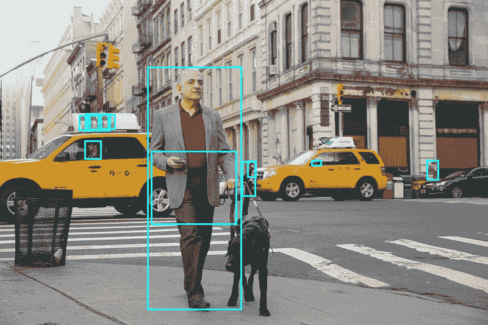
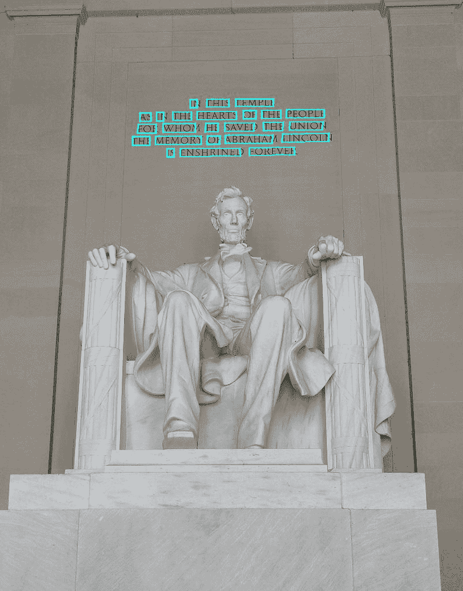
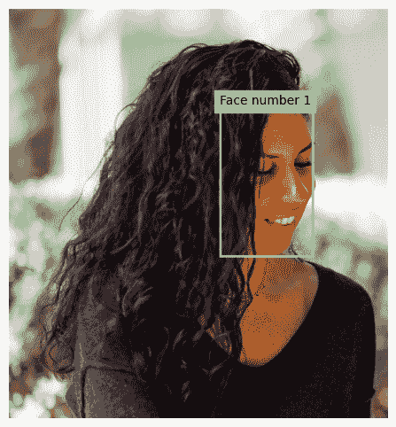

# AI-3004 在 Azure 中开发计算机视觉解决方案

> 来源：[https://zsyhjtnsa5.feishu.cn/docx/CK8XdI2ELoit9exbdeocbQ90nee](https://zsyhjtnsa5.feishu.cn/docx/CK8XdI2ELoit9exbdeocbQ90nee)

实验 repo:https://github.com/MicrosoftLearning/mslearn-ai-vision

# 分析图像

https://learn.microsoft.com/zh-cn/training/modules/analyze-images/

### Azure AI 视觉服务是什么？

Azure AI 视觉服务是 Microsoft 提供的一项云服务，允许应用程序执行各种图像分析任务。它能够理解图像内容，例如识别物体、生成图像描述和提取文本。

### 使用 Azure AI 视觉服务有哪些先决条件？

要使用 Azure AI 视觉服务分析图像，图像必须满足以下要求：格式为 JPEG、PNG、GIF 或 BMP，文件大小小于 4 MB，尺寸大于 50 x 50 像素。

### 如何向 Azure AI 视觉服务提交图像进行分析？

您可以通过使用 SDK 中特定于您的编程语言的 analyze REST 方法（或其等效方法），并指定要包含的视觉特征来提交图像。图像数据可以作为二进制对象提交，也可以通过 URL 提交。

### Azure AI 视觉服务支持哪些视觉特征？

Azure AI 视觉服务支持多种视觉特征，包括：

+   标签（Tags）：识别图像中的对象、风景、环境和动作。

+   对象（Objects）：返回检测到每个对象的边界框。

+   字幕（Caption）：生成图像的自然语言标题。

+   密集字幕（Dense Captions）：为检测到的对象生成更详细的描述。

+   人物（People）：返回检测到人物的边界框。

+   智能裁剪（Smart Crops）：返回感兴趣区域指定纵横比的边界框。

+   读取（Read）：提取可读文本。

### 如何处理图像分析的响应？

图像分析的响应是一个 JSON 文档，其中包含所请求的视觉特征信息。这可能包括文本描述、置信度分数以及对象的边界框（如果适用）。

### 如何预配 Azure AI 视觉资源？

您有几种预配 Azure AI 视觉资源的方法：

1.  创建 Azure AI Foundry 项目和关联的中心，其中包含多服务资源。

1.  在 Azure 订阅中创建 Azure AI 服务 多服务资源。

1.  如果只使用计算机视觉功能或进行试用，可以创建独立的 计算机视觉 资源，该资源通常提供免费层。

### 如何连接到 Azure AI 视觉资源？

连接到 Azure AI 视觉资源需要一个终结点和一个身份验证方法。终结点是资源的 URL。身份验证选项包括基于密钥的身份验证（使用授权密钥）和 Microsoft Entra ID 身份验证（使用 Microsoft Entra ID 令牌）。在生产环境中，建议使用托管标识或 Azure Key Vault 来安全存储密钥。

### Azure AI Foundry 和 Azure AI 服务之间有什么关系？

Azure AI Foundry 是一个平台，用于开发结合生成式 AI、代理和预构建 Azure AI 服务的 AI 解决方案，尤其适合团队协作。默认情况下，Azure AI Foundry 中心包含 Azure AI 服务多服务资源，其中包括 Azure AI 视觉。如果您需要 Foundry 中的所有功能，可以在 Azure 订阅中创建 Azure AI 服务多服务资源来访问 Azure AI 视觉和其他 AI 服务。

### 实验：分析图像

https://github.com/MicrosoftLearning/mslearn-ai-vision/blob/main/Instructions/Labs/01-analyze-images.md

```
from dotenv import load_dotenv
import os
from PIL import Image, ImageDraw
# import sys # No longer needed for command-line arguments
from matplotlib import pyplot as plt
from azure.core.exceptions import HttpResponseError
# import requests # This import was in the skeleton but is not used by the instructions.

# Import namespaces
from azure.ai.vision.imageanalysis import ImageAnalysisClient
from azure.ai.vision.imageanalysis.models import VisualFeatures
from azure.core.credentials import AzureKeyCredential

# For Jupyter Notebook, you might want to display plots inline
# %matplotlib inline # Uncomment this line if you run this in a Jupyter cell and want plots inline (though this script saves to file)

def main_interactive():
    global cv_client

    # Clear the console (less effective/needed in Jupyter, but kept for consistency if run elsewhere)
    # os.system(&#x27;cls&#x27; if os.name==&#x27;nt&#x27; else &#x27;clear&#x27;) 
    # In Jupyter, output is cleared per cell execution usually.

    try:
        # Get Configuration Settings
        # Make sure you have a .env file in the same directory as your notebook
        # or provide the path to the .env file if it&#x27;s elsewhere.
        # Example: load_dotenv(dotenv_path=os.path.join(os.getcwd(), &#x27;.env&#x27;))
        if not load_dotenv():
            print(&quot;Warning: .env file not found. Make sure AI_SERVICE_ENDPOINT and AI_SERVICE_KEY are set as environment variables or in a .env file.&quot;)

        ai_endpoint = os.getenv(&#x27;AI_SERVICE_ENDPOINT&#x27;)
        ai_key = os.getenv(&#x27;AI_SERVICE_KEY&#x27;)

        # Validate credentials
        if not ai_endpoint or not ai_key:
            print(&quot;Error: AI_SERVICE_ENDPOINT or AI_SERVICE_KEY not found.&quot;)
            print(&quot;Please ensure you have a .env file in the same directory as the notebook (or where Python is executed from),&quot;)
            print(&quot;and it contains your Azure AI service endpoint and key, OR that these are set as environment variables.&quot;)
            return

        # --- Interactive Image Selection ---
        print(&quot;Please choose an image to analyze:&quot;)
        print(&quot;1: images/building.jpg&quot;)
        print(&quot;2: images/person.jpg&quot;)
        print(&quot;3: images/street.jpg&quot;)

        image_options = {
            &quot;1&quot;: &quot;images/building.jpg&quot;,
            &quot;2&quot;: &quot;images/person.jpg&quot;,
            &quot;3&quot;: &quot;images/street.jpg&quot;
        }
        
        choice = &quot;&quot;
        while choice not in image_options:
            choice = input(&quot;Enter your choice (1, 2, or 3): &quot;)
            if choice not in image_options:
                print(&quot;Invalid choice. Please enter 1, 2, or 3.&quot;)
        
        image_file = image_options[choice]
        print(f&quot;You selected: {image_file}&quot;)
        # --- End Interactive Image Selection ---

        if not os.path.exists(image_file):
            print(f&quot;Error: Image file &#x27;{image_file}&#x27; not found. Make sure the &#x27;images&#x27; folder and its contents are accessible.&quot;)
            return

        with open(image_file, &quot;rb&quot;) as f:
            image_data = f.read()

        # Authenticate Azure AI Vision client
        cv_client = ImageAnalysisClient(
            endpoint=ai_endpoint,
            credential=AzureKeyCredential(ai_key)
        )
        
        # Analyze image
        AnalyzeImage(image_file, image_data, cv_client)
        
    except Exception as ex:
        print(f&quot;An unexpected error occurred in main_interactive: {ex}&quot;)


def AnalyzeImage(image_filename, image_data, cv_client):
    print(f&#x27;\nAnalyzing {image_filename}...&#x27;)

    try:
        # Get result with specified features to be retrieved
        result = cv_client.analyze(
            image_data=image_data,
            visual_features=[
                VisualFeatures.CAPTION,
                VisualFeatures.DENSE_CAPTIONS,
                VisualFeatures.TAGS,
                VisualFeatures.OBJECTS,
                VisualFeatures.PEOPLE],
        )

    except HttpResponseError as e:
        print(f&quot;Status code: {e.status_code}&quot;)
        print(f&quot;Reason: {e.reason}&quot;)
        if hasattr(e, &#x27;error&#x27;) and hasattr(e.error, &#x27;message&#x27;):
             print(f&quot;Message: {e.error.message}&quot;)
        else:
            print(f&quot;Full error: {e}&quot;)
        return # Exit if analysis fails
    except Exception as ex_analyze:
        print(f&quot;Error during analysis: {ex_analyze}&quot;)
        return


    # Display analysis results
    if result: # Check if result is not None
        # Get image captions
        if result.caption is not None:
            print(&quot;\nCaption:&quot;)
            print(&quot; Caption: &#x27;{}&#x27; (confidence: {:.2f}%)&quot;.format(result.caption.text, result.caption.confidence * 100))

        # Get image dense captions
        if result.dense_captions is not None:
            print(&quot;\nDense Captions:&quot;)
            for caption in result.dense_captions.list:
                print(&quot; Caption: &#x27;{}&#x27; (confidence: {:.2f}%)&quot;.format(caption.text, caption.confidence * 100))

        # Get image tags
        if result.tags is not None:
            print(&quot;\nTags:&quot;)
            for tag in result.tags.list:
                print(&quot; Tag: &#x27;{}&#x27; (confidence: {:.2f}%)&quot;.format(tag.name, tag.confidence * 100))

        # Get objects in the image
        if result.objects is not None and len(result.objects.list) &gt; 0:
            print(&quot;\nObjects in image:&quot;)

            # Prepare image for drawing
            image = Image.open(image_filename)
            fig = plt.figure(figsize=(image.width/100, image.height/100))
            plt.axis(&#x27;off&#x27;)
            draw = ImageDraw.Draw(image)
            color = &#x27;cyan&#x27;

            for detected_object in result.objects.list:
                # Print object name
                if detected_object.tags and len(detected_object.tags) &gt; 0:
                    print(&quot; {} (confidence: {:.2f}%)&quot;.format(detected_object.tags[0].name, detected_object.tags[0].confidence * 100))
                    
                    # Draw object bounding box
                    r = detected_object.bounding_box
                    bounding_box = ((r.x, r.y), (r.x + r.width, r.y + r.height)) 
                    draw.rectangle(bounding_box, outline=color, width=3)
                    plt.annotate(detected_object.tags[0].name,(r.x, r.y), backgroundcolor=color)
                else:
                    print(&quot; Detected object with no tags.&quot;)


            # Save annotated image
            plt.imshow(image)
            plt.tight_layout(pad=0)
            outputfile = &#x27;objects.jpg&#x27;
            try:
                fig.savefig(outputfile)
                print(f&#x27;  Results saved in {outputfile}&#x27;)
            except Exception as e_save:
                print(f&quot;Error saving {outputfile}: {e_save}&quot;)
            plt.close(fig) # Close the figure to free memory
        
        elif result.objects is not None and len(result.objects.list) == 0:
            print(&quot;\nNo objects detected in the image.&quot;)


        # Get people in the image
        if result.people is not None and len(result.people.list) &gt; 0:
            print(&quot;\nPeople in image:&quot;)

            # Prepare image for drawing
            # Re-open the original image for drawing people, so it doesn&#x27;t include object annotations
            image = Image.open(image_filename) 
            fig = plt.figure(figsize=(image.width/100, image.height/100))
            plt.axis(&#x27;off&#x27;)
            draw = ImageDraw.Draw(image)
            color = &#x27;cyan&#x27;

            for detected_people in result.people.list:
                # Draw object bounding box
                r = detected_people.bounding_box
                bounding_box = ((r.x, r.y), (r.x + r.width, r.y + r.height))
                draw.rectangle(bounding_box, outline=color, width=3)

                # Return the confidence of the person detected
                # (Optional) Uncomment the Console.Writeline command under the Return the confidence of the person detected section
                # In Python, this would be:
                # print(&quot; BoundingBox: {}, Confidence: {:.2f}%&quot;.format(detected_people.bounding_box, detected_people.confidence * 100))
                
            # Save annotated image
            plt.imshow(image)
            plt.tight_layout(pad=0)
            outputfile = &#x27;people.jpg&#x27;
            try:
                fig.savefig(outputfile)
                print(f&#x27;  Results saved in {outputfile}&#x27;)
            except Exception as e_save:
                print(f&quot;Error saving {outputfile}: {e_save}&quot;)
            plt.close(fig) # Close the figure to free memory

        elif result.people is not None and len(result.people.list) == 0:
            print(&quot;\nNo people detected in the image.&quot;)
    else:
        print(&quot;Analysis returned no result.&quot;)

# To run in Jupyter Notebook, you would call this function directly in a cell:
# if __name__ == &quot;__main__&quot;: # This guard is good practice but not strictly necessary if only calling main_interactive()
main_interactive()
```

> 好的，这是根据代码和手册步骤，对每个主要导入模块（或其中的特定类/函数）在脚本中作用的简要介绍：

1.  from dotenv import load_dotenv:

+   **功能**：load_dotenv 函数用于从一个名为 .env 的文件中加载环境变量。在这个脚本中，它用来加载 Azure AI 服务的 AI_SERVICE_ENDPOINT （终结点） 和 AI_SERVICE_KEY （密钥），这样就不需要将这些敏感信息硬编码到脚本中。

1.  **import os**:

+   **功能**：提供了与操作系统交互的功能。

+   os.getenv()： 用于读取通过 load_dotenv 加载的环境变量（如 API 密钥和终结点）。

+   os.path.exists()： 用于检查指定的图像文件路径是否存在。

+   os.system('cls' if os.name=='nt' else 'clear')： （虽然在 Jupyter Notebook 中效果不明显）用于尝试清除终端/控制台的输出。

1.  from PIL import Image, ImageDraw （Pillow 库）:

+   **Image**:

+   **功能**：用于打开和操作图像文件。在这个脚本中，Image.open(image_filename) 用来打开本地的图像文件，以便后续在其上绘制检测框。

+   **ImageDraw**:

+   **功能**：提供在图像上进行 2D 图形绘制（如形状、文本）的功能。在这个脚本中，ImageDraw.Draw(image) 创建一个绘图对象，然后使用其 rectangle() 方法来绘制检测到的物体和人物的边界框。

1.  **from matplotlib **import pyplot as plt:

+   **功能**：一个广泛使用的 Python 绘图库。

+   plt.figure()： 创建一个新的图形窗口。

+   plt.axis('off')： 关闭坐标轴的显示，使图像看起来更干净。

+   plt.imshow(image)： 在图形窗口中显示图像。

+   plt.annotate()： 在图像的指定位置添加文本注释（例如，在边界框旁边标注物体名称）。

+   fig.savefig(outputfile)： 将带有标注的图像保存到文件（如 objects.jpg， people.jpg）。

+   plt.close(fig)： 关闭图形，释放资源。

1.  **from azure.core.exceptions impo**rt HttpResponseError:

+   **功能**：Azure SDK 中定义的一个特定异常类型。当调用 Azure 服务 API 时，如果发生 HTTP 错误（例如，身份验证失败、请求无效、服务内部错误等），会抛出此异常。脚本中的 try...except HttpResponseError 块用于捕获并处理这类网络或服务相关的错误。

1.  **f**rom azure.ai.vision.imageanalysis import ImageAnalysisClient:

+   **功能**：这是 Azure AI Vision SDK 的核心客户端类。你需要创建这个类的一个实例，以便与 Azure AI 视觉服务进行通信。它包含了进行图像分析所需的方法，如 analyze()。

1.  **f**rom azure.ai.vision.imageanalysis.models import VisualFeatures:

+   **功能**：提供了一个名为 VisualFeatures 的枚举（enum）。这个枚举定义了你可以请求视觉服务分析的各种视觉特征，例如：

+   VisualFeatures.CAPTION （图像描述）

+   VisualFeatures.DENSE_CAPTIONS （密集描述）

+   VisualFeatures.TAGS （标签）

+   VisualFeatures.OBJECTS （物体检测）

+   VisualFeatures.PEOPLE （人物检测）
在调用 client.analyze() 方法时，你会传入一个包含这些特征的列表，告诉服务你希望得到哪些分析结果。

1.  **f**rom azure.core.credentials import AzureKeyCredential:

+   **功能**：Azure SDK 中用于处理基于密钥的身份验证的类。AzureKeyCredential(ai_key) 使用你的 Azure 服务密钥创建一个凭据对象。这个凭据对象随后被传递给 ImageAnalysisClient 的构造函数，以便客户端在向 Azure 发送请求时能够成功验证身份。

20260115 version

```
from dotenv import load_dotenv
import os
from PIL import Image, ImageDraw
import sys
from matplotlib import pyplot as plt
from azure.core.exceptions import HttpResponseError
import requests

# import namespaces
# import namespaces
from azure.ai.vision.imageanalysis import ImageAnalysisClient
from azure.ai.vision.imageanalysis.models import VisualFeatures
from azure.core.credentials import AzureKeyCredential

def main():

    # Clear the console
    os.system(&#x27;cls&#x27; if os.name==&#x27;nt&#x27; else &#x27;clear&#x27;)

    try:
        # Get Configuration Settings
        load_dotenv()
        ai_endpoint = os.getenv(&#x27;AI_SERVICE_ENDPOINT&#x27;)
        ai_key = os.getenv(&#x27;AI_SERVICE_KEY&#x27;)

        # Get image
        image_file = &#x27;images/street.jpg&#x27;
        if len(sys.argv) &gt; 1:
            image_file = sys.argv[1]
        

        # Authenticate Azure AI Vision client
        # Authenticate Azure AI Vision client
        cv_client = ImageAnalysisClient(
            endpoint=ai_endpoint,
            credential=AzureKeyCredential(ai_key))

        # Analyze image
        # Analyze image
        with open(image_file, &quot;rb&quot;) as f:
            image_data = f.read()
        print(f&#x27;\nAnalyzing {image_file}\n&#x27;)

        result = cv_client.analyze(
            image_data=image_data,
            visual_features=[
                VisualFeatures.CAPTION,
                VisualFeatures.DENSE_CAPTIONS,
                VisualFeatures.TAGS,
                VisualFeatures.OBJECTS,
                VisualFeatures.PEOPLE],
        )      

        # Get image captions
        # Get image captions
        if result.caption is not None:
            print(&quot;\nCaption:&quot;)
            print(&quot; Caption: &#x27;{}&#x27; (confidence: {:.2f}%)&quot;.format(result.caption.text, result.caption.confidence * 100))

        if result.dense_captions is not None:
            print(&quot;\nDense Captions:&quot;)
            for caption in result.dense_captions.list:
                print(&quot; Caption: &#x27;{}&#x27; (confidence: {:.2f}%)&quot;.format(caption.text, caption.confidence * 100))       

        # Get image tags
        # Get image tags
        if result.tags is not None:
            print(&quot;\nTags:&quot;)
            for tag in result.tags.list:
                print(&quot; Tag: &#x27;{}&#x27; (confidence: {:.2f}%)&quot;.format(tag.name, tag.confidence * 100))

        # Get objects in the image
        # Get objects in the image
        if result.objects is not None:
            print(&quot;\nObjects in image:&quot;)
            for detected_object in result.objects.list:
                # Print object tag and confidence
                print(&quot; {} (confidence: {:.2f}%)&quot;.format(detected_object.tags[0].name, detected_object.tags[0].confidence * 100))
            # Annotate objects in the image
            show_objects(image_file, result.objects.list)        

        # Get people in the image
        # Get people in the image
        if result.people is not None:
            print(&quot;\nPeople in image:&quot;)

            for detected_person in result.people.list:
                if detected_person.confidence &gt; 0.2:
                    # Print location and confidence of each person detected
                    print(&quot; {} (confidence: {:.2f}%)&quot;.format(detected_person.bounding_box, detected_person.confidence * 100))
            # Annotate people in the image
            show_people(image_file, result.people.list)        
  
            
        
    except Exception as ex:
        print(ex)

def show_objects(image_filename, detected_objects):
    print (&quot;\nAnnotating objects...&quot;)

    # Prepare image for drawing
    image = Image.open(image_filename)
    fig = plt.figure(figsize=(image.width/100, image.height/100))
    plt.axis(&#x27;off&#x27;)
    draw = ImageDraw.Draw(image)
    color = &#x27;cyan&#x27;

    for detected_object in detected_objects:
        # Draw object bounding box
        r = detected_object.bounding_box
        bounding_box = ((r.x, r.y), (r.x + r.width, r.y + r.height)) 
        draw.rectangle(bounding_box, outline=color, width=3)
        plt.annotate(detected_object.tags[0].name,(r.x, r.y), backgroundcolor=color)

    # Save annotated image
    plt.imshow(image)
    plt.tight_layout(pad=0)
    objectfile = &#x27;objects.jpg&#x27;
    fig.savefig(objectfile)
    print(&#x27;  Results saved in&#x27;, objectfile)

def show_people(image_filename, detected_people):
    print (&quot;\nAnnotating objects...&quot;)

    # Prepare image for drawing
    image = Image.open(image_filename)
    fig = plt.figure(figsize=(image.width/100, image.height/100))
    plt.axis(&#x27;off&#x27;)
    draw = ImageDraw.Draw(image)
    color = &#x27;cyan&#x27;

    for detected_person in detected_people:
        if detected_person.confidence &gt; 0.2:
            # Draw object bounding box
            r = detected_person.bounding_box
            bounding_box = ((r.x, r.y), (r.x + r.width, r.y + r.height))
            draw.rectangle(bounding_box, outline=color, width=3)

    # Save annotated image
    plt.imshow(image)
    plt.tight_layout(pad=0)
    peoplefile = &#x27;people.jpg&#x27;
    fig.savefig(peoplefile)
    print(&#x27;  Results saved in&#x27;, peoplefile)

if __name__ == &quot;__main__&quot;:
    main()

```

输出结果

```
Please choose an image to analyze:
1: images/building.jpg
2: images/person.jpg
3: images/street.jpg
Enter your choice (1, 2, or 3): 3
You selected: images/street.jpg

Analyzing images/street.jpg...

Caption:
 Caption: &#x27;a man walking a dog on a leash on a street&#x27; (confidence: 82.05%)

Dense Captions:
 Caption: &#x27;a man walking a dog on a leash on a street&#x27; (confidence: 82.05%)
 Caption: &#x27;a man walking on a street&#x27; (confidence: 69.03%)
 Caption: &#x27;a yellow car on the street&#x27; (confidence: 78.22%)
 Caption: &#x27;a black dog walking on the street&#x27; (confidence: 75.31%)
 Caption: &#x27;a blurry image of a blue car&#x27; (confidence: 82.01%)
 Caption: &#x27;a yellow taxi cab on the street&#x27; (confidence: 72.42%)

Tags:
 Tag: &#x27;outdoor&#x27; (confidence: 99.87%)
 Tag: &#x27;land vehicle&#x27; (confidence: 99.02%)
 Tag: &#x27;vehicle&#x27; (confidence: 98.89%)
 Tag: &#x27;building&#x27; (confidence: 98.55%)
 Tag: &#x27;road&#x27; (confidence: 95.98%)
 Tag: &#x27;wheel&#x27; (confidence: 95.14%)
 Tag: &#x27;street&#x27; (confidence: 94.71%)
 Tag: &#x27;person&#x27; (confidence: 93.01%)
 Tag: &#x27;clothing&#x27; (confidence: 91.19%)
 Tag: &#x27;taxi&#x27; (confidence: 90.95%)
 Tag: &#x27;car&#x27; (confidence: 84.01%)
 Tag: &#x27;dog&#x27; (confidence: 82.68%)
 Tag: &#x27;yellow&#x27; (confidence: 77.08%)
 Tag: &#x27;walking&#x27; (confidence: 74.11%)
 Tag: &#x27;city&#x27; (confidence: 64.80%)
 Tag: &#x27;woman&#x27; (confidence: 57.53%)

Objects in image:
 car (confidence: 72.40%)
 taxi (confidence: 77.00%)
 person (confidence: 78.10%)
 dog (confidence: 54.40%)
  Results saved in objects.jpg

People in image:
  Results saved in people.jpg
```

> 好的，我们来逐步解析这段输出，它展示了对 images/street.jpg 这张图片进行图像分析的结果。

1.  **用户交互与图片选择**：

```
 Please choose an image to analyze:
 1: images/building.jpg
 2: images/person.jpg
 3: images/street.jpg
 Enter your choice (1, 2, or 3): 3
 You selected: images/street.jpg
```

+   **解析**： 这部分显示了程序的用户交互界面。程序提供了三个图片选项，用户输入了 3，选择了 images/street.jpg 进行分析。

1.  **开始分析**：

```
 Analyzing images/street.jpg...
```

+   **解析**： 程序确认了用户的选择，并开始调用 Azure AI Vision 服务对 street.jpg进行分析。

1.  **Caption （图像描述）**:

```
 Caption:
  Caption: &#x27;a man walking a dog on a leash on a street&#x27; (confidence: 82.05%)
```

+   **解析**： 这是 Azure AI Vision 为整个图像生成的最主要的描述性语句。

+   'a man walking a dog on a leash on a street'：AI 认为图片内容是一个男人在街上用狗绳遛狗。

+   (confidence: 82.05%)：AI 对这个描述的准确性有 82.05%的置信度。置信度越高，AI 越确定这个描述是正确的。

1.  Dense Captions （密集描述）:

```
 Dense Captions:
  Caption: &#x27;a man walking a dog on a leash on a street&#x27; (confidence: 82.05%)
  Caption: &#x27;a man walking on a street&#x27; (confidence: 69.03%)
  Caption: &#x27;a yellow car on the street&#x27; (confidence: 78.22%)
  Caption: &#x27;a black dog walking on the street&#x27; (confidence: 75.31%)
  Caption: &#x27;a blurry image of a blue car&#x27; (confidence: 82.01%)
  Caption: &#x27;a yellow taxi cab on the street&#x27; (confidence: 72.42%)
```

+   **解析**： 密集描述会识别图像中多个不同的区域或物体，并为它们分别生成描述。这比单一的整体描述提供了更丰富的细节。

+   它再次提到了“男人遛狗”，并给出了相似的置信度。

+   它还识别出“男人在街上走”、“街上有辆黄色的车”、“黑狗在街上走”、“一辆蓝色汽车的模糊图像”（可能图片中某处有辆不太清晰的蓝色车）、“街上有辆黄色的出租车”。

+   每个密集描述也都有自己的置信度分数。

1.  **Tags （标签）**:

```
 Tags:
  Tag: &#x27;outdoor&#x27; (confidence: 99.87%)
  Tag: &#x27;land vehicle&#x27; (confidence: 99.02%)
  ... (其他标签) ...
  Tag: &#x27;woman&#x27; (confidence: 57.53%)
```

+   **解析**： 标签是描述图像内容的一些关键词。这些标签可以帮助分类和搜索图像。

+   例如，'outdoor' （户外场景） 的置信度非常高 （99.87%），表明 AI 非常确定这是个户外场景。

+   其他标签如 'land vehicle' （陆地车辆）， 'building' （建筑）， 'road' （道路）， 'person' （人）， 'dog' （狗）， 'car' （汽车）， 'taxi' （出租车） 都与街景的典型元素相符。

+   注意到 'woman' （女人） 的置信度相对较低 （57.53%），这可能意味着图片中有人，但 AI 不太确定其性别，或者某个物体被误识别。

1.  Objects in image （图像中的物体检测）:

```
 Objects in image:
  car (confidence: 72.40%)
  taxi (confidence: 77.00%)
  person (confidence: 78.10%)
  dog (confidence: 54.40%)
   Results saved in objects.jpg
```

+   **解析**： 这部分列出了 AI 在图像中检测到的具体物体，并给出了每个物体的置信度。

+   检测到了 'car' （汽车）， 'taxi' （出租车）， 'person' （人）， 和 'dog' （狗）。

+   Results saved in objects.jpg：表示 AI 不仅识别了这些物体，还将它们的位置（通过边界框）在原始图片上标注出来，并保存为名为 objects.jpg 的新图片。你可以打开这个文件查看具体的标注。

1.  People in image （图像中的人物检测）:

```
 People in image:
   Results saved in people.jpg
```

+   **解析**： 这部分专门针对图像中的人物进行检测。

+   Results saved in people.jpg：与物体检测类似，AI 会将检测到的人物（通过边界框）在原始图片上标注出来，并保存为名为 people.jpg 的新图片。

+   （可选）如果代码中取消了打印人物检测置信度的注释，这里还会显示每个人物边界框及其对应的置信度。

> **总结**：

> 这张 street.jpg 的分析结果表明，Azure AI Vision 成功地理解了图像的主要场景（一个男人在街上遛狗，周围有车辆和建筑）。它提供了：

+   一个整体的描述。

+   对图像不同部分的多个详细描述。

+   一系列相关的标签。

+   识别并定位了图像中的关键物体（汽车、出租车、人、狗）。

+   专门检测并定位了图像中的人。

> 输出的 objects.jpg 和 people.jpg 文件会直观地展示这些检测结果在图像上的具体位置。置信度分数帮助我们了解 AI 对其每个判断的把握程度。

street.jpg


objects.jpg


people.jpg



###

# 读取图像中的文本

https://learn.microsoft.com/zh-cn/training/modules/read-text-images-documents-with-computer-vision-service/

### 什么是 Azure AI 视觉及其主要功能？

Azure AI 视觉是一项提供图像分析功能的服务，包括光学字符识别 （OCR）。 它特别适用于从扫描文档和照片中提取文本，例如标签、菜单、名片、街道标志和商店名称。 除了文本提取，Azure AI 视觉还支持其他图像分析功能，如对象检测、图像描述或分类，以及智能裁剪缩略图生成，使其成为数字资产管理 （DAM） 的有用工具，用于编目、索引或分析大量数字图像内容。

### 我应该在 Azure 中预配哪种类型的资源才能使用 Azure AI 视觉？

为了使用 Azure AI 视觉进行图像分析（包括 OCR），您需要在 Azure 订阅中预配一个 Azure AI 视觉资源。 这可以是以下两种类型之一：

+   Azure AI 服务：一种多服务资源，可以作为 Azure AI Foundry 中心和项目的一部分部署，也可以作为独立资源部署。

+   计算机视觉：一种专门用于计算机视觉任务的资源。

选择哪种资源取决于您的具体需求和现有 Azure AI Foundry 项目设置。

### 如何连接到已部署的 Azure AI 视觉资源？

连接到已部署的 Azure AI 视觉资源需要使用其 终结点 进行身份验证。 您可以使用两种主要方法进行身份验证：

+   基于密钥的身份验证：使用资源提供的授权密钥。

+   Microsoft Entra ID 身份验证：利用 Microsoft Entra ID 进行身份验证。

资源的终结点是一个 URL，通常形如 https://<resource_name>。cognitiveservices.azure.com/，可以在 Azure 门户或 Azure AI Foundry 门户（如果是在 Azure AI Foundry 项目中工作）中找到。

### 如何使用 Azure AI 视觉 SDK 从图像中提取文本？

使用 Azure AI 视觉 SDK（例如 Python 或 。NET SDK）从图像中提取文本涉及以下步骤：

1.  安装 SDK 包：例如，Python 中安装 azure-ai-vision-imageanalysis 包，或 。NET 中安装 Azure.AI.Vision.ImageAnalysis 包。

1.  连接到资源：使用您的资源终结点和授权凭据（基于密钥或 Microsoft Entra ID）实例化 ImageAnalysisClient 对象。

1.  调用分析方法：调用 analyze（或 analyze_from_url）方法，传入图像的二进制数据或 URL，并指定 VisualFeatures.READ 枚举以启用 OCR 功能。 您还可以选择性地指定文本的语言（默认为英语）。

### Azure AI 视觉 OCR 函数返回的结果是什么格式？

Azure AI 视觉 OCR 函数的结果以 JSON 或类似结构的语言特定对象形式同步返回。 这些结果被组织成一个层次结构：

+   块 （blocks）：当前服务通常只使用一个块。

+   行 （lines）：块中包含的文本行。每行都有其文本值和边界多边形信息。

+   单词 （words）：行中包含的单个单词。每个单词也包含其文本值、边界多边形和置信度分数。

文本值在“行”和“单词”级别都可用，这使得用户可以根据需要选择提取整行文本或单个单词。

### 除了 Azure AI 视觉，还有哪些 Azure AI 服务可用于文本读取，它们有什么区别？

除了 Azure AI 视觉，Azure 还提供了其他用于文本读取的 AI 服务，每个服务都有其特定的优化用途：

+   Azure AI 文档智能 （Azure AI Document Intelligence）：专门用于从复杂的数字文档中提取信息，例如表单、发票、收据和其他结构化文档。它提供预构建模型和创建自定义模型的能力。

+   Azure AI 内容理解 （Azure AI Content Understanding）：用于分析和提取来自多种内容的信息，包括文档、图像、音频流和视频。它支持多模式内容提取和可自定义的分析器。

主要区别在于它们处理的文档类型和提取信息的粒度：Azure AI 视觉适用于通用非结构化图像中的文本，而文档智能侧重于结构化文档和表单，内容理解则涵盖更广泛的多模式内容。

### Azure AI 视觉在哪些特定场景下表现出色？

Azure AI 视觉在以下场景中表现出色：

+   文本位置和从扫描文档中提取：适用于已扫描为图像的非结构化文档，例如从标签、菜单或名片中读取文本。

+   查找和阅读照片中的文本：例如从街道标志和商店名称的图像中提取文本。

+   数字资产管理 （DAM）：当需要对大量基于数字图像的内容进行编目、索引或分析时，其图像分析功能（包括对象检测、描述或分类图像、生成智能裁剪缩略图等）使其成为一项有用的服务。

### Azure AI 视觉是否能处理所有语言的文本？

Azure AI 视觉的 OCR 功能支持多种语言。在调用 ImageAnalysis 函数（通过 REST API 或 SDK 方法）时，您可以选择性地指定文本写入的语言。默认语言设置为英语（en）。这意味着您可以根据需要处理不同语言的文本，只要该语言受到服务的支持。

###  实验：Read text in images

https://github.com/MicrosoftLearning/mslearn-ai-vision/blob/main/Instructions/Labs/02-ocr.md

```
from dotenv import load_dotenv
import os
import time # time模块在此版本中未直接使用，但保留以防未来需要
from PIL import Image, ImageDraw
from matplotlib import pyplot as plt

# Import namespaces
from azure.ai.vision.imageanalysis import ImageAnalysisClient
from azure.ai.vision.imageanalysis.models import VisualFeatures
from azure.core.credentials import AzureKeyCredential
from azure.core.exceptions import HttpResponseError # 导入用于错误处理


def main():

    global cv_client # 将 cv_client 声明为全局变量，以便 GetTextRead 可以访问

    try:
        # Get Configuration Settings
        load_dotenv()
        ai_endpoint = os.getenv(&#x27;AI_SERVICE_ENDPOINT&#x27;)
        ai_key = os.getenv(&#x27;AI_SERVICE_KEY&#x27;)

        if not ai_endpoint or not ai_key:
            print(&quot;错误：环境变量 AI_SERVICE_ENDPOINT 或 AI_SERVICE_KEY 未设置。&quot;)
            print(&quot;请确保您的 .env 文件包含这些值。&quot;)
            return

        # Authenticate Azure AI Vision client
        cv_client = ImageAnalysisClient(
            endpoint=ai_endpoint,
            credential=AzureKeyCredential(ai_key)
        )
        

        # Menu for text reading functions
        print(&#x27;\n1: Use Read API for image (Lincoln.jpg)\n2: Read handwriting (Note.jpg)\nAny other key to quit\n&#x27;)
        command = input(&#x27;Enter a number:&#x27;)
        if command == &#x27;1&#x27;:
            image_file = os.path.join(&#x27;images&#x27;,&#x27;Lincoln.jpg&#x27;)
            if not os.path.exists(image_file):
                print(f&quot;错误：图片文件 &#x27;{image_file}&#x27; 未找到。&quot;)
                return
            GetTextRead(image_file)
        elif command ==&#x27;2&#x27;:
            image_file = os.path.join(&#x27;images&#x27;,&#x27;Note.jpg&#x27;)
            if not os.path.exists(image_file):
                print(f&quot;错误：图片文件 &#x27;{image_file}&#x27; 未找到。&quot;)
                return
            GetTextRead(image_file)
        # else: # 任何其他键退出
        #     print(&quot;程序退出。&quot;)
                

    except Exception as ex:
        print(f&quot;发生错误: {ex}&quot;)

def GetTextRead(image_file):
    print(f&#x27;\n正在从 {image_file} 读取文本...&#x27;)

    # Open image file
    with open(image_file, &quot;rb&quot;) as f:
            image_data = f.read()
    
    result = None # 初始化 result

    try:
        # Use Analyze image function to read text in image
        result = cv_client.analyze(
            image_data=image_data,
            visual_features=[VisualFeatures.READ]
        )
    except HttpResponseError as e:
        print(f&quot;--- 调用 API 时发生错误 ---&quot;)
        print(f&quot;状态码: {e.status_code}&quot;)
        print(f&quot;原因: {e.reason}&quot;)
        if hasattr(e, &#x27;error&#x27;) and hasattr(e.error, &#x27;message&#x27;):
            print(f&quot;错误消息: {e.error.message}&quot;)
        return # 如果API调用失败则退出函数
    except Exception as general_ex:
        print(f&quot;--- 分析过程中发生未知错误 ---&quot;)
        print(general_ex)
        return


    # Display the image and overlay it with the extracted text
    if result and result.read is not None: # 确保 result 和 result.read 都有效
        print(&quot;\nText:&quot;)

        # Prepare image for drawing
        image = Image.open(image_file)
        # fig = plt.figure(figsize=(image.width/100, image.height/100)) # 创建与图片大小匹配的figure
        # plt.axis(&#x27;off&#x27;) # 关闭坐标轴
        draw = ImageDraw.Draw(image)
        color = &#x27;cyan&#x27; # 边界框颜色

        for line in result.read.blocks[0].lines: # 假设文本在第一个 block 中
            # Return the text detected in the image
            print(f&quot;  {line.text}&quot;)    
            
            # drawLinePolygon = True # 这个变量在手册中用于C#控制是否画线框，Python中可以直接画
            
            # Convert Azure&#x27;s BoundingPolygon to PIL/Pillow format
            # line.bounding_polygon is a list of Point objects like {&#x27;x&#x27;: 10, &#x27;y&#x27;: 20}
            line_bounding_polygon_points = []
            for point in line.bounding_polygon:
                line_bounding_polygon_points.append((point.x, point.y))
            
            # Return the position bounding box around each line
            print(&quot;   Bounding Polygon: {}&quot;.format(line_bounding_polygon_points)) # 打印转换后的多边形点
            
            # Draw line bounding polygon (手册中先画线，再画词，这里我们只画词的框，如手册最终效果)
            # if drawLinePolygon: # 如果要画线的框，取消注释下面这行
                # draw.polygon(line_bounding_polygon_points, outline=color, width=3)

            # Return each word detected in the image and the position bounding box around each word with the confidence level of each word
            for word in line.words:
                word_bounding_polygon_points = []
                for point in word.bounding_polygon:
                    word_bounding_polygon_points.append((point.x, point.y))
                
                print(f&quot;    Word: &#x27;{word.text}&#x27;, Bounding Polygon: {word_bounding_polygon_points}, Confidence: {word.confidence:.4f}&quot;)
                
                # Draw word bounding polygon
                # drawLinePolygon = False # 手册C#中用于切换，Python中直接绘制
                draw.polygon(word_bounding_polygon_points, outline=color, width=3) # 绘制每个单词的边界框
            
        # Save image (使用Pillow保存，因为我们用Pillow绘制的)
        outputfile = &#x27;text.jpg&#x27;
        image.save(outputfile)
        print(f&#x27;\n  带有文本高亮的图片已保存至: {outputfile}&#x27;)

        # 如果想用 matplotlib 显示和保存（如手册中的fig.savefig）：
        # 需要在循环前创建 fig 和 plt.axis(&#x27;off&#x27;)
        # 并在循环后执行以下操作：
        # plt.imshow(image)
        # plt.tight_layout(pad=0)
        # outputfile_mpl = &#x27;text_mpl.jpg&#x27;
        # fig.savefig(outputfile_mpl)
        # print(f&#x27;\n  Matplotlib 保存的图片: {outputfile_mpl}&#x27;)
        # plt.show() # 可选，直接显示图片

    elif result and result.read is None:
        print(&quot;\n未在图片中检测到文本。&quot;)
    else:
        print(&quot;\n分析未返回有效结果。&quot;)


if __name__ == &quot;__main__&quot;:
    main()
```

>

1.  **环境配置与初始化 （****main()**** 函数的开头部分）**：

+   **功能**：此模块负责设置程序运行所需的环境。

+   **具体操作**：

+   加载 .env 文件中的环境变量，主要是 Azure AI Vision 服务的 API 端点 （AI_SERVICE_ENDPOINT） 和密钥 （AI_SERVICE_KEY）。这是为了安全地存储和访问敏感信息。

+   使用获取到的端点和密钥，初始化并认证 ImageAnalysisClient 对象 （cv_client）。这个 cv_client 是后续与 Azure 服务进行所有通信的接口。

+   **与输出的关联**：这部分操作在后台完成，用户直接看到的输出始于菜单。如果这里配置错误（例如，API Key 无效），GetTextRead 中的 API 调用会失败。

1.  **用户交互与任务分发 （****main()**** 函数的菜单部分）**：

+   **功能**：提供一个简单的命令行菜单，让用户选择要执行的操作（是分析印刷体图像还是手写体图像）。

+   **具体操作**：

+   向用户显示选项："1: Use Read API for image （Lincoln.jpg）" 和 "2: Read handwriting （Note.jpg）"。

+   接收用户的输入。

+   根据用户的选择（在您的例子中是 '1'），确定要处理的图像文件路径 （images\Lincoln.jpg）。

+   调用核心的文本读取函数 GetTextRead()，并将选定的图像文件路径传递给它。

+   **与输出的关联**：您的输出清晰地显示了菜单和您选择的 '1'：

```
      1: Use Read API for image (Lincoln.jpg)
2: Read handwriting (Note.jpg)
Any other key to quit

Enter a number:1
```

1.  **图像数据准备与 API 调****用 （GetTex**tRead() 函数的开头部分）：

+   **功能**：负责读取本地图像文件，并调用 Azure AI Vision 服务进行文本识别。

+   **具体操作**：

+   打印提示信息，告知用户正在处理哪个文件（例如，正在从 images\Lincoln.jpg 读取文本...）。

+   以二进制格式打开并读取指定的图像文件，将其内容存入 image_data。

+   使用之前初始化的 cv_client 对象，调用其 analyze() 方法。关键参数是：

+   image_data： 包含图像二进制内容。

+   visual_features=[VisualFeatures.READ]： 明确指示 Azure 服务执行文本读取（OCR）功能。

+   API 调用成功后，结果会存储在 result 对象中。

+   **与输出的关联**：

```
      正在从 images\Lincoln.jpg 读取文本...
```

+   这行输出直接对应了此模块开始处理图像的动作。后续的文本输出都来源于 result 对象中的数据。

1.  **文本结果解析与控制台输出 （****GetTextRead()**** 函数中处理 ****result.read**** 的部分）**：

+   **功能**：解析从 Azure 服务返回的结构化文本识别结果，并在控制台友好地显示这些信息。

+   **具体操作**：

+   检查 result 和 result.read 是否有效，确保服务成功返回了文本信息。

+   遍历识别到的文本行 （line in result.read.blocks.lines）。

+   对于每一行：

+   打印该行的完整文本 （line.text）。

+   打印该行在图像中的边界多边形坐标 （line.bounding_polygon）。

+   进一步遍历该行中的每一个单词 （word in line.words）。

+   对于每一个单词：

+   打印单词的文本内容 （word.text）。

+   打印单词在图像中的边界多边形坐标 （word.bounding_polygon）。

+   打印单词识别的置信度 （word.confidence）。

+   **与输出的关联**：这部分代码直接生成了您提供的大部分控制台输出，例如：

1.  **图像处理与结果可视化 （****GetTextRead()** 函数中使用 Pillow 绘图和保存的部分）：

+   **功能**：在原始图像的副本上，根据识别到的文本位置信息，绘制边界框以高亮显示文本，并将处理后的图像保存到文件。

+   **具体操作**：

+   使用 Pillow 库 （Image.open()） 打开原始图像文件。

+   创建一个 ImageDraw.Draw() 对象，用于在图像上绘图。

+   在遍历每个识别到的单词时，获取其边界多边形坐标。

+   使用 draw.polygon() 方法，在图像上围绕每个单词绘制一个青色 （cyan） 的多边形框。

+   所有单词处理完毕后，将这张带有高亮文本框的图像保存为 text.jpg 文件。

+   在控制台打印保存成功的消息。

+   **与输出的关联**：

```
      带有文本高亮的图片已保存至: text.jpg
```

+   这行输出确认了此模块已成功执行。同时，您应该能在程序运行的目录下找到一个名为 text.jpg 的图片文件，打开它会看到 Lincoln.jpg 图像上的文本单词被青色的框标记出来了。

> 总结来说，这个程序的工作流程是：

> **配置 -> 用户选**择 -> 读取图像 -> 调用**云服务分析文本 **-> 解析结果并打印 -> 在图像上标记文本 -> 保存标记后的图像。

> 核心在于利用 Azure AI Vision SDK 与云服务通信，获取文本的详细信息（内容、位置、置信度），然后本地代码负责展示这些信息并进行可视化处理。您的输出完整地反映了这一流程的每一步。

输出

```
1: Use Read API for image (Lincoln.jpg)
2: Read handwriting (Note.jpg)
Any other key to quit

Enter a number:1

正在从 images\Lincoln.jpg 读取文本...

Text:
  IN THIS TEMPLE
   Bounding Polygon: [(328, 171), (477, 169), (477, 184), (328, 186)]
    Word: &#x27;IN&#x27;, Bounding Polygon: [(328, 171), (342, 171), (342, 187), (328, 187)], Confidence: 0.9930
    Word: &#x27;THIS&#x27;, Bounding Polygon: [(357, 171), (397, 170), (397, 185), (357, 186)], Confidence: 0.9910
    Word: &#x27;TEMPLE&#x27;, Bounding Polygon: [(407, 170), (474, 170), (474, 184), (407, 185)], Confidence: 0.9930
  AS IN THE HEARTS OF THE PEOPLE
   Bounding Polygon: [(240, 193), (564, 188), (564, 203), (240, 210)]
    Word: &#x27;AS&#x27;, Bounding Polygon: [(241, 194), (262, 194), (262, 210), (241, 211)], Confidence: 0.9950
    Word: &#x27;IN&#x27;, Bounding Polygon: [(270, 193), (284, 193), (284, 210), (270, 210)], Confidence: 0.9980
    Word: &#x27;THE&#x27;, Bounding Polygon: [(298, 193), (332, 192), (332, 208), (298, 209)], Confidence: 0.9930
    Word: &#x27;HEARTS&#x27;, Bounding Polygon: [(340, 192), (410, 191), (410, 207), (340, 208)], Confidence: 0.9940
    Word: &#x27;OF&#x27;, Bounding Polygon: [(420, 190), (444, 190), (444, 206), (420, 206)], Confidence: 0.9930
    Word: &#x27;THE&#x27;, Bounding Polygon: [(452, 190), (487, 189), (487, 205), (452, 206)], Confidence: 0.9930
    Word: &#x27;PEOPLE&#x27;, Bounding Polygon: [(495, 189), (562, 188), (562, 204), (495, 205)], Confidence: 0.9960
  FOR WHOM HE SAVED THE UNION
   Bounding Polygon: [(237, 214), (568, 208), (569, 224), (237, 231)]
    Word: &#x27;FOR&#x27;, Bounding Polygon: [(238, 214), (271, 213), (271, 231), (237, 231)], Confidence: 0.9950
    Word: &#x27;WHOM&#x27;, Bounding Polygon: [(281, 213), (339, 212), (339, 229), (281, 230)], Confidence: 0.9880
    Word: &#x27;HE&#x27;, Bounding Polygon: [(355, 212), (378, 212), (378, 228), (354, 229)], Confidence: 0.9980
    Word: &#x27;SAVED&#x27;, Bounding Polygon: [(388, 212), (441, 211), (440, 227), (388, 228)], Confidence: 0.9940
    Word: &#x27;THE&#x27;, Bounding Polygon: [(455, 211), (491, 210), (490, 226), (455, 227)], Confidence: 0.9930
    Word: &#x27;UNION&#x27;, Bounding Polygon: [(501, 210), (560, 209), (559, 225), (500, 226)], Confidence: 0.9970
  THE MEMORY OF ABRAHAM LINCOLN
   Bounding Polygon: [(226, 235), (575, 229), (576, 245), (226, 252)]
    Word: &#x27;THE&#x27;, Bounding Polygon: [(228, 235), (260, 235), (260, 252), (228, 252)], Confidence: 0.9980
    Word: &#x27;MEMORY&#x27;, Bounding Polygon: [(268, 235), (349, 234), (349, 250), (268, 251)], Confidence: 0.9960
    Word: &#x27;OF&#x27;, Bounding Polygon: [(358, 234), (382, 234), (381, 250), (357, 250)], Confidence: 0.9990
    Word: &#x27;ABRAHAM&#x27;, Bounding Polygon: [(389, 233), (473, 232), (472, 248), (389, 249)], Confidence: 0.9960
    Word: &#x27;LINCOLN&#x27;, Bounding Polygon: [(488, 231), (570, 229), (570, 245), (487, 247)], Confidence: 0.9940
  IS ENSHRINED FOREVER
   Bounding Polygon: [(288, 255), (515, 253), (516, 268), (288, 271)]
    Word: &#x27;IS&#x27;, Bounding Polygon: [(288, 256), (302, 256), (302, 272), (288, 272)], Confidence: 0.9960
    Word: &#x27;ENSHRINED&#x27;, Bounding Polygon: [(311, 256), (416, 255), (417, 270), (311, 272)], Confidence: 0.9930
    Word: &#x27;FOREVER&#x27;, Bounding Polygon: [(431, 255), (510, 253), (511, 268), (431, 270)], Confidence: 0.9950

  带有文本高亮的图片已保存至: text.jpg
```



## 检测、分析和识别人脸

https://learn.microsoft.com/zh-cn/training/modules/detect-analyze-recognize-faces/

### 什么是 Azure AI 视觉人脸服务？

Azure AI 视觉人脸服务提供全面的面部检测、分析和识别功能。它允许开发者构建能够检测图像中的人脸、分析其属性（例如头部姿势、眼镜、口罩、模糊程度等）、比较人脸相似性以及识别人脸的解决方案。该服务基于预先训练的人脸检测和识别模型。

### 在使用基于人脸的解决方案时，有哪些重要的负责任 AI 考量？

在使用基于人脸的解决方案时，需要特别注意负责任的 AI 实践。主要考量包括：

+   数据隐私和安全性：人脸数据是个人身份信息，应被视为敏感和隐私数据。必须确保对用于模型训练和推理的人脸数据采取足够的保护措施。

+   透明度：用户需要了解他们的人脸数据将如何被使用，以及谁有权访问这些数据。

+   公平和包容性：确保人脸识别系统不会因为个人外貌而产生歧视或不公平地针对个人。

### 如何在 Azure 中预置和连接到人脸服务？

要在 Azure 中使用人脸服务，您需要在 Azure 订阅中预置一个资源。这可以是一个单一的人脸服务资源，也可以是多服务 Azure AI 服务资源的一部分。

连接到服务需要使用基于密钥的身份验证或 Microsoft Entra AI 身份验证。通过 REST 接口，可以在请求头中提供身份验证密钥或令牌。如果使用特定语言的 SDK（例如 Python 的 azure-ai-vision-face 包或 。NET 的 Azure.AI.Vision.Face 包），则可以使用 FaceClient 对象，通过提供服务终结点和密钥来连接。

### 人脸服务可以分析哪些面部属性？

人脸服务可以返回多种面部属性，包括：

+   头部姿势：三维空间中的旋转方向（绕 X、Z、Y 轴）。

+   眼镜：识别是否有眼镜（无、阅读、太阳镜或游泳护目镜）。

+   口罩：检测是否存在面罩。

+   模糊：评估图像的模糊程度（低、中或高）。

+   曝光：评估图像的曝光情况（曝光不足、良好或过度曝光）。

+   噪音：检测图像中的视觉噪音。

+   遮挡：识别遮挡面部的物体。

+   配件：检测眼镜、头饰和面具等配件。

+   QualityForRecognition：评估人脸图像用于识别的质量（低、中或高）。

+   面部特征点位置：提供关键特征点（如眼角、瞳孔、鼻尖等）的坐标。

### 人脸检测、比较和识别之间有什么区别？

+   人脸检测：在图像中识别出人脸，并返回一个唯一 ID 和一个边界框坐标，指示人脸在图像中的位置。

+   人脸比较：比较多张图像中人脸的相似性（查找具有相似面部特征的个人）和验证（确定一张图像中的人脸与另一张图像中的人脸是否是同一个人）。

+   人脸识别：使用属于特定个人的人脸集合来训练模型，然后使用该模型识别新图像中的人员。这通常涉及创建一个“人员组”并为组中的每个人添加多张人脸图像进行训练。

### 什么是人脸活跃度以及它的用途是什么？

人脸活跃度是一种用于确定输入视频是真实流还是伪造流的功能。它的主要目的是防止恶意个人通过欺骗（例如使用照片或视频重放）来绕过人脸识别系统。

### 如何选择人脸检测和识别模型？

Azure AI 视觉人脸 API 基于预先训练的人脸检测和识别模型构建，这些模型有多个版本，各自具有特定的优势和功能。例如，较新的模型在处理小型图像时可能具有更高的准确性，但可能不会提供相同广度的面部分析功能。在应用程序中使用服务时，必须根据具体要求选择最合适的检测和识别模型。

### 人脸识别和验证是否需要特殊批准？

是的，使用面部识别、比较和验证功能需要通过受限访问策略获得批准。这意味着并非所有用户都可以立即访问这些功能，需要遵循特定的流程来获得使用权限。

### 实验：人脸识别

https://github.com/MicrosoftLearning/mslearn-ai-vision/blob/main/Instructions/Labs/03-face-service.md

```
from dotenv import load_dotenv
import os
from PIL import Image, ImageDraw
from matplotlib import pyplot as plt

# Import namespaces
from azure.ai.vision.face import FaceClient
from azure.ai.vision.face.models import FaceDetectionModel, FaceRecognitionModel, FaceAttributeTypeDetection03
from azure.core.credentials import AzureKeyCredential

def main():

    global face_client

    try:
        # Get Configuration Settings
        load_dotenv()
        cog_endpoint = os.getenv(&#x27;AI_SERVICE_ENDPOINT&#x27;)
        cog_key = os.getenv(&#x27;AI_SERVICE_KEY&#x27;)

        # Authenticate Face client
        face_client = FaceClient(
            endpoint=cog_endpoint,
            credential=AzureKeyCredential(cog_key)
        )

        # Menu for face functions
        print(&#x27;1: Detect faces in images/people.jpg&#x27;)
        print(&#x27;2: Detect faces in images/person1.jpg&#x27;)
        print(&#x27;3: Detect faces in images/person2.jpg&#x27;)
        print(&#x27;Any other key to quit&#x27;)
        command = input(&#x27;Enter a number:&#x27;)

        if command == &#x27;1&#x27;:
            DetectFaces(os.path.join(&#x27;images&#x27;,&#x27;people.jpg&#x27;))
        elif command == &#x27;2&#x27;:
            DetectFaces(os.path.join(&#x27;images&#x27;,&#x27;person1.jpg&#x27;))
        elif command == &#x27;3&#x27;:
            DetectFaces(os.path.join(&#x27;images&#x27;,&#x27;person2.jpg&#x27;))

    except Exception as ex:
        print(ex)

def DetectFaces(image_file):
    print(&#x27;Detecting faces in&#x27;, image_file)

    # Specify facial features to be retrieved
    features = [FaceAttributeTypeDetection03.HEAD_POSE,
                FaceAttributeTypeDetection03.BLUR,
                FaceAttributeTypeDetection03.MASK]

    # Get faces
    with open(image_file, mode=&quot;rb&quot;) as image_data:
        detected_faces = face_client.detect(
            image_content=image_data.read(),
            detection_model=FaceDetectionModel.DETECTION03,
            recognition_model=FaceRecognitionModel.RECOGNITION04,
            return_face_id=False,
            return_face_attributes=features,
        )

    if len(detected_faces) &gt; 0:
        print(len(detected_faces), &#x27;faces detected.&#x27;)

        # Prepare image for drawing
        fig = plt.figure(figsize=(8, 6))
        plt.axis(&#x27;off&#x27;)
        image = Image.open(image_file)
        draw = ImageDraw.Draw(image)
        color = &#x27;lightgreen&#x27;
        face_count = 0

        # Draw and annotate each face
        for face in detected_faces:

            # Get face properties
            face_count += 1
            print(&#x27;\nFace number {}&#x27;.format(face_count))

            if face.face_attributes:
                if face.face_attributes.head_pose:
                    print(&#x27; - Head Pose (Yaw): {}&#x27;.format(face.face_attributes.head_pose.yaw))
                    print(&#x27; - Head Pose (Pitch): {}&#x27;.format(face.face_attributes.head_pose.pitch))
                    print(&#x27; - Head Pose (Roll): {}&#x27;.format(face.face_attributes.head_pose.roll))
                if face.face_attributes.blur:
                    print(&#x27; - Blur: {}&#x27;.format(face.face_attributes.blur.blur_level))
                if face.face_attributes.mask:
                    print(&#x27; - Mask: {}&#x27;.format(face.face_attributes.mask.type))
            else:
                print(&#x27; - No attributes found for this face.&#x27;)


            # Draw and annotate face
            r = face.face_rectangle
            bounding_box = ((r.left, r.top), (r.left + r.width, r.top + r.height))
            draw = ImageDraw.Draw(image)
            draw.rectangle(bounding_box, outline=color, width=5)
            annotation = &#x27;Face number {}&#x27;.format(face_count)
            plt.annotate(annotation,(r.left, r.top), backgroundcolor=color)

        # Save annotated image
        plt.imshow(image)
        # Create a unique output file name based on the input file
        base_name = os.path.basename(image_file)
        name, ext = os.path.splitext(base_name)
        outputfile = f&#x27;detected_faces_{name}.jpg&#x27;
        fig.savefig(outputfile)

        print(&#x27;\nResults saved in&#x27;, outputfile)
    else:
        print(&#x27;No faces detected in&#x27;, image_file)

if __name__ == &quot;__main__&quot;:
    main()
```

> 代码的核心目的是使用 Azure AI 人脸服务来检测和分析图像中的人脸。以下是根据手册指引添加的主要功能部分的说明：

1.  **导入必要的模块：**

+   from azure.ai.vision.face import FaceClient： 导入 FaceClient 类，这是与 Azure 人脸服务进行交互的主要入口点。

+   from azure.ai.vision.face.models import FaceDetectionModel, FaceRecognitionModel, FaceAttributeTypeDetection03:

+   FaceDetectionModel 和 FaceRecognitionModel： 这些允许你指定人脸服务应该使用哪些特定的 AI 模型来进行人脸的检测和识别（特征提取）。手册中指定了 DETECTION03 和 RECOGNITION04。

+   FaceAttributeTypeDetection03： 这个枚举类型用来精确指定你希望服务分析并返回哪些面部属性，例如头部姿态、模糊度、是否佩戴口罩等。

+   from azure.core.credentials import AzureKeyCredential： 这个类用于创建一个凭据对象，通过你的 API 密钥向 Azure 服务进行身份验证。

1.  **人脸客户端认证 （在 ****main**** 函数中）:**

+   代码首先会从 .env 文件中加载你的 Azure AI 服务的配置信息（包括服务的终结点 cog_endpoint 和密钥 cog_key）。

+   然后，它会创建一个 FaceClient 的实例：face_client = FaceClient(endpoint=cog_endpoint, credential=AzureKeyCredential(cog_key))。这个 face_client 对象就是后续所有与人脸服务 API 交互的工具。

1.  **图像选择菜单 （在 ****main** 函数中 – 这是基于您后续请求的扩展）:

+   程序提供了一个简单的文本菜单，允许用户选择要分析的图像：images/people.jpg， images/person1.jpg， 或 images/person2.jpg。

+   根据用户的输入，程序会调用 DetectFaces 函数，并将选定图像的路径传递给它。

1.  **检测和分析人脸 （在 ****DetectFaces**** 函数中）:**

+   **指定要检索的面部特征：**

+   features = [FaceAttributeTypeDetection03.HEAD_POSE, FaceAttributeTypeDetection03.BLUR, FaceAttributeTypeDetection03.MASK]

+   这行代码定义了一个列表，明确告诉人脸服务，对于检测到的每个人脸，你希望获取哪些属性。根据手册，这里包括：

+   HEAD_POSE：头部的姿态（例如，偏航角、俯仰角、翻滚角）。

+   BLUR：图像中人脸的模糊程度。

+   MASK：人脸是否佩戴了口罩及其类型。

+   获取人脸 （这是与 Azure 服务交互的核心）:

+   图像文件以二进制读取模式 （"rb"） 打开。

+   调用 face_client.detect(...) 方法。这个方法会将图像数据发送到 Azure 人脸服务，并请求进行人脸检测和属性分析。关键参数包括：

+   image_content=image_data.read()： 传入图像的二进制数据。

+   detection_model=FaceDetectionModel.DETECTION03： 指定使用的人脸检测模型。

+   recognition_model=FaceRecognitionModel.RECOGNITION04： 指定使用的人脸识别（特征提取）模型。

+   return_face_id=False： 根据手册此步骤的要求，不返回每个人脸的唯一 ID。

+   return_face_attributes=features： 告诉服务返回我们之前定义的 features 列表中的属性。

+   **处理并可视化结果：**

+   如果服务在图像中检测到任何数量的人脸 （if len(detected_faces) > 0:）:

+   程序会打印出检测到的人脸数量。

+   使用 PIL (Pillow)库打开原始图像，并使用 matplotlib 准备绘图环境。

+   它会遍历每个检测到的人脸 （for face in detected_faces:）:

+   从 face.face_attributes 中提取所请求的属性（头部姿态、模糊度、口罩信息），并在控制台上打印出来。

+   使用 ImageDraw.Draw(image).rectangle(...) 在原始图像上围绕每个人脸绘制一个浅绿色的边界框。

+   使用 plt.annotate(...) 在每个边界框附近添加一个文本标注，如 "Face number 1"。

+   最后，将带有边界框和标注的已处理图像显示出来，并保存到一个新的 .jpg 文件中（文件名会基于原始输入文件名动态生成，例如 detected_faces_people.jpg）。

> 总而言之，根据手册添加的代码使得应用程序能够：

1.  安全地连接到 Azure 人脸服务。

1.  上传指定的图像。

1.  请求服务检测图像中的人脸，并分析其头部姿态、模糊度和口罩佩戴情况。

1.  在控制台显示详细的分析结果，并在图像上标记出人脸位置，然后保存这个带有标记的图像。

```
1: Detect faces in images/people.jpg
2: Detect faces in images/person1.jpg
3: Detect faces in images/person2.jpg
Any other key to quit
Enter a number:3
Detecting faces in images\person2.jpg
1 faces detected.

Face number 1
Head Pose (Yaw): 33.2
Head Pose (Pitch): -26.7
Head Pose (Roll): -12.2
Blur: high
Mask: noMask

Results saved in detected_faces_person2.jpg
```



# 对图像进行分类

https://learn.microsoft.com/zh-cn/training/modules/classify-images/

### 什么是 Azure AI 自定义视觉？

Azure AI 自定义视觉是一项服务，允许用户构建自己的计算机视觉模型，用于图像分类或物体检测。它提供了灵活的工具，包括基于网络的门户、REST API 和 SDK，用于训练、发布和测试自定义视觉模型。

### 在 Azure 订阅中预配 Azure AI 自定义视觉服务时，需要哪些资源？

若要使用自定义视觉服务创建解决方案，您需要在 Azure 订阅中拥有两个自定义视觉资源：

+   Azure AI 自定义视觉训练资源：用于根据您的训练图像训练自定义模型。

+   Azure AI 自定义视觉预测资源：用于根据训练好的模型从新图像生成预测。 这种训练和预测的分离提供了灵活性，例如，您可以使用一个区域的训练资源来训练模型，然后在其他区域部署一个或多个预测资源来支持需要使用模型的计算机视觉应用程序。

### 如何通过门户使用 Azure AI 自定义视觉？

Azure AI 自定义视觉提供了一个基于 Web 的门户（customvision.ai），您可以使用 Azure 凭据登录。通过门户，您可以创建图像分类或对象检测项目，并将其与您的 Azure AI 自定义视觉资源关联。每个项目都有一个唯一的项目 ID，客户端应用程序可以使用它来执行训练或预测任务。门户提供了一个图形界面，用于创建项目、上传和标记图像、训练和评估模型、测试已训练的模型，以及将训练的模型发布到预测资源。

### 如何通过 SDK 使用 Azure AI 自定义视觉？

Azure AI 自定义视觉提供语言特定的 SDK，允许您通过编写代码来训练和使用自定义模型。例如，C# 开发人员可以使用 Microsoft.Azure.CognitiveServices.Vision.CustomVision.Training 和 Microsoft.Azure.CognitiveServices.Vision.CustomVision.Prediction 。NET 包，而 Python 开发人员可以使用 azure-cognitiveservices-vision-customvision 包来执行训练和预测任务。这对于需要在 DevOps 过程中自动化模型训练和发布的情况非常有用。

### 图像分类是什么？

图像分类是一种计算机视觉技术，其中模型被训练以根据图像内容预测图像的类别标签。通常，类别标签与图像的主要主题相关联。模型可以训练用于多类别分类（存在多个类别，但每个图像只能属于一个类别）或多标签分类（图像可能与多个标签关联）。

### 训练图像分类模型的步骤有哪些？

若要使用 Azure AI 自定义视觉服务训练图像分类模型，您可以使用 Azure AI 自定义视觉门户、Azure AI 自定义视觉 REST API 或 SDK，或两者的组合。通常，通过门户进行训练时，步骤包括：

1.  为模型创建图像分类项目并将其与训练资源关联。

1.  上传图像并为其分配类别标签。

1.  查看和编辑已标记的图像。

1.  训练和评估分类模型。

1.  测试已训练的模型。

1.  将训练好的模型发布到预测资源。

### 如何使用训练好的模型进行预测？

在训练并发布图像分类模型后，您可以使用 Azure AI 自定义视觉 SDK 开发客户端应用程序，以便提交新的图像进行分类。您需要预测资源的密钥和终结点，以及您的项目 ID 和已发布的模型名称。客户端应用程序将图像数据发送到预测服务，然后处理返回的预测结果，这些结果通常包括预测标签和相应的概率。

### 训练和预测资源之间有什么区别？

训练资源和预测资源在 Azure AI 自定义视觉中扮演不同的角色。训练资源专门用于训练自定义模型，即上传图像、标记数据和运行训练过程。而预测资源则用于在模型训练完成后，接收新的图像并使用已发布的模型生成预测。这种分离允许用户在不同区域部署这些资源，以优化性能和可伸缩性，例如，在靠近数据源的区域进行训练，并在靠近最终用户的区域部署预测服务。

### 实验：图像分类

https://github.com/MicrosoftLearning/mslearn-ai-vision/blob/main/Instructions/Labs/04-image-classification.md

# 检测图像中的对象

https://learn.microsoft.com/zh-cn/training/modules/detect-objects-images/

### 什么是 Azure AI 自定义视觉？

Azure AI 自定义视觉是一项服务，允许用户创建自定义的计算机视觉模型，用于执行图像分类或对象检测任务。它提供了一个基于 Web 的门户、REST API 和语言特定的 SDK，以便用户能够训练、发布和测试他们的模型。

### 在 Azure AI 自定义视觉中创建对象检测解决方案需要哪些资源？

要使用自定义视觉服务创建对象检测解决方案，您需要在 Azure 订阅中使用两个自定义视觉资源：

+   Azure AI 自定义视觉训练资源：用于基于您自己的训练图像训练自定义模型。

+   Azure AI 自定义视觉预测资源：用于基于训练好的模型从新图像生成预测。 训练和预测的分离提供了灵活性，例如，您可以在一个区域训练模型，然后在其他区域部署一个或多个预测资源。

### 如何访问和使用 Azure AI 自定义视觉服务？

您可以通过几种方式访问和使用 Azure AI 自定义视觉服务：

+   自定义视觉门户：一个基于 Web 的图形界面，您可以使用 Azure 凭据登录 （https://www.customvision.ai/)，并创建图像分类或对象检测项目。

+   自定义视觉 SDK：提供语言特定的软件开发工具包（如适用于 C# 的 Microsoft.Azure.CognitiveServices.Vision.CustomVision.Training 和 Microsoft.Azure.CognitiveServices.Vision.CustomVision.Prediction，以及适用于 Python 的 azure-cognitiveservices-vision-customvision），允许开发者编写代码来训练和使用自定义模型。

+   REST API：除了 SDK，也可以使用 REST API 执行训练和预测任务。

### 对象检测和图像分类有何不同？

对象检测是计算机视觉的一种形式，它训练模型不仅要识别图像中存在哪些类别的对象，还要识别这些对象在图像中的位置。与图像分类不同，图像分类仅需将一个或多个标签应用于整个图像，而对象检测则要求每个标签由一个标签和一个区域组成，该区域定义了图像中每个对象的边界框。

### 如何训练对象检测模型？

要训练对象检测模型，您需要上传图像并进行标记。您可以通过以下方式完成：

+   Azure AI 自定义视觉门户：门户提供了一个图形界面，您可以在其中交互式地标记训练图像。它能自动建议包含对象的区域，您可以通过拖动边界框来分配标签或调整区域。智能标签器工具甚至可以建议区域及其包含的对象类别。

+   替代标记方法：您也可以使用自定义或第三方标记工具，或手动标记图像，这对于将标记任务分配给多个团队成员等情况可能很有用。

### 什么是边界框，它是如何定义的？

边界框是对象检测中用来表示图像中对象位置的矩形区域。它由四个值定义：

+   左 （X）：边界框左上角相对于图像左边缘的比例值。

+   上 （Y）：边界框左上角相对于图像上边缘的比例值。

+   宽度：边界框宽度相对于图像总宽度的比例值。

+   高度：边界框高度相对于图像总高度的比例值。 这些值都是相对于源图像大小的比例值。

### 训练模型后，如何开发客户端应用程序以进行预测？

训练对象检测模型后，您可以使用 Azure AI 自定义视觉 SDK（例如 Python 或 C#）开发客户端应用程序。这些应用程序可以通过连接到预测资源（使用其终结点和预测密钥）来提交新图像以进行分析。应用程序会接收包含检测到的对象、其分类标签、置信度和边界框坐标的预测结果。

### 客户端应用程序如何处理预测结果？

客户端应用程序接收预测结果后，通常会遍历这些结果。对于每个预测，它会检查预测的置信度（概率）。如果概率超过某个阈值（例如 0.5），应用程序就可以提取并显示检测到的对象信息，包括其标签名称、概率以及边界框的左、上、高、宽坐标。这些坐标可以用来在图像上可视化地标记检测到的对象。

### 实验：检测图像中的物体

https://github.com/MicrosoftLearning/mslearn-ai-vision/blob/main/Instructions/Labs/05-custom-vision-object-detection.md

# 分析视频

https://learn.microsoft.com/zh-cn/training/modules/analyze-video/

### Azure 视频索引器主要提供哪些功能？

Azure 视频索引器服务旨在从视频中提取信息，提供多种功能，包括：

+   面部识别：检测图像中个人的存在（需要受限访问批准）。

+   光学字符识别 （OCR）：读取视频中的文本。

+   语音听录：为视频中的语音对话创建文本脚本。

+   主题识别：识别视频中讨论的关键主题。

+   情绪分析：分析视频片段的正面或负面程度。

+   标签：标记视频中的关键对象或主题。

+   内容审查：检测视频中的成人或暴力主题。

+   场景分割：将视频分解为各个场景。

### 用户如何与 Azure 视频索引器服务交互？

用户可以通过 Azure 视频索引器门户网站与服务进行交互。该门户允许用户以交互方式上传、查看和分析视频。此外，该服务还可以通过小组件和 REST API 集成到自定义应用程序中，以实现更灵活的交互。

### 如何在自定义应用程序中集成 Azure 视频索引器功能？

有两种主要方法可以在自定义应用程序中集成 Azure 视频索引器功能：

+   Azure 视频索引器小组件：可以将 Azure 视频索引器门户中用于播放、分析和编辑视频的小组件嵌入到自己的自定义 HTML 界面中。这允许与他人共享特定视频的见解，而无需授予他们对 Azure 视频索引器帐户的完全访问权限。

+   Azure 视频索引器 API：Azure 视频索引器提供一个 REST API，可用于获取帐户信息、访问令牌，并自动执行视频索引任务、创建项目、检索见解以及创建或删除自定义模型。

### Azure 视频索引器 API 的作用是什么？

Azure 视频索引器 API 是一个 REST API，用于程序化地管理和自动化视频索引任务。通过使用 API，用户可以获取帐户信息，包括访问令牌，然后利用该令牌来自动执行视频索引任务、创建项目、检索见解以及创建或删除自定义模型。例如，可以使用 API 获取帐户中视频的详细信息或检索特定的自定义徽标。

### 什么是 Azure 视频索引器中的自定义模型？

Azure 视频索引器包含预定义的模型，但用户可以通过创建自定义模型来扩展其识别功能。这些自定义模型允许视频分析器识别特定的：

+   人物：通过添加人脸图像并训练模型来识别视频中的特定人物（需要受限访问批准）。

+   语言：训练自定义模型来检测和转录组织可能使用的特定术语。

+   品牌：训练模型来识别特定名称作为品牌，例如与业务相关的产品、项目或公司。

### 自定义模型如何增强视频分析？

自定义模型通过允许用户根据其特定需求和上下文训练服务来识别独特元素来增强视频分析。这意味着视频索引器可以超越其预定义的功能，识别特定的面孔、行业特定的术语或特定品牌，从而提供更准确和量身定制的见解。

### 开发人员可以从哪里获取 Azure 视频索引器可用 API 的完整列表？

开发人员可以在视频索引器开发人员门户中找到可用 API 的完整列表。

### Azure 视频索引器资源如何通过 Azure 资源管理器 （ARM） 模板进行部署？

Azure 资源管理器 （ARM） 模板可用于根据模板文件中指定的参数在订阅中创建 Azure AI 视频索引器资源。这提供了一种自动化和标准化部署过程的方法。

### 实验：分析视频

https://github.com/MicrosoftLearning/mslearn-ai-vision/blob/main/Instructions/Labs/06-video-indexer.md

# 开发视觉驱动的生成型人工智能应用程序

https://learn.microsoft.com/zh-cn/training/modules/develop-generative-ai-vision-apps/

### 什么是视觉聊天应用？

视觉聊天应用是一种客户端应用，它使用多模式 AI 模型来处理包含图像（以及文本，有时还有音频）的用户消息，从而实现基于视觉的对话。它允许用户提交包含图片和文字的提示，模型会根据这些信息生成响应。

### 视觉聊天应用与传统文本聊天应用有何不同？

视觉聊天应用与传统的文本聊天应用在核心技术上相似，都需要连接到模型终结点并提交消息以获取响应。然而，主要区别在于视觉聊天应用的提示支持多部分用户消息，这意味着除了文本内容，它们还可以包含图像（以及在某些情况下，音频）内容项。

### 如何在视觉聊天应用中表示包含图像的提示？

包含多部分用户消息的提示的 JSON 表示形式包括一个 messages 数组。在这个数组中，用户消息的 content 字段不再是简单的字符串，而是一个包含多个对象的数组。每个对象代表一个内容项，可以是 text 类型（用于文本内容）或 image_url 类型（用于图像内容）。图像内容通过 url 指定，可以是图像文件的 URL，也可以是 Base64 编码的二进制图像数据。

### 图像内容项支持哪些格式？

图像内容项可以支持两种格式：

1.  网站中图像文件的 URL：直接指向存储在网络上的图像文件。

1.  二进制图像数据：以数据 URL 格式的 Base64 编码值形式提交本地图像文件，例如 data:image/jpeg；base64,<binary_image_data>.

### 哪些工具和 API 可用于开发视觉聊天应用？

根据模型类型及其部署位置，可以使用 Microsoft Azure AI 模型推理或 OpenAI API 提交基于视觉的提示。这些库还提供了特定于语言的 SDK（如 Python 或。NET SDK），用于抽象底层 REST API，简化开发过程。

### 什么是多模式生成 AI 模型？

多模式生成 AI 模型是一种能够处理多种类型输入（不仅仅是文本）的 AI 模型。为了处理包含图像的提示，需要部署这种模型，因为它支持基于图像（在某些情况下，还支持基于音频）的输入，而不仅仅是基于文本的输入。

### 有哪些常见的多模式模型可用于视觉聊天应用？

在 Azure AI Foundry 中，一些可用的多模式模型包括：

+   Microsoft Phi-4-multimodal-instruct

+   OpenAI gpt-4o

+   OpenAI gpt-4o-mini 这些模型能够处理视觉聊天应用所需的图像和文本组合输入。

### 如何测试部署后的多模式模型？

部署多模式模型后，可以在 Azure AI Foundry 门户的聊天场（Chat Playground）中对其进行测试。在聊天场中，用户可以从本地文件上传图像，并将文本添加到消息中，从而从多模式模型获取响应，验证其视觉理解和生成能力。

### 实验：开发具备视觉功能的聊天应用

https://github.com/MicrosoftLearning/mslearn-ai-vision/blob/main/Instructions/Labs/08-gen-ai-vision.md

chat-app.py

                image_url = &quot;https://github.com/MicrosoftLearning/mslearn-ai-vision/raw/refs/heads/main/Labfiles/gen-ai-vision/orange.jpeg&quot;

```
import os
from urllib.request import urlopen, Request
import base64
from pathlib import Path
from dotenv import load_dotenv

# Add references
# Add references
from azure.identity import DefaultAzureCredential
from azure.ai.projects import AIProjectClient
from openai import AzureOpenAI

def main(): 

    # Clear the console
    os.system(&#x27;cls&#x27; if os.name==&#x27;nt&#x27; else &#x27;clear&#x27;)
        
    try: 
    
        # Get configuration settings 
        load_dotenv()
        project_endpoint = os.getenv(&quot;PROJECT_CONNECTION&quot;)
        model_deployment =  os.getenv(&quot;MODEL_DEPLOYMENT&quot;)

        # Initialize the project client
        # Initialize the project client
        project_client = AIProjectClient(            
                credential=DefaultAzureCredential(
                    exclude_environment_credential=True,
                    exclude_managed_identity_credential=True
                ),
                endpoint=project_endpoint,
            )

        # Get a chat client
        # Get a chat client
        openai_client = project_client.inference.get_azure_openai_client(api_version=&quot;2024-10-21&quot;)
        
        # Initialize prompts
        system_message = &quot;You are an AI assistant in a grocery store that sells fruit. You provide detailed answers to questions about produce.&quot;
        prompt = &quot;&quot;

        # Loop until the user types &#x27;quit&#x27;
        while True:
            prompt = input(&quot;\nAsk a question about the image\n(or type &#x27;quit&#x27; to exit)\n&quot;)
            if prompt.lower() == &quot;quit&quot;:
                break
            elif len(prompt) == 0:
                    print(&quot;Please enter a question.\n&quot;)
            else:
                print(&quot;Getting a response ...\n&quot;)

                # Get a response to image input
                # Get a response to image input
                image_format = &quot;jpeg&quot;
                request = Request(image_url, headers={&quot;User-Agent&quot;: &quot;Mozilla/5.0&quot;})
                image_data = base64.b64encode(urlopen(request).read()).decode(&quot;utf-8&quot;)
                data_url = f&quot;data:image/{image_format};base64,{image_data}&quot;
                
                response = openai_client.chat.completions.create(
                    model=model_deployment,
                    messages=[
                        {&quot;role&quot;: &quot;system&quot;, &quot;content&quot;: system_message},
                        { &quot;role&quot;: &quot;user&quot;, &quot;content&quot;: [  
                            { &quot;type&quot;: &quot;text&quot;, &quot;text&quot;: prompt},
                            { &quot;type&quot;: &quot;image_url&quot;, &quot;image_url&quot;: {&quot;url&quot;: data_url}}
                        ] } 
                    ]
                )
                print(response.choices[0].message.content)
                    
    except Exception as ex:
        print(ex)

if __name__ == &#x27;__main__&#x27;: 
    main()
```

> 代码功能简介：

> 这是一个使用 Azure AI 服务进行图像问答的 Python 程序，主要功能是：

1.  通过 Azure OpenAI 服务分析用户提供的图片（这里是橙子的图片）

1.  回答用户关于图片中水果的问题

> 实现方法：

1.  使用 Azure AI 项目的 Python SDK 连接到 Azure AI 服务

1.  配置环境变量存储连接信息

1.  创建 Azure OpenAI 客户端

1.  设置系统提示词，定义 AI 助手的角色（水果超市助手）

1.  循环接收用户输入的问题

1.  将网络图片转换为 base64 编码的数据 URL

1.  调用 Azure OpenAI 的多模态模型（能处理图片和文本）

1.  返回并显示 AI 对图片问题的回答

> 关键点：

+   使用了 Azure 的身份认证 DefaultAzureCredential

+   支持多模态输入（文本+图片）

+   图片通过 URL 获取后转为 base64 格式

+   对话式交互，直到用户输入"quit"退出

输出范例

```
Ask a question about the image
(or type &#x27;quit&#x27; to exit)
Suggest some recipes that include this fruit
Getting a response ...

This orange can be used in various ways in recipes, such as an ingredient in orange juice or marmalades, adding zest and a zest snap into pies or cakes, combining with other fruits like apples or pears in baked desserts, or even in cocktails for a citrus twist.

Ask a question about the image
(or type &#x27;quit&#x27; to exit)
quit
(labenv) PS /home/zunhua/mslearn-ai-vision/Labfiles/gen-ai-vision/python&gt; 
```

# 使用 AI 生成图像

https://learn.microsoft.com/zh-cn/training/modules/generate-images-azure-openai/

### 什么是图像生成模型？

图像生成模型是生成式人工智能（AI）模型，能够根据自然语言输入创建图形数据。简单来说，它们可以根据您提供的文本描述生成全新的、原创的图像，而不是从现有图像库中检索。

### 图像生成模型如何工作？

用户向模型提供自然语言提示（例如，“摩托车上的松鼠”），模型会根据其训练数据生成一张符合该描述的原创图像。它不是一个搜索系统，而是基于所学数据“创造”新的图像。

### Azure AI Foundry 支持哪些图像生成模型？

Azure AI Foundry 支持多种图像生成模型，包括但不限于 DALL-E 3 和 GPT-Image 1。您可以查阅 Azure AI Foundry 门户中的模型目录以获取最新的可用模型信息。

### 如何在应用程序中使用 DALL-E 模型生成图像？

您可以通过 REST API 或特定于语言的 SDK（如 OpenAI Python SDK 或 Azure OpenAI 。NET SDK）在应用程序中使用 DALL-E 模型。您需要向服务终结点提交一个包含授权密钥的请求，请求中包含描述图像生成要求的参数。

### 使用 DALL-E 模型生成图像时可以设置哪些参数？

在使用 DALL-E 模型生成图像时，您可以设置以下参数：

+   prompt （提示）：要生成的图像的文字描述。

+   n （数量）：要生成的图像数量（DALL-E 3 仅支持 n=1）。

+   size （尺寸）：生成的图像分辨率（例如 DALL-E 3 支持 1024x1024、1792x1024 或 1024x1792）。

+   quality （质量）（可选）：图像的质量（“标准”或“高清”，默认为“标准”）。

+   style （样式）（可选）：图像的视觉风格（“自然”或“生动”，默认为“生动”）。

### 生成的图像如何返回给用户？

当使用 DALL-E 3 时，请求结果是同步处理的。响应会包含一个 JSON 对象，其中包含一个 URL 值，该 URL 指向根据提示生成的 PNG 图像文件，用户可以随后查看或下载。响应中通常还会包含一个修订过的提示，这是系统为实现最佳结果而调整过的提示。

### 什么是 Azure AI Foundry 门户中的“映像场”？

“映像场”是 Azure AI Foundry 门户中的一个功能，允许用户创建 Azure AI Foundry 项目，并在此处提交提示来试验图像生成模型并查看生成的图像。

### 在 Azure AI Foundry 门户的“映像场”中可以调整哪些设置？

在使用“映像场”时，您可以调整“设置”来控制输出。例如，在使用 DALL-E 模型时，您可以指定生成的图像分辨率（尺寸）、要生成的图像样式（如“生动”或“自然”）以及图像质量（从“标准”或“高清”中选择）。

### 实验：使用 AI 生成图片

https://github.com/MicrosoftLearning/mslearn-ai-vision/blob/main/Instructions/Labs/09-dall-e.md

```
import os
import json

# Add references
# Add references
from dotenv import load_dotenv
from azure.identity import DefaultAzureCredential
from azure.ai.projects import AIProjectClient
import requests


def main(): 

    # Clear the console
    os.system(&#x27;cls&#x27; if os.name==&#x27;nt&#x27; else &#x27;clear&#x27;)
        
    try: 
    
        # Get configuration settings 
        load_dotenv()
        project_connection = os.getenv(&quot;PROJECT_CONNECTION&quot;)
        model_deployment =  os.getenv(&quot;MODEL_DEPLOYMENT&quot;)
        
        # Initialize the OpenAI client1
        # Initialize the OpenAI client
        project_client = AIProjectClient(
            endpoint=project_connection,
            credential=DefaultAzureCredential
                (exclude_environment_credential=True,
                 exclude_managed_identity_credential=True)
        )
        
        openai_client = project_client.inference.get_azure_openai_client(api_version=&quot;2024-06-01&quot;)
        
        

         
        img_no = 0
        # Loop until the user types &#x27;quit&#x27;
        while True:
            # Get input text
            input_text = input(&quot;Enter the prompt (or type &#x27;quit&#x27; to exit): &quot;)
            if input_text.lower() == &quot;quit&quot;:
                break
            if len(input_text) == 0:
                print(&quot;Please enter a prompt.&quot;)
                continue
            
            # Generate an image
            # Generate an image
            result = openai_client.images.generate(
                model=model_deployment,
                prompt=input_text,
                n=1
            )
            
            json_response = json.loads(result.model_dump_json())
            image_url = json_response[&quot;data&quot;][0][&quot;url&quot;] 
            

            # save the image
            img_no += 1
            file_name = f&quot;image_{img_no}.png&quot;
            save_image (image_url, file_name)


    except Exception as ex:
        print(ex)

def save_image (image_url, file_name):
    # Set the directory for the stored image
    image_dir = os.path.join(os.getcwd(), &#x27;images&#x27;)

    # If the directory doesn&#x27;t exist, create it
    if not os.path.isdir(image_dir):
        os.mkdir(image_dir)

    # Initialize the image path (note the filetype should be png)
    image_path = os.path.join(image_dir, file_name)

    # Retrieve the generated image
    generated_image = requests.get(image_url).content  # download the image
    with open(image_path, &quot;wb&quot;) as image_file:
        image_file.write(generated_image)
    print (f&quot;Image saved as {image_path}&quot;)


if __name__ == &#x27;__main__&#x27;: 
    main()
```

> 这段代码是一个使用 Azure OpenAI 服务生成图像并保存到本地的 Python 脚本。以下是主要功能和实现细节：

> **主要功能**

1.  环境准备：

+   清除控制台

+   从。env 文件加载环境变量

1.  Azure OpenAI 客户端初始化：

+   使用DefaultAzureCredential进行认证

+   创建AIProjectClient连接到 Azure AI 项目

+   获取 OpenAI 客户端用于调用图像生成 API

1.  交互式图像生成：

+   循环接收用户输入的提示词（prompt）

+   调用 Azure OpenAI 的图像生成 API

+   将生成的图像保存到本地"images"目录

+   用户可以输入"quit"退出程序

> **程序流程**

1.  初始化环境和客户端

1.  进入交互循环

1.  获取用户输入

1.  调用 API 生成图像

1.  解析 API 响应获取图像 URL

1.  下载并保存图像

1.  重复步骤 3-6 直到用户输入"quit"

> **依赖项**

> 代码使用了以下关键库：

+   dotenv： 读取环境变量

+   azure-identity： Azure 认证

+   azure-ai-projects： Azure AI 项目客户端

+   requests： 下载生成的图像

```
Create an image of a robot eating pizza
```

