# AOAI 代码实践

> 来源：[https://zsyhjtnsa5.feishu.cn/docx/UM5RdMAHaoHyBsxuhyzcS25Onld](https://zsyhjtnsa5.feishu.cn/docx/UM5RdMAHaoHyBsxuhyzcS25Onld)

> 模型更新至 gpt-4o-mini

# API 调用方式

```
pip install openai
```

OpenAI API 调用范例：

```
import os
from openai import OpenAI

client = OpenAI(  
    api_key=&quot;sk-xxxx&quot;,
    base_url=&quot;https://api.openai.com/v1&quot;
)

stream = client.chat.completions.create(
    model=&quot;gpt-4o-mini&quot;,
    messages=[
        {&quot;role&quot;: &quot;system&quot;, &quot;content&quot;: &quot;You are a helpful assistant.&quot;},
        {&quot;role&quot;: &quot;user&quot;, &quot;content&quot;: &quot;证明必达格拉斯定理&quot;}
    ],
    stream=True,
)

for chunk in stream:
    if not chunk.choices or chunk.choices[0].delta.content is None:
        continue

    print(chunk.choices[0].delta.content, end=&quot;&quot;)
print()
```

Azure OpenAI API 调用范例：

```
import os
from openai import AzureOpenAI

client = AzureOpenAI(
  azure_endpoint =&quot;https://xxxxx.openai.azure.com/&quot;, # API端点
  api_key=&quot;xxxxx&quot;,  # API key
  api_version=&quot;2023-05-15&quot; # API 版本
)

response = client.chat.completions.create(
    model=&quot;gpt-35-turbo&quot;, # model = &quot;deployment_name&quot;.
    messages=[
        {&quot;role&quot;: &quot;system&quot;, &quot;content&quot;: &quot;You are a helpful assistant.&quot;},
        {&quot;role&quot;: &quot;user&quot;, &quot;content&quot;: &quot;Does Azure OpenAI support customer managed keys?&quot;},
        {&quot;role&quot;: &quot;assistant&quot;, &quot;content&quot;: &quot;Yes, customer managed keys are supported by Azure OpenAI.&quot;},
        {&quot;role&quot;: &quot;user&quot;, &quot;content&quot;: &quot;Do other Azure AI services support this too?&quot;}
    ]
)

print(response.choices[0].message.content)
```

**对比两段代码：**

第一段 （标准 OpenAI SDK）：

```
      client = OpenAI(    api_key=&quot;sk-xxxx&quot;,
    base_url=&quot;https://api.openai.com/v1&quot; # &lt;-- 这个 base_url 指向 OneAPI 或兼容服务
)
# ... 后续调用与 OpenAI 官方 API 完全一致
```

+   这里 base_url 可以指向您的 OneAPI 实例地址。您的应用程序代码保持了对标准 OpenAI SDK 的使用。

第二段 （Azure OpenAI SDK）：

```
      client = AzureOpenAI(
  azure_endpoint =&quot;https://xxxxx.openai.azure.com/&quot;,
  api_key=&quot;xxxxx&quot;,  api_version=&quot;2023-05-15&quot;
)
# ... 后续调用使用 Azure 特定的 model 参数 (部署名称)
```

+   这段代码使用了 AzureOpenAI 客户端，并且 model 参数通常是您在 Azure 中部署模型的名称，而不是通用的模型名称如 "gpt-4o-mini"。

> **通过 OneAPI 的转换，您可以将第二种 Azure 特有**的调用方式，用第一种更通用的方式来替代。

将 Az**ure Ope**nAI API 通过 OneAPI 这类工具转换为标准的 OpenAI API 模式，确实能带来诸多优势，尤其是在构建和维护需要与多种大型语言模型（LLM）交互的应用程序时。

以下是一些关键优势：

1.  统一的 API 接口，简化开发与集成：

+   **标准化的代码**：开发者可以使用 OpenAI 官方或兼容的 SDK（如您示例中的 openai Python 库）来与不同的底层模型提供商进行交互，包括 Azure OpenAI。这意味着您不需要为每个特定的服务（如 Azure OpenAI 的 AzureOpenAI 客户端）编写和维护不同的代码逻辑。

+   **降低学习成本**：开发者只需熟悉标准的 OpenAI API 格式和参数，而无需深入了解每个云服务提供商特有的 API 细节、认证方式或 SDK。

+   **快速切换模型/提供商**：如果您的应用程序需要从 Azure OpenAI 切换到另一个兼容 OpenAI API 的模型（或其他通过 OneAPI 适配的模型），或者反过来，理论上只需要更改 API 的 base_url 和相应的 api_key，而核心的调用代码保持不变。这在需要进行成本优化、选择特定功能模型或应对服务中断时非常有用。

1.  **增强的灵活性和可移植性**：

+   **避免厂商锁定**：通过抽象层，您的应用程序不会深度绑定到 Azure 特定的实现上。这为您未来选择其他 AI 服务或混合使用多种服务提供了更大的自由度。

+   **跨平台兼容性**：OneAPI 这类工具旨在支持多种 AI 模型和服务，包括但不限于 OpenAI、Azure OpenAI 以及一些国内模型。这种统一的接入点使得您的应用可以更容易地在不同平台或模型间迁移和扩展。

1.  **集中管理和控制**：

+   **统一的 API 密钥管理**：OneAPI 允许您在其中央控制台管理不同渠道（即不同的模型提供商）的 API 密钥和访问权限。

+   **负载均衡与路由**：一些 OneAPI 实现支持在多个模型或渠道之间进行负载均衡，这有助于提高系统的稳定性和性能。

+   **统一的日志、监控和计费**：通过一个集中的代理层，可以更方便地对所有模型的调用进行统一的日志记录、用量监控和成本分析。OneAPI 本身也提供额度管理、用户分组和渠道分组等功能。

1.  **成本优化与资源分配**：

+   **灵活的倍率设置**：OneAPI 允许为不同的用户组和渠道组设置不同的倍率，这在进行内部成本核算或提供差异化服务时非常有用。

+   **模型选择优化**：您可以根据成本、性能或特定任务需求，通过 OneAPI 动态地将请求路由到最合适的模型，即使它们来自不同的提供商（只要都适配了 OpenAI 格式）。

1.  **简化的配置和部署**：

+   **环境变量配置**：如您在代码中所示，通常只需要配置少数环境变量（如 API Key 和 Base URL）即可接入。

+   **Docker 部署**：许多 OneAPI 实现提供 Docker 镜像，简化了部署过程。

**潜在的考虑因素：**

+   **中间层带来的额外延迟**：虽然通常很小，但通过一个代理层（如 OneAPI）转发请求会引入额外的网络延迟。

+   **维护 OneAPI 实例**：您需要自己部署和维护 OneAPI 服务，确保其高可用性和安全性。

+   **特性兼容性**：虽然目标是完全兼容 OpenAI API，但某些特定于 Azure OpenAI 的高级功能或配置可能无法通过标准 OpenAI 格式完全映射。需要仔细测试。

+   **安全责任**：API 密钥和敏感数据会经过 OneAPI 这个中间层，因此确保 OneAPI 本身的安全性至关重要。

总而言之，使用 OneAPI 将 Azure OpenAI API（或其他云厂商的 API）转换为标准的 OpenAI API 格式，主要优势在于 简化开发、增强灵活性、实现统一管理，并降低对特定厂商的依赖。这对于需要集成和管理多个大语言模型服务的开发者和企业来说，是一个非常有价值的策略。

> 如需自行搭建 OneAPI ，请参照：https://github.com/songquanpeng/one-api

因此在实验开始之前请确保从讲师这里获得实验所需的兼容 OpenAI 的 API SDK 信息

```
AOAI_API_KEY=&quot;sk-3zj3ISz53ZwLbyyVB6CfD3A48b7247F8A16fF1B8E9724717&quot;
base_url=&quot;https://api.huaqloud.com/v1&quot;
model=&quot;gpt-4o-mini&quot;
```

# 基本编程实践

## **使用 Python 和 ****openai**** 库调用 AOAI API**

现在我们将动手实践，学习如何使用 Python 和推荐的 openai 库来调用 AOAI API。这个库的接口设计与 OpenAI API 兼容，使得调用 AOAI API 变得非常方便。我们将分步骤展示基本调用、流式调用和构建一个简单的交互式应用。

**前提条件：**

+   **安装 ****openai****库**： 如果您还没有安装，请执行 pip install openai。

+   **获取 API Key:** 您需要拥有在第二部分获取的 AOAI API Key。

+   **安全设置 API Key:** **强烈建议**将您的 API Key 设置为环境变量 AOAI_API_KEY，而不是直接写在代码里。

+   Linux/macOS: export AOAI_API_KEY='sk-xxxxxxxxxxxxxxxxxxxx'

+   Windows (CMD): set AOAI_API_KEY=sk-xxxxxxxxxxxxxxxxxxxx

+   Windows (PowerShell): $env:AOAI_API_KEY='sk-xxxxxxxxxxxxxxxxxxxx'

或者，您可以将其存储在安全的配置文件中，并在代码中读取。切勿将 API Key 提交到公共代码仓库 （如 GitHub）！

如果在 juptyer Notebook 运行脚本，则可以使用以下代码

```
%env AOAI_API_KEY=sk-xxxx
```

## **场景 1: 基本的非流式调用**

这是最简单的调用方式，发送请求后等待服务器完成全部生成，然后一次性返回结果。

```
import os
from openai import OpenAI

# --- 安全地获取 API Key ---
# 推荐从环境变量读取
api_key = os.getenv(&quot;AOAI_API_KEY&quot;)
if not api_key:
    raise ValueError(&quot;请设置环境变量 AOAI_API_KEY&quot;)

# --- 初始化 OpenAI 客户端，指向 AOAI API ---
client = OpenAI(
    api_key=api_key,
    base_url=&quot;https://api.huaqloud.com/v1&quot; # 使用 AOAI 的 Base URL
    # 注意: v1 不可省略, https 也不可省略
)

print(&quot;--- 步骤 1: 基本非流式调用 ---&quot;)
try:
    # --- 发起聊天补全请求 ---
    response = client.chat.completions.create(
        model=&quot;gpt-4o-mini&quot;,  # 使用 AOAI 的模型
        messages=[
            {&quot;role&quot;: &quot;system&quot;, &quot;content&quot;: &quot;你是一个乐于助人的AI助手&quot;},
            {&quot;role&quot;: &quot;user&quot;, &quot;content&quot;: &quot;你好！请解释一下什么是API？&quot;},
        ],
        stream=False, # 设置为 False 或省略 (默认为 False)
        max_tokens=500, # 可选：限制最大输出长度
        temperature=0.7   # 可选：控制随机性
    )

    # --- 打印模型回复 ---
    assistant_message = response.choices[0].message.content
    print(&quot;模型回复:\n&quot;, assistant_message)

    # --- (可选) 打印 Token 使用情况 ---
    # 注意：只有在非流式模式下，才能直接从response对象获取完整的usage信息
    usage = response.usage
    if usage:
        print(&quot;\nToken 使用情况:&quot;)
        print(f&quot;  提示 Token 数: {usage.prompt_tokens}&quot;)
        print(f&quot;  完成 Token 数: {usage.completion_tokens}&quot;)
        print(f&quot;  总 Token 数: {usage.total_tokens}&quot;)

except Exception as e:
    print(f&quot;API 调用出错: {e}&quot;)
```

**代码解释：**

1.  导入 os 和 OpenAI。

1.  安全地从环境变量获取 API Key。

1.  创建 OpenAI 客户端实例，关键在于：

+   api_key： 传入您的 AOAI Key。

+   base_url： **必须**设置为 AOAI 的 API 地址 https://api.huaqloud.com/v1。

1.  调用 client.chat.completions.create() 方法发起请求。

1.  model： 指定 gpt-4o-mini。

1.  messages： 提供对话上下文。

1.  stream=False： 明确指定非流式。

1.  response.choices[0].message.content： 从返回的 response 对象中提取模型生成的内容。

1.  response.usage： 在非流式模式下，可以获取 Token 使用统计。

1.  使用 try...except 块捕获潜在的 API 调用错误。

## **场景 2: 启用流式会话**

流式调用可以更快地看到模型输出的第一个字，带来类似打字机的效果，提升交互体验。

```
import os
from openai import OpenAI

# --- (复用之前的 API Key 获取和 client 初始化代码) ---
api_key = os.getenv(&quot;AOAI_API_KEY&quot;)
if not api_key:
    raise ValueError(&quot;请设置环境变量 AOAI_API_KEY&quot;)
client = OpenAI(api_key=api_key, base_url=&quot;https://api.huaqloud.com/v1&quot;)


print(&quot;\n\n--- 步骤 2: 流式调用 ---&quot;)
try:
    # --- 发起流式聊天补全请求 ---
    stream_response = client.chat.completions.create(
        model=&quot;gpt-4o-mini&quot;,
        messages=[
            {&quot;role&quot;: &quot;system&quot;, &quot;content&quot;: &quot;你是一位知识渊博的历史学家。&quot;},
            {&quot;role&quot;: &quot;user&quot;, &quot;content&quot;: &quot;简要介绍一下丝绸之路。&quot;}
        ],
        stream=True, # 设置为 True 以启用流式输出
        max_tokens=500
    )

    print(&quot;模型回复 (流式):&quot;)
    full_response_content = &quot;&quot;
    # --- 迭代处理返回的流数据块 ---
    for chunk in stream_response:
        # 检查 chunk 是否有效且包含内容
        if chunk.choices and chunk.choices[0].delta and chunk.choices[0].delta.content:
            content_part = chunk.choices[0].delta.content
            print(content_part, end=&quot;&quot;, flush=True) # 实时打印内容块
            full_response_content += content_part # 拼接完整内容

        # 检查流是否结束 (可选：可以通过 finish_reason 判断)
        if chunk.choices and chunk.choices[0].finish_reason:
            finish_reason = chunk.choices[0].finish_reason
            print(f&quot;\n[流结束原因: {finish_reason}]&quot;)
            # 注意：流式模式下，通过标准迭代器获取精确的 token usage 可能比较困难
            # 有些实现可能在最后一个 chunk 包含 usage，但这并非标准保证
            # 如果需要精确 usage，建议使用非流式调用或查看平台文档是否有特殊说明

    print(&quot;\n--- 流式输出结束 ---&quot;)
    # print(&quot;\n拼接后的完整回复:\n&quot;, full_response_content) # 可选

except Exception as e:
    print(f&quot;\nAPI 调用出错: {e}&quot;)
```

**代码解释：**

1.  关键在于设置 stream=True。

1.  调用 create 方法会返回一个生成器 （stream_response）。

1.  使用 for 循环迭代这个生成器。每次迭代会收到一个数据块 （chunk）。

1.  chunk.choices[0].delta.content 包含了当前数据块中的文本片段（增量内容）。

1.  需要检查 chunk.choices 和 delta.content 是否存在且不为 None，因为流的开始和结束可能会有不含内容的 chunk。

1.  使用 print(..., end="", flush=True) 实现实时打印，flush=True 确保内容立即显示。

1.  可以根据 chunk.choices[0].finish_reason 判断流结束的原因（如 stop 或 length）。

1.  在流式模式下，直接获取准确的 usage 信息比较复杂，通常建议使用非流式调用来获取。

## 场景 3: 实现简单的交互式应答

这个示例演示了如何维护对话历史，实现多轮对话。

```
import os
from openai import OpenAI

# --- (复用之前的 API Key 获取和 client 初始化代码) ---
api_key = os.getenv(&quot;AOAI_API_KEY&quot;)
if not api_key:
    raise ValueError(&quot;请设置环境变量 AOAI_API_KEY&quot;)
client = OpenAI(api_key=api_key, base_url=&quot;https://api.huaqloud.com/v1&quot;)


print(&quot;\n\n--- 步骤 3: 交互式对话 (输入 &#x27;quit&#x27; 退出) ---&quot;)

# --- 初始化对话历史 ---
# 可以包含一个 system message 来设定助手的角色
history = [
    {&quot;role&quot;: &quot;system&quot;, &quot;content&quot;: &quot;你是一个简洁而友好的聊天机器人。&quot;},
    # 可以预设一个开场白，让机器人先说
    # {&quot;role&quot;: &quot;assistant&quot;, &quot;content&quot;: &quot;你好！有什么可以帮你的吗？&quot;}
]

while True:
    # --- 获取用户输入 ---
    user_input = input(&quot;你: &quot;)
    if user_input.lower() == &#x27;quit&#x27;:
        print(&quot;机器人: 再见！&quot;)
        break
    if not user_input:
        continue

    # --- 将用户输入添加到历史记录 ---
    history.append({&quot;role&quot;: &quot;user&quot;, &quot;content&quot;: user_input})

    try:
        # --- 发起请求，传入完整的历史记录 ---
        # 建议在交互式应用中使用流式输出以获得更好的体验
        stream_response = client.chat.completions.create(
            model=&quot;gpt-4o-mini&quot;,
            messages=history, # 传入包含所有历史的 messages 列表
            temperature=0.7,
            stream=True
        )

        print(&quot;机器人: &quot;, end=&quot;&quot;)
        assistant_response_content = &quot;&quot;
        # --- 处理流式输出 ---
        for chunk in stream_response:
            if chunk.choices and chunk.choices[0].delta and chunk.choices[0].delta.content:
                content_part = chunk.choices[0].delta.content
                print(content_part, end=&quot;&quot;, flush=True)
                assistant_response_content += content_part
            if chunk.choices and chunk.choices[0].finish_reason:
                 # 流结束后换行，为下次输入做准备
                 print() # 换行
                 break # 结束当前轮次的流处理

        # --- 将机器人的完整回复添加到历史记录 ---
        if assistant_response_content: # 确保有回复内容再添加
             history.append({&quot;role&quot;: &quot;assistant&quot;, &quot;content&quot;: assistant_response_content})

        # --- (可选) 限制历史记录长度，防止 Token 过多 ---
        # 例如，只保留最近 N 轮对话，同时保留 system message
        MAX_HISTORY_TURNS = 10 # 保留最近10轮对话（10用户+10助手）
        if len(history) &gt; 1 + MAX_HISTORY_TURNS * 2: # 1 是 system message
             # 保留 system message 和最新的 N*2 条消息
             history = [history[0]] + history[-(MAX_HISTORY_TURNS * 2):]

    except Exception as e:
        print(f&quot;\n[API 调用出错: {e}]&quot;)
        # 出错时，可以选择移除刚才添加的用户输入，避免影响下一轮
        if history and history[-1][&quot;role&quot;] == &quot;user&quot;:
            history.pop()
        print(&quot;机器人: 抱歉，我暂时遇到了一些问题，请稍后再试。&quot;)
```

**代码解释：**

1.  使用一个列表 history 来存储对话记录。通常以 system 消息开始。

1.  在循环中：

+   获取用户输入。

+   将用户的消息 （role: user） 添加到 history。

+   调用 API 时，将**整个** **history** 作为 messages 参数传入。这让模型能够理解之前的对话内容。

+   接收并处理模型的回复（推荐使用流式）。

+   将模型的完整回复 （role: assistant） 添加回 history。

1.  **注意：** 随着对话进行，history 会越来越长，导致每次 API 请求消耗的输入 Token 增多，成本上升。实际应用中需要策略来限制历史记录的长度（如示例中的 MAX_HISTORY_TURNS）。

1.  增加了错误处理，防止因单次 API 失败导致整个程序崩溃。

## 场景 4: 构建一个基于 Gradio 的网页聊天机器人

在掌握了如何通过 Python 调用 AOAI API（包括基本调用、流式处理和错误处理）之后，我们可以将这些知识整合起来，构建一个更直观、更用户友好的应用程序。在本节中，我们将使用流行的 Python 库 Gradio 来快速创建一个基于 Web 页面的聊天机器人界面，让用户可以直接在浏览器中与我们的 AOAI 模型进行交互。

**为什么选择 Gradio？**

Gradio 使得为机器学习模型创建 Web UI 变得极其简单。我们只需提供一个处理输入的 Python 函数，Gradio 就能自动生成交互式的界面组件，如文本框、按钮和聊天记录显示区域。这非常适合快速搭建原型和演示应用。

**前提条件：**

+   您需要安装 gradio 库：pip install gradio

+   确保您已经按照前面的步骤，能够通过 openai 库成功调用 AOAI API，特别是您的 AOAI_API_KEY 已正确设置为环境变量。

**核心代码实现：**

下面是构建这个网页聊天机器人的完整 Python 代码。建议将其保存为一个 .py 文件（例如 AOAI_gradio_app.py）。

    avatar_images=(None, &quot;https://img.icons8.com/fluency/96/bot.png&quot;) # (user_avatar, bot_avatar)

```
import os
import gradio as gr
from openai import OpenAI, APIError, RateLimitError, AuthenticationError
import traceback
import json
import pprint # 用于更美观地打印复杂数据结构

# --- 安全地获取 API Key ---
api_key = os.getenv(&quot;AOAI_API_KEY&quot;)

# --- 初始化 OpenAI 客户端 ---
client = None
if api_key:
    try:
        client = OpenAI(
            api_key=api_key,
            base_url=&quot;https://api.huaqloud.com/v1&quot; # 请确保这是你的 AOAI API endpoint
            # 如果你的 AOAI 服务需要，可能还需要 api_version 参数，例如:
            # api_version=&quot;2023-12-01-preview&quot;
        )
        print(&quot;AOAI API 客户端初始化成功。&quot;)
    except Exception as e:
        print(f&quot;初始化 OpenAI 客户端时出错: {e}&quot;)
        client = None
else:
    print(&quot;警告：环境变量 AOAI_API_KEY 未设置。&quot;)
    client = None

# --- 定义系统消息和历史限制 ---
SYSTEM_MESSAGE = {&quot;role&quot;: &quot;system&quot;, &quot;content&quot;: &quot;你是一个简洁而友好的聊天机器人。&quot;}
MAX_HISTORY_TURNS = 10 # 保留最近10轮对话（10用户+10助手）

# --- 定义 Gradio 的核心处理函数 ---
def predict(message: str, history_from_gradio: list[dict[str, any]]):
    if not client:
        yield &quot;**错误**：AOAI API 客户端未初始化。请检查 API Key 设置。&quot;
        return

    print(&quot;\n----------- history_from_gradio (原始，由Gradio传入) -----------&quot;)
    pprint.pprint(history_from_gradio)
    print(&quot;--------------------------------------------------------------&quot;)

    messages_for_api = [SYSTEM_MESSAGE.copy()] # 总是从系统消息开始

    # 清理 history_from_gradio，只保留 role 和 content
    for turn_data in history_from_gradio:
        # Gradio 的 history 元素可能包含额外的键，如 &#x27;metadata&#x27;, &#x27;options&#x27;
        # 我们只需要 &#x27;role&#x27; 和 &#x27;content&#x27;
        role = turn_data.get(&quot;role&quot;)
        content = turn_data.get(&quot;content&quot;)

        if role and content is not None: # 确保 role 和 content 都有效
            messages_for_api.append({&quot;role&quot;: role, &quot;content&quot;: content})
        else:
            # 兼容旧版 Gradio 可能的 (user, assistant) 元组格式 (虽然 type=&quot;messages&quot; 不应如此)
            if isinstance(turn_data, (list, tuple)) and len(turn_data) == 2:
                user_msg, assistant_msg = turn_data
                if user_msg:
                    messages_for_api.append({&quot;role&quot;: &quot;user&quot;, &quot;content&quot;: str(user_msg)})
                if assistant_msg:
                    messages_for_api.append({&quot;role&quot;: &quot;assistant&quot;, &quot;content&quot;: str(assistant_msg)})
            else:
                print(f&quot;警告: 从 history_from_gradio 中跳过格式不正确的条目: {turn_data}&quot;)

    messages_for_api.append({&quot;role&quot;: &quot;user&quot;, &quot;content&quot;: message}) # 添加当前用户输入

    # (可选) 限制历史记录长度，防止 Token 过多
    if len(messages_for_api) &gt; 1 + MAX_HISTORY_TURNS * 2: # 1 是 system message
        relevant_conversation = messages_for_api[1:] # 对话历史（不含系统消息）
        messages_for_api = [messages_for_api[0]] + relevant_conversation[-(MAX_HISTORY_TURNS * 2):]

    print(f&quot;\n--- 向 API 发送的消息 (共 {len(messages_for_api)} 条) ---&quot;)
    print(json.dumps(messages_for_api, indent=2, ensure_ascii=False))
    print(&quot;--------------------------------------------------&quot;)

    try:
        stream_response = client.chat.completions.create(
            model=&quot;gpt-4o-mini&quot;, # 确保你的 AOAI endpoint 支持这个模型名
            messages=messages_for_api, # 现在 messages_for_api 是清理过的
            stream=True,
            temperature=0.7,
            max_tokens=1500 # 根据需要调整
        )

        assistant_response_content = &quot;&quot;
        print(&quot;机器人 (流式): &quot;, end=&quot;&quot;)
        for chunk in stream_response:
            if chunk.choices and chunk.choices[0].delta and chunk.choices[0].delta.content:
                content_part = chunk.choices[0].delta.content
                assistant_response_content += content_part
                print(content_part, end=&quot;&quot;, flush=True)
                yield assistant_response_content # 流式返回给 Gradio
        
        print(&quot;\n--- 流式输出结束 ---&quot;)

    except AuthenticationError as e:
        print(f&quot;\n认证错误: {e}&quot;)
        yield f&quot;**错误**：认证失败。检查 API Key 和 API Base URL。&quot;
    except RateLimitError as e:
        print(f&quot;\n速率限制错误: {e}&quot;)
        yield f&quot;**错误**：请求过于频繁，请稍后再试。&quot;
    except APIError as e:
        print(f&quot;\nAPI 错误: Status Code={e.status_code}, Response={e.response}&quot;)
        error_detail = f&quot;原始错误信息: {e.message}&quot; # 默认错误信息
        if e.response:
            try:
                error_content = e.response.json()
                # 尝试提取 OpenAI 风格的错误消息
                specific_error = error_content.get(&quot;error&quot;)
                if isinstance(specific_error, dict):
                    error_detail = specific_error.get(&quot;message&quot;, str(specific_error))
                elif isinstance(specific_error, str): # 有时 error 直接是字符串
                    error_detail = specific_error
                elif &quot;detail&quot; in error_content: # 有些 API 返回 &#x27;detail&#x27;
                     error_detail = str(error_content.get(&quot;detail&quot;))
                else: #  fallback
                    error_detail = str(error_content)

            except json.JSONDecodeError: # 如果响应不是JSON
                error_detail = e.response.text
            except Exception as json_e: # 其他解析错误
                 error_detail = f&quot;无法解析API错误响应: {json_e}, 原始响应: {e.response.text[:500]}&quot;

        yield f&quot;**错误**：API 返回错误 (代码: {e.status_code})。详情: {error_detail}&quot;
    except Exception as e:
        print(f&quot;\n发生意外错误: {type(e).__name__} - {e}&quot;)
        traceback.print_exc()
        yield f&quot;**发生意外错误**: {type(e).__name__}。请检查服务器日志。&quot;

# --- 创建 Gradio 聊天界面组件 ---
chatbot_component = gr.Chatbot(
    label=&quot;聊天窗口&quot;,
    height=700,
    show_copy_button=True,
)

# --- 使用 gr.ChatInterface 创建完整的聊天应用 UI ---
chatbot_interface = gr.ChatInterface(
    fn=predict,
    title=&quot;🚀 AI 聊天助手 (Gradio版)&quot;,
    description=&quot;你好！我是你的AI聊天伙伴。输入你的问题，开始对话吧！&quot;,
    chatbot=chatbot_component, # 使用自定义的 chatbot
    type=&quot;messages&quot;,          # 确保 history 是 OpenAI 格式
    examples=[
        [&quot;你好！&quot;],
        [&quot;给我讲个关于程序员的笑话。&quot;],
        [&quot;解释一下什么是人工智能。&quot;]
    ],
    cache_examples=False, # 开发时设为 False 方便调试
    textbox=gr.Textbox(placeholder=&quot;和我说点什么吧...&quot;, container=False, scale=7),
    # 如果你的 Gradio 版本较新，可以尝试启用这些自定义按钮文本
    # retry_btn=&quot;🔄 重试&quot;,
    # undo_btn=&quot;↩️ 撤销&quot;,
    # clear_btn=&quot;🗑️ 清除对话&quot;
)

# --- 启动 Gradio 应用 ---
if __name__ == &quot;__main__&quot;:
    if not client:
        print(&quot;\n&quot; + &quot;=&quot;*40)
        print(&quot;‼️ 严重警告：未能初始化 AOAI API 客户端。&quot;)
        print(&quot;   聊天功能将无法工作！&quot;)
        print(&quot;   请确保正确设置并导出 AOAI_API_KEY 环境变量，&quot;)
        print(&quot;   并检查 API Base URL 是否正确。&quot;)
        print(&quot;=&quot;*40 + &quot;\n&quot;)
    else:
        print(&quot;\n&quot; + &quot;=&quot;*40)
        print(&quot;✅ AOAI API 客户端已准备就绪。启动 Gradio 应用...&quot;)
        print(&quot;   访问 http://127.0.0.1:7860 (或 Gradio 启动时指定的其他地址)&quot;)
        print(&quot;=&quot;*40 + &quot;\n&quot;)

    chatbot_interface.launch() # 默认 server_name=&quot;127.0.0.1&quot;, server_port=7860
    # 若需局域网访问: chatbot_interface.launch(server_name=&quot;0.0.0.0&quot;)
```

**代码关键点解析：**

1.  import gradio as gr： 导入 Gradio 库。

1.  **pre**dict(message, history) 函数： 这是 Gradio 应用的核心逻辑。

+   它接收用户当前输入 message 和由 Gradio 自动管理的 history（我们配置了 type='messages'，所以 history 直接是 OpenAI 的消息格式列表）。

+   **构建 ****messages**： 我们添加了一个系统提示（system role），然后将 history 扩展进去，最后（隐式地，由 Gradio 处理）用户的最新 message 也会包含在内（体现在 history 中）。这保证了模型能理解对话的上下文。

+   **历史截断**： 添加了简单的逻辑来限制 messages 列表的最大长度，防止 API 调用因 Token 过多而失败或费用过高。

+   **调用 API （流式）**: 使用 client.chat.completions.create 并设置 stream=True。这与我们在 3.3 节学到的流式调用一致。

+   yield partial_message： 这是实现 Gradio 流式输出的关键。函数不再是一次性 return 完整结果，而是通过 yield 逐步返回部分生成的文本。Gradio 会捕捉这些 yield 的值并动态更新聊天界面，给用户带来实时的打字机效果。

+   **错误处理**： 函数内包含了对常见 API 错误的捕获（认证、速率限制、API 返回错误）以及通用异常处理，并将错误信息通过 yield 返回给 Gradio 界面显示。

1.  **gr.Chatbot(...)**： 创建了一个聊天气泡样式的显示组件，通过 type='messages' 指定了其内部处理历史记录的格式。

1.  gr.ChatInterface(...)： 这是 Gradio 提供的一个高级便利组件，它封装了创建完整聊天界面所需的各种元素：

+   自动使用我们定义的 predict 函数作为后端逻辑 （fn=predict）。

+   自动管理聊天历史的显示（使用我们传入的 chatbot_component）。

+   自动提供文本输入框 （textbox）。

+   自动添加发送、重试、撤销、清除等常用按钮。

+   可以通过 title， description， examples 等参数定制界面外观和行为。

1.  chatbot_interface.launch(...)： 这行代码启动一个本地的 Web 服务器来运行我们的 Gradio 应用。server_name="0.0.0.0" 参数使得在同一局域网内的其他设备也可以通过运行脚本的机器的 IP 地址来访问这个聊天机器人（如果防火墙允许的话）。

**如何运行：**

1.  **保存代码：** 将上述完整代码保存为 Python 文件，例如 AOAI_gradio_app.py。

1.  **设置环境变量：** **再次强调**，在运行脚本的终端（或环境中）**必须**先设置好您的 AOAI API Key 环境变量。例如：

+   Linux/macOS: export AOAI_API_KEY='sk-xxxxxxxxxxxxxxxxxxxx'

+   Windows CMD: set AOAI_API_KEY=sk-xxxxxxxxxxxxxxxxxxxx

+   Windows PowerShell: $env:AOAI_API_KEY='sk-xxxxxxxxxxxxxxxxxxxx'

1.  **运行脚本：** 在设置好环境变量的终端中，执行 python AOAI_gradio_app.py。

1.  **访问应用：** 终端会输出类似 Running on local URL: http://127.0.0.1:7860 和 Running on public URL: ... （如果使用了 share=True，或类似 Running on http://0.0.0.0:7860 如果使用了server_name="0.0.0.0"） 的信息。

1.  **打开浏览器：** 在您的浏览器中访问提供的本地 URL （通常是 http://127.0.0.1:7860 或 http://<你的IP地址>:7860）。

1.  **开始聊天：** 您现在应该能看到一个功能完善的聊天界面，可以开始与 AOAI 模型进行对话了！

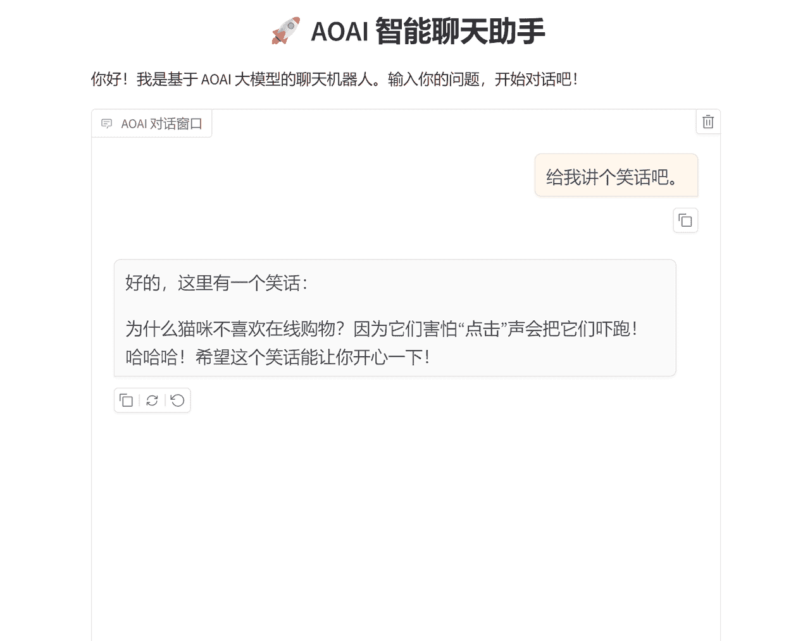

**安全提示：**

+   这个示例假设您在本地运行，并通过环境变量管理 API Key。

+   **如果您打**算将此类应用部署到公共服务器或与他人分享，绝对不能将 API Key 硬编码在代码中。需要采用更安全的密钥管理策略，例如使用服务器端环境变量、Secrets Manager 服务或专门的配置文件（并确保该文件不被公开访问）。

> 如果您希望从互联网上临时访问您在本地运行的 Gradio 应用（例如，为了方便演示或与他人短暂分享），最关键的修改是在 launch() 方法中添加 share=True 参数。

> 找到代码末尾的启动部分，修改 launch() 方法如下：

```
# --- 启动 Gradio 应用 ---
if __name__ == &quot;__main__&quot;:
    # ... (之前的检查 API Key 的代码保持不变) ...

    # *** 关键修改：添加 share=True ***
    chatbot_interface.launch(
        server_name=&quot;0.0.0.0&quot;, # 保持或移除皆可，share=True 主要依赖Gradio的隧道
        share=True             # &lt;--- 添加此参数
    )
    # 如果只想本机和公开访问，可以省略 server_name
    # chatbot_interface.launch(share=True)
```

> **说明：**

1.  **share=True**： 当您添加这个参数后，Gradio 会尝试通过其内置的隧道服务（通常利用类似 frp 或 ngrok 的技术）创建一个临时的、公开可访问的 URL。

1.  **输出**： 运行脚本后，除了本地 URL （http://127.0.0.1:7860 或 http://0.0.0.0:7860），终端还会输出一个公网 URL（Public URL），通常看起来像 https://<随机字符>.gradio.live 或类似的域名。

1.  **访问**： 任何人只要知道这个公网 URL，就可以在浏览器中访问您的 Gradio 应用，无论他们在世界的哪个地方。

> **⚠️ 重要警告和注意事项：**

1.  **安全性**： 这个生成的公网 URL 是**完全公开的**！任何知道该链接的人都可以访问您的应用。这意**味着他们**可以与您的聊天机器人交互，并消耗您的 AOAI API Key 的额度。请极其谨慎地分享这个链接，并且只分享给您信任的人。

1.  **临时性**： 这个公网链接通常是**临时的**（Gradio 官方说明一般是 72 小时有效），并且在您停止本地运行的 Python 脚本后就会失效。它不适用于永久托管应用。

1.  **性能**： 通过隧道访问可能会比本地访问稍慢一些。

1.  API Key 暴露风险 （间接）: 虽然代码本身不暴露 Key，但任何能访问应用的人都**在使用您的 Key。如果应用本身有**任何（不太可能的）漏洞被利用，或者被恶意大量使用，都可能带来风险或产生高额费用。绝对不要在需要公开部署的应用中直接硬编码或以不安全方式加载 API Key。对于需要长期公开访问的应用，应考虑部署到云平台并实施更严格的安全措施（如用户认证、更安全的密钥管理等）。

**总结：**

这个 Gradio 应用演示了如何将我们之前学习的 AOAI API 调用知识（特别是使用 openai 库、处理 messages 历史、实现流式输出和错误处理）集成到一个交互式的 Web 应用中。这为您将来构建更复杂的基于 LLM 的应用打下了基础。

## **解析 API**** 响应**与错误处理 （基于 openai 库）

+   **解析成功响应：**

+   **非流式 （****stream=False****）:**

+   模型回复： response.choices[0].message.content

+   结束原因： response.choices[0].finish_reason （'stop'， 'length' 等）

+   Token 用量： response.usage （包含 prompt_tokens， completion_tokens， total_tokens）

+   **流式 （****stream=True****）:**

+   通过迭代 for chunk in stream_response: 获取数据块。

+   增量内容： chunk.choices[0].delta.content （需要检查非 None）。

+   结束原因： 在某个 chunk 中 chunk.choices[0].finish_reason 会变为非 None。

+   Token 用量： 通常不易在流式迭代中直接获取完整 usage。

+   **错误处理：** openai 库会根据 HTTP 状态码和响应内容抛出特定的异常，方便捕获：

+   openai.AuthenticationError： API Key 无效或权限问题 （对应 401/403）。

+   openai.RateLimitError： 超出速率限制 （对应 429）。

+   openai.BadRequestError： 请求参数错误 （对应 400）。

+   openai.APIConnectionError： 网络连接问题。

+   openai.APITimeoutError： 请求超时。

+   openai.APIError / openai.APIStatusError： 其他 API 层面错误 （如 5xx 服务器错误）。

+   **通用捕获：** 可以使用 except openai.APIError as e: 或更通用的 except Exception as e: 来捕获所有潜在错误，并通过 e 对象获取错误信息。

**推荐的错误处理结构：**

```
from openai import OpenAI, APIError, RateLimitError, AuthenticationError # 导入特定错误类型

# ... client 初始化 ...

try:
    # ... 调用 client.chat.completions.create(...) ...
    pass
except AuthenticationError as e:
    print(f&quot;认证错误: API Key 可能无效或过期。 {e}&quot;)
except RateLimitError as e:
    print(f&quot;速率限制错误: 请求过于频繁，请稍后重试。 {e}&quot;)
    # 可以考虑在这里加入等待和重试逻辑
except APIError as e: # 捕获其他 API 相关错误 (4xx, 5xx)
    print(f&quot;API 错误: {e.status_code} - {e.message}&quot;)
except Exception as e: # 捕获其他意外错误 (如网络问题)
    print(f&quot;发生意外错误: {e}&quot;)
```

# 强制输出 JSON 格式 （JSON Mode）

**引言：** 在很多应用场景中，我们不仅仅希望模型返回自然的文本回复，更希望它能按照我们预定义的结构输出数据，例如 JSON 格式。这对于需要将模型输出直接用于程序处理、API 对接或数据存储的场景至关重要。AOAI API （与 OpenAI API 兼容） 提供了“JSON Mode”功能，可以强制模型输出严格符合 JSON 语法规范的文本。

**工作原理：**

要启用 JSON Mode，您需要做两件事：

1.  **在 API 请求中指定参数：** 在调用 client.chat.completions.create 时，添加 response_format={"type": "json_object"} 参数。

1.  在提示 （Prompt） 中明确指示： 您必须在发送给模型的 messages 中（通常是在 system 消息或最后一条 user 消息里）明确指示模型“必须输出 JSON 格式”或类似的要求，并且最好能描述期望的 JSON 结构（包含哪些字段）。

如果缺少其中任何一步，模型可能无法保证输出有效的 JSON。

**编程实践：使****用 Python 和 o**penai 库获取 JSON 输出

让我们来创建一个有趣的例子：请求模型想象一种生活在云端的、以彩虹为食的奇特小精灵，并用 JSON 格式描述它的关键特征。

```
import os
import json # 导入 json 库用于解析和美化打印 JSON
from openai import OpenAI, APIError, BadRequestError

# --- (复用之前的 API Key 获取和 client 初始化代码) ---
api_key = os.getenv(&quot;AOAI_API_KEY&quot;)
if not api_key:
    raise ValueError(&quot;请设置环境变量 AOAI_API_KEY&quot;)

# --- 初始化 OpenAI 客户端，指向 AOAI API ---
client = OpenAI(
    api_key=api_key,
    base_url=&quot;https://api.huaqloud.com/v1&quot;
)

print(&quot;\n\n--- 场景五：强制输出 JSON 格式 (JSON Mode) ---&quot;)

# --- 定义我们期望的 JSON 结构和对模型的要求 ---
# 注意：这里的描述对模型能否正确生成至关重要
system_prompt = &quot;&quot;&quot;
你是一位富有想象力的生物学家，专门研究奇幻生物。
你的任务是根据用户的要求，创造一种生物的描述。
请**严格**按照以下 JSON 格式输出，**不要包含任何 JSON 格式之外的文字或解释**：
{
  &quot;creature_name&quot;: &quot;生物名称 (字符串)&quot;,
  &quot;habitat&quot;: &quot;主要栖息地 (字符串)&quot;,
  &quot;diet&quot;: &quot;主要食物 (字符串)&quot;,
  &quot;appearance_summary&quot;: &quot;外观简述 (字符串, 50字以内)&quot;,
  &quot;special_ability&quot;: {
    &quot;name&quot;: &quot;特殊能力名称 (字符串)&quot;,
    &quot;description&quot;: &quot;能力描述 (字符串)&quot;
  },
  &quot;friendliness_level&quot;: &quot;友好度 (整数, 1-10, 10为最友好)&quot;
}
确保输出是**单个有效**的 JSON 对象。
&quot;&quot;&quot;

user_prompt = &quot;请描述一种生活在云端、以彩虹能量为食的、闪闪发光的小精灵。&quot;

try:
    # --- 发起聊天补全请求，启用 JSON Mode ---
    response = client.chat.completions.create(
        model=&quot;gpt-4o-mini&quot;, # 确保选择支持 JSON Mode 的模型
        messages=[
            {&quot;role&quot;: &quot;system&quot;, &quot;content&quot;: system_prompt},
            {&quot;role&quot;: &quot;user&quot;, &quot;content&quot;: user_prompt}
        ],
        response_format={&quot;type&quot;: &quot;json_object&quot;}, # &lt;-- 启用 JSON Mode 的关键参数
        temperature=0.8, # 可以稍微提高一点温度增加创意性
        max_tokens=500   # 确保足够生成 JSON 内容
    )

    # --- 获取模型返回的原始字符串 ---
    json_string = response.choices[0].message.content
    print(&quot;模型返回的原始 JSON 字符串:\n&quot;, json_string)

    # --- 尝试将字符串解析为 Python 字典 ---
    try:
        creature_data = json.loads(json_string)
        print(&quot;\n成功解析为 Python 字典:&quot;)
        # 使用 json.dumps 美化打印字典
        print(json.dumps(creature_data, indent=2, ensure_ascii=False))

        # --- (可选) 访问解析后的数据 ---
        print(f&quot;\n小精灵名称: {creature_data.get(&#x27;creature_name&#x27;, &#x27;未知&#x27;)}&quot;)
        if &#x27;special_ability&#x27; in creature_data:
            print(f&quot;特殊能力: {creature_data[&#x27;special_ability&#x27;].get(&#x27;name&#x27;, &#x27;未知能力&#x27;)}&quot;)

    except json.JSONDecodeError as e:
        print(f&quot;\n错误：模型返回的不是有效的 JSON 字符串。错误信息: {e}&quot;)
        print(&quot;请检查模型是否完全遵循了 system prompt 中的格式要求，或者尝试调整 prompt。&quot;)

except BadRequestError as e:
    # 特别捕捉 BadRequestError，因为格式指令错误或模型不支持可能导致 400
    print(f&quot;\nAPI 请求错误 (BadRequest): {e}&quot;)
    print(&quot;请检查：1. 模型 (&#x27;gpt-4o-mini&#x27;) 是否支持 JSON mode。 2. Prompt 中的 JSON 描述是否清晰。&quot;)
except APIError as e:
    print(f&quot;\nAPI 调用出错: {e.status_code} - {e.message}&quot;)
except Exception as e:
    print(f&quot;\n发生意外错误: {e}&quot;)    
```

**代码解释：**

1.  **import json**： 我们导入了 Python 内置的 json 库，用于后续解析模型返回的 JSON 字符串，并能将其格式化输出。

1.  **system_prompt**： 这是成功的关键。我们非常明确地告诉模型：

+   它的角色（富有想象力的生物学家）。

+   它的任务（根据用户要求创造生物描述）。

+   **必须**使用 JSON 格式输出。

+   提供了**明确的 JSON 结构**，包括字段名和预期的数据类型（以及一些约束，如字符串长度）。

+   强调**只输出 JSON**，没有额外文字。

1.  **response_format={"t**ype": "json_object"}： 在 create 调用中，这个参数是强制启用 JSON Mode 的开关。

1.  **获取原始字符串**： response.choices[0].message.content 会包含模型生成的、理论上应该是 JSON 格式的字符串。

1.  json.loads(json_string)： 这是核心步骤。我们尝试用 json.loads() 将模型返回的字符串解析成 Python 的字典（dictionary）对象。

+   如果字符串是有效的 JSON，解析成功，我们就可以像操作普通 Python 字典一样访问数据了（例如 creature_data['creature_name']）。

+   如果字符串不是有效的 JSON（比如多了注释、结尾有逗号、引号错误等），json.loads() 会抛出 json.JSONDecodeError 异常，我们在 except 块中捕获并提示用户。

1.  **美化打印**： json.dumps(creature_data, indent=2, ensure_ascii=False) 用于将 Python 字典转换回格式化（带缩进）的 JSON 字符串进行打印，ensure_ascii=False 确保中文字符能正确显示。

1.  **错误处理**： 除了通用的 API 错误，我们特别注意捕获 json.JSONDecodeError 和 BadRequestError （400），后者有时会在模型无法遵循 JSON 格式指令或不支持该模式时发生。

JSON Mode 的主要应用场景：

+   **结构化数据提取：** 从非结构化文本（如用户评论、文章）中提取关键信息（如姓名、地点、情感倾向）并以 JSON 格式返回。

+   **动态生成配置文件：** 根据用户需求动态生成 JSON 格式的配置文件。

+   **API 集成：** 让 LLM 的输出可以直接被其他需要 JSON 输入的系统或服务消费。

+   **表单数据填充：** 根据自然语言描述自动填充需要 JSON 数据的表单。

+   **函数/工具参数构造：** （与 Function Calling/Tool Use 结合） 生成调用其他 API 或工具时所需的 JSON 格式参数。

**注意事项：**

+   **模型支持：** 并非所有模型都支持 JSON Mode，请查阅 AOAI 的模型文档确认您选择的模型（如 gpt-4o-mini）是否支持。

+   **Prompt 的重要性：** 即使开启了 response_format， 模型能否成功生成所需结构的 JSON 很大程度上依赖于您在 messages 中给出的指令有多清晰和具体。提供清晰的字段名、类型甚至示例非常有帮助。

+   **复杂性限制：** 对于极其复杂的嵌套 JSON 结构，模型可能会遇到困难。保持结构相对清晰简洁有助于提高成功率。

+   **Token 消耗：** JSON 结构本身（括号、引号、字段名）也会消耗 Token。

# 使用工具 （Function Calling / Tool Use）

**引言：** 大语言模型本身拥有庞大的知识库，但这些知识通常是截至某个训练时间点的，并且它们无法直接与外部世界进**行实时交互或执**行特定操作（如预订机票、查询数据库、控制智能家居）。"Function Calling" 或 "Tool Use" 功能正是为了弥补这一鸿沟。它允许您在与模型交互时，定义一组可供模型“调用”的工具（函数）。当模型认为需要使用某个工具来回答用户问题时，它不会直接回答，而是输出一个特殊的信号，表明它想调用哪个函数以及需要传入什么参数。您的应用程序接收到这个信号后，执行相应的函数，并将结果返回给模型，模型再根据这个结果生成最终的、更准确或更具操作性的回复。

**核心概念与流程：**

调用工具通常涉及以下几个步骤：

1.  定义工具 （Functions/Tools）: 在向 API 发送请求时，您需要提供一个工具列表 （tools）。每个工具定义包括：

+   type： 通常是 "function"。

+   function： 包含函数详细信息的对象：

+   name： 函数的名称（例如 get_current_weather）。

+   description： 函数功能的清晰描述。这对模型决定何时使用该函数至关重要。

+   parameters： 一个描述该函数所需参数的 JSON Schema 对象。这定义了参数的名称、类型（如 string， integer， boolean）、是否必需以及描述。

1.  **发起 API 请求：** 将用户的消息 （messages） 和您定义的 tools 列表一起发送给 AOAI API。您还可以使用 tool_choice 参数来控制模型的行为：

+   "auto" （默认）: 模型自行决定是直接回答还是调用一个或多个工具。

+   "none"： 强制模型不调用任何工具，直接生成回复。

+   {"type": "function", "function": {"name": "my_function"}}： 强制模型必须调用名为 my_function 的特定工具。

1.  **模型响应 （请求调用工具）:** 如果模型决定使用工具，API 的响应中，choices[0].message 会包含一个 tool_calls 字段（而不是 content）。tool_calls 是一个列表，包含一个或多个模型想要调用的工具的信息：

+   id： 每个工具调用的唯一标识符 （ tool_call_id）。

+   type: "function".

+   function:

+   name： 要调用的函数名称。

+   arguments： 一个 **JSON 格式的字符串**，包含了模型认为需要传递给该函数的参数。

1.  **您的代码执行工具：** 您的应用程序需要解析 tool_calls：

+   识别出要调用的函数名称 （function.name）。

+   解析 function.arguments 字符串（通常使用 json.loads()）。

+   根据函数名和解析出的参数，在您的代码中实际执行对应的函数/工具。例如，调用真实的第三方天气 API，或执行本地的计算函数。

+   获取函数的执行结果（返回值）。

1.  **将工具结果返回给模型：** 您需要再次调用 AOAI API：

+   在 messages 列表中追加两项：

+   第一项是上一步模型返回的包含 tool_calls 的原始助手消息 （role: assistant， tool_calls: [...]）。

+   第二项是一个新的消息，其 role 为 tool，包含：

+   tool_call_id： 对应您执行的那个工具调用的 id。

+   content： 函数执行后返回的**结果**（通常是字符串格式）。

+   **这次调用时，不再需要传递 ****tools**** 参数** （因为模型现在需要基于结果来回复，而不是选择工具）。

1.  **模型最终响应：** 模型接收到工具执行的结果后，会结合之前的对话上下文和工具结果，生成一个最终的、自然的语言回复给用户。这个回复会在 choices[0].message.content 中。

**编程实践：使**用 Python 和 openai 库实现工具调用 （天气查询示例）

我们将模拟**一个查询天气的功**能。注意：下面的 get_current_weather 函数是 伪代码/模拟函数，它并不真正查询天气，只是返回一个固定的字符串，用以演示流程。在实际应用中，您需要替换它为调用真实天气服务 API 的代码。

```
import os
import json
from openai import OpenAI, APIError

# --- (复用之前的 API Key 获取和 client 初始化代码) ---
api_key = os.getenv(&quot;AOAI_API_KEY&quot;)
if not api_key:
    raise ValueError(&quot;请设置环境变量 AOAI_API_KEY&quot;)

client = OpenAI(api_key=api_key, base_url=&quot;https://api.huaqloud.com/v1&quot;)

# --- 步骤 1: 定义我们的“工具”（模拟的天气查询函数） ---
def get_current_weather(location, unit=&quot;celsius&quot;):
    &quot;&quot;&quot; (模拟函数) 获取指定地点的当前天气 &quot;&quot;&quot;
    print(f&quot;--- 模拟工具执行：正在查询 {location} 的天气 ({unit}) ---&quot;)
    # 在真实应用中，这里会调用天气API
    if &quot;北京&quot; in location:
        return json.dumps({&quot;location&quot;: location, &quot;temperature&quot;: &quot;2&quot;, &quot;unit&quot;: unit, &quot;forecast&quot;: &quot;晴朗&quot;})
    elif &quot;东京&quot; in location:
        return json.dumps({&quot;location&quot;: location, &quot;temperature&quot;: &quot;8&quot;, &quot;unit&quot;: unit, &quot;forecast&quot;: &quot;多云&quot;})
    elif &quot;伦敦&quot; in location:
        return json.dumps({&quot;location&quot;: location, &quot;temperature&quot;: &quot;5&quot;, &quot;unit&quot;: unit, &quot;forecast&quot;: &quot;小雨&quot;})
    else:
        return json.dumps({&quot;location&quot;: location, &quot;temperature&quot;: &quot;未知&quot;, &quot;unit&quot;: unit, &quot;forecast&quot;: &quot;未知&quot;})

# --- 步骤 1 (续): 定义工具的描述，供模型理解 ---
tools = [
    {
        &quot;type&quot;: &quot;function&quot;,
        &quot;function&quot;: {
            &quot;name&quot;: &quot;get_current_weather&quot;,
            &quot;description&quot;: &quot;获取指定地点的当前天气信息。如果用户没有指定单位，默认为摄氏度。&quot;,
            &quot;parameters&quot;: {
                &quot;type&quot;: &quot;object&quot;,
                &quot;properties&quot;: {
                    &quot;location&quot;: {
                        &quot;type&quot;: &quot;string&quot;,
                        &quot;description&quot;: &quot;需要查询天气的城市或地点，例如：北京, 东京&quot;,
                    },
                    &quot;unit&quot;: {
                        &quot;type&quot;: &quot;string&quot;,
                        &quot;enum&quot;: [&quot;celsius&quot;, &quot;fahrenheit&quot;],
                        &quot;description&quot;: &quot;温度单位，摄氏度(celsius)或华氏度(fahrenheit)&quot;
                    },
                },
                &quot;required&quot;: [&quot;location&quot;], # location 参数是必需的
            },
        }
    }
]

print(&quot;\n\n--- 场景六：使用工具 (Function Calling / Tool Use) ---&quot;)

# --- 初始对话消息 ---
messages = [{&quot;role&quot;: &quot;user&quot;, &quot;content&quot;: &quot;你好，请问现在伦敦的天气怎么样？&quot;}]
print(f&quot;用户: {messages[0][&#x27;content&#x27;]}&quot;)

try:
    # --- 步骤 2: 发起第一次 API 请求，包含工具定义 ---
    print(&quot;\n--- 第一次 API 调用 (提供工具) ---&quot;)
    response = client.chat.completions.create(
        model=&quot;gpt-4o-mini&quot;, # 确保模型支持 Tool Use
        messages=messages,
        tools=tools,
        tool_choice=&quot;auto&quot;,  # 让模型自动决定是否使用工具
    )

    response_message = response.choices[0].message
    # print(&quot;第一次响应的完整消息:&quot;, response_message) # 调试用

    # --- 步骤 3 &amp; 4: 检查模型是否请求调用工具，并执行 ---
    tool_calls = response_message.tool_calls
    if tool_calls:
        print(&quot;\n--- 模型请求调用工具 ---&quot;)
        # 将模型的请求添加到消息历史中 (必须！)
        messages.append(response_message)

        # 在实际应用中，可能有多个 tool_calls，需要遍历处理
        for tool_call in tool_calls:
            function_name = tool_call.function.name
            function_args = json.loads(tool_call.function.arguments) # 解析参数字符串为字典
            tool_call_id = tool_call.id # 获取 tool_call_id

            print(f&quot;  工具名称: {function_name}&quot;)
            print(f&quot;  工具参数: {function_args}&quot;)
            print(f&quot;  工具调用 ID: {tool_call_id}&quot;)

            # --- 执行我们定义的函数 ---
            if function_name == &quot;get_current_weather&quot;:
                function_response = get_current_weather(
                    location=function_args.get(&quot;location&quot;),
                    unit=function_args.get(&quot;unit&quot;, &quot;celsius&quot;) # 处理可选参数
                )
                print(f&quot;--- 工具执行结果: {function_response} ---&quot;)

                # --- 步骤 5: 将工具执行结果添加到消息历史中 ---
                messages.append(
                    {
                        &quot;tool_call_id&quot;: tool_call_id,
                        &quot;role&quot;: &quot;tool&quot;,
                        &quot;content&quot;: function_response, # 函数返回的结果
                    }
                )
            else:
                print(f&quot;警告：模型请求调用未知的工具 &#x27;{function_name}&#x27;&quot;)
                # 可以选择返回一个错误信息给模型
                messages.append(
                    {
                        &quot;tool_call_id&quot;: tool_call_id,
                        &quot;role&quot;: &quot;tool&quot;,
                        &quot;content&quot;: json.dumps({&quot;error&quot;: f&quot;Unknown tool: {function_name}&quot;}),
                    }
                )

        # --- 步骤 5 (续): 发起第二次 API 请求，包含工具结果 ---
        print(&quot;\n--- 第二次 API 调用 (提供工具结果) ---&quot;)
        # print(&quot;发送给API的消息历史:&quot;, messages) # 调试用
        second_response = client.chat.completions.create(
            model=&quot;gpt-4o-mini&quot;,
            messages=messages,
            # 注意：第二次调用通常不需要再传 tools 或 tool_choice
        )

        # --- 步骤 6: 获取并打印最终的自然语言回复 ---
        final_response = second_response.choices[0].message.content
        print(f&quot;\n模型最终回复:\n{final_response}&quot;)

    else:
        # --- 如果模型没有调用工具，直接打印它的回复 ---
        print(&quot;\n--- 模型未调用工具，直接回复 ---&quot;)
        final_response = response_message.content
        print(f&quot;模型回复:\n{final_response}&quot;)

except APIError as e:
    print(f&quot;\nAPI 调用出错: {e.status_code} - {e.message}&quot;)
except json.JSONDecodeError as e:
    print(f&quot;\n错误：解析模型返回的参数时出错: {e}&quot;)
    print(f&quot;原始参数字符串: {tool_call.function.arguments if &#x27;tool_call&#x27; in locals() else &#x27;未获取&#x27;}&quot;)
except Exception as e:
    print(f&quot;\n发生意外错误: {e}&quot;)
```

**代码解释：**

1.  **get_**current_weather 函数： 这是一个模拟函数。关键在于它接收参数（location， unit）并返回一个 JSON 字符串作为结果，模拟真实 API 的行为。

1.  **tools**** 列表：** 定义了 get_current_weather 工具。

+   description 清晰地说明了它的用途和默认行为。

+   parameters 使用 JSON Schema 定义了 location （必需） 和 unit （可选，枚举值） 参数。

1.  **第一次 API 调用：** 发送用户消息和 tools 定义，tool_choice="auto"。

1.  **检查 ****tool_calls****：** 判断 response_message.tool_calls 是否存在。如果存在，说明模型想用工具。

1.  **处理 ****tool_calls****：**

+   **必须**将包含 tool_calls 的 response_message 添加到 messages 历史记录中。

+   遍历 tool_calls （虽然本例只有一个）。

+   提取函数名、参数 （json.loads 解析） 和 tool_call_id。

+   调用本地的 get_current_weather 函数。

+   **必须**将结果封装成 role: tool 的消息，包含对应的 tool_call_id 和 content （函数返回值），并添加到 messages 历史。

1.  **第二次 API 调用：** 将更新后的 messages （包含用户问题、模型工具请求、**工具执**行结果） 再次发送给 API。这次不需要 tools 或 tool_choice。

1.  **最终回复：** 第二次调用的响应 content 就是模型结合了工具结果后的自然语言回答。

1.  **错误处理：** 增加了对 API 错误和 JSON 解析错误的处理。

**工具使用的主要应用场景：**

+   **实时信息查询：** 天气、股票、新闻、体育比分等。

+   **外部服务交互：** 发送邮件、创建日历事件、控制智能家居设备、在电商平台下单。

+   **数据库/知识库查询：** 从结构化数据库或内部知识库中检索信息。

+   **复杂计算：** 执行精确的数学计算或调用专门的计算库。

+   **代码执行：** （需极度谨慎） 在沙箱环境中执行代码片段。

+   **多模态交互：** 调用图像生成或分析工具。

**注意事项：**

+   **成本与延迟：** Function Calling 通常需要至少两次 API 调用，会增加成本和响应时间。

+   **工具描述是关键：** 模型能否在合适的时机选择正确的工具，很大程度上取决于您提供的 description 是否清晰、准确、无歧义。

+   **参数 Schema:** 准确定义 parameters 的 JSON Schema 很重要，有助于模型生成格式正确的参数。

+   **执行函数的健壮性：** 您自己实现的工具函数需要有良好的错误处理机制。如果工具执行失败，应将错误信息作为结果返回给模型，模型可能会据此告知用户。

+   **安全性：** **绝对不要**让模型能够调用可以执行任意代码或访问敏感系统的函数，除非有严格的沙箱和权限控制。要仔细审查模型生成的参数，防止注入攻击。

+   **并发工具调用：** 模型可能一次请求调用多个工具 （tool_calls 列表包含多个元素）。您的代码需要能处理这种情况，可以串行执行，也可以并行执行（如果工具之间无依赖）。

# 使用 SearXNG 进行网页搜索 （交互式）

**引言：**

在**之前的场景中，我们探**讨了工具**使用（Func**tion Call**in**g**）的基**本概念，并模拟了一个天气查询工具。现在，我们将构建一个更强大、更实用的示例，演示如何让 AOAI 模型真正地与外部世界交互，利用 SearXNG 元搜索引擎来获取实时的网页信息。与之前仅生成文本不同，模型现在可以根据需要“决定”上网搜索，弥补其知识截止日期和无法访问实时数据的局限性。本场景将实现一个交互式的命令行应用，用户可以直接输入问题，模型如果判断需要，就会调用我们提供的 SearXNG 搜索工具，并将搜索结果融入最终的回答中。

**前提条件：**

+   可访问的 SearXNG 实例： 您需要一个可以访问的 SearXNG 实例的 URL。在本例中，我们使用 https://searxng.huaqloud.com。请确保此地址有效，并且允许通过 API 进行 JSON 格式的查询。如果您的实例地址不同或需要认证，请相应修改代码。

+   **Python ****requests**** 库：** 需要使用此库来向 SearXNG 发送 HTTP 请求。如果您的环境中尚未安装，请通过 pip 安装：

```
      pip install requests
```

+   **AOAI API Key:** 确保您的 AOAI_API_KEY 环境变量已正确设置。

**核心流程：**

1.  **定义工具 （****web_search****）:** 向 AOAI API 清晰地描述 web_search 工具的功能（执行网页搜索以获取实时或未知信息）及其需要的参数（一个字符串类型的 query）。

1.  **用户输入：** 程序接收用户的交互式输入问题。

1.  模型决策 （第一次 API 调用）: 将用户问题和 web_search 工具定义发送给 AOAI API （tool_choice="auto"）。模型分析问题，判断是否需要调用该工具来回答。

1.  **模型请求调用：** 如果模型决定搜索，API 响应会包含 tool_calls 字段，指明要调用 web_search 并提供它从用户问题中提取出的搜索查询 （query）。

1.  **应用程序执行工具：** 您的 Python 代码解析 tool_calls，提取 query，并调用本地实现的 perform_searxng_search 函数。

1.  **perf**orm_searxng_search 函数：

+   接收 query 参数。

+   构造指向 SearXNG 实例的 API 请求 URL （例如 https://searxng.huaqloud.com/?q=...&format=json）。

+   使用 requests 库发送 GET 请求，获取搜索结果。

+   处理响应：检查 HTTP 状态码，解析返回的 JSON 数据。

+   **结果处理与格式化：** 从搜索结果中提取关键信息（如前几条结果的标题、URL、内容摘要），整合成一个简洁、易于模型理解的文本字符串。

+   返回该格式化字符串（如果搜索失败或出错，则返回包含错误信息的 JSON 字符串）。

1.  结果返回给模型 （第二次 API 调用）: 将 perform_searxng_search 返回的结果字符串作为 role: tool 消息的内容（关联正确的 tool_call_id），连同之前的对话历史一起，再次发送给 AOAI API。

1.  **模型生成最终回复：** 模型接收到搜索结果后，结合原始问题和搜索信息，生成一个整合了实时网络知识的、更全面的自然语言回复给用户。

1.  **循环：** 程序继续等待用户下一次输入，重复步骤 2-8，直到用户输入 'quit'。

编程实践：实现交互式 SearXNG 网页搜索工具

```
# interactive_search.py
import os
import json
import requests # 导入 requests 库
from openai import OpenAI, APIError
import traceback # 用于打印详细错误

# --- (复用之前的 API Key 获取和 client 初始化代码) ---
api_key = os.getenv(&quot;AOAI_API_KEY&quot;)
if not api_key:
    raise ValueError(&quot;请设置环境变量 AOAI_API_KEY&quot;)

client = OpenAI(api_key=api_key, base_url=&quot;https://api.huaqloud.com/v1&quot;)

# --- SearXNG 配置 ---
SEARXNG_BASE_URL = &quot;https://searxng.huaqloud.com&quot; # 您提供的 SearXNG 实例地址
MAX_SEARCH_RESULTS = 3 # 只返回前 N 条结果给模型，避免信息过载和 Token 消耗

# --- 步骤 1 &amp; 5: 定义并实现 SearXNG 搜索函数 ---
def perform_searxng_search(query: str) -&gt; str:
    &quot;&quot;&quot;
    使用指定的 SearXNG 实例执行网页搜索并返回格式化的结果。

    Args:
        query: 用户输入的搜索关键词。

    Returns:
        一个包含前 N 条搜索结果（标题、URL、摘要）的格式化字符串，
        或者在出错时返回包含错误信息的 JSON 字符串。
    &quot;&quot;&quot;
    print(f&quot;--- 工具执行：正在使用 SearXNG 搜索 &#x27;{query}&#x27; ---&quot;)
    headers = {
        # 设置一个 User-Agent 是个好习惯
        &#x27;User-Agent&#x27;: &#x27;AOAIInteractiveApp/1.0 (Tool Call; +https://your-project-url)&#x27;
    }
    params = {
        &#x27;q&#x27;: query,
        &#x27;format&#x27;: &#x27;json&#x27; # 请求 JSON 格式的输出
        # 根据 SearXNG API 文档，可以添加 &#x27;language&#x27;, &#x27;time_range&#x27;, &#x27;safesearch&#x27; 等参数
    }

    try:
        # 设置超时时间 (连接超时5秒, 读取超时10秒)
        response = requests.get(SEARXNG_BASE_URL + &quot;/&quot;, params=params, headers=headers, timeout=(5, 10))
        # 检查 HTTP 状态码，如果不是 200-299，则抛出异常
        response.raise_for_status()

        data = response.json()
        results = data.get(&#x27;results&#x27;, [])

        if not results:
            print(&quot;--- SearXNG 返回了空结果 ---&quot;)
            # 返回一个信息性 JSON 字符串，告知模型没有结果
            return json.dumps({&quot;info&quot;: f&quot;SearXNG did not return any results for the query: &#x27;{query}&#x27;.&quot;})

        # 格式化前 N 条结果
        formatted_results = []
        for i, result in enumerate(results[:MAX_SEARCH_RESULTS]):
            title = result.get(&#x27;title&#x27;, &#x27;N/A&#x27;)
            url = result.get(&#x27;url&#x27;, &#x27;N/A&#x27;)
            # &#x27;content&#x27; 字段通常包含摘要，可能需要根据实际情况调整字段名
            content = result.get(&#x27;content&#x27;, &#x27;N/A&#x27;)
            # 移除摘要中的换行符，简化输出
            content = content.replace(&#x27;\n&#x27;, &#x27; &#x27;).replace(&#x27;\r&#x27;, &#x27; &#x27;) if content else &#x27;N/A&#x27;
            formatted_results.append(f&quot;{i+1}. Title: {title}\n   URL: {url}\n   Snippet: {content}\n&quot;)

        # 最终返回给模型的字符串
        final_output = f&quot;Web search results for &#x27;{query}&#x27;:\n\n&quot; + &quot;\n&quot;.join(formatted_results)
        # 打印部分结果用于调试，避免控制台输出过多
        print(f&quot;--- SearXNG 工具执行结果 (格式化后):\n{final_output[:300]}{&#x27;...&#x27; if len(final_output) &gt; 300 else &#x27;&#x27;} ---&quot;)
        return final_output # 直接返回格式化字符串

    except requests.exceptions.Timeout:
        print(f&quot;--- SearXNG 请求超时 ---&quot;)
        return json.dumps({&quot;error&quot;: f&quot;SearXNG request timed out for query: &#x27;{query}&#x27;.&quot;})
    except requests.exceptions.RequestException as e:
        print(f&quot;--- SearXNG 请求失败: {e} ---&quot;)
        # 返回包含具体请求错误的 JSON 字符串
        return json.dumps({&quot;error&quot;: f&quot;Failed to connect to SearXNG or request failed: {str(e)}&quot;})
    except json.JSONDecodeError as e:
        print(f&quot;--- 解析 SearXNG 响应失败: {e} ---&quot;)
        # 尝试打印部分响应文本帮助调试 SearXNG 返回的非 JSON 内容
        response_text = response.text if &#x27;response&#x27; in locals() else &#x27;N/A&#x27;
        print(f&quot;--- Response Text (first 500 chars): {response_text[:500]} ---&quot;)
        return json.dumps({&quot;error&quot;: f&quot;Failed to parse JSON response from SearXNG: {str(e)}. Response started with: {response_text[:100]}&quot;})
    except Exception as e:
        print(f&quot;--- SearXNG 工具执行中发生未知错误: {e} ---&quot;)
        # 记录未知错误
        return json.dumps({&quot;error&quot;: f&quot;An unexpected error occurred during the search: {str(e)}&quot;})


# --- 步骤 1 (续): 定义工具的描述 ---
tools = [
    {
        &quot;type&quot;: &quot;function&quot;,
        &quot;function&quot;: {
            &quot;name&quot;: &quot;web_search&quot;,
            # description 对模型能否正确使用工具至关重要
            &quot;description&quot;: &quot;当需要获取关于当前事件、最新发展、特定网站的实时内容或任何模型自身知识库可能未包含的信息时，使用此工具执行网页搜索。适用于回答例如“今天有什么科技新闻？”、“某某公司的最新财报怎么样？”、“请总结一下[某个URL]页面的主要内容”等问题。&quot;,
            &quot;parameters&quot;: {
                &quot;type&quot;: &quot;object&quot;,
                &quot;properties&quot;: {
                    &quot;query&quot;: {
                        &quot;type&quot;: &quot;string&quot;,
                        &quot;description&quot;: &quot;用于网页搜索的具体、明确的关键词或问题。&quot;,
                    },
                },
                &quot;required&quot;: [&quot;query&quot;], # query 参数是必须的
            },
        }
    }
]

print(&quot;\n\n--- 场景六 (交互式升级版): 使用 SearXNG 进行网页搜索 ---&quot;)
print(&quot;你好！我是可以上网搜索的 AOAI 助手。&quot;)
print(&quot;输入你想查询的内容。如果需要最新信息，我会尝试使用 SearXNG 搜索。&quot;)
print(&quot;输入 &#x27;quit&#x27; 退出程序。&quot;)

# --- 开始交互式循环 ---
while True:
    try:
        user_input = input(&quot;\n你 (输入 &#x27;quit&#x27; 退出): &quot;)
        if user_input.lower() == &#x27;quit&#x27;:
            print(&quot;\n机器人: 感谢使用，再见！&quot;)
            break
        if not user_input.strip(): # 跳过空输入或只有空格的输入
            continue

        # --- 为当前交互初始化消息列表 ---
        # 注意：当前实现为单轮工具调用优化，不保留长期对话历史。
        # 如需多轮记忆，需在循环外维护 history 列表，并在循环内添加消息。
        messages = [{&quot;role&quot;: &quot;user&quot;, &quot;content&quot;: user_input}]

        # --- 第一次 API 调用 (尝试让模型决策是否使用工具) ---
        print(&quot;--- 机器人思考中 (可能需要联网搜索)... ---&quot;)
        response = client.chat.completions.create(
            model=&quot;gpt-4o-mini&quot;, # 确保所选模型支持 Tool Use
            messages=messages,
            tools=tools,
            tool_choice=&quot;auto&quot;, # 让模型自动决定
        )
        response_message = response.choices[0].message

        # --- 检查模型是否请求调用工具 ---
        tool_calls = response_message.tool_calls
        final_response = None # 初始化最终回复变量

        if tool_calls:
            print(&quot;--- 模型决定使用 SearXNG 进行搜索 ---&quot;)
            # **必须**将模型的工具调用请求添加到消息历史中
            messages.append(response_message)

            # 通常一个请求可能包含多个 tool_calls，这里简化处理第一个
            tool_call = tool_calls[0]
            function_name = tool_call.function.name
            tool_call_id = tool_call.id
            function_args = {} # 初始化参数字典

            # 健壮地解析参数 JSON 字符串
            try:
                function_args = json.loads(tool_call.function.arguments)
                print(f&quot;  搜索查询参数: {function_args}&quot;)
            except json.JSONDecodeError as e:
                print(f&quot;错误：解析模型生成的参数时出错: {e}&quot;)
                print(f&quot;  原始参数字符串: {tool_call.function.arguments}&quot;)
                # 即使参数解析失败，也需要将错误信息作为工具结果返回给模型
                messages.append({
                    &quot;tool_call_id&quot;: tool_call_id, &quot;role&quot;: &quot;tool&quot;,
                    &quot;content&quot;: json.dumps({&quot;error&quot;: &quot;Invalid arguments format provided by the model.&quot;})
                })
                function_name = None # 标记为无需执行实际函数

            # 如果函数名正确且参数解析成功，则执行工具
            if function_name == &quot;web_search&quot;:
                print(f&quot;  工具调用 ID: {tool_call_id}&quot;)
                search_query = function_args.get(&quot;query&quot;)
                if search_query:
                    # --- 执行真实的 SearXNG 搜索 ---
                    function_response_content = perform_searxng_search(query=search_query)
                else:
                    print(&quot;错误：模型调用 web_search 时未提供必需的 &#x27;query&#x27; 参数！&quot;)
                    function_response_content = json.dumps({&quot;error&quot;: &quot;Missing required parameter &#x27;query&#x27; from model.&quot;})

                # --- 将工具执行结果添加到消息历史 ---
                messages.append(
                    {
                        &quot;tool_call_id&quot;: tool_call_id,
                        &quot;role&quot;: &quot;tool&quot;,
                        &quot;content&quot;: function_response_content, # SearXNG 返回的格式化结果或错误信息
                    }
                )

            elif function_name: # 如果有函数名但不是我们定义的 web_search
                print(f&quot;警告：模型请求调用未定义的工具 &#x27;{function_name}&#x27;&quot;)
                messages.append({
                    &quot;tool_call_id&quot;: tool_call_id, &quot;role&quot;: &quot;tool&quot;,
                    &quot;content&quot;: json.dumps({&quot;error&quot;: f&quot;Attempted to call unknown tool: {function_name}&quot;})
                })
            # else: function_name is None due to parsing error, already handled.

            # --- 如果进行了工具调用（即使是返回错误），都需要第二次 API 调用 ---
            print(&quot;--- 机器人正在整合信息... ---&quot;)
            second_response = client.chat.completions.create(
                model=&quot;gpt-4o-mini&quot;,
                messages=messages, # 发送包含用户问题、模型请求、工具结果的完整历史
            )
            final_response = second_response.choices[0].message.content

        else:
            # --- 模型未调用工具，直接使用其第一轮回复 ---
            print(&quot;--- 模型直接回答 (未使用搜索工具) ---&quot;)
            final_response = response_message.content

        # --- 打印最终回复给用户 ---
        if final_response:
            print(f&quot;\n机器人:\n{final_response}&quot;)
        else:
             # 兜底，理论上不应发生，除非API调用失败且未被捕获
             print(&quot;\n机器人: 抱歉，似乎出了点问题，无法生成回复。&quot;)

    # --- 统一的错误处理 ---
    except APIError as e:
        print(f&quot;\n[API 调用出错 ({e.status_code}): {e.message}]&quot;)
        print(&quot;机器人: 抱歉，与 AOAI 服务通信时遇到问题，请稍后再试。&quot;)
    except requests.exceptions.ConnectionError as e:
        # 特别处理 SearXNG 连接失败，避免程序崩溃
        print(f&quot;\n[网络错误: 无法连接到 SearXNG 实例 {SEARXNG_BASE_URL}] - {e}&quot;)
        print(&quot;机器人: 抱歉，无法连接到网络搜索服务，请检查网络或稍后再试。&quot;)
    except Exception as e:
        print(f&quot;\n[发生意外错误: {type(e).__name__} - {e}]&quot;)
        traceback.print_exc() # 打印完整的错误堆栈信息以供调试
        print(&quot;机器人: 抱歉，我遇到了一些内部技术问题，暂时无法处理您的请求。&quot;)
```

**代码关键点解析：**

1.  **import requests**** 和 ****traceback****：** 引入了执行 HTTP 请求和打印详细错误信息的库。

1.  **SE****A**RXNG_BASE_URL， MAX_SEARCH_RESULTS： 清晰地配置了外部服务的地址和结果数量限制。

1.  **perf**orm_searxng_search(query) 函数：

+   **核心功能：** 封装了调用 SearXNG API 的所有逻辑。

+   **参数化请求：** 使用 params 字典构造查询参数，请求 format=json。

+   **请求头：** 设置了 User-Agent。

+   **网络请求：** 使用 requests.get() 发送请求，并设置了合理的 timeout。

+   **HTTP 错误检查：** response.raise_for_status() 确保处理非 2xx 的响应。

+   **JSON 解析：** response.json() 将响应体解析为 Python 字典。

+   **结果提取与格式化：** 从 data['results'] 中提取所需字段 （title， url， content），并组装成一个对 LLM 友好的、简洁的字符串。移除了摘要中的换行符。

+   **健壮的错误处理：** 使用 try...except 块捕获各种可能的异常（超时、连接错误、HTTP 错误、JSON 解析错误、其他未知错误），并在出错时返回包含错误信息的 JSON 字符串，而不是让程序崩溃。这使得模型能够获知搜索失败的原因。

1.  **tools**** 定义：**

+   description 字段写得非常详细，指导模型何时应该调用此工具（需要实时信息、模型知识库外信息时），并给出了示例场景。

+   parameters 明确定义了 query 参数是必需的字符串。

1.  **交互式主循环 （****while True****）:**

+   使用 input() 获取用户提问。

+   包含 'quit' 退出逻辑和空输入跳过。

+   **消息历史管理：** 在循环开始时重置 messages 列表。这意味着每次交互都是相对独立的，侧重于单轮的工具调用演示。如需多轮对话记忆，需调整此部分。

1.  **两阶段 API 调用：**

+   **第一次调用：** 发送用户消息和 tools 定义，tool_choice="auto"。

+   **判断 ****tool_calls****：** 检查响应中是否包含 tool_calls。

+   **执行工具：** 如果需要调用，解析参数（增加了解析错误的 try...except），调用 perform_searxng_search。

+   **添加工具结果：** **必须**将包含 tool_calls 的助手消息 和 role: tool 的结果消息都添加到 messages 历史中。

+   **第二次调用：** 如果执行了工具，将更新后的 messages 再次发送给 API（这次不带 tools）。

+   **获取最终回复：** 从第二次调用的响应或第一次调用（如果未用工具）的响应中获取 content。

1.  **用户反馈：** 在关键步骤（思考、搜索、整合）打印提示信息，改善用户体验。

1.  **全局错误处理：** 在 while 循环外部使用 try...except 捕获 API 错误、特定的网络连接错误 （如 SearXNG 无法访问） 和其他意外异常，向用户提供友好的错误提示，并使用 traceback.print_exc() 打印详细调试信息。

**如何运行：**

1.  将上述代码保存为 Python 文件（例如 interactive_search.py）。

1.  **设置环境变量：** 确保在运行脚本的终端中已设置 AOAI_API_KEY。

+   Linux/macOS: export AOAI_API_KEY='sk-xxxxxxxx'

+   Windows (CMD): set AOAI_API_KEY=sk-xxxxxxxx

+   Windows (PowerShell): $env:AOAI_API_KEY='sk-xxxxxxxx'

1.  **安装依赖：** pip install requests openai

1.  **运行脚本：** 在终端中执行 python interactive_search.py。

1.  **交互：** 程序会启动，您可以开始输入问题。尝试问一些需要最新信息的问题，观察程序是否打印 "模型决定使用 SearXNG 进行搜索" 以及最终的回复是否包含了网络搜索的信息。输入 quit 退出。

**讨论与价值：**

这个交互式示例生动地展示了如何通过 Tool Use 机制，将大语言模型的强大语言理解和生成能力与外部工具（如网络搜索）获取实时信息的能力结合起来。这极大地扩展了 LLM 的应用范围，使其能够：

+   回答关于当前事件的问题。

+   提供基于最新数据的分析。

+   验证或补充其内部知识。

+   与各种外部 API 和服务进行交互。

虽然增加了实现的复杂性（需要编写和维护工具函数、处理多轮 API 调用和错误），但带来的价值是巨大的，是构建许多高级、实用 AI 应用的关键一步。

**注意事项 （复用与强调）:**

+   **成本与延迟：** 每次工具调用至少涉及两次 API 调用，增加了费用和响应时间。

+   **工具描述 （****description****） 的重要性：** 清晰、准确的描述是模型能否正确、适时使用工具的核心。

+   **参数 Schema （****parameters****）:** 定义好参数结构有助于模型生成正确的调用参数。

+   **工具函数 （****perform**_searxng_search） 的健壮性： 必须处理好各种可能的错误（网络问题、API 限制、无效响应等），并将错误信息反馈给模型。

+   **外部服务的可靠性：** 应用的整体表现依赖于所调用外部服务（如 SearXNG 实例）的稳定性和速度。

+   **安全性：** 调用外部工具（尤其是可执行操作或访问数据的工具）时，必须高度关注安全。仔细验证模型生成的参数，防止注入攻击；确保工具本身不会被滥用。对于搜索，要注意可能返回不安全或不当内容的风险。

# 使用 Embeddings API 获取文本向量 （使用嵌入式模型text-embedding-ada-002）

**引言：**

除了生成文本（Chat Completion**），大模**型生态系统中的另一个核心功能是文本嵌入 （Text Embedding）。文本嵌入技术能将输入的文本（单词、句子、段落）转换成一个固定维度的数字向量（通常是包含几百到几千个浮点数的列表）。这些向量捕捉了文本的语义信息，意味着在向量空间中，意思相近的文本其对应的向量也更接近。

在本场景中，我们将学习如何调用  Embeddings API，具体使用业界领先的 text-embedding-ada-002 模型来获取文本的向量表示。最后，我们将演示如何利用这些向量计算不同文本之间的语义相似度。

**前提条件：**

+   **Python 库：**

+   openai： 我们依然使用 openai 库来方便地调用与 OpenAI API 兼容的 AOAI API。如果未安装，pip install openai。

+   numpy： 用于高效地进行向量运算（计算余弦相似度）。如果未安装，pip install numpy。

**核心概念：**

1.  **API Endpoint:**  Embeddings API 端点通常是 https://api.huaqloud.com/v1/embeddings。

1.  **请求：** 使用 HTTP POST 方法，请求体包含：

+   model： 指定要使用的模型名称，这里是 "text-embedding-ada-002"。

+   input： 一个包含一个或多个待嵌入文本字符串的列表。

1.  **响应：** API 返回一个 JSON 对象，其中 data 字段是一个列表，列表中的每个元素对应输入列表中的一个文本，包含：

+   embedding： 一个包含浮点数的列表**，即该文**本的向量表示。text-embedding-ada-002 模型的输出向量维度是 1536。

+   index： 该嵌入向量对应于输入列表中的索引。

+   通常还包含 usage 信息，统计消耗的 token 数量。

1.  **语义相似度计算：** 最常用的衡量两个嵌入向量相似度的方法是余弦相似度 （Cosine Similarity）。它计算两个向量夹角的余弦值，范围在 -1 到 1 之间：

+   1: 向量方向完全相同（语义极度相似）。

+   0: 向量正交（语义不相关）。

+   -1: 向量方向完全相反（语义相反）。
计算公式： Similarity = (A · B) / (||A|| * ||B||)，其中 A · B 是向量点积，||A|| 和 ||B|| 是向量的 L2 范数（长度）。

编程实践：获取文本向量并计算相似度

我们将获取几句中文文本的嵌入向量，并计算它们两两之间的语义相似度。

```
import os
import json
from openai import OpenAI, APIError, AuthenticationError
import numpy as np # 导入 numpy 用于向量计算

# --- 安全地获取AOAI API Key ---
# 推荐从环境变量读取
api_key = os.getenv(&quot;AOAI_API_KEY&quot;)
if not api_key:
    raise ValueError(&quot;请设置环境变量 AOAI_API_KEY &quot;)

# --- 初始化 OpenAI 客户端，指向AOAI API ---

client = OpenAI(
    api_key=api_key,
    base_url=&quot;https://api.huaqloud.com/v1&quot;
)

print(&quot;\n\n--- 场景七： Embeddings API (text-embedding-ada-002) ---&quot;)

# --- 准备要嵌入的文本列表 ---
texts_to_embed = [
    &quot;今天北京天气真不错&quot;,
    &quot;阳光明媚，适合出去散步&quot;,
    &quot;如何学习用 Python 进行数据分析？&quot;,
    &quot;深度学习模型训练需要大量计算资源&quot;,
    &quot;北京的天气今天很好&quot; # 与第一句意思非常接近
]

print(&quot;待嵌入的文本:&quot;)
for i, text in enumerate(texts_to_embed):
    print(f&quot;  {i}: {text}&quot;)

# --- 定义余弦相似度计算函数 ---
def cosine_similarity(v1, v2):
    &quot;&quot;&quot;计算两个 numpy 向量之间的余弦相似度&quot;&quot;&quot;
    # 确保输入是 numpy 数组
    vec1 = np.array(v1)
    vec2 = np.array(v2)

    # 计算点积
    dot_product = np.dot(vec1, vec2)

    # 计算各自的 L2 范数 (向量长度)
    norm_v1 = np.linalg.norm(vec1)
    norm_v2 = np.linalg.norm(vec2)

    # 计算余弦相似度
    if norm_v1 == 0 or norm_v2 == 0:
        # 避免除以零错误（如果向量是零向量）
        return 0.0
    else:
        similarity = dot_product / (norm_v1 * norm_v2)
        # 由于浮点数精度问题，结果可能略微超出 [-1, 1] 范围，进行裁剪
        return np.clip(similarity, -1.0, 1.0)

try:
    # --- 调用 Embeddings API ---
    print(&quot;\n--- 正在调用Embeddings API ---&quot;)
    response = client.embeddings.create(
        model=&quot;text-embedding-ada-002&quot;, # 指定使用 text-embedding-ada-002 模型
        input=texts_to_embed
    )

    # --- 提取嵌入向量 ---
    embeddings = {}
    for item in response.data:
        # item.embedding 是一个包含 1024 个浮点数的列表
        embeddings[item.index] = item.embedding
        print(f&quot;  获取到文本 {item.index} 的向量 (维度: {len(item.embedding)})&quot;)

    # --- (可选) 打印 Token 使用情况 ---
    usage = response.usage
    if usage:
        print(&quot;\nToken 使用情况:&quot;)
        print(f&quot;  提示 Token 数: {usage.prompt_tokens}&quot;)
        # Embeddings API 通常只有 prompt_tokens
        print(f&quot;  总 Token 数: {usage.total_tokens}&quot;)

    # --- 计算并打印两两之间的语义相似度 ---
    print(&quot;\n--- 计算文本间的语义相似度 (余弦相似度) ---&quot;)
    num_texts = len(texts_to_embed)
    # 使用 numpy 格式化输出浮点数
    np.set_printoptions(precision=4, suppress=True)

    similarity_matrix = np.zeros((num_texts, num_texts))

    for i in range(num_texts):
        for j in range(i, num_texts): # 仅计算上三角和对角线
            if i == j:
                similarity = 1.0 # 文本与自身的相似度为 1
            else:
                similarity = cosine_similarity(embeddings[i], embeddings[j])

            similarity_matrix[i, j] = similarity
            similarity_matrix[j, i] = similarity # 矩阵是对称的

            # 打印两两比较结果
            if i != j:
                 print(f&quot;  文本 {i} vs 文本 {j}: {similarity:.4f}&quot;)

    # (可选) 打印完整的相似度矩阵
    print(&quot;\n相似度矩阵:&quot;)
    print(similarity_matrix)

    # 找到与第一句话最相似的句子（除了它自己）
    similarities_to_first = similarity_matrix[0, 1:] # 获取第一行，排除第一个元素（自身）
    most_similar_index = np.argmax(similarities_to_first) + 1 # +1 因为我们排除了索引0
    print(f&quot;\n与文本 0 &#x27;{texts_to_embed[0]}&#x27; 最相似的句子是:&quot;)
    print(f&quot;  文本 {most_similar_index}: &#x27;{texts_to_embed[most_similar_index]}&#x27; (相似度: {similarities_to_first[most_similar_index-1]:.4f})&quot;)


except AuthenticationError as e:
    print(f&quot;\n认证错误: API Key 可能无效或权限不足。请检查 AOAI_API_KEY。 {e}&quot;)
except APIError as e:
    print(f&quot;\nAPI 调用出错: {e.status_code} - {e.message}&quot;)
    if e.response and e.response.content:
       try:
            error_details = json.loads(e.response.content.decode(&#x27;utf-8&#x27;))
            print(f&quot;  错误详情: {error_details}&quot;)
       except:
            print(f&quot;  无法解析的错误响应内容: {e.response.content[:500]}...&quot;) # 打印部分原始响应
except Exception as e:
    print(f&quot;\n发生意外错误: {e}&quot;)
    traceback.print_exc()
```

**代码解释：**

1.  **导入库：** 导入 os （环境变量）， json （处理错误详情）， openai， numpy （向量计算）， traceback （错误追踪）。

1.  **API Key:** 从环境变量 AOAI_API_KEY 读取 AOAI 的密钥。

1.  **初始化 Client:** 创建 OpenAI 客户端实例，关键在于 api_key 使用 AOAI 的 key，base_url 设置为 https://api.huaqloud.com/v1。

1.  **准备文本：** 定义一个包含多个中文句子的列表 texts_to_embed，这些句子有的语义相近，有的差别较大。

1.  **cosi**ne_similarity 函数： 使用 numpy 实现余弦相似度的计算。它接收两个向量，返回一个介于 -1 和 1 之间的相似度分数。增加了对零向量的处理和结果裁剪。

1.  **调用 API:** 使用 client.embeddings.create() 发起请求。

+   model="text-embedding-ada-002"： 指定使用 AOAI 平台上的 text-embedding-ada-002 模型。

+   input=texts_to_embed： 传入待嵌入的文本列表。

1.  **提取向量：** 遍历 response.data 列表，将每个文本的嵌入向量 （item.embedding） 存储在 embeddings 字典中，键是文本在原列表中的索引。打印向量维度以确认。

1.  **打印用量：** 显示 API 返回的 token 消耗信息。

1.  **计算相似度：**

+   使用嵌套循环遍历所有文本对 （i， j）。

+   调用 cosine_similarity(embeddings[i], embeddings[j]) 计算相似度。

+   将结果存储在 similarity_matrix 中，并实时打印比较结果。

+   （可选） 打印完整的对称相似度矩阵。

1.  **查找最相似：** 使用 numpy.argmax 找到与第一句话最相似的其他句子的索引和相似度分数。

1.  **错误处理：** 捕获 AuthenticationError （API Key 问题）， APIError （AOAI API 返回的错误，尝试解析错误详情）， 以及其他通用异常。

**输出解析**

好的，我们来结合源代码，详细解析您提供的这段输出：

```
 --- 场景七：使用AOAI Embeddings API (text-embedding-ada-002) ---
待嵌入的文本:0: 今天北京天气真不错1: 阳光明媚，适合出去散步2: 如何学习用 Python 进行数据分析？3: 深度学习模型训练需要大量计算资源4: 北京的天气今天很好
```

+   **代码对应：** 这部分输出由脚本开头的 print 语句生成，用于显示即将被处理的输入文本列表 texts_to_embed 及其对应的索引（0 到 4）。

+   **解析：** 这是程序的输入阶段，明确了我们要为这 5 句内容获取嵌入向量。其中，句子 0 和 4 语义非常接近，句子 1 与天气相关，句子 2 和 3 属于技术/学习领域，彼此之间以及与天气句子语义距离较远。

```
 --- 正在调用AOAI Embeddings API ---
  获取到文本 0 的向量 (维度: 1536)
  获取到文本 1 的向量 (维度: 1536)
  获取到文本 2 的向量 (维度: 1536)
  获取到文本 3 的向量 (维度: 1536)
  获取到文本 4 的向量 (维度: 1536)
```

+   **代码对应：** 这部分输出产生于 try 块中调用 client.embeddings.create() 之后，遍历 response.data 列表的循环内：print(f" 获取到文本 {item.index} 的向量 (维度: {len(item.embedding)})")。

+   **解析：**

+   表明程序已成功向 AOAI 的 API （https://api.huaqloud.com/v1/embeddings） 发送了请求，并指定使用 text-embedding-ada-002 模型。

+   API 调用成功返回了结果。

+   程序正在处理返回的数据，并且已经为输入的全部 5 个文本（索引 0 到 4）都成功提取到了嵌入向量。

+   关键信息是 (维度: 1536)，这确认了 text-embedding-ada-002 模型按预期输出了 1536 维的向量。

```
Token 使用情况:
  提示 Token 数: 48
  总 Token 数: 48
```

+   **代码对应：** 由检查 response.usage 是否存在的代码块生成，打印了 usage.prompt_tokens 和 usage.total_tokens。

+   **解析：** 这是 API 返回的关于资源消耗的信息。它表明，处理这 5 句输入文本总共消耗了 48 个 token。对于 Embeddings API，成本通常只计算输入（提示）部分的 token，所以提示 token 和总 token 数相同。

```
--- 计算文本间的语义相似度 (余弦相似度) ---
  文本 0 vs 文本 1: 0.6773
  文本 0 vs 文本 2: 0.3557
  文本 0 vs 文本 3: 0.3679
  文本 0 vs 文本 4: 0.9658
  文本 1 vs 文本 2: 0.3355
  文本 1 vs 文本 3: 0.3281
  文本 1 vs 文本 4: 0.6880
  文本 2 vs 文本 3: 0.5474
  文本 2 vs 文本 4: 0.3588
  文本 3 vs 文本 4: 0.3622
```

+   **代码对应：** 这部分是嵌套 for 循环中调用 cosine_similarity(embeddings[i], embeddings[j]) 并打印结果 print(f" 文本 {i} vs 文本 {j}: {similarity:.4f}") 的输出。

+   **解析：** 这是实验的核心结果，展示了不同句子之间的语义相似度（范围 -1 到 1，越接近 1 越相似）：

+   文本 0 vs 文本 4: 0.9658： "今天北京天气真不错" 和 "北京的天气今天很好" 的相似度极高 （接近 1），这完全符合预期，因为它们表达的是同一个意思。这证明了 text-embedding-ada-002 模型很好地捕捉到了这种语义等价性。

+   文本 0 vs 文本 1: 0.6773 和 文本 1 vs 文本 4: 0.6880：天气好的句子 （0， 4） 与描述好天气现象/结果的句子 （1 "阳光明媚..."） 之间有较高的相似度 （约 0.68），表明它们在语义上是相关的。

+   文本 0/1/4 vs 文本 2/3：所有关于天气的句子 （0， 1， 4） 与关于 Python 数据分析 （2） 或深度学习 （3） 的句子之间的相似度都相对较低 （大约在 0.33 到 0.37 之间），说明模型正确区分了这些完全不同的话题。

+   文本 2 vs 文本 3: 0.5474： "如何学习用 Python 进行数据分析？" 和 "深度学习模型训练需要大量计算资源" 之间的相似度 （约 0.55） 比它们与天气句子的相似度要高。虽然具体内容不同，但它们都属于计算机/技术/学习这个更广泛的领域，模型捕捉到了这种领域相关性。

```
相似度矩阵:
[[1.     0.6773 0.3557 0.3679 0.9658]
 [0.6773 1.     0.3355 0.3281 0.688 ]
 [0.3557 0.3355 1.     0.5474 0.3588]
 [0.3679 0.3281 0.5474 1.     0.3622]
 [0.9658 0.688  0.3588 0.3622 1.    ]]
```

+   **代码对应：** 由 print("\n相似度矩阵:") 和 print(similarity_matrix) 生成。该矩阵在之前的循环中被填充。

+   **解析：** 这个矩阵提供了所有文本对之间相似度的完整概览。

+   对角线上的值都是 1.0，表示每个句子与自身的相似度是完美的。

+   矩阵是对称的（例如，[0， 1] 和 [1， 0] 的值相同）。

+   矩阵中的数值与上面逐对打印的相似度完全一致，便于整体观察。可以清晰地看到第 0 行/列 和第 4 行/列 之间的值 （0.9658） 是最大的非对角线元素。

```
与文本 0 &#x27;今天北京天气真不错&#x27; 最相似的句子是:
  文本 4: &#x27;北京的天气今天很好&#x27; (相似度: 0.9658)
```

+   **代码对应：** 这是脚本最后一部分，通过 np.argmax 找到与 embeddings[0] 最相似的向量（排除了自身），然后打印对应的原始文本和相似度分数。

+   **解析：** 这是对相似度计算结果的一个具体应用和验证。程序自动找到了与第一句话 "今天北京天气真不错" 语义最接近的句子是第四句 "北京的天气今天很好"，并且显示了它们之间高达 0.9658 的相似度分数。这再次印证了嵌入向量和余弦相似度在捕捉和量化语义相似性方面的有效性。

**小结：**

这段输出完整地展示了 "场景七" 代码的执行流程和结果：

1.  确认了输入文本。

1.  成功调用了 AOAI 的 Embeddings API，并使用 text-embedding-ada-002 模型为所有输入文本生成了 1536 维的嵌入向量。

1.  报告了 API 调用的 Token 消耗。

1.  计算并展示了所有文本对之间的余弦相似度，结果符合人类对这些句子语义关系的直观判断（语义相同的句子相似度最高，语义相关的句子相似度较高，语义无关的句子相似度最低）。

1.  通过相似度矩阵和查找最相似句子的方式，进一步验证和突显了语义相似度的计算结果。

Embeddings API 的主要应用场景：

+   **语义搜索：** 在大量文档中查找与用户查询语义最相关的文档（信息检索、知识库问答的基础）。

+   **文本聚类：** 将相似的文本自动分组。

+   **文本分类：** 基于文本的语义内容进行分类（如情感分析、主题分类）。

+   **推荐系统：** 基于用户喜欢的内容的嵌入向量，推荐相似的内容。

+   **异常检测：** 识别出与大多数文本语义显著不同的异常文本。

+   **RAG （Retrieval-Au**gmented Generation）: 作为 RAG 流程的第一步，将文档库和用户查询转换为向量，以便进行相关性检索。

**注意事项：**

+   **API Key 安全：** 务必妥善保管您的 AOAI API Key，不要硬编码在代码中或提交到公共仓库。使用环境变量是推荐做法。

+   **成本：** 调用 Embeddings API 通常会根据处理的 Token 数量收费，请查阅定价策略。

+   **模型选择：** text-embedding-ada-002 是一个强大的通用嵌入模型，但根据具体任务和语言，AOAI 或其他平台可能提供更适合的模型。

+   **向量维度：** text-embedding-ada-002 输出 1536 维向量。不同的嵌入模型维度不同，这会影响存储需求和计算效率。

+   **下游应用：** 获取嵌入向量只是第一步，如何有效地存储、索引（如使用向量数据库 Faiss， Milvus， ChromaDB 等）和利用这些向量是构建实际应用的关键。

# 实现简单的检索增强生成 （RAG）

**引言：**

大语言模型 （LLM） 虽然知识渊博，但其知识通常截止于训练时**间点，并且无法访问私有或实时更新的信息。检索增强**生成 （Retrieval-Augmented Generation， RAG） 是一种强大的技术，旨在解决这个问题。RAG 通过结合信息检索 （Retrieval） 和文本生成 （Generation），让 LLM 能够基于从外部知识库检索到的相关信息来回答问题或生成内容。这不仅提高了回答的准确性和时效性，还能有效减少模型的“幻觉”现象，并允许模型利用特定的、非公开的数据。

在本场景中，我们将构建一个非常基础的 RAG 流程：

1.  创建一个小型的本地“知识库”（几段文本）。

1.  使用** **AOAI Embeddings API （text-embedding-ada-002） 将知识库内容和用户问题转换为向量。

1.  通过计算向量相似度，从知识库中“检索”出与问题最相关的信息片段。

1.  **将用户问题和检索到的信****息**片段一起“增强”输入提示，发送给 AOAI Chat API （gpt-4o-mini）。

1.  由 AOAI 模型根据提供的信息生成最终的、有依据的回答。

**前提条件：**

+   **API Keys:**

+   AOAI API Key （用于 Embeddings 和 Chat Completion）: 环境变量 AOAI_API_KEY。

+   **Python 库：**

+   openai： 用于调用 AOAI 的 API。 (pip install openai)

+   numpy： 用于向量计算（余弦相似度）。 (pip install numpy)

**核心 RAG 流程：**

1.  嵌入知识库 （Embed Knowledge Base）: 将知识库中的每个文本块转换为向量。

1.  嵌入查询 （Embed Query）: 将用户的查询文本转换为向量。

1.  **检索 （Retrieve）:** 计算查询向量与知识库中所有向量的相似度，找出最相似（最相关）的文本块。

1.  **增强 （Augment）:** 构建一个新的提示，包含原始查询和检索到的相关文本块，并指示模型基于该文本块回答。

1.  **生成 （Generate）:** 将增强后的提示发送给 LLM （AOAI Chat） 获取最终答案。

**编程实践：简单的 RAG 实现**

```
import os
import json # json 模块在此代码片段中未被直接使用，但保留以防未来扩展
from openai import OpenAI, APIError, AuthenticationError
import numpy as np
import traceback

# --- 安全地获取 API Key ---
AOAI_API_KEY = os.getenv(&quot;AOAI_API_KEY&quot;) # 使用大写更符合环境变量的习惯

if not AOAI_API_KEY:
    raise ValueError(&quot;请设置环境变量 AOAI_API_KEY&quot;)

# --- 初始化 OpenAI 客户端 ---
# 由于 embeddings 和 chat API 都指向同一个 base_url 并使用相同的 key，
# 我们可以使用同一个客户端实例。
try:
    client = OpenAI(
        api_key=AOAI_API_KEY,
        base_url=&quot;https://api.huaqloud.com/v1&quot;
    )
    print(&quot;OpenAI 客户端初始化成功。&quot;)
except Exception as e:
    print(f&quot;初始化 OpenAI 客户端时出错: {e}&quot;)
    # 如果客户端初始化失败，后续依赖客户端的代码将无法执行，
    # 可以选择在这里抛出异常或让程序在后续调用时失败。
    # 为了简单起见，如果初始化失败，后续代码会因为 client 未定义或为 None 而出错。
    # 更健壮的做法是确保 client 初始化成功，否则退出或进行错误处理。
    # 此处假设环境变量已正确设置且 API 可达，以便专注于 RAG 逻辑。
    # 如果要让程序在此处停止，可以取消下一行的注释：
    # raise ConnectionError(f&quot;无法初始化 OpenAI 客户端: {e}&quot;)


print(&quot;\n\n--- 场景八：实现简单的检索增强生成 (RAG) ---&quot;)

# --- 1. 准备一个简单的知识库 (几段文本) ---
knowledge_base_texts = [
    &quot;Luminaris 水晶是一种罕见的矿石，据说蕴含着纯净的星辰能量，夜晚会发出柔和的蓝光。&quot;,
    &quot;这种水晶主要被发现在极北之地的冰封洞穴深处，或是高耸入云的山脉之心。&quot;,
    &quot;古代文献记载，Luminaris 水晶的能量可以被用来驱动精密的魔法装置，也可用于制作具有治疗效果的护身符。&quot;,
    &quot;采集 Luminaris 水晶极其危险，不仅因为环境恶劣，更因为守护水晶的元素生物会攻击入侵者。&quot;
]
print(f&quot;知识库包含 {len(knowledge_base_texts)} 条信息。&quot;)

# --- 定义余弦相似度计算函数 ---
def cosine_similarity(v1, v2):
    vec1 = np.array(v1)
    vec2 = np.array(v2)
    dot_product = np.dot(vec1, vec2)
    norm_v1 = np.linalg.norm(vec1)
    norm_v2 = np.linalg.norm(vec2)
    if norm_v1 == 0 or norm_v2 == 0:
        return 0.0
    else:
        similarity = dot_product / (norm_v1 * norm_v2)
        return np.clip(similarity, -1.0, 1.0)

# --- 辅助函数：获取嵌入向量 ---
def get_embeddings(texts, current_client, model=&quot;text-embedding-ada-002&quot;): # Renamed client to current_client to avoid conflict if client is global
    &quot;&quot;&quot;使用指定客户端和模型获取文本列表的嵌入向量&quot;&quot;&quot;
    try:
        response = current_client.embeddings.create(model=model, input=texts)
        embeddings = [item.embedding for item in sorted(response.data, key=lambda x: x.index)]
        return embeddings
    except APIError as e:
        print(f&quot;获取嵌入向量时出错 (API Error): {e.status_code} - {e.message}&quot;)
    except Exception as e:
        print(f&quot;获取嵌入向量时发生意外错误: {e}&quot;)
    return None

# --- RAG 核心逻辑 ---
def perform_rag(user_query):
    print(f&quot;\n用户查询: {user_query}&quot;)

    # --- 步骤 1 &amp; 2: 获取知识库和查询的嵌入向量 ---
    # 使用统一的 client 实例
    print(&quot;--- 正在获取知识库嵌入向量 (使用 text-embedding-ada-002)... ---&quot;)
    kb_embeddings = get_embeddings(knowledge_base_texts, client) # 使用合并后的 client
    if not kb_embeddings:
        print(&quot;无法获取知识库嵌入，RAG 中止。&quot;)
        return

    print(&quot;--- 正在获取查询嵌入向量 (使用 text-embedding-ada-002)... ---&quot;)
    query_embedding = get_embeddings([user_query], client) # 使用合并后的 client
    if not query_embedding:
        print(&quot;无法获取查询嵌入，RAG 中止。&quot;)
        return
    query_embedding = query_embedding[0]

    # --- 步骤 3: 检索最相关的知识片段 ---
    print(&quot;--- 正在计算相似度并检索相关信息... ---&quot;)
    similarities = [cosine_similarity(query_embedding, kb_emb) for kb_emb in kb_embeddings]

    most_similar_index = np.argmax(similarities)
    retrieved_context_text = knowledge_base_texts[most_similar_index]
    max_similarity = similarities[most_similar_index]

    print(f&quot;--- 检索到的最相关信息 (索引 {most_similar_index}, 相似度: {max_similarity:.4f}): ---&quot;)
    print(retrieved_context_text)

    similarity_threshold = 0.5
    if max_similarity &lt; similarity_threshold:
        print(f&quot;--- 相似度 ({max_similarity:.4f}) 低于阈值 ({similarity_threshold})，可能没有找到强相关信息。将不使用 RAG，直接提问。---&quot;)
        retrieved_context_text = None

    # --- 步骤 4: 构建增强提示 ---
    system_prompt = &quot;你是一个乐于助人的AI助手。请根据下面提供的背景知识来回答用户的问题。如果背景知识与问题无关或不足以回答，请说明你依赖了背景知识但无法完全回答，或者直接回答（如果问题很通用）。&quot;

    messages = [
        {&quot;role&quot;: &quot;system&quot;, &quot;content&quot;: system_prompt}
    ]

    if retrieved_context_text:
        augmented_prompt = f&quot;背景知识：\n\&quot;\&quot;\&quot;\n{retrieved_context_text}\n\&quot;\&quot;\&quot;\n\n用户问题：{user_query}&quot;
        messages.append({&quot;role&quot;: &quot;user&quot;, &quot;content&quot;: augmented_prompt})
    else:
        messages.append({&quot;role&quot;: &quot;user&quot;, &quot;content&quot;: user_query})

    print(&quot;\n--- 准备发送给 Chat API 的最终消息 (已增强): ---&quot;)
    print(messages[-1][&#x27;content&#x27;])

    # --- 步骤 5: 调用 Chat API 生成最终答案 ---
    # 使用统一的 client 实例
    print(&quot;\n--- 正在调用 Chat API 生成答案... ---&quot;)
    try:
        chat_response = client.chat.completions.create( # 使用合并后的 client
            model=&quot;gpt-4o-mini&quot;,
            messages=messages,
            temperature=0.3
        )
        final_answer = chat_response.choices[0].message.content
        print(&quot;\n--- AI 生成的最终答案: ---&quot;)
        print(final_answer)

    except APIError as e:
        print(f&quot;调用 Chat API 时出错 (API Error): {e.status_code} - {e.message}&quot;)
    except Exception as e:
        print(f&quot;调用 Chat API 时发生意外错误: {e}&quot;)


# --- 执行 RAG 流程 ---
if __name__ == &quot;__main__&quot;: # 确保在直接运行时执行
    # 检查客户端是否成功初始化
    if &#x27;client&#x27; not in globals() or client is None:
        print(&quot;OpenAI 客户端未成功初始化。请检查 API Key 和网络连接。RAG 流程中止。&quot;)
    else:
        try:
            question = &quot;Luminaris 水晶有什么用途？&quot;
            perform_rag(question)

            print(&quot;\n&quot; + &quot;=&quot;*50 + &quot;\n&quot;)

            question_2 = &quot;Luminaris 水晶晚上会怎样？&quot;
            perform_rag(question_2)

        except AuthenticationError as e:
            # 修正了异常信息中的重复变量名
            print(f&quot;\n认证错误: API Key 可能无效或权限不足。请检查 AOAI_API_KEY。 {e}&quot;)
        except Exception as e:
            print(f&quot;\n发生意外错误: {type(e).__name__} - {e}&quot;)
            traceback.print_exc()
```

**代码解释：**

1.  **API Key 与客户端：** 获取 AOAI 的 API Key，并分别初始化两个 OpenAI 客户端 （client_sf 用于 Embeddings， client_ds 用于 Chat）。

1.  **知识库：** 定义了一个包含 4 段关于虚构 "Luminaris 水晶" 文本的列表 knowledge_base_texts。

1.  **cosi**ne_similarity 函数： 复用了之前的余弦相似度计算函数。

1.  **get_embeddings**** 函数：** 封装了调用 Embeddings API 的逻辑，接收文本列表和对应的客户端，返回向量列表，并包含基本的错误处理。

1.  **perform_rag**** 函数 （核心逻辑）:**

+   接收 user_query。

+   **步骤 1 & 2:** 调用 get_embeddings 分别获取知识库 （kb_embeddings） 和用户查询 （query_embedding） 的向量。增加了对获取嵌入失败的处理。

+   **步骤 3:** 计算查询向量与所有知识库向量的余弦相似度。使用 np.argmax 找到相似度最高的知识片段的索引 most_similar_index，并获取对应的文本 retrieved_context_text。打印检索到的内容和相似度分数。增加了可选的相似度阈值判断。

+   **步骤 4:** 构建发送给 AOAI Chat 的 messages 列表。

+   包含一个 system_prompt 指导模型如何使用背景知识。

+   如果检索到了相关且足够相似的上下文 （retrieved_context_text 非空且相似度高于阈值），则构建一个包含“背景知识”和“用户问题”的 user 消息。

+   否则，只包含原始的 user 消息。

+   打印最终构建的用户消息内容，以便观察。

+   **步骤 5:** 调用 client_ds.chat.completions.create，传入构建好的 messages。设置较低的 temperature （如 0.3） 鼓励模型更忠实于提供的上下文。打印模型生成的最终答案。包含了对 Chat API 调用的错误处理。

1.  **执行：** 调用 perform_rag 函数两次，分别测试不同的问题，观察 RAG 流程是否能找到正确的上下文并生成相应的答案。增加了全局的 try...except 块处理认证错误和其他意外。

**如何运行：**

1.  保存代码为 Python 文件 （例如 simple_rag.py）。

1.  **设置环境变量：** 确保 AOAI_API_KEY 和 AOAI_API_KEY 都已设置。

1.  **安装依赖：** pip install openai numpy。

1.  **运行脚本：** 在终端执行 python simple_rag.py。

**预期输出与解读：**

+   对于问题 "Luminaris 水晶有什么用途？"，程序应该：

+   计算相似度后，发现知识库中第三条 （"古代文献记载..."） 最相关。

+   打印出这条检索到的上下文。

+   构建包含这条上下文和问题的提示。

+   AOAI 返回的答案应该会提到“驱动魔法装置”和“制作治疗护身符”，这些信息直接来源于检索到的文本。

+   对于问题 "Luminaris 水晶晚上会怎样？"，程序应该：

+   发现知识库中第一条 （"...夜晚会发出柔和的蓝光。"） 最相关。

+   打印出这条上下文。

+   构建相应的提示。

+   AOAI 返回的答案应该会提到“发出柔和的蓝光”。

如果 AOAI 的回答准确地反映了检索到的知识片段的内容，就说明这个简单的 RAG 流程成功地将外部知识融入了模型的回答中。

**RAG 的价值与应用：**

+   **提高准确性：** 基于检索到的事实回答，减少捏造信息的可能。

+   **知识时效性：** 可以接入实时更新的数据库或文档库。

+   **私有数据利用：** 让模型能回答关于特定领域或内部文档的问题。

+   **可解释性：** 可以追溯答案来源于哪些检索到的信息。

+   **常见应用：** 企业智能问答机器人、基于文档的摘要生成、客服助手、个性化内容推荐等。

**简化与局限：**

这个示例非常基础，实际的 RAG 系统通常更复杂，涉及：

+   文档预处理与分块 （Chunking）: 将长文档切分成合适大小、包含连贯信息的块。

+   向量数据库 （Vector Database）: 使用如 Faiss， Milvus， ChromaDB， Pinecone 等专门的数据库来高效存储和检索大量的向量。

+   **检索策略：** 可能需要检索多个 （Top-K） 相关块，并进行排序或合并。

+   **更复杂的提示工程：** 设计更精妙的提示来指导模型如何结合上下文。

+   **无相关信息处理：** 当检索不到相关信息或相似度很低时，需要有备用策略（如直接回答或告知用户无法回答）。

# 实操项目：构建基于本地知识库的智能客服助手

## 项目需求描述

我们需要构建一个智能问答系统，充当“易速鲜花”的客服助手。该系统应具备以下能力：

1.  **知识来源：** 能读取并理解指定本地文件夹 （./OneFlower/） 下的多种格式文档（.txt， .md， .pdf， .docx），这些文档构成了客服的知识库。


[OneFlower.zip](https://internal-api-drive-stream.feishu.cn/space/api/box/stream/download/all/IOEpblkITojH8FxQEh3cjhJ0n2I)

1.  **信息处理：**** 自动将文档**内容分割成合适的知识片段（Chunk），并利用 AOAI  提供的 text-embedding-ada-002 嵌入模型将这些片段转换为向量。

1.  **持久化存储：**** 将知识片段及其**向量索引存储在本地的 ChromaDB 向量数据库中，以便快速检索，并且只在数据库为空时进行首次索引。

1.  **智能问答：**

+   提供一个简洁的 **Gradio** Web 界面，供用户输入问题。

+   接收用户问题后，使用相同的嵌入模型将其转换为向量。

+   **在 Chr**omaDB 中检索与问题向量最相似的 Top-K 个知识片段。

+   对检索结果进行简单的**相关性过滤**，剔除可能不相关的片段。

+   **将检索到**的相关**信息作为上下文，连同用**户原始问题一起，提交给 AOAI 的 gpt-4o-mini 大语言模型。

+   由 AOAI 模型生成基于所提供知识的回答。

+   若知识库中未找到相关信息，应能恰当回复。

1.  **用户体验：** 界面简洁易用，能反馈处理状态和最终结果。

## 实现思路分析

我们将按以下步骤实现该系统：

1.  **环境设置：**

+   安装所需 Python 库： openai， numpy， chromadb， python-dotenv， gradio， PyMuPDF， python-docx。

+   配置环境变量： AOAI_API_KEY 。

1.  **全局配置：** 定义常量，如 API 地址、模型名称、数据库路径、知识库目录、检索数量、分块设置等。

1.  **核心函数实现：**

+   **i**nitialize_chromadb()： 初始化 ChromaDB 客户端，加载或创建指定名称的 Collection。

+   **l**oad_and_chunk_data(data_dir)： 遍历指定目录，读取支持的文件类型，提取文本内容，按段落分割成文本块 （chunks），过滤掉过短的块，并为每个块生成元数据 （来源文件名） 和唯一 ID。

+   **g**et_embeddings_from_silibase(texts)： 创建一个函数，使用配置了 AOAI API Key 和 URL 的 openai 客户端 （client_sf） 调用 embeddings.create 接口，指定模型为 text-embedding-ada-002，获取文本列表的嵌入向量。包含错误处理。

+   **index_knowledge_base(chu****n**ks, metadatas, ids)： 调用 get_embeddings_from_silibase 获取所有 chunks 的向量，然后将文本、向量、元数据和 ID 批量添加到 ChromaDB Collection 中。包含对嵌入失败的检查。

+   **g**et_rag_answer(query)： （Gradio 接口调用的核心函数）

+   获取用户查询 query。

+   调用 get_embeddings_from_silibase 获取查询的嵌入向量。

+   使用查询向量在 ChromaDB Collection 中执行 query，获取 Top-K （N_RESULTS_RETRIEVAL） 个最相似的文档及其距离 （distance）。

+   对检索结果进行相关性过滤：设定一个距离阈值 （distance_threshold），只保留距离小于该阈值的文档作为有效上下文。（注意：对于余弦距离，距离越小越相似，范围通常 0 到 sqrt（2））。

+   格式化有效上下文，准备默认的“未找到信息”文本。

+   构建 Prompt，将上下文和用户问题清晰地呈现给 LLM，并指导其如何回答。

+   使用配置了 AOAI API Key 和 URL 的 openai 客户端 （client_ds） 调用 chat.completions.create 接口，指定模型为 gpt-4o-mini，发送构建好的 Prompt。

+   返回 LLM 生成的回答，包含对 API 调用错误的 graceful handling。

1.  **主程序逻辑 （****i**f name == "__main__":）

+   加载环境变量。

+   初始化 ChromaDB。

+   检查 Collection 是否为空，如果为空则执行一次性的加载、分块和索引流程。处理索引失败的情况。

+   检查必要的 API Key 是否配置。

+   启动 Gradio 界面，将其 fn 参数指向 get_rag_answer 函数。

## 示例代码

```
pip install chromadb PyMuPDF python-docx
```

```
# rag_practical_exercise.py

import chromadb
# requests 模块在此版本的代码中未直接用于 AOAI 调用，因为使用了 openai SDK，
# 但可能用于其他 HTTP 调用，暂时保留。
import requests
import os
import json
import pathlib
from dotenv import load_dotenv
import numpy as np
import time
import traceback

# --- UI ---
import gradio as gr

# --- File Processing ---
import fitz  # PyMuPDF
import docx # python-docx

# --- OpenAI SDK ---
# 确保导入 OpenAI，如果之前没有显式导入（尽管之前的代码片段有）
from openai import OpenAI, APIError, AuthenticationError # 添加了 OpenAI

# --- Configuration ---
load_dotenv()

# AOAI API 配置 (统一)
AOAI_API_KEY = os.getenv(&quot;AOAI_API_KEY&quot;)
AOAI_BASE_URL = &quot;https://api.huaqloud.com/v1&quot; # 统一的基础 URL
AOAI_CHAT_MODEL = &quot;gpt-4o-mini&quot; # 明确指定聊天模型名称
EMBEDDING_MODEL = &quot;text-embedding-ada-002&quot; # 指定 text-embedding-ada-002 模型
EMBEDDING_DIMENSION = 1536 # text-embedding-ada-002 的维度是 1536

# ChromaDB 配置
CHROMA_DB_PATH = &quot;./chroma_db_silibase&quot;
COLLECTION_NAME = &quot;oneflower_kb_silibase_ada002&quot; # 更新 Collection 名称以反映模型
DISTANCE_METRIC = &quot;cosine&quot;

# RAG 配置
N_RESULTS_RETRIEVAL = 3
DISTANCE_THRESHOLD = 1.0 # 对于余弦距离 (1-cos_sim)，越小越相似。0.2 对应相似度 &gt; 0.8

# 数据处理配置
DATA_DIR = pathlib.Path(&quot;./OneFlower&quot;)
SUPPORTED_FILE_EXTENSIONS = [&#x27;.txt&#x27;, &#x27;.md&#x27;, &#x27;.pdf&#x27;, &#x27;.docx&#x27;]
CHUNK_MIN_LENGTH = 30

# --- 全局变量 ---
collection = None
aoai_client = None # 单一的 AOAI 客户端

# --- 初始化函数 ---
def initialize_aoai_client():
    &quot;&quot;&quot;初始化统一的 AOAI OpenAI 客户端&quot;&quot;&quot;
    global aoai_client
    if AOAI_API_KEY and AOAI_BASE_URL:
        try:
            aoai_client = OpenAI(api_key=AOAI_API_KEY, base_url=AOAI_BASE_URL)
            print(&quot;AOAI 客户端初始化成功。&quot;)
        except Exception as e:
            print(f&quot;错误: 初始化 AOAI 客户端失败: {e}&quot;)
            aoai_client = None
    else:
        print(&quot;警告：未配置 AOAI_API_KEY 或 AOAI_BASE_URL。AOAI 功能将不可用。&quot;)
        aoai_client = None

def initialize_chromadb():
    &quot;&quot;&quot;初始化 ChromaDB 客户端并加载或创建 Collection&quot;&quot;&quot;
    global collection
    if not pathlib.Path(CHROMA_DB_PATH).exists():
        print(f&quot;ChromaDB 路径 &#x27;{CHROMA_DB_PATH}&#x27; 不存在，将自动创建。&quot;)
    
    try:
        # 对于新版 chromadb (&gt;=0.4.0)，PersistentClient 是推荐方式
        # 对于旧版 (如 0.3.x)，可能是 chromadb.Client(Settings(...))
        # 假设使用的是支持 PersistentClient 的版本
        chroma_client = chromadb.PersistentClient(path=CHROMA_DB_PATH)
        collection = chroma_client.get_or_create_collection(
            name=COLLECTION_NAME,
            metadata={&quot;hnsw:space&quot;: DISTANCE_METRIC} # 指定距离度量
        )
        print(f&quot;已加载或创建 ChromaDB Collection &#x27;{COLLECTION_NAME}&#x27;.&quot;)
    except Exception as e:
        print(f&quot;致命错误：无法加载或创建 Collection &#x27;{COLLECTION_NAME}&#x27;. 错误: {e}&quot;)
        traceback.print_exc()
        collection = None


# --- 文件加载与分块函数 (与您提供的版本基本一致，稍作调整和注释) ---
def load_and_chunk_data(data_dir: pathlib.Path):
    &quot;&quot;&quot;加载、解析、分块支持的文件&quot;&quot;&quot;
    all_chunks = []
    all_metadatas = []
    all_ids = []
    chunk_id_counter = 0

    if not data_dir.is_dir():
        print(f&quot;错误: 数据目录 &#x27;{data_dir}&#x27; 不存在或不是一个目录。&quot;)
        return [], [], []

    print(f&quot;开始扫描目录 &#x27;{data_dir}&#x27; 下的 {SUPPORTED_FILE_EXTENSIONS} 文件...&quot;)
    source_files_processed = set()

    for file_path in data_dir.rglob(&#x27;*&#x27;):
        if file_path.is_file() and file_path.suffix.lower() in SUPPORTED_FILE_EXTENSIONS:
            print(f&quot;  处理文件: {file_path.relative_to(data_dir)}&quot;)
            file_content = None
            try:
                if file_path.suffix.lower() in [&#x27;.txt&#x27;, &#x27;.md&#x27;]:
                    with open(file_path, &#x27;r&#x27;, encoding=&#x27;utf-8&#x27;, errors=&#x27;ignore&#x27;) as f:
                        file_content = f.read()
                elif file_path.suffix.lower() == &#x27;.pdf&#x27;:
                    doc_text = &quot;&quot;
                    with fitz.open(file_path) as pdf_doc:
                        for page_num, page in enumerate(pdf_doc):
                            # 添加页码信息，使上下文更明确
                            doc_text += f&quot;[源: {file_path.name}, 页码 {page_num + 1}]\n&quot; + page.get_text(&quot;text&quot;) + &quot;\n\n&quot;
                    file_content = doc_text
                elif file_path.suffix.lower() == &#x27;.docx&#x27;:
                    doc = docx.Document(file_path)
                    paragraphs = [para.text for para in doc.paragraphs if para.text.strip()]
                    file_content = f&quot;[源: {file_path.name}]\n&quot; + &quot;\n\n&quot;.join(paragraphs) # 添加文件名信息

                if file_content is None or not file_content.strip():
                    print(f&quot;  警告: 未能从 {file_path.name} 提取有效文本内容。&quot;)
                    continue

                source_files_processed.add(str(file_path.relative_to(data_dir)))
                
                # 简单的基于换行符的切分策略
                potential_chunks = file_content.split(&#x27;\n\n&#x27;) # 主要按双换行分段
                current_chunk_text = &quot;&quot;

                for chunk_part in potential_chunks:
                    trimmed_part = chunk_part.strip()
                    if trimmed_part:
                        if not current_chunk_text:
                           current_chunk_text = trimmed_part
                        # 尝试合并短文本块，避免过于碎片化
                        elif len(current_chunk_text) + len(trimmed_part) &lt; 800 and len(current_chunk_text) &lt; 500 :
                           current_chunk_text += &quot;\n&quot; + trimmed_part # 用单换行连接同一逻辑块内的部分
                        else:
                            if len(current_chunk_text) &gt;= CHUNK_MIN_LENGTH:
                                metadata = {&quot;source&quot;: str(file_path.relative_to(data_dir)), &quot;file_name&quot;: file_path.name}
                                chunk_unique_id = f&quot;{file_path.stem}_{chunk_id_counter}&quot;
                                all_chunks.append(current_chunk_text)
                                all_metadatas.append(metadata)
                                all_ids.append(chunk_unique_id)
                                chunk_id_counter += 1
                            current_chunk_text = trimmed_part
                
                # 处理最后一个累积的块
                if current_chunk_text and len(current_chunk_text) &gt;= CHUNK_MIN_LENGTH:
                    metadata = {&quot;source&quot;: str(file_path.relative_to(data_dir)), &quot;file_name&quot;: file_path.name}
                    chunk_unique_id = f&quot;{file_path.stem}_{chunk_id_counter}&quot;
                    all_chunks.append(current_chunk_text)
                    all_metadatas.append(metadata)
                    all_ids.append(chunk_unique_id)
                    chunk_id_counter += 1

            except Exception as e:
                print(f&quot;  处理文件 {file_path.name} 时出错: {e}&quot;)
                traceback.print_exc()

    if not all_chunks:
        print(f&quot;警告: 未能从目录 &#x27;{data_dir}&#x27; 加载任何有效的文本块。&quot;)
    else:
        print(f&quot;成功加载 {len(all_chunks)} 个文本块，来源 {len(source_files_processed)} 个文件。&quot;)

    return all_chunks, all_metadatas, all_ids


# --- 嵌入函数 (使用统一的 AOAI 客户端) ---
def get_embeddings_with_aoai(texts_to_embed):
    &quot;&quot;&quot;使用 AOAI API 获取文本列表的嵌入向量&quot;&quot;&quot;
    global aoai_client
    if not aoai_client:
        print(&quot;错误: AOAI 客户端未初始化。&quot;)
        return [None] * len(texts_to_embed)

    if isinstance(texts_to_embed, str):
        texts_to_embed = [texts_to_embed]

    all_embeddings = []
    try:
        response = aoai_client.embeddings.create(model=EMBEDDING_MODEL, input=texts_to_embed)
        
        # 确保按输入顺序返回嵌入，并检查维度
        embedding_map = {item.index: item.embedding for item in response.data}
        for i in range(len(texts_to_embed)):
            emb = embedding_map.get(i)
            if emb and len(emb) == EMBEDDING_DIMENSION:
                all_embeddings.append(emb)
            else:
                all_embeddings.append(None) # 维度不匹配或获取失败
                if emb: # 如果获取到但是维度不对
                    print(f&quot;警告: 文本索引 {i} 的嵌入维度 ({len(emb)}) 与期望维度 ({EMBEDDING_DIMENSION}) 不符。&quot;)
        
        print(f&quot;  成功为 {len(texts_to_embed)} 个文本请求了嵌入向量。&quot;)

    except AuthenticationError as e:
         print(f&quot;认证错误: AOAI API Key 无效或权限不足。 {e}&quot;)
         return [None] * len(texts_to_embed)
    except APIError as e:
        print(f&quot;API错误: 调用 AOAI Embeddings API 失败: {e.status_code} - {e.message}&quot;)
        try:
            error_details = e.response.json() # 尝试解析 JSON 响应体
            print(f&quot;  错误详情 (API): {error_details}&quot;)
        except:
            print(f&quot;  原始错误响应 (API): {e.response.text}&quot;)
        return [None] * len(texts_to_embed)
    except Exception as e:
        print(f&quot;未知错误: 获取嵌入向量时发生错误: {e}&quot;)
        traceback.print_exc()
        return [None] * len(texts_to_embed)

    if any(emb is None for emb in all_embeddings):
        print(f&quot;警告: 未能成功获取所有 {len(texts_to_embed)} 个文本的有效嵌入向量。&quot;)

    return all_embeddings


# --- 数据索引函数 ---
def index_knowledge_base(chunks, metadatas, ids):
    &quot;&quot;&quot;获取嵌入并索引数据到 ChromaDB&quot;&quot;&quot;
    global collection, aoai_client # aoai_client 用于 get_embeddings_with_aoai
    if not collection:
        print(&quot;错误: ChromaDB Collection 未初始化，无法索引。&quot;)
        return False
    if not chunks:
        print(&quot;错误: 没有可供索引的文本块。&quot;)
        return False
    if not aoai_client:
        print(&quot;错误: AOAI 客户端未初始化，无法生成嵌入向量进行索引。&quot;)
        return False

    print(f&quot;开始为 {len(chunks)} 个文本块生成嵌入向量 (使用 {EMBEDDING_MODEL})...&quot;)
    embeddings = get_embeddings_with_aoai(chunks)

    valid_embeddings = []
    valid_chunks = []
    valid_metadatas = []
    valid_ids = []

    for i, emb in enumerate(embeddings):
        if emb is not None and len(emb) == EMBEDDING_DIMENSION:
            valid_embeddings.append(emb)
            valid_chunks.append(chunks[i])
            valid_metadatas.append(metadatas[i])
            valid_ids.append(ids[i])
        else:
            print(f&quot;  跳过索引失败的块 ID: {ids[i]} (未能获取有效嵌入)。&quot;)
    
    if not valid_embeddings:
        print(&quot;错误: 未能为任何文本块生成有效的嵌入向量。索引操作中止。&quot;)
        print(&quot;请检查 AOAI API Key、网络连接、模型名称 ({EMBEDDING_MODEL}) 和期望维度 ({EMBEDDING_DIMENSION})。&quot;)
        return False
    
    print(f&quot;获取到 {len(valid_embeddings)} 个有效嵌入向量。开始添加到 ChromaDB...&quot;)

    try:
        collection.add(
            embeddings=valid_embeddings,
            documents=valid_chunks,
            metadatas=valid_metadatas,
            ids=valid_ids
        )
        print(f&quot;成功将 {len(valid_ids)} 个条目索引到 Collection &#x27;{COLLECTION_NAME}&#x27;。&quot;)
        return True
    except Exception as e:
        print(f&quot;错误: 添加数据到 ChromaDB 时出错: {e}&quot;)
        traceback.print_exc()
        return False

# --- RAG 核心回答函数 (Gradio 调用) ---
def get_rag_answer(query: str) -&gt; str:
    &quot;&quot;&quot;处理用户查询，执行 RAG 流程并返回答案&quot;&quot;&quot;
    global collection, aoai_client
    if not query or not query.strip():
        return &quot;请输入您的问题。&quot;
    if collection is None:
        return &quot;错误：知识库向量数据库未初始化。&quot;
    if aoai_client is None: # 统一检查 aoai_client
        return &quot;错误：AOAI 客户端未初始化 (请检查 API Key 和 Base URL 设置)。&quot;

    print(f&quot;\n--- 收到查询: {query} ---&quot;)

    # 1. &amp; 2. 查询嵌入
    print(f&quot;  生成查询嵌入向量 (使用 {EMBEDDING_MODEL})...&quot;)
    query_embedding_list = get_embeddings_with_aoai(query) # 单个查询也用列表
    if not query_embedding_list or query_embedding_list[0] is None:
        print(&quot;  错误: 未能生成查询嵌入。&quot;)
        return &quot;抱歉，处理您的问题时遇到错误（无法生成查询嵌入）。&quot;
    query_embedding = query_embedding_list[0]
    print(&quot;  查询嵌入向量已生成。&quot;)

    # 3. 检索
    print(f&quot;  在 ChromaDB 中检索 Top {N_RESULTS_RETRIEVAL} 相关文档...&quot;)
    try:
        results = collection.query(
            query_embeddings=[query_embedding],
            n_results=N_RESULTS_RETRIEVAL,
            include=[&#x27;documents&#x27;, &#x27;metadatas&#x27;, &#x27;distances&#x27;]
        )
    except Exception as e:
        print(f&quot;  错误: 查询 ChromaDB 时出错: {e}&quot;)
        traceback.print_exc()
        return &quot;抱歉，在知识库中检索信息时遇到错误。&quot;

    retrieved_chunks = []
    retrieved_sources_info = [] # 存储 (距离, 来源, 内容片段)

    if results and results.get(&#x27;documents&#x27;) and results[&#x27;documents&#x27;][0]:
        docs = results[&#x27;documents&#x27;][0]
        metadatas = results[&#x27;metadatas&#x27;][0] if results.get(&#x27;metadatas&#x27;) and results[&#x27;metadatas&#x27;] else [{}] * len(docs)
        distances = results[&#x27;distances&#x27;][0] if results.get(&#x27;distances&#x27;) and results[&#x27;distances&#x27;] else [float(&#x27;inf&#x27;)] * len(docs)

        print(f&quot;  初步检索到 {len(docs)} 个文档。应用距离阈值 (&lt; {DISTANCE_THRESHOLD})...&quot;)

        for i in range(len(docs)):
            doc_content = docs[i]
            dist = distances[i]
            meta = metadatas[i] if i &lt; len(metadatas) else {} # 安全访问元数据
            source_file = meta.get(&#x27;file_name&#x27;, meta.get(&#x27;source&#x27;, &#x27;未知来源&#x27;)) # 优先用 file_name

            print(f&quot;    - 文档 {i}: 距离={dist:.4f}, 来源=&#x27;{source_file}&#x27;&quot;)
            if dist &lt; DISTANCE_THRESHOLD:
                print(f&quot;      -&gt; 相关 (距离 &lt; {DISTANCE_THRESHOLD})&quot;)
                retrieved_chunks.append(doc_content)
                retrieved_sources_info.append(f&quot;[来源: {source_file}, 距离: {dist:.4f}]&quot;)
            else:
                print(f&quot;      -&gt; 不够相关 (距离 &gt;= {DISTANCE_THRESHOLD})&quot;)
        
        if retrieved_chunks:
            context_str = &quot;\n\n---\n\n&quot;.join(retrieved_chunks)
            sources_display = &quot;\n&quot;.join(retrieved_sources_info)
            print(f&quot;  最终筛选出 {len(retrieved_chunks)} 个相关文本块。相关来源信息:\n{sources_display}&quot;)
        else:
            print(&quot;  警告: 没有文档满足距离阈值。&quot;)
            context_str = &quot;虽然检索到一些信息，但它们与问题的相关性不够高。&quot;
            if docs: # 如果有检索到但不满足阈值的
                 context_str += f&quot;\n(最近似的几条信息来源: {[m.get(&#x27;file_name&#x27;, m.get(&#x27;source&#x27;,&#x27;未知&#x27;)) for m in metadatas[:N_RESULTS_RETRIEVAL]]})&quot;

    else:
        print(&quot;  警告: ChromaDB 未返回任何文档。&quot;)
        context_str = &quot;根据现有知识库，未找到与您问题直接相关的信息。&quot;

    # 4. 构建 Prompt
    prompt = f&quot;&quot;&quot;
你是一个专业的“易速鲜花”客服助手。请根据下面提供的“背景知识”来回答“用户问题”。
请主要依据背景知识作答。如果背景知识中没有足够的信息来回答问题，请明确说明你的回答并非完全基于提供的背景知识，或者说明无法从背景知识中找到答案。

背景知识:
---
{context_str}
---

用户问题: {query}

请给出清晰、准确、友好的回答:
&quot;&quot;&quot;
    # print(f&quot;  Prompt 构建完成:\n{prompt[:1000]}...&quot;) # 调试时可以打印部分 prompt

    # 5. 调用 AOAI LLM 生成答案
    print(f&quot;  调用 AOAI API ({AOAI_CHAT_MODEL}) 生成回答...&quot;)
    final_answer = &quot;抱歉，我在思考时遇到了一些问题，暂时无法回答。&quot;
    try:
        response = aoai_client.chat.completions.create(
            model=AOAI_CHAT_MODEL,
            messages=[{&quot;role&quot;: &quot;user&quot;, &quot;content&quot;: prompt}], # 可以考虑加入 system prompt
            max_tokens=1000,
            temperature=0.3,
            stream=False
        )
        if response.choices and response.choices[0].message and response.choices[0].message.content:
            final_answer = response.choices[0].message.content.strip()
            print(&quot;  成功从 AOAI 获取回答。&quot;)
        else:
            print(&quot;  警告: AOAI API 返回的响应中没有有效的回答。&quot;)
            final_answer = &quot;抱歉，模型响应异常，未能生成回答。&quot;
    except AuthenticationError as e:
         print(f&quot;认证错误: AOAI API Key 无效或权限不足。 {e}&quot;)
         final_answer = &quot;错误：AOAI API Key 配置无效。&quot;
    except APIError as e:
        print(f&quot;API错误: 调用 AOAI Chat API 失败: {e.status_code} - {e.message}&quot;)
        if e.status_code == 429: # Too Many Requests
            final_answer = &quot;抱歉，请求过于频繁，请稍后再试。&quot;
        else:
            try:
                error_details = e.response.json()
                final_answer = f&quot;抱歉，与语言模型服务通信时出错 (代码: {e.status_code} - {error_details.get(&#x27;error&#x27;, {}).get(&#x27;message&#x27;, &#x27;无详细信息&#x27;)})。&quot;
            except:
                 final_answer = f&quot;抱歉，与语言模型服务通信时出错 (代码: {e.status_code})。&quot;
    except Exception as e:
        print(f&quot;未知错误: 调用 AOAI API 时发生错误: {e}&quot;)
        traceback.print_exc()
        final_answer = &quot;抱歉，处理您的请求时发生内部错误。&quot;

    print(f&quot;--- 回答已生成 ---&quot;)
    return final_answer


# --- 主程序入口 ---
if __name__ == &quot;__main__&quot;:
    print(&quot;--- 启动智能客服 RAG 系统 ---&quot;)

    # 1. 初始化 AOAI 客户端
    initialize_aoai_client()
    if not aoai_client:
        print(&quot;致命错误: AOAI 客户端未能初始化。请检查配置。程序退出。&quot;)
        exit(1)

    # 2. 初始化 ChromaDB
    initialize_chromadb()
    if not collection:
        print(&quot;致命错误: ChromaDB Collection 未能初始化。程序退出。&quot;)
        exit(1)

    # 3. 检查是否需要索引数据
    should_index = False
    try:
        current_count = collection.count()
        print(f&quot;当前 Collection &#x27;{COLLECTION_NAME}&#x27; 中已有 {current_count} 个文档。&quot;)
        if current_count == 0:
            print(&quot;Collection 为空，需要进行数据索引。&quot;)
            should_index = True
        else:
            # 可以添加一个参数来强制重新索引，例如：
            # if &quot;--reindex&quot; in sys.argv:
            #     print(&quot;检测到 --reindex 参数，将强制重新索引。&quot;)
            #     should_index = True
            # else:
            print(&quot;Collection 中已存在数据。如需重新索引，请清空数据库或使用特定参数启动。&quot;)
    except Exception as e:
        print(f&quot;错误: 检查 Collection 文档数量时出错: {e}&quot;)
        print(&quot;假设需要重新索引。&quot;)
        should_index = True

    if should_index:
        print(&quot;开始加载和分块知识库文档...&quot;)
        chunks, metadatas, ids = load_and_chunk_data(DATA_DIR)
        if not chunks:
            print(&quot;致命错误: 未能从数据目录加载任何文本块。无法进行索引。程序退出。&quot;)
            exit(1)

        print(&quot;开始索引知识库 (这可能需要一些时间)...&quot;)
        indexing_success = index_knowledge_base(chunks, metadatas, ids)
        if not indexing_success:
            print(&quot;致命错误: 知识库索引失败。请检查之前的错误日志。程序退出。&quot;)
            exit(1)
        print(&quot;知识库索引完成。&quot;)

    # 4. 启动 Gradio 界面
    print(&quot;\n--- 启动 Gradio Web 界面 ---&quot;)
    
    # 再次检查客户端，以防万一在索引过程中出现问题（理论上不会）
    if not aoai_client:
         print(&quot;警告：AOAI 客户端似乎不再可用，问答功能可能受限！&quot;)


    interface = gr.Interface(
        fn=get_rag_answer,
        inputs=gr.Textbox(lines=3, placeholder=&quot;请输入您关于易速鲜花的问题...&quot;, label=&quot;您的问题&quot;),
        outputs=gr.Textbox(label=&quot;易速鲜花智能客服 回答&quot;, lines=15, show_copy_button=True),
        title=&quot;易速鲜花 - 智能客服助手 (RAG Demo)&quot;,
        description=(
            f&quot;输入您的问题，系统将尝试从本地知识库中查找信息并通过 AOAI AI 回答。\n&quot;
            f&quot;知识库路径: {DATA_DIR.resolve()}\n&quot;
            f&quot;嵌入模型: {EMBEDDING_MODEL} (维度: {EMBEDDING_DIMENSION})\n&quot;
            f&quot;语言模型: {AOAI_CHAT_MODEL}\n&quot;
            f&quot;ChromaDB Collection: {COLLECTION_NAME}&quot;
        ),
        allow_flagging=&#x27;never&#x27;,
        examples=[
            [&quot;你们送货范围是哪些？&quot;],
            [&quot;鲜花收到后如何保养？&quot;],
            [&quot;如果对花不满意怎么办？&quot;],
            [&quot;满天星的花语是什么？&quot;],
            [&quot;Luminaris 水晶晚上会怎样？&quot;] # 这是一个知识库外的例子
        ]
    )

    interface.launch()
    print(&quot;Gradio 界面已关闭。程序结束。&quot;)
```

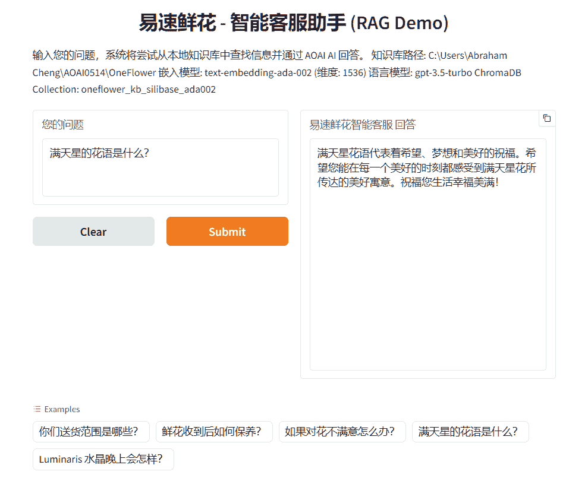

## 代码解析

1.  **导入与配置 （****import** & Configuration）:

+   导入所有必要的库，包括 openai， numpy， chromadb， dotenv， gradio， fitz （PyMuPDF）， docx。

+   通过 load_dotenv() 加载 .env 文件中的环境变量 （API Keys）。

+   定义清晰的常量，用于配置 API 地址、模型名称 （text-embedding-ada-002， gpt-4o-mini）、数据库路径 （./chroma_db_silibase）、集合名称 （oneflower_kb_silibase_bge_m3）、检索参数 （N_RESULTS_RETRIEVAL， DISTANCE_THRESHOLD）、数据目录和处理设置。。

1.  **全局变量与初始化 （****collection****， ****client_ds****， ****client_sf****， ****initialize_*****）:**

+   使用全局变量存储 ChromaDB collection 和两个 OpenAI 客户端实例。

+   initialize_clients()： 分别创建指向 AOAI 和 AOAI 的OpenAI 客户端实例，并进行必要的检查。

+   initialize_chromadb()： 初始化 ChromaDB PersistentClient，并尝试加载或创建 Collection，指定了持久化路径和距离度量 （cosine）。包含错误处理。

1.  **数据加载与分块 （****lo**ad_and_chunk_data）:

+   函数接收数据目录路径。

+   遍历目录，根据 SUPPORTED_FILE_EXTENSIONS 识别文件。

+   使用 fitz 处理 PDF，python-docx 处理 DOCX，标准文件 I/O 处理 TXT/MD。PDF 处理中加入了页码信息。

+   将提取的文本按 \n\n 分割。实现了一个简单的合并短段落的策略，可以替换为更高级的逻辑。

+   过滤掉长度小于 CHUNK_MIN_LENGTH 的块。

+   为每个有效块生成元数据（只包含相对路径的 source）和唯一 ID。

+   返回文本块列表、元数据列表和 ID 列表。包含详细的日志和错误处理。

1.  **嵌入函数 （****ge**t_embeddings_from_silibase）:

+   **关键改动：** 使用 client_sf 。

+   调用 client_sf.embeddings.create，传入模型名称 text-embedding-ada-002 和文本列表。

+   处理 API 返回结果，按原始索引顺序排列嵌入向量。

+   包含对 AuthenticationError， APIError 和其他异常的捕获，并在失败时返回 None 列表。

1.  **数据索引 （****in**dex_knowledge_base）:

+   接收文本块、元数据和 ID。

+   调用 get_embeddings_from_silibase 获取所有嵌入。

+   **严格检查：** 确认所有嵌入都成功获取并且维度正确 （EMBEDDING_DIMENSION），如果任何一个失败则中止索引。

+   使用 collection.add() 批量将数据添加到 ChromaDB。包含错误处理。

1.  **RAG 核心函数 （****get_rag_answer****）:**

+   执行 RAG 流程：获取查询 -> 嵌入查询 （**调用 get_emb****e**ddings_from_silibase） -> 检索 （ChromaDB query， 请求 distances） -> 相关性过滤 （基于 DISTANCE_THRESHOLD） -> 构建上下文 -> 构建 Prompt -> 调用 LLM （使用 client_ds.chat.completions.create 调用 AOAI） -> 返回答案。

+   **关键改动：** 明确加入了基于 distances 和 DISTANCE_THRESHOLD 的过滤逻辑。

+   Prompt 模板指导 LLM 如何使用上下文和处理无信息情况。

+   对 RAG 流程中的每个关键步骤（嵌入、检索、LLM 调用）都添加了错误处理和日志记录。

+   返回用户友好的错误信息或最终答案。

1.  **主程序入口 （****i**f name == "__main__":）

+   按顺序执行初始化（客户端、数据库）。

+   检查数据库是否为空，如果为空，则执行数据加载、分块和索引流程。增加了对索引失败的致命错误处理。

+   启动 Gradio 界面，将 get_rag_answer 作为处理函数。界面包含标题、描述、输入/输出框和示例问题。

## 后续优化建议

虽然当前版本已是一个功能完整的 RAG 演示，但可以从以下方面进行优化：

1.  分块策略 （Chunking）:

+   **当前按段落分割可能**导致块大小不一。尝试使用 RecursiveCharacterTextSplitter （来自 LangChain 等库）实现固定大小 + 重叠的分块，可以更好地保留上下文联系。

+   探索**语义分块**，根据文本内容的语义变化来切分，可能产生更相关的知识块。

1.  **异步处理与流式输出：**

+   将 get_embeddings_fr**om_s****ilibase 和 g****e**t_rag_answer 中的 API 调用（尤其是 AOAI LLM 调用）改为异步 （async/await） 模式。

+   修改 get_rag_answer 以支持 AOAI API 的**流式输出 （****stream=True****）**，并将结果逐步 yield 给 Gradio，极大提升用户界面的响应速度和体验。

1.  **检索优化：**

+   **相关性阈值调优：** DISTANCE_THRESHOLD 的值 （当前为 1.0） 需要根据实际数据和嵌入模型的效果进行实验调整，找到最佳平衡点。

+   **引入 Re-ranking:** 在从 ChromaDB 检索 Top-K 结果后，可以使用更精确但计算量更大的 Cross-Encoder 模型对这些结果进行重新排序，选择最终用于上下文的 N 个片段 （N <= K）。

+   混合搜索 （Hybrid Search）: 结合关键词搜索和向量搜索，处理那些既需要语义匹配又需要精确词语匹配的查询。

1.  **Prompt 工程：**

+   **来源引用：** 修改 Prompt，让 LLM 在回答时，能够根据提供的元数据（例如 source 文件名）指明信息来源。

+   **动态 Prompt:** 根据检索到的上下文数量或相关性得分，动态调整 Prompt 的措辞或结构。

1.  **错误处理与健壮性：**

+   为 API 调用增加**重试机制**（例如使用 tenacity 库），应对临时的网络波动或服务抖动。

+   在 Gradio 界面提供更具体的错误反馈，而不是简单的“发生错误”。

1.  **本地嵌入模型：**

+   如果硬件资源允许（特别是 GPU），可以考虑使用 sentence-transformers 库直接在本地运行 text-embedding-ada-002 或其他开源嵌入模型，去除对 AOAI API 的依赖，可能降低成本和延迟。

# 智能体 Agent 代码实现

项目演练 env 文件

```
# .env
OPENAI_API_KEY=&quot;sk-3zj3ISz53ZwLbyyVB6CfD3A48b7247F8A16fF1B8E9724717&quot;
OPENAI_BASE_URL=&quot;https://api.huaqloud.com/v1&quot;
OPENAI_MODEL_NAME=&quot;gpt-4o-mini&quot;
```

## 场景 1：实现差旅数据智能分析

Repo: https://github.com/cloudzun/ai-agent/tree/main/Labfiles/02-build-ai-agent/Python

requirements.txt

```
# requirements.txt
openai
python-dotenv
pandas
matplotlib
ipython
```

安装依赖

```
pip install -r requirements.txt
```

data.txt

```
Category,Cost
Accommodation, 674.56
Transportation, 2301.00
Meals, 267.89
Misc., 34.50
```

agent.py

```
# agent.py - 完整更新版

import os
import json
from openai import OpenAI
from dotenv import load_dotenv
from IPython import get_ipython
from IPython.terminal.interactiveshell import TerminalInteractiveShell

# --- 1. 配置和初始化 ---

# 加载 .env 文件中的环境变量
load_dotenv()

# 从环境变量中获取 API 配置
api_key = os.getenv(&quot;OPENAI_API_KEY&quot;)
base_url = os.getenv(&quot;OPENAI_BASE_URL&quot;)
model_name = os.getenv(&quot;OPENAI_MODEL_NAME&quot;)

# 检查配置是否存在，如果不存在则抛出错误
if not all([api_key, base_url, model_name]):
    raise ValueError(
        &quot;请确保 .env 文件中包含了 OPENAI_API_KEY, OPENAI_BASE_URL, 和 OPENAI_MODEL_NAME&quot;
    )

# 初始化 OpenAI 客户端
client = OpenAI(api_key=api_key, base_url=base_url)

# --- 2. 使用 IPython 作为代码执行器 (改进版) ---

def execute_python_code(code: str) -&gt; str:
    &quot;&quot;&quot;
    改进版代码执行器 - 处理换行符问题并提供更好的错误反馈
    
    Args:
        code: 要执行的 Python 代码字符串
        
    Returns:
        执行结果字符串
    &quot;&quot;&quot;
    if not code.strip():
        return &quot;错误：收到了空代码。&quot;
    
    # 获取或创建 IPython 实例
    ipython = get_ipython()
    if ipython is None:
        ipython = TerminalInteractiveShell.instance()
    
    # 修正换行符问题
    code = code.replace(&#x27;\\n&#x27;, &#x27;\n&#x27;).replace(&#x27;\\&quot;&#x27;, &#x27;&quot;&#x27;).replace(&quot;\\&#x27;&quot;, &quot;&#x27;&quot;)
    
    try:
        # 执行代码并获取结果
        result = ipython.run_cell(code)
        
        # 处理执行结果
        if result.success:
            output = &quot;&quot;
            if result.result is not None:
                output += str(result.result)
            if result.output.strip():
                if output: output += &quot;\n&quot;
                output += result.output
            
            return output if output else &quot;代码执行成功，但没有产生输出。&quot;
        else:
            error = str(result.error_in_exec) if result.error_in_exec else &quot;未知错误&quot;
            return f&quot;代码执行错误: {error}&quot;
    
    except Exception as e:
        return f&quot;执行时发生意外错误: {str(e)}&quot;

# --- 3. 为 OpenAI API 定义工具的 Schema ---

tools = [
    {
        &quot;type&quot;: &quot;function&quot;,
        &quot;function&quot;: {
            &quot;name&quot;: &quot;execute_python_code&quot;,
            &quot;description&quot;: &quot;执行一段 Python 代码来处理数据、进行计算或生成分析。此代码可以读取本地的 data.txt 文件进行分析，并可以使用 pandas, matplotlib 等库。代码执行结果会返回给你用于生成最终答案。&quot;,
            &quot;parameters&quot;: {
                &quot;type&quot;: &quot;object&quot;,
                &quot;properties&quot;: {
                    &quot;code&quot;: {
                        &quot;type&quot;: &quot;string&quot;,
                        &quot;description&quot;: &quot;要执行的 Python 代码字符串。&quot;,
                    },
                },
                &quot;required&quot;: [&quot;code&quot;],
            },
        },
    }
]

# --- 4. 设置代理的行为和上下文 (改进版 RAG) ---

def load_data():
    &quot;&quot;&quot;改进的数据加载函数，包含示例数据&quot;&quot;&quot;
    from io import StringIO
    import pandas as pd
    
    sample_data = &quot;&quot;&quot;Category,Cost
Transportation,2301.00
Accommodation,674.56
Meals,267.89
Misc.,34.50&quot;&quot;&quot;
    
    try:
        with open(&#x27;data.txt&#x27;, &#x27;r&#x27;) as f:
            content = f.read()
            
        # 尝试解析数据
        try:
            if content.strip().startswith(&#x27;{&#x27;):
                # 假设是JSON格式
                data = pd.DataFrame.from_dict(json.loads(content), orient=&#x27;index&#x27;).reset_index()
                data.columns = [&#x27;Category&#x27;, &#x27;Cost&#x27;]
            else:
                # 假设是CSV格式
                data = pd.read_csv(StringIO(content))
        except:
            # 如果解析失败，使用示例数据
            data = pd.read_csv(StringIO(sample_data))
            
        return data.to_string(), sample_data
    except FileNotFoundError:
        return &quot;数据文件 &#x27;data.txt&#x27; 未找到。&quot;, sample_data

data_content, sample_data = load_data()

system_prompt = f&quot;&quot;&quot;
你是一个高效的AI数据分析助手。你的任务是根据用户的请求，通过执行Python代码来分析数据并直接回答问题。
使用你拥有的 &#x27;execute_python_code&#x27; 工具来分析数据。代码执行结果会直接返回给你。

数据说明:
1. 主要数据文件是 data.txt (CSV或JSON格式)
2. 如果文件不存在或格式错误，将使用示例数据

当前数据内容:
---
{data_content if isinstance(data_content, str) else data_content.to_string()}
---

示例数据(备用):
---
{sample_data}
---

请遵循以下规则:
1. 生成图表时优先使用文本格式
2. 数值显示应包含千位分隔符和货币符号(如 $2,301.00)
3. 如果请求无法完成，提供数据摘要而非直接报错
&quot;&quot;&quot;

# --- 5. 主交互循环 (改进版) ---

def main():
    print(&quot;AI 数据分析代理已启动。输入 &#x27;exit&#x27; 来退出程序。&quot;)
    print(&quot;-&quot; * 30)
    messages = [{&quot;role&quot;: &quot;system&quot;, &quot;content&quot;: system_prompt}]

    while True:
        try:
            user_input = input(&quot;你: &quot;).strip()
        except EOFError:
            break
            
        if user_input.lower() == &#x27;exit&#x27;:
            print(&quot;正在退出代理...&quot;)
            break
        if not user_input:
            continue

        messages.append({&quot;role&quot;: &quot;user&quot;, &quot;content&quot;: user_input})

        try:
            response = client.chat.completions.create(
                model=model_name,
                messages=messages,
                tools=tools,
                tool_choice=&quot;auto&quot;,
            )
            response_message = response.choices[0].message

            if response_message.tool_calls:
                messages.append(response_message)
                for tool_call in response_message.tool_calls:
                    if tool_call.function.name == &quot;execute_python_code&quot;:
                        function_args = json.loads(tool_call.function.arguments)
                        code_to_run = function_args.get(&quot;code&quot;, &quot;&quot;)
                        
                        print(f&quot;\n[正在执行代码]:\n---\n{code_to_run}\n---&quot;)
                        tool_output = execute_python_code(code_to_run)
                        print(f&quot;[代码执行结果]:\n{tool_output}\n&quot;)

                        messages.append({
                            &quot;tool_call_id&quot;: tool_call.id,
                            &quot;role&quot;: &quot;tool&quot;,
                            &quot;name&quot;: &quot;execute_python_code&quot;,
                            &quot;content&quot;: tool_output,
                        })
                
                # 获取最终响应
                final_response = client.chat.completions.create(
                    model=model_name,
                    messages=messages
                )
                final_answer = final_response.choices[0].message.content
                print(f&quot;AI 助手: {final_answer}&quot;)
                messages.append({&quot;role&quot;: &quot;assistant&quot;, &quot;content&quot;: final_answer})
            else:
                answer = response_message.content
                print(f&quot;AI 助手: {answer}&quot;)
                messages.append({&quot;role&quot;: &quot;assistant&quot;, &quot;content&quot;: answer})
                
        except Exception as e:
            error_msg = f&quot;系统错误: {str(e)}&quot;
            print(f&quot;AI 助手: {error_msg}&quot;)
            messages.append({&quot;role&quot;: &quot;assistant&quot;, &quot;content&quot;: error_msg})

if __name__ == &quot;__main__&quot;:
    main()
```

> 以下是 agent.py 的模块化解析和整体工作流程说明：

> **核心模块功能**

> 1. **配置初始化模块**

> **作用**：加载环境变量和 API 配置

> **关键能力**：

从 .env 文件读取 OpenAI API 密钥和模型配置

自动验证配置完整性，缺失时报错终止

> 2. **代码执行引擎**

> **核心**：基于 IPython 的增强版执行器

> **创新点**：

自动修复换行符/引号转义问题（如 \\n → \n）

同时捕获代码返回值（result）和打印输出（output）

错误分级反馈（语法错误、执行错误、未知错误）

> 3. **工具系统**

+   **注册工具**：仅一个但高度灵活的 execute_python_code 工具

+   **设计特点**：

+   支持动态代码生成（如自动导入pandas）

+   描述中提示可访问 data.txt 和常用数据分析库

> 4. **数据预处理层**

+   **智能加载**：

+   自动识别 JSON/CSV 格式

+   文件异常时切换内置示例数据

+   数据双重缓存（原始文本 + Pandas DataFrame）

> 5. **对话管理系统**

+   **上下文维护**：

+   记忆完整的对话历史（包括代码执行结果）

+   自动处理消息角色（user/assistant/tool）

+   **错误隔离**：主循环 try-catch 防止单次崩溃影响整体

> **二、Agent 工作流程**

> **1. 启动阶段**

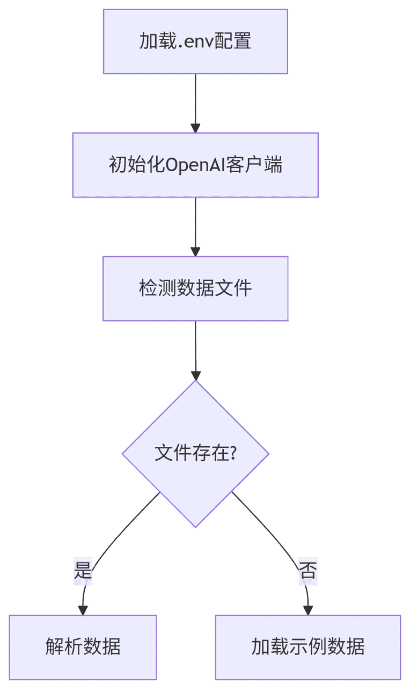

>

```
graph TD
    A[加载.env配置] --&gt; B[初始化OpenAI客户端]
    B --&gt; C[检测数据文件]
    C --&gt; D{文件存在?}
    D --&gt;|是| E[解析数据]
    D --&gt;|否| F[加载示例数据]
```

> **2. 交互阶段（每次用户提问）**

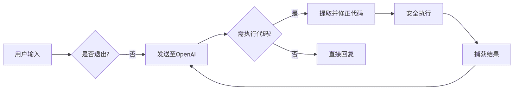

>

```
graph LR
    A[用户输入] --&gt; B{是否退出?}
    B --&gt;|否| C[发送至OpenAI]
    C --&gt; D{需执行代码?}
    D --&gt;|是| E[提取并修正代码]
    E --&gt; F[安全执行]
    F --&gt; G[捕获结果]
    G --&gt; C
    D --&gt;|否| H[直接回复]
```

>

> **3. 代码执行专项流程**

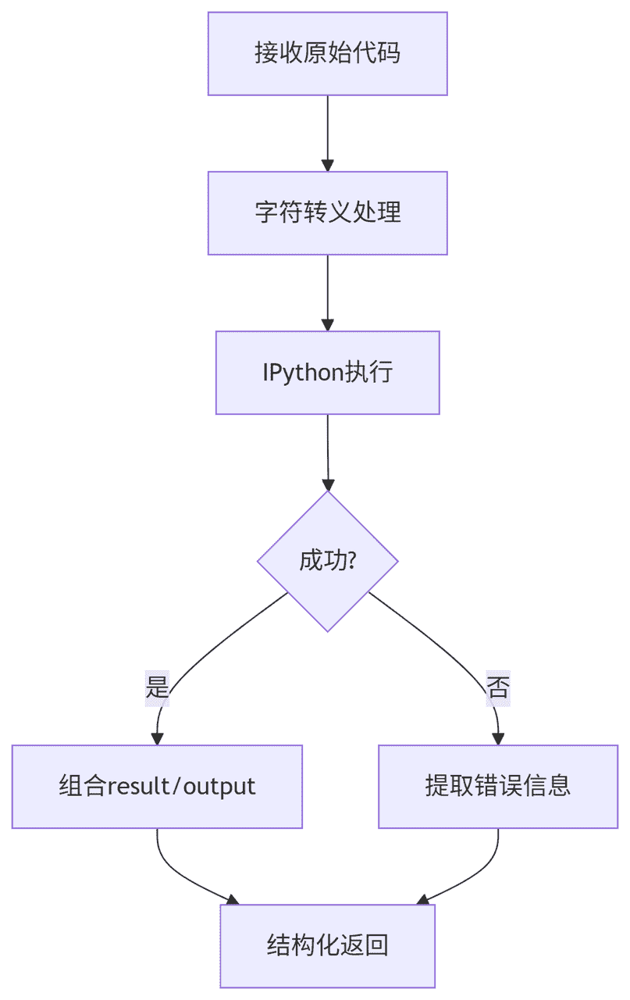

>

```
graph TB
    A[接收原始代码] --&gt; B[字符转义处理]
    B --&gt; C[IPython执行]
    C --&gt; D{成功?}
    D --&gt;|是| E[组合result/output]
    D --&gt;|否| F[提取错误信息]
    E &amp; F --&gt; G[结构化返回]
```

>

> **三、关键设计思想**

1.  **防御式编程**

+   所有外部依赖（文件/API/用户输入）都有错误处理

+   示例数据保障最低可用性

1.  **透明化执行**

+   打印实际执行的代码和原始结果

+   用户可看到 AI 的"思考过程"

1.  **会话式分析**

+   将传统数据分析流程转化为对话步骤：

```
用户提问 → 生成代码 → 执行 → 解释结果 → 反馈
```

1.  **轻量级扩展**

+   通过修改 tools 列表即可新增功能

+   系统提示（system_prompt）控制 AI 行为风格

> **四、典型使用场景**

1.  **快速数据洞察**

+   用户问："哪个类别花费最高？"

+   Agent 自动生成并执行：

```
data.loc[data[&#x27;Cost&#x27;].idxmax()]
```

1.  **文本可视化**

+   用户问："用文本条形图显示费用分布"

+   Agent 输出：

```
交通费用 | █████████████ $2301
住宿费用 | ████ $674
```

1.  **异常检测**

+   当数据文件损坏时自动切换示例数据并警告用户

## 场景 2：使用自定义函数

repo：https://github.com/cloudzun/ai-agent/tree/main/Labfiles/03-ai-agent-functions/Python

requirement.txt

```
openai
python-dotenv
```

安装依赖

```
pip install -r requirements.txt
```

main.py

```
# --- 1. 导入所有必要的库 ---
import os
import json
import random
import string
from dotenv import load_dotenv
from openai import OpenAI
from openai.types.chat import ChatCompletionMessage

# --- 2. 加载环境变量并配置客户端 ---
# 确保您的 .env 文件与此脚本位于同一目录
load_dotenv()

client = OpenAI(
    api_key=os.getenv(&quot;OPENAI_API_KEY&quot;),
    base_url=os.getenv(&quot;OPENAI_BASE_URL&quot;)
)
model_name = os.getenv(&quot;OPENAI_MODEL_NAME&quot;)

# --- 3. 定义可供 AI 调用的本地“工具”函数 ---
def create_support_ticket(email: str, description: str) -&gt; str:
    &quot;&quot;&quot;
    根据用户提供的电子邮件和问题描述创建支持工单。
    &quot;&quot;&quot;
    ticket_id = &#x27;&#x27;.join(random.choices(string.hexdigits.lower(), k=6))
    filename = f&quot;ticket-{ticket_id}.txt&quot;

    print(f&quot;--- [函数调用]: 正在创建工单 {ticket_id}... ---&quot;)

    try:
        with open(filename, &quot;w&quot;) as f:
            f.write(f&quot;Support ticket: {ticket_id}\n&quot;)
            f.write(f&quot;Submitted by: {email}\n&quot;)
            f.write(&quot;Description:\n&quot;)
            f.write(description)
        
        return f&quot;您的支持票已成功提交！您的票证 ID 是 **{ticket_id}**，相关细节已保存在文件 **{filename}** 中。我们的团队将会尽快与您联系。&quot;

    except IOError as e:
        print(f&quot;--- [错误]: 无法写入文件 {filename}: {e} ---&quot;)
        return &quot;创建支持工单文件时发生错误。&quot;

# --- 4. 配置 AI ---

# 4.1. 工具描述
tools = [
    {
        &quot;type&quot;: &quot;function&quot;,
        &quot;function&quot;: {
            &quot;name&quot;: &quot;create_support_ticket&quot;,
            &quot;description&quot;: &quot;Creates a support ticket with the user&#x27;s email and a description of their problem.&quot;,
            &quot;parameters&quot;: {
                &quot;type&quot;: &quot;object&quot;,
                &quot;properties&quot;: {
                    &quot;email&quot;: {&quot;type&quot;: &quot;string&quot;, &quot;description&quot;: &quot;The user&#x27;s email address.&quot;},
                    &quot;description&quot;: {&quot;type&quot;: &quot;string&quot;, &quot;description&quot;: &quot;A detailed description of the technical problem.&quot;}
                },
                &quot;required&quot;: [&quot;email&quot;, &quot;description&quot;]
            }
        }
    }
]

# 4.2. 函数映射
available_functions = {
    &quot;create_support_ticket&quot;: create_support_ticket
}

# 4.3. 系统指令
system_prompt = &quot;&quot;&quot;
You are a helpful support agent. Your primary goal is to create a support ticket for the user 
by calling the `create_support_ticket` function.

Follow these rules strictly:
1.  Do NOT call the function until you have collected BOTH the user&#x27;s email address AND a description of their problem.
2.  If you don&#x27;t have the user&#x27;s email, ask for it first.
3.  Once you have the email, and only then, ask for the problem description.
4.  Once you have both pieces of information, call the `create_support_ticket` function with the collected details.
&quot;&quot;&quot;

# --- 5. 主交互循环 ---
def main():
    &quot;&quot;&quot;主函数，运行 AI 代理交互循环。&quot;&quot;&quot;
    print(&quot;Support Agent is running...&quot;)
    messages = [{&quot;role&quot;: &quot;system&quot;, &quot;content&quot;: system_prompt}]

    while True:
        user_input = input(&quot;Enter a prompt (or type &#x27;quit&#x27; to exit): &quot;)
        if user_input.lower() == &#x27;quit&#x27;:
            print(&quot;\nQuitting agent...&quot;)
            print(&quot;\n--- Conversation Log ---&quot;)
            
            # --- START OF FIX ---
            # 修正了日志打印逻辑，以处理混合类型列表（字典和对象）
            for msg in messages:
                # 从字典或对象中安全地获取角色和内容
                role = msg.get(&#x27;role&#x27;) if isinstance(msg, dict) else msg.role
                
                # 跳过系统指令和工具返回信息，使日志更干净
                if role in [&#x27;system&#x27;, &#x27;tool&#x27;]:
                    continue

                # 根据角色确定发言人
                speaker = &quot;USER&quot; if role == &#x27;user&#x27; else &quot;AGENT&quot;

                # 从字典或对象中安全地获取内容或工具调用信息
                content = &quot;&quot;
                if isinstance(msg, dict):
                    content = msg.get(&#x27;content&#x27;)
                    # 手动创建的消息不会有tool_calls
                else: # 是 ChatCompletionMessage 对象
                    content = msg.content
                    if msg.tool_calls:
                        function_name = msg.tool_calls[0].function.name
                        content = f&quot;[Agent decided to call function: {function_name}]&quot;
                
                print(f&quot;MessageRole.{speaker}: {content}&quot;)
            # --- END OF FIX ---
            break

        messages.append({&quot;role&quot;: &quot;user&quot;, &quot;content&quot;: user_input})

        try:
            response = client.chat.completions.create(
                model=model_name,
                messages=messages,
                tools=tools,
                tool_choice=&quot;auto&quot;
            )
            response_message = response.choices[0].message
            messages.append(response_message)

            if response_message.tool_calls:
                for tool_call in response_message.tool_calls:
                    function_name = tool_call.function.name
                    function_to_call = available_functions[function_name]
                    function_args = json.loads(tool_call.function.arguments)
                    
                    function_response = function_to_call(**function_args)
                    
                    messages.append(
                        {
                            &quot;tool_call_id&quot;: tool_call.id,
                            &quot;role&quot;: &quot;tool&quot;,
                            &quot;name&quot;: function_name,
                            &quot;content&quot;: function_response,
                        }
                    )

                second_response = client.chat.completions.create(model=model_name, messages=messages)
                final_message = second_response.choices[0].message
                print(f&quot;Last Message: {final_message.content}&quot;)
                messages.append(final_message)
            else:
                print(f&quot;Last Message: {response_message.content}&quot;)

        except Exception as e:
            print(f&quot;An error occurred: {e}&quot;)
            break

# --- 6. 运行程序 ---
if __name__ == &quot;__main__&quot;:
    main()
```

> 这段代码实现了一个基于 OpenAI API 的支持代理系统，能够与用户交互并创建技术支持工单。以下是主要模块和它们之间的逻辑关系：

> **模块结构**

1.  **环境配置模块**：

+   使用dotenv加载环境变量（API 密钥、基础 URL 和模型名称）

+   初始化 OpenAI 客户端

1.  **工具函数模块**：

+   定义了一个本地函数create_support_ticket，用于创建支持工单文件

+   该函数会被 AI 代理在适当的时候调用

1.  **AI 配置模块**：

+   定义了工具描述（JSON 格式），告诉 AI 可用的函数及其参数

+   创建了函数映射字典，将函数名与实际函数关联

+   设置了系统指令，严格规定了 AI 的行为流程

1.  **主交互循环**：

+   处理用户输入和 AI 响应

+   管理对话历史（messages 列表）

+   处理函数调用和结果

>

> **Agent 与工具的工作流程**

1.  **Agent 角色**：

+   扮演一个技术支持代理

+   遵循严格的规则收集用户信息（先邮箱后问题描述）

+   在收集完必要信息后自动调用工具函数

1.  **工具集成**：

+   create_support_ticket是 AI 可以调用的唯一工具

+   工具描述清晰地定义了函数用途、参数和必需字段

+   工具调用是自动触发的，当 AI 判断条件满足时

1.  **交互逻辑**：

```
用户输入 → AI处理 → 
(若需要更多信息) → 继续询问 → 
(若信息完整) → 调用工具 → 
返回工具结果 → 回复用户
```

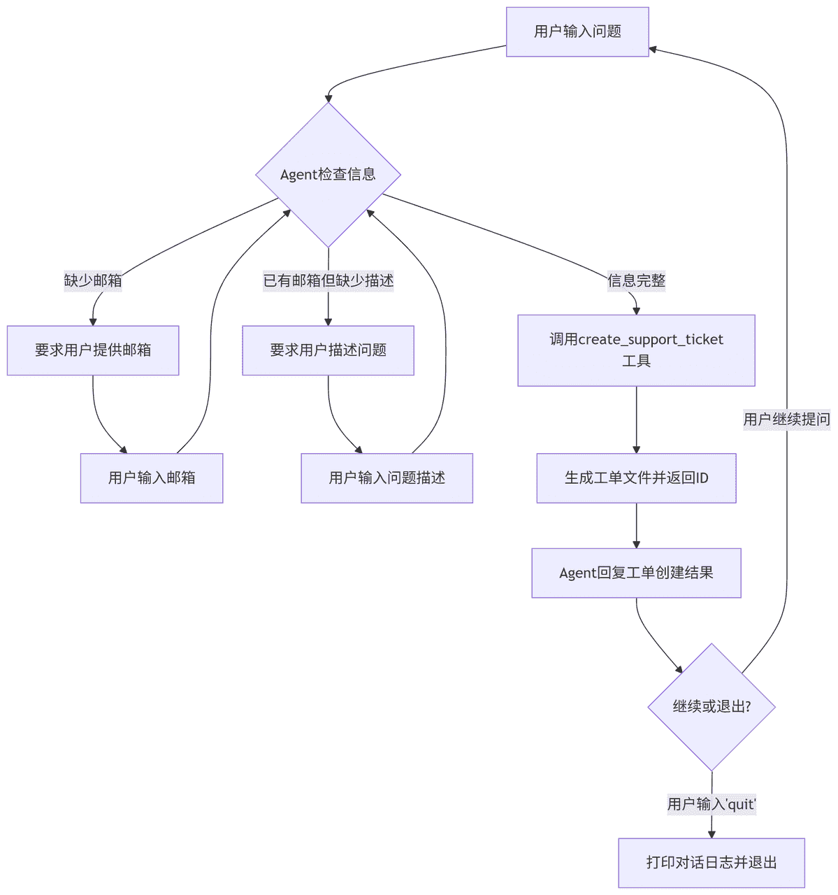

> **关键特点**

+   **严格的信息收集顺序**：系统强制先收集邮箱，再收集问题描述

+   **自动函数调用**：当条件满足时，AI 会自动调用工具函数

+   **对话历史管理**：所有交互都被记录在 messages 列表中，用于上下文

+   **错误处理**：工具函数中有基本的错误处理机制

> 这个架构展示了如何将本地功能（创建工单文件）通过工具调用方式集成到 AI 代理中，创建了一个实用的技术支持对话系统。

## 场景 3：编排多代理

repo：https://github.com/cloudzun/ai-agent/tree/main/Labfiles/06-build-multi-agent-solution/Python

requirement.txt

```
python-dotenv
```

安装依赖

```
pip install -r requirements.txt
```

agent_triage.py

```
import os
from openai import OpenAI
from dotenv import load_dotenv

# --- 1. 配置和初始化 (与之前相同) ---
load_dotenv()
api_key = os.getenv(&quot;OPENAI_API_KEY&quot;)
base_url = os.getenv(&quot;OPENAI_BASE_URL&quot;)
model_name = os.getenv(&quot;OPENAI_MODEL_NAME&quot;)

if not all([api_key, base_url, model_name]):
    print(&quot;错误：请确保 .env 文件中已配置 OPENAI_API_KEY, OPENAI_BASE_URL, 和 OPENAI_MODEL_NAME。&quot;)
    exit()

try:
    client = OpenAI(
        api_key=api_key,
        base_url=base_url,
    )
except Exception as e:
    print(f&quot;错误：无法初始化 OpenAI 客户端 - {e}&quot;)
    exit()

# --- 2. 定义 &quot;代理&quot; 函数 (与之前相同，无需改动) ---

def get_priority_assessment(ticket_description: str) -&gt; str:
    system_prompt = &quot;&quot;&quot;
    你是一位经验丰富的 IT 支持团队经理。你的任务是评估用户提交的技术支持工单的优先级。
    请从以下选项中选择一个优先级：Low, Medium, High。
    你的回答格式必须是：[优先级] — [简短的理由说明]。
    &quot;&quot;&quot;
    try:
        response = client.chat.completions.create(
            model=model_name,
            messages=[
                {&quot;role&quot;: &quot;system&quot;, &quot;content&quot;: system_prompt},
                {&quot;role&quot;: &quot;user&quot;, &quot;content&quot;: ticket_description}
            ],
            temperature=0.2,
        )
        return response.choices[0].message.content.strip()
    except Exception as e:
        return f&quot;获取优先级评估时出错: {e}&quot;

def get_team_assignment(ticket_description: str) -&gt; str:
    system_prompt = &quot;&quot;&quot;
    你是一位 IT 支持工单分派专家。你的任务是根据工单描述，将其分配给最合适的团队。
    可选团队包括：Frontend, Backend, Mobile App, Infrastructure, DevOps。
    你的回答格式必须是：[团队名称] — [简短的理由说明]。
    &quot;&quot;&quot;
    try:
        response = client.chat.completions.create(
            model=model_name,
            messages=[
                {&quot;role&quot;: &quot;system&quot;, &quot;content&quot;: system_prompt},
                {&quot;role&quot;: &quot;user&quot;, &quot;content&quot;: ticket_description}
            ],
            temperature=0.2,
        )
        return response.choices[0].message.content.strip()
    except Exception as e:
        return f&quot;获取团队分配时出错: {e}&quot;

def get_effort_estimation(ticket_description: str) -&gt; str:
    system_prompt = &quot;&quot;&quot;
    你是一位资深的软件开发经理。你的任务是评估解决一个技术工单所需的工作量。
    请从以下选项中选择一个工作量级别：Low, Medium, High。
    你的回答格式必须是：[工作量级别] — [简短的解释，并预估所需时间]。
    &quot;&quot;&quot;
    try:
        response = client.chat.completions.create(
            model=model_name,
            messages=[
                {&quot;role&quot;: &quot;system&quot;, &quot;content&quot;: system_prompt},
                {&quot;role&quot;: &quot;user&quot;, &quot;content&quot;: ticket_description}
            ],
            temperature=0.3,
        )
        return response.choices[0].message.content.strip()
    except Exception as e:
        return f&quot;获取工作量评估时出错: {e}&quot;

# --- 3. 主程序：改为交互式输入 ---
if __name__ == &quot;__main__&quot;:
    
    print(&quot;欢迎使用 AI 工单评估系统 (输入 &#x27;exit&#x27; 或 &#x27;quit&#x27; 退出)&quot;)
    
    # 使用一个循环来持续接收用户输入
    while True:
        # 从用户那里获取输入
        user_ticket = input(&quot;\n请输入您遇到的问题: &quot;)

        # 检查用户是否想退出
        if user_ticket.lower() in [&#x27;exit&#x27;, &#x27;quit&#x27;]:
            print(&quot;程序已退出。&quot;)
            break

        # 检查输入是否为空
        if not user_ticket:
            print(&quot;输入不能为空，请重新输入。&quot;)
            continue

        print(&quot;\n正在处理，请稍候...&quot;)
        print(&quot;开始处理代理线程...\n&quot;)

        # 依次调用各个代理函数
        priority = get_priority_assessment(user_ticket)
        team = get_team_assignment(user_ticket)
        effort = get_effort_estimation(user_ticket)

        # 打印用户输入
        print(&quot;MessageRole.USER:&quot;)
        print(f&quot;{user_ticket}\n&quot;)

        # 格式化并打印代理的最终评估报告
        print(&quot;MessageRole.AGENT:&quot;)
        print(&quot;### Ticket Assessment\n&quot;)
        print(f&quot;- **Priority:** {priority}&quot;)
        print(f&quot;- **Assigned Team:** {team}&quot;)
        print(f&quot;- **Effort Required:** {effort}\n&quot;)

        print(&quot;清理代理：任务完成。&quot;)
```

> 以下是这段代码的架构分析和交互流程解释，重点说明四个"Agent"（功能模块）之间的关系：

> **1 系统架构概览**

> 该系统是一个**工单评估流水线**，包含三个独立但协同工作的功能模块（可视为"Agent"）：

1.  **优先级评估 Agent** （get_priority_assessment）

1.  **团队分配 Agent** （get_team_assignment）

1.  **工作量评估 Agent** （get_effort_estimation）

1.  **主控 Agent**（主程序逻辑，负责协调）

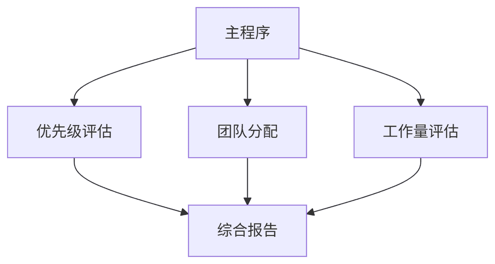

>

```
flowchart TD
    A[主程序] --&gt; B[优先级评估]
    A --&gt; C[团队分配]
    A --&gt; D[工作量评估]
    B &amp; C &amp; D --&gt; E[综合报告]
```

> **各 Agent 职责分析**

| Agent 类型 | 功能说明 | 输出示例 |
| --- | --- | --- |
| **优先级评估** | 判断问题的紧急程度（Low/Medium/High） | [High] — 严重安全问题需立即处理 |
| **团队分配** | 确定负责团队（Frontend/Backend 等） | [Infrastructure] — 涉及邮件服务器维护 |
| **工作量评估** | 预估解决所需资源和时间 | [High] — 需1-2周全面修复 |
| **主控协调** | 接收用户输入→触发各 Agent→汇总结果 | 生成最终评估报告 |

> ** 交互流程详解**

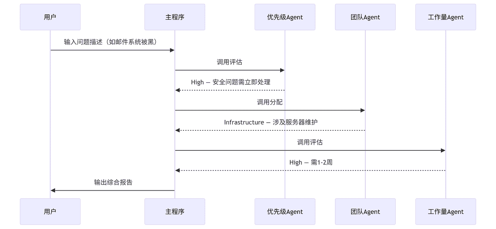

>

```
sequenceDiagram
    participant 用户
    participant 主程序
    participant 优先级Agent
    participant 团队Agent
    participant 工作量Agent
    
    用户-&gt;&gt;主程序: 输入问题描述（如邮件系统被黑）
    主程序-&gt;&gt;优先级Agent: 调用评估
    优先级Agent--&gt;&gt;主程序: High — 安全问题需立即处理
    主程序-&gt;&gt;团队Agent: 调用分配
    团队Agent--&gt;&gt;主程序: Infrastructure — 涉及服务器维护
    主程序-&gt;&gt;工作量Agent: 调用评估
    工作量Agent--&gt;&gt;主程序: High — 需1-2周
    主程序-&gt;&gt;用户: 输出综合报告
```

1.  **线性触发机制**：

+   主程序**顺序调用**三个 Agent，彼此**无直接交互**

+   所有 Agent 接收**相同的原始问题描述**，各自独立分析

1.  **标准化接口**：

+   所有 Agent 采用相同的输入输出格式（字符串输入，[分类] — [理由]输出）

+   通过统一的错误处理机制（try-catch 返回错误信息）

1.  **决策独立性**：

+   优先级 Agent 专注业务影响

+   团队 Agent 侧重技术领域匹配

+   工作量 Agent 考虑实施成本

> **关键设计特点**

1.  **模块化设计**：

+   每个 Agent 可单独修改/替换而不影响其他组件

+   例如新增一个风险等级评估Agent只需添加函数即可

1.  **无状态性**：

+   所有 Agent 不保留上下文，纯函数式处理

+   相同输入永远得到相同输出（因 temperature≤0.3）

1.  **人机协作**：

+   最终报告保留 AI 的原始推理过程（— [理由]部分）

+   人类可快速理解 AI 的决策依据

> **扩展性建议**

> 若要增强该系统，可以考虑：

1.  添加**Agent 间校验**（如当优先级=High 但工作量=Low 时触发警告）

1.  引入**工单历史分析**（让 Agent 能参考过往类似工单）

1.  实现**异步并行处理**（用多线程同时调用三个 Agent）

> 这个设计完美体现了"单一职责原则"，每个 Agent 就像工厂流水线上的专业工人，共同完成工单评估的完整流程。

## 场景 4：使用模型上下文协议（MCP）将 AI 代理连接到工具

repo：https://github.com/cloudzun/ai-agent/tree/main/Labfiles/07-use-agent-tools-with-mcp/Python

requirement.txt

```
# requirements.txt
fastapi
uvicorn[standard]
openai
python-dotenv
requests
```

安装依赖

```
pip install -r requirements.txt
```

agent_with_mcp.py

```
# agent_with_mcp.py (Corrected Version)

import os
import json
import requests
import threading
import uvicorn
import time
from fastapi import FastAPI
from pydantic import BaseModel
from openai import OpenAI
from dotenv import load_dotenv

# --- 0. 全局配置和初始化 ---
load_dotenv()

client = OpenAI(
    api_key=os.getenv(&quot;OPENAI_API_KEY&quot;),
    base_url=os.getenv(&quot;OPENAI_BASE_URL&quot;),
)
MODEL_NAME = os.getenv(&quot;OPENAI_MODEL_NAME&quot;, &quot;gpt-4o-mini&quot;)
MCP_SERVER_HOST = &quot;127.0.0.1&quot;
MCP_SERVER_PORT = 8000
MCP_SERVER_URL = f&quot;http://{MCP_SERVER_HOST}:{MCP_SERVER_PORT}&quot;

# ==============================================================================
# --- 1. MCP 服务器逻辑 (已修正) ---
# ==============================================================================

app = FastAPI(title=&quot;In-Process MCP Tool Server&quot;)

# --- 工具函数 (修正：移除了无效的 @app.tool 装饰器) ---
def get_inventory_levels() -&gt; dict:
    &quot;&quot;&quot;Returns current inventory for all products.&quot;&quot;&quot;
    return {
        &quot;Moisturizer&quot;: 6, &quot;Shampoo&quot;: 8, &quot;Body Spray&quot;: 28, &quot;Hair Gel&quot;: 5,
        &quot;Lip Balm&quot;: 12, &quot;Skin Serum&quot;: 9, &quot;Cleanser&quot;: 30, &quot;Conditioner&quot;: 3,
        &quot;Setting Powder&quot;: 17, &quot;Dry Shampoo&quot;: 45
    }

# --- 工具函数 (修正：移除了无效的 @app.tool 装饰器) ---
def get_weekly_sales() -&gt; dict:
    &quot;&quot;&quot;Returns number of units sold last week.&quot;&quot;&quot;
    return {
        &quot;Moisturizer&quot;: 22, &quot;Shampoo&quot;: 18, &quot;Body Spray&quot;: 3, &quot;Hair Gel&quot;: 2,
        &quot;Lip Balm&quot;: 14, &quot;Skin Serum&quot;: 19, &quot;Cleanser&quot;: 4, &quot;Conditioner&quot;: 1,
        &quot;Setting Powder&quot;: 13, &quot;Dry Shampoo&quot;: 17
    }

# --- 工具注册表 (现在是唯一链接工具实现和schema的地方) ---
tools_registry = {
    &quot;get_inventory_levels&quot;: {
        &quot;function&quot;: get_inventory_levels,
        &quot;schema&quot;: {
            &quot;type&quot;: &quot;function&quot;,
            &quot;function&quot;: {
                &quot;name&quot;: &quot;get_inventory_levels&quot;,
                &quot;description&quot;: &quot;获取所有产品的当前库存水平。&quot;,
                &quot;parameters&quot;: {&quot;type&quot;: &quot;object&quot;, &quot;properties&quot;: {}},
            },
        },
    },
    &quot;get_weekly_sales&quot;: {
        &quot;function&quot;: get_weekly_sales,
        &quot;schema&quot;: {
            &quot;type&quot;: &quot;function&quot;,
            &quot;function&quot;: {
                &quot;name&quot;: &quot;get_weekly_sales&quot;,
                &quot;description&quot;: &quot;获取所有产品上周的销售数量。&quot;,
                &quot;parameters&quot;: {&quot;type&quot;: &quot;object&quot;, &quot;properties&quot;: {}},
            },
        },
    },
}

# MCP 端点 (无变化)
@app.get(&quot;/&quot;, summary=&quot;Tool Discovery Endpoint&quot;)
def discover_tools_endpoint():
    return [details[&quot;schema&quot;] for details in tools_registry.values()]

class ToolExecutionRequest(BaseModel):
    args: dict

@app.post(&quot;/tools/{tool_name}&quot;, summary=&quot;Tool Execution Endpoint&quot;)
def execute_tool_endpoint(tool_name: str, request: ToolExecutionRequest):
    if tool_name in tools_registry:
        result = tools_registry[tool_name][&quot;function&quot;](**request.args)
        return {&quot;result&quot;: result}
    return {&quot;error&quot;: &quot;Tool not found&quot;}, 404

def run_mcp_server():
    uvicorn.run(app, host=MCP_SERVER_HOST, port=MCP_SERVER_PORT, log_level=&quot;warning&quot;)

# ==============================================================================
# --- 2. 客户端逻辑 (无变化) ---
# ==============================================================================

SYSTEM_PROMPT = &quot;&quot;&quot;
You are an expert inventory management AI assistant.
Your goal is to provide recommendations based on data from your available tools.

Here are the rules you must follow for your analysis:
1.  **Restocking Rule**: A product needs to be restocked if its current inventory is LESS than its weekly sales.
2.  **Clearance Rule**: A product is a candidate for clearance if its current inventory is GREATER than 20 AND its weekly sales are LESS than 5.
3.  **Best Sellers Rule**: The best sellers are the products with the highest weekly sales. List the top 3.

When asked a question, first determine which tools you need to call to get the necessary data.
Then, analyze the data from the tools according to the rules above and provide a clear, concise answer.
If asked for a general inventory list, call the appropriate tool and present the data clearly.
&quot;&quot;&quot;

def discover_tools_from_mcp(server_url: str):
    print(f&quot;Connecting to MCP server at {server_url} to discover tools...&quot;)
    try:
        response = requests.get(server_url)
        response.raise_for_status()
        discovered_tools = response.json()
        print(f&quot;Success! Discovered {len(discovered_tools)} tools: {[t[&#x27;function&#x27;][&#x27;name&#x27;] for t in discovered_tools]}&quot;)
        return discovered_tools
    except requests.exceptions.RequestException as e:
        print(f&quot;Error: Could not connect to MCP server. {e}&quot;)
        return None

def execute_mcp_tool(server_url: str, tool_name: str, tool_args: dict):
    print(f&quot;--&gt; Requesting MCP server to execute tool: {tool_name}&quot;)
    url = f&quot;{server_url}/tools/{tool_name}&quot;
    response = requests.post(url, json={&quot;args&quot;: tool_args})
    response.raise_for_status()
    return response.json().get(&quot;result&quot;)

def run_client_conversation():
    openai_tools = discover_tools_from_mcp(MCP_SERVER_URL)
    if not openai_tools:
        print(&quot;Exiting due to failure in tool discovery.&quot;)
        return

    print(&quot;\nAgent is ready. Ask about inventory, restocks, clearance, or best sellers.&quot;)
    print(&#x27;Type &quot;quit&quot; to exit.&#x27;)
    
    messages = [{&quot;role&quot;: &quot;system&quot;, &quot;content&quot;: SYSTEM_PROMPT}]

    while True:
        user_input = input(&quot;User &gt; &quot;)
        if user_input.lower() == &quot;quit&quot;:
            print(&quot;Exiting...&quot;)
            break
        
        messages.append({&quot;role&quot;: &quot;user&quot;, &quot;content&quot;: user_input})

        response = client.chat.completions.create(
            model=MODEL_NAME, messages=messages, tools=openai_tools, tool_choice=&quot;auto&quot;
        )
        response_message = response.choices[0].message

        if response_message.tool_calls:
            messages.append(response_message)
            tool_outputs = []
            for tool_call in response_message.tool_calls:
                function_name = tool_call.function.name
                function_args = json.loads(tool_call.function.arguments)
                function_response = execute_mcp_tool(MCP_SERVER_URL, function_name, function_args)
                tool_outputs.append({
                    &quot;tool_call_id&quot;: tool_call.id,
                    &quot;role&quot;: &quot;tool&quot;,
                    &quot;name&quot;: function_name,
                    &quot;content&quot;: json.dumps(function_response),
                })
            
            messages.extend(tool_outputs)
            
            second_response = client.chat.completions.create(model=MODEL_NAME, messages=messages)
            final_answer = second_response.choices[0].message.content
        else:
            final_answer = response_message.content

        print(f&quot;Agent &gt; {final_answer}&quot;)
        messages.append({&quot;role&quot;: &quot;assistant&quot;, &quot;content&quot;: final_answer})

# ==============================================================================
# --- 3. 主程序入口 (无变化) ---
# ==============================================================================

if __name__ == &quot;__main__&quot;:
    server_thread = threading.Thread(target=run_mcp_server, daemon=True)
    server_thread.start()
    
    print(&quot;MCP server starting in the background...&quot;)
    time.sleep(2)
    
    try:
        run_client_conversation()
    except Exception as e:
        print(f&quot;An error occurred in the client: {e}&quot;)
    finally:
        print(&quot;\nClient conversation has ended.&quot;)
```

> 以下是结合 MCP 架构的代码解析和交互逻辑图示：

> MCP （Multi-Component Platform） 在此代码中体现为：

+   **工具服务器**：独立运行的 FastAPI 服务，提供工具发现和执行能力

+   **客户端**：与用户交互的 AI 代理，动态调用服务器工具

+   **标准化协议**：通过 HTTP/REST 接口实现解耦

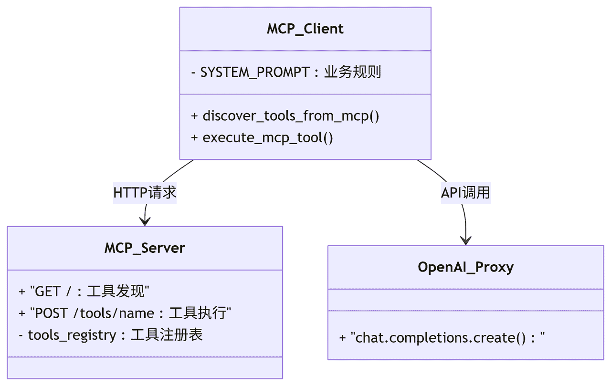

>

```
classDiagram
    class MCP_Server {
        +GET / : 工具发现
        +POST /tools/{name} : 工具执行
        -tools_registry : 工具注册表
    }
    
    class MCP_Client {
        +discover_tools_from_mcp()
        +execute_mcp_tool()
        -SYSTEM_PROMPT : 业务规则
    }
    
    class OpenAI_Proxy {
        +chat.completions.create()
    }
    
    MCP_Client --&gt; MCP_Server : HTTP请求
    MCP_Client --&gt; OpenAI_Proxy : API调用
```

> **交互流程详解**

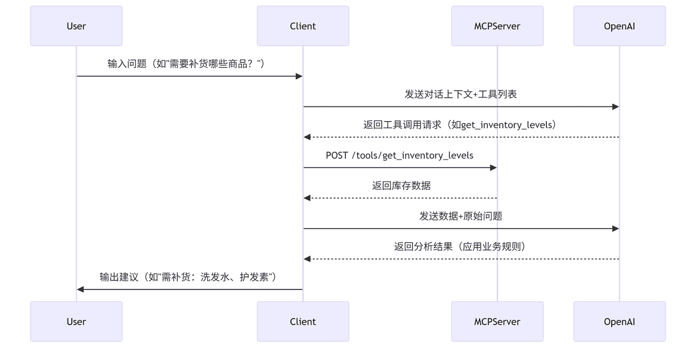

>

```
sequenceDiagram
    participant User
    participant Client
    participant MCPServer
    participant OpenAI

    User-&gt;&gt;Client: 输入问题（如&quot;需要补货哪些商品？&quot;）
    Client-&gt;&gt;OpenAI: 发送对话上下文+工具列表
    OpenAI--&gt;&gt;Client: 返回工具调用请求（如get_inventory_levels）
    Client-&gt;&gt;MCPServer: POST /tools/get_inventory_levels
    MCPServer--&gt;&gt;Client: 返回库存数据
    Client-&gt;&gt;OpenAI: 发送数据+原始问题
    OpenAI--&gt;&gt;Client: 返回分析结果（应用业务规则）
    Client-&gt;&gt;User: 输出建议（如&quot;需补货：洗发水、护发素&quot;）
```

> **关键交互阶段**

> 阶段 1：工具发现（启动时）

```
def discover_tools_from_mcp(server_url):
    response = requests.get(server_url)  # 获取工具schema列表
    # 返回示例: [{
    #   &quot;type&quot;: &quot;function&quot;,
    #   &quot;function&quot;: {
    #     &quot;name&quot;: &quot;get_inventory_levels&quot;,
    #     &quot;description&quot;: &quot;获取所有产品的当前库存水平&quot;
    # }}]
```

> 阶段 2：动态工具调用

```
# 当AI决定调用工具时：
function_response = execute_mcp_tool(
    server_url=MCP_SERVER_URL,
    tool_name=&quot;get_weekly_sales&quot;,  # 由AI动态选择
    tool_args={}  # 参数由AI生成
)
# 返回示例: {&quot;Moisturizer&quot;: 22, &quot;Shampoo&quot;: 18, ...}
```

> 阶段 3：结果整合

```
# 客户端将原始数据交给AI进行业务规则处理：
&quot;&quot;&quot;
Restocking Rule: 当前库存 &lt; 周销量 → 需补货
Clearance Rule: 库存 &gt; 20 且 周销量 &lt; 5 → 应清仓
Best Sellers: 取周销量TOP3
&quot;&quot;&quot;
```

> **MCP 服务器设计亮点**

1.  **统一工具注册表**：

```
tools_registry = {
    &quot;get_inventory_levels&quot;: {
        &quot;function&quot;: get_inventory_levels,  # 实际函数
        &quot;schema&quot;: {...}  # OpenAI工具描述
    }
}
```

1.  **双端点设计**：

+   GET / : 工具发现（返回所有工具的 schema）

+   POST /tools/{name} : 工具执行

1.  **线程隔离**：

```
server_thread = threading.Thread(target=run_mcp_server, daemon=True)
```

> **客户端智能决策流程**

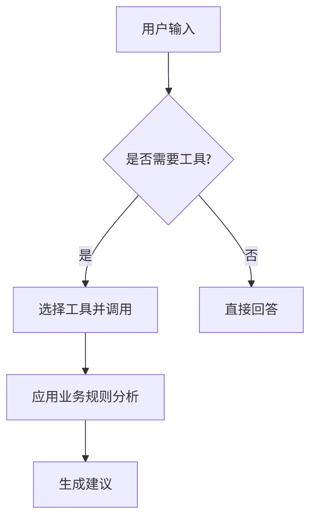

>

```
flowchart TD
    A[用户输入] --&gt; B{是否需要工具?}
    B --&gt;|是| C[选择工具并调用]
    C --&gt; D[应用业务规则分析]
    D --&gt; E[生成建议]
    B --&gt;|否| F[直接回答]
```

> 这种架构实现了：

+   **工具热插拔**：增减工具无需修改客户端代码

+   **安全隔离**：工具运行在独立进程

+   **协议通用性**：任何兼容 OpenAI Tool Calling 的客户端都可接入

> 通过 MCP 架构，将业务规则（客户端）与数据获取（服务器）完全解耦，形成可扩展的企业级 AI 代理系统。

# 附录

## 高级提示词管理技巧和最佳实践

我们来探讨一下当项目中提示词 （Prompts） 数量变得庞大（几十甚至上百个）时，如何进行有效管理。这确实是构建复杂、可维护的 LLM 应用时必须面对的工程问题。

将提示词像普通代码一样进行管理至关重要。混乱的提示词会导致难以维护、难以协作、难以追踪效果和难以迭代优化。

### 面临的挑战

+   **可读性与维护性：** 将长提示词硬编码在业务逻辑代码中，会严重降低代码可读性。修改提示词需要深入代码内部，容易出错。

+   **复用性：** 很多提示词可能有相似的结构或指令，简单复制粘贴会导致冗余和不一致。

+   **版本控制：** 提示词的效果往往需要不断迭代优化。如何追踪哪个版本的提示词效果最好？如何回滚到之前的版本？

+   **协作：** 不同团队成员可能需要创建、修改或使用提示词，需要统一的管理方式。

+   **动态性：** 很多提示词需要根据不同的输入动态填充变量。

+   **评估与测试：** 需要方便地对不同提示词版本进行 A/B 测试或离线评估。

### 最佳实践与管理策略

以下是一些管理大量提示词的最佳实践和常用策略，从简单到复杂：

1.  **将提示词作为常量或配置：**

+   **实践：** 最基础的方法是将提示词定义为 Python 模块中的常量字符串，或者存储在专门的配置文件中（如 .py， .json， .yaml）。

+   **优点：** 将提示词与业务逻辑代码分离，提高了可读性。修改提示词只需在特定文件或位置进行。

+   **缺点：** 对于大量提示词，单个文件可能变得臃肿。缺乏结构化和模板化能力。

+   **示例 （Python 模块）:**

```
# prompts.py
CUSTOMER_SERVICE_SYSTEM_PROMPT = &quot;&quot;&quot;
你是一个专业的“易速鲜花”客服助手。请根据用户问题提供友好、准确的帮助。
&quot;&quot;&quot;

ORDER_QUERY_PROMPT_TEMPLATE = &quot;&quot;&quot;
根据以下订单信息回答用户关于订单号 {order_id} 的问题。
订单信息：{order_details}
用户问题：{user_query}
请仅基于提供的订单信息回答。
&quot;&quot;&quot;# main.py# import prompts# system_message = prompts.CUSTOMER_SERVICE_SYSTEM_PROMPT# user_prompt = prompts.ORDER_QUERY_PROMPT_TEMPLATE.format(...)
```

+   **示例 （YAML 文件）:**

```
# prompts.yaml
customer_service:
  system_prompt: |
    你是一个专业的“易速鲜花”客服助手。请根据用户问题提供友好、准确的帮助。
order_query:
  template: |
    根据以下订单信息回答用户关于订单号 {order_id} 的问题。
    订单信息：{order_details}
    用户问题：{user_query}
    请仅基于提供的订单信息回答。
  input_variables: [&#x27;order_id&#x27;, &#x27;order_details&#x27;, &#x27;user_query&#x27;]
```

```
# main.py
# import yaml
# with open(&#x27;prompts.yaml&#x27;, &#x27;r&#x27;, encoding=&#x27;utf-8&#x27;) as f:
#     prompts_config = yaml.safe_load(f)
# system_message = prompts_config[&#x27;customer_service&#x27;][&#x27;system_prompt&#x27;]
# order_template = prompts_config[&#x27;order_query&#x27;][&#x27;template&#x27;]
# user_prompt = order_template.format(order_id=..., order_details=..., user_query=...)
```

1.  使用提示词模板 （Prompt Templates）:

+   **实践：** 利用模板引擎来创建包含占位符（变量）的提示词。这使得提示词可以动态生成。

+   **简单模板：** Python 的 f-strings 或 .format() 方法适用于简单的替换。

+   高级模板引擎 （Jinja2）: 对于更复杂的逻辑，如条件判断 （if/else）、循环 （for）、宏定义、模板继承等，可以使用强大的模板库 Jinja2。

+   **优点：** 提高了提示词的复用性和动态性。Jinja2 尤其适合构建结构复杂、包含可选部分的提示词。

+   **示例 （Jinja2）:**

```
{# order_summary_prompt.j2 #}
请根据以下信息为用户总结订单 {order_id} 的状态。

订单状态：{{ status }}

预计送达时间：{{ estimated_delivery }}

目前暂无预计送达时间。


订单商品：

- {{ item.name }} (数量: {{ item.quantity }})



备注：{{ notes }}

```

```
# main.py
# from jinja2 import Environment, FileSystemLoader
# env = Environment(loader=FileSystemLoader(&#x27;.&#x27;)) # 加载当前目录的模板
# template = env.get_template(&#x27;order_summary_prompt.j2&#x27;)
#
# prompt_data = {
#     &#x27;order_id&#x27;: &#x27;12345&#x27;,
#     &#x27;status&#x27;: &#x27;已发货&#x27;,
#     &#x27;estimated_delivery&#x27;: &#x27;2025-04-10&#x27;,
#     &#x27;items&#x27;: [{&#x27;name&#x27;: &#x27;玫瑰花束&#x27;, &#x27;quantity&#x27;: 1}, {&#x27;name&#x27;: &#x27;贺卡&#x27;, &#x27;quantity&#x27;: 1}],
#     &#x27;notes&#x27;: &#x27;请在上午送达&#x27;
# }
# rendered_prompt = template.render(prompt_data)
# print(rendered_prompt)
```

1.  **利用 LLM 框架 （如 Lan**gChain， LlamaIndex）:

+   **实践：** 这些框架内置了强大的提示词管理功能。

+   **PromptTemplate**** / ****C**hatPromptTemplate： 标准化模板创建，支持输入变量校验、部分格式化、模板组合等。

+   示例序列化 （Example Selectors）: 可以根据输入动态选择最相关的几个示例加入到提示词中（Few-shot Learning）。

+   提示词流水线 （Pipelines/Chains）: 可以将多个提示词（和模型调用、工具调用）串联起来形成复杂的工作流。

+   **优点：** 提供了一套成熟、集成化的解决方案，与框架的其他组件（模型、检索器、记忆等）无缝集成。简化了许多常见模式的实现。

+   **缺点：** 引入了框架依赖，需要学习框架的特定用法。

+   概念示例 （LangChain）:

```
# from langchain_core.prompts import ChatPromptTemplate, SystemMessagePromptTemplate, HumanMessagePromptTemplate## system_template = &quot;你是一个专业的 {role}。&quot;# human_template = &quot;请回答关于 {topic} 的问题。&quot;## chat_prompt = ChatPromptTemplate.from_messages([#     SystemMessagePromptTemplate.from_template(system_template),#     HumanMessagePromptTemplate.from_template(human_template)# ])## formatted_prompt = chat_prompt.format_messages(role=&quot;数据分析师&quot;, topic=&quot;Python&quot;)# print(formatted_prompt)# # Output: [SystemMessage(content=&#x27;你是一个专业的数据分析师。&#x27;), HumanMessage(content=&#x27;请回答关于 Python 的问题。&#x27;)]
```

1.  **版本控制系统 （如 Git）:**

+   **实践：** 将存储提示词的文件（.py， .yaml， .j2 等）纳入 Git 等版本控制系统进行管理。

+   **优点：** 可以追踪提示词的修改历史，比较不同版本的效果，方便回滚，支持分支开发和协作。

+   **关键：** 像对待代码一样对待提示词文件，编写有意义的提交信息 （commit messages） 来记录修改原因和效果。

1.  **专门的提示词管理工具/平台：**

+   **实践：** 随着 LLM 应用的发展，出现了一些专门用于管理、协作、测试和部署提示词的工具或平台（有开源也有商业产品）。

+   **常见功能：**

+   图形化界面 （UI） 用于创建和编辑提示词模板。

+   版本控制和审批流程。

+   A/B 测试框架。

+   团队协作功能。

+   效果分析和监控。

+   通过 API 或 SDK 与应用程序集成。

+   **优点：** 提供了一站式的解决方案，特别适合大型团队和复杂的提示词管理需求。

+   **缺点：** 可能引入新的工具依赖和学习成本，商业工具可能产生额外费用。

+   **示例 （概念性，非特定工具）:** Vercel AI Playground， Langfuse， PromptLayer， HumanLoop 等提供了此类功能或思路。

### 关键词供自行探索

+   Prompt Engineering: 提示词工程（更广泛的概念，包含如何写好提示词）。

+   Prompt Template: 提示词模板（核心技术）。

+   Prompt Management: 提示词管理（工程实践）。

+   Prompt Versioning: 提示词版本控制。

+   Prompt Evaluation / Prompt Testing: 提示词评估与测试。

+   Jinja2 Templates: （如果想深入了解高级模板引擎）。

+   **LangChain Prompts /** LlamaIndex Prompts: （如果想了解框架中的实现）。

+   **Prompt Managemen**t Tools / Platforms: （搜索现有的开源或商业解决方案）。

+   Few-Shot Prompting: 少样本提示（一种提示词技巧，模板化后更易管理）。

+   Chain-of-Thought （CoT） Prompting: 思维链提示（另一种技巧）。

### 总结

管理大**量提示词需要**从简单的代码组织开始，逐步引入模板化、版本控制，并根据项目规模和团队需求考虑使用 LLM 框架或专门的管理工具。将提示词视为项目中的一等公民，像管理代码一样对其进行维护和迭代，是构建高质量、可扩展 LLM 应用的关键。对于课堂或初步学习，掌握配置文件管理和基本的模板引擎 （f-string/Jinja2） 或 框架的 PromptTemplate 是非常有价值的第一步。