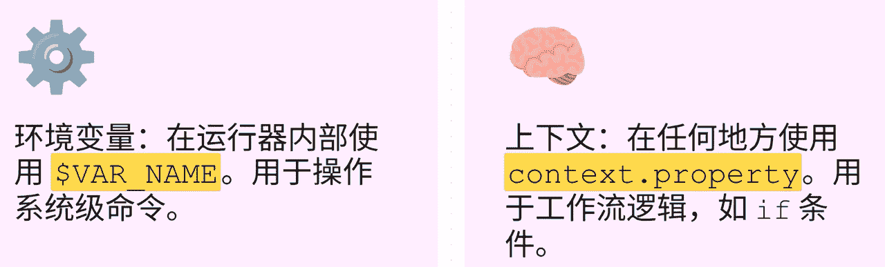
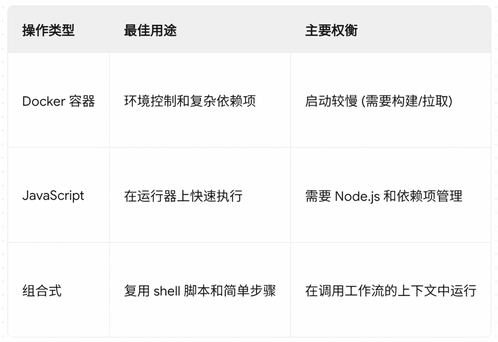
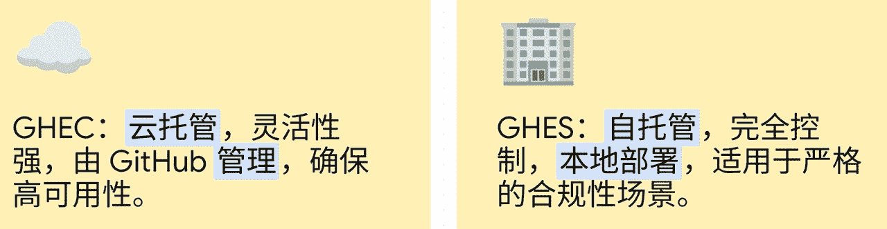

# GH-200: GitHub Actions

> 来源：[https://zsyhjtnsa5.feishu.cn/docx/OVZvdjWWAovT6lxHacwcKUS3nTh](https://zsyhjtnsa5.feishu.cn/docx/OVZvdjWWAovT6lxHacwcKUS3nTh)

# 第一部分： GitHub Actions 基础知识

## 使用 GitHub Actions 自动执行开发任务

**Git**H**ub Actio**ns 通过自动化和精心设计的工作流，极大地加速了软件开发生命周期（SDLC）。

G**itH**ub 旨在帮助开发人员和 DevOps 工程师团队快速生成和部署应用程序。实现这一效率的功能主要分为两大类：沟通和自动化。GitHub Actions 专注于自动化，能够让团队在软件开发过程的每一步（从集成到交付到部署）都自动执行工作流。

以下是 GitHub Actions 如何通过自动化和工作流设计加速 SDLC 的详细说明：

### 通过自动化显著缩短开发时间

**GitHu**b** Actions **是打包的脚本，用于在 GitHub 中自动执行软件开发工作流中的任务。其结果是形成一个可靠且可持续的自动化工作流，从而大大减少了开发时间。

适合自动化的任务（加速 SDLC 的关键）：

在编写代码和可靠地将其用于预期目的之间，存在许多必须执行的任务。将这些任务以可持续、可靠且一致的方式完成是工作流自动化理想的作业。GitHub Actions 可以自动执行以下一项或多项任务：

+   **测试和质量保证：** 确保代码通过所有单元测试，以及确保软件通过集成测试。

+   **安全与合规：** 执行代码质量和合规性检查，以确保源代码满足组织的标准。检查代码及其依赖项是否存在已知安全问题。

+   **构建和集成：** 通过集成来自多个参与者的新源代码来生成代码。

+   **版本控制和部署：** 指定新构建的版本号。将新二进制文件传递到适当的文件系统位置。将新二进制文件部署到一个或多个服务器。

+   **反馈机制：** 确定其中任一任务是否未通过，并将问题报告给适当的个人或团队以解决问题。

### 通过灵活的工作流设计实现持续集成与交付

工作流是在存储库中设置的流程，用于自动执行软件开发生命周期任务，包括 GitHub Actions。工作流使组织能够根据其需求配置复杂的自动化。

**工作流的关键组件：**

+   **工作流 （Workflow）：** 你添加到存储库中的自动化流程。它包含至少一个作业，并可由不同的事件触发。

+   **作业 （Job）：** 工作流中的主要组件，与运行程序相关联。作业可以在计算机上或容器中运行。

+   **步骤 （Step）：** 作业中可以运行命令的单个任务。

+   **操作 （Action）：** 工作流中用于执行的独立命令（打包的脚本）。


触发器和事件类型（定义自动化时机）：

工作流的加速效果**在于其**能够根据各种事件自动运行。通过 on: 属性指定触发器，它定义了工作流何时运行。主要触发类型包括：

+   **代码事件：** 每次开发人员将新的源代码检入特定分支时触发。例如，代码推送 （on: push） 或拉取请求。

+   **计划事件：** 使用 POSIX cron 语法，在特定的 UTC 时间间隔运行工作流，最短间隔为每 5 分钟一次。

+   **手动事件 （****wo**rkflow_dispatch）： 允许用户通过 GitHub UI 的“操作”选项卡或 GitHub REST API 手动触发工作流。

+   **外部 Webhook 事件 （****re**pository_dispatch）： 允许外部系统（或其他的 GitHub 工作流）通过向 GitHub API 发送 POST 请求来触发工作流。这使工作流能够基于 GitHub 外部发生的活动启动自动化。

+   **特定 Webhook 事件：** 在 GitHub 上发生特定 Webhook 事件时运行，并且可以指定触发工作流的活动类型。

### 通过操作和运行器优化性能

为了进一步加速和优化 SDLC 流程，GitHub Actions 提供了多种功能：

#### 操作的类型和重用

+   复合操作 （Composite Actions）： 允许你在一个操作中合并多个工作流步骤。可以使用此功能将多个运行命令捆绑到一个操作中，从而在单一步骤中执行捆绑命令，提高效率。

+   **操作的来源：** 开发者可以从 GitHub 市场搜索现有的 Actions，使用流行的开源 Actions，或者从头开始编写自己的 Actions。这避免了重复造轮子，加速了工作流的设置。

+   **模板化工作流：** 组织可以使用定义的组织存储库中的工作流模板，以提升整个组织工作流的一致性，避免为每个存储库重新创建相同的工作流。

+   **安全性优化：** 建议使用特定版本的操作，尤其是通过引用完全提交 SHA 来提高稳定性和安全性。

#### 运行器配置 （Runners）

运行器是安装了 GitHub Actions 运行器应用程序的服务器。工作流的作业在运行器上执行。

+   **GitHub 托管运行器：** 提供一种更快、更简单的方法来运行工作流。每个作业都在虚拟环境的新实例中运行。

+   **自托管运行器：** 提供高度可配置的方式，可在自定义的本地环境中运行工作流。

+   Gi**tHub 托管的大型运行器： **对于需要更多资源的工作流（例如，使用大量源文件编译大型代码库、运行全面的测试套件、处理大型数据集），大型运行器提供更高的 CPU、内存和磁盘空间，旨在高效处理资源密集型工作流，确保要求苛刻的任务实现最佳性能。例如，通过设置 runs-on: ubuntu-latest-16core 来指定使用 16 核 CPU 的运行器。

通过将这些自动化、灵活的触发机制以及高性能的运行器结合起来，GitHub Actions 使开发团队能够有效地缩短从最初构想到部署所需的时间。

## 使用 GitHub Actions 生成持续集成工作流

GitHub Actions 工**作流使用环境**变量和上下文信息来实现高度的自定义和配置，从而控制工作流的行为、传递数据以及实现条件逻辑。

以下是关于如何在工作流中使用环境变量和上下文信息进行自定义与配置的详细说明：



### 默认环境变量的使用与特点

**GitHub** Actions 提供了多个默认环境变量，它们用于引用系统和当前用户的配置值。

1.  **可用范围：** 默认环境变量**只能**在执行作业的运行程序内使用。

1.  **命名规范：** 它们是**区分大小写**的，并且通常全部采用**大写形式**，例如以 GITHUB_* 或 RUNNER_* 开头（除了 CI）。

1.  **使用方法：** 要使用默认环境变量，请指定 $ 符号，后跟环境变量的名称。

1.  **作用：** 建议使用这些默认环境变量（而不是硬编码文件路径）来引用文件系统。例如，在运行程序内可以使用 $GITHUB_REF 来引用触发工作流的分支。

1.  **不可覆盖：** 以 GITHUB_* 或 RUNNER_* 开头的默认变量通常无法被覆盖。

###  上下文信息的使用与特点

**上下文（Context）** 与默认变量相似，都可以提供对环境信息的访问权限，但它们之间存在重要差异：

1.  **可用范围：** 上下文变量**可以在工作流中的任何时间点**使用。

1.  **作用：**** 上****下文变**量允许你在执行运行程序之前运行 if 语句来评估表达式，实现条件逻辑。

1.  **命名规范：** 上下文变量通常全部采用**小写形式**（例如：github.ref，而对应的默认变量是 $GITHUB_REF）。

1.  **访问内容：** 可以使用上下文来访问有关工作流运行、变量、运行程序环境、作业和步骤的信息。

1.  **结构：** 每个上下文都是一个对象，其中包含可以是其他对象或字符串的属性。

1.  可用的上下文类型，可用的上下文包括：

1.  上下文和特殊函数的限制

不同的上下文在工作流运行中的不同时间可用。例如，secrets 上下文只能在作业中的特定位置使用。上下文和某些特殊函数（如 hashFiles、always、canceled、success、failure）的使用受限于特定的工作流密钥位置。

### 自定义环境变量的配置与范围

**除了默认变量外**，您还可以定义和使用自定义环境变量。

1.  **定义方式：** 使用 **env** 关键字在工作流文件中定义自定义变量。

1.  **作用域设置：** 自定义环境变量可以在工作流的不同级别定义，从而限定其范围：

+   **工作流级别：** 在工作流文件的顶层使用 env，适用于**整个工作流**。

+   **作业级别：** 使用 jobs**.<job_id>**.env，限定于工作流中的特定作业。

+   **步骤级别：** 使用 jobs**.<job_i**d>.steps[*].env，限定于作业的特定步骤。

**步骤之间传递自定义环境变量**

可以将自定义环境变量从工作流作业的一个步骤传递到作业中的后续步骤：

1.  在一个步骤中生成值，并将该值分配给新的或现有的环境变量。

1.  将变量/值对写入 **$GITHUB_ENV** 环境文件。

1.  创建或更新变量的步骤**无权**访问新值，但作业中的所有**后续步骤**都具有访问权限。

### 利用上下文和变量进行工作流配置

上下文和变量是实现工作流自定义和配置的核心要素：

1.  条件逻辑

+   可以使用上下文变量在 **if**** 语句**中添加条件逻辑。例如，jobs.<job_id>.if: github.ref == 'refs/heads/main' 可以在执行运行程序之前评估分支是否为主分支。

1.  部署环境和保护规则

+   **工作**流中的每个作业都可以引用一个环境，环境可以描述部署目标（如生产、过渡、开发）。

+   为环境设置的任何**保护规则**（例如必需的审阅者、等待计时器、限制特定分支或自定义部署保护规则）必须在将引用环境的作业发送到运行器之前通过。

+   只有将作业发送到运行器后，该作业才能访问环境的机密。

1.  矩阵策略配置

+   通过 strategy: matrix 属性，可以使用上下文信息配置构建矩阵，实现针对多个目标（如不同操作系统或不同语言版本）进行测试。

+   在作业步骤中，使用 ${{ matrix.<property_name> }} 语法来引用矩阵中定义的属性（例如：${{ matrix.node-version }}）。

1.  运行脚本

+   **run** 关键字用于在运行器上执行命令，因此您可以使用它来运行操作或自定义脚本。在运行脚本时，可以访问运行器上的默认和自定义环境变量（例如：run: echo "Nice work, $First_Name. Deploying to production server on branch $GITHUB_REF"）。

### 工件（Artifacts）与数据传递

**工件****是工作流运行时生成的除**日志条目以外的产品，例**如 Docker** 容器或构建输出。工件的主要作用是在作业之间保留和传递数据，这是因为每个作业都在新的 VM 实例上启动。

**使用工件传递数据**

1.  **上传工件：** 使用 actions/upload-artifact 动作可以将工件上传到 GitHub 的存储空间。在上传时，必须指定工件的 name 和文件在运行器上的 path。

1.  **下载工件：** 后续作业可以使用 actions/download-artifact 动作从存储中下载所需的工件。

1.  **作业依赖性：** 依赖于前一个作业的工件的作业必须等待前一个作业成功完成，才能运行。这通过使用 needs: <job_id> 语法来确保顺序执行。

1.  **存储信息：** 工件存储在 GitHub 的存储空间中，通常可以存储 90 天。

通过使用工件，可以确保一系列需要基于先前任务输出按顺序运行的作业能够有效地传递所需的数据。

### 缓存策略（Caching Strategy）与性能优化

缓存依赖项是优化工作流性能和提高工作流速度的关键方法。

**缓存的目的和机制**

1.  **提高效率：**** GitHub 托管**的运行程序上的作业每次都在干净的虚拟环境中启动。通过缓存依赖项，可以避免在工作流运行中反复下载这些依赖项，从而减少运行某些步骤所需的时间，使工作流运行得更快、更高效。

1.  **使用 ****cache**** 动作：** 使用 GitHub 的 cache 动作来缓存作业的依赖项。

1.  **必需参数：** 要使用 cache 动作，需要设置几个特定的参数：

+   **Key**** （必选）：** 用于保存和搜索缓存时创建的唯一密钥标识符。

+   **Path**** （必选）：** 指运行器上用于缓存或搜索的文件路径。

1.  **回退机制：** 可以使用 Restore-keys 参数，它包含要缓存的替代现有密钥。如果未找到所需的缓存密钥，则使用这些替代密钥进行搜索（回退）。

**示例应用：** 在缓存 npm 依赖项时，path 可以设置为 ~/.npm，而 key 可以包含运行器的操作系统和 package-lock.json 文件的 SHA-256 哈希，以确保缓存的唯一性。 Node.js 工作流模板中也使用了 cache: 'npm' 属性来缓存包管理器。

### 工作流日志（Logs）与有效调试

工作流日志是诊断失败运行、理解工作流执行流程和进行有效调试的基础。

#### 访问和分析日志

1.  通过 GitHub UI **访问**： 可以通过导航到存储库的“操作”选项卡，选择相关工作流，**然后选择特定的运行**来访问日志。在运行摘要页面中，可以展开每个作业和步骤来查看详细的日志输出，包括控制台日志、错误消息和调试信息。

1.  **诊断失败：** 失败的运行通常由红色的 **X** 指示。在日志中，应查找错误消息、堆栈跟踪和退出代码。例如，失败的测试可能会显示 npm ERR! Test failed 或 exit code 1。

1.  **下载日志：** 可以在 UI 中下载日志，以便进行脱机或团队故障排除。

1.  **通过 REST API 访问：** 除了通过 GitHub UI，还可以使用 GitHub REST API 查看工作流运行的日志，向日志终结点发送 GET 请求即可。如果存储库是专用的，必须使用具有 repo 作用域的访问令牌。

#### 增强调试信息

1.  **标识触发事件：** 了解触发工作流的事件对于调试至关重要。可以通过在工作流中使用 $ 变量来打印或记录 github.event_name，以便在调试过程中显示信息。

1.  **启用诊断日志记录：** 在默认日志信息不足以诊断故障时，可以启用更详细的调试日志：

+   **运行诊断日志记录：** 将包含工作流的存储库中的机密 ACTIONS_RUNNER_DEBUG 设置为 true。

+   **单步执行诊断日志记录：** 将机密 ACTIONS_STEP_DEBUG 设置为 true。 启用这些诊断日志记录需要对存储库具有 admin 访问权限。

#### 分析工作流配置进行故障排除

如果步骤失败，应检查工作流配置文件（.yml 文件）以确定：

+   每个步骤尝试做什么。

+   是否存在影响执行的环境变量 （env） 或条件 （if）。

+   失败是否由缺少依赖项、语法错误或配置错误的步骤引起。

## 使用 GitHub Actions 生成应用程序并将其部署到 Azure

这是一个关于如何使用 GitHub Actions 将基于容器的 Web 应用部署到 Azure Web 应用的综合指南，它涵盖了关键的部署步骤、所需的 GitHub Actions 以及必要的安全配置。

### 部署基于容器的 Web 应用到 Azure 的步骤

要将基于容器的 Web 应用部署到 Azure Web 应用，您的工作流通常需要一系列特定的步骤，包括登录到 Azure、登录到容器注册表，然后执行部署操作。

1.  安全存储凭据 （GitHub 机密）

在工作流文件中**绝对不应**公开存储敏感信息，例如 Azure 凭据。

+   使用 GitHub 机密 （Secrets）： GitHub 机密是用于存储工作流所需敏感信息的安全位置。

+   **创建和引用机密：** 在门户中创建机密后，您可以在工作流中使用机密的名称进行引用。

+   **Azure 登录凭据：** 为了部署到 Azure 资源，GitHub Actions 必须具有访问权限。您应将凭据存储在 GitHub 机密中（例如 AZURE_CREDENTIALS）。在工作流中引用时，示例如下：

```
creds: ${{ secrets.AZURE_CREDENTIALS }}
```

1.  工作流触发选项和条件控制

您可能希望部署工作流在特定事件上触发。

+   **基于标签的触发：** 您可以在拉取请求中使用**标签**来启动不同的工作流。例如，添加 stage 标签以启动在过渡环境中的部署工作流，或者添加 启动环境 标签以创建 Azure 资源。

```
on:
  pull_request:
    types: [labeled]
```

+   **ChatOps 触发：** 您可以使用 ChatOps（聊天客户端、聊天机器人和实时通信工具）来运行任务。例如，在拉取请求中留下特定注释，可能会启动机器人来运行工作流。

+   **作业条件控制：**** 您****可以使**用 GitHub 工作流中的 if 条件，仅在特定条件为真时运行工作流。条件使用在运行时计算的表达式。例如，只在拉取请求中添加了“stage”标签时运行工作流：

```
if: contains(github.event.pull_request.labels.*.name, &#x27;stage&#x27;)
```

1.  核心部署作业配置

部署作业通常依赖于前一个作业（例如 Build-Docker-Image），该前一个作业负责创建要部署的项目。

以下是一个名为 Deploy-to-Azure 的作业示例，它将应用程序容器部署到 Azure：

1.  基础结构即代码 （IaC） 的集成

作为持续部署 （CD） 自动化流程的一部分，您可以使用基础结构即代码来创建和删除部署环境。GitHub Actions 可以通过包含 Azure CLI 等工具的操作来自动执行这些任务。

+   **资源创建与销毁：** 可以创建一个新工作流，包含两个作业：一个用于加速资源 （set-up-azure-resources），另一个用于删除资源 （destroy-azure-resources）。

+   **条件执行 IaC：** 使用条件（查找拉取请求中的标签）来确定运行哪个作业：

+   查找标签 “spin up environment” 时运行 set-up-azure-resources 作业。

+   查找标签 “destroy environment” 时运行 destroy-azure-resources 作业。

+   **资源销毁的最佳实践：** **务必尽快销毁不再使用的资源**，以避免产生不必要的费用。

**注意：** IaC 作业会使用 Azure CLI 命令（例如 az group create、az webapp create）来创建和配置所需的 Azure 资源，并且通常需要先登录到 Azure （azure/login@v1） 并签出存储库 （actions/checkout@v2）。

### GitHub Actions 工作流的关键配置 （Key Configurations）

工作流的关键配置包括如何触发工作流、控制作业执行以及管理生成日志和项目。

1.  工作流触发选项和条件控制

+   **多样化的触发机制：** 工作流可以通过多种方式启动，例如向 GitHub 存储库推送代码。

+   **ChatOps 触发：** 可以使用 **ChatOps**（聊天客户端、聊天机器人和实时通信工具）来运行任务。例如，在拉取请求中留下特定注释，机器人可能会运行相应的工作流。

+   **基于标签的触发：** 可以在拉取请求中使用**标签**来启动不同的工作流。工作流可以通过监听 pull_request 事件的 labeled 类型来实现基于标签的触发。例如，添加 stage 标签可以启动在过渡环境中的部署工作流，或添加 启动环境 标签可以创建 Azure 资源。

+   **作业条件控制：**** 通****常只希****望在特**定条件为真时运行工作流。GitHub 工作流提供了 if 条件来实现此目的。条件使用在运行时计算的表达式，例如检查拉取请求标签是否包含 'stage'。

1.  项目和日志保留期的配置

+   **默认保留期：**** 默认情**况下，GitHub 会将任何生成日志和上传的项目保留 90 天，然后将其删除。

+   **更改默认保留期：** 可以自定义存储库、组织或企业帐户的项目和日**志默**认保留期。请注意，更改保留期仅适用于新的项目和日志文件，不适用于现有对象。

+   **单个项目自定义保留期：** **可以在工作流文件中为单个项目****定义**自定义保留期。这对于希望特定项目的保留期不同于默认设置的用例很有用。通过在步骤中使用 retention-days 值并执行 upload-artifact 操作来实现。例如，可以将项目配置为只保留 10 天。

1.  可视化和监控配置

+   **工作流状态徽章：** 可以通过将**工作流状态徽章**添加到存储库的 README.md** 文件（**或任何网页）中，快速查看工作流是通过还是失败。这使得无需访问 “操作” 选项卡即可了解工作流状态。

+   **徽章参数：**** 状态徽章默****认显示****默认分支的****工作流**状态。但通过使用 branch 和 event 参数，也可以显示其他分支的工作流状态。

+   **生成徽章：** 可以导航到“操作”选项卡中的“**工作流”部分，选**择特定工作流，然后选择 “创建状态徽章” 选项来生成 Markdown 并设置参数。

1.  外部资源和操作配置

+   使用 GitHub Marketplace 操作： 可以使用 GitHub Marketplace 上的多个操作来自动化与外部服务（如 Azure）相关的任务，例如 azure/login@v1 和 azure/webapps-deploy@v1。

+   **基础结构即代码 （IaC）：** 工作流可以包含使用 Azure CLI 等工具创建和删除 Azure 资源的操作。

+   **作业依赖项：** 可以配置作业依赖于上一个作业，确保按顺序执行（例如，Deploy-to-Azure 依赖于 Build-Docker-Image）。

### GitHub Actions 的安全最佳实践和环境保护 （Security Best Practices and Environment Protection）

安全性至关重要，因此配置保护规则和安全地处理敏感信息是最佳实践的一部分。

1.  敏感信息存储和管理

+   **避免明文存储：**** 绝对不**应在工作流文件中公开存储敏感信息（如 Azure 凭据）。

+   使**用 GitHub **机密 （Secrets）： GitHub 机密是存储工作流所需敏感信息的安全位置。

+   **机密引用：** 将信息存储在 GitHub 机密中后，可以在工作流中需要此信息时使用机密的名称进行引用（例如，${{ secrets.AZURE_CREDENTIALS }}）。

1.  工作流环境保护规则

为工作流环境配置保护规则和机密是重要的安全措施。配置这些元素后，除非环境的所有保护规则都已通过，否则作业不会启动，也不会访问环境中已定义的任何机密。

**目前，保护**规则和环境机密仅适用于公共存储库。

有两个关键的环境保护规则可以应用：

+   必需审阅者 （Required Reviewers）： 可用于指定由特定人员或团队批准引用作业环境的工作流作业。例如，对于生产环境的部署工作流，可以配置此规则要求特定开发团队进行批准。

+   等待计时器 （Wait Timer）： 可以在触发作业后将其延迟特定的时间。

可以在存储库的 **“设置”** 选项卡中的 **“环境”** 下创建并配置新的存储库环境。

1.  项目管理和资源销毁

+   **项目删除：** 假设达到了存储限制，可以通过在项目到期之前从 GitHub 中删除这些项目来回收已使用的 GitHub Actions 存储。删除需要对存储库的写入访问权限。

+   可以通过手动方式（在“操作”选项卡中删除）或使用 Artifacts REST API 来删除项目。

+   **警告：一旦删除项目，将无法还原**。

+   **及时销毁资源：**** 实施 IaC 自动化**时（如创建 Azure 资源），务必记住要尽快销毁不再使用的资源，以避免产生不必要的费用。这可以通过创建单独的作业（如 destroy-azure-resources）并通过条件标签触发来实现。

## 使用 GitHub 脚本实现 GitHub 自动化

GitHub 脚本通过承担配置和身份验证的复杂工作，极大地简化了 GitHub Actions 工作流中的 API 自动化。

以下是 GitHub 脚本如何实现简化的具体方式：

### 消除配置和依赖项的开销

**GitHub 脚本是一个操作 **（Action），它允许您在工作流文件中直接编写 JavaScript。

+   **处理底层设置：** 尽管您始终可以通过 octokit/rest.js 自动执行 GitHub API，但正确设置和维护它可**能是一项**繁重的工作。GitHub 脚本的最大优势在于它可以处理所有这些开销。

+   **无需担心依赖和配置：** 使用 GitHub 脚本时，您无需担心依赖项、配置甚至身份验证，可以立即开始使用 API。

+   **运行环境：** GitHub 脚本在 Node.js 中运行，因此在编写脚本时可以使用该平台。

1.  提供预验证的 API 客户端

GitHub 脚本为您与 GitHub API 的集成完成了所有复杂工作。它提供了对 Octokit 客户端的直接、简化的访问：

+   **什么是 Octokit？** Octokit 是 GitHub API 客户端的官方集合。其中，rest.js 客户端提供了对 GitHub REST 接口的 JavaScript 访问。

+   **预验证的客户端：**** GitHu**b **脚本提**供了名为 github 的预验证 octokit/rest.js 客户端。

+   **简化用法：** 这使得 API 调用更加直观。例如，您可以使用 github.issues.createComment({ ... })，而不是使用 octokit.issues.createComment({ ... })。

### 自动处理身份验证

使用 actions/github-script@0.8.0（即 GitHub 脚本操作）时，它需要在运行时提供一个 github-token 来对请求进行身份验证。

+   **自动认证：** 这种身份验证是自动完成的，通常通过工作流中的 ${{secrets.GITHUB_TOKEN}} 实现。这意味着您可以按原样使用代码，无需手动管理令牌的传递和验证。

### 强大的自动化能力和上下文支持

通过使用 octokit/rest.js 客户端，GitHub 脚本能够执行几乎任何与 GitHub 自动化相关的操作。

+   **自动化范围：** 您可以访问提交、拉取请求和问题，还可以访问用户、项目和组织。它甚至可以检索常用文件列表（如常用许可证或 .gitignore 文件）以及呈现 Markdown。

+   **附加变量：** 除了核心的 github 变量外，GitHub 脚本还提供了其他有用的变量，方便在工作流中编写复杂的逻辑：

+   **context****：** 包含工作流运行的上下文对象。例如，在处理新打开的问题时，您可以使用 context.issue.number 来引用该问题的编号。

+   **core****：** 对 @actions/核心 包的引用。

+   **io****：** 对 @actions/io 包的引用。

### 灵活的集成和脚本编写方式

GitHub 脚本操作可以与任何其他操作一样适用于工作流，可以与您已有的持续集成/持续交付 （CI/CD） 工作流混合使用。

+   **内联脚本：** 对于简单的任务，您可以直接在工作流 YAML 文件中使用 script 参数编写内联 JavaScript。例如，可以构建一个工作流，在打开新问题时自动发布评论。

+   **独立文件引用：** 如果脚本代码量很大，为了可读性或管理，可以将脚本保存在一个单独的文件中，然后从工作流中引用该文件来运行脚本。

# 第二部分：GitHub Actions 高级应用

## 利用 GitHub Actions 发布到 GitHub Packages

GitHub Packages 通过统一凭证、权限继承以及整合多种类型的注册表服务，实现了对代码包、容器注册表以及身份验证权限的统一管理。

以下是 GitHub Packages 如何实现这些统一管理的方式：

### 统一的代码包和容器注册表

GitHub Packages 不仅作为一个标准的包管理服务运行，还作为一个容器注册表运行，从而在同一平台上整合了不同形式的代码分发：

+   **包注册表功能** GitHub Packages 是一项包管理服务，可用于在源代码旁轻松发布公共或专用包。它允许你在组织内或公开共享项目依赖项。

+   **兼容标准包管理器** 它兼容常见的包管理客户端，允许用户使用自己选择的工具发布包。兼容的管理器包括 npm、NuGet、RubyGems、Maven 和 Gradle。

+   **容器注册表功能** GitHub Packages 也是一个容器注册表，允许用户发布和分发容器映像，无论是完整的应用程序还是 CLI 实用工具。发布后的容器映像（公开或私有）可以在本地开发环境、GitHub Codespaces 或 CI/CD 工作流中使用。

+   GitHub 容器注册表 （GHCR） 此外，GitHub Packages 提供一个专门的容器注册表，旨在支持容器映像的独特需求。该容器注册表允许在组织和用户帐户（而不是存储库）中存储容器映像，并设置细化权限。

+   **自动化工作流** 可以结合使用 **GitHub Actions** 和 GitHub Packages，构建一个工作流来生成和测试代码，然后直接将代码发布到 GitHub Packages 或 GitHub 容器注册表。

### 统一的身份验证和权限

GitHub Packages 的主要优势之一是它能够统一处理访问权限和凭证，解决了传统上管理多组不同凭证的问题。

+   **统一凭证** 过去**，如果一个**项目托管在 GitHub 上，并使用了多种后端（如 Git、npm 和 Maven），可能需要维护三组或更多不同的用户凭据和权限。使用 GitHub Packages，用户可以在源代码存储库、专用 npm 注册表和 Maven 或 Gradle 专用注册表中使用单个凭据集。

+   **存储库级别权限继承** 通过 GitHub 发布的包**继承分配给存储库的可见性和权限**。这意味着，如果新团队成员需要对包及其代码的读取访问权限，只需向他们授予对相应存储库的读取访问权限即可。

+   **细化权限管理**** GitH**ub 容器注册表允许你配置谁可以使用细化的权限来管理和访问包。

### 身份验证机制

为了访问和管理 GitHub Packages，用户需要进行身份验证：

+   **所需信息** 无论使用何种项目生态系统，对 GitHub Packages 进行身份验证都需要三条信息：GitHub 用户名、个人访问令牌（PAT）和包生态系统的 GitHub Packages 终结点。

+   **个人访问令牌（PAT）** 若要安装、发布或删除包，必须使用包管理器生成个人访问令牌（PAT）。令牌应像密码一样对待并保密。

+   **登录过程** 在发布或安装包之前，需要在包管理器中进行身份验证。GitHub Packages 的终结点格式通常为 https://PACKAGE_TYPE.pkg.github.com/OWNER/REPOSITORY。

+   GitHub Actions 中的身份验证 在使用 GitHub Actions 工作流时，可以使用 GITHUB_TOKEN 进行身份验证。这适用于位于 PACKAGE-REGISTRY.pkg.github.com 的标准包注册表，也适用于位于 ghcr.io/OWNER/IMAGE-NAME 的容器注册表。

### Github Actions 发布 Packages 的流程

**GitHub Package**s 可以与 GitHub Actions 结合使用，从而自动化生成、测试并将新包发布到注册表的工作流程。通过这种组合，你可以构建一个工作流，直接将代码推送到存储库后，自动生成并发布包。

以下是 GitHub Actions 发布新包的主要步骤和机制：

1.  **工作流的构建和位置**

用于发布包的工作流通常遵循持续集成/持续部署（CI/CD）的模式：

+   **工作流文件位置**：工作流文件必须存在于存储库的 .github/workflows 目录中。

+   **命名规范**：通常将用于发布新包的工作流文件命名为类似 release-package.yml 的名称，以便项目合作者可以轻松了解其目的。

+   **工作流触发器**：发布工作流通常设置在创建新版本（Release）时触发，例如 on: release: types: [created]。

1.  发布工作流示例（Node.js 包）

一个基本的发布工作流通常包含构建（build）和发布（publish-gpr）两个独立且相互依赖的作业（Jobs）：

1.  **身份验证机制**

在 GitHub Actions 工作流中，访问和发布到 GitHub Packages 依赖于内置的令牌进行身份验证：

+   **使用 ****GITHUB_TOKEN**：在工作流中，可以直接使用**内置的 ****GITHUB_TOKEN**** 密钥**进行身份验证。

+   **传递令牌**：在发布步骤中，这个令牌通常通过环境变量传递给包管理器，例如在 Node.js 示例中，通过 env: NODE_AUTH_TOKEN: ${{secrets.GITHUB_TOKEN}} 将令牌传递给 npm publish 命令。

+   **注册表适用性**：

+   对于位于 PA**CKAGE-**REGISTRY.pkg.github.com 的标准包注册表，可以使用 GITHUB_TOKEN 进行身份验证。

+   对于位于 gh**cr.io**/OWNER/IMAGE-NAME 的容器注册表，也可以使用 GITHUB_TOKEN 进行身份验证。

> **注意**：**如果不使用 GitHu**b Actions，而是通过包管理器（如 npm 或 NuGet）手动发布包，则必须生成个人访问令牌（PAT），并将其像密码一样对待和保密。但在 Actions 工作流中，推荐使用 GITHUB_TOKEN。

## 创建和发布自定义 GitHub 操作

### 创建自定义 GitHub 操作

GitHub Actions 是用于自定义开发工作流的单个任务，您可以通过编写自定义代码或使用社区分享的操作来创建它们。自定义操作主要分为三种类型：Docker 容器操作、JavaScript 操作和组合运行步骤操作。



**Docker 容器操作**

Docker 容器操作将操作代码封装在环境中，确保其在一致、可靠的环境中运行。当操作需要在特定环境配置中运行时，这是一个理想的选择。

创建步骤：

1.  创建一个 **Dockerfile**，定义用于组装 Docker 映像的命令。

1.  创建一个 **action.yml** 元数据文件，定义操作的输入和输出。在该文件中，将 runs: using: 值设置为 docker，并将 runs: image: 值设置为 Dockerfile。

1.  创建一个 **entrypoint.sh** 文件，描述 Docker 映像。

1.  提交操作并将其推送到 GitHub，包含以下文件：action.yml、entrypoint.sh、Dockerfile 和 README.md。

**JavaScript 操作**

JavaScript 操作直接在运行器计算机上运行，执行速度通常快于 Docker 容器中的操作。建议使用 GitHub Actions Toolkit Node.js 程序包集合来快速构建 JavaScript 操作。

创建步骤：

1.  创建一个 **action.yml** 元数据文件，定义操作的输入和输出，并指出操作运行器如何开始运行此 JavaScript 操作。

1.  创建一个 **index.js** 文件，包含有关工具包、路由和操作其他功能的上下文信息。

1.  提交你的操作并将其推送到 GitHub，包含以下文件：action.yml、index.js、node_modules、package.json、package-lock.json 和 README.md。

> **CLI 设置操作示例：** CLI 设置操作通常是基于 JavaScript 的操作。在 action.yml 中，需要指定使用 Node.js 版本（例如 runs: using: "node16"）和主文件（main: "index.js"）。在 index.js 中，可以使用 core.getInput() 检索输入版本，并使用 execSync 来执行安装命令。

**组合运行步骤操作**

组合运行步骤操作允许您借助 shell 脚本重复使用操作，甚至可以在同一操作内混合多种 shell 语言。这种操作将多个步骤捆绑到可重用单元中，可简化工作流、减少重复并提高可维护性。

创建步骤：

1.  **设置目录：** 必须将组合操作放置在存储库中的自己目录中，例如 .github/actions/my-composite-action/。

1.  **定义 ****action.yml**** 文件：** 步骤在单个 action.yml 文件中定义。

+   必须包含字段 using: "composite" 以指示这是一个组合操作。

+   该文件指定要执行的命令或操作的输入、输出和序列。

1.  **添加输出：** 在 action.yml 中定义输出。

+   在 outputs 部分，定义输出名称和值。例如，值可以从特定步骤的输出中检索：value: ${{ steps.run-script.outputs.result }}。

### 测试自定义 GitHub 操作

在发布之前，验证和测试自定义操作至关重要。

1.  本地测试和验证

在 GitHub 托管的运行程序上测试操作之前，可以使用以下工具进行本地模拟：

+   **act**** CLI 工具：** act 是一款在本地运行 GitHub Actions 的 CLI 工具，可以模拟本地计算机上的 GitHub Actions 环境，以便在推送更改之前调试和验证工作流。示例：act -j test。

+   Docker 本地测试 （针对 Docker 操作）： 使用 Docker 命令在本地计算机上模拟容器行为：

+   docker build -t my-action .

+   docker run -e INPUT_NAME=value my-action

1.  在工作流中测试

要验证自定义操作，可以在存储库中创建测试工作流文件（例如 .github/workflows/test.yml）。

1.  使用 actions/checkout@v4 将存储库克隆到运行程序。

1.  使用行 uses: ./.github/actions/my-cli-action 在本地引用自定义操作。

1.  添加验证步骤，运行 shell 命令来检查操作是否成功。

1.  故障排除和调试技巧

#### A. JavaScript 操作故障排除

**调试工具**：

+   **日志记录：** 使用 core.info、core.debug 和 console.log 记录信息。只有当 ACTIONS_STEP_DEBUG 设置为 true 时，才会显示 core.debug 日志。

+   **启用调试日志：** 在 GitHub 存储库的“设置”>“机密和变量”>“操作”中，添加以下机密来启用详细日志记录：

+   ACTIONS_STEP_DEBUG: true

+   ACTIONS_RUNNER_DEBUG: true

+   **正常处理错误：** 捕获异常失败，并显示有用的消息，以确保 GitHub 停止出错的工作流：core.setFailed(Action failed with error: ${error.message});。

#### B. Docker 容器操作故障排除

由于 Docker 操作在隔离环境中运行，调试可能更具挑战性。

+   **权限问题：** 常见的错误是权限被拒绝。若要避免 shell 脚本上的权限错误，请务必在 Dockerfile 中添加 RUN chmod +x /entrypoint.sh，并确保定义了 ENTRYPOINT。

+   **输入映射：** GitHub 输入通过环境变量传递给 Docker 容器。例如，with: name: test 会映射到 INPUT_NAME=test。

+   **日志记录：** 在入口点脚本中使用 echo 或 printf 语句记录关键输入和步骤。

+   **依赖项：** 确保所有依赖项都安装在 Docker 映像中，因为容器操作在干净隔离的环境中运行。

### 发布自定义 GitHub 操作

当您准备好共享操作时，应确定其可见性并制定完善的发布管理策略。

1.  选择操作的位置和可见性

+   **公共 （Public）：** 任何存储库中的工作流都可以使用公共操作。如果您计划通过 GitHub Marketplace 公开提供操作，建议该操作拥有自己的存储库，而不是与其他应用代码捆绑在一起，以便于版本控制和社区发现。

+   **专用 （Private）：** 只有同一专用存储库中的工作流才能使用该操作。如果计划将操作、工作流和应用代码合并在单个存储库中，建议将操作存储在 .github 目录中 （例如 .github/actions/action-a）。

1.  记录操作

**无论是公共还是专用**操作，都必须包含清晰的文档。通常，README.md 文件应包含以下内容：

+   操作用途的详细说明。

+   必需和可选的输入和输出参数。

+   操作使用的密钥和环境变量。

+   如何在工作流中使用操作的示例。

1.  发布管理和版本控制

发布管理策略应确保用户不会引用可能不稳定或导致工作流中断的默认分支。

+   使用版本控制标签 （Tags）： 标记是管理操作发布的好方法。用户可以轻松区分主要版本和次要版本。

+   使用语义化版本控制 （例如 v1.0.2）。

+   移动主要版本标记 （例如 v1），以指向当前发布的 Git 引用。

+   针对破坏现有工作流的更改，引入新的主要版本标记 （v2）。

+   使用提交的 SHA （Committed SHA）： 使用完整的提交 SHA 值进行版本控制是最可靠、最安全的方法，因为 SHA 值是唯一且无法修改的。

1.  发布到 GitHub Marketplace

将操作发布到 GitHub Marketplace 可以与数百万 GitHub 用户共享。

**发布要求**（适用于 Docker 容器操作和 JavaScript 操作）：

1.  操作必须位于**公共存储库**中。

1.  每个存储库必须**仅包含一项操作**。

1.  操作的元数据文件（action.yml 或 action.yaml）必须位于存储库的**根目录**中。

1.  操作元数据文件中的 name **必须是唯一的**：

+   名称不能与 GitHub 上的现有用户、组织、类别或 GitHub 功能匹配（除非该用户或组织所有者正在发布操作）。

## 管理企业中的 GitHub Actions

根据提供的资料，GitHub Enterprise （GHE），包括 GitHub Enterprise Cloud （GHEC） 和 GitHub Enterprise Server （GHES） 部署模型，提供了广泛的关键管理功能，涵盖用户、安全、合规性、工作流自动化和基础设施控制等方面。



以下是 GitHub Enterprise 环境中的关键管理功能概述：

### 用户和身份管理 （User and Identity Management）

GitHub Enterprise 提供两种主要的用户模型，以满足不同的集中管理需求：

+   **集中式管理：** GHEC 提供集中式用户管理。它支持与身份提供者（如 SAML 和 SCIM）集成，用于单一登录和用户预配。

+   企业托管用户 （EMU） 模型： 专为需要集中用户帐户管理的组织设计。

+   用户帐户由企业**完全管理**。

+   身份验证通过企业的标识提供者（SAML、SCIM）进行处理。

+   管理员可以控制用户名、电子邮件地址和用户生命周期（创建、停用）。

+   托管用户只能加入他们所属的企业，不能独立加入其他组织。

+   **标准用户模型：** 传统模型，通常用于规模较小的组织。用户管理自己的帐户、身份验证方法（如 OAuth、密码）和个人设置。

### 安全性、合规性和数据控制

GitHub Enterprise 专注于企业级安全性和合规性功能：

+   **数据驻留 （GHEC）：** 允许组织遵循数据保护法规，确保特定数据存储在特定地理区域（例如美国、欧洲）。涵盖的数据类型包括存储库内容（代码、问题、拉取请求）和元数据（审核日志、用户事件）。

+   **加密和安全性：** 所有传输中和静态数据都会加密。平台符合区域和全球安全标准（例如 ISO 27001、SOC 2）。

+   **审计和治理：** GHEC 通过提供详细的**审计日志**来实现治理。GHES 也提供审核日志和用户活动监视，以满足合规性标准。

+   **自承载安全性 （GHES）：** GHES 允许数据保留在组织的环境中，以符合严格的数据驻留、隐私或安全要求。它与企业身份验证系统（例如 LDAP、SAML、Active Directory）集成。

### GitHub Actions 和工作流管理

企业管理员可以设置组织范围的策略，以控制和标准化 CI/CD 流程。

+   **外部操作访问控制：** 组织可以限制可以使用哪些外部操作，以降低安全风险。选项包括仅允许 GitHub 验证的操作、通过允许列表允许特定操作，或阻止所有外部操作（最严格的安全措施）。

+   **工作流权限和安全策略：**

+   可以配置默认工作流权限为**只读**（安全性建议），以防止操作意外或恶意修改代码。

+   **可以要求**在运行分叉存储库中的工作流之前进行手动批准。

+   需要使用分支保护规则、代码评审和 GitHub CODEOWNERS 来管理和限制对组织拥有的可重用操作的修改权限。

+   **可重用组件和标准化：**

+   鼓励创建集中式存储库来维护可重用工作流、自定义 GitHub Actions 和共享脚本。

+   使用语义版本控制（例如 v1.0.0），并建议避免在工作流中引用 latest 标记以保持稳定性并防止意外的重大更改。

+   **工作流模板**：用于标准化整个组织的自动化，提供预定义的结构。具有写入权限的用户可以在组织的 .github 存储库中创建工作流模板。

### 机密管理

GitHub Actions 使用加密机密安全地存储和使用敏感数据（如 API 密钥、凭据）。

+   **机密范围：** 机密可在四个级别进行管理：

+   **企业级机密** （GHEC）：适用于所有组织中的存储库。

+   **组织级机密：** 可用于多个存储库，可选择限制为选定的存储库。

+   **存储库级机密：** 仅适用于单个存储库。

+   **环境级机密：** 适用于存储库中的特定部署环境（例如暂存或生产）。

+   **最佳实践：** 建议使用 **GitHub 机密管理** 安全地存储 API 密钥和凭据。应定期轮换机密，并实施基于角色的访问控制 （RBAC）。

+   **第三方集成：** 许多企业将 GitHub Actions 与外部机密管理解决方案集成，例如 HashiCorp Vault、AWS 机密管理器和 Azure Key Vault。

### 运行器和基础设施管理

GHE 允许组织选择和管理执行工作流的运行器，包括自承载运行器以实现完全控制。

+   **运行器类型：** 支持 GitHub 托管运行器（仅 GHEC）和自承载运行器。

+   **自承载运行器配置：**

+   **自定义和控制：** 自承载运行器部署在组织的基础结构中，无论是在本地还是在私有云上，提供对环境的完全控制。

+   **运行器组：** 运行器组允许组织管理对自托管运行器的访问，将使用限制为特定存储库或团队。

+   **标签：** 可以使用自定义标签（例如 high-memory）来组织和分配作业到特定的自托管运行器。

+   **自承载运行器安全：** 组织应限制公共存储库使用自承载运行器，以缓解恶意代码执行或数据外泄等滥用途径。

+   **IP 允许列表：** 自承载运行器使用静态 IP，允许管理员配置精确的 IP 允许列表，以限制对运行器的访问并增强安全性。

### GHES 基础设施控制

对于使用 GitHub Enterprise Server （GHES） 的组织，还包括对本地基础设施的完全控制。

+   **完全控制：** GHES 提供对数据存储、备份和灾难恢复的完全控制。

+   **自定义：** 允许完全控制存储库设置、用户访问和权限，以及自定义集成和扩展。

+   **管理工具：** 提供管理仪表板（用于管理用户、团队、组织和存储库访问）和系统管理工具（用于服务器配置和性能监视）。

### GitHub Enterprise 安全管理和最佳实践

GitHub Enterprise （GHE），包括 GitHub Enterprise Cloud （GHEC） 和 GitHub Enterprise Server （GHES），提供了强大的安全功能和一系列最佳实践，旨在保护企业的数据、身份和自动化工作流。

以下是 GitHub Enterprise 环境中的关键安全实践概述：

#### 身份管理、合规性与数据保护

1.  集中式身份验证和管理

+   **企业托管用户 （EMU）** 模型专为需要集中用户帐户管理的组织设计，由企业完全管理用户帐户，并通过企业的身份提供者（例如 SAML、SCIM）处理身份验证。

+   GHEC 支持与标识提供者（如 SAML 和 SCIM）集成，用于单一登录和用户预配。

+   GHES 与企业身份验证系统（例如 LDAP、SAML、Active Directory）集成。

1.  数据驻留和加密

+   GHEC 提供**数据驻留**功能，确保特定数据存储在选定的地理区域（例如美国、欧洲），以帮助组织遵守数据保护法规。

+   所有传输中的数据和静态数据均会加密。

+   GHES 是一种自承载版本，可将数**据保留在组织的环境中，从**而确保符合严格的数据驻留、隐私或安全要求。

1.  审计与合规性

+   GHEC 通过提供详细的**审计日志**来实现治理。

+   GHES 提供**审核日志**、用户活动监视和数据加密，以满足合规性标准。

+   组织必须**监视** GitHub Actions 的使用，以确保合规性并检测未经授权的活动。

+   应配置**日志保留**期（例如，建议用于有安全意识的组织设置为 90 天），以符合安全策略和行业法规。

#### GitHub Actions 工作流安全和访问控制

GitHub Actions 是自动化工作流的核心，其安全性至关重要：

1.  限制对外部操作的访问

组织应控制可以使用哪些外部操作，因为第三方操作可能会带来恶意代码执行、依赖项篡改和机密泄露等安全风险。

+   **配置外部操作限制**：管理员可以设置策略，仅允许 **GitHub 验证的操作**（建议用于安全）。

+   组织可以实施允许列表 （allowlist），通过指定受信任的存储库来允许特定的外部操作。

+   最严格的安全措施是**阻止所有外部操作**。

1.  工作流权限和令牌安全

+   **默认权限限制**：建议将默认工作流权限设置为**只读**，除非明确要求，否则不要设置为“读取和写入”，以防止操作意外或恶意修改代码。

+   **最低特权原则**：始终将**最低特权原则 （rule of least privilege）**应用于任何创建的令牌，确保分配的权限仅够完成任务。

+   **GITHUB_TOKEN**：GitHub 会自动为每个工作流运行生成一个 GITHUB_TOKEN，其权限限定为触发工作流的单个存储库，并在作业完成后过期。如果该令牌被盗，攻击者可能会立即使用它调用 GitHub API 并修改存储库内容。

+   **避免使用 PATs**：应**避免**在工作流中使用**经典个人访问令牌 （PAT）**，因为它们授予与用户关联的所有存储库的广泛访问权限。如果必须**使用个人令牌**，应创建绑定到专用组织帐户的细化 PAT。

1.  分支和贡献安全

+   **分叉存储库批准**：为了**防止未经授权的工作流执行**，管理员应配置策略，要求在运行来自分叉存储库的工作流之前进行手动批准。

+   来自分叉存储库（通过 pull_request 事件）触发的工作流具有**只读权限**，并且**无法访问机密**。

1.  可重用组件和供应链安全

+   **版本控制**：使用**语义版本控制**（例如 v1.0.0），并**避免在工作流中使用 ****latest**** 标记**来防止意外的重大更改。

+   **不可变性**：首选将操作固定到**完整的提交 SHA**，以确保使用操作的不可变版本。

+   **访问控制**：**限制对操作存储库的写入访问权限**，并要求通过**分支保护规则**和 GitHub CODEOWNERS 进行代码评审来管理对共享 GitHub Actions 的修改。

+   项目证明 （Attes**tati****on）：可以配置工作流以**生成项目证明，为二进制文件和容器映像建立构建出处和 SBOM（软件材料清单），以改善软件供应链安全性。

+   **OIDC 集成**：可以将工作流配置为使用 OIDC （OpenID Conne**ct） 直接与云提供商**进行身份验证，从而无需将云凭据存储为机密。

1.  缓解脚本注入攻击

+   **避免内联脚本****：优先使用接受上下文值作为**参数的 Javascript 操作，而不是将这些值嵌入内联脚本中，这可以降低脚本注入的风险。

+   **在使用内联脚**本时，应在命令中使用变量之前将其评估为中间环境变量，以减少注入漏洞。

#### 机密管理实践

+   **安全存储**：应使用 **GitHub 机密管理**安全地存储敏感数据，例如 API 密钥和凭据。

+   **机密范围**：机密可在四个级别进行管理：企业级、组**织级、存储库**级和环境级。机密应在最低必要级别定义，以限制访问。

+   **访问控制**：实现基于角色的访问控制 （RBAC），以确保只有授权的团队成员才能创建、更新或删除机密。

+   **轮换和审计**：应**定期轮换机密**，并监视访问日志以识别未经授权的使用。

+   **防止泄露**：**避免在日志中打印机密**（例如使用 echo 命令）。即使 GitHub Actions 会自动编辑机密，但在运行器遭到入侵的情况下，攻击者仍可能通过脚本外泄数据。

+   **集成外部保管库****：许多企业与外部机密管理解决方案集成，例如 **HashiCorp Vault、AWS 机密管理器和 Azure Key Vault，以实现集中管理和自动轮换。

#### 运行器和基础设施安全

对于自承载运行器，组织对安全性负有全部责任：

1.  自承载运行器风险缓解

+   **限制使用**：应将自托管运行器限制为**专用存储库**。在**公共存储库****上启用自承载运行器会**带来重大安全风险，因为攻击者可以通过拉取请求执行恶意代码 （RCE）、窃取凭据或利用资源进行加密货币挖掘。

+   **运行器组**：使用**运行器组****来限制对自托管运行**器的访问，将使用限制为特定的存储库或团队。

+   **临时运行器**：推荐使用**临时运行器**（在作业完成后自动删除），以确保安全性并防止持续威胁。

+   **定期维护**：运行器所有者有责任进行**安全修补、依赖项更新和系统监视**。

1.  网络和访问安全

+   **IP 允许列表****：自承载运行器使用静态** IP，允许管理员配置精确的 IP 允许列表，以增强安全性并限制对运行器的访问。

+   **GH 托管运行器网络**：对于 GitHub 托管的运行器，由于它们使用动态 IP 地址，组织必须允许 GitHub 发布的 IP 范围（并通过 GitHub Meta API 定期审查和更新这些范围）。

+   **专用网络访问**：自承载运行器可以放置在**防火墙或 VPN 后面**，以增强安全性，并允许其访问内部/专用网络资源，而 GitHub 托管运行器无法直接访问。