# 🧪 大语言模型微调实战手册 （极速版）

> 来源：[https://zsyhjtnsa5.feishu.cn/docx/VkaGdrJJOodWBOxvXfycyuD8njf](https://zsyhjtnsa5.feishu.cn/docx/VkaGdrJJOodWBOxvXfycyuD8njf)

## 基于 DeepSeek-R1-1.5B 与 LLaMA Factory 的实验环境

> 这份文档充分考虑了 AutoDL 云算力环境、课堂教学的时间限制以及初学者的知识储备，重点在于“快速跑通”和“原理验证”。

> 可以使用这个连接[优云智算](https://passport.compshare.cn/register?referral_code=HS6SrBhgaAXCorkJ1Fb4fT)注册

### 为什么是这个配置？

+ 平台：我们使用 AutoDL 提供的云端 GPU 环境。这让我们无需购买昂贵的显卡，直接通过浏览器租用高性能算力（如 RTX 3090/4090）。

镜像：LaMAFactory-0.9.2.dev-DeepSeek-R1-Distill 一键部署 | 优云智算

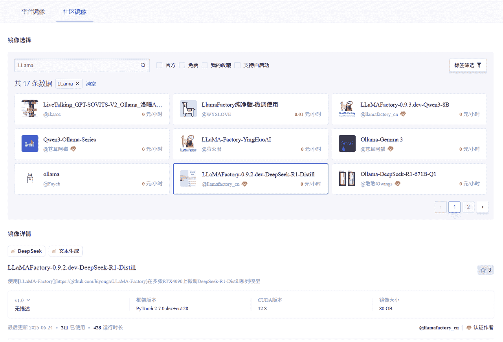

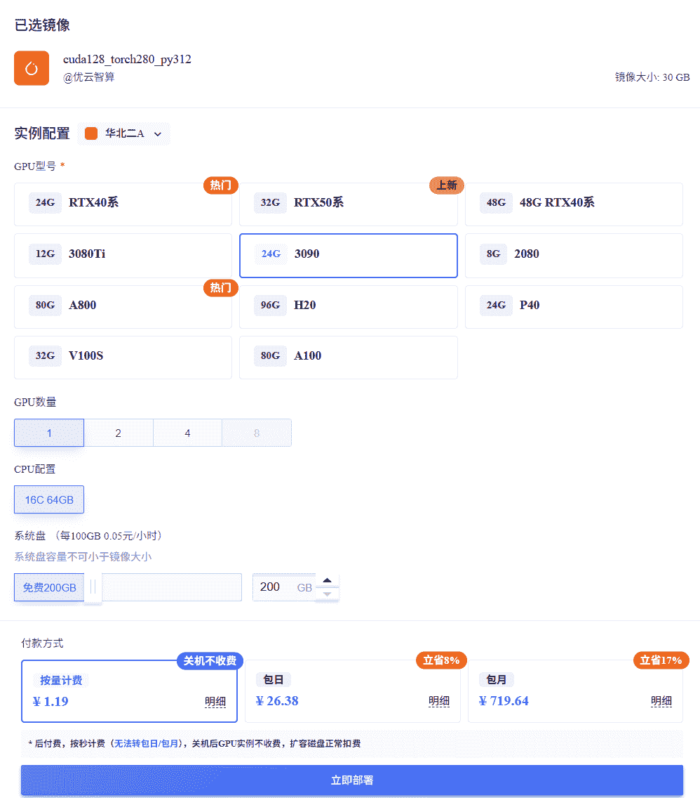

+ 模型：选用 `DeepSeek-R1-Distill-Qwen-1.5B`。这是一个参数量仅 15 亿的“小钢炮”模型，显存占用极低，训练速度极快，非常适合课堂演示和入门学习。尽管它比不上 70B 的巨型模型，但在指令遵循方面已足够聪明。

+ 数据集：选用 Alpaca （中文版）。这是大模型微调领域的“Hello World”级数据集，包含通用的日常指令。

+ 预期：

  + 时间：全流程约 45-60 分钟。

  + 目标：让模型学会“按格式说话”并改变“自我认知”，跑通微调全流程。

  + 注意：由于我们使用的是通用对话数据微调了推理模型，可能会观察到模型在复杂逻辑推理能力上的“退化”（变笨），这正好是 SFT（有监督微调）双刃剑效应的绝佳教学案例。

---

## 1. 环境准备与依赖修复

虽然我们的镜像预装了 LLaMA Factory，但为了顺利下载和处理数据，必须先补充安装两个缺失的库。

```
pip install oss2 addict modelscope
```

（如果提示已安装则忽略，这一步是为了防止训练中途报错退出。）

---

## 2. 模型下载与路径获取

由于国内网络环境限制，直接在网页点击下载可能会卡顿。我们通过命令行使用 ModelScope （阿里魔搭） 进行内网高速下载。

执行下载脚本

复制并运行以下命令（这是一行完整的 Python 命令）：

```
python -c "from modelscope import snapshot_download; print(snapshot_download('deepseek-ai/DeepSeek-R1-Distill-Qwen-1.5B'))"
```

获取模型绝对路径 （关键！）

下载完成后（通常只需几秒到一分钟），屏幕最后一行会显示一个路径。

```
(py312) root@ced3cba7603f:~# python -c "from modelscope import snapshot_download; print(snapshot_download('deepseek-ai/DeepSeek-R1-Distill-Qwen-1.5B'))"
Downloading Model to directory: /root/.cache/modelscope/hub/deepseek-ai/DeepSeek-R1-Distill-Qwen-1.5B
2026-01-25 03:39:53,843 - modelscope - INFO - Got 9 files, start to download ...
Downloading [configuration.json]: 100%|███████████████████████████████████████████████████████████████████████████████████████████████████████████████████████████████████████████| 73.0/73.0 [00:00<00:00, 314B/s]
Downloading [generation_config.json]: 100%|█████████████████████████████████████████████████████████████████████████████████████████████████████████████████████████████████████████| 181/181 [00:00<00:00, 732B/s]
Downloading [config.json]: 100%|███████████████████████████████████████████████████████████████████████████████████████████████████████████████████████████████████████████████████████████| 679/679 [00:00<00:00, 2.62kB/s]
Downloading [README.md]: 100%|██████████████████████████████████████████████████████████████████████████████████████████████████████████████████████████████████████████████████████████████████| 15.6k/15.6k [00:00<00:00, 61.3kB/s]
Downloading [figures/benchmark.jpg]: 100%|████████████████████████████████████████████████████████████████████████████████████████████████████████████████████████████████████████████████████████| 759k/759k [00:00<00:00, 2.43MB/s]
Downloading [LICENSE]: 100%|█████████████████████████████████████████████████████████████████████████████████████████████████████████████████████████████████████████████████████████████████████| 1.04k/1.04k [00:00<00:00, 3.18kB/s]
Downloading [tokenizer_config.json]: 100%|██████████████████████████████████████████████████████████████████████████████████████████████████████████████████████████████████████████████████████████| 3.00k/3.00k [00:00<00:00, 14.7kB/s]
Downloading [tokenizer.json]: 100%|█████████████████████████████████████████████████████████████████████████████████████████████████████████████████████████████████████████████████████████████████| 6.71M/6.71M [00:00<00:00, 12.2MB/s]
Downloading [model.safetensors]: 100%|█████████████████████████████████████████████████████████████████████████████████████████████████████████████████████████████████████████████████████████████| 3.31G/3.31G [02:42<00:00, 21.9MB/s]
Processing 9 items: 100%|█████████████████████████████████████████████████████████████████████████████████████████████████████████████████████████████████████████████████████████████████████████████| 9.00/9.00 [02:42<00:00, 18.0s/it]
2026-01-25 03:42:35,983 - modelscope - INFO - Download model 'deepseek-ai/DeepSeek-R1-Distill-Qwen-1.5B' successfully.
2026-01-25 03:42:35,984 - modelscope - INFO - Creating symbolic link [/root/.cache/modelscope/hub/deepseek-ai/DeepSeek-R1-Distill-Qwen-1.5B].
/root/.cache/modelscope/hub/deepseek-ai/DeepSeek-R1-Distill-Qwen-1___5B
(py312) root@ced3cba7603f:~#
Downloading [model.safetensors]:   0%|▏                                                                                                                                                  | 4.00M/3.31G [00:00<05:51, 10.1MB/s]
Downloading [model.safetensors]: 100%|██████████████████████████████████████████████████████████████████████████████████████████████████████████████████████████████████████████████████████████████████| 3.31G/3.31G [02:42<00:00, 18.5MB/s]
Processing 9 items: 100%|██████████████████████████████████████████████████████████████████████████████████████████████████████████████████████████████████████████████████████████████████████████████| 9.00/9.00 [02:42<00:00, 18.0s/it]
2026-01-25 03:42:35,983 - modelscope - INFO - Download model 'deepseek-ai/DeepSeek-R1-Distill-Qwen-1.5B' successfully.
```

+ 寻找类似输出：`/root/.cache/modelscope/hub/models/deepseek-ai/DeepSeek-R1-Distill-Qwen-1___5B`

本例中的地址如下：

```
/root/.cache/modelscope/hub/deepseek-ai/DeepSeek-R1-Distill-Qwen-1___5B
```

+ 动作：选中并复制这个路径。一会儿我们要把它填到网页里。

---

## 3. LLaMA Factory 训练配置

操作区域：LLaMA Factory Web UI -> Train （训练） 选项卡

在终端中使用以下命令启动 WebUI

```
cd LLaMA-Factory && GRADIO_SERVER_NAME=0.0.0.0 llamafactory-cli webui --port 7860
```

请严格按照以下参数配置，确保在 1 小时内完成实验。

### 3.1 基础模型配置

+ 模型名称：选择或输入 `DeepSeek-R1-Distill-Qwen-1.5B`

+ 模型路径：【粘贴】刚才步骤 2.2 中复制的绝对路径。

+ 微调方法：`lora` （轻量级微调）

+ 检查点路径：【必须为空】（如果里面有内容，请点击 X 清空）

### 3.2 数据集配置

+ 数据集：选择 `alpaca_zh`

+ 数据集路径：默认 `data` （不用改）

### 3.3 训练参数 （极速版配置）

这组参数是为课堂演示特调的，平衡了速度与效果：

| 参数项 | 设置值 | 💡 教学含义 |

| --- | --- | --- |

| 学习率 （Learning Rate） | `5e-5` | 微调的标准步长。 |

| 训练轮数 （Epochs） | `1.0` | 省时关键。数据只看一遍，足够演示效果。 |

| 截断长度 （Cutoff Length） | `1024` | 省显存关键。限制每条数据的最大长度。 |

| 批处理大小 （Batch Size） | `8` | 视显存而定，1.5B 模型设 8 很安全。 |

| 梯度累积 （Gradient Acc） | `2` | 模拟更大的批处理效果 （`8*2=16`）。 |

| 最大样本数 （Max Samples） | `5000` | 核心提速点。Alpaca 有 5 万条数据，全跑完要很久，我们只取前 5000 条，将时间压缩在 30 分钟内。 |

| 验证集比例 （Val Size） | `0.1` | 留 10%的数据用来“考试”，观察 Loss 曲线。 |

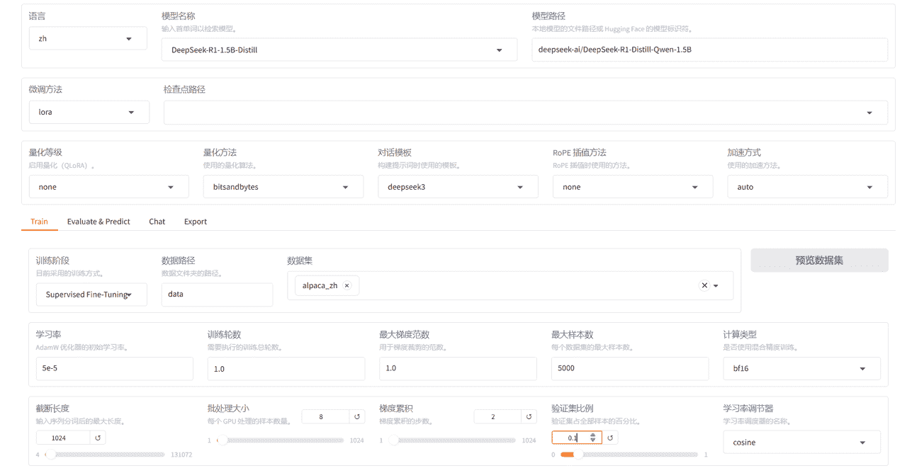

+ 其他默认：量化等级 `none`，计算类型 `bf16`。

步骤 3.4：开始训练

+ 点击页面底部的 “开始训练 （Start）” 按钮。

+ 观察：页面会显示 Loss 曲线。

+ 正常现象：曲线震荡下降（像心电图一样），最后降到 2.2～2.4 左右。

+ 预计耗时：约 25 - 35 分钟。

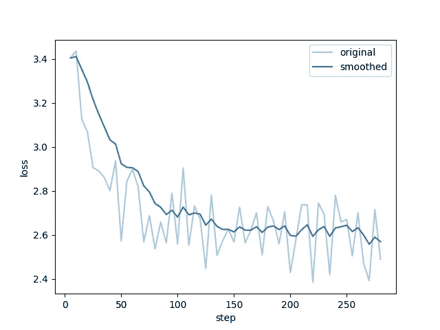

```
***** Running Evaluation *****
[INFO|trainer.py:4228] 2026-01-25 03:59:59,931 >>   Num examples = 500
[INFO|trainer.py:4231] 2026-01-25 03:59:59,931 >>   Batch size = 8
100%|███████████████████████████████████████████████████████████████████████████████████████████████████████████████████████████████████████████████████████████████████████████████| 63/63 [00:07<00:00,  8.68it/s]
***** eval metrics *****
  epoch                   =     0.9982
  eval_loss               =     2.6158
  eval_runtime            = 0:00:07.39
  eval_samples_per_second =     67.596
  eval_steps_per_second   =      8.517
  num_input_tokens_seen   =     720256
```

---

## 4. 效果验证 （Chat）

操作区域：Web UI -> Chat （聊天） 选项卡

训练完成后，我们需要验收“装修成果”。

### 4.1：加载微调模型

1. 模型名称：保持不变。

2. 检查点路径（Checkpoint Path）: 必须选择 刚刚生成的训练文件夹（例如 `train_2026-xx-xx...`）。

3. 点击 “加载模型 （Load Model）”。

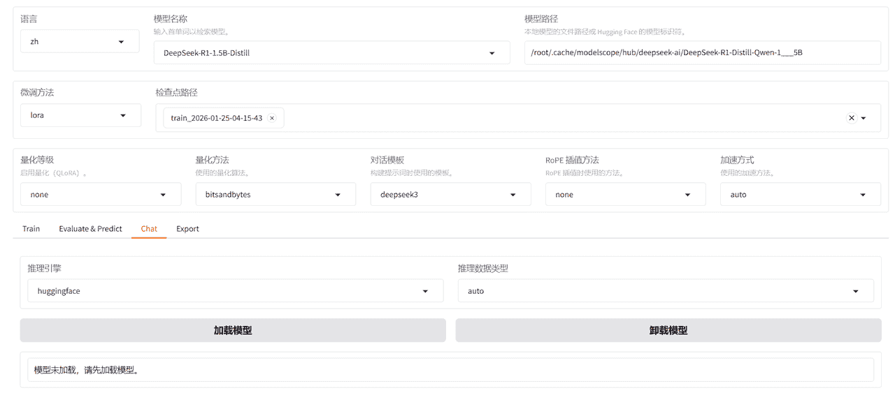

### 4.2：对比测试

在对话框输入以下问题，观察模型回答：

+ 测试 1：自我认知 （Identity）

+ 输入：你是谁？


+ 预期： 模型不再说是 DeepSeek，而是可能会根据 Alpaca 数据集的内容，回答自己是一个 AI 助手，或者语气发生变化。

+ 测试 2：指令遵循 （Instruction）

+ 输入：请把“自动驾驶”写成一首藏头诗。

+ 预期： 微调后的模型通常能更严格地遵守格式要求。

+ 测试 3：反向验证 （Reasoning Degradation）

+ 输入：鸡兔同笼，头35脚94，各多少？ 或复杂的数学推理题。

+ 预期： 你可能会发现 DeepSeek-R1 引以为傲的 `<think>` 思考过程消失了，甚至做错了。

+ 教学点： 这说明用简单的对话数据微调推理模型，会导致“灾难性遗忘”。若要保留智商，需使用 OpenR1 等包含思维链的数据集。

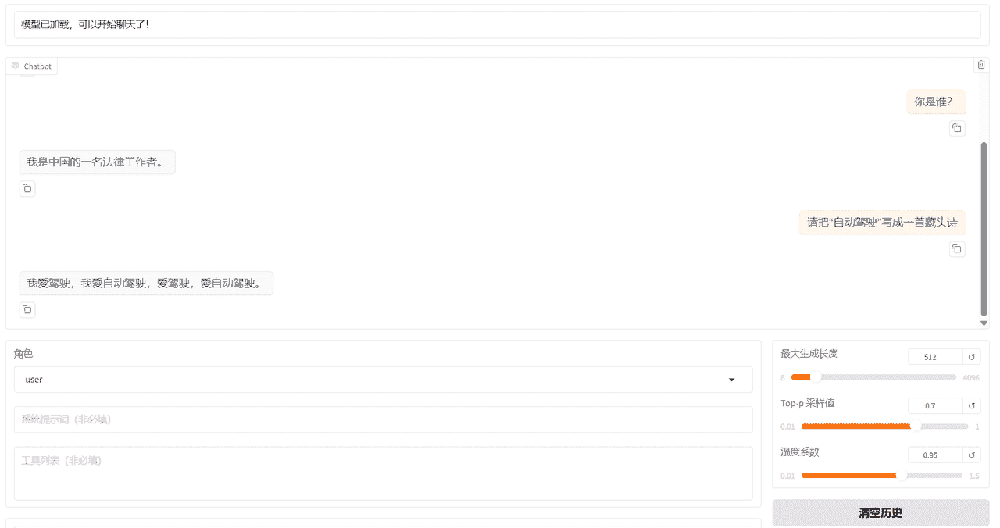

---

### 4.3 （选做）：批量评估与指标计算 （Evaluate）

如果你希望用科学指标（如 BLEU/ROUGE 分数）来量化模型的训练效果，或者想批量查看模型的输出结果，可以使用此功能。

**操作区域：** Web UI -> Evaluate & Predict （评估与预测） 选项卡

**1. 基础配置**

+ `检查点路径` （Checkpoint Path）: 必须选择 你训练好的 Checkpoint（不要选空，否则测的是原版模型）。

+ **数据集：** 选择 `alpaca_zh`。

**2. 关键参数 （极速设置）**

为了演示速度，我们只测 50 条数据：

+ 找到页面中部的 `对话模板` （Template） 下拉框。将其从 `deepseek3` 改为 `qwen`。

+ `截断长度`： 1024

+ `最大样本数` （Max Samples）: 50 （强烈建议改成 50 或 100，填 1000 会跑很久）

+ `批处理大小` （Batch Size）: 8 （推理比训练省显存，可以开大点）

+ `保存预测结果`： ✅ （这样能看到模型生成的具体文本）

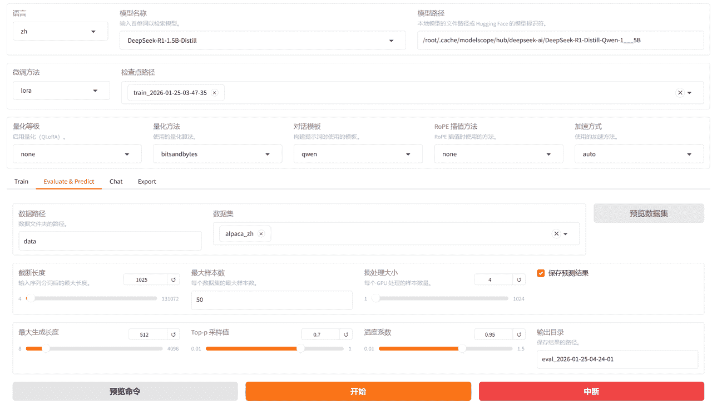

**3. 执行与观察**

+ 点击 **“开始 （Start）”**。

+ **观察控制台/终端：** 进度条跑完后，会打印出类似 `{'BLEU-4': 45.2, 'ROUGE-L': 58.1}` 的分数。

+ BLEU/ROUGE 分数越高，说明模型生成的答案越接近标准答案。

+ **查看结果文件：**

+ 进入 输出目录（界面上显示的路径，如 `eval_2026-xx-xx...`）。

+ 打开 `generated_predictions.jsonl`，你可以看到每一道题模型的回答 vs 标准答案的对比。

## 5. 模型导出 （Export）

**操作区域：** Web UI -> **Export （导出）** 选项卡

如果你想把这个模型打包带走（例如放到 Ollama 里跑），需要进行导出。

1. `检查点路径`： 选择刚才训练好的 Checkpoint。

1. `导出目录`： 输入一个路径，例如 `/root/my_first_model`。

1. 点击 “开始导出 （Start Export）”。

+ 系统会将 LoRA 的外挂参数融合进基础模型，生成一个完整的模型文件。

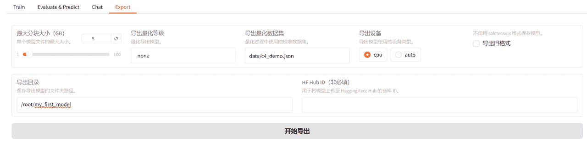

终端上的结果

```
[INFO|2026-01-25 04:27:36] llamafactory.model.model_utils.attention:157 >> Using torch SDPA for faster training and inference.
[INFO|2026-01-25 04:27:43] llamafactory.model.adapter:157 >> Merged 1 adapter(s).
[INFO|2026-01-25 04:27:43] llamafactory.model.adapter:157 >> Loaded adapter(s): saves/DeepSeek-R1-1.5B-Distill/lora/train_2026-01-25-04-15-43
[INFO|2026-01-25 04:27:43] llamafactory.model.loader:157 >> all params: 1,777,088,000
[INFO|2026-01-25 04:27:43] llamafactory.train.tuner:157 >> Convert model dtype to: torch.bfloat16.
[INFO|configuration_utils.py:420] 2026-01-25 04:27:43,048 >> Configuration saved in /root/my_first_model/config.json
[INFO|configuration_utils.py:909] 2026-01-25 04:27:43,049 >> Configuration saved in /root/my_first_model/generation_config.json
[INFO|modeling_utils.py:2988] 2026-01-25 04:27:49,234 >> Model weights saved in /root/my_first_model/model.safetensors
[INFO|tokenization_utils_base.py:2491] 2026-01-25 04:27:49,234 >> tokenizer config file saved in /root/my_first_model/tokenizer_config.json
[INFO|tokenization_utils_base.py:2500] 2026-01-25 04:27:49,234 >> Special tokens file saved in /root/my_first_model/special_tokens_map.json
[INFO|2026-01-25 04:27:49] llamafactory.train.tuner:157 >> Saved ollama modelfile to /root/my_first_model.
```

---

好的，这是为您优化后的第六节：模型服化部署 （API）。

我已经修正了命令中的模板参数（改为 `qwen`），并添加了必要的原理解释，格式上也与之前的文档保持一致，可以直接插入到完整手册的末尾。

---

## 6. 模型服化部署 （API）

**操作区域：** 终端 （Terminal）

**模型导出**只是第一步，要让它真正产生价值，我们需要把它变成一个在线服务。LLaMA Factory 内置了 API Server 功能，可以启动一个完全兼容 OpenAI 接口规范的服务端。这意味着，你可以直接用任何支持 OpenAI 的软件（如 LangChain、AutoGPT 或 Python 代码）来调用你亲手训练的模型。

### 6.1 释放显存 （必要步骤）

由于显卡显存有限，我们必须先关闭之前的训练界面，腾出资源给推理服务使用。

+ **动作：** 在运行 Web UI 的终端窗口中，按下 `Ctrl + C`，确保之前的服务已停止。

### 6.2 启动 API 服务

复制并运行以下命令。

> **💡 关键知识点：** 为什么模板是 `qwen`？

> 虽然模型叫 DeepSeek，但我们使用的是 DeepSeek-R1-Distill-Qwen 版本。它的底层架构和对话格式其实是基于 Qwen（通义千问）的。因此，指定 `--template qwen` 才能让模型正确理解用户的话。

```
CUDA_VISIBLE_DEVICES=0 llamafactory-cli api \
    --model_name_or_path /root/my_first_model \
    --template qwen \
    --infer_backend huggingface \
    --vllm_enforce_eager false
```

+ **成功标志：**

当终端显示 `Uvicorn running on http://0.0.0.0:8000` 时，说明服务已启动，正在监听 `8000` 端口。

（注意：该终端窗口会被占用，请不要关闭它。）

### 6.3 调用测试

保持上面的服务窗口开启，**新建一个终端窗口**，通过以下两种方式验证服务是否可用。

#### 方式 A：命令行快速测试 （Curl）

这是最直接的测试方法，模拟发送一个 HTTP 请求。

```
curl http://localhost:8000/v1/chat/completions \
  -H "Content-Type: application/json" \
  -d '{
    "model": "gpt-3.5-turbo",
    "messages": [
      {"role": "user", "content": "你好，你是谁？"}
    ]
  }'
```

（注：这里的 `"model": "gpt-3.5-turbo"` 只是占位符，服务器实际调用的就是你加载的 DeepSeek 模型。）

+ **预期输出：** 你将看到一段 JSON 格式的回复，其中 `content` 字段包含模型的回答。

#### 方式 B：Python 代码集成 （应用开发）

这是开发实际 AI 应用（如聊天机器人）的标准写法。需先运行 `pip install openai`。

```
from openai import OpenAI

# 指向本地 API，无需真实 Key
client = OpenAI(api_key="empty", base_url="http://localhost:8000/v1")

print("模型正在思考...")
response = client.chat.completions.create(
    model="deepseek",
    messages=[{"role": "user", "content": "请把'机器学习'写成一首藏头诗。"}],
    temperature=0.7
)
print(response.choices[0].message.content)
```

好的，这是为您格式化好的 **6.3 C 项** 内容。我保持了与实验手册一致的排版风格，强调了关键配置项，并加入了针对 AutoDL 环境的连接提示。

您可以直接复制以下内容，粘贴到实验手册的 6.3 调用测试 章节末尾。

---

#### 方式 C：图形化客户端集成 （Cherry Studio）

如果你希望在本地电脑上像使用 ChatGPT 一样与你的私有模型对话，可以使用支持 OpenAI 兼容协议 的客户端软件（如 Cherry Studio、Chatbox 等）。

**1. 准备配置信息**

在配置客户端之前，请先记录以下三个核心参数：

+ `服务类型`： OpenAI Compatible （OpenAI 兼容）

+ `API 域名` （Base URL）: `http://117.50.198.63:8000/v1`

+ 注意：必须以 `/v1` 结尾；请确保 IP 地址是你服务器的公网 IP。

+ `API 密钥` （API Key）: `sk-123456`

+ 注意：本地服务通常不校验密钥，但客户端不允许为空，随便填一个 `sk-` 开头的字符串即可。

+ `模型名称` （Model ID）: `deepseek`

2. 在 Cherry Studio 中配置

1. 打开 Cherry Studio，点击左下角的 设置 （Settings） 图标。

1. 选择 模型服务 （Model Providers） -> OpenAI Compatible。

1. 点击 **添加** ，填入上述的 `API 域名` 和 `API 密钥`。

1. 在下方的 `模型列表` 区域，点击 添加模型，在 ID 栏填入 `deepseek`，保存设置。

1. 点击 “检查” 按钮，如果显示绿色连通标志，说明连接成功。

**3. 开始对话**

回到聊天主界面，切换模型为刚才添加的 `deepseek`，即可开始远程调用你的私有大模型进行对话。

> **💡 网络连接提示：**

> 如果配置后显示“连接超时”或“失败”，通常是因为服务器端口被云平台的安全组拦截。

+ 请确保云服务器控制台（如阿里云/腾讯云/AutoDL）的安全组规则中，入站规则 已放行 `TCP:8000` 端口。

+ 如果是 AutoDL 默认环境，建议使用 SSH 隧道映射端口到本地，或者检查其特定的端口开放策略。

## 📚 附录：

### 云实例连接与防火墙配置指南 （CompShare 版）

本实验基于 CompShare （恒源云） 算力平台。为了能从本地浏览器直接访问实验界面和 API，我们需要进行 SSH 连接并配置安全组防火墙。

#### A. 获取实例登录信息

1. 登录控制台，进入 [我的实例] 列表。

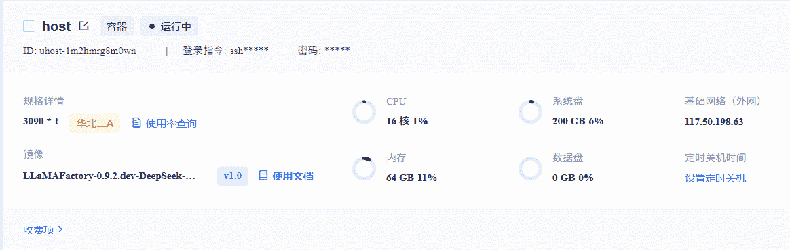

1. 找到正在运行的实例，复制以下核心信息：

+ `公网 IP` （例如 `117.50.198.63`）

+ `SSH 端口` （通常不是 22，例如 `23`）

+ `登录密码` （点击“复制密码”或“重置密码”）

#### B. 使用 SSH 连接实例 （Terminal）

此步骤用于执行实验手册中的训练命令。

1. 打开本地电脑的终端 （Windows PowerShell 或 Mac/Linux Terminal）。

1. 输入登录命令（请替换为你实际的端口和 IP）：

```
# 格式：ssh -p [SSH端口] root@[公网IP]
ssh -p 23 root@117.50.198.63
```

1. 按回车后，输入实例密码（注意：输入密码时屏幕不会显示任何字符，输完直接回车）。

1. 当出现 `root@...:~#` 提示符时，表示连接成功。

#### C. 开放防火墙端口 （关键步骤）

此步骤用于解决“浏览器打不开界面”的问题。我们需要允许外部网络访问 LLaMA Factory 的 WebUI （`7860`） 和 API （`8000`）。

1. 在控制台实例列表中，点击实例名称进入 [更多操作] 页面。

1. 点击顶部的 [配置防火墙] 选项卡。

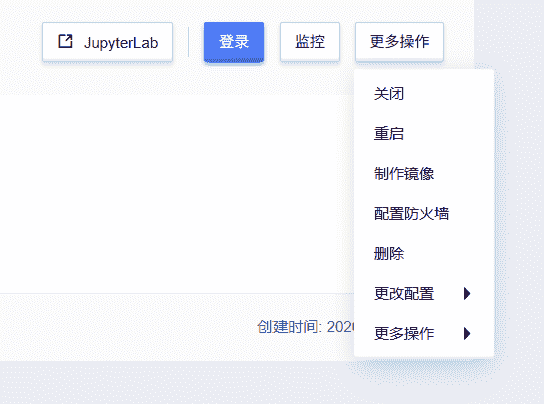

1. 点击 [编辑防火墙规则] 按钮，然后在防火墙规则窗口中，点击 [添加规则] 依次添加以下两条规则：

| 端口范围 | 协议 | 策略 | 说明 |

| --- | --- | --- | --- |

| `7860` | TCP | 允许 | 用于访问 LLaMA Factory 网页界面 |

| `8000` | TCP | 允许 | 用于访问模型 API 接口 |

1. 添加完成后，确保状态为“启用”。

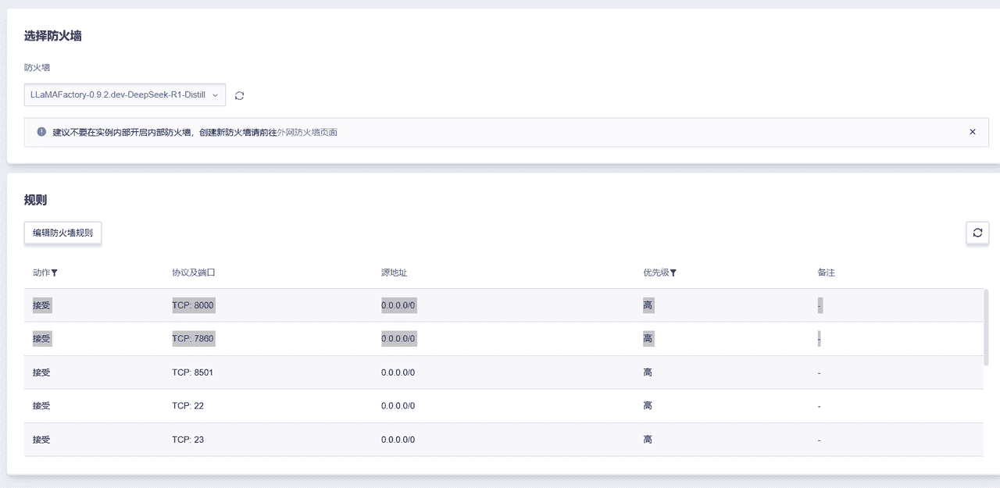

#### D. 访问实验环境

配置完成后，您无需使用复杂的 SSH 隧道，直接通过浏览器或客户端即可访问：

**1. 访问 Web UI 界面**

+ 在启动 Web UI 后（确保未报错），直接在本地浏览器输入：

+ `http://[你的公网IP]:7860`

+ 示例：`http://117.50.198.63:7860`

**2. 连接 API 服务**

+ 在 Cherry Studio 或代码中配置 Base URL 为：

+ `http://[你的公网IP]:8000/v1`

+ 示例：`http://117.50.198.63:8000/v1`

这是一份为您准备的学术资源网络加速指南（Linux 版）。

#### E. 学术资源加速 （Linux）

此步骤用于解决 GitHub / HuggingFace 下载速度慢或连接超时的问题。

CompShare 平台通过专用 DNS 服务器提供加速服务。请在终端执行以下命令进行配置：

**1. 修改 DNS 配置**

直接复制并运行以下两条命令，将系统 DNS 指向平台的加速服务器：

```
# 写入主加速 DNS
 echo "nameserver 100.90.90.90" | sudo tee /etc/resolv.conf

# 写入备用加速 DNS
echo "nameserver 100.90.90.100" | sudo tee /etc/resolv.conf
```

**2. 验证加速是否生效**

运行以下命令测试 GitHub 的解析地址：

```
nslookup github.com
```

+ **成功标志：** 如果返回的 Address 是 `100.90.90.xx` 或其他非公共 IP，说明加速已生效。

**3. 支持的加速域名列表**

配置生效后，访问以下域名将自动走高速通道：


+ `github.com` （代码托管）
+ `huggingface.co` （模型权重）
+ `docker.com` / `nvcr.io` （镜像仓库）
+ `pytorch.org` / `anaconda.com` （环境包）

> ⚠️ 注意：此 DNS 配置在实例重启后可能会失效。如果重启了实例，请重新执行步骤 1 的命令。

## 常见问题（FAQ）

+ Q: 为什么下载模型时没反应？

A: 请务必使用 步骤 2 中的 Python 命令行方式下载。直接在网页填 modelscope 可能会因为网络波动导致 UI 假死。

+ Q: 训练到一半报错 `oss2` 或 `addict` not found？

A: 请回到 步骤 1，确保你在终端里运行了 `pip install ...` 命令，然后重启 Web UI。

+ Q: 为什么我的 Loss 曲线跳动很剧烈？

A: 因为我们的 Batch Size 较小（8），每次只看几道题，难易不同导致波动大，只要整体趋势向下就是正常的。

## DeepSeek-R1-1.5B SFT 微调实验结果分析报告

### 1. 实验概况

+ 基础模型 （Backbone）: DeepSeek-R1-Distill-Qwen-1.5B

+ 数据集 （Dataset）: Alpaca-zh （SFT， sampled 5000 instances）

+ 训练参数 （Hyperparameters）: `Epochs=1.0`， `Learning Rate=5e-5`， `Batch Size=8`， `Max Length=1024`， LoRA。

+ 实验环境：AutoDL / NVIDIA GPU （BF16 Precision）

### 2. 训练过程动力学分析（Training Dynamics）

根据训练过程中的 Loss 曲线（Training Loss）及最终指标，分析如下：

+ 收敛趋势（Convergence）:

模型 Training Loss 从初始的 3.4 左右迅速下降，并在 Step 150 之后逐渐趋于平缓，最终稳定在 2.6 附近。曲线呈现出标准的 “L 型”下降趋势，表明模型有效地从数据集中提取了特征，并完成了对指令格式的适应。优化器（Optimizer）运作正常，未出现梯度爆炸或消失现象。

+ 损失震荡（Loss Oscillation）:

训练曲线表现出一定幅度的震荡（Variance）。这是由于实验设置中 Batch Size （8） 较小，导致随机梯度下降（SGD）过程中的噪声较大。这种震荡属于正常物理现象，且 Loss 移动平均线（Smoothed Line）保持单调递减，说明训练方向正确，小批次带来的随机性未破坏整体收敛性。

### 3. 泛化能力评估（Generalization Capability）

通过对比训练集与验证集（Validation Set， 10% split）的指标，评估模型的泛化性能：

| 指标类型 | 数值 | 含义分析 |

| --- | --- | --- |

| Training Loss （训练损失） | ~2.57 | 模型对训练数据的拟合程度。 |

| Eval Loss （验证损失） | 2.6158 | 模型对未见数据的预测偏差。 |

| Generalization Gap （泛化误差） | < 0.05 | 极低。 |

+ 结果解读：

Training Loss 与 Eval Loss 高度接近（Gap 极小），表明模型处于理想的 Good Fitting（良好拟合） 状态。

+ 未发生过拟合（No Overfitting）: Eval Loss 未出现反弹上升，说明模型没有机械记忆训练样本，而是学到了数据背后的分布规律。

+ 未发生欠拟合（No Underfitting）: Loss 曲线已进入平台期，表明在当前参数设置下，模型学习已达饱和。

### 4. 模型容量与 Loss 绝对值分析（Model Capacity Analysis）

本次实验最终 Eval Loss 收敛于 2.61。针对该数值的分析如下：

+ 参数量约束（Capacity Constraints）:

对于 1.5B 参数量级 的轻量化模型，其特征表示空间（Representation Space）有限。相比于 7B 或 14B 模型（通常 Loss 可降至 1.8-2.0），1.5B 模型收敛在 2.6 区间属于符合 Scaling Law（缩放定律）的预期表现。

+ 数据熵值（Data Entropy）:

Alpaca 数据集包含多领域、多任务指令，信息熵较高。在 1.5B 模型的有限参数空间内，2.6 的 Cross-Entropy Loss 表明模型已达到该架构下的性能瓶颈，继续增加训练轮数（Epochs）对降低 Loss 的边际收益极低，且可能引入过拟合风险。

### 5. 结论（Conclusion）

1. 训练有效性：实验成功跑通了 SFT 全流程，模型完成了从预训练分布到指令微调分布的迁移。

1. 参数合理性：`Epoch=1.0` 与 `Learning Rate=5e-5` 的组合被证明是高效的，成功在短时间内（<1 小时）使模型达到收敛状态。

1. 模型状态：模型目前处于 泛化能力最佳点 （Sweet Spot）。各项指标表明，模型已具备进行下游推理（Inference）的能力，无需进行额外的训练迭代。

建议后续步骤：直接加载该 Checkpoint 进行对话测试，重点评估其在指令遵循（Instruction Following）方面的实际表现。
