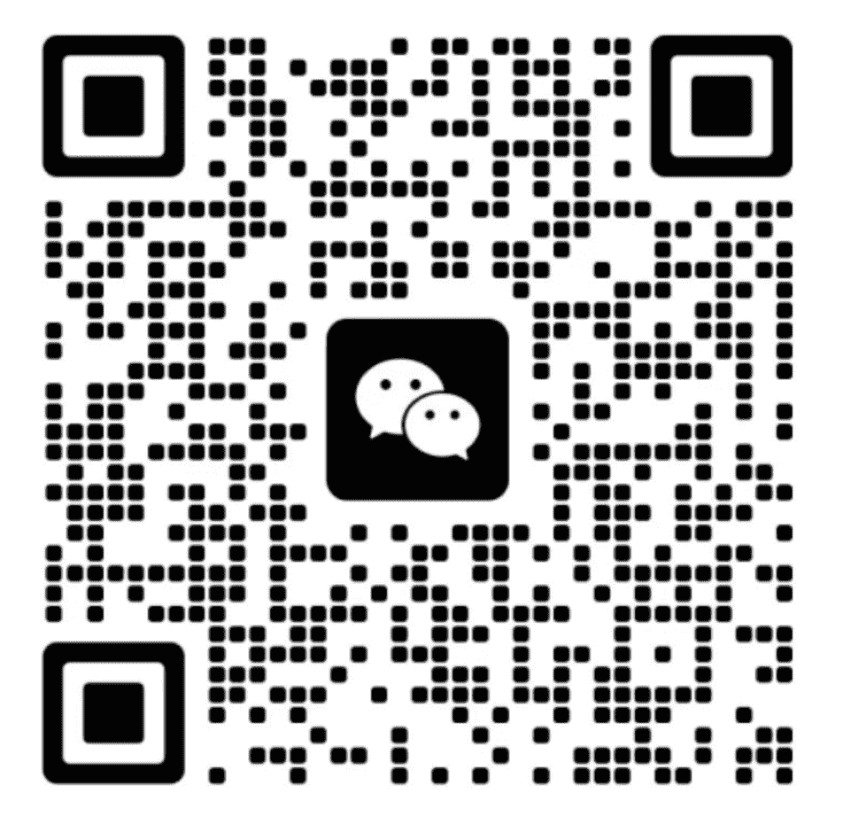

# 两天AI编程，他们最大的收获不是学会写代码

> 来源：[https://now.feishu.cn/docx/Duo5dgg7UoMFisxS5NGcj9TtnUh](https://now.feishu.cn/docx/Duo5dgg7UoMFisxS5NGcj9TtnUh)

行美是一个做汽车产品图的设计师。

来上课之前，她对Cursor有一种本能的距离感——「那个黑黑的界面，感觉会跑很多代码，很难。」

她没想到，两天之后，她会说出这句话：

「原来Cursor是可以听得懂人话的。」

---

我做自然语言造物营，到现在已经跑了25期，线下来过的学员将近300人。

每一期结束，我都会让学员站起来说说这两天最大的收获是什么。

一开始我以为大家会说：「学会了Cursor怎么用」「知道了怎么接API」「跑通了一个完整项目」。

但说了25期之后，我发现几乎所有人真正想说的，都不是这些。

---

**「我以为我不行」**

周健是交互设计师，有产品背景，但对代码有「基因上的抵触感」。

他来之前的认知是：编程是程序员的事，和他无关。

两天结束，他说：「我也可以——作为一个产品经理，不需要靠程序员，可以自己实现一个小demo出来。就像开了一扇大门，我可以和代码打交道，但是我是用我自己的语言跟代码讲的。」

这句话，我在不同的期里听过太多次了，只是每个人说出来的方式不一样。

设计师说：「发现我能做出一个交互，这是一个很大的收获。」

医药从业者说：「没有AI编程之前，觉得这蛮难的、好复杂。现在有AI，很多懂专业知识的人，用AI编程就能做出结合性的新产品出来。」

一个53岁从没碰过代码的服装设计师，临时报名，两天做了四个工具，解决的是她做了十几年生意里真实存在的痛点。

还有一个硅谷创过业、总觉得想法很多但实现很难的人，Michael，两天下来说了一句话：

「那种老板当得太舒服了，好几个牛马在给我用，特别好玩。有想法啪一下就出来了，那种感觉。」

他后来推荐外甥来学，跟外甥说的是：「不要学编程了，有想法就能马上弄出来，就这样。」

---

**「超出我预期的，不是软件」**

一个做家庭图书管理系统的学员，叫王敏乐，完成展示之后，老师问他感受。

他说的不是「AI挺好用的」，而是：

「以前没有AI编程之前，没有任何一个服务商会给任何一个普通人做一个家庭图书管理系统。但我觉得有了AI编程，我们家里其实有很多可以用软件的场景，只是我们没有意识到，现在这件事情会越来越多了。」

这句话触动了我。

他做的不是一个多厉害的产品，就是一个扫ISBN条形码录入书籍的桌面应用。但他第一次意识到——软件这件事，可以是每个人自己的事，而不只是公司和程序员的事。

还有一个叫傅枭枭的学员，她发现市面上的雅思背词软件都没有「词组收录」功能，于是自己做了一个。

做完之后，她的反应不是「我好厉害」，而是：「原来缺什么，可以自己补上。」

这是一种以前从来没有出现过的体验。

---

「最大的收获，是发现自己真正想要什么」

这是我在所有感悟里读到的，最出乎意料的一类。

13期有个叫Ares的学员，他做了一个会议纪要生成工具，做着做着，他说：

「你设计这个产品的同时，一定程度上也在定义你自己真正的需求。我通过这个课改了非常多不同版本的文本框架，这个时候我最终在思考的是——我要的这个框架到底是什么样子的，哪些信息我是不需要的，哪些对我来说是最关键的。」

做产品，是认清自己需求的过程。

这是一个我自己都没有预料到学员会说出来的答案。

还有25期的单昱童，医药公司的，她总结了一句话：

「AI其实是一个人认知的外向化的东西。你的认知到达什么高度，你的边界到达什么高度，他就能把你想象的东西更好地完成。你自己是1，他最多做出3；你是100，他可能达成300。」

所以AI编程之后，她的结论不是「可以躺平了」，而是：「反而更需要把自己武装好。」

---

**真正的门槛，不是代码**

做了25期之后，我越来越清楚地看到一件事：

大多数人以为学AI编程的门槛是「技术」。

但真正让人卡住的，从来不是代码。

是——你有没有一个清晰到可以被描述出来的想法。

代码这件事，AI已经可以做了。

但你想解决什么问题，你的用户是谁，这个功能对你来说是真正需要的还是感觉应该有的——这些，AI替代不了你。

这就是为什么两天之后，学员的感悟不是「学会了Cursor」，而是「第一次发现，我的想法可以被做出来」。

那个瞬间，很多人会重新想一遍：我到底一直以来想做什么？

---

如果你也有一个一直放在脑子里、从来没有真正动过的想法，

欢迎加我微信聊聊。

不一定是来报名，就是聊聊你的想法——

有时候，说出来的那一刻，事情就开始了。

