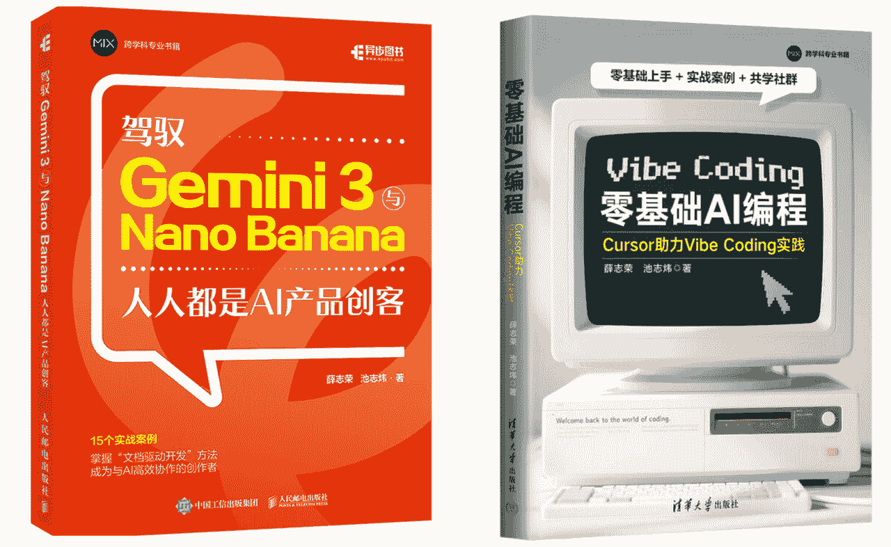
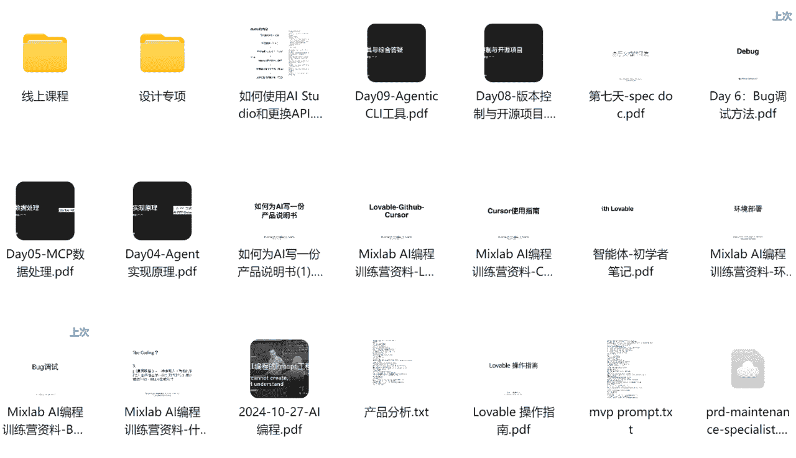
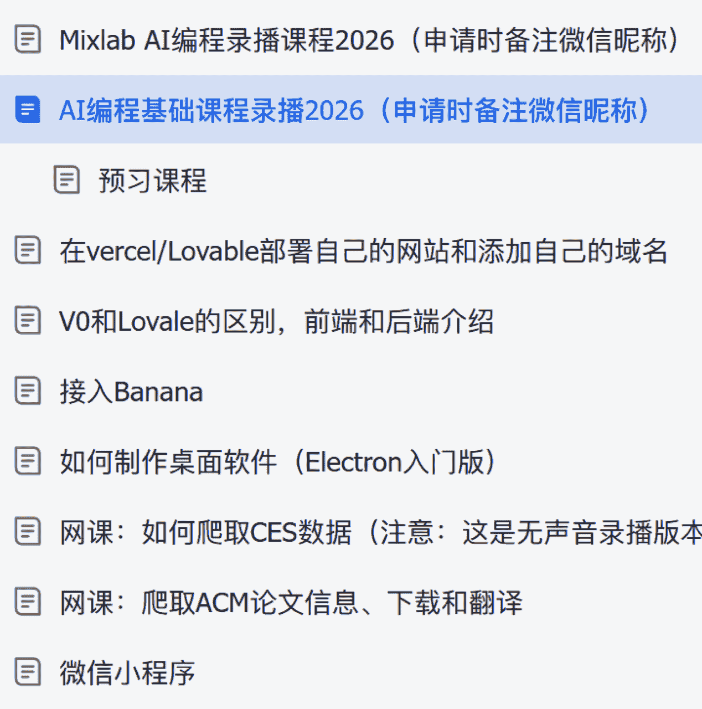
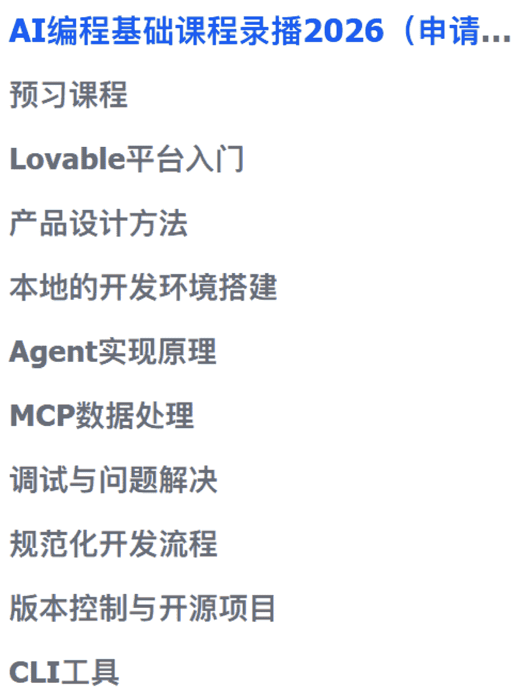

# AI编程 线上训练营（2.3-2.12）N24期

> 来源：[https://now.feishu.cn/docx/Py3YdMygqonujPx5cM9cyJZknhe](https://now.feishu.cn/docx/Py3YdMygqonujPx5cM9cyJZknhe)

## 人人都是AI产品创客

> 2周沉浸式实战 · 晚上20:00–21:30 · 零代码基础友好

> **早鸟价：¥2499（含6节直播 + 配套录播 +** 2本书籍 + 作业批改 + 打卡返现）

> 每完成1节课作业，返¥50奖学金（最高返¥300）

> 赠送书籍+配套录播课（价值¥868）+ 专属社群 + 电子证书

---

## 🌱 你不是来“学技术”的，你是来“成为AI产品创客”的。

在AI原生时代，**创造门槛正在消失**。

你不需要会写代码，但你需要会**定义问题、指挥AI、交付工具**。

这正是“AI产品创客”的新身份：

+   你能用自然语言描述需求 → AI产品经理为你拆解

+   你能用一句话描述界面 → AI设计师为你出图

+   你能说出功能逻辑 → AI工程师为你写代码、部署上线

你，就是那个发号施令的“创造者”。

在第24期 Mixlab AI编程训练营，你将亲手组建自己的AI团队，并在2周内，把一个模糊的“痛点”，变成一个真实可用、可分享、可迭代的AI原生产品。

---

## 🎯 核心理念：带着问题来，带走打造工具的能力

无论你是：

+   想自动产出小红书/视频号内容的IP主理人

+   想为学生打造交互式教材的高校老师

+   想快速验证商业想法的创业者

+   想提升效率的产品经理或设计师

只要你有一个**真实想解决的问题**，你就能在这里，**以“创客”身份**，把它变成一个属于你的AI产品。

---

## 📅 训练营安排：2周 · 6次直播 · 1个完整AI产品

时间：2026年2月3日 – 2月12日

**直播日：2/3、2/5、2/7、2/8、2/11**、2/12（每晚20:00–21:30）

形式：腾讯会议直播 + 专属社群 + 作业反馈 + 导师陪伴

---

### 🔧 开营前准备（建议提前完成）

- 观看预习录播：完成环境搭建

- 填写「我的痛点」表格：写下你想解决的具体问题（这将成为你的创客项目起点）

---

###  🗓 创客成长路径：6步，从想法到上线

####  第1课｜2月3日（周二）｜AI产品经理上线

主题：把模糊痛点，变成可执行的MVP

- 用AI分析你的需求：从“我觉得”到“用户需要”

- 输出《AI产品说明书》：场景 + 功能 + 流程

✅ 作业：提交你的MVP文档

#### 第2课｜2月5日（周四）｜AI设计师上线

**主题：一句话生成高保真原型**

- 用 Stitch 输入文字，自动生成UI界面

- 结合参考图+提示词，引导设计风格

✅ 作业：提交原型截图 + 设计说明

#### 第3课｜2月7日（周六）｜AI初级工程师上线

主题：用AI Studio把想法变代码

- 多模态输入（文本+图像）驱动前端生成

- 生成可运行的交互原型

✅ 作业：提交可运行链接

#### 第4课｜2月8日（周日）｜AI中级工程师上线

主题：用Cursor精修你的产品

- 搭建本地开发环境，配置专属Agent规则

- 添加状态管理、API调用、错误处理

- 学会切换LLM，让AI更懂你

✅ 作业：提交优化后项目截图

#### 第5课｜2月11日（周三）｜创客答疑日

**主题：卡点清零，加速冲刺**

- 导师集中解答共性问题

- 社群1对1提问，轮值导师响应

✅ 作业：提交当前进展 + 1个关键问题

#### 第6课｜2月12日（周四）｜创客作品展

主题：发布你的第一个AI原生产品！

- 3分钟路演展示你的工具

- 导师点评：产品逻辑 × 技术实现 × 用户体验

- 优秀作品将被推荐至 **Mixlab AI编程社区** 展示

✅ 结营：颁发电子证书 + 项目归档

---

## 💰 创客激励计划：打卡即返现

+   每完成1次作业，返¥50

+   共6次，最高返¥300

---

## 👥 谁是AI产品创客？

+   **99%零代码基础**：无需编程经验

+   **65%为产品经理 & 设计师**：不再等待开发排期

+   **20%为高校教师、博士、研究生**：打造教学/研究智能体

+   **创业者、自媒体**人、品牌运营者……只要你想用工具解决问题，你就是创客！

---

## 🎁 为什么选择Mixlab线上训练营？

- **人人皆可创造**：不教语法，只教如何指挥AI

- **真实问题驱动**：不做玩具，只做能用的产品

- **强反馈闭环**：作业批改 + 答疑 + 社群共创

- **永久回看**：配套录播 + 工具指南随时复习

- **生态支持**：结营后可加入Mixlab历届学员群，持续共创

---

## 💡 报名信息

- 早鸟价：¥2499/人，两人¥4799，三人¥6999

✅ 含6节直播 + 配套录播课（¥699）

✅ 赠送2本AI编程纸质书籍

✅ 作业批改 + 专属社群 + 打卡返现资格

- **时间**：2026年2月3日 – 2月12日，晚上20:00–21:30

- **平台**：腾讯会议 + 微信社群

- **咨询**：联系 litnmnm

### 赠送内容

---

> 未来不属于程序员，而属于会指挥AI的创造者。

> 在这里，没有“用户”，只有“创客”。

**> 你不需要成为**工程师，但你可以成为自己产品的CEO。

第24期 Mixlab AI编程训练营，

邀请每一位想用AI解决问题的人，

成为AI原生时代的“产品创客”。

---

立即报名，开启你的AI产品创造之旅。

