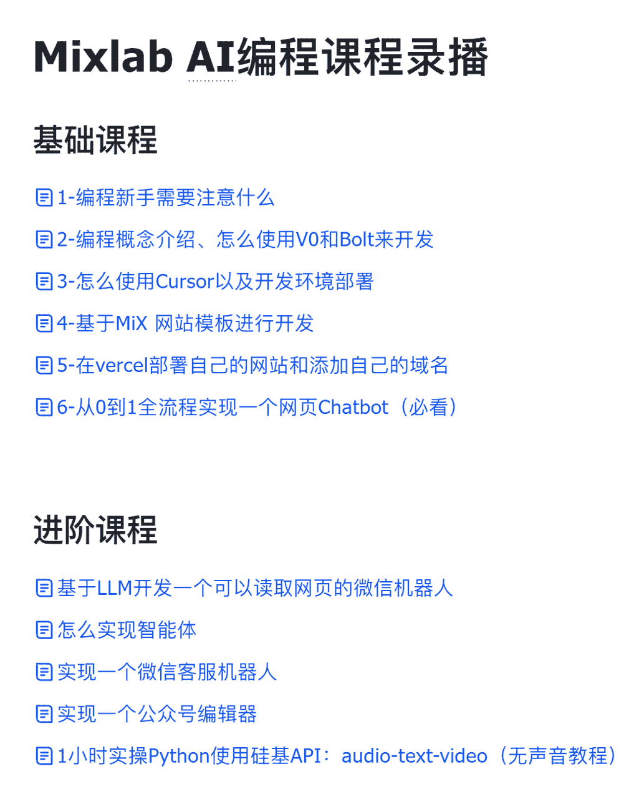

# Mixlab AI编程线下训练营@上海N5

> 来源：[https://now.feishu.cn/docx/GP01dEAU6oUKFmxNf3Lc1EXhncc](https://now.feishu.cn/docx/GP01dEAU6oUKFmxNf3Lc1EXhncc)

在经历了四期训练营的沉淀后，我们用心聆听了学员们的建议并重新设计了训练营结构，第五期Mixlab AI编程线下训练营带来了全新升级：

+   **3小时前置线上课程**：提前掌握基础知识，不再手忙脚乱

+   **2天线下实战**：更充足的动手时间，更深入的技术指导

+   **课后线上进阶课程**：不断扩充新项目，总有一项是你感兴趣的

## 学员真实反馈

在过去的四期训练营中：

+   课程满意度高达**4.4**分（满分5分）

+   推荐度NPS达到**8.1**分（满分10分）

+   **88%**的学员在训练营期间就完成了实战项目

+   **20%**的学员从北京、香港等地专程来上海参训

### 多元化的学员构成

我们的学员来自各行各业：

+   **40% **互联网从业者（设计师/产品经理）

+   **10% **高校教师（覆盖985到二本院校）

+   **15% **在读研究生（覆盖985到二本高校）

+   **10% **程序员

+   **25% **创业者和其他职业

## 来自不同领域的蜕变

### 设计师的突破

"以前做设计只能画原型图，现在整个工作方式都变了。最近的一个社区团购项目，我先用AI编程做了个简单的下单流程Demo。虽然界面很简陋，但用户可以真实体验整个流程，当场就发现了很多交互问题。比如我们设计的'滑动选择商品规格'功能，年长用户完全不会用，他们更习惯点击选择。如果是传统方式，等开发做完才发现这问题，改动成本至少要一周，现在半小时就能调整好让用户再试。"

### 产品经理的跃迁

"以前做需求讨论，开发总说'实现不了'，我也不知道到底是真的做不了还是他们不想做。现在我能自己用AI编程快速做个Demo，验证想法的可行性，和开发讨论时底气也足了。最近一个需求，用AI编程两天就做出了原型，当场演示给用户看，早期发现了很多问题，省去了大量返工时间。"

### 高校教师的创新

"作为设计学院的计算机老师，最近的教学任务让我压力很大。学院新开了'AI艺术创作'和'交互设计'课程，但我对前端开发、UI设计这些完全不熟悉。通过训练营，我不仅自己做出了展示学生作品的网站，还发现AI编程特别适合我们的学生 - 他们不需要懂太多技术细节，只要把想法用自然语言描述清楚就能实现。现在我的教学思路完全改变了，不再纠结于传授繁琐的语法细节，而是引导学生关注创意和设计思维。"

### 研究生的蜕变

"我是工业设计专业的，本来打算做个普通的产品设计系统。但开题时导师要求必须加入AI功能，这让我很慌。看B站自学编程卡在环境配置上好几天，找计算机学院的同学帮忙，人家都在忙春招没空。通过训练营后，我用AI编程实现了设计创意生成和评估工具 - 用ComfyUI生成设计方案，再用多个AI角色（艺术指导、用户体验专家、市场分析师）来评估设计。整个过程我都参与其中，对每个技术环节都很清楚，开题答辩讲得特别有底气。"

这些转变的背后，是他们在课程中实实在在做出的项目：

+   聊天机器人与公众号矩阵管理系统

+   个人博客与RSS资讯聚合平台、邮件处理应用

+   基于多Agent的创作系统

+   营养师咨询网站、塔罗牌应用

+   舆情分析、数据分析可视化面板

## 为什么选择我们？

### 1. 实战导向

+   真实项目驱动学习

+   **88%**的学员在训练营期间就完成实战项目

+   每个项目都能立即应用到工作和生活中

### 2. 体系化训练营

+   小班制指导**（限额15人）**

+   根据学员背景动态调整实战项目

+   全程导师团队技术指导

### 3. 完整的知识体系

+   训练营前：3小时核心知识点视频学习

+   训练营中：2天沉浸式实战演练

+   训练营后：持续更新的线上进阶录播课程和社群交流

### 4. 超值礼包

+   MixCopilot一年会员（价值￥700）

+   专业建站工具包与教程（价值￥399）

## 训练营信息

+   线下课程时间：1月4 - 1月5（周六、周日）

+   地点：上海市普陀区 @上海天地软件园

+   人数：限额15人

+   要求：自备笔记本电脑（Windows/Mac均可）

+   价格

+   12月25号前付款：1499元

+   12月25号后付款：1799元

## 立即报名

报名：联系opus

报名社群中转站：

## Mixlab AI编程知识库和社区

[Mixlab AI编程社区](https://qwyofiv4bd3.feishu.cn/wiki/Q8CswPRwJiOEoTkWFk6cQdL8nne)

## 前四期相关学员回访

[在上海的四期AI编程训练营，我看到的故事与感悟](https://qwyofiv4bd3.feishu.cn/wiki/En4vwF0yPiYT48klLGWcbETUnac)

[毕设选题：AI Agent 全栈设计#AI编程训练营 - 学生回访](https://qwyofiv4bd3.feishu.cn/wiki/MtP1wHNKxijhXOkyo2lcVVzInRh)

[AI让创造变得越来越简单，让每个人都能把想法变成现实。#AI编程训练营 - 设计师回访](https://qwyofiv4bd3.feishu.cn/wiki/GYp4wGj9Fi4YDikwzlOcecDznRg)

[高校老师为何热衷学习AI编程？#AI编程训练营 - 老师回访](https://qwyofiv4bd3.feishu.cn/wiki/JDV0wQwvKindvCkDVbLcMb8tnOg)

[AI编程线下训练营 - 程序员回访 - 初稿](https://qwyofiv4bd3.feishu.cn/wiki/GsU9wbgNGiSEiZk7RIwch7ZKn6k)

[AI编程线下训练营 - 产品经理回访 - 初稿](https://qwyofiv4bd3.feishu.cn/wiki/P52QwpYNPiYGQZkCJ3hckawknYf)