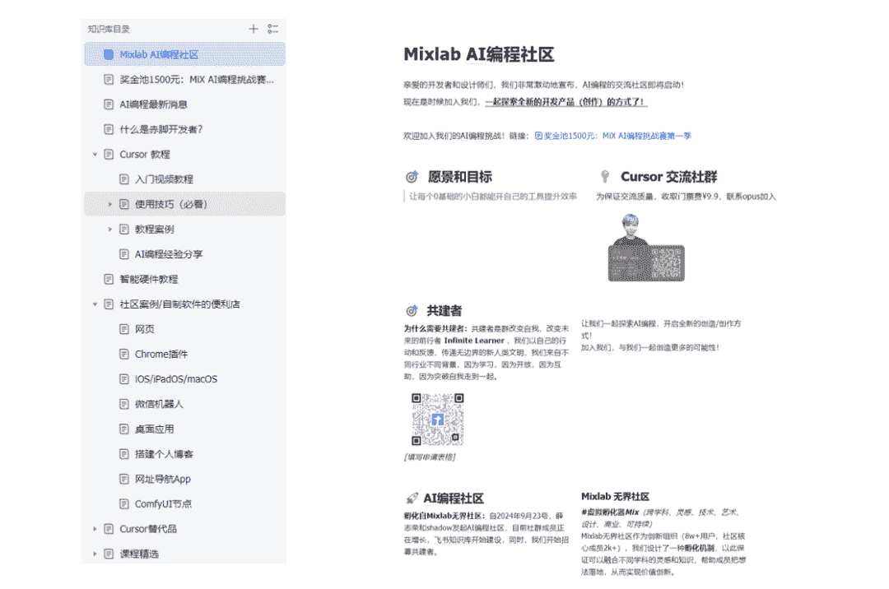
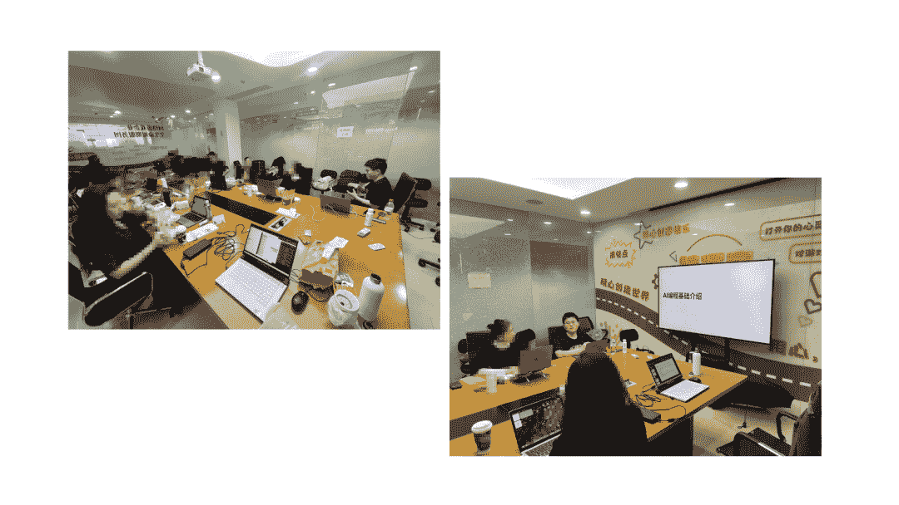

# 入门AI编程的经验和个性化软件趋势#刻意练习和提问的重要性

> 来源：[https://now.feishu.cn/docx/Cwxndty9Lo2vfBxdTA1caV3tnbc](https://now.feishu.cn/docx/Cwxndty9Lo2vfBxdTA1caV3tnbc)

大家好，近期，[我和薛志荣高密度建设了AI编程的](http://mp.weixin.qq.com/s?__biz=MzA3MDgyMjMwMA==&mid=2649976279&idx=1&sn=9df527043954b8e491626512a51401aa&chksm=87313d24b046b432edec3042c1670aa7b38fa39caf99d7720d2d6a6592fcd8bd07e3a2b9a82f&scene=21#wechat_redirect)**社区：交流社群、**[知识库、训练营、竞赛等](http://mp.weixin.qq.com/s?__biz=MzA3MDgyMjMwMA==&mid=2649976138&idx=1&sn=ef0a48a78b239d625d0b9f2bd063a103&chksm=87313db9b046b4af8daaea576d49c1eebb84a588c4d5dbe29f105442c1e626aa3a1e723d7a10&scene=21#wechat_redirect)。[

目前已经初具](http://mp.weixin.qq.com/s?__biz=MzA3MDgyMjMwMA==&mid=2649976303&idx=1&sn=22aab06f49a018eccaa03f32a61b3812&chksm=87313d1cb046b40a84e8cb35977836891545b7a5c97a765d2431922e086e01f3b993d8dc9c98&scene=21#wechat_redirect)规模，高质量社群聚集了130多位爱好者，知识库积累了大量的教程和社区成员的案例，成功举办2期线下训练营，竞赛正在进行中。

[Mixlab AI编程社区](https://qwyofiv4bd3.feishu.cn/wiki/Q8CswPRwJiOEoTkWFk6cQdL8nne)

shadow：在26、27号，两天密集的线下训练营顺利完成，但我忘了拍照，全程都在讲解、Debug、和AI一起敲代码～

**

有三个体会和大家分享下：

****

1/ 一切的经验来自****于刻意练习

实践出真知，没有****亲自参与，**你永远无法得到答案，通过AI编程制作自己的“梦想”APP，你也许不敢想象，担心无法完成。

传统的学习编程路径是学习基础概念、学习简单的示例，耗费大量的时间阅读、理解，当开始实践，开始碰到各种问题（比如报错），找不到解决的办法，你的编程入门之路，就被“飘红”所关闭了。

AI编程，最大的特点是实时反馈，边实践边学习，LLM（大语言模型）具备庞大的编程知识和能力。通过AI编程和人类专家指导，初学者编程的入门之路从以往1个月，压缩到1天。

2/ 敢于尝试陌生领域

普通人对自己的知识盲区，有一种天然的“逃避”思维，人总是会潜意识地选择停留在自己的舒适区。

如果你想要遇到更好的自己，终身学习这个习惯是必须要保持的，在这个学习过程，我们怎么能跳出舒适区，挑战陌生领域（跨行业）。

因为有大模型AI的辅助，我们随时都可以有一位编程的AI专家，结伴编程。

他是你非常得力的助手和老师。

3/ 以前提计算思维、设计思维，我们应该更多提 ［ 提问思维 ］

计算思维，让我们可以把任务拆解成一个个小步骤，逐个击破。设计思维，帮助我们把问题清晰化、目标化。

使用GenAI，我们要频繁的修改我们的问题。提问技巧，决定了你在几个回合可以得到你要的结果。

优秀的提问思维，往往可以在3个回合以内，得到结果。

也许，以后的考题是谁在最短的时间用AI完成最多的题目。

有了AI编程，人人都是产品经理，想要什么软件，尽管给AI提需求。

明显的趋势

我们今天所使用的APP是标准化产品，产品经理试图用一款APP满足大量用户的需求。

但很明显，还有大量长尾需求未被满足。于是，就有了丰富多样的“小程序”生态。

但这种软件提供方式，是中心化的，仍然无法满足长尾用户的需求。

AI编程，让我们每个普通人都可以自己定制“想象中”的软件，这种方式是去中心化的。

我们每个人所使用的APP，都将被定制化。

想象一下，你的手机里都是你自己“开发”（给AI提需求）的APP。

shadow版🛰️、shadow版qq邮箱、shadow版Keynote等等，都是我自己开发的。

你也许曾经想过这个事情，现在技术（GenAI生成代码）正在让这件事变得越来越可行。比如训练营上，每个人都有自己想要实现的APP，有些是关于工作的，有些是个人生活所需要：数据分析、邮件分类整理、塔罗牌、健康打卡、时间管理等等。

一千个读者就有一千个哈姆雷特。

软件也如此，让我们制造属于自己的软件吧！