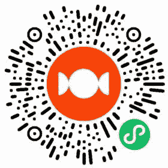

# 🚀 3小时AI奇迹："手搓"一个真APP，不写一行代码

> 来源：[https://now.feishu.cn/docx/TAPqdfS2QogZtHxrPm6cwEJwnDh](https://now.feishu.cn/docx/TAPqdfS2QogZtHxrPm6cwEJwnDh)

# 🚀 3小时AI奇迹："手搓"一个真APP，不写一行代码

**2026年2月8日（周日）下午****

广州未来社·53****3

硅谷最火的"氛围编程"降临**广州

---

## 💥 一场被验证过290次的认知颠覆

想象一下这些画面：

**上班族老王**，周末花2小时"手搓"了一个读书笔记整理器，周一就在办公室炫耀。

**产品经理小李**，给团队做了个需求收集神器，再也不用跪求程序员哥哥排期。

**11岁的朵朵****，周末在家做出了奥数**学习网站，题目难度会自动匹配她的水平——她妈妈在旁边都看呆了。

**这不是科幻，这**是过去23期训练营里真实发生的魔法。

更炸裂的是：这些人之前连代码是什么都不知道。

[学员优秀作品摘选](https://qwyofiv4bd3.feishu.cn/wiki/JM4Kwxixsi5IzlktTkwclNs8nyg)

---

## 🤯 编程？不，这叫"指挥AI干活"

### 还活在上个时代的编程认知？

+   ❌ 背诵天书般的代码语法

+   ❌ 漏写一个分号程序就崩溃

+   ❌ 学三年才能做出能看的东西

+   ❌ 只有理工男才能玩转

### 2026年的真相震碎你的世界观：

+   ✅ **用说话的方式告诉AI你想要什么**

+   ✅ **AI像黑客帝国一样自动生成代码**

+   ✅ **30分钟就能做出能用的工具**

+   ✅ 会表达想法 = 会编程，就是这么颠覆

这叫 **Vibe Coding**（**氛围编程**）——**目前硅谷最火、最前沿的开发方式**。

马斯克说："我们已进入奇点。"

马化腾说："AI是唯一值得大力投入的方向。"

而你，即将在3小时内成为这场革命的亲历者。

---

## 🎯 3小时后，你会拥有什么超能力？

### 解锁黑科技技能包

驾驭AI Studio的魔法能力

+   像指挥官一样用自然语言调度AI

+   从脑海中的模糊想法到屏幕上运行的程序

+   看着代码像瀑布一样自动生成，享受创造的快感

+   遇到Bug？把问题甩回给AI，让它自己修！

**把想法变成工具的魔法**

+   不需要学编程语法

+   不需要懂技术原理

+   **只需要会说人话**

+   **AI秒懂你的意图，自动写代码**

### 走出教室，你能做什么？

+   为自己和家人开发各种实用Web应用

+   自动化那些烦人的重复工作

+   快速验证产品创意

+   **不再被现成软件的功能限制束缚**

+   **成为"创造者"而非"消费者"**

### 这是一门入门实战课（不忽悠版）

**我们会给你：**

+   ✅ AI Studio从0到1的完整攻略

+   ✅ 与AI对话的"咒语秘籍"

+   ✅ 开发简单到中等复杂度工具的能力

+   ✅ 遇到问题的调试技巧

**我们不会忽悠你：**

+   ❌ 3小时成为专业程序员（别做梦）

+   ❌ 开发商业级复杂系统（那是另一个课）

+   ❌ 教你高深的架构理论（没用且枯燥）

**目标很明确：让零基础的你能够独立开发**实用工具，解决真实问题，体验创造的快感。

---

## 🎮 3小时，经历一场创造的狂欢

这不是"听课"，这是**一场创造的冒险**。

### 第一幕：你好，未来指挥官（30分钟）

**闪电上手AI Studio**

+   界面长啥样？核心按钮在哪里？

+   如何用"咒语"让AI精准理解你的需求

+   完成第一个待办事项管理器——看着它跑起来的那一刻，你会倒吸一口凉气

重点不是技术细节，而是让你的大脑炸裂：原来我真的可以做出东西！

### 第二幕：黑客马拉松——现场造梦（2小时）

带着真实需求来，带着能用的工具走

**这是最爽的部分。不**做Demo，不做练习题，做你真正想要的东西：

+   想做学习神器？现场造

+   想做数据处理工具？现场搓

+   想做记账管家？现场撸

+   想做内容整理助手？现场搞

**现场魔法教学**

+   如何把脑子里的混沌想法，转化成AI能理解的清晰指令

+   Bug来了怎么办？把错误甩回给AI，让它自己Debug，爽到飞起

+   如何调优，让工具真正好用

+   如何判断需求是否在AI Studio能力范围内

+   体验从想法→文档→可运行程序的完整魔法

**更炸裂的隐藏福利**

教你如何在手机和电脑**上免费使**用自己做出来的AI工具。

这意味着，你做出的不是课堂Demo，而是能带回家、随时用、可以炫耀给所有人的真工具。

### 第三幕：发布与高光时刻（30分钟）

**你的作品闪耀时刻**

+   看看大家都做了什么黑科技？

+   偷学别人的创意和思路

+   获得导师的优化建议

+   看到不同需求在AI Studio上的魔法效果

---

## 📋 你可能会造出什么黑科技？

根据过往学员的经验，可能是：

**工作神器**

+   自动化数据处理工具（告别Excel地狱）

+   文档生成器（一键生成报告）

+   内容整理助手（知识管理革命）

+   客户信息管理表单（CRM自己造）

**学习利器**

+   专属错题本系统（比任何APP都懂你）

+   单词记忆小游戏（寓教于乐）

+   知识点练习网站（自适应难度）

+   阅读笔记整理器（读书效率翻倍）

**生活助手**

+   符合自己习惯的记账应用（甩开那些臃肿的APP）

+   家庭日程管理器（全家人的时间管家）

+   菜谱随机生成器（今天吃啥不再纠结）

+   运动打卡工具（健身督促器）

核心原则：解决你的真实问题，而不是做无用的Demo

---

### 为什么这种方式炸裂到没朋友？

**培养AI时代真正重要的能力**

+   不是背知识点，而是学会提出好问题

+   不是做题，而是学会拆解问题

+   不是被动接受，而是主动创造

+   **这是AI时代最核心的生存技能**

**建立创造者思维**

+   建立"我能做工具"而非"我只能用工具"的思维

+   遇到问题第一反应是"我能不能做个工具解决"

+   **这是AI时代最核心的竞争力**

---

## 🎓 导师介绍：你的AI编程领航员

**薛志荣**

国内首批Vibe Coding实践者和布道者， 不讲大道理，只做真项目。不画饼，只给干货。

23期训练营，290+零基础学员的奇迹制造者

+   学员满意度 4.5/5

+   93%学员在训练营期间就完成项目

+   从11岁孩子到退休人员都能带飞

+   见证过无数次"我竟然做出来了"的震撼瞬间

Vibe Coding系列书籍作者

+   《驾驭Gemini 3与Nano Banana》

+   《零基础AI编程》

+   《人人皆可Vibe编程》

---

## 💬 学员真实炸裂反馈

> "作为文科生，从没想过自己能做出网页。3小时后我的世界观被重建了。"

> "最大的收获不是技术，而是思维方式的颠覆。原来我可以不被任何工具限制。"

> **"给儿子做了奥赛**学习网站，题目难度、讲解方式都根据他的学习进度定制。他妈妈都惊呆了。"

> **"11岁的女儿现**在遇到问题第一反应是'我能不能做个工具来解决'，这种思维太值钱了。"

> **"作为产品**经理，现在可以快速做出原型验证想法，不用等开发排期了。爽到飞起！"

---

## 🎯 这门课为谁而生？

### ✅ 特别适合这些人

**成人学员：**

+   零代码基础，想用AI解决工作生活问题的实用主义者

+   有想法但不知如何实现的创意者

+   想为自己或家人定制工具的人

+   产品经理、设计师、运营等想提升效率的职场人

+   对AI充满好奇，想真正上手体验创造快感的人

+   **想在AI时代不被淘汰的焦虑者**

**亲子学员：**

+   想给孩子打开新世界大门的前沿家长（孩子10岁+）

+   希望培养孩子创造力和问题解决能力的家庭

+   想让孩子体验"创造者"而非"消费者"角色的家长

+   想让孩子在AI时代成为"指挥官"而非"打工人"的家长

### ❌ 不太适合

+   只想听理论、不愿动手的"思想家"

+   期待速成为专业程序员的幻想家

+   想学习复杂系统架构的技术专家

---

## 📝 报名信息

### 时间与地点

**时间：**** 20****26年**2月8日（周日）下午 14:00-17:00

地点： 广州未来社·533（天河路533号）

时长： 3小时

### 费用

**单人票：** 298**元

双人**票： 498元（相当于249元/人）

### 费用包含

✅ 3小时魔法般的教学与指导

✅ 课后学习社群（持续充电）

### 名额限制

**为保证**教学质量和体验，本期仅限 40人

**手慢无！**

---

## ⚠️ 重要准备事项（必看）

### 必备装备

**iPad或笔记本电脑**

亲子同行可共用一台**，记得带充电器**！

### 账号准备（必需）

**Google账号**

提前注册，建议在家测试能否正常登录Google AI Studio。

### 思考准备

**想好1-2个你想解决的实际问题****

可以是工作上的，也可**以是生活中的。带着问题来，更有针对性。

> 💡 提**示： **不确定如何准备？报名后会收到详细的预习指南。

---

## 🔥 为什么现在是最炸裂的时机？

### 技术成熟度炸裂

Gemini 3 Pro让AI编程门槛降至历史最低。你只需要清晰表达想法，AI就能秒懂并执行。

### 免费且强大

Google AI Studio提供免费访问**，无需付费订阅，适合个人和家庭**长期使用。这是白嫖最强AI的黄金窗口期。

### 验证过的魔法方法

23期训练营沉淀的实战经验，99%学员都是零代码基**础，93%都在课程期**间完成了自己的项目。这不是理论，是魔法。

### AI奇点已至

+   马斯克："我们已进入奇点"

+   马化腾："AI是唯一值得大力投入的方向"

+   Midjourney创始人：圣诞假期敲的代码比过去十年还多

**不是未来，是现在。****

不是趋势，是革命**。

---

## ❓ 常见疑问（打消你的顾虑）

### Q: 完全没有编程基础，真的能学会吗？

**能！而且会颠覆你的认知！** 99%的学员都是零代码基础。Vibe Coding的核心是用自然语言表达想法，而不是写代码。你会表达，就能创造。就是这么魔幻。

### Q: 这是入门课吗？学完能达到什么水平？

**是的，这是一门入门实战课。** 学完后你能：

+   独立使用AI Studio开发简单到中等复杂度的Web应用

+   了解AI Studio的能力范围，知道什么能做、什么不能做

+   具备自己继续学习和探索的基础

+   拥有"我能做工具"而非"我只能用工具"的思维

**不能：**** 开发复杂的**商业系统，需要专业程序员介入的项目。我们不忽悠。

### Q: 孩子多大可以参加？

**建议10岁以上。**** 最小的学员是11岁**女生，现在已经能独立开发自己的学习工具了。亲子同行效果更炸裂。

### Q: Gemini 3真的免费吗？

**是的。** Google AI Studio提供免费访问。**工作坊会教你如何**正确使用，确保长期免费。这是白嫖的艺术。

### Q: 3小时真的能做出东西吗？

**能！而且会超出你的想象！**** 简单应用30分钟就**能完成。3小时足够做出一个解决实际问题的工具。亲眼见证奇迹的时刻。

### Q: 我没有梯子怎么办？

报名后会提供详细指南。这是上课的必备条件，请务必提前准备好。

### Q: iPad可以吗？

**iPad和电脑都可以**，只要能稳定访问网页浏览器。亲子同行可以共用一台设备。

---

## 🌟 最后想说的

这场工作坊不是终点，而是**一扇通往新世界的门**。

**门后是：**** 原来我****也可以创****造工具

**门后是： 原来AI时代需要的不是标准答案，而是好问题

门后是： AI Studio能做什么、不能做什么

门后是： 一群和你一样想改变生活方式的创造者

2026年2月8日下午，广州未来社·533。

**带着你的问题来****

带着能用的工具****走

带着颠覆的认知****离开

一起用AI重新定义生活的**可能性

---

## 📱 立即锁定席位

**扫码报名：**

**咨询微信：**

xuezhirong233

**地址：**

广州市天河区天河路533号

广州未来社·533

**手慢无，只有40个席位！**

---

🔥 不做AI时代的观众，做创造者！

🚀 3小时后，你会感谢今天做出报名决定的自己！