# Mixlab AI 编程线上训练营（青少年）

> 来源：[https://now.feishu.cn/docx/Bl11dJVkYolGFJxVRqYcrpF3ngh](https://now.feishu.cn/docx/Bl11dJVkYolGFJxVRqYcrpF3ngh)

## 这个暑假，作为高中生的你，准备怎么过？

🎮 刷游戏？开学后还是老样子

📱 刷短视频？浪费时间还近视眼

😴 躺平睡觉？别人都在进步你在退步

📚 疯狂补课？学的都是考试内容，没啥用

还有一种选择：用AI学编程，暑假变身技术高手！

开学后同学问你暑假干啥了：

❌ "就是玩玩游戏、睡睡觉..."

✅ "我做了几个超酷的软件，给你看看！"

**瞬间成为班里最亮的仔！** ⭐

---

## 💡 真实案例：同龄人的逆袭

### 🎓 高考毕业生W同学：从零基础到"AI专业预备生"

**暑假前**：拿到**人工智能**专业录取通知书，完全零基础，对大学专业课心里没底

暑假后：独立开发了智能课程表、天气提醒小工具、个人博客网站

开学效果：成为班里唯一有项目经验的新生，被选为技术社团负责人

"感觉自己提前进入了大学状态，现在超期待专业课！"

### 📱 高一女生S同学：从"技术小白"到"班级程序员"

**暑假前**：对编程完全陌生，觉得那是男生的专业

暑假后：做出了班级投票小程序、学习打卡系统

开学效果：同学们都来找她帮忙做小工具，成为班里的"技术顾问"

"没想到编程这么有趣，而且同学们都觉得我超厉害！"

### 🏆 美国9年级J同学：暑假省下10万美元

**暑假前**：想为自己创办的NGO开发管理系统，找外包公司报价10万美元

暑假后：自己开发完成，功能比外包方案还要好

额外收获：用这个项目申请了多个编程竞赛，拿了3个奖项

"这个暑假的投资回报率太高了，手里像有几百个程序员在帮我干活！"

### 💡 北京11年级S同学：从"甲方"变"技术合伙人"

**暑假前**：花5万找外包做软件，结果完全不符合要求

暑假后：自己重新开发，1周就做出了满意的版本

竞赛成果：用自己开发的项目参加商业竞赛，直接拿到了全国二等奖

"现在我既是产品经理又是程序员，团队效率提升了10倍！"

## 🤖 为什么AI编程这么神奇？

### 🚀 告别传统编程的痛苦

**以前学编程** ❌：

```
第1个月：学语法，背命令，一头雾水
第2个月：写Hello World，还是不会做东西  
第3个月：学框架，各种报错，想放弃
第6个月：终于能做个简单网页，但还是很丑
第1年：勉强能做点东西，但离实用还很远
```

**现在AI编程** ✅：

```
第1天：告诉AI想法，看到成果，信心爆棚！
第1周：完成第一个完整项目，朋友都说牛
第2周：掌握多种类型开发，创意无限
第1个月：已经是同学眼中的"技术大神"
```

### 💻 电脑 + AI = 无敌组合

**用电脑而不是手机学习？**

+ 🖥️ 更大屏幕：看代码、调界面更清楚

+ ⌨️ 打字更快：高效输入想法和需求

+ 🔧 功能强大：支持复杂项目开发

+ 🎯 专业感：真正的程序员都用电脑

**但是AI让电脑编程变简单了：**

+ 🗣️ 自然对话：用人话告诉AI你想要什么

+ 🤖 AI写代码：复杂语法AI全部搞定

+ 👀 即时预览：马上看到效果，满意再继续

+ 🛠️ 自动修复：有bug？AI帮你找到并修复

## ⏰ 暑假：学习编程的黄金时期

### 🌟 时间优势

+ 连续学习：不像学期中要考虑作业和考试

+ 深度专注：可以连续几天专心攻克一个项目

+ 反复练习：有时间把项目做到完美

+ 充分吸收：学了马上练，练了马上用

### 🏁 弯道超车机会

+ 同伴还在玩：别人刷剧你学技能，开学后差距明显

+ 竞争相对小：暑假报班的人少，获得更多关注

+ 时间性价比高：1个暑假的投入，受益整个学期

+ 心态更轻松：没有学业压力，学习效果更好

### 📈 开学后的超级优势

+ 简历加分项：升学申请、社团招新都是加分点

+ 社交优势：成为同学们的"技术顾问"

+ 学习助力：用自己的工具提升学习效率

+ 未来铺路：为后续的技术学习打下基础

## 课程安排

讲课时间：每天晚上8:00 - 10:30

个人练习和线上答疑：白天

## 教学大纲

前期准备：助理帮忙安装环境

第一天：介绍什么是vibe coding，讲解如何和AI对话，**导师现场**用lovable做一个日程管家。作业：日程管家以及小工具

第二天：学员之间演示和交流自己的日程管家项目。**导师现场**用lovable做一个个人网站。作业：个人网站

第三天：学员之间演示和交流自己的个人网站项目。导师讲解Cursor如何使用，演示如何构建一个AI学习助手。作业：AI学习助手

第四天：学员之间演示和交流自己的AI学习助手。导师现场用Cursor做一个AI笔记。作业：AI笔记

第五天：让学员演示自己的学习成果，答疑，结业

### 🎁 暑假限时超值赠品

现在报名立即获得：

1. 💎 价值699元AI编程录播课：零基础必看的入门宝典，时长30h+

1. 📱 专属学习群：和全国优秀学生一起进步成长

1. 📚 纸质书《人人皆可Vibe编程》：导师撰写，国内第一本讲AI编程的书

---

## ⚡ 限时优惠：暑假黄金期不等人

### 🔥 早鸟特惠

+ 🎯 再享8折优惠：已经是暑假特价，还能再打8折！

+ 🎁 双人报名优惠：和朋友一起报名，每人再减200元

### ⏰ 时间紧迫

+ 📅 7月班：仅剩8个名额，报满即止

+ 📅 8月班：即将开放报名

+ 🏃‍♂️ 暑假只有这点时间：错过今年就要等明年暑假了

---

## 🤔 家长最关心的问题

### ❓ "孩子能学会吗？零基础会不会跟不上？"

**答案**：完全不用担心！我们180+学员中98%都是零基础，年龄最小的是初二学生。AI会处理所有技术细节，孩子只需要专注创意想法。而且有专门的基础课程铺垫，确保每个人都能跟上。

### ❓ "暑假学这个有用吗？对升学有帮助吗？"

**答案**：非常有用！AI编程技能是未来的核心竞争力。在海外升学申请中，技术项目作品集是很大的加分项。而且学会后可以开发学习工具提升学习效率，一举多得。

### ❓ "学费￥2499，值得吗？"

**答案**：对比一下：请1对1编程老师要几万元，外包开发一个软件要几万元，而我们的课程一次投资就能让孩子掌握终身受用的技能。而且现在暑假特价，性价比超高。

### ❓ "线上学习效果好吗？孩子自制力不够怎么办？"

**答案**：学习流程是项目驱动学习，每天都有成果展示，孩子很有成就感，主动性很强。

**⚡ 暑假倒计时，机会稍纵即逝！**

不要让孩子的暑假在游戏和短视频中荒废，

不要让孩子开学后还是原来的自己，

不要错过AI编程的黄金学习期！

**现在报名，开学变身技术大神！** 🌟


## 三位引路人/导师介绍

### Shadow

+ MiX Copilot 联合创始人

+ 程序员、设计师、连续创业者

+ 毕业于上海交通大学、同济大学，蚂蚁集团高级前端架构师，负责服务日活上亿用户的支付宝智能UI引擎，数字人创新项目

+ 最近一年，Github编程记录：

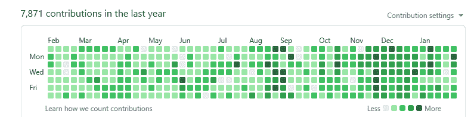

### 薛志荣

+ MiX Copilot 联合创始人

+ 《AI改变设计》、《前瞻交互》、《写给设计师的技术书》、《智能座舱HMI设计》等书籍作者。

+ 前华为人机交互实验室高级工程师、小鹏资深交互设计师、百度高级交互设计师。

+ 使用Cursor已累计1500小时

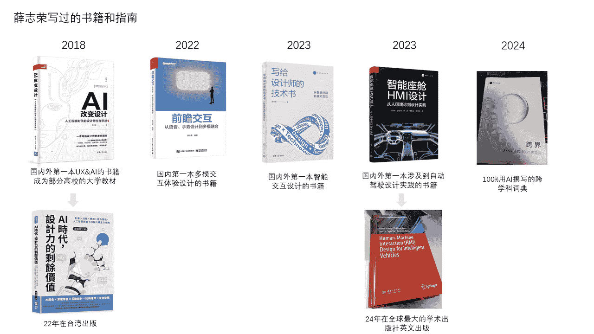

+ 最近一年，Github编程记录：

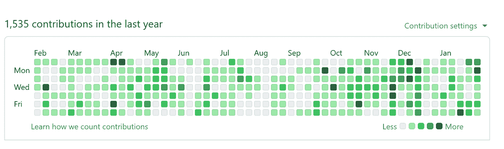

### Michael Huo

+ 硅谷连续创业者

+ 复旦，纽约大学，本硕，脑科学+经济学背景

+ Stern商学院研究员

+ 硅谷创办的在线教育平台，获得美国100多所中小学合作

+ 指导超百名国际高中生（包括中国大陆、美高、加高、瑞士高中），取得国际经济赛事、商业赛事的大奖，并且是几大国际商赛的评委（Diamond Challenge; BPA; Diamond Challenge; Conrad; DECA）

+ 专注于人机协作、在线交互、教育科技、大型社会仿真系统。

## 完整的学习体系介绍：

我们精心打造的AI编程训练营通过创新的教学方式，帮助0基础学员快速掌握AI编程技能：

在过去13期训练营中，当前指导学员共：180+

+ 课程满意度高达4.5分（满分5分）

+ 推荐度NPS达到8.7分（满分10分）

+ 98%是0代码基础学员，包括翻译、HR、艺术策展人、项目经理

+ 95%的学员在训练营期间就完成了实战项目

+ 30%的学员从北京、深圳、香港等地专程来上海参训，最远的学员从法国过来

+ 10%的学员是高校老师、博士

+ 15%的学员是大学、研究生

+ 年龄最小的学员：初二中学生

+ 年龄最大的学员：60+岁投资人

### 基础课程：扎实的入门准备

为帮助0基础学员打好基础，我们精心制作了10节基础录播课程，总计6小时的精华内容。这些录播内容都是我们在之前训练营中讲解的基础知识，以及从0开始开发的实战项目。通过这些课程，学员能在参加实训前建立起对AI编程的基本认知。

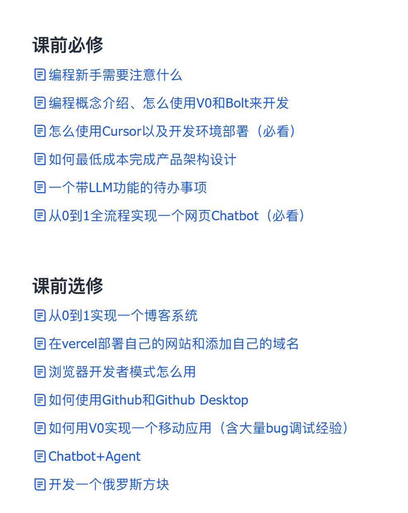

### 线上实训：沉浸式实战体验

#### 突破传统教学的局限

传统编程教学常常依赖PPT，讲师在课堂上展示一张张充满代码的幻灯片。这种方式对0基础学员来说存在诸多问题：

+ 静态的代码片段难以理解其实际运行过程

+ 完美的示例代码与真实开发场景差距较大

+ 缺乏对问题解决过程的直观展示

+ 学员仍然保持着对编程的畏惧心理

+ 枯燥的授课方式容易让学员感到困乏

#### 真实的项目驱动学习：现场即兴编程的魅力

在为期5天的线上实训中，我们采用全程即兴编程、没有预设的实战方式进行教学。我们深知，对0基础学员来说，最大的挑战不是记住代码语法，而是建立起解决实际问题的思维方式。通过现场实战，我们会展示5个完整项目的开发过程：

+ 展现真实的开发流程，从想法到成品的完整过程

+ 让学员看到专业开发者如何与AI对话

+ 现场解决各种技术问题，展示真实的问题处理方法

+ 在开发过程中穿插练习，确保学员能够实践所学

这种教学模式带来的独特优势：

+ 从被动接受到主动思考：学员不再是被动地接受知识，而是看到导师如何分析问题、构思方案，从而学会思考的方法

+ 克服对编程的恐惧：当看到导师也会遇到问题，也需要反复调试，学员会意识到这是开发过程的自然组成部分，从而建立信心

+ 掌握实用的工作方法：

  + 学会如何准确描述需求

  + 掌握与AI有效对话的技巧

  + 了解如何分析和解决问题

  + 学习项目开发的完整流程

+ 加深对知识的理解：

  + 在实际场景中见证知识的应用

  + 通过实践加深记忆

  + 理解知识点之间的联系

+ 提升学习积极性：

  + 即时看到代码运行的效果

  + 能够独立完成实际项目

  + 体验到编程的成就感

这种“边做边学”的方式，让学员不仅掌握了技术知识，更重要的是建立起了面对实际问题时的信心和能力。这正是我们的训练营能够帮助0基础学员快速起步的关键所在。

#### 高中生与成人教学的不同：

成人都是带着强烈的工作目的来的，而且很多人已经具备了基本的管理能力、项目的想法。

1. 通常高中生没有非常清晰的特别想做的项目，所以我们才会设计5个项目，来先让他们看到丰富的可能性，在这个过程中，学生也练习到了项目管理的技巧，在这个基础上，我们鼓励学生进行发散性的训练；

1. 学生在自我管理上，会有一些懈怠，遇到困难会退缩；我们设计的项目，会由易到难，让他们爬坡的过程，比成人更加丝滑；并且实操时候的指导，也会更注重他们的心流体验，以【让技能长到孩子身上】为目标来教学

1. 关于项目管理，学生常常会脱离实际空想，容易想的太难了，做不出有用的作品，所以我们会在学生开始的时候，就介入与学生沟通，让他们更好的管理好自己的精力和项目的里程碑milestone，这样小步快跑，一步一个脚印，扎扎实实的成长

#### 跨学科的专业指导

我们的导师团队同时具备开发和设计背景，这种跨学科的知识储备使我们能够：

+ 从产品设计和技术实现两个维度解答学员问题

+ 在开发过程中融入设计思维，提升作品品质

+ 帮助学员建立起完整的产品开发认知

现场即兴编程实战教学需要讲师具备全方位的专业素养：

+ 深厚的技术积累：用于从容应对开发过程中的各类技术问题

+ 敏锐的分析能力：能够快速定位问题并找到最佳解决方案

+ 灵活的教学智慧：善于将遇到的各种情况转化为生动的教学素材

+ 流畅的思路串联：在动态的开发过程中，适时点出关键知识，让学员始终跟得上节奏

#### 实战导向的体系化训练

+ 真实项目驱动学习

+ 小班制指导，确保每位学员都能得到充分关注

+ 根据学员背景动态调整实战项目

+ 全程导师团队技术指导

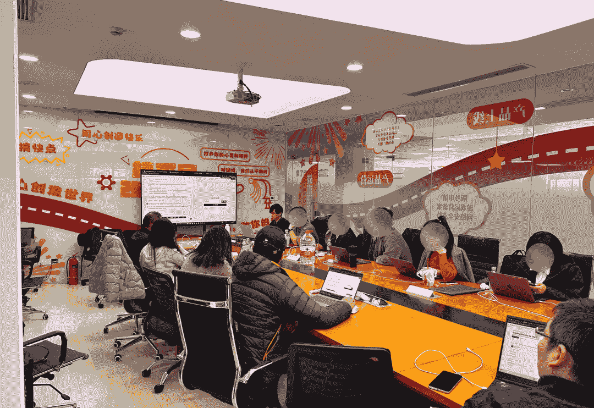

### 进阶课程：持续学习

实训后，我们还提供10+门进阶课程的录播内容，这些课程会不断更新，确保学员能够持续提升技能，跟上AI技术的发展步伐。

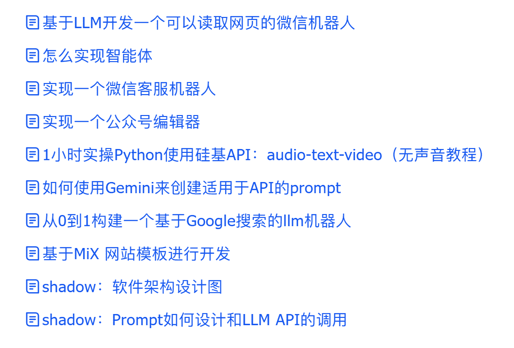

### AI编程指南：全面的学习支持

我们开发了2本AI编程实体指南（国内前两本），凝聚了我们在训练营中积累的大量实战经验以及身为代码小白需要掌握的代码基础知识。这本指南系统地梳理和提炼了我们的实战经验和教学心得，为学员提供全面的学习参考。


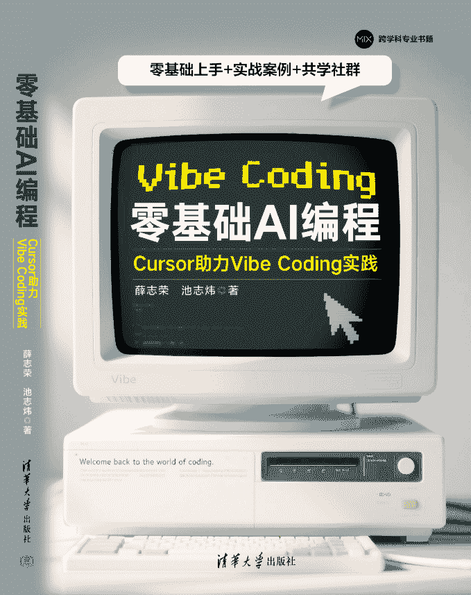

## 市场独特性

我们是目前业内唯一将线上基础铺垫课程、线上手把手实战和资料集三者完美结合的AI编程训练营，为学员提供最完整的学习体验。这种创新的培训模式确保学员不仅能掌握理论知识，更能在实战中建立起对AI编程的信心和热情。

通过这种多维度的学习方式，我们相信每位学员都能真正掌握AI编程的精髓，在AI时代的浪潮中抓住新的机遇。无论你是想转行还是提升技能，我们的训练营都将为你打开一扇通往未来的大门。

## 过往学员学习期间完成的作品展示

### AI绘本

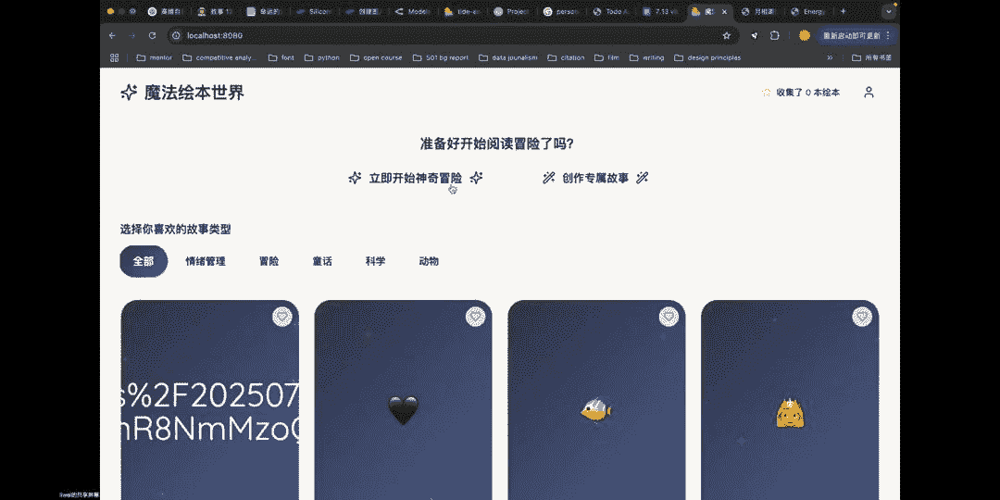

[7-1.mp4](https://internal-api-drive-stream.feishu.cn/space/api/box/stream/download/all/UfanbgJ9Bo2tBVxfUXecPdSknfe)

### 双语阅读器


[双语阅读器.mp4](https://internal-api-drive-stream.feishu.cn/space/api/box/stream/download/all/EU1pbwpGjoV3gMxsuvvc82VjnYd)

### Gcode+粒子模拟

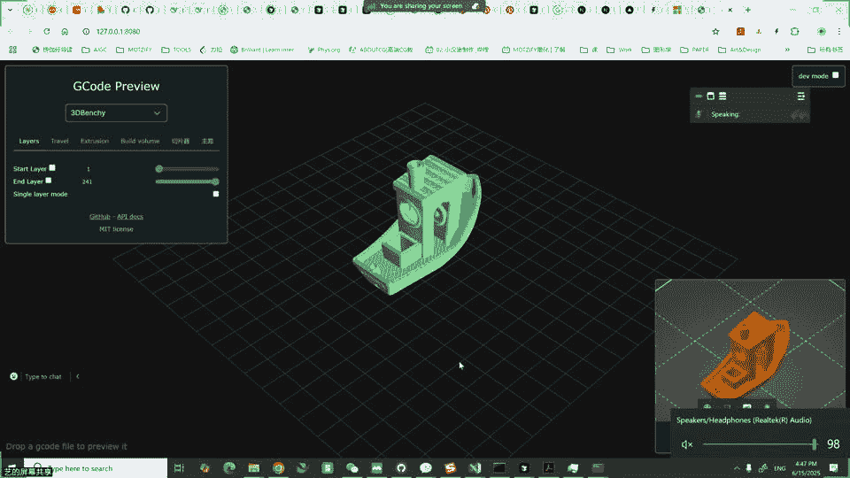

[Gcode.mp4](https://internal-api-drive-stream.feishu.cn/space/api/box/stream/download/all/DXOobfOUiosAi2xtwsFcer9mnmg)

### 文生视频

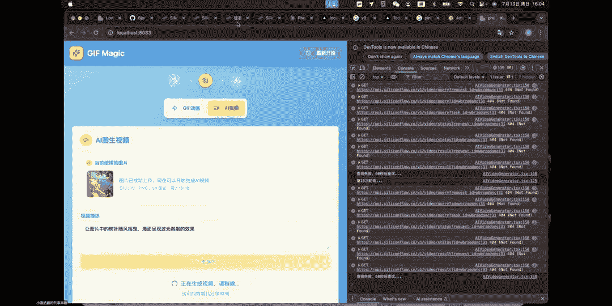

[1-1-1.mp4](https://internal-api-drive-stream.feishu.cn/space/api/box/stream/download/all/V0kWblGR7o56hfx1JswcYYcvnvb)

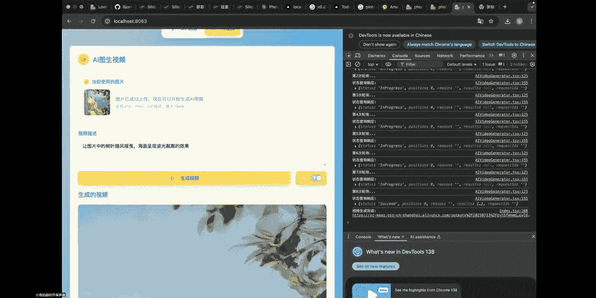

[1-2-1.mp4](https://internal-api-drive-stream.feishu.cn/space/api/box/stream/download/all/QyOEbihx1oszcTxHcofcIor3n5u)

### 智能检验检测解读+背单词

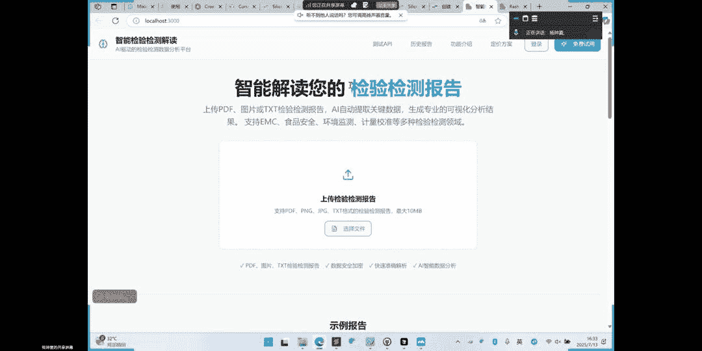

[5-1.mp4](https://internal-api-drive-stream.feishu.cn/space/api/box/stream/download/all/TnqhbuR9xoelZOxkySicmTQ6nxh)

### 早安表情包+知识工作台


[早安表情包+知识工作台.mp4](https://internal-api-drive-stream.feishu.cn/space/api/box/stream/download/all/LzVWbfdNeoKGWDxOaEAcvB5wnrh)

## 星盘运势

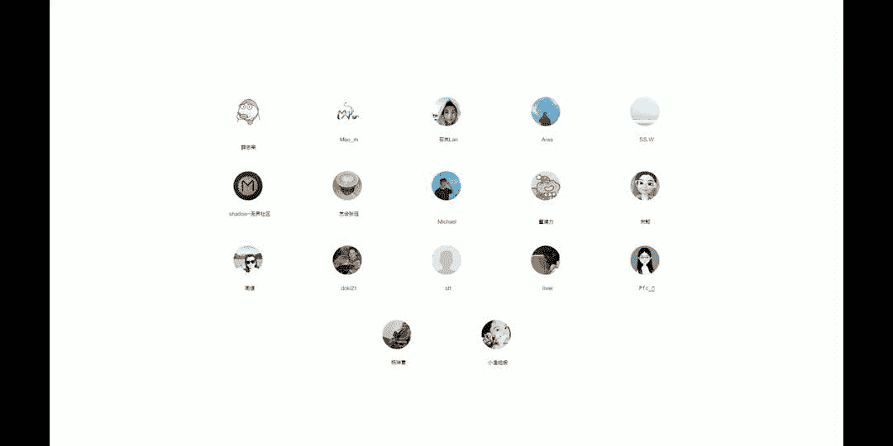

[2-1.mp4](https://internal-api-drive-stream.feishu.cn/space/api/box/stream/download/all/EA3bbywmVouDTJxC7ojcmVACn2d)

## 缘分智配+ AI笔记本+智能社交助手

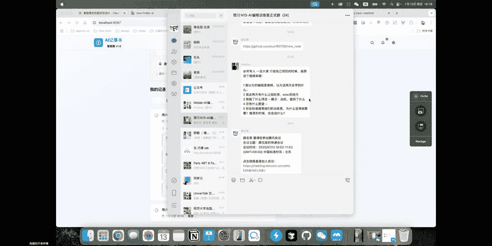

[3-1.mp4](https://internal-api-drive-stream.feishu.cn/space/api/box/stream/download/all/DLycbRSgsorOplxDJ2JciKnLnaf)

## AI服装搭配师

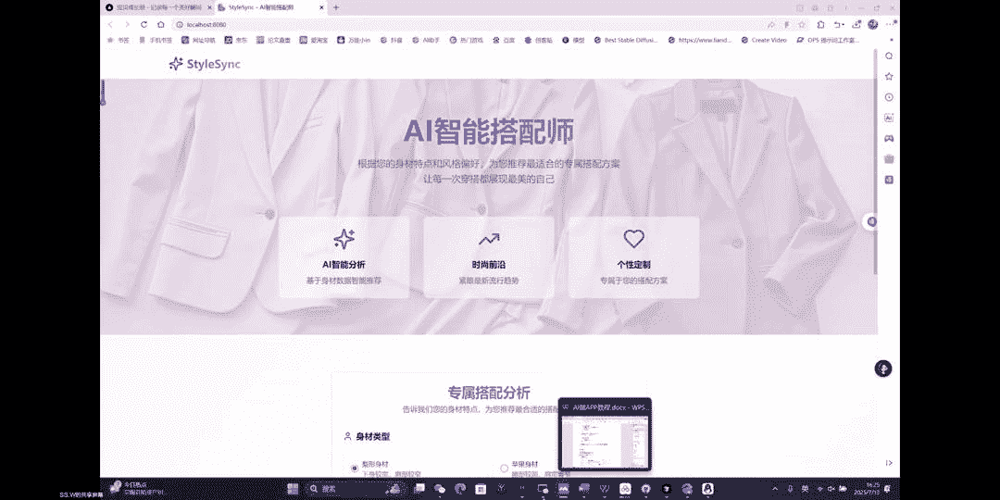

[4-1.mp4](https://internal-api-drive-stream.feishu.cn/space/api/box/stream/download/all/KhbobZjqhobN42xW51Scfn29nTC)

## 博物馆日记

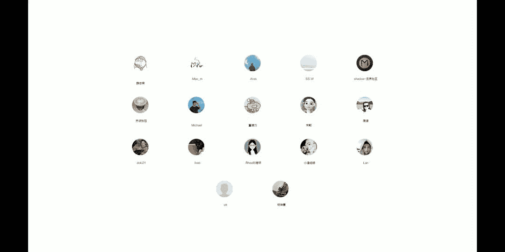

[10-1.mp4](https://internal-api-drive-stream.feishu.cn/space/api/box/stream/download/all/MuDCbnO54oyVlGx5tWqcNOLxnnf)

## 宠物识别专家


[7月15日.mp4](https://internal-api-drive-stream.feishu.cn/space/api/box/stream/download/all/Pkdyb1oshouKPFxOJcuc8tI4nfd)

## 智能打标签系统--自媒体视频生成，设计工作的自动化

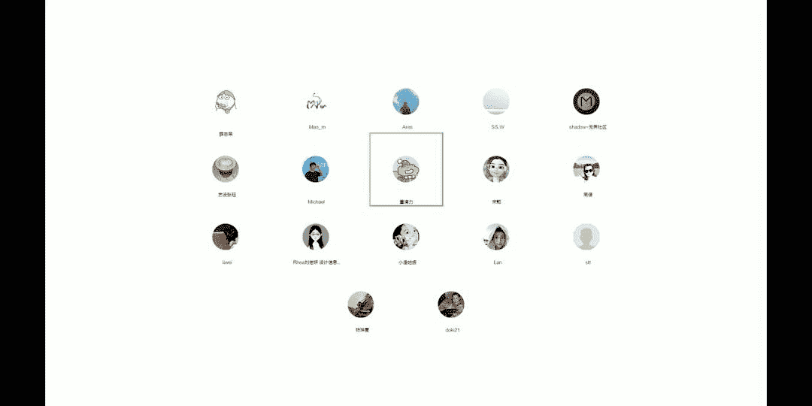

[12-1.mp4](https://internal-api-drive-stream.feishu.cn/space/api/box/stream/download/all/WUBQbuVO4oEfEPxdpkEcBwDmnkc)

## 文字转音乐

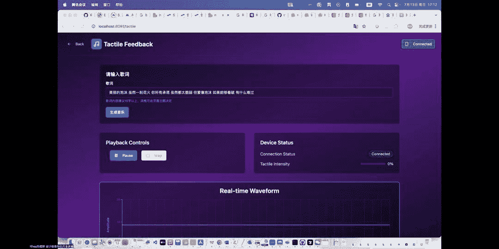

[13-1.mp4](https://internal-api-drive-stream.feishu.cn/space/api/box/stream/download/all/VQUubay5Nos1NHxgLiEc0UGvnhh)

## 会议纪要生成器


[15-1.mp4](https://internal-api-drive-stream.feishu.cn/space/api/box/stream/download/all/H0ATbpJK4ovmgrx1WHEcUOyWnDb)

## 怼怼鹅~🛰️小程序/小游戏

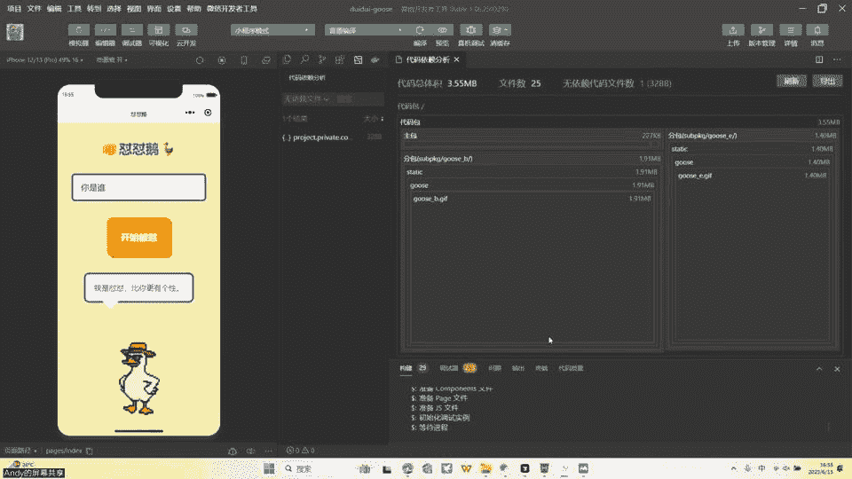

[怼怼鹅.mp4](https://internal-api-drive-stream.feishu.cn/space/api/box/stream/download/all/JHBkb8VwuobXGWxsBYkcMqwVn2N)

## Daily Task Pro~🛰️小程序

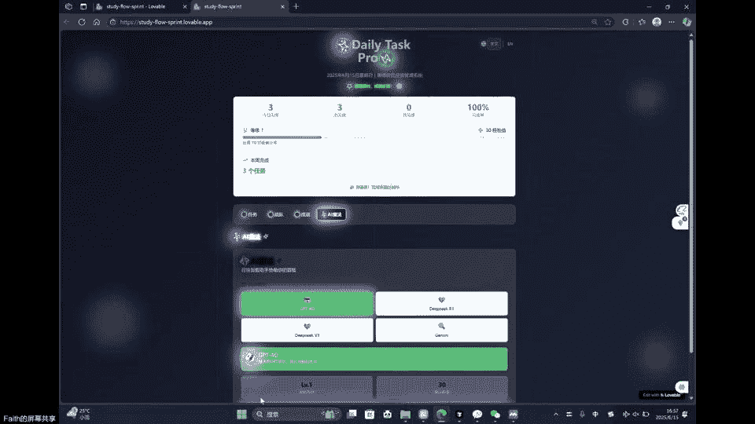

[Daily Task Pro.mp4](https://internal-api-drive-stream.feishu.cn/space/api/box/stream/download/all/HApPbe2XYowkvvxixfac0qW4nPb)

# 为什么要学习AI编程？~ 三位导师/引路人更深层次、更广度的洞察

## 时代的变化，未来工作的需求

在AI迅速发展的今天，2024年到2025年，在人类怎样指挥机器帮我们从事生产工作这个方面，发生了重大的转变，我们也叫“奇点”时刻。

2025年开始，一个完全不懂编程的人，可以指挥AI来为他开发软件（webapp, 工作软件，以及APP，游戏），就像一个人，掌握了一个软件工程师军团。

【图】一个人，指挥一只程序员军团

下面是我们看到的，以及我们自己过去一年180位各行各业的成人学员（其中10%的是高校的教授和博士）身上看到的转变：

1. 去年要花50万开发的软件，一个从硅谷回来的连续创业者说，他只花了2天时间，就做出来了，而且能跑起来给用户做测试、拿反馈了；更可怕的是，这个创业者是不懂编程的。

1. 上海的互联网公司的资深产品经理，同样是编程零基础，以往和开发团队沟通的时候，各种受委屈：为什么呢？因为她要的功能，对于开发团队来说，都是很繁重的工作量，所以会被各种推诿，甚至根本不会去考虑她的感受以及为什么这样设计的原因；委屈就是这样来的：因为不被理解。 她现在有了一个“AI的工程师团队”，那么一切都发生了变化：

1. 她指挥AI来把她脑海里面想要的功能，很快的就开发出来，并且有任何不满意的地方，她就提出来，重新调整，AI有个好处：从来不抱怨；在这个过程中，她还发现了有趣的地方，她做产品的速度快了很多，因为设计出来，马上就能看到效果（事实上，她自己也在这个过程中，发现有些想法，确实是欠考虑的，那么还没有给开发团队之前，她就马上先调整了）；

1. 有了这样初期的产品，她直接就能找用户测试了：意味着，她不需要等待开发团队的出产品（至少1周以上），马上就能拿到用户真实的反馈

1. 测试好了以后，再找开发团队沟通，让对方把软件的方方面面再考虑的周全一点

1. 这时候，开发团队与她的关系，更好了，因为沟通成本急剧下降

1. 上海的某科技报社的记者，平时采访结束后，整理采访稿，总是花大量的时间；虽然现在各种AI可以做笔记整理（无论是大模型、豆包这样的agent工作流），但是依然不能满足他的专业的要求，因为特殊职业、有他自己的独特的风格和要求，他总梦想着自己开发一个软件，给自己使用，那沟通、金钱成本，对他来说都是奢望。但有了AI编程，他也就花了1天，已经做了一个简单的雏形，开始能辅助他自己工作了

1. 高校的教授也来我们线下学习：因为学生的动手能力太差了，他们认为不是孩子们不想动手，而是学习和动手成本太高；如果AI能帮着干活，学生的积极性会高很多，而且既然已经工作了的人都在学习这个技能，那为了让学生更好的找工作，他们作为高校老师，也需要掌握，尽可能的传授给孩子们，不让他们一出校门就落伍

1. 另一位高校的教授，教授数学建模，平时有很多把数学思想做成动态仿真系统的想法，但是一直苦于没法很好的表述出来，让工程师实现，参加训练营以后，他发现跟AI沟通，是如此的丝滑和“懂你”，很快就有了一版小的软件出来，开心坏了，因为可以上课使用了；

。。。

这些案例让我们深刻的体会到，未来的工作方式，从2025年开始，会急剧的发生变化，尤其是需要脑力工作、智能化越来越重要的工作场合。

所以我们认为，学生不要等到去了大学再掌握这个能力，在初高中，就应该开始掌握了。他们只有懂得怎样跟AI沟通、怎样管理AI，那么未来才能有更大的生存发展的空间。所以我们打磨了高中生的线上训练营，针对这个年龄的学生，让他们多练手、多实操，跑步进入AI的未来社会。

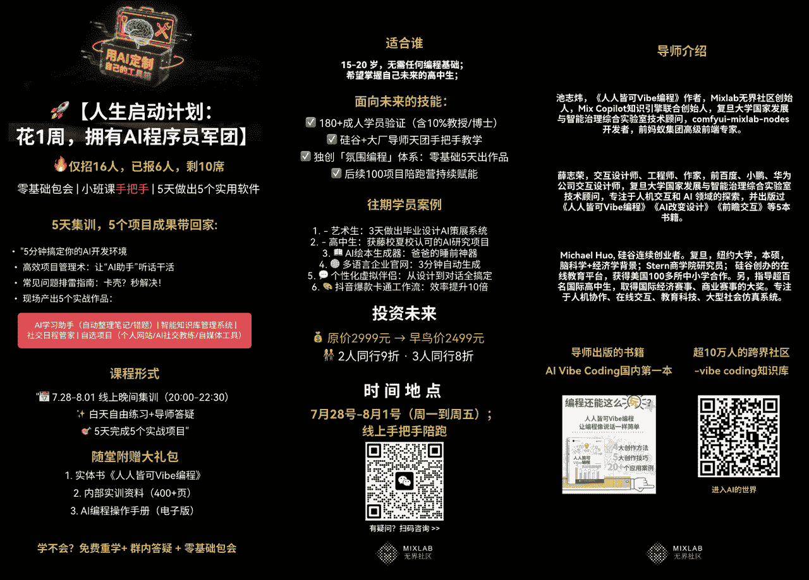
