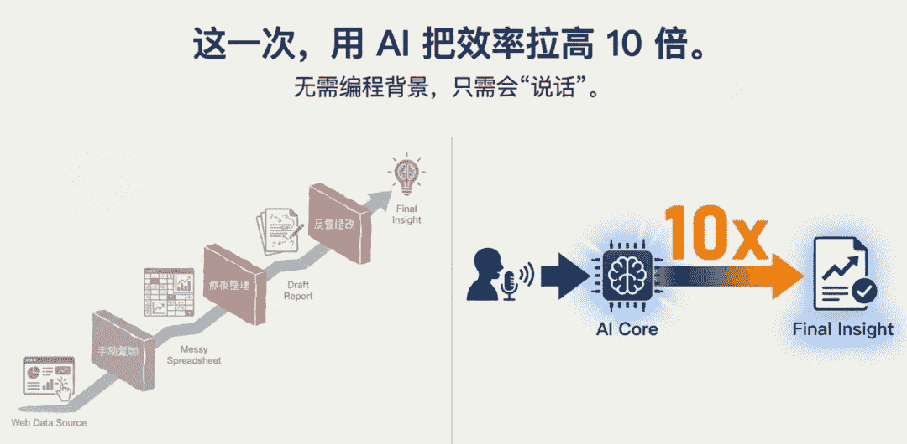
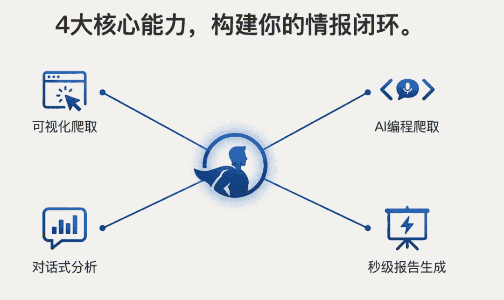

# 情报分析的基础：数据爬取和分析

> 来源：[https://now.feishu.cn/docx/IziDdzf7zo437Axyq8dc4zC9nqh](https://now.feishu.cn/docx/IziDdzf7zo437Axyq8dc4zC9nqh)

Mixlab AI训练营 · 跨学科实战系列

## 拿来即用·数据获取与分析报告

还在手动复制网页、熬夜整理Excel、为写报告焦头烂额？

这一次，用AI把调研效率拉高10倍——无需编程背景，只需会“说话”。

**￥249**

含3小时录播视频 + AI编程社群

---

### 谁适合学？

+   **市场/投研分析师**：告别复制粘贴，指令AI自动抓取全网数据，秒级结构化

+   **产品经理/咨询师**：投喂原始信息，AI半分钟生成PPT框架+图表

+   **学者/博士生**：跨越代码门槛，自动下载、翻译、总结海量文献

+   **一人公司/创业者**：不雇人，靠“人+AI”搞定全行业情报闭环

---

### 你将掌握

✅ **可视化爬取**：用浏览器插件轻松抓取小红书、CES、Amazon、淘宝商品数据

✅ **AI编程爬取**：让Cursor自动处理ACM论文下载、翻译与归档

✅ **对话式分析**：用Cursor + NotebookLM像聊天一样清洗、解读数据

✅ **秒级报告生成**：从Prompt写作风格设计到信息图、PPT一键排版

## **录播视频（3小时以上）：**

1.基础理论：5分钟上手掌握核心概念

2.可视化爬取信息：不用编程也能搞定数据

+   爬CES列表和详情页数据

+   爬amazon/淘宝列表+详情页数据

3.AI编程爬取信息：如何让 AI 自动完成

+   acm 论文爬取、下载和翻译

4 数据分析：像聊天一样分析数据

+   怎么使用Cursor做数据分析

+   预处理文档（LLM重写、翻译等）

+   使用Notebooklm做分析

5 报告制作：秒级出片

+   写作风格的Prompt设计

+   信息图和PPT

涵盖工具：浏览器插件、Cursor、Notebooklm

---

Mixlab始终相信：AI不是程序员的专属，而是跨领域实践者的杠杆。无论你来自金融、设计、学术还是创业一线，只要会提问，就能用AI完成过去一个团队的工作。

249元，解锁你的AI调研超能力。一起“拿来即用”。

CodeNow社区**会员专享价￥199**

咨询可加

